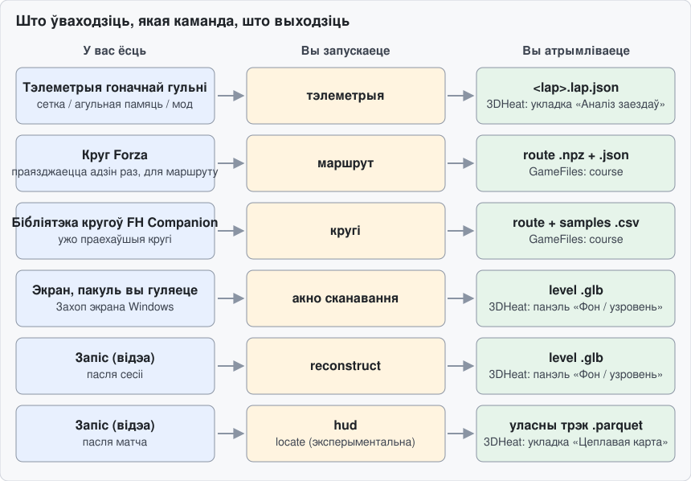

# 3DHeat GameCapture {#dheat-gamecapture}

**Што гэта?** Інструмент, які запісвае тое, што гоначная гульня паведамляе пра вашу язду, па аднаму файлу
на круг. Ён таксама можа ўзнавіць прыблізную 3D-мадэль узроўню па відэа, як вы гуляеце.

**Навошта гэта мне?** Каб бачыць свае кругі ў [праглядальніку 3DHeat](https://holdi601.github.io/3DHeat/):
дзе вы тармазілі, дзе былі павольныя, чым адрозніваюцца два кругі. І каб пад вашай
цеплавой картай быў узровень, калі ніхто не мае яго 3D-мадэлі.

**Прыклад:** уключыце Data Out у Forza, выканайце адну каманду, праедзьце два кругі. Два файлы кругоў з'явяцца ў
`laps\`. Перацягніце іх на ўкладку «Аналіз заездаў» праглядальніка.


Упершыню ў камандным радку? Спачатку прачытайце [Перад пачаткам](before-you-start.md).

## Тры задачы {#the-three-jobs}

1. **Тэлеметрыя кругоў.** Ён запісвае кожны канал, які публікуе гоначная гульня - Data Out у Forza,
   агульную памяць гульняў Assetto Corsa, сеткавыя струмені ралі-гульняў, мод BeamNG, плагін
   Trackmania - і піша адзін файл `heat3d-lap` на круг або этап, для ўкладкі
   «Аналіз заездаў» праглядальніка. iRacing не патрабуе запісвальніка: праглядальнік чытае ўласныя файлы `.ibt`.
2. **Узроўні з гульні.** Ён ператварае тое, што паказваў экран, пакуль вы хадзілі або ехалі па
   ўзроўні, у 3D-мадэль `.glb`, якую праглядальнік кладзе пад цеплавую карту.
3. **Ваш уласны матч, пасля яго.** `hud` чытае HUD вашага ўласнага запісу - вашы дзеянні, смерці,
   трэк на мінікарце і стужку забойстваў. `locate` (эксперыментальна: пакуль што змяшчае мала сапраўдных кадраў)
   вызначае, дзе быў зроблены кожны кадр, на 3D-мадэлі ўзроўню.

Усе тры трымаюцца аднаго правіла: **у гульню нічога не ўкараняецца і нічога не падчэплівецца**. Кадры
ідуць з публічнага API захопу экрана, тэлеметрыя — з інтэрфейсаў, якія гульні публікуюць для яе. Гл.
[Правілы](../rules.md).



Код — Python (пакет `heat3d_capture`), ліцэнзія MIT. Мадэлі глыбіні і позы, якія ён можа
запускаць, маюць свае ліцэнзіі - гл. [Мадэлі і ліцэнзіі](../models-and-licences.md).

## Хуткі старт {#quick-start}

### Запіс кругоў {#record-laps}

Вам патрэбен Python 3.10 або навейшы ([Перад пачаткам](before-you-start.md)). У PowerShell:

```powershell
git clone https://github.com/Holdi601/3DHeat-GameCapture
cd 3DHeat-GameCapture
python -m venv .venv
.venv\Scripts\python -m pip install -r requirements.txt

# Forza: Settings -> HUD and Gameplay -> Data Out = ON, IP 127.0.0.1, port 5300
.venv\Scripts\python -m heat3d_capture telemetry -o laps
```

**Вы ўбачыце** `listening on port 5300. Laps go to laps. Ctrl+C to stop.`, потым радок на кожны круг, калі вы перасякаеце лінію, як
на малюнку вышэй. Націсніце Ctrl+C, каб спыніць. Перацягніце файлы з `laps\` на ўкладку «Аналіз заездаў» праглядальніка.
Кожная іншая гульня — гэта адзін `--game`:

```powershell
.venv\Scripts\python -m heat3d_capture telemetry --game acc -o laps
.venv\Scripts\python -m heat3d_capture telemetry --game dirtrally2 -o laps
```

Гл. [Запісвальнікі тэлеметрыі](../telemetry.md) пра кожную гульню і опцыю.

### Сканаванне ўзроўню {#scan-a-level}

Двойчы пстрыкніце **`scan.bat`** у папцы інструмента. Ён знаходзіць Python (і прапануе ўсталяваць яго
праз winget, калі яго няма), стварае прыватную `.venv` і адкрывае акно сканавання. Акно кажа,
чаго не хапае, для чаго кожны пакет і колькі трэба спампаваць, і нічога не ўсталёўвае
без вашага «так». Гл. [Асяроддзе выканання і залежнасці](../runtime.md) і
[Акно сканавання](../reconstruction-scan-ui.md).

Уручную: `.venv\Scripts\python -m heat3d_capture.ui`.

Каб узнавіць запіс аўтаномна, з траекторыяй камеры, вырашанай адразу ўся (патрэбны PyTorch,
пакет `vggt` і GPU - гл. [Аўтаномнае ўзнаўленне](../reconstruction-offline.md)):

```powershell
.venv\Scripts\python -m heat3d_capture reconstruct lap.mp4 -o lap.glb
```

## Карта дакументацыі {#map-of-the-documentation}

| Старонка | Пра што яна |
|---|---|
| [Перад пачаткам](before-you-start.md) | Python, тэрмінал, першая каманда, частыя памылкі |
| [Правілы](../rules.md) | Без укаранення, толькі публічныя інтэрфейсы, і чаго гэта каштуе |
| [Запісвальнікі тэлеметрыі](../telemetry.md) | Каманда `telemetry` і агляд кожнай гульні |
| [Forza](../telemetry-forza.md) | Data Out, выяўленне структуры, рэтранслятар FH Companion і яго `.tele.gz` |
| [Гульні Assetto Corsa](../telemetry-assetto-corsa.md) | AC, ACC, AC EVO, AC Rally з агульнай памяці |
| [Ралі-гульні](../telemetry-rally.md) | EA SPORTS WRC, DiRT Rally 2.0 / 1 / DiRT 4, Richard Burns Rally |
| [BeamNG.drive](../telemetry-beamng.md) | Мод пратаколу `heat3d` |
| [Trackmania](../telemetry-trackmania.md) | Плагін Openplanet `Heat3dRecorder` |
| [iRacing](../telemetry-iracing.md) | Чытанне файлаў `.ibt` у праглядальніку |
| [Падзел на кругі і этапы](../lap-splitting.md) | `LapSplitter`, `CounterSplitter`, `LineSplitter`, `StageSplitter` |
| [Слізгаценне, дрэйф і вытворныя каналы](../slip-and-drift.md) | Як маштабуецца слізгаценне і што вылічвае праглядальнік |
| [Файл heat3d-lap](../lap-format.md) | Фармат файла круга, каналы, адзінкі, `meta` |
| [Гульні](../games.md) | Па гульнях: як запісваць, што адпраўляецца, якія трасы можна экспартаваць |
| [Каманды](../commands.md) | `route`, `telemetry`, `laps`, `reconstruct`, `hud`, `locate`, крок за крокам |
| [Даведнік каманд](../cli-reference.md) | кожная опцыя, створаная з `--help` |
| [Чытанне HUD з запісу](../hud-video.md) | `hud`: уласныя дзеянні, смерці, трэк на мінікарце і стужка забойстваў з запісу |
| [Вызначэнне кадраў на ўзроўні](../locate.md) | `locate`: дзе быў зроблены кожны кадр, па геаметрыі ўзроўню |
| [Узнаўленне ўзроўню](../reconstruction.md) | Канвеер ад кадраў да `.glb` |
| [Акно сканавання](../reconstruction-scan-ui.md) | Кожны элемент кіравання, гарачая клавіша і элемент накладкі |
| [Захоп, маскі і якасць кадраў](../reconstruction-capture.md) | Windows Graphics Capture, ключавыя кадры, маскі HUD, парады па якасці |
| [Глыбіня](../reconstruction-depth.md) | Depth Anything V2, ONNX Runtime, пабудова мадэлі |
| [Поза камеры і маштаб](../reconstruction-pose.md) | Адометрыя, перадалакалізацыя, позы з тэлеметрыі, маштаб зямлі, карэкцыя пучка |
| [Зліццё, пакрыццё і колер](../reconstruction-fusion-and-texture.md) | Аб'ём запаўнення, сетка пакрыцця, слабыя месцы, колер вяршын |
| [Вывад .glb](../glb-output.md) | Файл, які загружае праглядальнік |
| [Аўтаномнае ўзнаўленне](../reconstruction-offline.md) | `reconstruct`, вокны VGGT і зшыванне |
| [Мадэлі і ліцэнзіі](../models-and-licences.md) | Памеры Depth Anything V2, VGGT, пакеты |
| [Асяроддзе выканання і залежнасці](../runtime.md) | Папярэдняя праверка, бэкенды, ўзроўні прадукцыйнасці |
| [Абмежаванні і праверка](../limits.md) | Што не зроблена і што не правярана |
| [Абнаўленні](../updates.md) | Праверка выпуску і `python -m heat3d_update` |
| [Распрацоўка](../development.md) | Тэсты, віртуальнае асяроддзе, структура рэпазітарыя |
| [Падтрымка гэтай дакументацыі](../maintaining.md) | Спіс для выпуску кода і дакументацыі |

## Частка 3DHeat {#part-of-3dheat}

Файлы, якія ён піша, загружае **праглядальнік 3DHeat** -
[код](https://github.com/Holdi601/3DHeat), [дакументацыя](https://holdi601.github.io/3DHeat/).
Файлы кругоў ідуць на ўкладку «Аналіз заездаў», узроўні `.glb` — на панэль «Фон / узровень», табліцы `hud` і `locate` — на
ўкладку «Цеплавая карта»; як праглядальнік чытае табліцы і файлы матчаў, апісана ў
[Адзін файл на матч (.3dheat)](https://holdi601.github.io/3DHeat/container.html) і
[Як загрузіць даныя](https://holdi601.github.io/3DHeat/getting-data-in.html).

| Інструмент | Што ён робіць | Дакументацыя |
|---|---|---|
| [Праглядальнік 3DHeat](https://github.com/Holdi601/3DHeat) | паказвае цеплавыя карты, гонкі і матчы ў 3D, у браўзеры | [дакументацыя](https://holdi601.github.io/3DHeat/) |
| [GameFiles](https://github.com/Holdi601/3DHeat-GameFiles) | трасы і ўзроўні з файлаў, што пастаўляюць гульні, як 3D-мадэлі | [дакументацыя](https://holdi601.github.io/3DHeat-GameFiles/) |
| [GameCapture](https://github.com/Holdi601/3DHeat-GameCapture) | тэлеметрыя кругоў з гоначных гульняў; узроўні, узноўленыя з відэа гульні | [дакументацыя](https://holdi601.github.io/3DHeat-GameCapture/) |
| [Unreal Exporter](https://github.com/Holdi601/3DHeat-UnrealExporter) | убудова Unreal Editor, што экспартуе ўзровень як 3D-мадэль | [дакументацыя](https://holdi601.github.io/3DHeat-UnrealExporter/) |
| [CS2](https://github.com/Holdi601/3DHeat-CS2) | дэма Counter-Strike 2 у файлы матчаў; карты ў 3D-мадэлі | [дакументацыя](https://holdi601.github.io/3DHeat-CS2/) |
| [Watcher](https://github.com/Holdi601/3DHeat-Watcher) | запісвае вашу гульню ў фоне з таго, што гульні публікуюць | [дакументацыя](https://holdi601.github.io/3DHeat-Watcher/) |
| [Ext-WarThunder](https://github.com/Holdi601/3DHeat-Ext-WarThunder) | рэплеі War Thunder у файлы матчаў | [дакументацыя](https://holdi601.github.io/3DHeat-Ext-WarThunder/) |
| [Ext-WoT](https://github.com/Holdi601/3DHeat-Ext-WoT) | рэплеі World of Tanks у файлы матчаў | [дакументацыя](https://holdi601.github.io/3DHeat-Ext-WoT/) |
| [Ext-WoWs](https://github.com/Holdi601/3DHeat-Ext-WoWs) | рэплеі World of Warships у файлы матчаў | [дакументацыя](https://holdi601.github.io/3DHeat-Ext-WoWs/) |
| [Ext-Squad](https://github.com/Holdi601/3DHeat-Ext-Squad) | дэма сервераў Squad у файлы матчаў | [дакументацыя](https://holdi601.github.io/3DHeat-Ext-Squad/) |
| [Ext-DCS](https://github.com/Holdi601/3DHeat-Ext-DCS) | карты DCS World у 3D-мадэлі | [дакументацыя](https://holdi601.github.io/3DHeat-Ext-DCS/) |
| [Ext-IL2](https://github.com/Holdi601/3DHeat-Ext-IL2) | карты IL-2 Sturmovik у 3D-мадэлі | [дакументацыя](https://holdi601.github.io/3DHeat-Ext-IL2/) |

Распрацоўшчык з адкрытым праектам гульні павінен выкарыстоўваць экспартэр Unreal, які чытае сапраўдную
геаметрыю і дакладны. Дзе архівы гульні можна прачытаць, GameFiles здабывае дакладную
трасу. Узнаўленне з гульні — для выпадку, калі даступны толькі экран.
