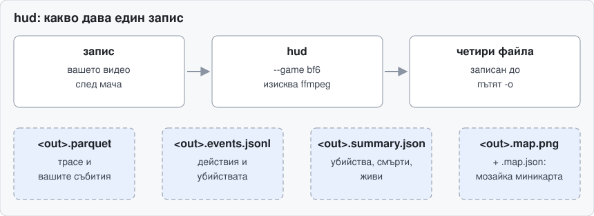

# Четене на HUD от запис {#reading-the-hud-from-a-recording}

`hud` чете екранния HUD на играта от **собствения запис** на играча, след мача: **собствените**
действия на играча от изскачащия прозорец с точки, които играта показва под прицела (убийства,
асистенции, възстановявания, снабдявания, превземания...), смъртите му от екраните за падане и
разгръщане, **собствената** му следа от миникартата и лентата с убийствата до тях като събития с време - записано
като таблица на 3DHeat, с мозайката на миникартата като картина на карта, която да се сложи под нея.

Накратко: гледа видеото ви от мача и записва вашите убийства, смърти и къде сте вървели.

```bash
.venv\Scripts\python -m heat3d_capture hud "<recording>.mp4" --game bf6 --player <name> -o out/match
```

Battlefield 6 е първият профил на игра.



## Какво докосва и какво не {#what-it-does-and-does-not-touch}

- Чете **видео файл**: клип от ShadowPlay / Instant Replay, запис от OBS, всичко, което декодира
  ffmpeg. Никога не докосва играта, паметта ѝ, файловете ѝ или мрежата ѝ, и работи след края на
  мача. Вж. [Правилата](rules.md).
- Извежда **само позицията на играча**, от собствената му миникарта. Маркерите на другите играчи
  върху миникартата се маскират и никога не се четат. Лентата с убийствата се пази изцяло, но само както го
  показва екранът (кой, кого, с какво, кога); на никого, освен играча, не се прикачва позиция.
- OCR работи локално (RapidOCR с моделите на PaddleOCR през ONNX Runtime). Никой кадър или изрез не
  напуска машината.
- Записът показва имената на други играчи, а мозайката е картина на нивото. Изходите са за лична
  употреба на играча; пазете ги локално.

## Изисквания {#requirements}

- **ffmpeg и ffprobe** в `PATH`. Карта NVIDIA се ползва за декодиране, когато има такава
  (`-hwaccel cuda`); иначе декодира процесорът, няколко пъти по-бавно.
- Пакетите от `requirements.txt`, и OCR без собствените му зависимости (иска процесорния
  `onnxruntime`, който се сблъсква с DirectML версията, ползвана от проекта):

```bash
.venv\Scripts\python -m pip install -r requirements.txt
.venv\Scripts\python -m pip install --no-deps rapidocr_onnxruntime==1.2.3
```

`rapidocr_onnxruntime` е четецът на текст (OCR), който чете имената и думите от екрана.
`--no-deps` не му позволява да смени DirectML `onnxruntime` на проекта.

За да инсталирате ffmpeg на Windows: `winget install Gyan.FFmpeg`, после отворете нов терминал и
проверете с `ffmpeg -version`. Нови в командния ред? Прочетете [Преди да започнете](before-you-start.md).

- Запис **16:9** с каквато и да е разделителна способност (1080p, 1440p, 4K). Другите съотношения
  се отхвърлят, защото кутиите на профила биха попаднали в грешни части на екрана.
- **Стандартното разположение на HUD** на играта. Преместен или мащабиран елемент на HUD се чете на
  грешното място.

## Опции {#options}

| Опция | По подразбиране | Значение |
|---|---|---|
| `video` | | Записът. |
| `-o`, `--out` | името на видеото, в текущата папка | Път на изхода **без** наставка; файловете са `<out>.parquet`, `.events.jsonl`, `.summary.json`, `.map.png`, `.map.json`. |
| `--game` | `bf6` | Чий HUD да се чете. `bf6` (Battlefield 6) е единственият профил засега. |
| `--player` | няма | Името на играча, както го показва лентата с убийствата. Сравнява се свободно (OCR бърка `l`/`I`/`1`, `O`/`0`, `rn`/`m`). Без него името се налучква (по-долу). |
| `--fps` | 5 | Проби на миникартата в секунда. Лентата с убийствата се проверява на половината от тази честота, изскачащият прозорец с точки и екраните за смърт - пак на половината (на една четвърт, когато няма изскачащ прозорец), компасът - на всеки 3 s, списъкът на отряда - на всеки 15 s. |
| `--start` | 0 | Секунди от началото на видеото, от които да започне. |
| `--seconds` | всичко | Колко от видеото да се прочете. |
| `--metres-per-pixel` | няма | Мащабът на миникартата, ако е известен: метри на пиксел от миникартата при обичайното приближение (миникартата е 296 пиксела широка на екран 1080p). Без него позициите са в тези пиксели; вж. [Мерни единици](#north-and-units). |
| `--cpu` | изключено | Декодиране на процесора, дори когато има карта NVIDIA. |

Напредъкът се извежда на всеки пет секунди; накрая - играчът, убийствата, смъртите, животите и
записаните файлове.

## Изходи {#outputs}

### `<out>.parquet` - следата и събитията на играча {#parquet---the-players-track-and-events}

По един ред за всяка проба, в която играчът е бил в игра и миникартата е могла да се намести, плюс
по един за всяко събитие на играча. Футърът носи инструкциите на визуализатора за четене (ключ
`heat3d`, `kind: heat3d-hud`), така че визуализаторът картографира всяка колона, без да пита.

| Колона | Значение |
|---|---|
| `time` | Секунди от началото на видеото. |
| `event` | `position`; `start` (видеото започна по средата на живот), `spawn` (отново в игра след смърт или дълго прекъсване), `death`, `downed` и `revived` (от екраните за падане, по-долу), `end` (животът е приключил без обяснение); собствените действия на играча от изскачащия прозорец с точки (`kill`, `assist`, `reviving`, `resupply`, `capture`... - [таблицата на събитията](#event-table)); и редовете на лентата с убийствата за играча като `kill_feed`, `death_feed`, `teamkill_feed`, `suicide_feed`, `squadwipe_feed`. |
| `source` | Откъде идва събитието на реда: `points` (изскачащия прозорец), `screen` (екраните за падане и разгръщане), `feed` (лентата с убийствата); празно при редовете на позиция. |
| `text` | При редовете `points`: етикетът, както е изписан (`KILL`, `SQUAD DAMAGE ASSIST`...), или заглавието (`DOUBLE KILL`, името на лента), или при непознат етикет - каквото е прочетено. |
| `points` | При редовете `points`: с колко е нараснала сумата на изскачащия прозорец в този момент. Когато няколко действия идват в една и съща проба (убийство и машината, в която е било), е тяхната сума, дадена при всяко, а `shared` казва с колко е споделена. Празно, когато сумата не е прочетена два пъти от двете страни на момента. |
| `subject`, `subject_side` | При редовете `points`: името, което е показал изскачащият прозорец с действието - жертвата при убийство, съотборникът, който е възстановен или снабден - и цветът му (`enemy`, `friendly`, `squad`). |
| `confirmed` | `feed`, когато лентата с убийствата е имала ред за същото убийство или смърт (в рамките на 3 s, същата жертва). |
| `x`, `y`, `z` | Позиция върху мозайката: `x` на изток, `y` на север, `z` 0 (футърът казва, че `z` е нагоре). Северът е истинският север, когато компасът го е позволил (вж. `north_up` в обобщението). |
| `player` | Винаги `me`. Само редовете на собствения играч имат позиции. |
| `team` | `own`. |
| `session` | `<video name>#NN`, по един за живот. Маршрутите на линейната топлина никога не минават през две сесии. |
| `heading` | Градуси по часовниковата стрелка от севера (от горната страна на мозайката, когато северът е неизвестен): накъде е гледал изгледът. |
| `dir_x`, `dir_y`, `dir_z` | Същото като вектор на посока, за посоката на погледа във визуализатора. |
| `zoom` | Колко е била отдалечена миникартата спрямо обичайното си приближение (над 1 в машина). |
| `killer`, `victim`, `weapon`, `headshot`, `marker` | При редове за убийство и смърт, които имат ред от лентата с убийствата: редът от лентата с убийствата (по-долу). Убийство от изскачащия прозорец без ред от лентата с убийствата има името от прозореца като `victim`; убийство от прозореца, показано като HEADSHOT, има `headshot` true. |

Всеки ред на събитие взема позицията на играча в момента на събитието (при смърт или падане - последната
позиция преди него; при възстановяване - първата след него). Редовете съвпадат директно с
[линейната топлина](https://holdi601.github.io/3DHeat/line-heat.html) на визуализатора: нейното
предложение избира `event`, започва от `start`, `spawn` и `revived`, завършва на `death`, `downed` и
`end`, а редовете `position` лежат по маршрута. Другите събития са наречени така, че предложението да
не вземе нито едно за начало или край: даването на възстановяване е `reviving` (не `revive`),
задържането на точка - `defense`, съотборник, който се появява при играча - `teammate_arrived`, редовете
на лентата с убийствата - `kill_feed` и т.н.; `kill` не е край.

Клип с два кръга на две карти дава две мозайки, които не могат да се свържат. Най-голямата е
`<out>.parquet`; всяка друга с поне 30 s следа се записва до нея като `<out>.map2.parquet`,
`<out>.map2.map.png` и т.н.

### `<out>.events.jsonl` - събитията на играча и лентата с убийствата {#eventsjsonl---the-players-events-and-the-kill-feed}

Един JSON обект на ред, по ред на времето, всеки със `source`:

- `points`: по един за всяко действие на играча: `time`, `event`, `text`, `points`, `shared`,
  `subject`, `subject_side` (както в таблицата), `popup` (от кой изскачащ прозорец е, номериран през
  цялото изпълнение), `seen` (колко четения са го показали), `confirmed`, и `x`, `y` - къде е бил
  играчът.
- `screen`: по един за всяко падане и всяко възстановяване: `event` (`death`, `downed` или
  `revived`), `time` (кога играчът е паднал; при `revived` - кога са изчезнали екраните), `until`
  (последното виждане на екраните), `screens` (`down` и/или `card`), `outcome` (`death`, `revived` или
  `unknown`, когато записът свърши първо), `killer` (от реда на лентата с убийствата, когато има такъв), `x`, `y`.
- `feed`: всеки ред, показан от лентата с убийствата, на всеки играч:

| Поле | Значение |
|---|---|
| `time`, `last` | Първата и последната проба, в която е прочетен редът (секунди от началото на видеото). `time` е кога се е появило убийството, с точност до една проба от лентата с убийствата (0,4 s при стандартната честота). |
| `kind` | От страната на играча: `kill`, `death`, `teamkill`, `suicide`, `squadwipe`; за редовете на други играчи `kill`, `squadwipe` или `death` за ред без убиец. |
| `killer`, `victim` | Имената, както са най-често прочетени във всички проби, показващи реда (по-дългото четене печели, когато общото е негово начало: име, частично скрито). `killer` е празно за ред, който е показал само икона и жертва - смърт от света, или ред, чийто убиец вече е избледнял. |
| `killer_side`, `victim_side` | От цвета на името: `friendly` (отборът на играча, син), `enemy` (оранжев), `squad` (бледозеленото, което играта ползва за играча и отряда му), `neutral` (нито едно от тях). |
| `weapon` | Класът на иконата на оръжието в рамките на това изпълнение: `icon01`, `icon02`... Редовете с еднакво изглеждащи икони споделят клас. Иконите не са наименувани; няма списък, от който да се наименуват. |
| `marker` | Малката икона между оръжието и жертвата: `skull`, `arrow`, `chevrons`, `crosses` или празно. |
| `headshot` | `marker == "skull"` - предположение, вж. [Ограничения](#limits). |
| `seen` | Колко проби на лентата с убийствата са показали реда. |
| `me` | `killer`, `victim` или null. |
| `matched` | При собствените редове на играча: дали е намерено действие от изскачащ прозорец или екран на смърт за него. |
| `x`, `y` (, `map`) | При собствените редове на играча: къде е бил. |

### `<out>.summary.json` {#summaryjson}

Играч (и как е бил открит), откъде идват събитията на играча (`own_events_from`: изскачащият
прозорец и екраните, или самата лента с убийствата, когато нито едно не е прочетено), убийства, смърти, K/D,
headshot-ове, асистенции, дадени (`revives`) и получени (`revived`) възстановявания, падания,
превземания, неутрализирания, снабдявания, лекувания, поправки, унищожени машини, резултатът (сборът
от сумите на изскачащите прозорци), всеки тип действие с брой (`actions`), броят на изскачащите
прозорци, смъртите, които е показала само лентата с убийствата, собственият брой убийства и смърти на лентата с убийствата и
колко от неговите убийства съвпадат с убийство от изскачащ прозорец, убийства по съотборник,
самоубийства, унищожени отряди, животи, секунди в игра, изминато разстояние (в мерните единици на
таблицата), редове на лентата с убийствата, за всяка карта дали е с north up и колко показания на компаса са
съвпаднали, броевете на следата (проби, в игра, намерени, ненамерени, острови), направените
предположения и времената.

### `<out>.map.png` и `<out>.map.json` - картата под следата {#mappng-and-mapjson---the-map-under-the-track}

Мозайката на всички миникарти от изпълнението, усреднена, с премахнати наслагвания, обърната и
мащабирана точно както таблицата. Файлът `.json` съдържа двете котви, които иска опцията
**Изображение на карта** на визуализатора ([Изображения на карта](https://holdi601.github.io/3DHeat/map-images.html)
в документацията на визуализатора): заредете PNG с **Изображение на карта...**, оставете
**Обръщане север/юг** включено и въведете котва 1 и котва 2 (`px`, `py`, `worldX`, `worldZ`) от файла.
Изображението тогава лежи точно под следата.

Само частите на нивото, които е показала миникартата на играча, са в картината.

## Метод {#method}

### Декодиране {#decoding}

ffmpeg декодира на GPU, намалява до честотата на пробите, докато кадрите още са на картата, изрязва
областите на профила (миникартата, лентата с убийствата, двете ленти на компаса, списъка на отряда, изскачащия
прозорец с точки, думите на екрана за падане, долния десен ъгъл), мащабира всяка до фиксиран размер
и ги слага в една малка картина за проба. Само тази картина минава през тръбата към Python. Декодирането
на всеки кадър от потока H.264 е долната граница на времето за работа.

Двете работни нишки поемат пробите: едната регистрира миникартите (OpenCV), другата чете текст (ONNX Runtime).

### В игра или не {#in-play-or-not}

Квадратчето с клавиша на картата (светлото квадратче с ключа на картата, долу вляво на миникартата)
се рисува винаги, когато се рисува миникартата, и не се рисува на екраните за смърт, kill-cam,
разгръщане, меню или таблото. Наличието му - светло, безцветно квадратче, с тъмна буква в средата,
ясно по-светло от околното - търсено в няколко пиксела около мястото си, е тестът за игра. Една
проба, която не съвпада с двата си съседа, се пренебрегва.

Празнина в играта е смърт или смяна на кръга (следващият участък започва с `spawn`), когато трае поне
6 s или когато смърт (от екраните, или ред на лентата с убийствата, който назовава играча като жертва) е станала
в рамките на 40 s преди нея; по-къса празнина без смърт (отворена голямата карта) продължава живота.
Миникартата остава показана, докато играчът е на земята, така че паднал играч е в игра.

### Следата {#the-track}

Миникартата се завърта с изгледа и държи играча в фиксирана точка (измерено: средата, 49,7% надолу).
Всяка проба:

1. **Маскиране** на всичко, което не е нивото: силно оцветените или почти бели пиксели (маркери на
   цели, икони на отряда и машини, сигнали, граница на зоната за игра, линии на маршрути, текст),
   бледожълто-зеленото на конуса на изгледа, диск около маркера на играча, клинът над него, клавишът
   на картата и тънък кант.
2. **Характеристики**: ключови точки SIFT върху сивото изображение на миникартата с изравнен контраст,
   вътре в маската.
3. **Намествяне към мозайката**, не към предишната проба: ключовите точки се сравняват със
   characteristics, записани досега, в координатите на мозайката, близо до мястото, където е бил
   играчът последно; подобие (завъртане, мащаб, отместване) се нагажда с RANSAC. Нагаждането изисква
   достатъчно вътрешни точки, мащаб в рамките на една трета от последния и отместване по-малко от
   една трета от миникартата на проба; нагаждане, търсено навсякъде в мозайката (след смърт), изисква
   два пъти повече вътрешни точки.
4. **Растеж на мозайката**: характеристики, които мозайката още няма, се добавят (най-много на всеки
   няколко десети от секундата движение), и маскираната миникарта се усреднява в картината.
5. Точката на играча, пренесена през нагаждането, е неговата **позиция**; горната страна на
   миникартата, пренесена през него, е неговата **посока** върху мозайката.

След това точка, която скача повече от 10 пиксела далеч и от двете проби преди нея, и от двете след
нея (които се съгласяват помежду си), се изхвърля: миникартата понякога съвпада при грешен мащаб за
една проба. Обобщението ги брои (`dropped_as_jumps`).

Намествянето към мозайката е това, което не позволява грешките да се натрупват: връщане на едно място
съвпада със запазените характеристики от първия път. Поява на място, което още не е виждано, започва
отделен **остров**; всяка десета намерена проба се пробва спрямо другите острови, а първото добро
съвпадение ги свързва (по-малкият се слива в по-големия, заедно с неговата следа). Островите, които
никога не са се свързали (друга карта или земя, която никога не е била споделена), се записват
отделно, както по-горе.

### Север и мерни единици {#north-and-units}

Лентата на компаса се чете на всеки 3 s: надписите ѝ се намират по мастилото си (светло, безцветно,
групирано през малки празнини, без отметките), всеки се чете самостоятелно, а два или повече надписа
определят както мащаба на лентата, така и посоката под централната марка - един единствен надпис не
определя нищо. Всяко показание на компаса се сдвоява с посоката на мозайката от същата проба; кръговата
медиана на разликите, по показанията в рамките на 10 градуса от нея, е завъртането, което поставя
севера горе на мозайката. Прилага се, когато поне три показания и половината от всички се съгласяват.

<a id="units"></a>Земният мащаб на миникартата не е изписан никъде на екрана, затова позициите са в
**пиксели на миникартата при обичайното приближение**: медианното приближение на изпълнението се
мащабира до една мерна единица на пиксел за 296-пикселова миникарта (нейният размер на екран 1080p).
Изваждането на отдалечаването във машина се прави от намествянето, така че единицата е същата пешком
и в машина. `--metres-per-pixel` умножава всичко в метри, когато мащабът е известен (от познато
разстояние на картата, измерено веднъж).

### Лентата с убийствата {#the-kill-feed}

Лентата с убийствата се чете 2,5 пъти в секунда, но само когато цветните му пиксели са се променили забележимо
или са минали 2 s. Редовете с текст се намират от детектора на OCR; ред, чиято картина съвпада с
прочетен в предишната проба (редовете се движат, така че може да са се преместили), взима този текст,
вместо да се чете отново. Редове, твърде малки за име, или с наклонена черта (брояч на кадри в този
ъгъл), се пропускат.

Редовете се групират по височина; в ред най-левото име е убиецът, а най-дясното - жертвата. Съседни
части с един и същ цвят се свързват (име с интервал). Един ред, който е минал през иконата от едно
име в друго, се реже на най-широката си празнина, когато половините се различават по цвят, и всяка
половина се чете отново. Единично име в колоната на жертвите с икона точно вляво от него е ред без
убиец. Две части в един цвят без икона между тях са едно име, чийто убиец е избледнял, а не убийство.

**Страните** идват от цвета. Имената се рисуват с известна прозрачност, затова тестът е колко далеч е
текстът от собствения си фон: знакът на червено минус синьо в тази разлика е оранжев (враг) или син
(приятел) на всеки фон; нито едно от двете, със зелено над другите два, е цветът на отряда.

**Иконите**: между имената пикселите в цвета на убиеца правят силуета на оръжието; малка отделна икона
точно преди жертвата е маркерът, наименуван по формата си (петно с очни дупки е череп; малък
триъгълник - стрелка; няколко парчета - кръстове).

**Събития**: ред, прочетен отново, с еднакви две имена (сходство 0,7 след сгъване на обичайните
объркания на OCR, едно от тях 0,8; прочетен изрязан ред съвпада с началото на пълното име) е същото
събитие, докато събитието е било последно прочетено преди по-малко от 5 s и е на по-малко от 14 s
- никой ред не остава на екрана по-дълго, така че същата двойка по-късно е ново убийство. Ред без
убиец съвпада само по жертвата. Времето на събитието е първото му появяване; имената, страните и
маркерът са мнозинството от появяванията; ред, прочетен само веднъж, се пропуска.

**Играчът**: `--player`, иначе маркираният (най-светлият) ред на списъка на отряда, когато има поне три
четения и 60% от тях се съгласяват, иначе името, което лентата с убийствата е показала най-често в цвета на
отряда. В противен случай обобщението казва, че играчът е неизвестен и никой ред на лентата с убийствата не се
приписва на него. (Изскачащият прозорец и екраните на смъртта са на играча, каквото и да е името
му; не се нуждаят от име.)

### Изскачащият прозорец с точки {#the-points-popup}

Всичко, което играчът печели, Battlefield 6 показва в един изскачащ прозорец точно вляво и под
прицела - на същото място пешком, в машина и през мерник:

```
            [ RIBBON ] (icon)          a title, now and then: a ribbon or a multi-kill
      (icon)(icon)(icon)  300          one icon per action; the popup's running total
                Some_Name              who it was about, for a moment: orange an enemy, blue a teammate
    [ KILL x2 ] [ VEHICLE DESTROYED ]  one boxed tag per kind of action, with a count
```

Прозорецът расте, докато играчът продължава да печели: ново убийство превръща `KILL` в `KILL x2`,
добавя икона и повишава сумата; нов вид действие добавя етикет. Редът с етикети показва последните
няколко вида (по-стар се изплъзва навън и продължава да брои, когато се върне). Около три секунди след
последното действие изскачащият прозорец се свива в един ред (`[KILL x2] 300`) и изчезва. Текстът е
светлосив, етикетите - в тънки кутии, сумата - с големи цифри, започващи от x 760 на екран 1920x1080,
етикетите - подравнени вдясно до x 750.

Чете се 2,5 пъти в секунда: детекторът на OCR намира редовете с текст, четат се само редове на един от
редовете на прозореца (етикетите на собствените надписи на танковия мерник в същата област не се
четат), а ред, чиято картина съвпада с прочетения в предишната проба, взима този текст. Ред, който
минава от икона, име или сгънат етикет в сумата (`Name10`, `REVIVE185`), се реже там, където започва
сумата (x 755), и двете половини се четат отново. Докато няма изскачащ прозорец, всяка друга проба
се задържа непрочетена; когато следващата показва изскачащ прозорец, задържаната се чете първа, така
че началото на прозореца се открива до пробата.

**Етикетите** се съпоставят с [таблицата на събитията](#event-table), след сгъване на обичайните
грешки на разпознавателя (Q прочетено като O, цифра между букви, I вместо L, буква, загубена на
ръба): четенето е етикет, когато е поне 80% подобно на някой (85% за етикети от пет букви или по-
малко) и ясно по-близко до него, отколкото до всеки друг. Етикети, които разпознавателят е слял
(`CAPTUREDORDERCOMPLETED`), се разделят, като се отделят познатите етикети от началото. Броят е
`x2`, `X3`, случаен знак и цифра, или цифра веднага след етикета. Светлосив ред с главни букви в реда на
етикетите, който не съвпада с нищо, се запазва като действие `points` с текста си; ред, който е част
от познат етикет в същия прозорец (`DESTROYED` до `VEHICLE DESTROYED`), не е. Заглавията над сумата
(светли кутии, тъмен текст) са `multi_kills` (`DOUBLE KILL` ...) или `ribbon`. Името е цветният ред
между сумата и етикетите; страната му идва от цвета му, както при лентата с убийствата.

**Прозорци и действия**: четения с по-малко от 0,9 s празнина между тях са един прозорец. Прозорец, който
изглежда свършил и се връща, преди да е могъл да се свие (в рамките на 3,2 s от последното нарастване),
с всеки етикет на броя си или по-висок и сума не по-малка, е същият прозорец, загубен за миг (размазване,
светъл фон) - нищо в него не се брои два пъти. В прозорец окончателният брой на един етикет е най-високият
брой, прочетен поне два пъти; неговото k-то действие е времето на първото четене, показващо брой k или
повече. Брой, прочетен само в една проба, не е действие - освен убийство, което лентата с убийствата потвърждава
(ред на играча в рамките на 3 s, който никое друго убийство не е взело): късият етикет KILL е този,
който разпознавателят най-често чете само веднъж. Заглавие се брои веднъж на прозорец, когато е
прочетено два пъти. `points` е колко е нараснала сумата - като се броят само сумите, прочетени два пъти
подред - от преди пробата на действието до след нея.

Непознат ред се брои за етикет само на реда на познатите етикети в същото четене (или, без познат етикет,
когато няма и име), така че име, нарисувано в цвят, който тестът за страната не разпознава, не се взима
за етикет.

### Смърти и възстановявания {#deaths-and-revives}

Когато играчът падне, играта го показва под центъра на екрана (MAN DOWN, REQUEST REVIVE, SKIP (HOLD),
NEARBY MEDICS; след като е поискано възстановяване - REVIVE REQUESTED, CANCEL REQUEST), а картата в
долния десен ъгъл казва кой го е свалил, с DAMAGE LOG или PLAYER CARD под нея и ред "YOU n - n FOE"
над нея. Убит на място (фатален headshot) - показва се само картата. После или съотборник възстановява
играча - екраните изчезват и играта продължава - или играчът умира от кръвозагуба или се предава, и
идва екранът за разгръщане, с DEPLOY в долния десен ъгъл.

Тези думи се четат заедно с изскачащия прозорец, в същото преминаване на OCR (изскачащият прозорец, лентата
на екрана за падане и долният десен ъгъл, слепени в една картина): 2,5 пъти в секунда, докато има
изскачащ прозорец, 1,25 пъти иначе. Ъгълът се включва само когато играчът е извън игра или е бил видян
паднал в последните 3 s; в игра съдържа само броя на муницията.
Появявания на по-малко от 4 s едно от друго правят един епизод (поне две появявания). Епизодът е
**смърт**, когато екранът за разгръщане се покаже в рамките на 12 s от края му, или когато играчът е извън
игра 3 s след него и остава така поне 6 s; е **възстановяване** (`downed`, после `revived`), когато
играчът е още в игра 3 s след като екраните са изчезнали; `unknown` (записано като самостоятелно `downed`),
когато записът свърши първо. Времето на смъртта е когато играчът е паднал: редът на лентата с убийствата, който го
назовава като жертва, когато има такъв в рамките на 3 s преди епизода, иначе първото появяване на епизода
минус половин интервал на четене. Позициите след смърт се изваждат от маршрута до екрана за разгръщане.

Смърт от лентата с убийствата, която нито един епизод не обяснява (екраните са пропуснати), е все пак `death` с
`source` `feed`, и се преценява както преди: ако играчът остане в игра повече от 40 s след нея, е бил
възстановен.

### Таблица на събитията {#event-table}

Какво става от всеки етикет, заглавие и екран. Няколко етикета могат да са едно събитие; `text` пази
кой е.

| Събитие | От | Значение |
|---|---|---|
| `kill` | KILL; HEADSHOT | Играчът е убил някого (името е жертвата). Убийство с headshot показва HEADSHOT, където би стояло KILL: `text` казва кое е, а `headshot` е true. |
| `assist` | ASSIST, KILL ASSIST, DAMAGE ASSIST, SQUAD DAMAGE ASSIST | Нанесена щета на някого, когото съотборник е убил. |
| `kill_assist` | ASSIST COUNTS AS KILL | Асистенция, която играта брои като убийство. |
| `suppression`, `suppression_assist` | ENEMY SUPPRESSION; SUPPRESSION ASSIST | Потискащ огън по враг; по такъв, когото съотборник после е убил. |
| `smoke_assist` | SMOKE ASSIST, SQUAD SMOKE ASSIST | Дим, който е прикрил съотборник. |
| `spot`, `spot_assist` | SPOT, SPOTTED, ENEMY DESIGNATION; SPOT ASSIST, SPOT BONUS | Откриване на враг; убийство на такъв, когото играчът е открил. |
| `driver_assist` | DRIVER ASSIST | Убийство от стрелеца на машината на играча. |
| `reviving`, `reviving_bonus` | REVIVE, SQUAD REVIVE; CONCEALED REVIVE | Играчът е възстановил съотборник; бонусът за това, че е направено прикрито. |
| `heal` | HEAL, SQUAD HEAL | Играчът е лекувал съотборник. |
| `resupply` | SUPPLY, RESUPPLY, SQUAD SUPPLY | Съотборник е взел муниция от играча. |
| `repair` | REPAIR, VEHICLE REPAIR, SQUAD REPAIR | Играчът е поправил машина. |
| `capturing`, `capture` | CAPTURING, RECAPTURING; CAPTURED, OBJECTIVE CAPTURED | Тик на превземане; превзетата цел. |
| `neutralizing`, `neutralize` | NEUTRALIZING; NEUTRALIZED, OBJECTIVE NEUTRALIZED | Същото за неутрализиране на вражеска цел до неутрално състояние. |
| `defense` | DEFENDING, OBJECTIVE DEFENDED | Задържане на цел. |
| `offensive`, `defensive` | OFFENSIVE; DEFENSIVE | Бонусът за действие близо до атакувана цел; защитена. |
| `order` | ORDER COMPLETED | Изпълнена заповед на отряда. |
| `vehicle_damage`, `vehicle_disabled`, `vehicle_destroyed`, `vehicle_destroyed_assist` | VEHICLE DAMAGE; VEHICLE DISABLED; VEHICLE DESTROYED; VEHICLE DESTROYED SUPPORT | Щета на вражеска машина, до унищожаването ѝ, или помощ за това. |
| `equipment_destroyed` | EQUIPMENT DESTROYED | Унищожено вражеско приспособление. |
| `forced_bail` | FORCED BAIL | Враг, принуден да напусне машината си. |
| `squad_wipe` | SQUAD WIPE | Последният от вражески отряд, убит. |
| `savior`, `avenger` | SAVIOR; AVENGER | Убийство на враг, който е наранявал съотборник; на този, който е убил току-що. |
| `teammate_arrived` | SPAWNED ON, SPAWN ASSIST, VEHICLE SPAWN, SQUAD VEHICLE SPAWN | Съотборник се е появил при играча или в неговата машина. |
| `transport` | TEAM TRANSPORT | Превоз на съотборници в машина. |
| `fortify` | DEFENSE DEPLOYED | Защита, която играчът е изградил. |
| `points` | всичко друго в реда на етикетите | Действие, което таблицата не знае: `text` е каквото е прочетено. |
| `multi_kills` | DOUBLE KILL, TRIPLE KILL, QUAD KILL, MULTI KILL (заглавие) | Убийства в бърза последователност. |
| `ribbon` | всяко друго заглавие | Лента, по името си (BALLISTIC, TANK BUSTER, ENGINEER EXPERT, SPEARHEAD...). |
| `downed` | екран за падане, после игра | Играчът е паднал и е бил възстановен. |
| `revived` | изчезването на екраните, играта продължава | Играчът е бил възстановен от съотборник. |
| `death` | екран за падане или карта, после разгръщане или извън игра | Играчът е умрял. |

Текстовете в таблицата са видени в тестовите записи, освен тези, които са обичайните имена на серията
игри и са в таблицата, за да се наименуват, а не да се пазят като `points`: HEADSHOT KILL, ASSIST,
KILL ASSIST, ASSIST COUNTS AS KILL, SPOT, SPOTTED, SPOT ASSIST, SPOT BONUS, SQUAD REVIVE, HEAL, SQUAD HEAL,
RESUPPLY, SQUAD SUPPLY, REPAIR, VEHICLE REPAIR, SQUAD REPAIR, VEHICLE DISABLED, SQUAD WIPE, AVENGER,
формите OBJECTIVE ..., и заглавията TRIPLE KILL, QUADRUPLE KILL и MULTI KILL. Играта на друг език печата
други думи: нейните етикети излизат като `points` с каквото е прочетено - без да се бъркат с познато
действие - с техните суми и имена; а тъй като екраните за смърт се познават по английските им думи,
смъртите тогава идват само от лентата с убийствата, като редове `death` с `source` `feed`.

## Какво е проверено {#what-is-verified}

Проверено с око върху тестови записи (на играча, не са част от хранилището), като случайно са
нарисувани проби и са сравнени с кадрите около тях:

- **Собствените събития на играча.** Всяко действие от изскачащия прозорец, взето в проба, е било
  истинско действие от този вид, намерено в рамките на едно четене (0,4 s) от времето си; повечето
  стойности и имена са били верни (имена на някои писмености, като кирилицата, могат да излязат
  объркани). Всеки екран за смърт, взет в проба, е бил намерен.
- **Лентата с убийствата.** Голямата част от редовете на лентата с убийствата са намерени с двете имена верни; допустими са малки
  грешки на OCR (главно I, прочетено като малко l). Имена, нарисувани с глифове, които самата игра
  показва като квадратчета, могат да се пропуснат. Страните (цветовете) са грешни при няколко процента
  от имената.
- **В игра.** Тестът с клавиша на картата се съгласи с кадъра във всеки взет момент.
- **Следа.** Няма истина за това къде е бил играчът, затова следата се проверява спрямо самия запис:
  две миникарти се нанасят **директно една към друга**, и това отместване се сравнява с отместването
  между двете позиции в таблицата. Медианното несъответствие е около 1-3 пиксела на миникартата
  (под 1% от нейната ширина), повече на претъпкана, отдалечена миникарта. Показанията на компаса
  почти винаги се съгласяват с мозайката в рамките на 10 градуса.
- **Време за работа.** Декодирането, около 5 пъти реално време, е по-голямата част от него, на настолен
  GPU; четенето на изскачащия прозорец с точки добавя около една пета до една половина.

С око: всяка мозайка има непрекъснати пътища и сгради през животите, които са я направили, и маршрути на
различни животи по един и същи път лежат един върху друг. Участък, на който се променя приближението на
миникартата, може да излезе твърде дълъг - вж. [Ограничения](#limits).

Тестовете (`tests/test_hud_*.py`) нарисуват всичко, което четат: измислено ниво с пътища, сгради и
хоризонтали, миникарти на разходки през него с наслаганията, които има една истинска, ленти на компас,
редове на лентата с убийствата със измислени имена. Проверяват, че цикъл се следи с точност до два пиксела и се
затваря, че неподвижен играч остава на място, докато изгледът се завърта, че промените на
приближението се следват, че появата на друго място се свързва обратно, когато пътищата се срещнат, че
завъртането към севера и обръщането по y поставят следата там, където е наистина вървяла, че котвите на
картата я подравняват под следата, и разбора на лентата с убийствата, страните, маркерите и премахването на дубликати.
За собствените събития на играча рисуват изскачащи прозорци с точки с измислени имена и етикети и
проверяват таблицата на етикетите и толерантността ѝ към грешките на разпознавателя, слети етикети, редовете
на прозореца, отрязването на сумата от име, броенето, докато прозорецът расте, продължаването след миг
непрочетено, изплъзването на етикет навън и обратно, или края; че брой, прочетен веднъж, се пази отделно;
смъртите, възстановяванията и изходите от екраните; и, на измислен мач, че действията, смъртите и
възстановяванията попадат в таблицата там, където е бил играчът, редовете на лентата с убийствата до тях - под собствените
си имена, маршрутът свършва на смъртта, а не на възстановяването.

## Ограничения {#limits}

- **Мерните единици са пиксели на миникартата**, не метри, освен ако не е зададено `--metres-per-pixel`.
  Нищо на екрана на играта не казва земния мащаб на миникартата.
- **Картографира се само това, което е показала миникартата.** Мозайката покрива земята в рамките на
  половин миникарта от мястото, където е отишъл играчът; две мозайки, които никога не са споделяли
  земя (два кръга на две карти или два живота в далечни ъгли на голяма карта), остават отделни файлове
  с несвързани координати.
- **Следата е на миникартата, на 5 проби в секунда**, не се изглажда от нищо. Миникарта, силно
  отдалечена (хеликоптер в тестовите записи я е отдалечил 2,3 пъти), показва по-малко подробности на
  пиксел, а извън зоната за игра показва почти никакви, така че намествянето там е по-грубо. Самолети и
  играчът като пътник не са били в тестовите записи.
- **Грешките при намествяне са локални и не се натрупват**, но мозайка, построена при изследване на нова
  земя, може да носи малко огъване, което се оправя само когато земята е видяна отново. Там, където
  приближението на миникартата се променя непрекъснато (машина, която ускорява), нагласеното приближение
  може да се отклони, и един такъв участък е бил видян с разстояние около два пъти по-голямо от истинското.
  Мозайка, построена от претъпкана, отдалечена пехотна миникарта, е най-неточна (грешки около 3 пиксела
  обикновено, до 18).
- **Без оптимизация на графа на позициите.** Цикълът се затваря чрез съвпадане на запазени
  характеристики, а не чрез разпределяне на корекцията по цикъла.
- **Класовете на оръжията още не работят.** Силуетът на иконата се взима от полупрозрачна икона върху
  движещ се фон и варира твърде много от проба на проба: тестовите записи излязоха с 220 до 340 класа за
  550 до 670 реда, когато едно съвпадение има няколко десетки оръжия. Третирайте `weapon` като
  експериментално. Класовете така или иначе са за всяко изпълнение и не са имена.
- **Значенията на маркерите не са всички известни.** Стрелката (`▸`) се рисува пред собственото име на
  играча, в редове за тях; тя не е вид убийство. Черепът се приема за headshot; това е предположение, а не
  нещо, което играта казва. `chevrons` и `crosses` (унищожени отряди) се отчитат както са видени.
- **Имена на писмености, различни от латиница** (например кирилица) излизат като най-близките латински
  look-alike букви: разпознавателят чете латиница и китайски. Същият играч се чете по същия начин всеки
  път, така че пак се съвпадат, но текстът не е името му.
- **Наслагвания в ъгъла на лентата с убийствата** (брояч на кадри) могат да скрият края на жертвата на горния ред.
  Текст на брояч се разпознава и се отхвърля, а име, отрязано накъсо, се съпоставя с пълните си четения,
  но име, което е видяно само отрязано, остава отрязано.
- **Смърт, която нито екраните, нито лентата с убийствата са показали**, все пак слага край на маршрута като `end`,
  когато играчът е извън игра 6 s или повече.
- **Получените възстановявания** идват от екраните за падане. Само за смърт от лентата с убийствата, която екраните са
  пропуснали, се извеждат (в игра повече от 40 s след нея), и бързо възстановяване тогава не се различава.
- **Действията от изскачащия прозорец са времеви към четене**: в рамките на 0,4 s от първото появяване
  на етикета; етикет, който се анимира, може да бъде прочетен една проба по-късно или по-рано.
- **Имената на редовете в изскачащия прозорец** се четат като тези на лентата с убийствата: писмености, различни от
  латиница, излизат объркани, и от време на време име на съотборник, което плава в света близо до
  прозореца, се чете като име на действието. Действията без име (тик на превземане, заповед) нямат такова.
- **`points`** липсва, когато сумата не е прочетена два пъти от двете страни на действие, и се споделя
  между действия, дошли в една и съща проба. `score` в обобщението събира окончателните суми на
  прозорците, така че прозорец, чиято сума никога не е била прочетена два пъти, не е в нея.
- **Редът с етикети е прозорец**: при четири или повече вида в един прозорец най-старият етикет се плъзга
  наляво, извън ръба на прочитания участък. Той е бил броен, докато е бил в полезрението; брой, който
  печели, докато е наполовина извън екрана, може да се пропусне.
- **Прозорец, загубен за по-дълго, отколкото може да е траял** (над около 4 s нечетими проби, докато още
  расте), се взима за два, и етикет с брой над едно тогава се брои отново. Не е виждано в проверките по-долу.
- **Други езици на интерфейса**: етикетите излизат като `points` с текста си, а смъртите идват само от
  лентата с убийствата (екраните за смърт се съпоставят по английските им думи).
- **Събития на кратък остров**: живот, чиято следа е била прекалено къса, за да се запише като карта
  (под 30 s), пази събитията си в `.events.jsonl` без `x`, `y`, и не в никоя таблица.
- **Разположението на HUD е стандартното на BF6 при 16:9.** Променен мащаб на HUD, палитра за
  далтонисти или друг размер на миникартата биха изисквали собствен профил.
