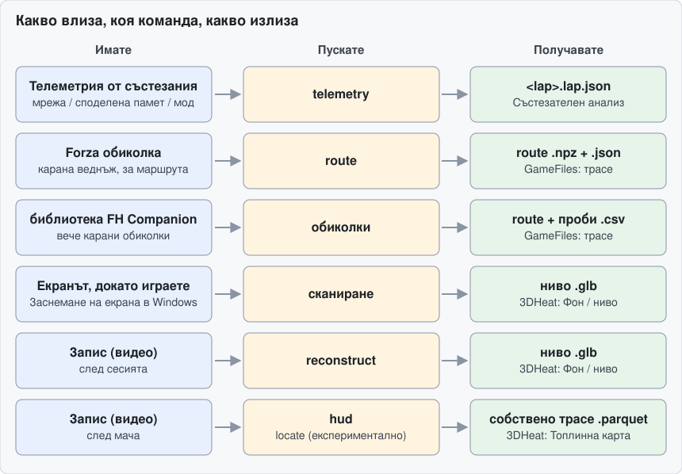

# 3DHeat GameCapture {#dheat-gamecapture}

**Какво е?** Инструмент, който записва какво казва една състезателна игра за вашето каране, по един файл
на обиколка. Може също да възстанови груб триизмерен модел на ниво от видеозапис на това, как играете.

**Защо да го използвам?** За да видите обиколките си в [визуализатора 3DHeat](https://holdi601.github.io/3DHeat/):
къде сте спирали, къде сте били бавни, как се различават две обиколки. И да имате нивото под топлинната си карта, когато никой няма негов триизмерен модел.

**Пример:** включете Data Out на Forza, пуснете една команда и карайте две обиколки. Два файла с обиколки се появяват в
`laps\`. Пуснете ги в раздела Състезателен анализ на визуализатора.


Нов ли сте в командния ред? Първо прочетете [Преди да започнете](before-you-start.md).

## Трите задачи {#the-three-jobs}

1. **Телеметрия от обиколки.** Записва всеки канал, който състезателна игра публикува - Data Out на Forza,
   споделената памет на играта Assetto Corsa, мрежовите потоци на ралийните игри, модул за BeamNG, плъгин за
   Trackmania - и записва по един файл `heat3d-lap` на обиколка или етап за раздела Състезателен анализ на визуализатора. iRacing не
   изисква записвач: визуализаторът чете собствените си файлове `.ibt`.
2. **Нива от игра.** Превръща онова, което екранът е показал, докато сте ходили или карали през ниво, в
   `.glb` триизмерен модел, който визуализаторът полага под топлинната карта.
3. **Вашият собствен мач, след него.** `hud` чете HUD на собствения ви запис - действията ви, смъртите, картата на миникарта и лентата с убийствата. `locate` (експериментално: засега поставя малко реални кадри) открива къде е заснет всеки кадър, върху триизмерния модел на нивото.

И трите следват едно правило: **нищо не се инжектира в игра и нищо не се закача**. Кадрите идват от публичния API за заснемане на екрана, телеметрията - от интерфейси, които игрите публикуват за нея. Вижте [Правилата](rules.md).



Кодът е на Python (пакет `heat3d_capture`), с лиценз MIT. Моделите за дълбочина и поза, които може да пуска, имат свои лицензи - вижте [Модели и лицензи](models-and-licences.md).

## Бърз старт {#quick-start}

### Запис на обиколки {#record-laps}

Трябва ви Python 3.10 или по-нов ([Преди да започнете](before-you-start.md)). В PowerShell:

```powershell
git clone https://github.com/Holdi601/3DHeat-GameCapture
cd 3DHeat-GameCapture
python -m venv .venv
.venv\Scripts\python -m pip install -r requirements.txt

# Forza: Settings -> HUD and Gameplay -> Data Out = ON, IP 127.0.0.1, port 5300
.venv\Scripts\python -m heat3d_capture telemetry -o laps
```

**Трябва да видите** `listening on port 5300. Laps go to laps. Ctrl+C to stop.`, после по един ред за всяка
обиколка, когато минете финала, както на картината по-горе. Натиснете Ctrl+C, за да спрете. Пуснете файловете от
`laps\` в раздела Състезателен анализ на визуализатора.
Всяка друга игра е на една опция `--game`:

```powershell
.venv\Scripts\python -m heat3d_capture telemetry --game acc -o laps
.venv\Scripts\python -m heat3d_capture telemetry --game dirtrally2 -o laps
```

Вижте [Записвачи на телеметрия](telemetry.md) за всяка игра и опция.

### Сканиране на ниво {#scan-a-level}

Щракнете два пъти върху **`scan.bat`** в папката на инструмента. Той намира Python (и предлага да го инсталира с
winget, ако няма), създава частна `.venv` и отваря прозореца за сканиране. Прозорецът казва какво липсва, за какво
е всеки пакет и колко голямо е свалянето, и не инсталира нищо без ваше „да“. Вижте [Изпълнение и зависимости](runtime.md) и
[Прозорецът за сканиране](reconstruction-scan-ui.md).

Ръчно: `.venv\Scripts\python -m heat3d_capture.ui`.

За да възстановите запис офлайн, с пътя на камерата, решен наведнъж (изисква PyTorch, пакета `vggt` и GPU - вижте [Офлайн възстановяване](reconstruction-offline.md)):

```powershell
.venv\Scripts\python -m heat3d_capture reconstruct lap.mp4 -o lap.glb
```

## Карта на документацията {#map-of-the-documentation}

| Страница | Какво съдържа |
|---|---|
| [Преди да започнете](before-you-start.md) | Python, терминал, първата команда, честите грешки |
| [Правилата](rules.md) | Без инжектиране, само публикувани интерфейси, и какво струва това |
| [Записвачи на телеметрия](telemetry.md) | командата `telemetry` и преглед на всяка игра |
| [Forza](telemetry-forza.md) | Data Out, разпознаване на оформлението, релето на FH Companion и неговият `.tele.gz` |
| [Игрите Assetto Corsa](telemetry-assetto-corsa.md) | AC, ACC, AC EVO, AC Rally от споделената памет |
| [Ралийни игри](telemetry-rally.md) | EA SPORTS WRC, DiRT Rally 2.0 / 1 / DiRT 4, Richard Burns Rally |
| [BeamNG.drive](telemetry-beamng.md) | Модът за протокола `heat3d` |
| [Trackmania](telemetry-trackmania.md) | Плъгинът `Heat3dRecorder` за Openplanet |
| [iRacing](telemetry-iracing.md) | Четене на файлове `.ibt` във визуализатора |
| [Разделяне на обиколки и етапи](lap-splitting.md) | `LapSplitter`, `CounterSplitter`, `LineSplitter`, `StageSplitter` |
| [Приплъзване, дрифт и производни канали](slip-and-drift.md) | Как се мащабира приплъзването и какво извежда визуализаторът |
| [Файлът heat3d-lap](lap-format.md) | Форматът на файла с обиколка, каналите, мерните единици, `meta` |
| [Игри](games.md) | За всяка игра: как се записва, какво се изпраща, кои трасета може да се експортират |
| [Команди](commands.md) | `route`, `telemetry`, `laps`, `reconstruct`, `hud`, `locate`, стъпка по стъпка |
| [Справка за командите](../cli-reference.md) | всяка опция, генерирана от `--help` |
| [Четене на HUD от запис](hud-video.md) | `hud`: собствените действия, смъртите, картата на миникарта и лентата с убийствата от запис |
| [Откриване на кадри в ниво](locate.md) | `locate`: къде е заснет всеки кадър, спрямо геометрията на нивото |
| [Възстановяване на ниво](reconstruction.md) | Конвейерът от кадри до `.glb` |
| [Прозорецът за сканиране](reconstruction-scan-ui.md) | Всеки контрол, клавишна комбинация и елемент на наслагване |
| [Заснемане, маски и качество на кадрите](reconstruction-capture.md) | Windows Graphics Capture, ключови кадри, маски за HUD, съвети за качеството |
| [Дълбочина](reconstruction-depth.md) | Depth Anything V2, ONNX Runtime, изграждане на модела |
| [Поза на камерата и мащаб](reconstruction-pose.md) | Одометрия, релокализация, пози от телеметрия, мащаб на земята, bundle adjustment |
| [Сливане, покритие и цвят](reconstruction-fusion-and-texture.md) | Обемът на заетостта, мрежата на покритието, слаби места, цвят на върховете |
| [Изходният .glb](glb-output.md) | Файлът, който зарежда визуализаторът |
| [Офлайн възстановяване](reconstruction-offline.md) | `reconstruct`, прозорци VGGT и сглобяване |
| [Модели и лицензи](models-and-licences.md) | Размери на Depth Anything V2, VGGT, пакетите |
| [Изпълнение и зависимости](runtime.md) | Предварителна проверка, бекенди, нива на производителност |
| [Ограничения и проверки](limits.md) | Какво не е направено и какво не е проверено |
| [Обновления](updates.md) | Проверката за издание и `python -m heat3d_update` |
| [Разработка](development.md) | Тестове, виртуалната среда, структура на хранилището |
| [Поддръжка на тези документи](maintaining.md) | Списъкът за издаване на кода и документацията |

## Част от 3DHeat {#part-of-3dheat}

Файловете, които това записва, се зареждат от **визуализатора 3DHeat** -
[изходен код](https://github.com/Holdi601/3DHeat), [документация](https://holdi601.github.io/3DHeat/).
Файловете с обиколки отиват в раздела Състезателен анализ, `.glb` нивата - в панела Фон / ниво, таблиците `hud` и `locate` - в
раздела Топлинна карта; как визуализаторът чете таблици и файлове на мачове е описано в
[Един файл на мач (.3dheat)](https://holdi601.github.io/3DHeat/container.html) и
[Получаване на данни](https://holdi601.github.io/3DHeat/getting-data-in.html).

| Инструмент | Какво прави | Документация |
|---|---|---|
| [3DHeat визуализатор](https://github.com/Holdi601/3DHeat) | показва топлинни карти, състезания и мачове в 3D, в браузъра | [документация](https://holdi601.github.io/3DHeat/) |
| [GameFiles](https://github.com/Holdi601/3DHeat-GameFiles) | трасета и нива от файловете, които игрите доставят, като триизмерни модели | [документация](https://holdi601.github.io/3DHeat-GameFiles/) |
| [GameCapture](https://github.com/Holdi601/3DHeat-GameCapture) | телеметрия от обиколки в състезателни игри; нива, възстановени от видеозапис на игра | [документация](https://holdi601.github.io/3DHeat-GameCapture/) |
| [Unreal Exporter](https://github.com/Holdi601/3DHeat-UnrealExporter) | приставка за Unreal Editor, която експортира ниво като триизмерен модел | [документация](https://holdi601.github.io/3DHeat-UnrealExporter/) |
| [CS2](https://github.com/Holdi601/3DHeat-CS2) | демота на Counter-Strike 2 в файлове на мачове; карти в триизмерни модели | [документация](https://holdi601.github.io/3DHeat-CS2/) |
| [Watcher](https://github.com/Holdi601/3DHeat-Watcher) | записва играта ви на заден план от това, което публикуват игрите | [документация](https://holdi601.github.io/3DHeat-Watcher/) |
| [Ext-WarThunder](https://github.com/Holdi601/3DHeat-Ext-WarThunder) | повторения на War Thunder в файлове на мачове | [документация](https://holdi601.github.io/3DHeat-Ext-WarThunder/) |
| [Ext-WoT](https://github.com/Holdi601/3DHeat-Ext-WoT) | повторения на World of Tanks в файлове на мачове | [документация](https://holdi601.github.io/3DHeat-Ext-WoT/) |
| [Ext-WoWs](https://github.com/Holdi601/3DHeat-Ext-WoWs) | повторения на World of Warships в файлове на мачове | [документация](https://holdi601.github.io/3DHeat-Ext-WoWs/) |
| [Ext-Squad](https://github.com/Holdi601/3DHeat-Ext-Squad) | демота от сървъри на Squad в файлове на мачове | [документация](https://holdi601.github.io/3DHeat-Ext-Squad/) |
| [Ext-DCS](https://github.com/Holdi601/3DHeat-Ext-DCS) | карти на DCS World в триизмерни модели | [документация](https://holdi601.github.io/3DHeat-Ext-DCS/) |
| [Ext-IL2](https://github.com/Holdi601/3DHeat-Ext-IL2) | карти на IL-2 Sturmovik в триизмерни модели | [документация](https://holdi601.github.io/3DHeat-Ext-IL2/) |

Разработчик, който има отворения проект на играта, трябва да използва Unreal експортера, който чете реалната
геометрия и е точен. Където архивите на играта могат да се четат, GameFiles извлича точното трасе. Възстановяването от игра е за случаите, в които е налице само екранът.
