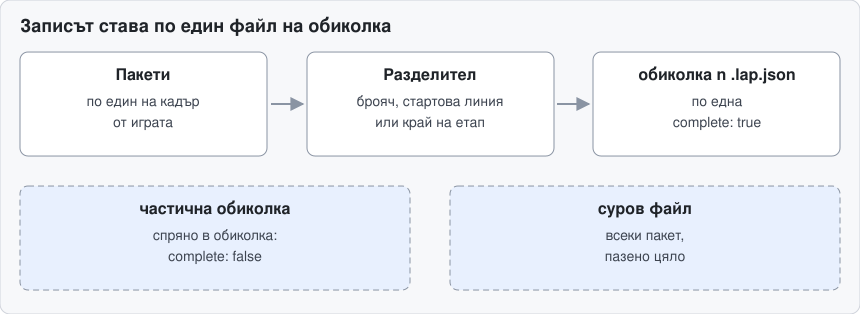

# Как се разделят обиколките и етапите {#how-laps-and-stages-are-split}

Записвачът вижда един непрекъснат поток от проби. Превръщането му в обиколки се извършва от един от четирите разделители, избран според това, което играта казва за обиколките. Всички следват една и съща идея: използват собственото броене на играта, когато има такова, а иначе намират обиколката от позициите; никога не записват фрагмент, твърде къс, за да бъде сравнен.

| Разделител | Код | Използва се от |
|---|---|---|
| `LapSplitter` | [`fulllap.py`](https://github.com/Holdi601/3DHeat-GameCapture/blob/main/heat3d_capture/telemetry/fulllap.py) | Forza |
| `CounterSplitter` | [`kunos.py`](https://github.com/Holdi601/3DHeat-GameCapture/blob/main/heat3d_capture/telemetry/kunos.py) | Assetto Corsa, ACC |
| `LineSplitter` | [`kunos.py`](https://github.com/Holdi601/3DHeat-GameCapture/blob/main/heat3d_capture/telemetry/kunos.py) | AC EVO, AC Rally, BeamNG |
| `StageSplitter` | [`rally.py`](https://github.com/Holdi601/3DHeat-GameCapture/blob/main/heat3d_capture/telemetry/rally.py) | EA SPORTS WRC, DiRT Rally 2.0, DiRT Rally, DiRT 4, Richard Burns Rally |

Trackmania разделя пусканията в собствената си приставка ([Trackmania](telemetry-trackmania.md)), а файловете на iRacing се разделят от визуализатора по брояча на обиколките на симулатора ([iRacing](telemetry-iracing.md)).

При **Ctrl+C** всеки записвач извиква `flush()` на своя разделител, така че отворена обиколка или етап се записва, ако мине същите минимуми, както по-долу.

## LapSplitter (Forza) {#lapsplitter-forza}

Параметри: `minimum_metres = 400`, `gap_seconds = 2.0`.

За всеки декодиран пакет:

1. Ако `timestampMs` на играта е скочил напред с повече от 2 секунди след последния пакет или е отишъл назад, отворената обиколка първо се записва.
2. Ако `isRaceOn` е 0 (играта не е в състезание), отворената обиколка се записва, а пакетът се отхвърля.
3. Ако няма отворена обиколка, се отваря една с `lapNumber` на пакета.
4. Ако `lapNumber` е различен от този на отворената обиколка, тя се затваря като **завършена**; `seconds` е `lastLap` на играта, когато е положителен. Обиколка, затворена така, се записва независимо от дължината си. Отваря се нова обиколка.
5. Пакетът се добавя.

Записвачът също записва, когато не е пристигнал пакет в продължение на 2 секунди реално време (играта е на пауза или е затворена по средата на обиколка).

**Записването** запазва отворената обиколка само ако има поне 2 проби и поне 400 m `distanceTravelled`; записва се като незавършена (`run`). Състезание от точка до точка никога не брои втора обиколка, затова винаги завършва така.

## CounterSplitter (AC, ACC) {#countersplitter-ac-acc}

Параметър: `minimum_metres = 300`. Получава всяка проба с `completedLaps` от графичната страница и времето на последната обиколка.

- Първата проба отваря обиколка с номер според текущия `completedLaps`.
- Когато `completedLaps` се промени, отворената обиколка се затваря. Тя е **завършена**, с `seconds = last lap ms / 1000` (ако е положителен), само ако броячът е нараснал точно с 1 - скок назад към 0 (рестарт на сесията) или с няколко затваря обиколката като незавършена.
- Затворена обиколка се записва само ако има проби и поне 300 m изминат път.
- Записването запазва отворената обиколка, ако има повече от една проба и поне 300 m.

## LineSplitter (AC EVO, AC Rally, BeamNG) {#linesplitter-ac-evo-ac-rally-beamng}

Параметри: `radius = 15 m`, `minimum_metres = 300`, `stop_seconds = 8`.

Тези игри или нямат брояч на обиколки на страница, която записвачът чете, или карат етапи. **Линията е там, където е започнало записването**:

1. Хоризонталната позиция (`x`, `z`) на първата проба става линията.
2. Щом автомобилът измине повече от 5 m, посоката от линията към автомобила става посоката на обиколката.
3. **Спирането** прекратява пускане: когато `speed` остане под 1 m/s за 8 секунди, отворената обиколка се записва (така завършва ралийният етап: автомобилът спира на финала).
4. **Преминаването през линията**: след повече от 300 m път се събират проби в рамките на 15 m от линията. Когато автомобилът отново излезе от този радиус, най-близката събрана проба е преминаването. Ако автомобилът е бил насочен в същата посока като посоката на обиколката (скаларното произведение на локалната посока на движение и посоката е положително), обиколката се затваря в тази проба; иначе преминаването се пренебрегва (автомобилът е минал през старта в обратната посока).
5. `seconds` на затворена обиколка е времето от първата ѝ проба до преминаването. Тя е **завършена само ако първата ѝ проба е била по-бърза от 5 m/s**: обиколка, която е започнала от неподвижно положение, е старт, а не обиколка за сравнение. Първата обиколка на запис, започнал от стартовата решетка, затова винаги е незавършена; запис, започнат на бърза обиколка, дава завършена първа обиколка при следващото преминаване.
6. Следващата обиколка започва от пробата на преминаването (тя принадлежи и на двете обиколки).

Обиколки по-къси от 300 m се отхвърлят. Записването (спиране или Ctrl+C) запазва отворената обиколка, ако има поне 2 проби и 300 m, като незавършена. BeamNG записва по същия начин, когато автомобилът се нулира (часовникът му се връща назад), преди да стартира нов разделител, така че пускането, карано преди нулирането, се запазва.

Разстоянията са хоризонтални (`x`, `z`) за брояча на изминатия път и за теста за линията, а за теста за дължина от 300 m - пълни 3D.

## StageSplitter (ралийни игри) {#stagesplitter-rally-games}

Параметър: `minimum_metres = 300`. Получава всяка проба с часовника на етапа на играта, с това дали играта казва, че автомобилът е финиширал, и по избор със собственото време на играта за него.

1. Ако часовникът е 0 или по-малко, или се е върнал назад с повече от 0,5 s, отвореният етап се **изоставя**: запазва се като частичен етап, ако не е завършен, има повече от 10 проби и поне 300 m. Часовник 0 или по-малко също отхвърля пробата (автомобилът е на старта).
2. Ако няма отворен етап, се отваря нов (номериран 1, 2, ... за записа).
3. Щом един етап е завършен, следващите проби се пренебрегват, докато часовникът не се върне назад.
4. Всяка проба се пази с `time`, равно на часовника на етапа.
5. Когато играта каже, че е финиширал, етапът е завършен; `seconds` е времето на играта, когато е дадено и е положително, иначе часовникът. Записва се, ако е покрил поне 300 m.

Какво значи „финиширал“ при всяка игра:

| Игра | Финиширал, когато |
|---|---|
| EA SPORTS WRC | дължината на етапа е > 0 и изминатото разстояние на етапа е >= дължината - 0,5 m |
| Игрите DiRT | броят завършени обиколки се е вдигнал над началния брой на етапа или (събитие с една обиколка) дистанцията на обиколката е >= 99,9% от дължината на трасето |
| Richard Burns Rally | часовникът на състезанието е > 0 и разстоянието до финала е <= 0 |

При RBR вертикалната ос и скоростта се определят, когато се записва етап (вижте [Ралийни игри](telemetry-rally.md#richard-burns-rally-rsf--ngp)).

## Време и разстояние във файла на обиколката {#time-and-distance-in-the-lap-file}

При всеки записвач, освен Forza, `time` се премества така, че първата проба на обиколката да е 0, а `distance` е натрупаното 3D разстояние между последователни позиции. Forza използва собствения таймер на обиколката и брояча на разстоянието на играта, преместени по същия начин.
