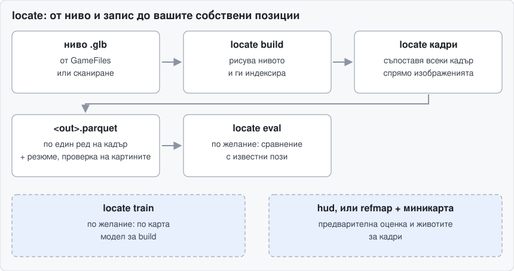

# Намиране на кадри в ниво {#locating-frames-in-a-level}

`locate` установява къде е бил взет всеки кадър от запис на игра - триизмерната позиция на камерата
и посоката на погледа - като съпоставя картината с изображения на геометрията на нивото. Предназначен е за
игри, които не пазят запис къде е бил играчът: без демо, без файл с повторение, без телеметрия.
Battlefield 6 е първата.

> **Експериментално.** При истински записи засега намира само малка част от кадрите; вж.
> [Истински кадри: експериментално](#real-frames-experimental).

```bash
# Once per level: render it from every place a player can stand, and index the renders.
.venv\Scripts\python -m heat3d_capture locate build level.glb -o level.db

# Per recording: where was each frame taken?
.venv\Scripts\python -m heat3d_capture locate frames "<recording>.mp4" --db level.db -o out/match
```

Позицията идва **от картината**, спрямо цялото ниво, без предварителна стойност. Следата от миникартата
на [четеца на HUD](hud-video.md) е само резервен вариант за кадрите, които картината не може да намести,
а всеки ред казва кой от двата е.




## Какво докосва и какво не {#what-it-does-and-does-not-touch}

- Чете **собствения запис** на играча и файл с ниво, изнесен от **собственото му копие** на играта. Никога
  не докосва играта, паметта ѝ, файловете ѝ, докато работи, или мрежата ѝ, и работи след мача. Вж.
  [Правилата](rules.md).
- Намества **само собствената камера** на играча: кадърът е собственият изглед на играча.
- Нивото, базата данни, изградена от него, и всичко, изобразено от него, принадлежат на издателя на
  играта. Пазете ги локално.

## Изисквания {#requirements}

- Това, което изброява `requirements.txt`, PyTorch (от pytorch.org, за GPU), и
  `requirements-locate.txt`:

```bash
.venv\Scripts\python -m pip install -r requirements-locate.txt
```

- GPU с OpenGL 3.3 (4.3 е по-бързо) за изображенията, и за предпочитане CUDA за моделите. На процесор
  работи, но бавно.
- Моделите се теглят при първо ползване (около 450 MB): DINOv2 от Hugging Face, ALIKED и LightGlue през
  kornia. Всички са лицензирани за търговска употреба; вж. [Лицензи](#licences).
- **Нивото** като `.glb` (или `.gltf`) в рамката на визуализатора, Y нагоре, **с базовите цветови
  текстури**, както го записват експортьорите на 3DHeat (части `ground:` / `structure:`; имената на частите
  не са нужни). Една единица е един метър, освен ако най-горното ниво на файла `extras.unit_metres` не
  казва друго. Сканиране на GameCapture (`reconstruct`, прозорецът за сканиране) се записва в **
  сантиметри** и носи `extras.unit_metres: 0.01`, така че се чете в истинския си размер. Нива без текстури
  работят много по-зле; вж. [Ограничения](#limits).

## Команди {#commands}

### `locate build <level> -o <db>` {#locate-build---o-}

Изобразява нивото от всяко място, на което може да стои играч, и запазва за всяко изображение позата му и
един глобален дескриптор.

| Опция | По подразбиране | Значение |
|---|---|---|
| `level` | | `.glb` / `.gltf` на нивото. |
| `-o`, `--out` | | Папката на базата данни за записване. |
| `--game` | `bf6` | Профилът на играта: височини на очите, полезрение, кутии на HUD, скорост (по-долу). `generic` за всяка игра от първо лице. |
| `--eye` | на профила | Височини на очите над пода в метри, първо стоеж. Един изглед в базата за всяка височина. |
| `--fov` / `--vfov` | на профила | Хоризонталното полезрение на записа или вертикалното (плъзгачът на Battlefield) за запис 16:9. |
| `--spacing` | 2,5 | Метри между местата, от които се взимат изгледите. |
| `--yaw-step` | 30 | Градуси между посоките на изгледите. |
| `--pitch` | 0 | Наклони, под които да се изобразява, градуси нагоре. |
| `--positions` | няма | Таблица (Parquet или CSV с `x`, `y`, `z` в краката, в рамката на нивото), от която да се взимат места вместо от всеки под - например изход от предишно изпълнение. |
| `--shadows` | изключено | Хвърля слънчевите сенки в изображенията (слънцето на нивото, когато файлът му го назовава в `extras.sun`). |
| `--untextured` | изключено | Изобразява само форма и светлина. |
| `--box X0 Z0 X1 Z1` | целият файл | Само места в този правоъгълник (единици на нивото): зоната за игра. |
| `--places` | `auto` | Откъде се взимат изгледите: `nav` - играчи на височина на очите над навигационната мрежа на нивото (части `nav:`: точно там, където играта позволява да се ходи), камери на машини на височината им над частите `ground:` (терен и пътища) до 50 m от нея; `ground` - и двете над `ground:`; `floors` - над всяка повърхност, обърната нагоре (включително покриви и сандъци); `auto` - `nav`, когато нивото има навигационна мрежа, иначе `floors`. |
| `--head` | няма | Модел на глава за картата от `locate train`, за дескрипторите. |

Записва `<db>/db.json` (от какво и с какво е построена) и `<db>/views.npz` (пози, дескриптори).

### `locate frames <recording> --db <db>` {#locate-frames----db-}

| Опция | По подразбиране | Значение |
|---|---|---|
| `source` | | Видео, картина или папка с картини (взети по име, на `--fps` разстояние). |
| `--db` | | Базата, която записа `build`. Файлът на нивото ѝ трябва да е още там, където е бил (или `--level`). |
| `-o`, `--out` | `<source>.locate` | Път на изхода без наставка. |
| `--fps` | 2 | Кадри, намерени в секунда видео. |
| `--start`, `--seconds` | всички | Частта от видеото, която се чете. |
| `--width` | 1280 | Ширината, при която се сравняват кадрите. |
| `--shortlist` | 8 | Изгледи от базата, пробвани на кадър близо до предварителна стойност или поправка. |
| `--search-shortlist` | 16 | Без предварителна стойност: изгледи от базата, пробвани на кадър ([търсени заедно](#with-no-prior-frames-searched-together)). |
| `--no-search` | изключено | Без предварителна стойност: всеки кадър се търси сам и поправката му се вярва без съседите му. |
| `--accept-depth` | 0 (изключено) | Без предварителна стойност: поправка се вярва само ако далечното разстояние на съвпаденията ѝ е този път по-голямо от близкото. |
| `--accept-support` | 2 | Без предварителна стойност: съгласни съседи по живота, нужни една поправка да се вярва. |
| `--checkpoint` | няма | Пази състоянието на изпълнението тук и продължава от него, ако то е там. |
| `--stop-file`, `--stop-process` | няма | Спира сам, със запазено състояние, с код на изход 75, когато този файл съществува или работи процес, чието име започва с това (проверява се преди всеки кадър; може да се повтори), за да освободи машината за игра при дълго изпълнение. Същата команда продължава. |
| `--normalise` | няма | Леко нормализиране преди сравняване: `clahe`, `gray`. |
| `--minimap` | няма | Таблицата на командата `hud`: **резервният вариант** за кадрите, които картината не може да намести. |
| `--prior-radius` | няма | **По желание ускорение**, изключено по подразбиране: търси само изгледи от базата на толкова метра от позицията на миникартата (изисква `--minimap`). |
| `--minimap-anchor` | няма | JSON файл, който свързва миникартата с нивото ([миникартата като предварителна стойност за търсене](#the-minimap-as-a-search-prior)): миникартата съкращава търсенето от първия кадър; намерените така поправки са `visual+minimap-prior`. |
| `--no-level-search` | изключено | С предварителна стойност: когато нищо близо до нея не съвпада, не се търси и цялото ниво (по-бързо). |
| `--lives` | таблицата на `--minimap` | Таблицата на командата `hud`, чиито смърти, разгръщания и възстановявания казват кога играчът е бил в игра: позициите скачат само през смърт ([животи от записа](#lives-from-the-footage)). |
| `--no-sequence` | изключено | Решава всеки кадър сам, а не по протежение на изпълнението (по-долу). |
| `--fit-fov` | изключено | След изпълнението нагажда полезрението по най-силните поправки, по изглед, и го показва. |
| `--check-every` | 0 | Също на всеки N кадъра, намерен или не, картина в `<out>.check`. |
| `--no-checks` | изключено | Не записва контролните картини на визуалните поправки (по-долу). |
| `--no-zoomed` | изключено | Не решава приближените изгледи от съседните поправки (по-долу). |
| `--no-grow` | изключено | Не търси отново около всяка поправка кадрите около нея, които още нямат такава. |
| `--game`, `--eye`, `--fov`, `--vfov`, `--mask`, `--no-hud-mask`, `--max-speed` | на профила | Както по-горе; `--mask x,y,w,h` добавя кутия на екрана (на екран 1920x1080), която не е нивото. |
| `--vehicle-vfov` | на профила | Вертикалното полезрение на камерите на машини (плъзгачът за машини на Battlefield). |
| `--settings` | най-новият файл с настройки | `bf6`: файлът с настройки на играта, от който се четат полезренията (само за четене), когато не е зададено `--fov`/`--vfov`; по подразбиране най-новият `PROFSAVE*_profile` под `Documents/Battlefield 6/settings`. Съдържа настройките такива, каквито са сега, които може да не са били такива при по-стар запис. |

### `locate refmap <level> <deploy screen> -o <refmap>` {#locate-refmap----o-}

Поставя собствената карта на играта върху нивото: отправната точка, спрямо която се чете миникартата
([миникартата, четена спрямо нивото](#the-minimap-read-against-the-level)). `<deploy screen>` е картина на
екрана за разгръщане, която показва цялата карта, или запис с `--at <seconds>` в такъв момент; кутията на
картата от профила се изрязва от него (`--whole-picture` запазва всичко). Записва `<refmap>.png` (картата,
преоразмерена към рамката на самото ниво, `--mpp` метра на пиксел, по подразбиране 0,5), `<refmap>.valid.png`
(къде е картата, а не маркер или етикет) и `<refmap>.json` (рамката и калибрирането, с това колко далеч са
били плочките на картата от нея). `--topdown <prefix>` запазва нивото, изобразено отгоре, за следващото
изпълнение (`--topdown-mpp`, по подразбиране 0,656 m; `--box` ограничава).

### `locate minimap <recording> --refmap <refmap> -o <table>.parquet` {#locate-minimap----refmap---o-parquet}

Чете миникартата на записа спрямо референтната карта, кадър по кадър (`--fps`, по подразбиране 2): позиция,
посока и приближение на всяка миникарта, която съвпада, в рамката на нивото, записани като таблица на
миникартата със котва до нея (`<table>.anchor.json`), която `locate frames` приема като
`--minimap <table>.parquet --minimap-anchor <table>.anchor.json`. С таблицата на `hud` (`--hud`) животите ѝ
се пренасят; с котва за тази таблица (`--hud-anchor`) първото търсене е около мястото, където я поставя
играчът, а където никоя миникарта не съвпада, следата на HUD запълва празнините, преместена към най-близките
поправки от референтната карта (`--hud-fill`, секунди, по подразбиране 120; 0 го изключва). `source` на
таблицата казва кое е (`refmap`, `hud`).

### `locate eval <out>.parquet --truth <poses>` {#locate-eval-parquet---truth-}

Сравнява резултат с известни пози на камерата: таблица с `time`, `x`, `y`, `z` (очите), `yaw`, `pitch` в
рамката на нивото. `--offset` е отместването на часовника (истинско време = време във видеото + отместване);
без него отместването се търси. `--unit-metres` превръща грешките в метри.

## Профили на играта {#game-profiles}

| | `bf6` | `generic` |
|---|---|---|
| Височини на очите | 1,6 m стоя, 1,05 m клекнал (още не е измерено в играта) | 1,65, 1,1 m |
| Полезрение | 55 градуса вертикално, около 86 хоризонтално при 16:9: **подайте на играча собственото** с `--vfov` | 90 хоризонтално |
| HUD се маскира | миникартата и списъкът на отряда, лентата с убийствата, компасът, муницията, оръжието на играча, изскачащите прозорци, прицелът | прицелът |
| Най-бързо пешком | 8 m/s | 8 m/s |
| Различавани изгледи | пешком, в машина, приближен (по-долу) | всеки кадър пешком |
| Камери на машини | плъзгачът за машина (от файла с настройки), машината се маскира, камерата до 8 m над пода, 30 m/s | - |

Полезрението е най-важно: кадър, решен с грешно полезрение, е решен с грешна фокусна дължина, и позицията му се плъзга
по посоката на погледа.

## Изходи {#outputs}

### `<out>.parquet` {#parquet}

По един ред за всеки намерен кадър, в **рамката на нивото** (Y нагоре, единиците на нивото), с инструкциите
на визуализатора за четене в футъра (`kind: heat3d-locate`). Футърът назовава всяка колона, която няма своя
роля, като допълнителна, така че визуализаторът ги пази всичките (картата му за преглед ги показва).

| Колона | Значение |
|---|---|
| `time` | Секунди от началото на видеото. |
| `event` | `start` на първия ред на живот, `position` на останалите. |
| `x`, `y`, `z` | Очите, изгладени в рамките на живота. Празно там, където нито един източник не е намерил кадъра. |
| `yaw`, `pitch` | Градуси: yaw около вертикалната ос (0 по +X, нараства към -Z, което е собственият yaw на играта в рамката на визуализатора), pitch нагоре от хоризонталата. `pitch` е празно при редовете на миникартата. |
| `dir_x`, `dir_y`, `dir_z` | Векторът на посоката на погледа. |
| `player`, `team`, `session` | `me`, `own`, и `<video>#NN`, по един за живот. |
| `life` | Животът, в който записът показва кадъра (от смъртите на HUD; 1 = първият). Празно, когато е извън игра (мъртъв, паднал, разгръщане) или когато животите не са прочетени. `session` е животът на следата, който може да се раздели и при скок. |
| `source` | `visual` (от картината), `visual+minimap-prior` (от картината, търсенето съкратено от предварителната стойност на миникартата), `minimap` (резервният вариант), `minimap+nav-floor` (на закрито: миникартата и подът от навигационната мрежа) или `none`. |
| `view` | `foot`, `vehicle`, `zoomed` или `screen` (по-долу). |
| `cam_x`, `cam_y`, `cam_z` | Камерата, която е видяла кадъра. Пешком или през мерник е очите, и `x`, `y`, `z` са същите; в изглед от трето лице на машина `x`, `y`, `z` са самата машина (модел на отместване по-долу), а камерата се движи зад и над нея. |
| `hfov`, `zoom` | Хоризонталното полезрение, с което е решен кадърът, и за приближен изглед - приближението спрямо нормалния изглед. |
| `confidence` | 0..1: колко да се вярва на реда (по-долу). |
| `uncertainty` | Типичната грешка на реда, единици на нивото: за визуална поправка - от вътрешните точки и съседите ѝ, за ред на миникартата - от нагаждането (по-долу). |
| `inliers`, `rmse` | Вътрешните точки на визуалното решение (PnP) и грешката на проекцията (пиксели при работната ширина). |
| `x_raw` ... `pitch_raw` | Визуалното решение преди изглаждането (също за извънредните, отхвърлени чрез гласуване). |
| `kept` | Визуалната поправка е оцеляла при гласуването за извънредни. |
| `note` | Защо кадър не е намерен или е отхвърлен чрез гласуване. |

### `<out>.summary.json` {#summaryjson}

Кадри, визуални поправки, извънредни, животи, редове по източник, нагаждането на миникартата (двойки,
вътрешни точки, остатък), време на кадър.

## Метод {#method}

### Базата данни {#the-database}

Местата са точки върху всеки триъгълник, обърнат нагоре, разпределени равномерно (по един на `--spacing` в
тримерна мрежа, така че етажите на всяка сграда получават своите). От всяко място очите се проверяват с шест
малки дълбочинни изображения: камера в геометрията вижда предимно задните лица; пълзяща пространство има
нещо плътно над очите; и двете се отхвърлят. От всяко място нивото се изобразява на всяка височина на очите,
на всеки `--yaw-step` и на всеки `--pitch`, и всяко изображение се описва с **DINOv2** (токените на кръпките
се събират чрез обобщено средно, съединени с токена на класа).

Локалните характеристики и 3D точките, срещу които кадър най-накрая се решава, **не се пазят**: правят се
отново при нужда, като се изобразяват малкото изгледи, които търсенето е избрало, и това отнема милисекунди.
Така базата данни е няколкостотин мегабайта, а не десетки гигабайта, и това позволява усъвършенстването
по-долу. Цената е, че `frames` се нуждае от файла на нивото и от GPU, не само от базата.

### Един кадър {#one-frame}

1. **Маскиране** на всичко, което не е нивото: кутиите на HUD от профила и прицелът, плюс всеки `--mask`.
2. **Търсене** в **цялото ниво**: глобалният дескриптор на кадъра срещу всеки изглед от базата; най-сходните
   няколко десетки, разредени така, че да държат различни места и посоки, са кратката листа.
3. **Съпоставяне**: всеки изглед от кратката листа се изобразява отново при размера и полезрението на кадъра,
   с дълбочината си. Ключовите точки ALIKED на кадъра и изображението се съпоставят с LightGlue. Пиксел от
   изображението плюс дълбочината му е 3D точка на нивото, така че всяко съвпадение е съответствие 2D-3D;
   ключови точки на ръб на дълбочина (чиято дълбочина може да принадлежи на нещото зад тях) се отхвърлят.
4. **Поза**: PnP с RANSAC (SQPnP), после устойчиво прецизиране, което държи камерата хоризонтално - изгледът
   от първо лице не се накланя - и минимизира грешката на проекцията на вътрешните точки.
5. **Възможно ли е?** Позата трябва да е на височина на очите на играч над под и извън геометрията (
   дълбочинно изображение право надолу). Прилика на текстура другаде - плочкав под, съвпаднал със стена от
   същия материал - може да даде стотици вътрешни точки при поза, на която никой играч не би могъл да бъде;
   те се отделят, колкото и вътрешни точки да имат.
6. **Изобразяване и сравнение**: нивото се изобразява в решената поза и се съпоставя отново, което заменя
   изглед от базата на до няколко метра и десетки градуса разлика с такъв, който почти съвпада с кадъра.
   Повтаря се, докато печели вътрешни точки (най-много два пъти).
7. **Избор**: най-силните три места (на повече от около 3 m едно от друго) се прецизират поотделно, преди да
   се избере едно. Прилика може да води преди прецизирането; правилното място печели много повече от него.
8. **Присъда**: `confidence` комбинира броя вътрешни точки, най-доброто друго място (`runner_up`) и грешката на
   проекцията. Поправката е `ok` с поне 25 вътрешни точки, без друго място в 80% от вътрешните ѝ точки и
   увереност поне 0,85 - прагът, който измерванията по-долу поставят на 97,5-99% верни.

### Изгледи {#views}

Кадър не е винаги очите на играча. Детекторът на профила чете от HUD кой изглед е, и кадърът се решава
съответно:

- **Пешком**: полезрението на пехотата и височините на очите.
- **Машина** (Battlefield 6: подсказките за клавишите на седалката, `C CAMERA` и `E EXIT`, долу в средата):
  полезрението на машината, самата машина се маскира (долната средна част на екрана в изгледа от трето лице),
  и камера, която може да е до 8 m над пода. Поправката е на камерата.
- **Екран** (тъмни ръбове около тъмна среда: картата за разгръщане, меню, таблото): не е изглед на нивото;
  пропуска се.
- **Приближен** (мерник, прицел на стрелец, собственият изглед от първо лице на машина: единият ръб на екрана е
  черен, и двата тъмни, около светла картина): не се търси в нивото - тясната ивица от нивото в мерник прилича
  на нито един широк изглед от базата - а се решава след изпълнението от най-близката поправка до 6 s, по-долу.
  Изключва се с `--no-zoomed`.

### Приближени изгледи {#zoomed-views}

Тесният изглед определя позицията слабо: крачка назад с малко повече приближение изглежда почти същото. Затова
приближен кадър започва от мястото, където съседната му поправка казва, че е прицелът - пешком очите на тази
поправка, в машина 2,5 m над земята под средата на машината (прицел на купола) - и на колко далеч може да се е
преместил оттогава: 2 m, плюс 4 m в секунда пешком или 8 в машина, най-много 12 m (`reach`).

1. **Посока и приближение, позицията задържана.** За всяко приближение 1, 1,2 (собственият изглед на машина,
   по-тесен от пешеходния), 1,5, 2, 3, 4, 6 и 8, нивото се изобразява от седалката в посоки в рамките на 30
   градуса от тези на съседа (а от 3x - и няколко наклона). Ключовите точки на кадъра, съпоставени с
   изображение, с точките на нивото под тях, са лъчи от седалката; завъртане се нагажда по две (RANSAC) за
   фокусни дължини от 0,75 до 1,3 пъти тази на приближението, като точка съвпада в ъгъл, който допуска
   седалката да е `reach` разлика на това разстояние. Приближението, посоката и фокусната дължина, с които
   съвпада най-много точки, печелят.
2. **Уреждане.** Тези точки после нагаждат позиция, посока и фокусна дължина заедно, по грешката им на
   проекцията, като позицията се държи към седалката с наказание от два пиксела на всеки `reach` преместен;
   изобразява се още веднъж в отговора и се нагажда отново. Вътрешните точки и грешката се броят в пиксели, и
   поправката е `ok` по същата увереност като всяка друга.

Записаното приближение (`zoom`) е спрямо полезрението на пешеходния изглед на изпълнението; `hfov` е решеното.
В машина записаната позиция е тази на машината, 2,5 m под прицела, както за изгледа ѝ от трето лице.

### Машини: камерата и машината {#vehicles-the-camera-and-the-vehicle}

В изгледа от трето лице на машина решената поза е на камерата при преследване, която се движи зад и над
машината и се върти около нея, когато играчът гледа наоколо. Записаната позиция (`x`, `y`, `z`) е на машината -
земята под средата ѝ: камерата плюс `vehicle_offset` на профила, толкова метра напред по хоризонталната посока
на камерата и толкова надолу. Камерата остава в `cam_x`, `cam_y`, `cam_z`. Преобразуването се прави преди
последователността и следата, така че камера, която се върти около неподвижна машина, не се взима за движение.
Футърът на таблицата носи използваното отместване и дали е измерено (`vehicleOffset`). Пешком и през мерник
няма отместване.

Как е измерено отместването за Battlefield 6: при верни поправки на истински кадри от трето лице на танк,
средата на танка е отбелязана на око върху кадъра, а нивото, изобразено в поправката, дава земята в този пиксел.
Профилът взима медианата: около 10 m напред от камерата и около 4 m под нея. Отбелязването е добро до около
метър, и е за един тип машина: кола или хеликоптер се вози със закачената си камера по друг начин.

### Без предварителна стойност: кадрите се търсят заедно {#with-no-prior-frames-searched-together}

Глобалният дескриптор на един кадър срещу цяло ниво е слаб сигнал, а вътрешните точки на един кадър не
отличават правилното място от прилика. Затова без предварителна стойност кадрите на записа първо се описват и
се търсят заедно (`search.py`), а поправка се вярва само заедно с кадрите около нея:

- **Кратка листа.** Сходствата на всеки изглед се измерват спрямо собствената му средна стойност и разпръскване
  в записа, така че изглед, който прилича на всеки кадър, спира да печели навсякъде. Всеки кадър оценява
  клетките на решетка от 24 m по ранга на най-добрия си изглед; най-добрият път през клетките по всеки живот, в
  рамките на това, което играчът може да покрие между кадрите, дава вяра за всяка клетка, а най-добрият изглед
  на всяка клетка, най-вярващият първи, е един списък. Обикновеното търсене е другото, и двете се вземат на
  ред: измерването на изгледите спрямо записа наказва място, което играчът почти не напуска, а там
  обикновеното търсене се справя добре.
- **Вяра.** Кандидат се брои само ако вътрешните му точки покриват поне 12% от решетка 8 x 8 над кадъра:
  прилика е повтарящ се обект, купчина контейнери, със стотици вътрешни точки върху няколко клетки на кадъра.
  Поправка се вярва, когато лежи на най-добрия път през броящите се кандидати (по-долу) с поне два съседа в
  рамките на 6 s, които се съгласяват с нея. Кадър извън игра изобщо не се търси.
- **Растеж.** Расте се само от това, на което се вярва, и нараснала поправка трябва да покрива кадъра по същия
  начин.

### По протежение на изпълнението {#along-the-run}

Всеки кадър пази всяка физически възможна поза, която е намерил, по една за всяко място (`candidates`), а не
само най-силната. Изпълнението тогава избира по една за кадър - или никоя - така че избраните пози да образуват
път, по който играч би могъл да върви или кара, и колкото се може повече вътрешни точки да лежат на него: скрит
марковски модел, декодиран наведнъж (Viterbi). Прилика, която печели един кадър сама, губи от мястото, с което
съседите ѝ се съгласяват; слаб кандидат, през който минава пътят, с поне два съгласни съседа, става поправка
(`note`: избрано по протежение на последователността); уверена поправка, с която всичките ѝ съседи си противоречат,
престава да бъде такава. Съсед се брои за съгласен само в рамките на 6 s: по-далеч разстоянието, което играч -
а ако е в машина, още повече - би могъл да измине, е толкова голямо, че съгласието не значи нищо. Изключва се с
`--no-sequence`.

### Времена на кадрите {#frame-times}

`time` на ред е собственото времетраене на кадъра в записа, не броят му спрямо номиналната честота на кадрите.
Записите се отклоняват от номиналната си честота (с няколко десети от секундата в рамките на клип, при онези,
които са измерени), а всичко, което чете кадър обратно по времето му - контролните картини, приближеният
проход, `locate train --real`, миникартата от командата `hud` - търси по времеви печат. Броени кадри биха
поставили контролната картина далеч от кадъра, който е намерен, с до толкова.

### Полезрението, от кадрите {#the-field-of-view-from-the-frames}

`--fit-fov` пази най-силните поправки на изпълнението (по изглед) и уточнява позата и фокусната дължина на
всяка заедно по вътрешните им точки; медианата от тях е полезрението, с което е бил направен записът, и се
показва в обобщението (`hfov_fitted`) за `--fov` на следващото изпълнение. Близките и далечните точки се
движат различно при промяна на фокусната дължина, отколкото при промяна на позицията, и точно това го
определя; нужни са поправки с дълбочина в тях, а не плоска стена.

### Модел за отделна карта {#a-per-map-model}

`locate train` обучава малка глава върху DINOv2 за едно ниво, върху изображения на нивото, така че глобалният
дескриптор да намира правилните изгледи на истински кадри, а не само на изображения:

- **Глава**: всеки токен на кръпка през двуслойна проекция, събран чрез обобщено средно по кръпките, които
  показват нивото, съединен с проектирания токен на класа. DINOv2 остава замразен. Всичко това е написано тук
  (MIT).
- **Двойки**: място върху ходимата земя и посока, изобразени два пъти от позиции на разстояние до метър-два и
  до десетина градуса една от друга, при полезрения до 10 градуса едно от друго, при различна светлина (слънце,
  сенки, околна), през игрален вид: цветокорекция, мъгла по дълбочина, блясък, виньетиране, дим, хора на пътя,
  собствената машина на играча в изгледи от машина, размазване при движение, шум, JPEG (`augment.py`).
  Маскирани като кадър. Места на няколко метра, гледащи в една и съща посока, не се броят за отрицателни.
- **Истински кадри**: кадри с поза, която самият конвейер е намерил (псевдо-етикети: поправки, избрани по
  протежение на последователност), могат да се включат като двойки - кадърът и изображение в позата му - във
  втори кръг.
- **Загуба**: контрастна (InfoNCE) върху партидата.

`locate build --head <head.pt>` строи базата с него; `frames` тогава го ползва за кадрите.

| Опция на `locate train` | По подразбиране | Значение |
|---|---|---|
| `-o`, `--out` | задължителна | Файлът на главата за записване (`.pt`). |
| `--steps` | 600 | Стъпки на обучение. |
| `--real TABLE VIDEO` | няма | Таблица на `locate frames` и нейният запис: уверените ѝ поправки се включват като истински двойки. Може да се повтори. |
| `--real-confidence` | 0,85 | Увереността, която поправката трябва да има, за да се включи като истинска двойка. |
| `--spacing`, `--box`, `--places`, и опциите на профила | както при `build` | Къде са местата за обучение, и профилът на играта. |

### Проверка с око {#checking-by-eye}

Всяка визуална поправка получава картина в `<out>.check` - `<time>s_<view>_visual.jpg`: кадърът, и до него
нивото, изобразено от камерата на поправката, с ръбовете на кадъра, начертани върху изображението. Където
съвпадат, поправката е вярна. Записва се след като последователността и следата са решили, така че картините
са точно редовете, които таблицата нарича visual. Изключва се с `--no-checks`.

### Миникартата, четена спрямо нивото {#the-minimap-read-against-the-level}

Миникарта, слепена в една мозайка (на командата `hud`), не е плоска: мащабът ѝ се мести с приближението, при
което е била нанесена всяка миникарта, място, видяно два пъти, може да е нарисувано два пъти, и мозайката на
всеки клип е собствена. Подобие, нагодено към няколко поправки, държи близо до тях и е на десетки метри далеч
от тях. Затова миникартата се поставя от самото ниво, на две стъпки, и нищо не се слепва:

- **Референтната карта** (`locate refmap`). Екранът за разгръщане рисува цялата карта, с север нагоре, плоска, в
  един мащаб. Нивото, изобразено отгоре, показва същите неща, изправени над земята (танкове, сгради, стени): на
  нивото - височината им над земята в радиус 15 m; на картата - това, което е нарисувано по-светло от околната
  земя. Картата се поставя върху нивото чрез нормализирана кръстосана корелация на двете по мащаб и малко
  завъртане, уточнена чрез съвпадане на плочки от картата една по една, и накрая цялата карта наведнъж около
  този отговор (няколко десетки плочки оставят мащаба свободен с процент, метри по краищата на картата). Резултатът
  е едно подобие: пиксел от картата към нивото.
- **Миникартата, кадър по кадър** (`locate minimap`). Всяка взета миникарта - изрязването на четеца на HUD и
  маската му - се съпоставя (SIFT) с референтната карта около мястото, където играчът е бил последно, или навсякъде,
  когато никъде не е известно, и се нагажда подобие (завъртане, мащаб, отместване). Точката на играча, пренесена
  през него, е позицията; горната страна на миникартата (конусът на изгледа) е посоката; мащабът ѝ е
  приближението - измерено, не предположено.
- **Къде не съвпада.** Екранът за разгръщане не рисува нищо извън зоната за игра; миникарта, която показва
  главно нещо извън нея - играч на ръба на картата - няма с какво да се съпостави. Там следата на самия HUD
  заема мястото, преместена с отместването, което измерват най-близките поправки от референтната карта
  (`--hud-fill`); тя е толкова добра, колкото е мозайката близо до тези поправки.

На тестовото ниво миникартата, прочетена така, беше на няколко метра (медиана) от уверените визуални
поправки, толкова добра извън областта, по която е нагодена референтната карта, колкото и вътре в нея.

### Миникартата като предварителна стойност за търсене {#the-minimap-as-a-search-prior}

Следата на миникартата от командата `hud` казва за повечето кадри в игра, приблизително къде е играчът и накъде
гледа - в собствените си единици (пиксели на миникартата, север нагоре). Свързана веднъж с нивото, тя съкращава
търсенето до малка част от него; самата поза все още идва от картината, по същите правила.

- **Котвата** (`--minimap-anchor <anchor.json>`): едно подобие за всяка карта, от миникартата към нивото -
  мащаб, завъртане (с огледалото между пикселите с north up и осите на нивото), отместване - нагодено по
  уверените визуални поправки (увереност 0,7 и повече) на няколко клипа. Миникартата на всеки клип е мозайка, която
  четецът на HUD е слепил самостоятелно, така че всяка седи някъде другаде в единиците на миникартата; две
  мозайки на една карта се различават само по отместване, намерено чрез съвпадане на ключови точки между тях
  (отместването, с което се съгласяват най-много съвпадения), и всяка мозайка е свързана с една референция през
  всички двойки, които се съгласяват добре. Файлът на котвата носи подобието на картата, отместването на клипа
  (`clip_shift`) и грешката, която котвата е показала спрямо поправките на клипове, оставени извън нейното
  нагаждане (`median`, `p90`, метри).
- **Къде и накъде.** Посоката на миникартата е yaw на камерата: на измерените клипове се съгласяваше с решения yaw
  в рамките на 2-5 градуса. Затова кадър първо се съпоставя с изображения, изобразени там, където миникартата
  поставя камерата - пешком очи над земята на това място, в машина - камерата при преследване зад и над нея
  (отместването на машината) - гледаща по посоката: самата точка и 4 m на всяка страна, при два наклона
  (`seeds`). Само когато никое от тях не дава поправка, се пробват собствените изгледи на базата в диска
  (30 m плюс 90-процентната грешка на котвата).
- **Коригира се по време на изпълнението.** Всяка уверена поправка близо до предварителната стойност казва колко е
  далеч котвата там; медианата от тези в рамките на 2 минути коригира предварителната стойност, а разпръскването им
  (поне 5 m) заменя грешката на котвата в радиуса на диска - до 10 m: поправки, които се разминават повече, казват,
  че миникартата е неточна за мястото, а не че нещо на 50 m е добро. Без поправка в рамките на 2 минути
  предварителната стойност изобщо не се коригира (грешката другаде в клипа не казва нищо за това място).
- **Котви с решетка.** Котвата може да носи и `grid`: `x` и `z` на нивото върху правилна решетка над единиците на
  миникартата на клипа, четени билинейно; вътре в нея решетката поставя точката, извън нея - подобието. Котвата на
  таблица на `locate minimap` е единичната (нейната таблица вече е в рамката на нивото).
- **Слаби нагаждания.** С предварителна стойност нагаждане, което е слабо (25 вътрешни точки или повече, но недостатъчно
  уверено само по себе си) и лежи в диска, се пази - с по-ниската си увереност - за последователността и следата да
  го преценят, а не се отхвърля: дим, отломки и разрушени стени оставят на истинските кадри по-малко съвпадения.
- **Източници.** `visual` - картината го е намерила, без предварителна стойност; `visual+minimap-prior` - картината го
  е намерила, търсенето е съкратено до предварителната стойност; `minimap` - картината не го е намерила, миникартата
  заема мястото; `minimap+nav-floor` - на закрито, по-долу.
- **На закрито миникартата води.** Кадър, който картината не е намерила, пешком, където око на позицията на миникартата
  вижда нивото отблизо от всички страни (медианно разстояние под 8 m в четири посоки) и няма небе, е на закрито: получава
  `x` и `z` на миникартата и височината на пода от навигационната мрежа там - от няколко етажа, този най-близо до
  последната поправка - с `source = minimap+nav-floor`, така че е ясно, че картината не го е поправила.

### Животи от записа {#lives-from-the-footage}

Позиция може да скочи само там, където играчът е умрял. Животите не се налучкват от позициите - една грешна
поправка би отворила нов живот - а се четат от записа: таблицата на четеца на HUD записва смъртите, които са показали
екраните за падане и разгръщане (`death`), падането, което съотборник е вдигнал (`downed`, `revived`), разгръщанията
(`spawn`) и къде е започнала и е спряла играта (`start`, `end`); `lives.py` ги превръща в животи. Смъртта затваря
живот, първият кадър в игра след екрана за разгръщане отваря следващия; възстановяването не прекъсва живота (играчът е
там, където е паднал), а кадрите, докато е на земята, не се намират; и спиране от менюта или зареждане по-дълго от
10 s също го прекъсва. Кадрите извън игра (мъртъв, разгръщащ се, на земята) никога не се намират.

В рамките на живот непрекъснатостта е твърдо правило: всяка стъпка - най-много скоростта, по времето между кадрите,
плюс 1,5 m. Скоростта е на кадъра: пешком - тази на профила, в машина - скоростта, която показва самият уред на
машината в рамките на 3 s (една трета повече, и 2 m/s при ускоряване), или, където няма показание, границата на
класа ѝ. По протежение на изпълнението (Viterbi) стъпка през смърт е свободна на всякакво разстояние, всяка друга
стъпка е ограничена; кадър, който би изисквал скок, се оставя - по-слабата страна на противоречието губи (по-малко
вътрешни точки, по-малко подкрепа) - и животът никога не се разделя заради него. Когато оставената страна е сама по
себе си силна (увереност 0,9 и повече, две или повече поправки, които се съгласяват помежду си), изпълнението не
налучква: и двете страни се пазят и се маркират `jump without detected death` (пропусната смърт, или истински
телепорт), и се изброяват в обобщението. Резервният вариант на миникартата следва същите животи.

Battlefield 6: изгледите на танковете от първо лице показват скоростта (`<n> KPH`, вдясно от прицела; четена с OCR
на четеца на HUD); изгледът от трето лице не я показва. Показанията по тестовите клипове бяха бавни, затова
наземните машини се допускат до 15 m/s, където нищо не се чете. За лодки, хеликоптери и самолети се дават щедри
граници (20, 90 и 280 m/s), които не са измерени: никой клип не показва такава машина в движение, а класификаторът
на изгледа не отличава въздуха от земята - участък по-бърз от наземна машина се вижда като скок, маркиран, и не се
вярва.

### Разрушаване {#destruction}

Файловете на нивото са неразрушеното ниво; в мач стени, къщи и скали се разрушават от изстрели, отломки и дим
остават наоколо, и става по-зле, колкото по-дълго трае мачът.

- **Съпоставянето се доверява на статичното ниво.** Част, която експортът маркира като разрушима (името ѝ започва с
  `destructible:`, или `extras.destructible` на нейния възел, мрежа или примитив), се рисува в маската `destructible`
  на изображението. Съвпаденията, чиято точка на нивото лежи върху нея, се отхвърлят, когато остават 40 или повече
  съвпадения върху статични части - терен, пътища, големите конструкции носят решението.
- **Обучението вижда, че е изчезнало.** Обучителните изображения (`locate train`) заменят кръпки от разрушимите части
  с шум в цвят на отломки и добавят прах ниско над земята, отгоре на дима и останалия вид на играта (`augment.py`),
  така че моделът за отделната карта да се научи да не се облегне на тях.
- **Липсващата геометрия не е грешно място**: с предварителна стойност слабите нагаждания в диска се пазят (по-горе).

Докато експортите не носят маркировките, нищо не е маркирано като разрушимо и тези неща не правят нищо.

### Следата {#the-track}

- **Извънредни**: поправката се сравнява с поправките в 3-те секунди преди нея и отделно - в 3-те след нея;
  съгласувана означава не по-далеч една от друга, отколкото позволява скоростта на профила, плюс 1,5 m. Поправка,
  която не се съгласява с повечето от съседите си **от двете страни**, се отхвърля чрез гласуване (пази се в
  колоните `_raw`, `kept` е false). Изискването за двете страни пази първата поправка след появяване.
- **Животи**: с живота от записа (по-горе) следата следва тях, а в рамките на живот пуска по-слабата страна на
  стъпка, която нарушава скоростта. Без тях се прекъсва там, където две последователни запазени поправки са по-далеч
  една от друга, отколкото позволява скоростта, където има празнина над 8 s, и където таблицата на миникартата
  започва нов живот.
- **Изглаждане**: в рамките на живот всяка поправка се слива с права линия през поправките около нея (претеглена
  локална линейна регресия, сигма 0,5 s), като всяка е претеглена по своята несигурност: силна поправка - добра до
  сантиметри - остава на мястото си, слаба се дърпа към силните си съседи. Линия, а не средно, защото средното
  изостава играч, който тича: средното беше пробвано първо и превърна следа от 3 mm в такава от 0,3 m при 2 кадъра в
  секунда. Ъглите на погледа не се изглаждат; завъртането на изгледа е истинско и бързо.

### Резервният вариант на миникартата {#the-minimap-fallback}

Таблицата на миникартата е в собствената ѝ мозайка (пиксели, x на изток, y на север). Тя се свързва с нивото чрез
едно подобие - завъртане, мащаб, отместване, и огледало, ако така пасва по-добре - нагодено устойчиво по кадрите, където
и двете имат позиция. Където картината не е дала нищо, или поправката ѝ е отхвърлена чрез гласуване, позицията на
миникартата заема мястото с `source = minimap`, увереност най-много 0,5 и несигурност два пъти остатъка от нагаждането
плюс 1,5 m. Миникартата няма височина: взема се от най-близката визуална поправка. Изпълнение само с миникарта (без
визуални поправки) не може да се свърже с нивото и не намира нищо.

`--prior-radius` използва същото нагаждане в обратна посока: след като осем визуални поправки са свързали миникартата с
нивото, търсенето гледа само изгледи от базата в този радиус от позицията на миникартата, и пада към цялото ниво, когато
там нищо не се намира. Това е по-бързо; но е толкова вярно, колкото е миникартата, затова е изключено по подразбиране.

## Точност {#accuracy}

Измерено на **стенд**, където истината е точна: тестово ниво, експортирано с текстурите си, и кадри, изобразени от
известни пози на камерата, *така че да изглеждат като игра, а не като базата данни* - слънцето и сенките на самото
ниво, по-рязък контраст, случайна цветокорекция, виньетиране и блясък, фигури с размер на играч и дим на пътя,
HUD, изобразен в маскираните кутии, размазване, шум и JPEG. Всеки кадър се намира спрямо **цялото ниво, без
предварителна стойност**. Вярно означава в рамките на 1 m и 5 градуса. Нищо от стенда (нива, изображения) не е част
от това хранилище.

| Кадри без предварителна стойност | Резултат |
|---|---|
| намерени вярно | около 4 от 5 |
| от `ok` поправките (увереност 0,85 и повече), верни | около 97-99% |
| грешка на верните поправки | милиметри до сантиметър; няколко стотни от градуса |
| време на кадър | около 1 s на настолен GPU |

Увереността е полезна мярка за доверие: почти всяка поправка от 0,9 и нагоре е вярна, докато поправките под 0,85
често са грешни - оттам прагът 0,85 за `ok`. Къде се проваля: няма съвпадащ изглед, твърде малко съвпадения (стена на
една стъпка, предимно небе, предимно закриващ предмет), или две места изглеждат еднакво.

**Проследяване.** Тестов път на камерата, изобразен, както по-горе, във видео с 30 fps, и таблица на миникартата,
направена от същия път (в собствената му завъртяна, мащабирана, огледална рамка, с шум), пуснат през `locate frames` с
2 кадъра в секунда и оценен с `locate eval`, който трябваше и да намери отместването на часовника: всеки кадър в игра
беше намерен, почти всички от картината; отместването на часовника беше намерено в стотни от секундата; редовете на
картината бяха в рамките на няколко сантиметра, редовете на миникартата - в рамките на около метър.

**Какво прави разлика:**

- **Текстурите** са това, на което стъпва съпоставянето. Без тях се намира само малка част от кадрите; под, свит до
  един плосък цвят, струва около една трета от уверените поправки.
- **Правилното полезрение.** На 3 градуса разлика грешката на верните поправки расте от милиметри до десетки
  сантиметри и повечето поправки вече не са `ok`. Подайте истинското полезрение.
- **Сенките** в изображенията на базата (`--shadows`): малка печалба.
- **По-дълга кратка листа**: малка печалба, няколко пъти по-бавно. По-къса: по-малко поправки, по-висока точност.
- Нормализирането на светлината (CLAHE) не даде печалба и не е по подразбиране.

Места, които изглеждат като други, са основният източник на уверени грешки: поза точно един модул на сграда
по-далеч, покрай стена от повтарящи се модули, решена по същия начин в няколко кадъра, докато играчът стои на
едно място. Прецизирането на трите най-силни места преди избора и отхвърлянето на невъзможните пози премахна
повечето от останалите.

### Истински кадри: експериментално {#real-frames-experimental}

При истински записи `locate` **още не работи добре**: намира само малка част от кадрите по картината, главно кадри
от машини (камерата от трето лице вижда повече от нивото отгоре), и почти никакви пешком (играчът гледа стени и
земя отблизо). Научено е от тестови записи:

- **Намирането на верния изглед е това, което се проваля.** Светлината на играта, ефектите и грубите експортирани
  текстури местят истинския кадър по-далеч от изображенията, отколкото е стендовата имитация, така че верният изглед
  се класира близо до, но извън, кратката листа.
- **Модел за отделната карта помага** (`locate train`): класира верния изглед много по-високо, а истинските кадри като
  обучителни двойки помагат още повече на кадрите около тях.
- **Кадри близо един до друг си помагат**: при 2 кадъра в секунда участък в машина има около една трета от кадрите си
  намерени; при един кадър на 5 s почти никой.
- **Истинските кадри показват грешка на проекцията от 2-3 пиксела** срещу 1 при изображенията; профилът приема 3 за
  нормално (`pixel_noise`).
- **Полезрението**, нагодено от кадрите (`--fit-fov`), може да се различава от запазените настройки: настройката може да
  е била променена след записа.
- **Слабите поправки, станали `ok` само от далечни съседи**, бяха грешните; съседите вече се броят само в рамките на 6 s,
  и всяка поправка от 0,7 и нагоре беше вярна.
- **Файлът на нивото има значение**: земя без текстура и растителност, нарисувана като черни карти, вредят. Изобразяващият
  уред спазва изрезките (`alphaMode: MASK`): текселът под `alphaCutoff` на материала (0,5, когато не е зададен) се
  отхвърля, така че фонът се вижда (`render.py`).

Какво трябва след това: много повече истински псевдо-етикети от много клипове, за обучение и калибриране на увереността
(`locate train --real <table> <video>`), нива с текстурирана земя и начин за справяне с приближените изгледи.

## Изображения срещу кадри {#renders-against-frames}

Изображенията, от които е съставена базата, не са кадрите на играта. На стенда разликата е имитирана (светлина, сенки,
цветокорекция, играчи, дим, HUD) и струва около 10 точки верни поправки спрямо кадри, изобразени както базата (91% срещу
80-89%); верните поправки остават милиметрови. Помогна: слънцето и сенките на картата в изображенията, с които се
съпоставя (малко), по-дълга кратка листа (малко, бавно). Не помогна: нормализирането на светлината с CLAHE.

Което стендът не може да имитира, е останалото от истинския кадър: печена и отразена светлина, амбиентна окклузия, мъгла,
частици, растителност, която се движи, собствената следобработка на играта. За да се измери това, запишете възпроизвеждането
на нещо, чиито пози на камерата са точни - демо или повторение на играта - и сравнете с `locate eval`; той сам намира
отместването на часовника между записа и позите, или го взима от `--offset`.

## Ограничения {#limits}

- **Истинските кадри почти не се намират още.** Без предварителна стойност с DINOv2 почти никой истински кадър не се
  намира; с модел за отделната карта няколко процента се намират, верно, когато са проверени с око (вж.
  [Истински кадри: експериментално](#real-frames-experimental)). Всяко число за точност по-горе е върху изображения на
  нивото, направени така, че да изглеждат като играта (нейните слънце, сенки, цветокорекция, блясък, шум, играчи, HUD),
  срещу изображения на същото ниво. Истинският кадър се различава по начини, които изображението не може да имитира:
  печена и отразена светлина, амбиентна окклузия, мъгла, частици, променящи се декали, анимирана растителност. Колко
  струва това, е открит въпрос; вж. [Изображения срещу кадри](#renders-against-frames) за това как да се измери.
- **Нивото трябва да е това, което е било играно**, в същата версия, с текстурите си, включително тази на пода: вж.
  [Какво трябва да носи файлът на нивото](#accuracy).
- **Места, които изглеждат като други.** Нивата ползват повторно сгради, предмети и плочкави материали. Две места, които
  изглеждат еднакво, дават две добри решения; второто се докладва (`runner_up`), поправката не е `ok`, а следата или
  миникартата трябва да решат. Поправка, която е вярна, но е маркирана като двусмислена, се губи, а не е грешна.
- **Кадри с малко ниво в тях**: стена на една стъпка, небе, димна граната, черната рамка на мерник, екран на смърт или
  меню. Не дават поправка и се казва, че не дават.
- **Приближение.** Прицелването и мерниците стесняват полезрението. Приближените кадри се решават само от съседна поправка
  (по-горе); дълъг участък през мерник без поправка около него не се решава.
- **Машини и камери от трето лице.** Камерата тогава не е на височина на очите и не е там, където е машината; отместването
  между тях (по-горе) е измерено за един тип машина, основен бойн танк. Други машини возят камерата си по друг начин и
  позициите им се отклоняват с разликата - няколко метра. Самата машина се маскира (`vehicle_hud` на профила).
- **Какво нивото не съдържа**: разрушаване, машини, играчи, врати, които са се преместили. Маскира се, когато е HUD;
  иначе RANSAC трябва да вижда през него.
- **Скорост.** Кадър струва около 0,5-1,5 s на настолен GPU (повече, докато друга работа споделя GPU): изображенията на
  краткия списък, съпоставянето и изобразяването и сравнението. Два кадъра в секунда от мач от 20 минути са 2400 кадъра,
  20 минути до час. Базата се строи веднъж за ниво: около 20-30 минути за ниво с размера на състезателна карта на
  стрелба при разстояние 2,5 m; зона за игра като Battlefield изисква `--box` и по-голямо разстояние или няколко кутии.
- **Големи нива.** Файл на ниво може да съдържа километри декор: `--box` ограничава местата до зоната за игра. Сенките
  (`--shadows`) се хвърлят от една карта на сенките за целия файл, която става груба при много големи.

## Лицензи {#licences}

| Компонент | Лиценз |
|---|---|
| Тежестите на DINOv2 ViT-B/14 (`facebook/dinov2-base`) | Apache-2.0 |
| ALIKED (`aliked-n16`) | BSD-3-Clause |
| LightGlue, вариант ALIKED | Apache-2.0 |
| kornia, kornia-rs | Apache-2.0 |
| moderngl, glcontext | MIT |
| transformers, huggingface_hub, safetensors | Apache-2.0 |

Всички позволяват търговска употреба. Две често срещани алтернативи са оставени извън проекта, защото условията им
биха се прехвърлили върху всеки резултат: тежестите на SuperPoint (некомерсиални) и кода за регресия на координати на
сцена под некомерсиални лицензи. Вж. [Модели и лицензи](models-and-licences.md).

## Изпълнение на Battlefield 6 {#running-it-on-battlefield-6}

Какво е нужно, по ред:

1. **Нивото, с текстури**, от собственото инсталирано копие на играча, като `.glb` в метри, Y нагоре, в рамката, която
   ползват таблиците на четеца на HUD и визуализатора. `extras.unit_metres` (1 за метри; сканиране на GameCapture записва
   0,01, защото е в сантиметри) и, ако е известно, `extras.sun` (посоката към слънцето) в най-горното ниво на файла `extras`.
   Ниво без текстури се зарежда и се изобразява, но вж. [Ограничения](#limits).
2. **Зоната за игра** като кутия (`--box X0 Z0 X1 Z1`, метри): файловете на нивата на Battlefield носят декора на
   километри около нея, а база данни за всичко това е предимно изгледи, които никой не вижда.
3. **Полезрението на играча**: плъзгачът на Battlefield е вертикален; подайте го като `--vfov` (55-те градуса на профила
   са временна стойност). Записи 16:9.
4. **Височините на очите** (`--eye`, стоеж, после клек) - 1,6 и 1,05 m от профила не са измерени. Измерете ги при първото
   добро изпълнение: `y` на поправките на играч, който стои неподвижно на равна земя, минус височината на пода там.
5. **Кутиите на HUD** са проверени на 4K записи със стандартното разположение (миникарта, списък на отряда, лентата с убийствата,
   компас и компас на прицела, лента с резултата и флагове на целите, чат, муниция, подсказки, оръжието). Преместен или
   мащабиран HUD се нуждае от `--mask`.
6. Построяване, после намиране с таблицата на четеца на HUD като резервен вариант, и преглед на проба от поправките:

```bash
.venv\Scripts\python -m heat3d_capture locate build level.glb -o level.db --game bf6 --box X0 Z0 X1 Z1 --shadows
.venv\Scripts\python -m heat3d_capture hud "<recording>.mp4" --game bf6 -o out/match
.venv\Scripts\python -m heat3d_capture locate frames "<recording>.mp4" --db level.db --game bf6 --vfov <yours> --minimap out/match.parquet -o out/match.locate --check-every 20
```

Всяка визуална поправка получава контролна картина (`<out>.check`; `--check-every 20` добавя всеки 20-и кадър, намерен
или не): кадърът до нивото, изобразено по поправката му, с ръбовете на кадъра, начертани върху изображението. Където
съвпадат, поправката е вярна. Няма истина, с която да се сравни при Battlefield, затова тази картина, делът на кадрите,
намерени по картината (`summary.json`), и колко добре нагаждането на миникартата се съгласява с визуалните поправки
(нейният `residual`) са проверките.
