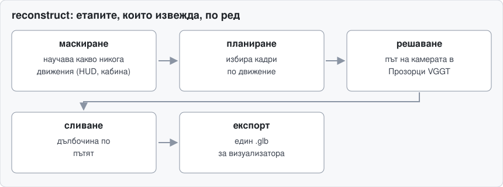

# Офлайн реконструкция {#offline-reconstruction}

```bash
python -m heat3d_capture reconstruct lap.mp4 -o lap.glb [--solve-budget 260] [--fuse-interval 0.4]
```

Код: [`scan/offline.py`](https://github.com/Holdi601/3DHeat-GameCapture/blob/main/heat3d_capture/scan/offline.py),
[`pose/feedforward.py`](https://github.com/Holdi601/3DHeat-GameCapture/blob/main/heat3d_capture/pose/feedforward.py),
[`pose/vggt_model.py`](https://github.com/Holdi601/3DHeat-GameCapture/blob/main/heat3d_capture/pose/vggt_model.py),
[`pose/feedforward_source.py`](https://github.com/Holdi601/3DHeat-GameCapture/blob/main/heat3d_capture/pose/feedforward_source.py),
[`pose/solveprep.py`](https://github.com/Holdi601/3DHeat-GameCapture/blob/main/heat3d_capture/pose/solveprep.py).
Опции: [Справка за командите](commands.md#reconstruct).

## Защо втори път {#why-a-second-path}

Постепенното проследяване е на живо, евтино и работи там, където има структура за захващане: интериор, улица, карта с укритие. **Състезателната писта е най-лошият ѝ случай**: пътят е гладка лента с малко текстура, хоризонтът почти не се движи и щом няколко пози се отклонят, нищо по-късно не ги връща. Обиколката излиза като крива, която блуждае, вместо да се затвори.

Офлайн пътят подава **прозорци от кадри** на модел, който предсказва всичките им камери заедно, така че всеки кадър ограничава всеки друг директно, а не през верига. Той се нуждае от целия запис, преди да отговори, затова не е на живо и е бавен: минути на прозорец на настолен GPU. Всичко след позите - сливане, покритие, цвят, изнасяне - е същият код като при живото сканиране: решеният път се подава на реконструктора като източник на поза, точно там, където отива телеметрията на Forza.

## Изисквания {#requirements}

- **PyTorch**, съгласуван с вашия GPU (проектът не го фиксира; инсталирайте го преди `requirements.txt`, вижте [Изпълнение](runtime.md)).
- **`vggt`** - кодът на модела VGGT (`from vggt.models.vggt import VGGT`), от GitHub хранилището на Meta; не е в индекса на пакетите.
- **`transformers`**, защото офлайн пътят пуска дълбочината през PyTorch `DepthEstimator` (Depth Anything V2 Small), а не през ONNX файла.
- На практика CUDA GPU; и двата модела минават на CPU, но това не е практично.

Нито един от тях не е в `requirements.txt`, защото сканерът не ги ползва. Те са в **`requirements-offline.txt`**, заедно със собствените зависимости на VGGT (`einops`, `safetensors`, `huggingface_hub`, `Pillow`):

```bash
.venv\Scripts\python -m pip install -r requirements-offline.txt
.venv\Scripts\python -m pip install --no-deps "vggt @ git+https://github.com/facebookresearch/vggt.git"
```

VGGT се инсталира с `--no-deps`, защото метаданните на пакета фиксират `numpy<2`, което pip би спазил, като понижи numpy, от който тук се нуждае scipy. `reconstruct` проверява всички тях веднага след като изведе реда с лиценза (списъкът `OFFLINE` в [`runtime/preflight.py`](https://github.com/Holdi601/3DHeat-GameCapture/blob/main/heat3d_capture/runtime/preflight.py)), показва какво липсва с размерите, и инсталира само при „да“ - VGGT с `--no-deps`, както по-горе. Отказ или липса на терминал, в който да попита, завършва с код 1.

## Моделът и лицензът му {#the-model-and-its-licence}

**VGGT**, `facebook/VGGT-1B`: **CC-BY-NC-4.0, само некомерсиално, и реконструкция, направена с него, наследява това.** Командата го извежда, преди да започне (`describe_licence`). Съществува отделно лицензиран `facebook/VGGT-1B-Commercial`, но е затворено хранилище, отваряно за всеки акаунт поотделно от Meta, затова не може да е стандартният. `--model vggt-1b-commercial` решава с него (и вместо това извежда реда си с лиценза); без одобрен достъп свалянето се проваля. *Кодът* на `vggt` е под собствения лиценз на Meta, „VGGT License“, споразумение за изследователски материали с политика за допустима употреба (прочетено от `LICENSE.txt` на пакета). Вижте [Модели и лицензи](models-and-licences.md).

## Пускането, етап по етап {#the-run-stage-by-stage}

Имената на етапите са тези, които командата извежда.



### masking (маскиране) {#masking}

`FlowMask` се учи от **4 серии по 90 последователни кадъра**, центрирани на 1/8, 3/8, 5/8 и 7/8 от видеото, при 960 x 540 в сиво (вижте [FlowMask](reconstruction-capture.md#flowmask-what-never-travels)). Бележката му се извежда и се пази в обобщението. Видео по-късо от 90 кадъра не получава маска.

#### Маската на камерата се учи, не се прилага {#the-camera-mask-is-learned-not-applied}

Маската **не** се прилага към кадрите, подавани на решателя. Маскирането на кабината изглеждаше правилно по статистиката на особеностите (повечето открити ъгли са върху пиксели, закрепени към камерата) - но това е твърдение за детектора на особености, а решателят е обучена мрежа. Измерено по това колко завива възстановеният път между последователни стъпки (автомобил завива с няколко градуса; случайно блуждаене - с деветдесет), суровите кадри дават най-малкия завой, кадрите с повишен контраст малко повече, маскираните кадри - ясно повече, а и двете заедно - най-много. Затова решателят получава сурови кадри. Маската още се ползва за планиране на разстоянията между кадрите по-долу и постепенният проследяващ я ползва при живото сканиране. (`solveprep.enhance`, който маскира и повишава локалния контраст с CLAHE, съществува, но тази команда не го ползва.)

### planning (планиране): кадри, разположени по движение {#planning-frames-spaced-by-motion}

`plan_by_motion` избира кадрите за решателя по **колко се е преместила картината**, а не по часовника: фиксиран интервал дава на бавните участъци кадри, които не им трябват, и гладува бързите, където последователните кадри спират да се припокриват достатъчно, за да са свързани.

- Целево преместване: **5% от ширина от 960 пиксела** (48 px), медианното преместване на особеностите ORB между последователно избраните кадри, измерено върху кадри 960 x 540 в сиво с контраст CLAHE, особеностите само върху маската.
- Започва с интервал от 0,3 s; след всяка стъпка следващият интервал става `gap x (0.5 + 0.5 x target / measured)`, ограничен до **0,15-2,0 s**, така че едно шумно измерване не разклаща плана.
- Когато нищо не е съвпаднало, интервалът се свива до 0,6 от себе си (твърде далечните кадри са грешката, която се избягва).
- Спира в края на видеото или при `--solve-budget` кадъра (по подразбиране 260).

По-малко от 4 планирани кадъра е грешка.

### solving (решаване): прозорци и съединяване {#solving-windows-and-stitching}

Планираните кадри се декодират с ширина 960 px и се решават в **припокриващи се прозорци от 16 кадъра, по 6 общи** със следващия (`plan_windows`; последният прозорец се връща назад, за да завърши на последния кадър, така че краят на заснемането има толкова съседи, колкото и средата). Повече от **400** кадъра в едно пускане се отказват.

Всеки прозорец: кадрите се мащабират така, че дългата страна да е **518**, а двете страни да са кратни на **14** (съотношението на страните се запазва - свиването би изкривило зрителното поле), мащабират се в 0..1 и минават през VGGT с autocast bfloat16 (float16 изчерпва експонентата при далечни координати на света). Външните параметри на камерата се превръщат във въртения свят-от-камера и центрове на камерата. Картите на точките по подразбиране не се пазят.

Всеки прозорец се връща в **своя собствена произволна координатна система и свой собствен произволен мащаб**, затова прозорците се **съединяват** в координатната система на първия чрез преобразуване на подобие (завъртане, транслация, един мащаб), нагласено по камерите, които споделят с вече поставеното:

- **Завъртането се взима от ориентациите на камерите**, не от позициите им: общите камери са разположени по пътя и са почти на една права на права отсечка, което оставя настройка само по позиция неспособна да види завъртането - всеки прозорец се огъва, а съединеният резултат излиза прав. Завъртането е средното на `target_R x source_R^T`, проектирано обратно върху истинско завъртане (с предпазител срещу отражение).
- **Мащабът и отместването се взимат от позициите**, по завъртения източник.
- Нужни са поне **4** общи камери; по-малко е грешка.
- Припокриването е една трета от прозореца, за да е мащабът добре определен; натрупването на грешка в мащаба от прозорец към прозорец е това, което прави обиколката спирала.

За всеки шев се записва най-голямото несъгласие на общите камери след настройката, в единици от средното разстояние между тях (`seam_error`).

### fusing (сливане) {#fusing}

Кадри на всеки `--fuse-interval` секунди (по подразбиране 0,4) се декодират с ширина 960 px, получават дълбочина от Depth Anything V2 Small (PyTorch) и се сливат с поза, **интерполирана** от решения път по техния времеви отпечатък (линейна позиция, сферично завъртане; `FeedForwardPoses`). Кадри извън решения времеви интервал се пропускат, вместо да се екстраполират. Камерата използва хоризонтално зрително поле от **65 градуса**. Позите от предаване напред носят увереност 0,85 при сливането и покритието.

### exporting (изнасяне) {#exporting}

Мрежата се записва както при живо сканиране ([Изходът .glb](glb-output.md)), с името на видеото.

## Обобщението {#the-summary}

```text
140 cameras solved over 182s
closure error 3.1% of path length
worst seam 0.42 frame spacings
<mask note>
wrote lap.glb
```

| Ред | Значение |
|---|---|
| closure error | разстоянието между първата и последната камера, делено на дължината на пътя. За една обиколка това е честната мярка за отклонение. Над 10%: „The lap does not close ... Treat the shape as unreliable.“ |
| worst seam | най-голямото несъгласие при съединяване. Над 1,0: „Windows disagreed by up to N frame spacings at a seam, so part of the path is stitched on weak evidence.“ |
| няма файл | „Fusion produced no surface, so nothing was written.“ Кодът на изхода тогава е 1. |

## Мащаб {#scale}

Съединеният път е в произволните единици на първия прозорец. Дълбочината се закотвя чрез триангулация между интерполираните пози (както при телеметрията), така че геометрията е съгласувана с пътя - но **резултатът не е в метри**, освен ако не е и пътят. Нищо в тази команда не определя глобалния мащаб; калибрирането по земята не се прилага, когато позите идват от източник на поза.

## Състояние на този път {#state-of-this-path}

При кадри на фиксиран интервал прозорците се решават в съгласуван път на някои участъци от обиколка и в драсканица на други; провалите са в тесните завои, където изгледът рязко се мени между кадрите, а вземането на проби по-гъсто в тези завои ги оправя. Никоя статистика на картината (яркост, детайл, брой особености, дял на вътрешните точки, преместване) не предсказа предварително кои участъци ще се провалят. Затова разстоянията не могат да се планират напълно по картините предварително: трябва да се избират чрез решаване, измерване на резултата и ново решаване по-гъсто там, където пътят не е такъв, какъвто би могъл да кара автомобил. Планирането по движение е изградено; **адаптивното ново решаване - не**.
