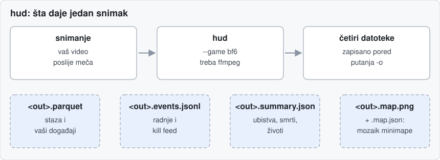

# Čitanje HUD-a iz snimka {#reading-the-hud-from-a-recording}

`hud` čita HUD igre sa ekrana iz igračevog **vlastitog snimka**, nakon meča: igračeve
**vlastite** akcije iz iskočnog prozora s bodovima koji igra prikazuje ispod nišana (ubistva,
asistencije, oživljavanja, dopune municije, zauzimanja...), njegove smrti sa ekrana pada i povratka u igru, njegov
**vlastiti** trag sa mini-mape, a pored toga i kill feed kao vremenske događaje - zapisano kao
3DHeat tabela s mozaikom mini-mape kao slikom mape koja se stavlja ispod.

Ukratko: gleda video vašeg meča i zapisuje vaša ubistva, smrti i gdje ste hodali.

```bash
.venv\Scripts\python -m heat3d_capture hud "<recording>.mp4" --game bf6 --player <name> -o out/match
```

Battlefield 6 je prvi profil igre.



## Šta dira, a šta ne {#what-it-does-and-does-not-touch}

- Čita **video datoteku**: klip iz ShadowPlay / Instant Replay, OBS snimak, bilo šta što
  ffmpeg dekodira. Nikad ne dira igru, njenu memoriju, datoteke ni mrežu i radi
  nakon što je meč gotov. Pogledajte [Pravila](rules.md).
- Izvodi **samo igračevu vlastitu poziciju**, sa igračeve vlastite mini-mape. Markeri drugih igrača
  na mini-mapi se maskiraju i nikad ne čitaju. Kill feed se čuva cijeli, ali samo kao
  ono što piše na ekranu (ko, koga, čime, kada); nijedna pozicija se ne veže ni za koga osim za
  igrača.
- OCR radi lokalno (RapidOCR s PaddleOCR modelima preko ONNX Runtimea). Nijedan kadar
  ni isječak ne napušta računar.
- Snimak prikazuje imena drugih igrača, a mozaik je slika nivoa. Izlazi
  su za igračevu vlastitu upotrebu; čuvajte ih lokalno.

## Zahtjevi {#requirements}

- **ffmpeg i ffprobe** na `PATH`-u. NVIDIA kartica se koristi za dekodiranje kad je ima
  (`-hwaccel cuda`); inače dekodira CPU, nekoliko puta sporije.
- Paketi iz `requirements.txt` i OCR bez vlastitih zavisnosti (traži
  CPU `onnxruntime`, koji se sudara s DirectML verzijom koju projekat koristi):

```bash
.venv\Scripts\python -m pip install -r requirements.txt
.venv\Scripts\python -m pip install --no-deps rapidocr_onnxruntime==1.2.3
```

`rapidocr_onnxruntime` je čitač teksta (OCR) koji čita imena i riječi s ekrana.
`--no-deps` sprečava da zamijeni DirectML `onnxruntime` projekta.

Da instalirate ffmpeg na Windowsu: `winget install Gyan.FFmpeg`, zatim otvorite novi terminal i provjerite
s `ffmpeg -version`. Novi ste u komandnoj liniji? Pročitajte [Prije nego počnete](before-you-start.md).

- Snimak u omjeru **16:9** u bilo kojoj rezoluciji (1080p, 1440p, 4K). Drugi omjeri se odbijaju,
  jer bi okviri profila pali na pogrešne dijelove ekrana.
- **Zadani raspored HUD-a** igre. Premješten ili skaliran element HUD-a čita se na pogrešnom mjestu.

## Opcije {#options}

| Opcija | Zadano | Značenje |
|---|---|---|
| `video` | | Snimak. |
| `-o`, `--out` | naziv videa, u trenutnom folderu | Putanja izlaza **bez** nastavka; datoteke su `<out>.parquet`, `.events.jsonl`, `.summary.json`, `.map.png`, `.map.json`. |
| `--game` | `bf6` | Čiji HUD čitati. `bf6` (Battlefield 6) je za sada jedini profil. |
| `--player` | nema | Igračevo ime kako ga prikazuje kill feed. Upoređuje se slobodno (OCR miješa `l`/`I`/`1`, `O`/`0`, `rn`/`m`). Bez njega se ime pogađa (dolje). |
| `--fps` | 5 | Uzoraka mini-mape u sekundi. Kill feed se uzorkuje upola rjeđe, iskočni prozor s bodovima i ekrani smrti također upola rjeđe (četvrtinom dok nema iskočnog prozora), kompas svake 3 s, lista odreda svakih 15 s. |
| `--start` | 0 | Sekunde u videu od kojih početi. |
| `--seconds` | sve | Koliko videa čitati. |
| `--metres-per-pixel` | nema | Razmjera mini-mape, ako je poznata: metri po pikselu mini-mape pri uobičajenom zumu (mini-mapa je široka 296 piksela na ekranu od 1080p). Bez nje su pozicije u tim pikselima; pogledajte [Jedinice](#north-and-units). |
| `--cpu` | isključeno | Dekodirajte na CPU-u čak i kad postoji NVIDIA kartica. |

Napredak se ispisuje svakih pet sekundi; na kraju igrač, ubistva, smrti, životi i zapisane
datoteke.

## Izlazi {#outputs}

### `<out>.parquet` - igračev trag i događaji {#parquet---the-players-track-and-events}

Jedan red po uzorku u kojem je igrač bio u igri i mini-mapa se mogla smjestiti, plus jedan po svakom njegovom
događaju. Podnožje nosi upute pregledaču za čitanje (ključ `heat3d`, `kind: heat3d-hud`), pa
pregledač mapira svaku kolonu bez pitanja.

| Kolona | Značenje |
|---|---|
| `time` | Sekunde od početka videa. |
| `event` | `position`; `start` (video je počeo usred života), `spawn` (opet u igri nakon smrti ili dugog razmaka), `death`, `downed` i `revived` (sa ekrana smrti, dolje), `end` (život je završio bez ičega što kaže kako); igračeve vlastite akcije iz iskočnog prozora s bodovima (`kill`, `assist`, `reviving`, `resupply`, `capture`... - [tabela događaja](#event-table)); i linije kill feeda o igraču kao `kill_feed`, `death_feed`, `teamkill_feed`, `suicide_feed`, `squadwipe_feed`. |
| `source` | Odakle je došao događaj reda: `points` (iskočni prozor), `screen` (ekrani pada i povratka u igru), `feed` (kill feed); prazno na redovima pozicije. |
| `text` | Na redovima `points`: oznaka kako je ispisana (`KILL`, `SQUAD DAMAGE ASSIST`...), ili naslov (`DOUBLE KILL`, naziv trake), a za nepoznatu oznaku ono što je pročitano. |
| `points` | Na redovima `points`: za koliko je ukupan zbir iskočnog prozora porastao u tom trenutku. Kad je više akcija stiglo u istom uzorku (ubistvo i vozilo u kojem je bilo) to je njihov zbir, dat na svakoj, a `shared` kaže koliko ih je dijelilo. Prazno kad zbir nije dvaput pročitan s obje strane trenutka. |
| `subject`, `subject_side` | Na redovima `points`: ime koje je iskočni prozor prikazao uz akciju - žrtva ubistva, oživljeni ili opskrbljeni saborac - i njegova boja (`enemy`, `friendly`, `squad`). |
| `confirmed` | `feed` kad je kill feed imao liniju za isto ubistvo ili smrt (u roku od 3 s, ista žrtva). |
| `x`, `y`, `z` | Pozicija na mozaiku: `x` istok, `y` sjever, `z` 0 (podnožje kaže da je `z` gore). Sjever je pravi sjever kad je kompas to dozvolio (pogledajte `north_up` u sažetku). |
| `player` | Uvijek `me`. Samo igračevi vlastiti redovi imaju pozicije. |
| `team` | `own`. |
| `session` | `<video name>#NN`, jedan po životu. Rute toplote linija nikad ne prelaze sesiju. |
| `heading` | Stepeni u smjeru kazaljke na satu od sjevera (od gornje strane mozaika kad sjever nije poznat): kuda je pogled bio usmjeren. |
| `dir_x`, `dir_y`, `dir_z` | Isto kao vektor smjera, za smjer pogleda u pregledaču. |
| `zoom` | Koliko je mini-mapa bila udaljena u odnosu na uobičajeni zum (iznad 1 u vozilima). |
| `killer`, `victim`, `weapon`, `headshot`, `marker` | Na redovima ubistva i smrti koji imaju liniju feeda: linija feeda (dolje). Ubistvo iz iskočnog prozora bez linije feeda ima ime iz iskočnog prozora kao `victim`; ubistvo iz iskočnog prozora prikazano kao HEADSHOT ima `headshot` true. |

Svaki red događaja uzima igračevu poziciju u vrijeme događaja (za smrt ili pad, posljednju
poziciju prije njega; za oživljavanje, prvu poslije). Redovi se uklapaju direktno u [toplotu linija](https://holdi601.github.io/3DHeat/line-heat.html) pregledača: njen
prijedlog bira `event`, počinje na `start`, `spawn` i `revived`, završava na `death`, `downed` i
`end`, a redovi `position` leže duž rute. Ostali događaji su imenovani tako da
prijedlog nijedan od njih ne uzme za početak ili kraj: davanje oživljavanja je `reviving` (ne
`revive`), držanje tačke `defense`, saborac koji se pojavljuje na igraču `teammate_arrived`,
linije feeda `kill_feed` i tako dalje; `kill` nije kraj.

Klip s dvije runde na dvije mape daje dva mozaika koji se ne mogu povezati. Najveći je
`<out>.parquet`; svaki drugi s najmanje 30 s traga zapisuje se pored njega kao
`<out>.map2.parquet`, `<out>.map2.map.png` i tako dalje.

### `<out>.events.jsonl` - igračevi događaji i kill feed {#eventsjsonl---the-players-events-and-the-kill-feed}

Jedan JSON objekt po liniji, redom po vremenu, svaki s `source`:

- `points`: jedan po igračevoj akciji: `time`, `event`, `text`, `points`, `shared`,
  `subject`, `subject_side` (kao u tabeli), `popup` (iz kojeg iskočnog prozora je došao, numerisano kroz
  vožnju), `seen` (koliko je čitanja pokazalo), `confirmed`, te `x`, `y` gdje je igrač bio.
- `screen`: jedan po padu i po oživljavanju: `event` (`death`, `downed` ili `revived`), `time` (kad je
  igrač pao; za `revived`, kad su ekrani nestali), `until` (posljednje viđenje
  ekrana), `screens` (`down` i/ili `card`), `outcome` (`death`, `revived` ili `unknown` kad
  snimak prije završi), `killer` (iz linije feeda, kad je ima), `x`, `y`.
- `feed`: svaka linija koju je feed pokazao, svačija:

| Polje | Značenje |
|---|---|
| `time`, `last` | Prvi i posljednji uzorak u kojem je linija pročitana (sekunde od početka videa). `time` je kad se ubistvo pojavilo, s tačnošću jednog uzorka feeda (0,4 s pri zadanoj brzini). |
| `kind` | Iz igračeve perspektive: `kill`, `death`, `teamkill`, `suicide`, `squadwipe`; za linije drugih igrača `kill`, `squadwipe`, ili `death` za liniju bez ubice. |
| `killer`, `victim` | Imena, kao najčešće čitanje kroz sve uzorke koji pokazuju liniju (duže čitanje pobjeđuje kad je uobičajeno njegov početak: djelimično skriveno ime). `killer` je prazan za liniju koja je pokazala samo ikonu i žrtvu - smrt od svijeta, ili liniju čiji je ubica već izblijedio. |
| `killer_side`, `victim_side` | Prema boji imena: `friendly` (igračev tim, plavo), `enemy` (narandžasto), `squad` (blijedozelena koju igra koristi za igrača i njegov odred), `neutral` (nijedno od ovoga). |
| `weapon` | Klasa ikone oružja unutar ove vožnje: `icon01`, `icon02`... Linije čije ikone izgledaju slično dijele klasu. Ikone nisu imenovane; nema liste prema kojoj bi se imenovale. |
| `marker` | Mala ikona između oružja i žrtve: `skull`, `arrow`, `chevrons`, `crosses` ili prazno. |
| `headshot` | `marker == "skull"` - pretpostavka, pogledajte [Ograničenja](#limits). |
| `seen` | Koliko je uzoraka feeda pokazalo liniju. |
| `me` | `killer`, `victim` ili null. |
| `matched` | Za igračeve vlastite linije: je li za nju pronađena akcija iskočnog prozora ili ekran smrti. |
| `x`, `y` (, `map`) | Za igračeve vlastite linije: gdje je bio. |

### `<out>.summary.json` {#summaryjson}

Igrač (i kako je pronađen), odakle su došli igračevi događaji (`own_events_from`: iskočni
prozor i ekrani, ili sam kill feed kad nije pročitano ništa od toga), ubistva, smrti, K/D,
headshotovi, asistencije, date (`revives`) i primljene (`revived`) oživljavanja, padovi, zauzimanja,
neutralizacije, dopune, liječenja, popravke, uništena vozila, rezultat (zbirovi iskočnih prozora
sabrani), svaki tip akcije s brojem (`actions`), broj iskočnih prozora, smrti koje je pokazao
samo feed, feedov vlastiti broj ubistava i smrti i koliko se njegovih ubistava poklopilo s ubistvom iz iskočnog prozora,
ubistva saboraca, samoubistva, uništeni odredi, životi, sekunde u igri, pređena udaljenost (u jedinicama tabele),
linije feeda, po mapi je li sjever gore i koliko se čitanja kompasa složilo, brojevi traga
(uzorci, u igri, smješteni, nesmješteni, ostrva), napravljene pretpostavke i vremena.

### `<out>.map.png` i `<out>.map.json` - mapa ispod traga {#mappng-and-mapjson---the-map-under-the-track}

Mozaik svake mini-mape vožnje, usrednjen, bez overlaya, okrenut i skaliran tačno kao
tabela. JSON sidecar nosi dva sidra koja traži smještanje **slike mape** u pregledaču
([Slike mapa](https://holdi601.github.io/3DHeat/map-images.html) u dokumentaciji pregledača): učitajte PNG pomoću
**Map image...**, ostavite **Flip north/south** uključeno i upišite sidro 1 i sidro 2 (`px`, `py`,
`worldX`, `worldZ`) iz sidecara. Slika tada leži tačno ispod traga.

U slici su samo dijelovi nivoa koje je igračeva mini-mapa pokazala.

## Metoda {#method}

### Dekodiranje {#decoding}

ffmpeg dekodira na GPU-u, spušta na brzinu uzorkovanja dok su kadrovi još na kartici, izrezuje
regije profila (mini-mapa, kill feed, dvije trake kompasa, lista odreda, iskočni prozor s bodovima,
riječi ekrana pada, donji desni ugao), skalira svaku na fiksnu veličinu i slaže ih
u jednu malu sliku po uzorku. Samo ta slika prelazi cijev
u Python. Dekodiranje svakog kadra H.264 toka je donja granica vremena izvođenja.

Dvije radne niti uzimaju uzorke: jedna registruje mini-mape (OpenCV), druga čita tekst (ONNX Runtime).

### U igri ili ne {#in-play-or-not}

Kvadrat s oznakom tastera (svijetli kvadrat s tasterom mape u sebi, dolje lijevo od
mini-mape) crta se kad god i mini-mapa, a ne na ekranima smrti, kill-cama, raspoređivanja, menija ni rezultata.
Njegovo prisustvo - svijetli, bezbojni kvadrat s tamnim slovom u sredini, jasno
svjetliji od onoga oko njega - traženo nekoliko piksela oko njegovog mjesta, je test za igru. Jedan
uzorak koji se ne slaže s oba susjeda se ignoriše.

Prekid u igri je smrt ili promjena runde (sljedeća dionica počinje s `spawn`) kad traje najmanje
6 s ili je smrt (sa ekrana, ili linija feeda koja imenuje igrača kao žrtvu) bila u 40 s
prije njega; kraći prekid bez smrti (otvorena velika mapa) nastavlja život. Mini-mapa
ostaje gore dok je igrač oboren, pa je oboreni igrač u igri.

### Trag {#the-track}

Mini-mapa se okreće s pogledom i drži igrača u fiksnoj tački (izmjereno: sredina, 49,7%
dolje). Svaki uzorak:

1. **Maskira** ono što nije nivo: jako obojene ili skoro bijele piksele (markere ciljeva, ikone odreda
   i vozila, pingove, granicu zone igre, linije ruta, tekst), blijedu žuto-zelenu
   konusa pogleda, disk oko igračevog markera, klin konusa iznad njega, oznaku tastera i
   tanak rub.
2. **Karakteristike**: SIFT ključne tačke na sivoj mini-mapi s izjednačenim kontrastom, unutar maske.
3. **Registruje prema mozaiku**, ne prema prethodnom uzorku: ključne tačke se upoređuju s
   dosad pohranjenim karakteristikama, u koordinatama mozaika, blizu mjesta gdje je igrač posljednji put bio; sličnost
   (okret, zum, pomak) se prilagođava pomoću RANSAC-a. Prilagođavanje traži dovoljno inliera, zum u granicama trećine
   prethodnog i pomak manji od trećine mini-mape po uzorku; prilagođavanje traženo
   bilo gdje na mozaiku (nakon smrti) traži dvostruko više inliera.
4. **Rasti mozaik**: karakteristike koje mozaik još nema dodaju se (najviše svakih nekoliko desetina
   sekunde kretanja), a maskirana mini-mapa se usrednjava u sliku.
5. Igračeva tačka provedena kroz prilagođavanje je njegova **pozicija**; gornja strana mini-mape provedena
   kroz njega je njegov **smjer** (heading) na mozaiku.

Poslije toga tačka koja skoči više od 10 piksela od oba uzorka prije nje i od
oba poslije nje (koji se međusobno slažu) se odbacuje: mini-mapa se povremeno poklopi s pogrešnim
zumom za jedan uzorak. Sažetak ih broji (`dropped_as_jumps`).

Registracija prema mozaiku je ono što sprečava sabiranje grešaka: povratak na neko mjesto poklapa se s
karakteristikama pohranjenim prvi put. Pojavljivanje negdje još neviđenom počinje poseban **ostrvo**; svaki
deseti smješteni uzorak se proba naspram drugih ostrva, a prvo dobro poklapanje ih spaja (manje
se premješta u veće, sa svojim tragom). Ostrva koja se nikad nisu spojila (druga mapa, ili tlo koje se nikad
nije dijelilo) zapisuju se zasebno kao gore.

### Sjever i jedinice {#north-and-units}

Traka kompasa se čita svake 3 s: njene oznake se pronalaze po tinti (svijetle, bezbojne,
grupisane preko malih razmaka, crtice odbačene), svaka se čita zasebno, a dvije ili više oznaka određuju i
razmjeru trake i smjer ispod središnje oznake - jedna oznaka ne određuje ništa. Svako
čitanje kompasa uparuje se s smjerom mozaika istog uzorka; kružni medijan
razlika, preko čitanja unutar 10 stepeni od njega, je okret koji postavlja mozaik sjeverom gore.
Primjenjuje se kad se slože najmanje tri čitanja i polovina svih.

<a id="units"></a>Razmjera tla mini-mape nije nigdje ispisana na ekranu, pa su pozicije u
**pikselima mini-mape pri uobičajenom zumu**: medijan zuma vožnje skalira se na jednu jedinicu tabele po
pikselu mini-mape od 296 piksela (njena veličina na ekranu od 1080p). Odzumiranje u vozilu se uklanja
registracijom, pa je jedinica ista pješice i u vozilu. `--metres-per-pixel` množi
sve u metre kad je razmjera poznata (iz poznate udaljenosti na mapi, izmjerene jednom).

### Kill feed {#the-kill-feed}

Feed se čita 2,5 uzorka u sekundi, ali samo kad su se njegovi obojeni pikseli primjetno promijenili ili
je prošlo 2 s. Linije teksta pronalazi detektor OCR-a; linija čija se slika poklapa s onom pročitanom u
prethodnom uzorku (redovi se pomjeraju, pa se mogla pomaknuti) preuzima taj tekst umjesto da se ponovo čita.
Linije premale za ime, ili s kosom crtom (brojač fps-a u tom uglu), odbacuju se.

Linije se grupišu u redove po visini; u redu je krajnje lijevo ime ubica, a krajnje desno
žrtva. Susjedni dijelovi iste boje se spajaju (ime s razmakom). Jedna linija koja je
prešla preko ikone iz jednog imena u drugo reže se na svom najširem razmaku kad se polovine razlikuju po
boji, a svaka polovina se ponovo čita. Jedno ime u koloni žrtava s ikonom odmah lijevo od njega
je linija bez ubice. Dva dijela iste boje bez ikone između njih su jedno ime čiji
je ubica izblijedio, a ne ubistvo.

**Strane** dolaze iz boje. Imena su crtana s nešto prozirnosti, pa se test radi na tome koliko je
tekst udaljen od vlastite pozadine: predznak crvenog minus plavog u toj razlici je narandžasta (neprijatelj)
ili plava (prijatelj) na bilo kojoj pozadini; nijedno, sa zelenom iznad druge dvije, je boja odreda.

**Ikone**: između imena, pikseli u boji ubice čine siluetu oružja; mala odvojena
ikona odmah prije žrtve je marker, imenovan po obliku (mrlja s rupama za oči
je lubanja; mali trougao strelica; nekoliko dijelova križevi).

**Događaji**: red pročitan ponovo s oba imena sličnim (sličnost 0,7 nakon svođenja uobičajenih
OCR zabuna, jedna od njih 0,8; skraćeno čitanje poklapa početak punog imena) je isti
događaj, sve dok je događaj posljednji put pročitan prije manje od 5 s i star je manje od 14 s - nijedan red ne ostaje
gore duže, pa je isti par kasnije novo ubistvo. Red bez ubice poklapa se samo po žrtvi.
Vrijeme događaja je njegovo prvo viđenje; njegova imena, strane i marker su većina kroz
viđenja; redovi pročitani samo jednom se odbacuju.

**Igrač**: `--player`, inače istaknuti (najsvjetliji) red liste odreda kad se slože najmanje tri
čitanja i 60% njih, inače ime koje je feed najčešće crtao u boji odreda. Inače
sažetak kaže da je igrač nepoznat, i nijedna linija feeda mu se ne pripisuje. (Iskočni prozor i
ekrani smrti su igračevi vlastiti bez obzira na ime; ne trebaju ime.)

### Iskočni prozor s bodovima {#the-points-popup}

Sve što igrač osvoji, Battlefield 6 prikazuje u jednom iskočnom prozoru odmah lijevo i ispod
nišana - na istom mjestu pješice, u vozilu i kroz nišan:

```
            [ RIBBON ] (icon)          a title, now and then: a ribbon or a multi-kill
      (icon)(icon)(icon)  300          one icon per action; the popup's running total
                Some_Name              who it was about, for a moment: orange an enemy, blue a teammate
    [ KILL x2 ] [ VEHICLE DESTROYED ]  one boxed tag per kind of action, with a count
```

Iskočni prozor raste dok igrač nastavlja osvajati bodove: novo ubistvo pretvara `KILL` u `KILL x2`, dodaje
ikonu i podiže zbir; nova vrsta akcije dodaje oznaku. Red oznaka pokazuje posljednjih nekoliko vrsta
(starija iskliže, a brojanje se nastavlja kad se vrati). Otprilike tri sekunde nakon posljednje
akcije iskočni prozor se savija u jednu liniju (`[KILL x2] 300`) i nestaje. Tekst je svijetlosiv, oznake u
tankim okvirima, zbir velikim ciframa počevši od x 760 ekrana 1920x1080, oznake
poravnate udesno do x 750.

Čita se 2,5 puta u sekundi: detektor OCR-a pronalazi linije teksta, čitaju se samo linije u jednom od
redova iskočnog prozora (vlastite oznake nišana tenka u istom području ne), a linija čija
se slika poklapa s pročitanom u prethodnom uzorku preuzima taj tekst. Linija koja prelazi s ikone, imena
ili savijene oznake u zbir (`Name10`, `REVIVE185`) reže se tamo gdje zbir počinje
(x 755), a obje polovine se ponovo čitaju. Dok nema iskočnog prozora, svaki drugi uzorak se zadržava
nepročitan; kad sljedeći pokaže iskočni prozor, zadržani se čita prvi, pa se početak iskočnog prozora i dalje
pronalazi do na uzorak.

**Oznake** se poklapaju s [tabelom događaja](#event-table) nakon svođenja uobičajenih grešaka
prepoznavača (Q pročitano kao O, cifra između slova, I umjesto L, slovo izgubljeno na rubu): čitanje je oznaka
kad je najmanje 80% slično jednoj (85% za oznake od pet slova ili manje) i jasno bliže njoj
nego bilo kojoj drugoj. Oznake koje je prepoznavač slijepio (`CAPTUREDORDERCOMPLETED`) razdvajaju se
skidanjem poznatih oznaka s početka. Broj je `x2`, `X3`, zalutali znak i cifra, ili cifra
odmah iza oznake. Svijetlosiva linija velikim slovima u redu oznaka koja ne odgovara ničemu čuva se kao
akcija `points` sa svojim tekstom; linija koja je dio poznate oznake u istom iskočnom prozoru
(`DESTROYED` pored `VEHICLE DESTROYED`) ne čuva se. Naslovi iznad zbira (svijetli okviri, tamni tekst)
su `multi_kills` (`DOUBLE KILL` ...) ili `ribbon`. Ime je obojena linija između zbira
i oznaka; njena strana dolazi iz boje kao u feedu.

**Iskočni prozori i akcije**: čitanja s manje od 0,9 s ničega između njih jedan su iskočni prozor. Iskočni prozor
koji izgleda da završava i vraća se prije nego što se mogao savinuti (u roku od 3,2 s od posljednjeg rasta),
sa svakom oznakom na svom broju ili većem i zbirom ne manjim, isti je iskočni prozor izgubljen na trenutak
(zamućenje, svijetla pozadina) - ništa u njemu se ne broji dvaput. U iskočnom prozoru konačan broj oznake je
najveći broj pročitan najmanje dvaput; njena k-ta akcija vremenski se određuje prvim čitanjem koje pokazuje broj
k ili veći. Broj pročitan u samo jednom uzorku nije akcija - osim ubistva za koje
kill feed jamči (linija igrača u roku od 3 s koju nijedno drugo ubistvo nije uzelo): kratka oznaka KILL
je ona koju prepoznavač najčešće pročita samo jednom. Naslov se broji jednom po iskočnom prozoru, kad se pročita
dvaput. `points` je koliko je zbir - računajući samo zbirove pročitane dvaput zaredom - porastao od
uzorka prije akcije do uzorka poslije nje.

Nepoznata linija računa se kao oznaka samo u redu poznatih oznaka u istom čitanju (ili, bez
poznate oznake, kad nema ni imena), pa se ime crtano u boji koju test strane ne može razlikovati
ne uzima za oznaku.

### Smrti i oživljavanja {#deaths-and-revives}

Kad igrač padne, igra to kaže ispod sredine ekrana (MAN DOWN, REQUEST
REVIVE, SKIP (HOLD), NEARBY MEDICS; kad se zatraži oživljavanje, REVIVE REQUESTED, CANCEL REQUEST),
a kartica dolje desno navodi ko je to učinio, s DAMAGE LOG ili PLAYER CARD ispod nje i
linijom "YOU n - n FOE" iznad. Ubijen odmah (smrtonosni headshot), prikazuje se samo kartica. Zatim ili
saborac oživi igrača - ekrani nestaju i igra se nastavlja - ili igrač iskrvari ili
odustane, a slijedi ekran raspoređivanja s DEPLOY dolje desno.

Ove riječi se čitaju zajedno s iskočnim prozorom, u istom prolazu OCR-a (iskočni prozor, pojas
ekrana pada i donji desni ugao složeni u jednu sliku): 2,5 puta u sekundi dok je
iskočni prozor gore, 1,25 puta inače. Ugao je uključen samo kad je igrač van igre ili
je viđen oboren u posljednje 3 s; u igri sadrži samo broj metaka.
Viđenja udaljena manje od 4 s čine jednu epizodu (najmanje dva viđenja). Epizoda je
**smrt** kad se ekran raspoređivanja pokaže u roku od 12 s od njenog kraja, ili je igrač van igre 3 s
nakon nje i ostane van 6 s ili duže; **oživljavanje** (`downed`, zatim `revived`) je kad je
igrač još u igri 3 s nakon što su ekrani nestali; `unknown` (zapisano samo kao `downed`) kad
snimak prije završi. Vrijeme smrti je kad je igrač pao: linija feeda koja ga imenuje kao
žrtvu, kad je ima u 3 s prije epizode, inače prvo viđenje epizode umanjeno za
pola intervala čitanja. Pozicije poslije smrti izostavljaju se iz rute do ekrana
raspoređivanja.

Smrt iz feeda koju nijedna epizoda ne objašnjava (ekrani su propušteni) i dalje je `death`, sa `source`
`feed`, i ocjenjuje se kao ranije: ako igrač ostane u igri duže od 40 s nakon nje, bio je
oživljen.

### Tabela događaja {#event-table}

U šta se pretvara svaka oznaka, naslov i ekran. Više oznaka može biti jedan događaj; `text` čuva koja.

| Događaj | Iz | Značenje |
|---|---|---|
| `kill` | KILL; HEADSHOT | Igrač je nekoga ubio (ime je žrtva). Ubistvo headshotom prikazuje HEADSHOT gdje bi bio KILL: `text` kaže koje, a `headshot` je true. |
| `assist` | ASSIST, KILL ASSIST, DAMAGE ASSIST, SQUAD DAMAGE ASSIST | Šteta nanesena nekome koga je ubio saborac. |
| `kill_assist` | ASSIST COUNTS AS KILL | Asistencija koju igra računa kao ubistvo. |
| `suppression`, `suppression_assist` | ENEMY SUPPRESSION; SUPPRESSION ASSIST | Rafal za potiskivanje neprijatelja; na onom kojeg je saborac zatim ubio. |
| `smoke_assist` | SMOKE ASSIST, SQUAD SMOKE ASSIST | Dim koji je zaklonio saborca. |
| `spot`, `spot_assist` | SPOT, SPOTTED, ENEMY DESIGNATION; SPOT ASSIST, SPOT BONUS | Uočavanje neprijatelja; ubistvo onoga kojeg je igrač uočio. |
| `driver_assist` | DRIVER ASSIST | Ubistvo koje je počinio strijelac u igračevom vozilu. |
| `reviving`, `reviving_bonus` | REVIVE, SQUAD REVIVE; CONCEALED REVIVE | Igrač je oživio saborca; bonus za to pod zaklonom. |
| `heal` | HEAL, SQUAD HEAL | Igrač je liječio saborca. |
| `resupply` | SUPPLY, RESUPPLY, SQUAD SUPPLY | Saborac je uzeo municiju od igrača. |
| `repair` | REPAIR, VEHICLE REPAIR, SQUAD REPAIR | Igrač je popravio vozilo. |
| `capturing`, `capture` | CAPTURING, RECAPTURING; CAPTURED, OBJECTIVE CAPTURED | Otkucaj zauzimanja; cilj zauzet. |
| `neutralizing`, `neutralize` | NEUTRALIZING; NEUTRALIZED, OBJECTIVE NEUTRALIZED | Isto za spuštanje neprijateljskog cilja na neutralno. |
| `defense` | DEFENDING, OBJECTIVE DEFENDED | Držanje cilja. |
| `offensive`, `defensive` | OFFENSIVE; DEFENSIVE | Bonus na akciju blizu cilja koji se napada; koji se brani. |
| `order` | ORDER COMPLETED | Izvršena komanda odreda. |
| `vehicle_damage`, `vehicle_disabled`, `vehicle_destroyed`, `vehicle_destroyed_assist` | VEHICLE DAMAGE; VEHICLE DISABLED; VEHICLE DESTROYED; VEHICLE DESTROYED SUPPORT | Šteta na neprijateljskom vozilu, do njegovog uništenja, ili pomoć u tome. |
| `equipment_destroyed` | EQUIPMENT DESTROYED | Uništen neprijateljski gadžet. |
| `forced_bail` | FORCED BAIL | Neprijatelj prisiljen napustiti vozilo. |
| `squad_wipe` | SQUAD WIPE | Ubijen posljednji iz neprijateljskog odreda. |
| `savior`, `avenger` | SAVIOR; AVENGER | Ubistvo neprijatelja koji je povrjeđivao saborca; koji je upravo jednog ubio. |
| `teammate_arrived` | SPAWNED ON, SPAWN ASSIST, VEHICLE SPAWN, SQUAD VEHICLE SPAWN | Saborac se pojavio na igraču ili u njegovom vozilu. |
| `transport` | TEAM TRANSPORT | Prevoz saboraca u vozilu. |
| `fortify` | DEFENSE DEPLOYED | Odbrana koju je igrač izgradio. |
| `points` | bilo šta drugo u redu oznaka | Akcija koju tabela ne poznaje: `text` je ono što je pročitano. |
| `multi_kills` | DOUBLE KILL, TRIPLE KILL, QUAD KILL, MULTI KILL (naslov) | Ubistva u brzom slijedu. |
| `ribbon` | bilo koji drugi naslov | Traka, po svom nazivu (BALLISTIC, TANK BUSTER, ENGINEER EXPERT, SPEARHEAD...). |
| `downed` | ekran pada, zatim igra | Igrač je pao i oživljen je. |
| `revived` | ekrani nestaju, igra se nastavlja | Igrača je oživio saborac. |
| `death` | ekran pada ili kartica, zatim raspoređivanje ili van igre | Igrač je poginuo. |

Tekstovi u tabeli viđeni su u probnim snimcima, osim ovih, koji su uobičajeni nazivi serijala
igre i nalaze se u tabeli da bi bili imenovani umjesto da se čuvaju kao `points`:
HEADSHOT KILL, ASSIST, KILL ASSIST, ASSIST COUNTS AS KILL, SPOT, SPOTTED, SPOT ASSIST, SPOT BONUS,
SQUAD REVIVE, HEAL, SQUAD HEAL, RESUPPLY, SQUAD SUPPLY, REPAIR, VEHICLE REPAIR, SQUAD REPAIR,
VEHICLE DISABLED, SQUAD WIPE, AVENGER, oblici OBJECTIVE ... i naslovi TRIPLE KILL,
QUADRUPLE KILL i MULTI KILL. Igra na drugom jeziku ispisuje
druge riječi: njene oznake izlaze kao `points` s onim što je pročitano - ne zamjenjuju se s poznatom akcijom -
s njihovim zbirovima i imenima; a pošto se ekrani smrti prepoznaju po engleskim riječima, smrti
tada dolaze samo iz kill feeda, kao redovi `death` sa `source` `feed`.

## Šta je provjereno {#what-is-verified}

Provjereno okom prema probnim snimcima (igračevim vlastitim, nisu dio repozitorija),
nasumičnim izvlačenjem uzoraka i poređenjem svakog s okolnim kadrovima:

- **Igračevi vlastiti događaji.** Svaka uzorkovana akcija iskočnog prozora bila je stvarna akcija te vrste, pronađena
  u roku od jednog čitanja (0,4 s) od svog vremena; većina vrijednosti i imena bila je tačna (imena u nekim pismima,
  poput ćirilice, mogu izaći izobličena). Svaki uzorkovani ekran smrti je pronađen.
- **Kill feed.** Velika većina redova feeda pronađena je s oba tačna imena; male greške OCR-a
  (veliko I pročitano kao malo l) su dozvoljene. Imena crtana glifovima koje i sama igra
  prikazuje kao kućice mogu biti propuštena. Strane (boje) su pogrešne za nekoliko procenata imena.
- **U igri.** Test oznake tastera slagao se s kadrom u svakom uzorkovanom trenutku.
- **Trag.** Nema pouzdane istine o tome gdje je igrač bio, pa se trag provjerava prema
  samom snimku: dvije mini-mape se registruju **direktno jedna prema drugoj**, a taj pomak
  poredi se s pomakom između dvije pozicije u tabeli. Medijan neslaganja je oko
  1-3 piksela mini-mape (ispod 1% širine mini-mape), više na prepunoj, odzumiranoj mini-mapi.
  Čitanja kompasa se gotovo uvijek slažu s mozaikom u granicama 10 stepeni.
- **Vrijeme izvođenja.** Dekodiranje oko 5 puta brže od stvarnog vremena je većina toga, na desktop GPU-u; čitanje
  iskočnog prozora s bodovima dodaje otprilike petinu do polovinu.

Pregledano okom: svaki mozaik ima neprekidne puteve i zgrade kroz živote koji su ga izgradili,
a rute različitih života duž istog puta leže jedna preko druge. Dionica na kojoj se
zum mini-mape mijenja može izaći predugačka - pogledajte [Ograničenja](#limits).

Testovi (`tests/test_hud_*.py`) crtaju sve što čitaju: izmišljen nivo od puteva, zgrada i
izohipsi, mini-mape šetnji kroz njega s overlayima kakve ima prava, trake kompasa, redove kill feeda
s izmišljenim imenima. Provjeravaju da se petlja prati u granicama dva piksela i da se zatvara, da
igrač koji stoji ostaje na mjestu dok se pogled okreće, da se promjene zuma prate, da se pojavljivanje
drugdje ponovo spaja kad se putanje sretnu, da okret sjevera i okretanje y postavljaju trag
tamo gdje je zaista išao, da ga sidra slike mape poravnavaju ispod traga, te parsiranje feeda, strane, markere i uklanjanje duplikata. Za igračeve vlastite događaje crtaju iskočne prozore s bodovima
s izmišljenim imenima i oznakama i provjeravaju tabelu oznaka i njenu toleranciju prema greškama prepoznavača,
slijepljene oznake, redove iskočnog prozora, zbir odrezan od imena, brojanje dok iskočni prozor raste, nastavljanje
nakon trenutka bez čitanja, izlazak oznake i povratak, ili kraj; da se broj pročitan jednom čuva
odvojeno; smrti, oživljavanja i ishode iz riječi ekrana; i, na izmišljenom meču, da
akcije, smrti i oživljavanja završe u tabeli tamo gdje je igrač bio, linije feeda pored njih
pod svojim imenima, a ruta završava na smrti, a ne na oživljavanju.

## Ograničenja {#limits}

- **Jedinice su pikseli mini-mape**, a ne metri, osim ako je dat `--metres-per-pixel`. Ništa na
  ekranu igre ne navodi razmjeru tla mini-mape.
- **Mapirano je samo ono što je mini-mapa pokazala.** Mozaik pokriva tlo u granicama pola mini-mape
  od mjesta kuda je igrač išao; dva mozaika koji nikad nisu dijelili tlo (dvije runde na dvije mape, ili dva
  života u udaljenim uglovima velike mape) ostaju odvojene datoteke s nepovezanim koordinatama.
- **Trag je trag mini-mape, pri 5 uzoraka u sekundi**, ničim izglađen. Mini-mapa jako
  odzumirana (helikopter u probnim snimcima odzumirao ju je na 2,3 puta) pokazuje manje detalja po pikselu,
  a izvan zone igre gotovo nikakve, pa je registracija tamo grublja. Mlažnjaci i
  igrač kao putnik nisu bili u probnim snimcima.
- **Greške registracije su lokalne i ne akumuliraju se**, ali mozaik izgrađen dok se istražuje novo
  tlo može nositi malu krivinu koja se ispravlja tek kad se tlo ponovo vidi. Gdje se
  zum mini-mape neprekidno mijenja (vozilo koje ubrzava) prilagođeni zum može odlutati, a jedna
  takva dionica viđena je s udaljenošću oko dvostruko većom od prave. Mozaik izgrađen iz prepune,
  odzumirane pješadijske mini-mape je najmanje tačan (tipične greške oko 3 piksela, do 18).
- **Nema optimizacije grafa poza.** Petlja se zatvara poklapanjem pohranjenih karakteristika, a ne
  raspoređivanjem ispravke po petlji.
- **Klase oružja još ne rade.** Silueta ikone uzima se iz prozirne ikone preko
  pokretne pozadine i previše varira od uzorka do uzorka: probni snimci su dali
  220 do 340 klasa za 550 do 670 linija, a meč ima nekoliko desetina oružja. Tretirajte
  `weapon` kao eksperimentalno. Klase su u svakom slučaju po vožnji i nisu imena.
- **Značenja markera nisu sva poznata.** Strelica (`▸`) se crta prije igračevog vlastitog
  imena, u linijama o njemu; nije vrsta ubistva. Lubanja se uzima kao headshot; to
  je pretpostavka, a ne nešto što igra kaže. `chevrons` i `crosses` (uništeni odredi) se
  prijavljuju kako su viđeni.
- **Imena u pismima koja nisu latinica** (na primjer ćirilica) izlaze kao najbliža slična latinična
  slova: prepoznavač čita latinicu i kineski. Isti igrač se svaki put čita isto, pa se
  i dalje poklapaju, ali tekst nije njihovo ime.
- **Overlayi u uglu kill feeda** (brojač fps-a) mogu sakriti kraj žrtve u gornjem redu.
  Tekst brojača se prepoznaje i odbacuje, a skraćeno ime se poklapa s njegovim punim
  čitanjima, ali ime viđeno samo skraćeno ostaje skraćeno.
- **Smrt koju nisu pokazali ni ekrani ni feed** i dalje završava rutu, kao `end`, kad
  igrač napusti igru na 6 s ili duže.
- **Primljena oživljavanja** dolaze sa ekrana pada. Samo za smrt iz feeda koju su ekrani propustili
  i dalje se zaključuju (u igri duže od 40 s nakon nje), a brzo oživljavanje se tada ne razlikuje.
- **Akcije iskočnog prozora vremenski su određene čitanjem**: u roku od 0,4 s od prvog prikazivanja oznake; oznaka koja
  se animira može biti pročitana jedan uzorak kasno ili rano.
- **Imena u redovima iskočnog prozora** čitaju se kao ona u feedu: pisma koja nisu latinica izlaze izobličena,
  a povremeno se saborčeva oznaka imena koja lebdi u svijetu blizu iskočnog prozora pročita kao
  ime akcije. Akcije bez imena (otkucaj zauzimanja, komanda) ga ne nose.
- **`points`** nedostaje gdje zbir nije dvaput pročitan s obje strane akcije, i
  dijeli se među akcijama koje su stigle u istom uzorku. `score` u sažetku sabira konačne zbirove iskočnih prozora,
  pa iskočni prozor čiji zbir nikad nije dvaput pročitan nije u njemu.
- **Red oznaka je prozor**: s četiri ili više vrsta u jednom iskočnom prozoru, najstarija oznaka iskliže
  ulijevo, preko ruba regije koja se čita. Brojana je dok je bila vidljiva; broj
  koji dobije dok je napola van ekrana može biti propušten.
- **Iskočni prozor izgubljen duže nego što je mogao trajati** (preko oko 4 s nečitljivih uzoraka
  dok je još rastao) uzima se za dva, a oznaka s brojem većim od jedan se tada broji ponovo.
  Nije viđeno u provjerama ispod.
- **Drugi jezici sučelja**: oznake izlaze kao `points` sa svojim tekstom, a smrti dolaze samo iz
  feeda (ekrani smrti se poklapaju po engleskim riječima).
- **Događaji na kratkom ostrvu**: život čiji je trag bio prekratak da bi se zapisao kao mapa (ispod
  30 s) zadržava svoje događaje u `.events.jsonl` bez `x`, `y`, i ne u nijednoj tabeli.
- **Raspored HUD-a je zadani u BF6 pri 16:9.** Promijenjena skala HUD-a, paleta za daltoniste ili
  drugačija veličina mini-mape tražili bi vlastiti profil.
