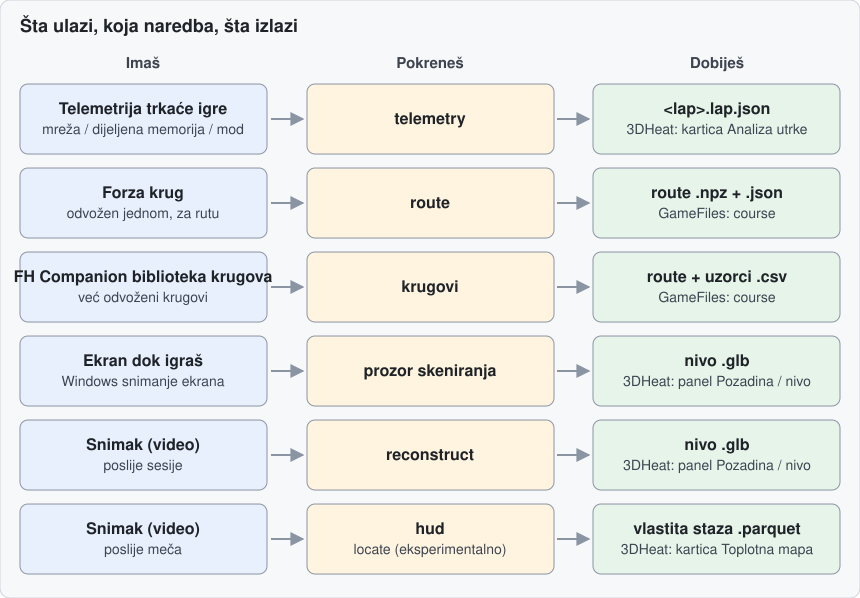

# 3DHeat GameCapture {#dheat-gamecapture}

**Šta je to?** Alat koji zapisuje ono što ti trkaća igra javlja o tvojoj vožnji, jedna datoteka
po krugu. Može i rekonstruirati grubi 3D model nivoa iz videa tvog igranja.

**Zašto bih ga koristio?** Da vidiš svoje krugove u [pregledniku 3DHeat](https://holdi601.github.io/3DHeat/):
gdje si kočio, gdje si bio spor, kako se dva kruga razlikuju. I da imaš nivo ispod svoje
toplotne mape kad niko nema njegov 3D model.

**Primjer:** uključi Forzin Data Out, pokreni jednu naredbu, vozi dva kruga. Dvije datoteke krugova
pojave se u `laps\`. Prevuci ih na karticu Analiza utrke preglednika.


Komandna linija ti je nova? Prvo pročitaj [Prije nego počneš](before-you-start.md).

## Tri posla {#the-three-jobs}

1. **Telemetrija krugova.** Bilježi svaki kanal koji trkaća igra objavljuje - Forzin Data Out,
   dijeljenu memoriju igara Assetto Corsa, mrežne tokove rally igara, BeamNG mod, Trackmania
   dodatak - i piše jednu `heat3d-lap` datoteku po krugu ili etapi, za karticu Analiza utrke
   preglednika. iRacing ne treba snimač: preglednik čita vlastite `.ibt` datoteke.
2. **Nivoi iz igranja.** Pretvara ono što je ekran pokazivao dok si hodao ili vozio kroz
   nivo u `.glb` 3D model, koji preglednik polaže ispod toplotne mape.
3. **Tvoj vlastiti meč, poslije njega.** `hud` čita HUD tvog vlastitog snimka - tvoje radnje, smrti,
   stazu na minimapi i kill feed. `locate` (eksperimentalno: do sada smješta malo stvarnih frameova) određuje
   gdje je nastao svaki frame, na 3D modelu nivoa.

Sva tri slijede jedno pravilo: **ništa se ne ubacuje u igru i ništa se ne hvata (hook)**. Frameovi dolaze
iz javnog API-ja za snimanje ekrana, telemetrija iz sučelja koja igre objavljuju za to. Vidi
[Pravila](../rules.md).



Kod je Python (paket `heat3d_capture`), MIT licenca. Modeli dubine i poze koje može
pokretati imaju vlastite licence - vidi [Modeli i licence](../models-and-licences.md).

## Brzi početak {#quick-start}

### Snimi krugove {#record-laps}

Treba ti Python 3.10 ili noviji ([Prije nego počneš](before-you-start.md)). U PowerShellu:

```powershell
git clone https://github.com/Holdi601/3DHeat-GameCapture
cd 3DHeat-GameCapture
python -m venv .venv
.venv\Scripts\python -m pip install -r requirements.txt

# Forza: Settings -> HUD and Gameplay -> Data Out = ON, IP 127.0.0.1, port 5300
.venv\Scripts\python -m heat3d_capture telemetry -o laps
```

**Trebao bi vidjeti** `listening on port 5300. Laps go to laps. Ctrl+C to stop.`, zatim red po krugu dok prelaziš liniju, kao
na gornjoj slici. Pritisni Ctrl+C da zaustaviš. Prevuci datoteke iz `laps\` na karticu Analiza utrke preglednika.
Svaka druga igra je jedan `--game` daleko:

```powershell
.venv\Scripts\python -m heat3d_capture telemetry --game acc -o laps
.venv\Scripts\python -m heat3d_capture telemetry --game dirtrally2 -o laps
```

Vidi [Snimači telemetrije](../telemetry.md) za svaku igru i opciju.

### Skeniraj nivo {#scan-a-level}

Dvaput klikni **`scan.bat`** u folderu alata. Nalazi Python (i nudi da ga instalira pomoću
winget ako ga nema), pravi privatni `.venv` i otvara prozor skeniranja. Prozor kaže
šta nedostaje, čemu služi svaki paket i koliko je preuzimanje veliko, te ne instalira ništa
bez tvog "da". Vidi [Izvršno okruženje i zavisnosti](../runtime.md) i
[Prozor skeniranja](../reconstruction-scan-ui.md).

Ručno: `.venv\Scripts\python -m heat3d_capture.ui`.

Da rekonstruišeš snimak offline, s putanjom kamere riješenom odjednom (treba PyTorch, paket
`vggt` i GPU - vidi [Offline rekonstrukcija](../reconstruction-offline.md)):

```powershell
.venv\Scripts\python -m heat3d_capture reconstruct lap.mp4 -o lap.glb
```

## Karta dokumentacije {#map-of-the-documentation}

| Stranica | Šta pokriva |
|---|---|
| [Prije nego počneš](before-you-start.md) | Python, terminal, prva naredba, česte greške |
| [Pravila](../rules.md) | Bez ubacivanja, samo objavljena sučelja i šta to košta |
| [Snimači telemetrije](../telemetry.md) | Naredba `telemetry` i pregled svake igre |
| [Forza](../telemetry-forza.md) | Data Out, otkrivanje rasporeda, FH Companion relej i njegov `.tele.gz` |
| [Igre Assetto Corsa](../telemetry-assetto-corsa.md) | AC, ACC, AC EVO, AC Rally iz dijeljene memorije |
| [Rally igre](../telemetry-rally.md) | EA SPORTS WRC, DiRT Rally 2.0 / 1 / DiRT 4, Richard Burns Rally |
| [BeamNG.drive](../telemetry-beamng.md) | Mod s protokolom `heat3d` |
| [Trackmania](../telemetry-trackmania.md) | Openplanet dodatak `Heat3dRecorder` |
| [iRacing](../telemetry-iracing.md) | Čitanje `.ibt` datoteka u pregledniku |
| [Dijeljenje na krugove i etape](../lap-splitting.md) | `LapSplitter`, `CounterSplitter`, `LineSplitter`, `StageSplitter` |
| [Klizanje, drift i izvedeni kanali](../slip-and-drift.md) | Kako se klizanje skalira i šta preglednik izvodi |
| [Datoteka heat3d-lap](../lap-format.md) | Format datoteke kruga, kanali, jedinice, `meta` |
| [Igre](../games.md) | Po igri: kako snimiti, šta se šalje, koje staze se mogu izvesti |
| [Naredbe](../commands.md) | `route`, `telemetry`, `laps`, `reconstruct`, `hud`, `locate`, korak po korak |
| [Referenca naredbi](../cli-reference.md) | svaka opcija, generirana iz `--help` |
| [Čitanje HUD-a iz snimka](../hud-video.md) | `hud`: vlastite radnje, smrti, staza na minimapi i kill feed iz snimka |
| [Lociranje frameova u nivou](../locate.md) | `locate`: gdje je nastao svaki frame, prema geometriji nivoa |
| [Rekonstrukcija nivoa](../reconstruction.md) | Tok od frameova do `.glb` |
| [Prozor skeniranja](../reconstruction-scan-ui.md) | Svaka kontrola, prečica i element preklopa |
| [Snimanje, maske i kvaliteta frameova](../reconstruction-capture.md) | Windows Graphics Capture, ključni frameovi, HUD maske, savjeti o kvaliteti |
| [Dubina](../reconstruction-depth.md) | Depth Anything V2, ONNX Runtime, gradnja modela |
| [Poza kamere i skala](../reconstruction-pose.md) | Odometrija, relokalizacija, poze iz telemetrije, skala tla, bundle adjustment |
| [Fuzija, pokrivenost i boja](../reconstruction-fusion-and-texture.md) | Volumen zauzetosti, mreža pokrivenosti, slabe tačke, boja vrhova |
| [Izlaz .glb](../glb-output.md) | Datoteka koju preglednik učitava |
| [Offline rekonstrukcija](../reconstruction-offline.md) | `reconstruct`, VGGT prozori i spajanje |
| [Modeli i licence](../models-and-licences.md) | Veličine Depth Anything V2, VGGT, paketi |
| [Izvršno okruženje i zavisnosti](../runtime.md) | Preflight, backendi, nivoi performansi |
| [Ograničenja i provjera](../limits.md) | Šta nije urađeno i šta nije provjereno |
| [Ažuriranja](../updates.md) | Provjera izdanja i `python -m heat3d_update` |
| [Razvoj](../development.md) | Testovi, virtualno okruženje, raspored repozitorija |
| [Održavanje ove dokumentacije](../maintaining.md) | Lista za provjeru pri izdanju koda i dokumentacije |

## Dio 3DHeat-a {#part-of-3dheat}

Datoteke koje ovo piše učitava **preglednik 3DHeat** -
[izvor](https://github.com/Holdi601/3DHeat), [dokumentacija](https://holdi601.github.io/3DHeat/).
Datoteke krugova idu na njegovu karticu Analiza utrke, `.glb` nivoi u njegov panel Pozadina / nivo, a tabele `hud` i `locate` na
njegovu karticu Toplotna mapa; kako preglednik čita tabele i datoteke mečeva opisano je u
[Jedna datoteka po meču (.3dheat)](https://holdi601.github.io/3DHeat/container.html) i
[Unos podataka](https://holdi601.github.io/3DHeat/getting-data-in.html).

| Alat | Šta radi | Dokumentacija |
|---|---|---|
| [Preglednik 3DHeat](https://github.com/Holdi601/3DHeat) | prikazuje toplotne mape, utrke i mečeve u 3D, u pregledniku | [dokumentacija](https://holdi601.github.io/3DHeat/) |
| [GameFiles](https://github.com/Holdi601/3DHeat-GameFiles) | staze i nivoi iz datoteka koje igre isporučuju, kao 3D modeli | [dokumentacija](https://holdi601.github.io/3DHeat-GameFiles/) |
| [GameCapture](https://github.com/Holdi601/3DHeat-GameCapture) | telemetrija krugova iz trkaćih igara; nivoi rekonstruirani iz video snimka igranja | [dokumentacija](https://holdi601.github.io/3DHeat-GameCapture/) |
| [Unreal Exporter](https://github.com/Holdi601/3DHeat-UnrealExporter) | dodatak za Unreal Editor koji izvozi nivo kao 3D model | [dokumentacija](https://holdi601.github.io/3DHeat-UnrealExporter/) |
| [CS2](https://github.com/Holdi601/3DHeat-CS2) | Counter-Strike 2 demoi u datoteke mečeva; mape u 3D modele | [dokumentacija](https://holdi601.github.io/3DHeat-CS2/) |
| [Watcher](https://github.com/Holdi601/3DHeat-Watcher) | bilježi tvoje igranje u pozadini iz onoga što igre objavljuju | [dokumentacija](https://holdi601.github.io/3DHeat-Watcher/) |
| [Ext-WarThunder](https://github.com/Holdi601/3DHeat-Ext-WarThunder) | War Thunder snimci u datoteke mečeva | [dokumentacija](https://holdi601.github.io/3DHeat-Ext-WarThunder/) |
| [Ext-WoT](https://github.com/Holdi601/3DHeat-Ext-WoT) | World of Tanks snimci u datoteke mečeva | [dokumentacija](https://holdi601.github.io/3DHeat-Ext-WoT/) |
| [Ext-WoWs](https://github.com/Holdi601/3DHeat-Ext-WoWs) | World of Warships snimci u datoteke mečeva | [dokumentacija](https://holdi601.github.io/3DHeat-Ext-WoWs/) |
| [Ext-Squad](https://github.com/Holdi601/3DHeat-Ext-Squad) | Squad serverski demoi u datoteke mečeva | [dokumentacija](https://holdi601.github.io/3DHeat-Ext-Squad/) |
| [Ext-DCS](https://github.com/Holdi601/3DHeat-Ext-DCS) | DCS World mape u 3D modele | [dokumentacija](https://holdi601.github.io/3DHeat-Ext-DCS/) |
| [Ext-IL2](https://github.com/Holdi601/3DHeat-Ext-IL2) | IL-2 Sturmovik mape u 3D modele | [dokumentacija](https://holdi601.github.io/3DHeat-Ext-IL2/) |

Programer s otvorenim projektom igre treba koristiti Unreal exporter, koji čita stvarnu
geometriju i tačan je. Gdje se vlastite arhive igre mogu čitati, GameFiles izvlači tačnu
stazu. Rekonstrukcija iz igranja je za slučaj kad je dostupan samo ekran.
