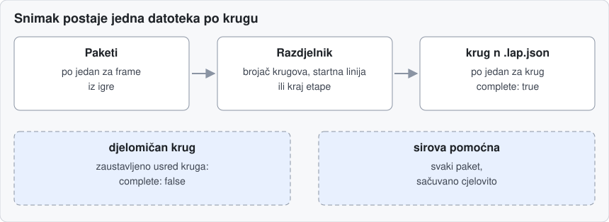

# Kako se dijele krugovi i dionice {#how-laps-and-stages-are-split}

Snimač vidi jedan neprekidan tok uzoraka. Pretvaranje u krugove radi jedan od četiri
razdjelnika, odabran prema onome što igra kaže o krugovima. Svi slijede istu ideju: koriste
igrino vlastito brojanje tamo gdje ga ima, a inače pronalaze krug iz pozicija; nikada
ne pišu fragment prekratak za poređenje.

| Razdjelnik | Kod | Koristi ga |
|---|---|---|
| `LapSplitter` | [`fulllap.py`](https://github.com/Holdi601/3DHeat-GameCapture/blob/main/heat3d_capture/telemetry/fulllap.py) | Forza |
| `CounterSplitter` | [`kunos.py`](https://github.com/Holdi601/3DHeat-GameCapture/blob/main/heat3d_capture/telemetry/kunos.py) | Assetto Corsa, ACC |
| `LineSplitter` | [`kunos.py`](https://github.com/Holdi601/3DHeat-GameCapture/blob/main/heat3d_capture/telemetry/kunos.py) | AC EVO, AC Rally, BeamNG |
| `StageSplitter` | [`rally.py`](https://github.com/Holdi601/3DHeat-GameCapture/blob/main/heat3d_capture/telemetry/rally.py) | EA SPORTS WRC, DiRT Rally 2.0, DiRT Rally, DiRT 4, Richard Burns Rally |

Trackmania dijeli vožnje unutar svog dodatka ([Trackmania](telemetry-trackmania.md)), a iRacing
datoteke dijeli preglednik prema brojaču krugova simulatora ([iRacing](telemetry-iracing.md)).

Na **Ctrl+C** svaki snimač poziva `flush()` svog razdjelnika, pa se otvoreni krug ili dionica
zapisuje ako zadovoljava iste minimume kao ispod.

## LapSplitter (Forza) {#lapsplitter-forza}

Parametri: `minimum_metres = 400`, `gap_seconds = 2.0`.

Za svaki dekodirani paket:

1. Ako je igrin `timestampMs` skočio naprijed za više od 2 sekunde od posljednjeg paketa,
   ili je išao unazad, otvoreni krug se prvo ispiše.
2. Ako je `isRaceOn` 0 (igra nije u trci), otvoreni krug se ispiše, a paket se
   odbacuje.
3. Ako nijedan krug nije otvoren, otvara se jedan s `lapNumber` paketa.
4. Ako se `lapNumber` razlikuje od otvorenog kruga, otvoreni krug se **zatvara kao završen**; njegov
   `seconds` je igrin `lastLap` kada je pozitivan. Krug zatvoren na ovaj način zapisuje se
   bez obzira na dužinu. Otvara se novi krug.
5. Paket se dodaje.

Snimač također ispisuje kada 2 sekunde stvarnog vremena nije stigao nijedan paket (igra je
pauzirana ili zatvorena usred kruga).

**Ispisivanje** zadržava otvoreni krug samo ako ima najmanje 2 uzorka i najmanje 400 m
`distanceTravelled`; zapisuje se kao nezavršen (`run`). Trka od tačke do tačke nikada ne računa
drugi krug, pa se uvijek ovako završi.

## CounterSplitter (AC, ACC) {#countersplitter-ac-acc}

Parametar: `minimum_metres = 300`. Hrani se svakim uzorkom s `completedLaps` grafičke stranice
i vremenom posljednjeg kruga.

- Prvi uzorak otvara krug numerisan trenutnim `completedLaps`.
- Kada se `completedLaps` promijeni, otvoreni krug se zatvara. On je **završen**, s
  `seconds = last lap ms / 1000` (ako je pozitivno), samo ako je brojač porastao za tačno 1 -
  skok nazad na 0 (ponovno pokretanje sesije) ili za nekoliko zatvara ga kao nezavršen.
- Zatvoreni krug se zapisuje samo ako ima uzorke i najmanje 300 m prevožene putanje.
- Ispisivanje zadržava otvoreni krug ako ima više od jednog uzorka i najmanje 300 m.

## LineSplitter (AC EVO, AC Rally, BeamNG) {#linesplitter-ac-evo-ac-rally-beamng}

Parametri: `radius = 15 m`, `minimum_metres = 300`, `stop_seconds = 8`.

Ove igre ili nemaju brojač krugova na stranici koju snimač čita, ili vozi dionice.
**Linija je mjesto gdje je snimanje počelo**:

1. Vodoravni položaj prvog uzorka (`x`, `z`) postaje linija.
2. Kada automobil pređe više od 5 m, smjer od linije do automobila postaje
   smjer kruga.
3. **Zaustavljanje** završava vožnju: kada `speed` ostane ispod 1 m/s 8 sekundi, otvoreni krug
   se ispisuje (tako završava reli dionica: automobil staje na cilju).
4. **Prelazak linije**: nakon više od 300 m puta, prikupljaju se uzorci unutar 15 m od linije.
   Kada automobil ponovo napusti taj radijus, najbliži prikupljeni uzorak je
   prelazak. Ako je automobil tu išao istim smjerom kao smjer kruga (skalarni
   proizvod lokalnog smjera sa smjerom je pozitivan), krug se zatvara u
   tom uzorku; inače se prolaz ignoriše (automobil je prešao start vozeći u drugom smjeru).
5. `seconds` zatvorenog kruga je vrijeme od njegovog prvog uzorka do prelaska. On je
   **završen samo ako je njegov prvi uzorak bio brži od 5 m/s**: krug koji je počeo iz
   mirovanja je lansiranje, a ne krug za poređenje. Prvi krug snimka započetog na
   startnoj rešetki stoga je uvijek nezavršen; snimanje započeto na letećem krugu daje završen
   prvi krug pri sljedećem prelasku.
6. Sljedeći krug počinje u uzorku prelaska (pripada oba kruga).

Krugovi kraći od 300 m se odbacuju. Ispisivanje (zaustavljanje ili Ctrl+C) zadržava otvoreni krug ako ima
najmanje 2 uzorka i 300 m, kao nezavršen. BeamNG ispisuje na isti način kada se vozilo
resetuje (njegov sat ide unazad), prije pokretanja novog razdjelnika, tako da se
vožnja prije reseta zadrži.

Udaljenosti su vodoravne (`x`, `z`) za brojač puta i test linije, a pune
3D za test dužine od 300 m.

## StageSplitter (reli igre) {#stagesplitter-rally-games}

Parametar: `minimum_metres = 300`. Hrani se svakim uzorkom s igrinim satom dionice, time kaže li
igra da je automobil završio, i opcionalno igrinim vlastitim vremenom za to.

1. Ako je sat 0 ili manje, ili je otišao unazad za više od 0,5 s, otvorena dionica se
   **napušta**: zadržava se kao djelimična dionica ako nije završena, ima više od 10 uzoraka i
   najmanje 300 m. Sat od 0 ili manje također odbacuje uzorak (automobil je na startu).
2. Ako nijedna dionica nije otvorena, otvara se nova (numerisana 1, 2, ... za snimak).
3. Kada je dionica završena, daljnji uzorci se ignorišu dok sat ne ode unazad.
4. Svaki uzorak se pohranjuje s `time` postavljenim na sat dionice.
5. Kada igra kaže da je završeno, dionica je završena; njen `seconds` je igrino vrijeme kada je
   dano i pozitivno, inače sat. Zapisuje se ako je pokrila najmanje 300 m.

Šta "završeno" znači po igri:

| Igra | Završeno kada |
|---|---|
| EA SPORTS WRC | dužina dionice > 0 i udaljenost dionice >= dužina - 0,5 m |
| DiRT igre | završeni krugovi porasli iznad početnog broja dionice, ili (događaj od jednog kruga) udaljenost kruga >= 99,9% dužine staze |
| Richard Burns Rally | sat trke > 0 i udaljenost do kraja <= 0 |

Za RBR se osa gore i brzina utvrđuju kada se dionica zapisuje (pogledajte
[Reli igre](telemetry-rally.md#richard-burns-rally-rsf--ngp)).

## Vrijeme i udaljenost u datoteci kruga {#time-and-distance-in-the-lap-file}

Za svaki snimač osim Forze, `time` je pomaknut tako da je prvi uzorak kruga 0, a
`distance` je kumulativna 3D udaljenost između uzastopnih pozicija. Forza koristi
igrin vlastiti mjerač kruga i brojač udaljenosti, pomaknute na isti način.
