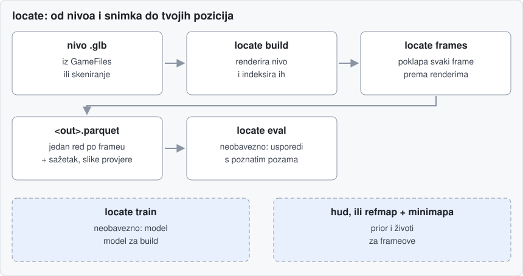

# Lociranje kadrova u nivou {#locating-frames-in-a-level}

`locate` utvrđuje gdje je snimljen svaki kadar snimka igranja - 3D poziciju kamere
i smjer pogleda - poklapanjem slike s renderima geometrije samog nivoa. Namijenjen je
igrama koje ne vode zapis o tome gdje je igrač bio: nema demoa, datoteke replaya ni telemetrije.
Battlefield 6 je prvi.

> **Eksperimentalno.** Na stvarnim snimcima za sada smješta samo mali dio kadrova; pogledajte
> [Stvarni kadrovi: eksperimentalno](#real-frames-experimental).

```bash
# Once per level: render it from every place a player can stand, and index the renders.
.venv\Scripts\python -m heat3d_capture locate build level.glb -o level.db

# Per recording: where was each frame taken?
.venv\Scripts\python -m heat3d_capture locate frames "<recording>.mp4" --db level.db -o out/match
```

Pozicija dolazi **iz slike**, naspram cijelog nivoa, bez prethodnog znanja. Trag mini-mape
iz [HUD čitača](hud-video.md) samo je rezerva za kadrove koje slika ne može smjestiti, a svaki
red kaže od koje od te dvije stvari je došao.




## Šta dira, a šta ne {#what-it-does-and-does-not-touch}

- Čita igračev **vlastiti snimak** i datoteku nivoa koju je igrač izvezao iz svoje **vlastite
  kopije** igre. Nikad ne dira igru, njenu memoriju, njene datoteke dok radi ni njenu
  mrežu, i radi nakon meča. Pogledajte [Pravila](rules.md).
- Smješta **samo igračevu vlastitu kameru**: kadar je igračev vlastiti pogled.
- Nivo, baza izgrađena iz njega i sve što je iz njega renderovano pripadaju izdavaču
  igre. Čuvajte ih lokalno.

## Zahtjevi {#requirements}

- Ono što navodi `requirements.txt`, PyTorch (sa pytorch.org, za GPU) i
  `requirements-locate.txt`:

```bash
.venv\Scripts\python -m pip install -r requirements-locate.txt
```

- GPU s OpenGL 3.3 (4.3 je brži) za rendere, a po mogućnosti CUDA za modele. Na
  CPU-u radi, sporo.
- Modeli se preuzimaju pri prvoj upotrebi (oko 450 MB): DINOv2 sa Hugging Facea, ALIKED i
  LightGlue preko kornije. Svi imaju licencu za komercijalnu upotrebu; pogledajte [Licence](#licences).
- **Nivo** kao `.glb` (ili `.gltf`) u okviru pregledača, Y gore, **s teksturama osnovne boje**,
  kako ga zapisuju 3DHeat izvoznici (dijelovi `ground:` / `structure:`; nazivi dijelova
  nisu potrebni). Jedna jedinica je jedan metar osim ako `extras.unit_metres` na vrhu datoteke ne kaže
  drugačije. GameCapture skeniranje (`reconstruct`, prozor za skeniranje) zapisuje se u **centimetrima** i
  nosi `extras.unit_metres: 0.01`, pa se čita u pravoj veličini. Nivo bez tekstura radi
  mnogo lošije; pogledajte [Ograničenja](#limits).

## Komande {#commands}

### `locate build <level> -o <db>` {#locate-build---o-}

Renderuje nivo sa svakog mjesta na kojem je igrač mogao stajati i pohranjuje, po renderu, njegovu pozu i jedan
globalni deskriptor.

| Opcija | Zadano | Značenje |
|---|---|---|
| `level` | | `.glb` / `.gltf` nivoa. |
| `-o`, `--out` | | Folder baze koji se zapisuje. |
| `--game` | `bf6` | Profil igre: visine očiju, vidno polje, okviri HUD-a, brzina (dolje). `generic` za bilo koju igru iz prvog lica. |
| `--eye` | iz profila | Visine očiju iznad poda u metrima, prvo stojeći. Jedan pogled baze po visini. |
| `--fov` / `--vfov` | iz profila | Horizontalno vidno polje snimka, ili vertikalno (Battlefieldov klizač) za snimak 16:9. |
| `--spacing` | 2.5 | Metri između mjesta s kojih se uzimaju pogledi. |
| `--yaw-step` | 30 | Stepeni između smjerova pogleda. |
| `--pitch` | 0 | Nagibi za renderovanje, stepeni prema gore. |
| `--positions` | nema | Tabela (Parquet ili CSV s `x`, `y`, `z` na stopalima, u okviru nivoa) iz koje se uzimaju mjesta umjesto svakog poda: na primjer izlaz prethodne vožnje. |
| `--shadows` | isključeno | Bacite sjene sunca u renderima (vlastito sunce nivoa kad ga datoteka navodi u `extras.sun`). |
| `--untextured` | isključeno | Renderujte samo oblik i svjetlo. |
| `--box X0 Z0 X1 Z1` | cijela datoteka | Samo mjesta unutar ovog okvira (jedinice nivoa): zona igre. |
| `--places` | `auto` | Odakle se uzimaju pogledi: `nav` - igrači na visini očiju iznad navigacione mreže nivoa (dijelovi `nav:`: tačno gdje im igra dozvoljava hodanje), kamere vozila na svojoj visini iznad dijelova `ground:` (teren i putevi) u krugu od 50 m od nje; `ground` - oboje iznad `ground:`; `floors` - iznad svake površine okrenute prema gore (i krovovi i sanduci); `auto` - `nav` kad nivo ima navigacionu mrežu, inače `floors`. |
| `--head` | nema | Glava po mapi iz `locate train` za deskriptore. |

Zapisuje `<db>/db.json` (iz čega i čime je izgrađena) i `<db>/views.npz` (poze, deskriptori).

### `locate frames <recording> --db <db>` {#locate-frames----db-}

| Opcija | Zadano | Značenje |
|---|---|---|
| `source` | | Video, slika ili folder slika (uzimaju se po redoslijedu imena, na razmaku `--fps`). |
| `--db` | | Baza koju je zapisao `build`. Njena datoteka nivoa mora još biti tamo gdje je bila (ili `--level`). |
| `-o`, `--out` | `<source>.locate` | Putanja izlaza bez nastavka. |
| `--fps` | 2 | Locirani kadrovi po sekundi videa. |
| `--start`, `--seconds` | sve | Dio videa koji se čita. |
| `--width` | 1280 | Širina na kojoj se kadrovi poklapaju. |
| `--shortlist` | 8 | Pogledi baze isprobani po kadru blizu prethodnog znanja ili tačke. |
| `--search-shortlist` | 16 | Bez prethodnog znanja: pogledi baze isprobani po kadru ([pretraženi zajedno](#with-no-prior-frames-searched-together)). |
| `--no-search` | isključeno | Bez prethodnog znanja: pretražite svaki kadar zasebno i vjerujte njegovoj tački bez susjeda. |
| `--accept-depth` | 0 (isključeno) | Bez prethodnog znanja: vjerujte tački samo ako je daleka udaljenost njenih poklapanja toliko puta veća od bliske. |
| `--accept-support` | 2 | Bez prethodnog znanja: koliko susjeda duž života koji se slažu treba da bi se tački vjerovalo. |
| `--checkpoint` | nema | Čuvajte stanje vožnje ovdje i nastavite iz njega ako postoji. |
| `--stop-file`, `--stop-process` | nema | Zaustavlja se sam, sa spremljenim stanjem i izlaznim kodom 75, kad ova datoteka postoji ili radi proces čije ime počinje ovim (provjerava se prije svakog kadra; može se ponoviti), da duga vožnja oslobodi računar za igru. Ista komanda nastavlja. |
| `--normalise` | nema | Laka normalizacija prije poklapanja: `clahe`, `gray`. |
| `--minimap` | nema | Tabela komande `hud`: **rezerva** za kadrove koje slika ne može smjestiti. |
| `--prior-radius` | nema | **Neobavezno ubrzanje**, zadano isključeno: pretražujte samo poglede baze udaljene ovoliko metara od pozicije mini-mape (traži `--minimap`). |
| `--minimap-anchor` | nema | JSON datoteka koja veže mini-mapu za nivo ([mini-mapa kao prethodno znanje pretrage](#the-minimap-as-a-search-prior)): mini-mapa sužava pretragu od prvog kadra; tako nađene tačke su `visual+minimap-prior`. |
| `--no-level-search` | isključeno | S prethodnim znanjem: kad ništa blizu njega ne odgovara, ne pretražujte i cijeli nivo (brže). |
| `--lives` | tabela `--minimap` | Tabela komande `hud` čije smrti, raspoređivanja i oživljavanja kažu kad je igrač bio u igri: pozicije skaču samo preko smrti ([životi iz snimka](#lives-from-the-footage)). |
| `--no-sequence` | isključeno | Odlučite o svakom kadru zasebno, ne duž vožnje (dolje). |
| `--fit-fov` | isključeno | Nakon vožnje prilagodite vidno polje najjačim tačkama, po pogledu, i prijavite ga. |
| `--check-every` | 0 | Također svakih N kadrova, smještenih ili ne, slika u `<out>.check`. |
| `--no-checks` | isključeno | Ne zapisuj kontrolne slike vizuelnih tačaka (dolje). |
| `--no-zoomed` | isključeno | Ne rješavaj zumirane poglede iz tačaka njihovih susjeda (dolje). |
| `--no-grow` | isključeno | Ne pretražuj ponovo blizu svake tačke za kadrove oko nje koji još nemaju tačku. |
| `--game`, `--eye`, `--fov`, `--vfov`, `--mask`, `--no-hud-mask`, `--max-speed` | iz profila | Kao gore; `--mask x,y,w,h` dodaje okvir ekrana (na ekranu 1920x1080) koji nije nivo. |
| `--vehicle-vfov` | iz profila | Vertikalno vidno polje kamera vozila (Battlefieldov klizač za vozila). |
| `--settings` | najnovija datoteka postavki | `bf6`: datoteka postavki igre iz koje se čitaju vidna polja (samo čitanje) kad nije dat `--fov`/`--vfov`; zadano najnoviji `PROFSAVE*_profile` pod `Documents/Battlefield 6/settings`. Sadrži postavke kakve su sada, koje možda nisu bile takve kad je stariji snimak pravljen. |

### `locate refmap <level> <deploy screen> -o <refmap>` {#locate-refmap----o-}

Smješta vlastitu mapu igre na nivo: referencu naspram koje se čita mini-mapa
([mini-mapa, čitana naspram nivoa](#the-minimap-read-against-the-level)). `<deploy screen>` je
slika ekrana raspoređivanja koja prikazuje cijelu mapu, ili snimak sa `--at <seconds>` u takvom
trenutku; iz njega se izrezuje okvir mape profila (`--whole-picture` zadržava cijelu sliku). Zapisuje
`<refmap>.png` (mapa ponovo uzorkovana na vlastiti okvir nivoa, `--mpp` metara po pikselu, zadano 0.5),
`<refmap>.valid.png` (gdje je to mapa, a ne marker ili oznaka) i `<refmap>.json` (okvir i
kalibracija, s onim koliko su pločice mape bile udaljene od njega). `--topdown <prefix>` zadržava nivo
renderovan odozgo za sljedeću vožnju (`--topdown-mpp`, zadano 0.656 m; `--box` ga ograničava).

### `locate minimap <recording> --refmap <refmap> -o <table>.parquet` {#locate-minimap----refmap---o-parquet}

Čita mini-mapu snimka naspram referentne mape, kadar po kadar (`--fps`, zadano 2):
pozicija, smjer i zum svake mini-mape koja se poklapa, u okviru nivoa, zapisano kao
tabela mini-mape sa sidrom pored (`<table>.anchor.json`) koje `locate frames` prima kao
`--minimap <table>.parquet --minimap-anchor <table>.anchor.json`. Uz tabelu komande `hud`
(`--hud`) prenose se njeni životi; uz sidro i za tu tabelu (`--hud-anchor`) prva
pretraga je oko mjesta gdje ono smješta igrača, a gdje se nijedna mini-mapa ne poklapa popunjava se
vlastiti trag HUD-a, pomjeren na najbliže tačke referentne mape (`--hud-fill`, sekunde, zadano 120; 0 to isključuje).
`source` tabele kaže koje je (`refmap`, `hud`).

### `locate eval <out>.parquet --truth <poses>` {#locate-eval-parquet---truth-}

Upoređuje rezultat s poznatim pozama kamere: tabela s `time`, `x`, `y`, `z` (oko), `yaw`,
`pitch` u okviru nivoa. `--offset` je pomak sata (vrijeme istine = vrijeme videa + pomak);
bez njega se pomak traži. `--unit-metres` pretvara greške u metre.

## Profili igara {#game-profiles}

| | `bf6` | `generic` |
|---|---|---|
| Visine očiju | 1,6 m stojeći, 1,05 m čučeći (još nisu izmjerene u igri) | 1,65, 1,1 m |
| Vidno polje | 55 stepeni vertikalno, oko 86 horizontalno pri 16:9: **proslijedite igračevo vlastito** s `--vfov` | 90 horizontalno |
| Maskirani HUD | mini-mapa i lista odreda, kill feed, kompas, municija, igračevo oružje, iskočni prozori, nišan | nišan |
| Najbrže pješice | 8 m/s | 8 m/s |
| Razlikovani pogledi | pješice, vozilo, zumirano (dolje) | svaki kadar pješice |
| Kamere vozila | klizač za vozila (iz datoteke postavki), vozilo maskirano, kamera do 8 m iznad poda, 30 m/s | - |

Vidno polje je najvažnije: kadar riješen s pogrešnim riješen je s pogrešnom žižnom
daljinom, a njegova pozicija klizi duž pogleda.

## Izlazi {#outputs}

### `<out>.parquet` {#parquet}

Jedan red po lociranom kadru, u **okviru nivoa** (Y gore, jedinice nivoa), s uputama
pregledaču za čitanje u podnožju (`kind: heat3d-locate`). Podnožje navodi svaku kolonu koja nema
vlastitu ulogu kao dodatnu, pa ih pregledač sve zadržava (njegova kartica za pregled ih prikazuje).

| Kolona | Značenje |
|---|---|
| `time` | Sekunde od početka videa. |
| `event` | `start` na prvom redu života, `position` na ostalima. |
| `x`, `y`, `z` | Oko, izglađeno unutar života. Prazno gdje nijedan izvor nije smjestio kadar. |
| `yaw`, `pitch` | Stepeni: yaw oko ose gore (0 duž +X, raste prema -Z, što je vlastiti yaw igre u okviru pregledača), pitch gore od horizontale. `pitch` je prazan za redove mini-mape. |
| `dir_x`, `dir_y`, `dir_z` | Smjer pogleda. |
| `player`, `team`, `session` | `me`, `own` i `<video>#NN`, jedan po životu. |
| `life` | Život u kojem je snimak pokazao kadar (iz smrti u HUD-u; 1 = prvi). Prazno kad je van igre (mrtav, oboren, raspoređuje se) ili kad životi nisu pročitani. `session` je život traga, koji se može razdvojiti i na skoku. |
| `source` | `visual` (iz slike), `visual+minimap-prior` (iz slike, pretraga sužena prethodnim znanjem mini-mape), `minimap` (rezerva), `minimap+nav-floor` (unutra: mini-mapa i pod navigacione mreže) ili `none`. |
| `view` | `foot`, `vehicle`, `zoomed` ili `screen` (dolje). |
| `cam_x`, `cam_y`, `cam_z` | Kamera koja je vidjela kadar. Pješice i kroz nišan to je oko, a `x`, `y`, `z` su isti; u pogledu vozila iz trećeg lica `x`, `y`, `z` su vozilo (model pomaka dolje), a kamera jaše iza i iznad njega. |
| `hfov`, `zoom` | Horizontalno vidno polje s kojim je kadar riješen, a za zumirani pogled njegov zum naspram normalnog pogleda. |
| `confidence` | 0..1: koliko vjerovati redu (dolje). |
| `uncertainty` | Tipična greška reda, jedinice nivoa: za vizuelnu tačku iz njenih inliera i susjeda, za red mini-mape iz prilagođavanja (dolje). |
| `inliers`, `rmse` | Inlieri PnP rješenja iz slike i greška reprojekcije (pikseli pri radnoj širini). |
| `x_raw` ... `pitch_raw` | Rješenje iz slike prije izglađivanja (i za izuzetke koji su izglasani van). |
| `kept` | Vizuelna tačka je preživjela glasanje o izuzecima. |
| `note` | Zašto kadar nije smješten ili je izglasan van. |

### `<out>.summary.json` {#summaryjson}

Kadrovi, vizuelne tačke, izuzeci, životi, redovi po izvoru, prilagođavanje mini-mape (parovi, inlieri, rezidual),
vrijeme po kadru.

## Metoda {#method}

### Baza {#the-database}

Mjesta su tačke na svakom trouglu nivoa okrenutom prema gore, ravnomjerno raspoređene (jedna po `--spacing`
na 3D rešetki, pa svaki sprat zgrade dobija svoja). Svako se provjerava iz svog oka sa šest
malih rendera dubine: kamera unutar geometrije vidi uglavnom stražnje strane, u puzajućem prostoru
ima nešto čvrsto iznad oka; oba se odbacuju. Sa svakog mjesta nivo se renderuje na svakoj visini oka,
svakog `--yaw-step` i svakog `--pitch`, a svaki render opisuje **DINOv2** (njegovi tokeni zakrpa
udruženi generalizovanom sredinom, spojeni s tokenom klase).

Lokalne karakteristike i 3D tačke naspram kojih se kadar na kraju rješava **nisu pohranjene**: nastaju
ponovo kad zatrebaju, renderovanjem nekoliko pogleda koje je pretraga odabrala, što traje milisekunde. To
drži bazu na nekoliko stotina megabajta umjesto desetina gigabajta i omogućava
doradu dolje. Cijena je što `frames` treba datoteku nivoa i GPU, ne samo bazu.

### Jedan kadar {#one-frame}

1. **Maskirajte** ono što nije nivo: okvire HUD-a profila i nišan, plus svaki `--mask`.
2. **Pretraga** po **cijelom nivou**: deskriptor kadra naspram svakog pogleda baze; najsličnijih
   nekoliko desetina, prorijeđenih tako da drže različita mjesta i smjerove, je uža lista.
3. **Poklapanje**: svaki pogled s uže liste renderuje se ponovo na veličini i vidnom polju kadra, sa
   svojom dubinom. ALIKED ključne tačke kadra i rendera poklapaju se pomoću LightGlue. Poklopljeni piksel rendera
   plus njegova dubina je 3D tačka nivoa, pa je svako poklapanje 2D-3D korespondencija;
   ključne tačke na rubu dubine (čija dubina može pripadati onome što je iza njih) odbacuju se.
4. **Poza**: PnP s RANSAC-om (SQPnP), zatim robusna dorada koja drži kameru ravno - pogled iz
   prvog lica se ne valja - i minimizira grešku reprojekcije inliera.
5. **Je li moguće?** Poza mora biti na visini igračevog oka iznad poda i izvan geometrije
   (render dubine pravo dolje). Slična tekstura drugdje - popločan pod poklopljen sa zidom
   istog materijala - može dati stotine inliera na pozi koju nijedan igrač ne bi mogao imati; one se
   odbacuju, koliko god inliera imale.
6. **Renderujte i uporedite**: nivo se renderuje na riješenoj pozi i ponovo poklapa, što
   zamjenjuje pogled baze udaljen do nekoliko metara i desetina stepeni pogledom koji se gotovo
   poklapa s kadrom. Ponavlja se dok dobija inliere (najviše dvaput).
7. **Biranje**: tri najjača mjesta (udaljena više od oko 3 m) dorađuju se prije nego što se
   jedno izabere. Slično mjesto može voditi prije dorade; pravo mjesto od nje dobija daleko više.
8. **Presuda**: `confidence` kombinuje broj inliera, najbolje drugo mjesto (`runner_up`) i
   grešku reprojekcije. Tačka je `ok` s najmanje 25 inliera, bez drugog mjesta unutar 80% njenih
   inliera i s pouzdanošću od najmanje 0,85 - pragom koji mjerenja dolje postavljaju na 97,5-99%
   tačnih.

### Pogledi {#views}

Kadar nije uvijek igračeve oči. Detektor profila iz HUD-a čita o kojem se pogledu radi,
i kadar se rješava u skladu s tim:

- **Pješice**: vidno polje pješadije i visine očiju.
- **Vozilo** (Battlefield 6: oznake tastera dijagrama sjedišta, `C CAMERA` i `E EXIT`, dolje u
  sredini): vidno polje vozila, samo vozilo maskirano (donja sredina ekrana u
  pogledu iz trećeg lica) i kamera dozvoljena do 8 m iznad poda. Tačka je tačka kamere.
- **Ekran** (tamni rubovi oko tamne sredine: mapa raspoređivanja, meni, rezultati): nije pogled
  na nivo; preskače se.
- **Zumirano** (durbin, strijelčev nišan, vlastiti pogled iz prvog lica vozila: jedan rub ekrana crn,
  oba tamna, oko svijetle slike): ne traži se po nivou - isječak nivoa u durbinu ne liči
  ni na jedan od širokih pogleda baze - nego se rješava poslije vožnje iz najbliže tačke
  u roku od 6 s, dolje. Isključuje se s `--no-zoomed`.

### Zumirani pogledi {#zoomed-views}

Uski pogled slabo određuje poziciju: korak unazad s malo više zuma izgleda gotovo isto.
Zato zumirani kadar počinje od mjesta gdje susjed kaže da je nišan - pješice oko te tačke, u
vozilu 2,5 m iznad tla ispod sredine vozila (nišan kupole) - i koliko se mogao
pomjeriti otad: 2 m, plus 4 m u sekundi pješice ili 8 u vozilu, najviše 12 m (`reach`).

1. **Smjer i zum, pozicija držana.** Za svaki zum od 1, 1.2 (vlastiti pogled vozila,
   uži nego pješice), 1.5, 2, 3, 4, 6 i 8, nivo se renderuje na sjedištu u smjerovima
   unutar 30 stepeni od susjedovog (a od 3x i nekoliko nagiba). Ključne tačke kadra poklopljene
   s renderom, s tačkama nivoa ispod njih, su zraci iz sjedišta; rotacija im se prilagođava
   po dvije (RANSAC) za žižne daljine od 0,75 do 1,3 puta daljine tog zuma, a tačka
   se slaže unutar ugla koji dozvoljava da je sjedište `reach` pogrešno na njenoj udaljenosti. Zum,
   smjer i žižna daljina s kojima se slaže najviše tačaka pobjeđuju.
2. **Smireno.** Te tačke zatim zajedno prilagođavaju poziciju, smjer i žižnu daljinu, prema
   svojoj grešci reprojekcije, a pozicija se drži uz sjedište cijenom od dva piksela po `reach` pomaka;
   još jednom se renderuje na odgovoru i ponovo prilagođava. Inlieri i greška broje se u pikselima, a
   tačka je `ok` po istoj pouzdanosti kao svaka druga.

Zapisani zum (`zoom`) je naspram vidnog polja vožnje pješice; `hfov` je riješeno. U
vozilu je zapisana pozicija vozilova, 2,5 m ispod nišana, kao za njegov pogled iz
trećeg lica.

### Vozila: kamera i vozilo {#vehicles-the-camera-and-the-vehicle}

U pogledu iz trećeg lica na vozilo riješena poza je poza kamere za praćenje, koja jaše iza i
iznad vozila i zamahuje oko njega dok igrač gleda unaokolo. Zapisana pozicija (`x`, `y`,
`z`) je vozilova - tlo ispod njegove sredine: kamerina plus `vehicle_offset` profila,
toliko metara naprijed duž horizontalnog smjera pogleda kamere i toliko
dolje. Kamera ostaje u `cam_x`, `cam_y`, `cam_z`. Pretvaranje se radi prije sekvence i
traga, pa se kamera koja zamahuje oko vozila koje stoji ne uzima za kretanje. Podnožje
tabele nosi korišteni pomak i je li izmjeren (`vehicleOffset`). Pješice i kroz
nišan nema pomaka.

Kako je izmjeren pomak za Battlefield 6: na tačnim tačkama stvarnih kadrova tenka iz trećeg lica
sredina tenka je označena okom na kadru, a nivo renderovan na tački dao je
tlo na tom pikselu. Profil uzima medijan: oko 10 m ispred kamere i oko 4 m
ispod nje. Označavanje je tačno na metar-dva, i to je jedna vrsta vozila: automobil ili helikopter
jaše kameru drugačije.

### Bez prethodnog znanja: kadrovi pretraženi zajedno {#with-no-prior-frames-searched-together}

Globalni deskriptor jednog kadra naspram cijelog nivoa je slab signal, a inlieri jednog kadra
ne razlikuju pravo mjesto od sličnog. Zato se bez prethodnog znanja kadrovi snimka opisuju
prvo i pretražuju zajedno (`search.py`), a tački se vjeruje samo s kadrovima oko nje:

- **Uža lista.** Sličnosti svakog pogleda mjere se naspram njegove vlastite sredine i raspršenja kroz
  snimak, tako da pogled koji liči na svaki kadar prestaje svuda pobjeđivati. Svaki kadar ocjenjuje
  ćelije rešetke od 24 m prema rangu njihovog najboljeg pogleda; najbolja putanja kroz ćelije duž svakog
  života, u granicama onoga što igrač može preći između kadrova, daje vjerovanje po ćeliji, a najbolji pogled
  svake ćelije, prvo najbolje vjerovan, je jedna lista. Obična pretraga je druga, i uzimaju se
  naizmjence: mjerenje pogleda naspram snimka kažnjava mjesto koje igrač jedva napušta,
  a upravo tamo obična pretraga dobro radi.
- **Vjerovanje.** Kandidat se računa samo ako njegovi inlieri pokrivaju najmanje 12% rešetke 8 x 8 preko
  kadra: sličan predmet je ponovljen objekt, hrpa kontejnera, sa stotinama inliera na
  nekoliko ćelija kadra. Tački se vjeruje kad leži na najboljoj putanji kroz kandidate koji se
  računaju (dolje) s najmanje dva susjeda u roku od 6 s koji se s njom slažu. Kadar van
  igre se uopće ne pretražuje.
- **Rast.** Raste se samo iz onoga čemu se vjeruje, a tačka koja raste mora pokrivati kadar na isti način.

### Duž vožnje {#along-the-run}

Svaki kadar zadržava svaku fizički moguću pozu koju je našao, po jednu za mjesto (`candidates`), ne samo
najjaču. Vožnja zatim bira po jednu za kadar - ili nijednu - tako da izabrane poze čine putanju koju
je igrač mogao proći pješice ili vozeći, a što više inliera leži na njoj: skriveni Markovljev
model, dekodiran odjednom (Viterbi). Sličnost koja sama pobijedi u jednom kadru gubi od mjesta
s kojim se slažu njeni susjedi; slab kandidat kroz koji putanja prolazi, s najmanje dva susjeda koji se slažu,
postaje tačka (`note`: izabrano duž sekvence); sigurna tačka koju svi susjedi
opovrgavaju prestaje to biti. Susjed se računa kao saglasan samo u roku od 6 s: dalje jedan od drugog,
udaljenost koju igrač - a kamoli vozilo - može preći je toliko velika da slaganje
ne govori ništa. Isključuje se s `--no-sequence`.

### Vremena kadrova {#frame-times}

`time` reda je vlastita vremenska oznaka kadra u snimku, a ne njegov broj preko nominalne
brzine kadrova. Snimci odstupaju od nominalne brzine (za nekoliko desetinki sekunde unutar klipa, na onima
koji su mjereni), a sve što čita kadar nazad po njegovom vremenu -
kontrolne slike, zumirani prolaz, `locate train --real`, mini-mapa iz komande `hud` - traži
po vremenskoj oznaci. Prebrojani kadrovi bi postavili kadar kontrolne slike toliko daleko od onog
koji je lociran.

### Vidno polje, iz kadrova {#the-field-of-view-from-the-frames}

`--fit-fov` zadržava najjače tačke vožnje (po pogledu) i dorađuje poze i žižnu
daljinu svake zajedno na njihovim inlierima; medijan preko njih je vidno polje s kojim je snimak
pravljen, prijavljeno u sažetku (`hfov_fitted`) za `--fov` sljedeće vožnje. Bliske i daleke tačke se pomjeraju
drugačije pri promjeni žižne daljine nego pri promjeni pozicije, što ga i određuje;
trebaju mu tačke s dubinom u sebi, a ne ravan zid.

### Model po mapi {#a-per-map-model}

`locate train` trenira malu glavu povrh DINOv2 za jedan nivo, na njegovim renderima, tako da
globalni deskriptor nalazi prave poglede stvarnih kadrova, a ne samo rendera:

- **Glava**: svaki token zakrpe kroz dvoslojnu projekciju, udružen generalizovanom sredinom preko
  zakrpa koje pokazuju nivo, spojen s projektovanim tokenom klase. DINOv2 ostaje zamrznut. Sve
  to napisano ovdje (MIT).
- **Parovi**: mjesto na prohodnom tlu i smjer, renderovani dvaput iz poza udaljenih do
  metar-dva i desetak stepeni, pri vidnim poljima udaljenim do 10 stepeni, pod
  različitim svjetlom (sunce, sjene, ambijent), svaki kroz izgled nalik igri: korekcija boja, izmaglica po dubini,
  bloom, vinjeta, dim, ljudi na putu, igračevo vlastito vozilo u pogledima vozila, zamućenje pokreta,
  šum, JPEG (`augment.py`). Maskirano kao kadar. Mjesta unutar nekoliko metara okrenuta u istom
  smjeru ne računaju se kao negativi.
- **Stvarni kadrovi**: kadrovi s pozom koju je cjevovod sam našao (pseudo-oznake: tačke izabrane duž
  sekvence) mogu se pridružiti kao parovi - kadar i render na njegovoj pozi - u drugom krugu.
- **Gubitak**: kontrastivni (InfoNCE) preko serije.

`locate build --head <head.pt>` gradi bazu s njom; `frames` je zatim koristi za kadrove.

| Opcija `locate train` | Zadano | Značenje |
|---|---|---|
| `-o`, `--out` | obavezno | Datoteka glave koja se zapisuje (`.pt`). |
| `--steps` | 600 | Koraci treniranja. |
| `--real TABLE VIDEO` | nema | Tabela `locate frames` i njen snimak: njene sigurne tačke pridružuju se kao stvarni parovi. Ponovljivo. |
| `--real-confidence` | 0.85 | Pouzdanost koja treba tački da se pridruži kao stvarni par. |
| `--spacing`, `--box`, `--places` i opcije profila | kao `build` | Gdje su mjesta za treniranje i profil igre. |

### Provjera okom {#checking-by-eye}

Svaka vizuelna tačka dobija sliku u `<out>.check` - `<time>s_<view>_visual.jpg`: kadar, a
pored njega nivo renderovan na kameri tačke s rubovima kadra nacrtanim preko rendera.
Gdje se poklapaju, tačka je tačna. Zapisuje se nakon što su sekvenca i trag odlučili, pa
slike odgovaraju tačno redovima koje tabela naziva vizuelnim. Isključuje se s `--no-checks`.

### Mini-mapa, čitana naspram nivoa {#the-minimap-read-against-the-level}

Mini-mapa sašivena u jedan mozaik (komande `hud`) nije ravna: njena razmjera odlazi sa zumom
pri kojem je svaka mini-mapa registrovana, mjesto viđeno dvaput može biti nacrtano dvaput, a mozaik svakog klipa je
vlastiti. Sličnost prilagođena na nekoliko tačaka tada vrijedi blizu njih, a daleko od njih
griješi desetine metara. Zato se mini-mapa smješta samim nivoom, u dva koraka, i ništa se ne šije:

- **Referentna mapa** (`locate refmap`). Ekran raspoređivanja crta cijelu mapu sjeverom gore, ravno, u
  jednoj razmjeri. Nivo renderovan pravo odozgo pokazuje iste stvari kako stoje uzdignute iznad
  tla (tenkovi, zgrade, zidovi): na nivou, njihova visina iznad tla u krugu od 15 m; na
  mapi, ono što je nacrtano svjetlije od tla oko njega. Mapa se polaže na nivo normalizovanom
  unakrsnom korelacijom to dvoje preko razmjere i malog okreta, dorađuje se poklapanjem njenih pločica jedne
  po jedne, i na kraju cijelom mapom odjednom oko tog odgovora (nekoliko desetina pločica ostavlja razmjeru
  labavom za procenat, metre na krajevima mape). Rezultat je jedna sličnost, piksel mape u nivo.
- **Mini-mapa, kadar po kadar** (`locate minimap`). Svaka uzorkovana mini-mapa - isječak HUD čitača
  i maska overlaya - poklapa se (SIFT) s referentnom mapom oko mjesta gdje je igrač zadnji put bio, ili
  bilo gdje kad se nigdje ne zna, i prilagođava se sličnost (okret, zum, pomak). Igračeva tačka
  provedena kroz nju je pozicija, gornja strana mini-mape (konus pogleda) smjer, a njena razmjera
  zum - izmjeren, ne pretpostavljen.
- **Gdje se ne poklapa.** Ekran raspoređivanja ne crta ništa izvan zone igre; mini-mapa
  koja uglavnom pokazuje ono što leži izvan nje - igrač na rubu mape - nema šta da poklopi.
  Tamo uskače vlastiti trag HUD-a, pomjeren za pomak koji su izmjerile najbliže tačke referentne mape
  (`--hud-fill`); dobar je koliko je mozaik dobar blizu tih tačaka.

Na probnom nivou, mini-mapa čitana na ovaj način bila je nekoliko metara (medijan) od sigurnih
tačaka iz slike, jednako dobra izvan područja u kojem je referentna mapa prilagođena kao i unutar njega.

### Mini-mapa kao prethodno znanje pretrage {#the-minimap-as-a-search-prior}

Trag mini-mape iz komande `hud` kaže, za većinu kadrova igre, otprilike gdje je igrač i kuda
gleda - u vlastitim jedinicama (pikseli mini-mape, sjever gore). Jednom vezan za nivo, sužava
pretragu na mali dio njega; sama poza i dalje dolazi iz slike, po istim pravilima.

- **Sidro** (`--minimap-anchor <anchor.json>`): jedna sličnost po mapi, mini-mapa u nivo -
  razmjera, okret (s ogledalom između piksela sa sjeverom gore i osa nivoa), pomak - prilagođena na
  sigurne vizuelne tačke (pouzdanost 0,7 i više) nekoliko klipova. Mini-mapa svakog klipa je mozaik
  koji je HUD čitač sašio sam, pa svaki leži negdje drugdje u jedinicama mini-mape; dva mozaika
  jedne mape razlikuju se samo za pomak, pronađen poklapanjem ključnih tačaka između njih (pomak oko kojeg se
  slaže najviše poklapanja), a svaki mozaik je vezan za jednu referencu kroz sve parove koji se dobro slažu. Datoteka
  sidra nosi sličnost mape, pomak klipa (`clip_shift`) i grešku koju je
  sidro pokazalo naspram tačaka klipova izostavljenih iz njegovog prilagođavanja (`median`, `p90`, metri).
- **Gdje i kuda.** Smjer mini-mape je yaw kamere: na izmjerenim klipovima
  slagao se s riješenim yawom u granicama 2-5 stepeni. Zato se kadar prvo poklapa s renderima napravljenim
  tamo gdje mini-mapa postavlja kameru - pješice oko iznad tla tamo, u vozilu kamera za praćenje
  iza i iznad njega (pomak vozila) - koja gleda duž smjera: tačka i 4 m sa
  svake strane, pri dva nagiba (`seeds`). Tek kad nijedan od njih ne da tačku probaju se vlastiti
  pogledi baze unutar diska (30 m plus 90. percentil greške sidra).
- **Ispravlja se tokom vožnje.** Svaka sigurna tačka blizu prethodnog znanja kaže koliko je sidro tamo pogrešno;
  medijan onih u roku od 2 minute ispravlja prethodno znanje, a njihovo raspršenje (najmanje 5 m)
  zamjenjuje grešku sidra u poluprečniku diska - do 10 m: tačke koje se više ne slažu kažu
  da je mini-mapa pogrešna s mjestom, a ne da će poslužiti bilo šta udaljeno 50 m. Bez tačke u roku od 2 minute
  prethodno znanje se uopće ne ispravlja (greška drugdje u klipu ne govori ništa o ovdje).
- **Sidra s rešetkom.** Sidro može nositi i `grid`: x i z nivoa na pravilnoj rešetki preko
  jedinica mini-mape klipa, čitano bilinearno; unutar nje rešetka smješta tačku, izvan nje
  sličnost. Sidro tabele `locate minimap` je identitet (njena tabela je već u okviru nivoa).
- **Slaba prilagođavanja.** S prethodnim znanjem, prilagođavanje koje je slabo (25 inliera ili više, ali nedovoljno sigurno
  samo po sebi) i leži unutar diska zadržava se - s nižom pouzdanošću - da sekvenca i
  trag procijene, ne odbacuje se: dim, ruševine i uništeni zidovi ostavljaju stvarnim kadrovima manje poklapanja.
- **Izvori.** `visual` - slika ga je smjestila, bez prethodnog znanja; `visual+minimap-prior` - slika
  ga je smjestila, pretraga sužena prethodnim znanjem; `minimap` - slika nije, mini-mapa uskače;
  `minimap+nav-floor` - unutra, dolje.
- **Unutra** vodi mini-mapa. Kadar koji slika nije smjestila, pješice, gdje oko na
  poziciji mini-mape vidi nivo blizu sa svih strana (medijan udaljenosti ispod 8 m u četiri smjera) i nema
  neba, je unutra: dobija x i z mini-mape i visinu poda navigacione mreže
  tamo - od nekoliko spratova, onaj najbliži posljednjoj tački - s `source = minimap+nav-floor`, tako
  da je jasno da ga slika nije odredila.

### Životi iz snimka {#lives-from-the-footage}

Pozicija smije skočiti samo tamo gdje je igrač poginuo. Životi se ne pogađaju iz pozicija - jedna
pogrešna tačka otvorila bi novi - nego se čitaju iz snimka: tabela HUD čitača bilježi
smrti koje su pokazali ekrani pada i raspoređivanja (`death`), padove koje je saborac oživio (`downed`,
`revived`), raspoređivanja (`spawn`) i gdje je igra počela i stala (`start`, `end`); `lives.py`
ih pretvara u živote. Smrt zatvara život, prvi kadar igre nakon otvaranja ekrana raspoređivanja
otvara sljedeći; oživljavanje ga ne prekida (igrač je tamo gdje je pao), a kadrovi
dok je oboren se ne smještaju; dionica menija ili učitavanja duža od 10 s također ga prekida. Kadrovi van
igre (mrtav, raspoređuje se, oboren) nikad se ne smještaju.

Unutar života kontinuitet je tvrdo pravilo: svaki korak najviše brzina puta vrijeme između,
plus 1,5 m. Brzina je ona kadra: pješice iz profila, u vozilu brzina koju je vlastiti
pokazivač vozila pokazao u roku od 3 s (još trećina, i 2 m/s, za ubrzavanje) ili, gdje ne pokazuje
ništa, ograničenje njegove klase. Duž vožnje (Viterbi) korak preko smrti je besplatan na bilo kojoj udaljenosti,
svaki drugi korak je ograničen; kadar kojem bi trebao skok izostavlja se - slabija strana kontradikcije
gubi (manje inliera, manje podrške) - i život se nikad ne dijeli na tome. Gdje je izostavljena strana
sama jaka (pouzdanost 0,9 i više, dvije ili više tačaka koje se međusobno slažu), vožnja
ne pogađa: obje strane se zadržavaju i označavaju `jump without detected death` (propuštena smrt ili stvarni
teleport), i navode u sažetku. Rezerva mini-mape prati iste živote.

Battlefield 6: pogled iz prvog lica tenkova pokazuje brzinu (`<n> KPH`, desno od nišana; čita se
OCR-om HUD čitača); pogled iz trećeg lica ne. Očitanja na probnim klipovima bila su
spora, pa se kopnenim vozilima dozvoljava 15 m/s gdje se ništa ne čita. Čamci, helikopteri i mlažnjaci
dobijaju velikodušna ograničenja (20, 90 i 280 m/s) koja nisu izmjerena: nijedan klip ne pokazuje da se jedan vozi ili
leti, a klasifikator pogleda ne razlikuje zrak od tla - dionica brža od kopnenog
vozila pojavljuje se kao skok, označena, a ne povjerena.

### Razaranje {#destruction}

Datoteke nivoa su netaknut nivo; u meču se zidovi, kuće i stijene razaraju, ruševine
i dim vise unaokolo, a sve je gore kako meč odmiče.

- **Poklapanje vjeruje statičnom nivou.** Dio koji izvoz označi kao razoriv (njegov naziv počinje
  `destructible:`, ili `extras.destructible` na njegovom čvoru, mreži ili primitivu) crta se u
  masku `destructible` rendera. Poklapanja čija tačka nivoa leži na njemu odbacuju se kad ostane 40 ili više
  poklapanja na statičnim dijelovima - teren, putevi, velike strukture nose rješenje.
- **Treniranje ga vidi nestalog.** Renderi za treniranje (`locate train`) zamjenjuju zakrpe
  razorivih dijelova šumom boje ruševina i dodaju prašinu nisko nad tlom, povrh
  dima i ostatka izgleda igre (`augment.py`), pa model po mapi uči da se ne oslanja na
  njih.
- **Geometrija koja nedostaje nije pogrešno mjesto**: s prethodnim znanjem, slaba prilagođavanja unutar njegovog diska zadržavaju se (gore).

Dok izvozi ne nose oznake, ništa nije označeno razorivim i ovo ne radi ništa.

### Trag {#the-track}

- **Izuzeci**: tačka se poredi s tačkama u 3 s prije nje i, odvojeno, u 3 s poslije
  nje; saglasno znači ne dalje jedna od druge nego što brzina profila dozvoljava, plus 1,5 m. Tačka koja
  se ne slaže s većinom svojih susjeda s **obje** strane izglasava se van (zadržana u kolonama `_raw`,
  `kept` false). Zahtijevanje obje strane zadržava prvu tačku nakon ponovnog pojavljivanja.
- **Životi**: sa životima iz snimka (gore) trag ih prati, a unutar života odbacuje
  slabiju stranu koraka koji krši brzinu. Bez njih se prekida gdje su dvije uzastopne zadržane
  tačke dalje jedna od druge nego što brzina dozvoljava, gdje postoji razmak veći od 8 s i gdje
  tabela mini-mape počinje novi život.
- **Izglađivanje**: unutar života, svaka tačka se stapa s pravom linijom kroz tačke oko nje
  (ponderisano lokalno linearno prilagođavanje, sigma 0,5 s), svaka ponderisana svojom nesigurnošću: jaka tačka - dobra
  na centimetre - ostaje gdje jest, slaba se privlači prema jakim susjedima. Linija
  umjesto prosjeka, jer prosjek vuče igrača koji trči iza: prosjek je isproban
  prvi i pretvorio je trag od 3 mm u trag od 0,3 m pri 2 kadra u sekundi. Uglovi pogleda nisu
  izglađeni; okret pogleda je stvaran, i brz.

### Rezerva mini-mape {#the-minimap-fallback}

Tabela mini-mape je u okviru vlastitog mozaika (pikseli, x istok, y sjever). Za nivo se veže
jednom sličnošću - okret, razmjera, pomak, i ogledalo ako bolje odgovara - robusno prilagođenom na
kadrovima gdje oboje imaju poziciju. Gdje slika nije dala ništa, ili je njena tačka izglasana van,
uskače pozicija mini-mape sa `source = minimap`, pouzdanošću od najviše 0,5 i nesigurnošću
od dvostrukog reziduala prilagođavanja plus 1,5 m. Mini-mapa nema visine: prenosi se od
najbliže vizuelne tačke. Vožnja samo s mini-mapom (bez vizuelnih tačaka) ne može se vezati za nivo i ne
smješta ništa.

`--prior-radius` koristi isto prilagođavanje obrnuto: kad osam vizuelnih tačaka veže
mini-mapu za nivo, pretraga gleda samo poglede baze unutar tog poluprečnika od pozicije
mini-mape, a vraća se na cijeli nivo kad to ne nađe ništa. Brže je; također je tačno
onoliko koliko je tačna mini-mapa, zbog čega je zadano isključeno.

## Tačnost {#accuracy}

Mjereno na **klupi** gdje je istina tačna: probni nivo izvezen s teksturama i
kadrovi renderovani iz poznatih poza kamere *da liče na igru, a ne na bazu* - vlastito sunce
i sjene nivoa, oštriji kontrast, nasumična korekcija boja, vinjeta i bloom, oblici veličine igrača
i dim na putu, HUD nacrtan u maskirane okvire, zamućenje, šum i JPEG. Svaki kadar se
locira naspram **cijelog nivoa, bez prethodnog znanja**. Tačno znači unutar 1 m i 5 stepeni. Ništa
od klupe (nivoi, renderi) nije dio ovog repozitorija.

| Kadrovi bez prethodnog znanja | Rezultat |
|---|---|
| smješteno tačno | oko 4 od 5 |
| od `ok` tačaka (pouzdanost 0,85 i više), tačnih | oko 97-99% |
| greška tačnih tačaka | milimetri do centimetar; nekoliko stotinki stepena |
| vrijeme po kadru | oko 1 s na desktop GPU-u |

Pouzdanost je upotrebljiva mjera povjerenja: gotovo svaka tačka od 0,9 i više bila je tačna, dok su tačke
ispod 0,85 često bile pogrešne - otuda prag 0,85 za `ok`. Gdje ne uspijeva: ne nađe se odgovarajući pogled,
premalo poklapanja (zid na korak, uglavnom nebo, uglavnom zaklon) ili dva mjesta izgledaju
isto.

**Trag.** Probna putanja kamere renderovana kako je gore u video od 30 fps, s tabelom mini-mape napravljenom
od iste putanje (vlastiti okrenut, skaliran, ogledan okvir, sa šumom), propuštena kroz
`locate frames` pri 2 kadra u sekundi i ocijenjena s `locate eval`, koji je morao naći i
pomak sata: svaki kadar u igri je smješten, gotovo svi iz slike; pomak sata je
pronađen u granicama stotinki sekunde; redovi iz slike bili su u granicama nekoliko centimetara, redovi
mini-mape u granicama oko metra.

**Šta čini razliku:**

- **Teksture** su ono na čemu poklapanje živi. Bez njih se smješta samo mali dio kadrova;
  pod sveden na jednu ravnu boju košta oko trećinu sigurnih tačaka.
- **Pravo vidno polje.** Pogrešno za 3 stepena, greška tačnih tačaka raste s milimetara na
  desetine centimetara i većina tačaka više nije `ok`. Proslijedite pravi FOV.
- **Sjene** u renderima baze (`--shadows`): mali dobitak.
- **Duža uža lista**: mali dobitak, nekoliko puta sporije. Kraća: manje tačaka, veća
  preciznost.
- Laka normalizacija (CLAHE) nije dala dobitak i nije zadana.

Slična mjesta glavni su izvor sigurnih grešaka: poza tačno jedan modul zgrade
dalje, duž zida ponovljenih modula, riješena na isti način preko nekoliko kadrova igrača koji
stoji. Dorada tri najjača mjesta prije biranja i odbacivanje nemogućih poza uklonili su većinu ostalih.

### Stvarni kadrovi: eksperimentalno {#real-frames-experimental}

Na stvarnim snimcima `locate` **još ne radi dobro**: iz slike smješta samo mali dio kadrova,
uglavnom kadrove vozila (kamera iz trećeg lica vidi više nivoa s veće
visine), a gotovo nijedan kadar pješice (igrač izbliza gleda zidove i tlo).
Šta je naučeno na probnim snimcima:

- **Ne uspijeva pronalaženje pravog pogleda.** Svjetlo igre, efekti i grube teksture izvoza
  udaljavaju stvaran kadar od rendera dalje nego što je imitacija klupe, pa se pravi pogled
  rangira blizu uže liste, ali izvan nje.
- **Model po mapi pomaže** (`locate train`): rangira pravi pogled mnogo više, a stvarni kadrovi
  dodani kao parovi za treniranje više pomažu kadrovima oko njih.
- **Kadrovi blizu jedan drugog pomažu jedan drugom**: pri 2 kadra u sekundi dionica u vozilu imala je oko
  trećinu kadrova smještenih; pri jednom kadru svakih 5 s gotovo nijedan.
- **Stvarni kadrovi pokazuju 2-3 piksela greške reprojekcije** naspram 1 na renderima; profil uzima 3
  kao normalno (`pixel_noise`).
- **Vidno polje** prilagođeno iz kadrova (`--fit-fov`) može se razlikovati od spremljenih postavki:
  postavka se mogla promijeniti od snimanja.
- **Slabe tačke koje su `ok` postale samo zbog udaljenih susjeda** bile su pogrešne; susjedi se sada računaju samo
  u roku od 6 s, a svaka tačka pouzdanosti 0,7 i više bila je tačna.
- **Datoteka nivoa je važna**: tlo bez tekstura i lišće nacrtano kao crne kartice štete. Renderer
  poštuje izreze (`alphaMode: MASK`): teksel ispod `alphaCutoff` materijala (0,5 kad nije
  dat) odbacuje se, pa pozadina probija (`render.py`).

Šta mu treba dalje: mnogo više stvarnih pseudo-oznaka iz mnogo klipova za treniranje i kalibraciju
pouzdanosti (`locate train --real <table> <video>`), nivoi s teksturiranim tlom i način da se
obrade zumirani pogledi.

## Renderi naspram kadrova {#renders-against-frames}

Renderi od kojih se sastoji baza nisu kadrovi igre. Na klupi je razlika bila imitirana
(svjetlo, sjene, korekcija boja, igrači, dim, HUD) i košta oko 10 poena tačnih tačaka naspram
kadrova renderovanih kao baza (91% na 80-89%); tačne tačke ostaju na milimetrima. Šta je pomoglo:
vlastito sunce i sjene mape u renderima naspram kojih se poklapa (malo), duža uža lista (malo,
sporo). Šta nije: CLAHE normalizacija svjetla.

Ono što klupa ne može imitirati je ostatak stvarnog kadra: pečeno i odbijeno svjetlo, ambijentalna
okluzija, magla, čestice, lišće koje se miče, vlastita naknadna obrada igre. Da bi se izmjerilo,
snimite reprodukciju nečega čije su poze kamere tačne - demo ili replay igre - i
uporedite s `locate eval`; on sam nalazi pomak sata između snimka i poza,
ili ga uzima iz `--offset`.

## Ograničenja {#limits}

- **Stvarni kadrovi se jedva smještaju.** Samo s DINOv2 gotovo nijedan stvaran kadar nije smješten
  bez prethodnog znanja; s modelom po mapi nekoliko procenata jest, tačno kad se pogleda (pogledajte
  [Stvarni kadrovi: eksperimentalno](#real-frames-experimental)). Svaki
  broj tačnosti gore je na renderima nivoa, napravljenim da liče na igru (njeno sunce, sjene,
  korekcija boja, bloom, šum, igrači, HUD), naspram rendera istog nivoa. Stvaran kadar se razlikuje na načine koje render ne može imitirati: pečeno i odbijeno svjetlo,
  ambijentalna okluzija, magla, čestice, dekali koji se mijenjaju, animirano lišće. Koliko to košta je
  otvoreno pitanje; pogledajte [Renderi naspram kadrova](#renders-against-frames) kako to izmjeriti.
- **Nivo mora biti onaj koji je igran**, iste verzije, s teksturama,
  uključujući i teksturu poda: pogledajte [Šta datoteka nivoa mora nositi](#accuracy).
- **Slična mjesta.** Nivoi ponovo koriste zgrade, rekvizite i popločane materijale. Dva mjesta koja izgledaju
  isto daju dva dobra rješenja; drugo se prijavljuje (`runner_up`), tačka nije `ok`, a
  trag ili mini-mapa moraju odlučiti. Tačka koja je tačna, ali označena kao dvosmislena, izgubljena je, a ne
  pogrešna.
- **Kadrovi s malo nivoa u sebi**: zid na korak, nebo, dimna granata, crna okolina
  durbina, ekran smrti ili menija. Ne daju tačku i kaže se da je ne daju.
- **Zum.** Nišanjenje kroz nišan i durbini sužavaju vidno polje. Zumirani kadrovi se rješavaju samo
  iz susjedne tačke (gore); duga dionica kroz durbin bez tačke oko nje se ne rješava.
- **Vozila i kamere iz trećeg lica.** Kamera tada nije na visini oka niti tamo gdje je
  vozilo; pomak između njih (gore) izmjeren je za jednu vrstu vozila, glavni borbeni
  tenk. Druga vozila jašu kameru drugačije, a njihove pozicije griješe za
  razliku - nekoliko metara. Samo vozilo je maskirano (`vehicle_hud` profila).
- **Šta nivo ne sadrži**: razaranje, vozila, igrače, vrata koja su se pomjerila. Maskirano gdje
  je to HUD; inače RANSAC mora vidjeti mimo toga.
- **Brzina.** Kadar košta oko 0,5-1,5 s na desktop GPU-u (više dok dijeli rad s drugim): renderi
  uže liste, poklapanje i renderuj-i-uporedi. Dva kadra u sekundi meča od
  20 minuta je 2.400 kadrova, 20 minuta do sat vremena. Baza se gradi jednom po nivou:
  oko 20-30 minuta za nivo veličine mape kompetitivnog shootera pri razmaku od 2,5 m;
  zona igre veličine Battlefielda traži `--box` i grublji razmak, ili nekoliko okvira.
- **Veliki nivoi.** Datoteka nivoa može sadržavati kilometre pozadine: `--box` ograničava mjesta na
  zonu igre. Sjene (`--shadows`) bacaju se iz jedne mape sjena preko cijele datoteke, što postaje
  grubo na veoma velikim.

## Licence {#licences}

| Komponenta | Licenca |
|---|---|
| Težine DINOv2 ViT-B/14 (`facebook/dinov2-base`) | Apache-2.0 |
| ALIKED (`aliked-n16`) | BSD-3-Clause |
| LightGlue, ALIKED varijanta | Apache-2.0 |
| kornia, kornia-rs | Apache-2.0 |
| moderngl, glcontext | MIT |
| transformers, huggingface_hub, safetensors | Apache-2.0 |

Sve dozvoljavaju komercijalnu upotrebu. Dvije uobičajene alternative izostavljene su jer bi se njihovi uslovi prenijeli
na svaki rezultat: težine SuperPointa (nekomercijalne) i kod za regresiju koordinata scene pod
nekomercijalnim licencama. Pogledajte [Modeli i licence](models-and-licences.md).

## Pokretanje na Battlefieldu 6 {#running-it-on-battlefield-6}

Šta je potrebno, redom:

1. **Nivo, s teksturama**, iz igračeve vlastite instalirane kopije, kao `.glb` u metrima, Y gore, u
   okviru koji koriste tabele HUD čitača i pregledača. `extras.unit_metres` (1 za metre; GameCapture
   skeniranje zapisuje 0.01, jer je u centimetrima) i, ako je poznato,
   `extras.sun` (smjer prema suncu) u `extras` na vrhu datoteke. Nivo bez
   tekstura se učitava i renderuje, ali pogledajte [Ograničenja](#limits).
2. **Zona igre** kao okvir (`--box X0 Z0 X1 Z1`, metri): datoteke nivoa Battlefielda nose
   pozadinu kilometrima unaokolo, a baza svega toga uglavnom su pogledi koje niko ne vidi.
3. **Igračev FOV**: Battlefieldov klizač je vertikalan; proslijedi ga kao `--vfov` (55
   stepeni iz profila je rezerviran prostor). Snimci pri 16:9.
4. **Visine očiju** (`--eye`, stojeći pa čučeći) - 1,6 i 1,05 m iz profila nisu
   izmjereni. Izmjerite ih pri prvoj dobroj vožnji: `y` tačaka igrača koji stoji na
   ravnom tlu, minus visina poda tamo.
5. **Okviri HUD-a** provjereni su na 4K snimcima sa zadanim rasporedom (mini-mapa, lista odreda,
   kill feed, kompas i kompas nišana, traka rezultata i zastave ciljeva, chat, municija, upute,
   oružje). Premješten ili skaliran HUD traži `--mask`.
6. Izgradite, zatim locirajte s tabelom HUD čitača kao rezervom i pogledajte uzorak tačaka:

```bash
.venv\Scripts\python -m heat3d_capture locate build level.glb -o level.db --game bf6 --box X0 Z0 X1 Z1 --shadows
.venv\Scripts\python -m heat3d_capture hud "<recording>.mp4" --game bf6 -o out/match
.venv\Scripts\python -m heat3d_capture locate frames "<recording>.mp4" --db level.db --game bf6 --vfov <yours> --minimap out/match.parquet -o out/match.locate --check-every 20
```

Svaka vizuelna tačka dobija kontrolnu sliku (`<out>.check`; `--check-every 20` dodaje svaki 20. kadar,
smješten ili ne): kadar pored nivoa renderovanog na njegovoj tački, s rubovima kadra nacrtanim preko
rendera. Gdje se poklapaju, tačka je tačna. U Battlefieldu nema istine s kojom bi se
uporedilo, pa su provjere ta slika, udio kadrova smještenih iz slike
(`summary.json`) i koliko se prilagođavanje mini-mape slaže s vizuelnim tačkama (njen `residual`).
