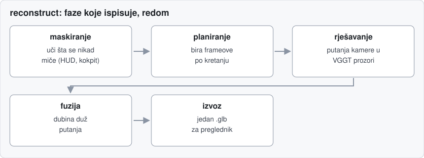

# Offline rekonstrukcija {#offline-reconstruction}

```bash
python -m heat3d_capture reconstruct lap.mp4 -o lap.glb [--solve-budget 260] [--fuse-interval 0.4]
```

Kod: [`scan/offline.py`](https://github.com/Holdi601/3DHeat-GameCapture/blob/main/heat3d_capture/scan/offline.py),
[`pose/feedforward.py`](https://github.com/Holdi601/3DHeat-GameCapture/blob/main/heat3d_capture/pose/feedforward.py),
[`pose/vggt_model.py`](https://github.com/Holdi601/3DHeat-GameCapture/blob/main/heat3d_capture/pose/vggt_model.py),
[`pose/feedforward_source.py`](https://github.com/Holdi601/3DHeat-GameCapture/blob/main/heat3d_capture/pose/feedforward_source.py),
[`pose/solveprep.py`](https://github.com/Holdi601/3DHeat-GameCapture/blob/main/heat3d_capture/pose/solveprep.py).
Opcije: [Pregled komandi](commands.md#reconstruct).

## Zašto druga putanja {#why-a-second-path}

Inkrementalno praćenje je uživo, jeftino i radi tamo gdje ima strukture za koju se
može uhvatiti: enterijer, ulica, mapa s zaklonima. **Trkaća staza je njegov najgori slučaj**: put je glatka
traka s malo teksture, horizont se jedva pomiče, i kad nekoliko poza odluta ništa kasnije
ih ne vraća. Krug izađe kao kriva koja luta umjesto da se zatvori.

Offline putanja predaje **prozore kadrova** modelu koji predviđa sve njihove kamere zajedno,
pa svaki kadar ograničava svaki drugi direktno, a ne preko lanca. Treba joj cijeli
snimak prije nego što može odgovoriti, pa nije uživo, i spora je: minute po prozoru na desktop
GPU-u. Sve poslije poza - fuzija, pokrivenost, boja, izvoz - isti je kod kao u skeniranju uživo:
riješena putanja predaje se rekonstruktoru kao izvor poze, tačno tamo gdje ide Forza
telemetrija.

## Zahtjevi {#requirements}

- **PyTorch** usklađen s vašim GPU-om (ne propisuje ga ovaj projekat; instalirajte ga prije
  `requirements.txt`, pogledajte [Runtime](runtime.md)).
- **`vggt`** - kod VGGT modela (`from vggt.models.vggt import VGGT`), iz Metinog GitHub
  repozitorija; nije na indeksu paketa.
- **`transformers`**, jer offline putanja pokreće dubinu preko PyTorch
  `DepthEstimator`-a (Depth Anything V2 Small), a ne preko ONNX datoteke.
- U praksi CUDA GPU; oba modela se vraćaju na CPU, što nije praktično.

Ništa od ovoga nije u `requirements.txt`, jer skener to ne treba. Nalazi se u
**`requirements-offline.txt`**, s vlastitim zavisnostima VGGT-a (`einops`, `safetensors`,
`huggingface_hub`, `Pillow`):

```bash
.venv\Scripts\python -m pip install -r requirements-offline.txt
.venv\Scripts\python -m pip install --no-deps "vggt @ git+https://github.com/facebookresearch/vggt.git"
```

VGGT se instalira s `--no-deps` jer njegovi metapodaci paketa propisuju `numpy<2`, što bi pip
poštovao spuštanjem verzije numpy-ja koji ovdje treba scipy. `reconstruct` provjerava sve ovo
odmah nakon ispisa linije o licenci (lista `OFFLINE` u
[`runtime/preflight.py`](https://github.com/Holdi601/3DHeat-GameCapture/blob/main/heat3d_capture/runtime/preflight.py)),
navodi šta nedostaje s veličinama i instalira samo na potvrdan odgovor - VGGT s `--no-deps`, kao gore.
Odbijanje, ili nepostojanje terminala za pitanje, izlazi s kodom 1.

## Model i njegova licenca {#the-model-and-its-licence}

**VGGT**, `facebook/VGGT-1B`: **CC-BY-NC-4.0, samo nekomercijalno, a rekonstrukcija napravljena
njime to nasljeđuje.** Komanda ovo ispisuje prije početka (`describe_licence`). Zasebno
licencirani `facebook/VGGT-1B-Commercial` postoji, ali je zaštićen repozitorij koji Meta odobrava po nalogu,
pa ne može biti zadan. `--model vggt-1b-commercial` rješava s njim (i ispisuje njegovu
liniju o licenci umjesto toga); bez odobrenog pristupa preuzimanje ne uspijeva. *Kod* `vggt` je pod
Metinom vlastitom "VGGT License", ugovorom o istraživačkim materijalima s politikom prihvatljive upotrebe (pročitano iz
`LICENSE.txt` paketa). Pogledajte [Modeli i licence](models-and-licences.md).

## Pokretanje, korak po korak {#the-run-stage-by-stage}

Imena koraka su ona koja komanda ispisuje.



### masking {#masking}

`FlowMask` se uči iz **4 niza od po 90 uzastopnih kadrova**, centriranih na 1/8, 3/8, 5/8 i 7/8
videa, na 960 x 540 sivo (pogledajte [FlowMask](reconstruction-capture.md#flowmask-what-never-travels)).
Njegova napomena se ispisuje i čuva u sažetku. Video kraći od 90 kadrova ne dobija masku.

#### Maska kamere se uči, ne primjenjuje {#the-camera-mask-is-learned-not-applied}

Maska se **ne** primjenjuje na kadrove predate rješavaču. Maskiranje kokpita izgledalo je ispravno prema
statistici karakteristika (većina otkrivenih uglova leži na pikselima pričvršćenim za kameru) - ali to je
tvrdnja o detektoru karakteristika, a rješavač je trenirana mreža. Mjereno time koliko se
oporavljena putanja okreće između uzastopnih koraka (automobil se okreće nekoliko stepeni; slučajno lutanje devedeset),
sirovi kadrovi dali su najmanje okretanje, kadrovi s podignutim kontrastom nešto više, maskirani kadrovi jasno
više, a oba zajedno najviše. Zato rješavač dobija sirove kadrove. Maska se i dalje koristi za
planiranje razmaka kadrova ispod, a inkrementalni pratilac je koristi u skeniranju uživo.
(`solveprep.enhance`, koji maskira i podiže lokalni kontrast pomoću CLAHE, postoji ali ga ova
komanda ne koristi.)

### planning: kadrovi raspoređeni prema kretanju {#planning-frames-spaced-by-motion}

`plan_by_motion` bira kadrove rješavača prema **tome koliko se slika pomaknula**, a ne prema satu: fiksni
interval daje sporim dionicama kadrove koji im ne trebaju, a gladuje brze, gdje
uzastopni kadrovi prestaju dovoljno se preklapati da bi se povezali.

- Ciljni pomak: **5% širine od 960 piksela** (48 px) medijan pomaka ORB karakteristika između
  uzastopnih odabranih kadrova, mjeren na sivim kadrovima 960 x 540 s CLAHE kontrastom, karakteristike samo na
  maski.
- Počinje se s razmakom od 0,3 s; nakon svakog koraka sljedeći razmak postaje
  `gap x (0.5 + 0.5 x target / measured)`, ograničen na **0,15-2,0 s**, pa jedno bučno
  mjerenje ne pomjera plan.
- Kada se ništa nije poklopilo, razmak se smanjuje na 0,6 sebe (predaleko je greška koja
  se izbjegava).
- Staje na kraju videa ili na `--solve-budget` kadrova (zadano 260).

Manje od 4 planirana kadra je greška.

### solving: prozori i spajanje {#solving-windows-and-stitching}

Planirani kadrovi se dekodiraju na širini 960 px i rješavaju u **preklapajućim prozorima od 16 kadrova,
6 zajedničkih** sa sljedećim (`plan_windows`; posljednji prozor se povlači unazad da završi na zadnjem kadru,
tako da kraj snimka ima isto susjeda kao sredina). Više od **400** kadrova u jednom pokretanju
se odbija.

Svaki prozor: kadrovima se mijenja veličina tako da je duža stranica **518**, a obje stranice su višekratnici od **14**
(omjer stranica očuvan - stiskanje bi pogrešno prikazalo vidno polje), skaliraju se na 0..1, propuštaju kroz VGGT
pod bfloat16 autocastom (float16 ostaje bez eksponenta na dalekim svjetskim koordinatama). Ekstrinzici kamere
pretvaraju se u rotacije svijet-iz-kamere i centre kamera. Mape tačaka se
zadano ne čuvaju.

Svaki prozor se vraća u **svom vlastitom proizvoljnom okviru i svojoj proizvoljnoj skali**, pa se prozori
**spajaju** u okvir prvog transformacijom sličnosti (rotacija, translacija, jedna
skala) podešenom na kamerama koje dijele s onim što je već postavljeno:

- **Rotacija iz orijentacija kamera**, a ne iz njihovih pozicija: zajedničke kamere leže duž
  putanje i gotovo su kolinearne na ravnom dijelu, zbog čega podešavanje samo prema pozicijama ne vidi
  rotaciju - svaki prozor se krivi, a spojeni rezultat ispadne ravan. Rotacija je
  srednja vrijednost `target_R x source_R^T` projicirana nazad na pravu rotaciju (sa zaštitom od refleksije).
- **Skala i pomak iz pozicija**, duž rotiranog izvora.
- Potrebne su najmanje **4** zajedničke kamere; manje je greška.
- Preklapanje je trećina prozora da bi skala bila dobro određena; greška skale koja se gomila
  od prozora do prozora čini da krug ide u spiralu.

Za svaki šav bilježi se najveće neslaganje zajedničkih kamera nakon podešavanja, u jedinicama
srednjeg razmaka među njima (`seam_error`).

### fusing {#fusing}

Kadrovi svakih `--fuse-interval` sekundi (zadano 0,4) dekodiraju se na širini 960 px, dobijaju dubinu od
Depth Anything V2 Small (PyTorch) i spajaju s pozom **interpoliranom** iz riješene putanje u
njihovom trenutku (linearna pozicija, sferna rotacija; `FeedForwardPoses`). Kadrovi izvan
riješenog vremenskog raspona preskaču se umjesto ekstrapolacije. Kamera koristi horizontalno vidno
polje od **65 stepeni**. Feed-forward poze nose pouzdanost 0,85 u fuziji i pokrivenosti.

### exporting {#exporting}

Mreža trokuta se zapisuje kao za skeniranje uživo ([Izlaz .glb](glb-output.md)), s imenom po videu.

## Sažetak {#the-summary}

```text
140 cameras solved over 182s
closure error 3.1% of path length
worst seam 0.42 frame spacings
<mask note>
wrote lap.glb
```

| Linija | Značenje |
|---|---|
| closure error | udaljenost od prve do zadnje kamere u odnosu na dužinu putanje. Za jedan krug poštena mjera odstupanja. Preko 10%: "The lap does not close ... Treat the shape as unreliable." |
| worst seam | najveće neslaganje spajanja. Preko 1,0: "Windows disagreed by up to N frame spacings at a seam, so part of the path is stitched on weak evidence." |
| nema datoteke | "Fusion produced no surface, so nothing was written." Izlazni kod je tada 1. |

## Skala {#scale}

Spojena putanja je u proizvoljnim jedinicama prvog prozora. Dubina se sidri triangulacijom
između interpoliranih poza (kao za telemetriju), pa je geometrija usklađena s putanjom -
ali **rezultat nije u metrima** osim ako putanja jeste. Ništa u ovoj komandi ne postavlja globalnu
skalu; kalibracija tla se ne primjenjuje kada poze dolaze iz izvora poze.

## Stanje ove putanje {#state-of-this-path}

S kadrovima u fiksnom intervalu, prozori se rješavaju u koherentnu putanju na nekim dionicama kruga i
u šaru na drugim; neuspjesi su oštre krivine, gdje se pogled jako zamahne između
kadrova, a gušće uzorkovanje tih krivina ih oporavlja. Nijedna isprobana statistika slike
(svjetlina, detalji, broj karakteristika, omjer unutrašnjih tačaka, pomak) nije unaprijed predvidjela koje
dionice će zakazati. Dakle razmak se ne može u potpunosti planirati
iz slika unaprijed: mora se birati rješavanjem, mjerenjem rezultata i ponovnim rješavanjem
gušće tamo gdje putanja nije ona koju bi automobil mogao proći. Planiranje prema kretanju je izgrađeno; **adaptivno
ponovno rješavanje nije**.
