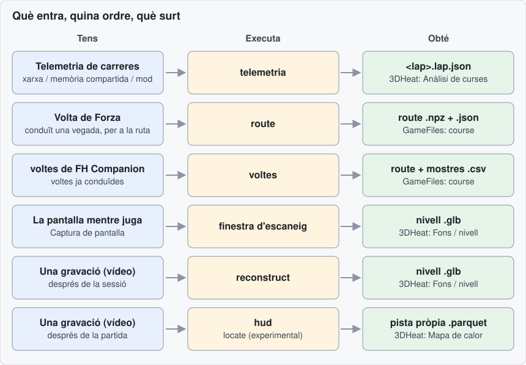

# 3DHeat GameCapture {#dheat-gamecapture}

**Què és?** Una eina que anota el que un joc de carreres li explica sobre la vostra conducció, un fitxer
per volta. També pot reconstruir un model 3D aproximat d'un nivell a partir d'un vídeo de vosaltres jugant.

**Per a què la faria servir?** Per veure les vostres voltes al [visualitzador de 3DHeat](https://holdi601.github.io/3DHeat/):
on frenàveu, on anàveu lents, en què es diferencien dues voltes. I per tenir el nivell sota el vostre
mapa de calor quan ningú no en té un model 3D.

**Exemple:** activi el Data Out de Forza, executi una ordre, i conduïu dues voltes. Apareixen dos fitxers de volta a
`laps\`. Deixi'ls a la pestanya Anàlisi de curses del visualitzador.


Si és nou amb la línia d'ordres, llegeixi primer [Abans de començar](before-you-start.md).

## Les tres tasques {#the-three-jobs}

1. **Telemetria de voltes.** Registra cada canal que publica un joc de carreres: el Data Out de Forza, la
   memòria compartida dels jocs d'Assetto Corsa, els fluxos de xarxa dels jocs de ral·li, un mod de BeamNG, un
   connector de Trackmania; i escriu un fitxer `heat3d-lap` per volta o etapa, per a la
   pestanya Anàlisi de curses del visualitzador. iRacing no necessita cap gravador: el visualitzador llegeix
   els seus propis fitxers `.ibt`.
2. **Nivells a partir del joc.** Converteix el que mostrava la pantalla mentre caminàveu o conduíeu per un
   nivell en un model 3D `.glb`, que el visualitzador col·loca sota el mapa de calor.
3. **La vostra partida, després.** `hud` llegeix el HUD de la vostra gravació propia: les vostres accions, les morts,
   el traçat del minimapa i el registre de baixes. `locate` (experimental: de moment situa pocs fotogrames reals)
   calcula on es va prendre cada fotograma, sobre el model 3D d'un nivell.

Les tres segueixen una mateixa norma: **no s'injecta res a cap joc i no s'hi enganxa res**. Els fotogrames
arriben de l'API pública de captura de pantalla, i la telemetria, de les interfícies que els jocs publiquen
per a aquest fi. Vegi [Les regles](../rules.md).



El codi és Python (paquet `heat3d_capture`), amb llicència MIT. Els models de profunditat i de postura
que pot executar tenen les seves pròpies llicències: vegi [Models i llicències](../models-and-licences.md).

## Inici ràpid {#quick-start}

### Gravar voltes {#record-laps}

Necessita Python 3.10 o posterior ([Abans de començar](before-you-start.md)). A PowerShell:

```powershell
git clone https://github.com/Holdi601/3DHeat-GameCapture
cd 3DHeat-GameCapture
python -m venv .venv
.venv\Scripts\python -m pip install -r requirements.txt

# Forza: Configuració -> HUD i joc -> Data Out = ON, IP 127.0.0.1, port 5300
.venv\Scripts\python -m heat3d_capture telemetry -o laps
```

**Hauria de veure** `listening on port 5300. Laps go to laps. Ctrl+C to stop.`, i després una línia per volta
en creuar la línia, com a la imatge de dalt. Premi Ctrl+C per aturar. Deixi els fitxers de `laps\` a la
pestanya Anàlisi de curses del visualitzador.
Cada altre joc és a un `--game` de distància:

```powershell
.venv\Scripts\python -m heat3d_capture telemetry --game acc -o laps
.venv\Scripts\python -m heat3d_capture telemetry --game dirtrally2 -o laps
```

Vegi [Gravadors de telemetria](../telemetry.md) per a cada joc i cada opció.

### Escanejar un nivell {#scan-a-level}

Faci doble clic a **`scan.bat`** a la carpeta de l'eina. Troba Python (i ofereix instal·lar-lo amb
winget si no n'hi ha cap), crea un `.venv` privat, i obre la finestra d'escaneig. La finestra indica
què falta, per a què serveix cada paquet i quant ocupa la descàrrega, i no instal·la res sense un sí. Vegi
[Entorn d'execució i dependències](../runtime.md) i [La finestra d'escaneig](../reconstruction-scan-ui.md).

Per a fer-ho a mà: `.venv\Scripts\python -m heat3d_capture.ui`.

Per reconstruir una gravació fora de línia, amb la trajectòria de la càmera resolta de cop (necessita PyTorch, el
paquet `vggt` i una GPU: vegi [Reconstrucció fora de línia](../reconstruction-offline.md)):

```powershell
.venv\Scripts\python -m heat3d_capture reconstruct lap.mp4 -o lap.glb
```

## Mapa de la documentació {#map-of-the-documentation}

| Pàgina | Què cobreix |
|---|---|
| [Abans de començar](before-you-start.md) | Python, una terminal, la primera ordre, errors habituals |
| [Les regles](../rules.md) | Sense injecció, només interfícies publicades, i el que això costa |
| [Gravadors de telemetria](../telemetry.md) | L'ordre `telemetry` i una visió general de cada joc |
| [Forza](../telemetry-forza.md) | Data Out, detecció de la disposició, el relé de FH Companion i el seu `.tele.gz` |
| [Jocs d'Assetto Corsa](../telemetry-assetto-corsa.md) | AC, ACC, AC EVO, AC Rally des de la memòria compartida |
| [Jocs de ral·li](../telemetry-rally.md) | EA SPORTS WRC, DiRT Rally 2.0 / 1 / DiRT 4, Richard Burns Rally |
| [BeamNG.drive](../telemetry-beamng.md) | El mod de protocol `heat3d` |
| [Trackmania](../telemetry-trackmania.md) | El connector Openplanet `Heat3dRecorder` |
| [iRacing](../telemetry-iracing.md) | Lectura de fitxers `.ibt` al visualitzador |
| [Divisió de voltes i d'etapes](../lap-splitting.md) | `LapSplitter`, `CounterSplitter`, `LineSplitter`, `StageSplitter` |
| [Lliscament, derrapada i canals derivats](../slip-and-drift.md) | Com s'escala el lliscament, i què deriva el visualitzador |
| [El fitxer heat3d-lap](../lap-format.md) | El format del fitxer de volta, canals, unitats, `meta` |
| [Jocs](../games.md) | Per joc: com gravar, què s'envia, quins circuits es poden exportar |
| [Ordres](../commands.md) | `route`, `telemetry`, `laps`, `reconstruct`, `hud`, `locate`, pas a pas |
| [Referència de l'ordre](../cli-reference.md) | cada opció, generada a partir de `--help` |
| [Lectura del HUD d'una gravació](../hud-video.md) | `hud`: accions pròpies, morts, traçat del minimapa i registre de baixes d'una gravació |
| [Localitzar fotogrames en un nivell](../locate.md) | `locate`: on es va prendre cada fotograma, contra la geometria del nivell |
| [Reconstrucció de nivells](../reconstruction.md) | La cadena de fotogrames fins a un `.glb` |
| [La finestra d'escaneig](../reconstruction-scan-ui.md) | Cada control, tecla d'accés i element de superposició |
| [Captura, màscares i qualitat del fotograma](../reconstruction-capture.md) | Windows Graphics Capture, fotogrames clau, màscares de HUD, consells de qualitat |
| [Profunditat](../reconstruction-depth.md) | Depth Anything V2, ONNX Runtime, construir el model |
| [Postura de la càmera i escala](../reconstruction-pose.md) | Odometria, relocalització, postures de telemetria, escala del terreny, ajust de feix |
| [Fusió, cobertura i color](../reconstruction-fusion-and-texture.md) | El volum d'ocupació, la graella de cobertura, punts febles, color de vèrtex |
| [La sortida .glb](../glb-output.md) | El fitxer que carrega el visualitzador |
| [Reconstrucció fora de línia](../reconstruction-offline.md) | `reconstruct`, finestres de VGGT i unió |
| [Models i llicències](../models-and-licences.md) | Mides de Depth Anything V2, VGGT, els paquets |
| [Entorn d'execució i dependències](../runtime.md) | Verificació prèvia, backends, nivells de rendiment |
| [Límits i verificació](../limits.md) | Què no es fa, i què no s'ha comprovat |
| [Actualitzacions](../updates.md) | La comprovació de versió i `python -m heat3d_update` |
| [Desenvolupament](../development.md) | Proves, l'entorn virtual, disposició del repositori |
| [Manteniment d'aquesta documentació](../maintaining.md) | La llista de comprovació de publicació del codi i la documentació |

## Part de 3DHeat {#part-of-3dheat}

Els fitxers que escriu aquesta eina els carrega el **visualitzador de 3DHeat**
([codi](https://github.com/Holdi601/3DHeat), [documentació](https://holdi601.github.io/3DHeat/)).
Els fitxers de volta van a la pestanya Anàlisi de curses, els nivells `.glb` al panell Fons / nivell, les taules de
`hud` i `locate` a la pestanya Mapa de calor; com el visualitzador llegeix les taules i els fitxers de partida
s'explica a [Un fitxer per partida (.3dheat)](https://holdi601.github.io/3DHeat/container.html) i a
[Introduir dades](https://holdi601.github.io/3DHeat/getting-data-in.html).

| Eina | Què fa | Documentació |
|---|---|---|
| [Visualitzador 3DHeat](https://github.com/Holdi601/3DHeat) | mostra mapes de calor, curses i partides en 3D, al navegador | [documentació](https://holdi601.github.io/3DHeat/) |
| [GameFiles](https://github.com/Holdi601/3DHeat-GameFiles) | circuits i nivells dels fitxers que envien els jocs, com a models 3D | [documentació](https://holdi601.github.io/3DHeat-GameFiles/) |
| [GameCapture](https://github.com/Holdi601/3DHeat-GameCapture) | telemetria de voltes de jocs de carreres; nivells reconstruïts a partir de vídeo de joc | [documentació](https://holdi601.github.io/3DHeat-GameCapture/) |
| [Unreal Exporter](https://github.com/Holdi601/3DHeat-UnrealExporter) | un connector per a l'editor d'Unreal que exporta un nivell com a model 3D | [documentació](https://holdi601.github.io/3DHeat-UnrealExporter/) |
| [CS2](https://github.com/Holdi601/3DHeat-CS2) | demos de Counter-Strike 2 en fitxers de partida; mapes en models 3D | [documentació](https://holdi601.github.io/3DHeat-CS2/) |
| [Watcher](https://github.com/Holdi601/3DHeat-Watcher) | registra la vostra partida en segon pla a partir del que publiquen els jocs | [documentació](https://holdi601.github.io/3DHeat-Watcher/) |
| [Ext-WarThunder](https://github.com/Holdi601/3DHeat-Ext-WarThunder) | repeticions de War Thunder en fitxers de partida | [documentació](https://holdi601.github.io/3DHeat-Ext-WarThunder/) |
| [Ext-WoT](https://github.com/Holdi601/3DHeat-Ext-WoT) | repeticions de World of Tanks en fitxers de partida | [documentació](https://holdi601.github.io/3DHeat-Ext-WoT/) |
| [Ext-WoWs](https://github.com/Holdi601/3DHeat-Ext-WoWs) | repeticions de World of Warships en fitxers de partida | [documentació](https://holdi601.github.io/3DHeat-Ext-WoWs/) |
| [Ext-Squad](https://github.com/Holdi601/3DHeat-Ext-Squad) | demos de servidors de Squad en fitxers de partida | [documentació](https://holdi601.github.io/3DHeat-Ext-Squad/) |
| [Ext-DCS](https://github.com/Holdi601/3DHeat-Ext-DCS) | mapes de DCS World en models 3D | [documentació](https://holdi601.github.io/3DHeat-Ext-DCS/) |
| [Ext-IL2](https://github.com/Holdi601/3DHeat-Ext-IL2) | mapes d'IL-2 Sturmovik en models 3D | [documentació](https://holdi601.github.io/3DHeat-Ext-IL2/) |

Una eina de desenvolupador amb el projecte del joc obert hauria d'usar el connector d'Unreal, que llegeix la
geometria real i és exacta. Quan es poden llegir els arxius propis d'un joc, GameFiles n'extreu el circuit
exacte. La reconstrucció a partir del joc és per al cas en què només es té la pantalla.
