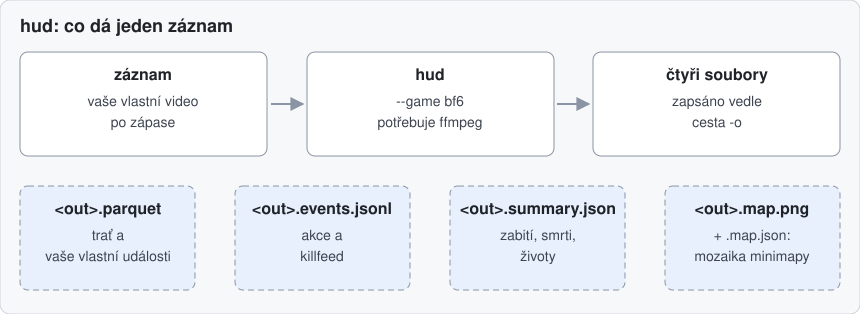

# Čtení HUD ze záznamu {#reading-the-hud-from-a-recording}

`hud` čte herní HUD (zobrazení na obrazovce) z **vlastního záznamu hráče**, po zápase: **vlastní**
akce hráče z vyskakovacího okna bodů, které hra ukazuje pod zaměřovačem (zabití, asistence,
oživení, doplnění munice, dobývání...), jeho smrti z obrazovek sestřelení a nasazení, jeho
**vlastní** trasu z minimapy a zprávy o zabitích vedle nich jako časované události - zapsané jako
tabulka 3DHeat, s mozaikou minimapy jako obrázkem mapy, který se položí pod ni.

Stručně: sleduje video tvého zápasu a zapisuje tvá zabití, smrti a kam jsi chodil.

```bash
.venv\Scripts\python -m heat3d_capture hud "<recording>.mp4" --game bf6 --player <name> -o out/match
```

Battlefield 6 je prvním profilem hry.



## Čeho se to dotýká a čeho ne {#what-it-does-and-does-not-touch}

- Čte **soubor videa**: klip ShadowPlay / Instant Replay, nahrávku z OBS, cokoli, co ffmpeg
  dekóduje. Nikdy se nedotýká hry, její paměti, jejích souborů ani sítě, a běží až po skončení
  zápasu. Viz [Pravidla](rules.md).
- Odvozuje **jen vlastní pozici hráče**, z jeho vlastní minimapy. Značky ostatních hráčů na
  minimapě se zakryjí a nikdy se nečtou. Zprávy o zabitích se uchovají celé, ale jen jako to, co
  je na obrazovce napsáno (kdo, koho, čím, kdy); nikomu jinému než hráči se nepřiřazuje žádná
  pozice.
- OCR běží lokálně (RapidOCR s modely PaddleOCR přes ONNX Runtime). Žádný snímek ani výřez
  neopustí počítač.
- Záznam ukazuje jména ostatních hráčů a mozaika je obrázkem levelu. Výstupy slouží jen
  hráčovu vlastnímu použití; nechte je lokálně.

## Požadavky {#requirements}

- **ffmpeg a ffprobe** v `PATH`. Pokud je k dispozici karta NVIDIA, dekóduje se na ní
  (`-hwaccel cuda`); jinak dekóduje procesor, několikrát pomaleji.
- Balíčky v `requirements.txt` a OCR bez vlastních závislostí (žádá procesorový `onnxruntime`,
  který se hádá s verzí DirectML, kterou projekt používá):

```bash
.venv\Scripts\python -m pip install -r requirements.txt
.venv\Scripts\python -m pip install --no-deps rapidocr_onnxruntime==1.2.3
```

`rapidocr_onnxruntime` je čtečka textu (OCR), která čte jména a slova z obrazovky.
`--no-deps` brání tomu, aby nahradila DirectML verzi `onnxruntime` projektu.

Instalace ffmpeg na Windows: `winget install Gyan.FFmpeg`, pak otevřete nový terminál a ověřte to
příkazem `ffmpeg -version`. Nikdy jste nepracovali s příkazovým řádkem? Přečtěte si
[Než začnete](before-you-start.md).

- Záznam **16:9** v libovolném rozlišení (1080p, 1440p, 4K). Jiné poměry stran se odmítnou,
  protože by boxy profilu padly na špatné části obrazovky.
- **Výchozí rozložení HUD** hry. Přesunutý nebo zvětšený prvek HUD se přečte na špatném místě.

## Volby {#options}

| Volba | Výchozí | Význam |
|---|---|---|
| `video` | | Záznam. |
| `-o`, `--out` | název videa v aktuální složce | Cesta k výstupu **bez** přípony; soubory jsou `<out>.parquet`, `.events.jsonl`, `.summary.json`, `.map.png`, `.map.json`. |
| `--game` | `bf6` | Čí HUD se čte. `bf6` (Battlefield 6) je zatím jediný profil. |
| `--player` | žádné | Jméno hráče, jak ho ukazuje zpráva o zabití. Porovnává se volně (OCR plete `l`/`I`/`1`, `O`/`0`, `rn`/`m`). Bez něj se jméno odhadne (níže). |
| `--fps` | 5 | Vzorky minimapy za sekundu. Zpráva o zabití se vzorkuje na polovině této hodnoty, vyskakovací okno bodů a obrazovky smrti také na polovině (na čtvrtině, když žádné okno není vidět), kompas každé 3 s, seznam squadu každých 15 s. |
| `--start` | 0 | Sekundy ve videu, od kterých se začíná. |
| `--seconds` | všechno | Kolik videa se přečte. |
| `--metres-per-pixel` | žádné | Měřítko minimapy, je-li známé: metry na pixel minimapy při obvyklém přiblížení (minimapa je na obrazovce 1080p široká 296 pixelů). Bez něj jsou pozice v těchto pixelech; viz [Jednotky](#north-and-units). |
| `--cpu` | vypnuto | Dekódovat na procesoru, i když je k dispozici karta NVIDIA. |

Průběh se vypisuje každých pět sekund; na konci hráč, zabití, smrti, životy a zapsané soubory.

## Výstupy {#outputs}

### `<out>.parquet` - stopa hráče a události {#parquet---the-players-track-and-events}

Jeden řádek na každý vzorek, kdy byl hráč ve hře a šlo umístit minimapu, plus jeden na každou
jeho událost. Zápatí nese pokyny pro čtení prohlížečem (klíč `heat3d`, `kind: heat3d-hud`), takže
prohlížeč namapuje každý sloupec bez dotazu.

| Sloupec | Význam |
|---|---|
| `time` | Sekundy od začátku videa. |
| `event` | `position`; `start` (video začalo uprostřed života), `spawn` (zpět ve hře po smrti nebo dlouhé pauze), `death`, `downed` a `revived` (z obrazovek sestřelení, níže), `end` (život skončil bez vysvětlení); vlastní akce hráče z vyskakovacího okna bodů (`kill`, `assist`, `reviving`, `resupply`, `capture`... - [tabulka událostí](#event-table)); a řádky zprávy o zabitích, které se hráče týkají, jako `kill_feed`, `death_feed`, `teamkill_feed`, `suicide_feed`, `squadwipe_feed`. |
| `source` | Odkud řádek události přišel: `points` (vyskakovací okno), `screen` (obrazovky sestřelení a nasazení), `feed` (zprávy o zabitích); u řádků pozice prázdné. |
| `text` | U řádků `points`: štítek tak, jak je vytištěn (`KILL`, `SQUAD DAMAGE ASSIST`...), nebo nadpis (`DOUBLE KILL`, název stuhy), nebo u neznámého štítku to, co se přečetlo. |
| `points` | U řádků `points`: o kolik vzrostl součet vyskakovacího okna v tom okamžiku. Když přišlo několik akcí ve stejném vzorku (zabití a vozidlo, ve kterém bylo), je to jejich součet, uvedený u každé z nich, a `shared` říká, kolik jich sdílelo. Prázdné, když se součet nepřečetl dvakrát na obou stranách okamžiku. |
| `subject`, `subject_side` | U řádků `points`: jméno, které okno ukázalo u akce - oběť zabití, spoluhráč, kterého hráč oživil nebo zásobil - a jeho barva (`enemy`, `friendly`, `squad`). |
| `confirmed` | `feed`, když zpráva o zabitích měla řádek pro stejné zabití nebo smrt (do 3 s, stejná oběť). |
| `x`, `y`, `z` | Pozice na mozaice: `x` na východ, `y` na sever, `z` 0 (zápatí říká, že `z` je nahoru). Sever je skutečný sever, když to kompas dovolil (viz `north_up` v souhrnu). |
| `player` | Vždy `me`. Jen řádky hráče mají pozice. |
| `team` | `own`. |
| `session` | `<video name>#NN`, jedna na každý život. Trasy čar se nikdy nepřekročí přes relace. |
| `heading` | Stupně po směru hodinových ručiček od severu (od nahoru mozaiky, když sever není známý): kam se díval pohled. |
| `dir_x`, `dir_y`, `dir_z` | Totéž jako směrový vektor pro směr pohledu v prohlížeči. |
| `zoom` | Jak moc byla minimapa oddálena oproti obvyklému přiblížení (nad 1 ve vozidlech). |
| `killer`, `victim`, `weapon`, `headshot`, `marker` | U řádků zabití a smrti, které mají řádek ze zprávy o zabitích: ten řádek (níže). Zabití z vyskakovacího okna bez řádku ze zprávy má jméno z okna jako `victim`; zabití z okna ukázané jako HEADSHOT má `headshot` true. |

Každý řádek události má pozici hráče v čase události (u smrti nebo sestřelení poslední pozice před
ní, u oživení první po ní). Řádky se přímo hodí do [čárového tepla](https://holdi601.github.io/3DHeat/line-heat.html)
prohlížeče: jeho návrh vybírá `event`, začíná na `start`, `spawn` a `revived`, končí na `death`,
`downed` a `end`, a řádky `position` leží podél trasy. Ostatní události mají jména tak, aby
návrh žádnou z nich nebral jako začátek nebo konec: oživení dává `reviving` (ne `revive`),
držení bodu `defense`, spawn spoluhráče na hráči `teammate_arrived`, řádky zpráv o zabitích
`kill_feed` a tak dále; `kill` není konec.

Záznam se dvěma koly na dvou mapách dává dvě mozaiky, které nelze vzájemně spojit. Největší je
`<out>.parquet`; každá další, která má nejméně 30 s stopy, se zapíše vedle něj jako
`<out>.map2.parquet`, `<out>.map2.map.png` a tak dál.

### `<out>.events.jsonl` - události hráče a zprávy o zabitích {#eventsjsonl---the-players-events-and-the-kill-feed}

Jeden objekt JSON na řádek, v pořadí času, každý s `source`:

- `points`: jeden na každou akci hráče: `time`, `event`, `text`, `points`, `shared`,
  `subject`, `subject_side` (jako v tabulce), `popup` (ze kterého okna přišla, číslované přes
  celý běh), `seen` (kolik čtení ji ukázalo), `confirmed`, a `x`, `y`, kde byl hráč.
- `screen`: jeden na každé sestřelení a každé oživení: `event` (`death`, `downed` nebo
  `revived`), `time` (kdy hráč padl; u `revived` kdy obrazovky zmizely), `until` (poslední
  zachycení obrazovek), `screens` (`down` a/nebo `card`), `outcome` (`death`, `revived`, nebo
  `unknown`, když záznam skončí dřív), `killer` (z řádku zprávy, když je), `x`, `y`.
- `feed`: každý řádek, který zpráva o zabitích ukázala, všech hráčů:

| Pole | Význam |
|---|---|
| `time`, `last` | První a poslední vzorek, ve kterém byl řádek přečten (sekundy od začátku videa). `time` je okamžik, kdy se zabití objevilo, s přesností na jeden vzorek zprávy (0,4 s při výchozí rychlosti). |
| `kind` | Z pohledu hráče: `kill`, `death`, `teamkill`, `suicide`, `squadwipe`; u řádků ostatních hráčů `kill`, `squadwipe`, nebo `death` pro řádek bez vraha. |
| `killer`, `victim` | Jména, jako nejčastější čtení napříč všemi vzorky, které řádek ukazoval (delší čtení vyhrává, když je běžné čtení jeho začátkem: jméno částečně skryté). `killer` je prázdné u řádku, který ukázal jen ikonu a oběť - smrt způsobená světem, nebo řádek, jehož vrah už zmizel. |
| `killer_side`, `victim_side` | Z barvy jména: `friendly` (tým hráče, modrá), `enemy` (oranžová), `squad` (bledě zelená, kterou hra používá pro hráče a jeho squad), `neutral` (žádná z nich). |
| `weapon` | Třída ikony zbraně v rámci tohoto běhu: `icon01`, `icon02`... Řádky s podobnými ikonami sdílejí třídu. Ikony nemají jména; není seznam, podle kterého by se pojmenovaly. |
| `marker` | Malá ikona mezi zbraní a obětí: `skull`, `arrow`, `chevrons`, `crosses` nebo prázdné. |
| `headshot` | `marker == "skull"` - předpoklad, viz [Omezení](#limits). |
| `seen` | Kolik vzorků zprávy ukázalo řádek. |
| `me` | `killer`, `victim` nebo null. |
| `matched` | U vlastních řádků hráče: zda se k nim našla akce z vyskakovacího okna nebo obrazovka smrti. |
| `x`, `y` (, `map`) | U vlastních řádků hráče: kde byl. |

### `<out>.summary.json` {#summaryjson}

Hráč (a jak byl nalezen), odkud pocházejí jeho události (`own_events_from`: okno a obrazovky,
nebo samotná zpráva o zabitích, když se nepřečetlo ani jedno), zabití, smrti, K/D, headshoty,
asistence, dané oživení (`revives`) a přijaté (`revived`), sestřelení, dobytí, neutralizace,
doplnění munice, léčení, opravy, zničená vozidla, skóre (součty vyskakovacích oken sečtené),
každý typ akce s počtem (`actions`), počet oken, smrti, které ukázala jen zpráva, vlastní počet
zabití a smrtí zprávy a kolik jejích zabití se shodovalo se zabitím z okna, týmová zabití,
sebevraždy, vyhlazení squadu, životy, sekundy ve hře, ujetá vzdálenost (v jednotkách tabulky),
řádky zprávy, pro každou mapu, zda je sever nahoře a kolik čtení kompasu souhlasilo, počty stopy
(vzorky, ve hře, umístěné, neumístěné, ostrovy), předpoklady, které se udělaly, a časování.

### `<out>.map.png` a `<out>.map.json` - mapa pod stopou {#mappng-and-mapjson---the-map-under-the-track}

Mozaika všech minimap běhu, zprůměrovaná, bez překryvů, otočená a zvětšená přesně jako tabulka.
Pomocný soubor JSON obsahuje dvě kotvy, které žádá položka prohlížeče **Obrázek mapy**
([Obrázky mapy](https://holdi601.github.io/3DHeat/map-images.html) v dokumentaci prohlížeče):
načtěte PNG přes **Obrázek mapy…**, nechte zapnuté **Převrátit sever/jih** a zadejte kotvu 1 a
kotvu 2 (`px`, `py`, `worldX`, `worldZ`) z pomocného souboru. Obrázek pak leží přesně pod stopou.

Na obrázku jsou jen ty části levelu, které ukázala minimapa hráče.

## Postup {#method}

### Dekódování {#decoding}

ffmpeg dekóduje na GPU, při vzorkovací rychlosti snižuje počet snímků, ještě dokud jsou na kartě,
vyřízne oblasti profilu (minimapu, zprávu o zabitích, dva pásy kompasu, seznam squadu, vyskakovací
okno, slova na obrazovce sestřelení, pravý dolní roh), každou zmenší na pevnou velikost a složí
je do jednoho malého obrázku na vzorek. Přes rouru do Pythonu přechází jen tento obrázek.
Dekódování každého snímku H.264 streamu je spodní hranice doby běhu.

Dva pracovní vlákna berou vzorky: jedno registruje minimapy (OpenCV), jedno čte text (ONNX Runtime).

### Ve hře, nebo ne {#in-play-or-not}

Čtvercový klíč nápovědy na minimapě (světlý čtverec s klíčem mapy uvnitř, dole vlevo na minimapě)
se kreslí vždy, když je minimapa, a ne na obrazovkách smrti, kill-camu, nasazení, menu nebo
tabulky výsledků. Jeho přítomnost - světlý, bezbarvý čtverec s tmavým písmenem uprostřed, zřetelně
světlejší než okolí - hledaná několik pixelů kolem jeho místa, je test „ve hře“. Jediný vzorek,
který nesouhlasí s oběma sousedy, se ignoruje.

Mezera ve hře je smrt nebo změna kola (další úsek začíná `spawn`), když trvá nejméně 6 s, nebo
když smrt (z obrazovek, nebo řádek zprávy, který jmenuje hráče jako oběť) přišla do 40 s před ní;
kratší mezera bez smrti (otevřená velká mapa) pokračuje v životě. Minimapa zůstává nahoře, když
je hráč sestřelen, takže sestřelený hráč je ve hře.

### Stopa {#the-track}

Minimapa se otáčí s pohledem a drží hráče v pevném bodě (naměřeno: uprostřed, 49,7 % dolů).
Každý vzorek:

1. **Maskovat**, co není level: silně barevné nebo téměř bílé pixely (značky cílů, ikony squadu
   a vozidel, pingy, hranice hrací oblasti, čáry trasy, text), slabě žlutozelenou kuželu pohledu,
   kotouč kolem značky hráče, klín nad ní, klíč nápovědy a tenký okraj.
2. **Rysy**: body SIFT na šedé minimapě s vyrovnaným kontrastem, uvnitř masky.
3. **Registrovat na mozaiku**, ne na předchozí vzorek: body se porovnávají s rysy uloženými
   dosud, v souřadnicích mozaiky, poblíž místa, kde byl hráč naposled; podobnost (otočení,
   přiblížení, posun) se přizpůsobí pomocí RANSAC. Přizpůsobení potřebuje dost inlierů, přiblížení
   v rozmezí třetiny posledního a posun menší než třetinu minimapy na vzorek; přizpůsobení hledané
   kdekoli na mozaice (po smrti) potřebuje dvojnásobek inlierů.
4. **Růst mozaiky**: přidají se rysy, které mozaika ještě nemá (nejvýš každých několik desetin
   sekundy pohybu), a maskovaná minimapa se zprůměruje do obrázku.
5. Bod hráče, který přenese přizpůsobení, je jeho **pozice**; nahoru minimapy, přenesené stejně, je
   jeho **směr** na mozaice.

Potom se bod, který vyskočí víc než 10 pixelů od obou předchozích a obou následujících vzorků
(které se navzájem shodují), zahodí: minimapa se občas v jednom vzorku shodne při špatném
přiblížení. Souhrn to počítá (`dropped_as_jumps`).

Registrace na mozaiku brání hromadění chyb: návrat na místo se shoduje s rysy uloženými při prvním
průchodu. Spawn na místě, které ještě nebylo vidět, založí samostatný **ostrov**; každý desátý
umístěný vzorek se zkusí proti ostatním ostrovům a první dobrá shoda je spojí (menší se přesune do
většího, se svou stopou). Ostrovy, které se nikdy nespojily (jiná mapa, nebo země, která nebyla
nikdy sdílena), se zapíší zvlášť, jak je popsáno výše.

### Sever a jednotky {#north-and-units}

Pás kompasu se čte každé 3 s: jeho popisky se najdou podle jejich inkoustu (jasný, bezbarvý,
seskupený přes malé mezery, značky vynechány), každý se přečte samostatně, a dva nebo více
popisků určí jak měřítko pásu, tak azimut pod středovou značkou - jediný popisek nic neurčí.
Každé čtení kompasu se páruje s mozaikovým směrem stejného vzorku; kruhový medián rozdílů přes
čtení do 10 stupňů od něj je otočení, které postaví mozaiku severem nahoru. Použije se, když
souhlasí alespoň tři čtení a polovina ze všech.

<a id="units"></a>Pozemní měřítko minimapy nikde na obrazovce nevypisuje, takže pozice jsou v
**pixelech minimapy při obvyklém přiblížení**: střední přiblížení běhu se přepočítá na jednu
jednotku tabulky na pixel 296pixelové minimapy (její velikost na obrazovce 1080p). Vynásobení
vozidlovým oddálením registrace odstraní, takže jednotka je stejná pěšky i ve vozidle.
`--metres-per-pixel` vynásobí všechno na metry, když je měřítko známé (ze známé vzdálenosti na
mapě, změřené jednou).

### Zprávy o zabitích {#the-kill-feed}

Zpráva se čte 2,5krát za sekundu, ale jen když se její barevné pixely výrazně změnily nebo
uplynuly 2 s. Řádky textu se najdou detektorem OCR; řádek, jehož obrázek se shoduje s jedním
přečteným v předchozím vzorku (řádky se posouvají, takže se mohl pohnout), převezme ten text
místo toho, aby se četl znovu. Řádky příliš malé pro jméno nebo s lomítkem (počítadlo fps v tom
rohu) se zahodí.

Řádky se seskupují do řad podle výšky; v řadě je nejlevější jméno vrah a nejpravější oběť.
Sousední kusy stejné barvy se spojí (jméno s mezerou). Jediný řádek, který přešel přes ikonu z
jednoho jména do druhého, se přeřízne v nejširší mezeře, když se půlky liší barvou, a každá půlka
se přečte znovu. Jediné jméno ve sloupci obětí s ikonou těsně vlevo je řádek bez vraha. Dva kusy
jedné barvy bez ikony mezi nimi jsou jedno jméno, jehož vrah zmizel, ne zabití.

**Strany** určuje barva. Jména se kreslí s průhledností, takže test je na tom, jak daleko je text
od vlastního pozadí: znaménko červené minus modré v tomto rozdílu je oranžová (nepřítel), nebo
modrá (přítel) na jakémkoli pozadí; ani jedna, se zelenou nad ostatními dvěma, je barva squadu.

**Ikony**: mezi jmény pixely v barvě vraha tvoří siluetu zbraně; malá samostatná ikona přímo před
obětí je značka, pojmenovaná podle tvaru (blob s dírami pro oči je lebka; malý trojúhelník je šipka;
několik kusů kříže).

**Události**: řádek přečtený znovu se stejnými jmény (podobnost 0,7 po sjednocení obvyklých chyb
OCR, jedna z nich 0,8; přečtení, které bylo zkráceno, se shoduje se začátkem celého jména) je
stejná událost, pokud byla událost naposled přečtena méně než 5 s předtím a je starší než 14 s -
žádný řádek nezůstává nahoře déle, takže stejná dvojice později je nové zabití. Řádek bez vraha
se páruje jen podle oběti. Čas události je její první zachycení; její jména, strany a značka jsou
většina ze zachycení; řádky přečtené jen jednou se zahodí.

**Hráč**: `--player`, jinak nejjasnější zvýrazněný řádek seznamu squadu, když jsou alespoň tři
čtení a 60 % z nich souhlasí, jinak jméno, které zpráva nejčastěji kreslila barvou squadu.
Jinak souhrn říká, že hráč je neznámý, a žádný řádek zprávy se mu nepřipíše. (Vyskakovací okno a
obrazovky smrti jsou vlastní hráče bez ohledu na jeho jméno; jméno nepotřebují.)

### Vyskakovací okno bodů {#the-points-popup}

Všechno, co hráč získá, Battlefield 6 ukazuje v jednom okně těsně vlevo a pod zaměřovačem - na
stejném místě pěšky, ve vozidle i přes záměrný dalekohled:

```
            [ RIBBON ] (icon)          a title, now and then: a ribbon or a multi-kill
      (icon)(icon)(icon)  300          one icon per action; the popup's running total
                Some_Name              who it was about, for a moment: orange an enemy, blue a teammate
    [ KILL x2 ] [ VEHICLE DESTROYED ]  one boxed tag per kind of action, with a count
```

Okno roste, když hráč dál získává body: nové zabití promění `KILL` v `KILL x2`, přidá ikonu a zvýší
součet; nový druh akce přidá štítek. Řádek štítků ukazuje posledních několik druhů (starší
vyjede ven a počítá dál, když se vrátí). Asi tři sekundy po poslední akci se okno sbalí do jednoho
řádku (`[KILL x2] 300`) a zmizí. Text je světle šedý, štítky v tenkých rámečcích, součet velkými
číslicemi počínaje x 760 na obrazovce 1920x1080, štítky zarovnané vpravo k x 750.

Čte se 2,5krát za sekundu: detektor OCR najde řádky textu, čtou se jen řádky na jednom z řádků
okna (štítky zaměřovače tanku ve stejné oblasti ne), a řádek, jehož obrázek se shoduje s tím,
přečteným o vzorek dříve, převezme ten text. Řádek, který přejel z ikony, jména nebo sbaleného
štítku do součtu (`Name10`, `REVIVE185`), se přeřízne tam, kde součet začíná (x 755), a obě půlky
se přečtou znovu. Dokud není vidět žádné okno, každý druhý vzorek se nechá nepřečtený; když
další ukáže okno, držený se přečte jako první, takže začátek okna se najde přesně na vzorek.

**Štítky** se párují s [tabulkou událostí](#event-table) po sjednocení obvyklých chyb rozpoznávače
(Q čtené jako O, číslice mezi písmeny, I místo L, ztracené písmeno na okraji): čtení je štítek,
když se alespoň z 80 % shoduje s některým (85 % pro štítky o pěti písmenech a méně) a je zřetelně
blíž k němu než k jakémukoli jinému. Štítky, které rozpoznávač slepil dohromady
(`CAPTUREDORDERCOMPLETED`), se rozdělí odloupnutím známých štítků ze začátku. Počet je `x2`,
`X3`, zbloudilé znaménko a číslice, nebo číslice těsně za štítkem. Světle šedý řádek velkých písmen
v řádku štítků, který se neshoduje s ničím, se zachová jako akce `points` s textem; řádek, který je
kusem známého štítku ve stejném okně (`DESTROYED` vedle `VEHICLE DESTROYED`), ne. Nadpisy nad
součtem (světlé rámečky, tmavý text) jsou `multi_kills` (`DOUBLE KILL` ...) nebo `ribbon`. Jméno je
barevný řádek mezi součtem a štítky; jeho strana je z barvy stejně jako u zprávy.

**Okna a akce**: čtení s méně než 0,9 s prázdna mezi nimi tvoří jedno okno. Okno, které se zdá
skončit a vrátí se dřív, než mohlo zmizet (do 3,2 s od posledního růstu), se stejným nebo větším
počtem u každého štítku a součtem ne menším, je tolik stejné okno, které se na chvíli ztratilo
(rozmazání, světlé pozadí) - nic v něm se nepočítá dvakrát. V okně je konečný počet štítku nejvyšší
počet přečtený nejméně dvakrát; jeho k-tá akce se časuje na první čtení, které ukazuje počet k
nebo víc. Počet přečtený jen v jednom vzorku není akce - kromě zabití, které za něj ručí zpráva o
zabitích (řádek hráče do 3 s, který nevzalo jiné zabití): krátký štítek KILL je ten, který
rozpoznávač nejčastěji přečte jen jednou. Nadpis se počítá jednou za okno, když se přečte dvakrát.
`points` je o kolik součet - počítaný jen u součtů přečtených dvakrát za sebou - vzrostl od vzorku
před akcí do vzorku po ní.

Neznámý řádek se počítá jako štítek jen na řádku známých štítků ve stejném čtení (nebo, když žádný
známý štítek není, když tam není ani jméno), takže jméno nakreslené barvou, kterou test stran
nerozezná, se nebere za něj.

### Smrti a oživení {#deaths-and-revives}

Když hráč padne, hra to ukáže pod středem obrazovky (MAN DOWN, REQUEST REVIVE, SKIP (HOLD), NEARBY
MEDICS; jakmile se oživení požádá, REVIVE REQUESTED, CANCEL REQUEST), a karta v pravém dolním rohu
jmenuje, kdo to udělal, s DAMAGE LOG nebo PLAYER CARD pod ní a řádkem „YOU n - n FOE“ nad ní. Zabit
na místě (smrtelný headshot), ukáže se jen karta. Pak buď hráče oživí spoluhráč - obrazovky zmizí a
hra pokračuje - nebo hráč vykrvácí nebo to vzdá, a následuje obrazovka nasazení s DEPLOY vpravo
dole.

Tato slova se čtou spolu s oknem, ve stejném průchodu OCR (okno, pás obrazovky sestřelení a pravý
dolní roh složené do jednoho obrázku): 2,5krát za sekundu, když je okno vidět, 1,25krát jinak.
Roh se přidá jen tehdy, když je hráč mimo hru nebo byl naposled viděn sestřelený před méně než 3 s;
ve hře obsahuje jen počet munice.
Zachycení od sebe vzdálená méně než 4 s tvoří jednu epizodu (nejméně dvě zachycení). Epizoda je
**smrtí**, když se obrazovka nasazení objeví do 12 s od jejího konce, nebo když je hráč mimo hru
3 s po ní a zůstane tam 6 s nebo déle; je to **oživení** (`downed`, pak `revived`), když je hráč
stále ve hře 3 s poté, co obrazovky zmizely; `unknown` (zapsáno jen jako `downed`), když záznam
skončí dřív. Čas smrti je okamžik, kdy hráč padl: řádek zprávy, který ho jmenuje jako oběť, pokud
je do 3 s před epizodou, jinak první zachycení epizody minus polovina intervalu čtení. Pozice po
smrti se z trasy vynechají až do obrazovky nasazení.

Smrt ze zprávy, kterou žádná epizoda nevysvětluje (obrazovky se minuly), je přesto `death` se
`source` `feed`, a posuzuje se stejně: když hráč zůstane ve hře déle než 40 s po ní, byl oživen.

### Tabulka událostí {#event-table}

Co se stane z každého štítku, nadpisu a obrazovky. Několik štítků může být jedna událost; `text`
zachová, který to byl.

| Událost | Z | Význam |
|---|---|---|
| `kill` | KILL; HEADSHOT | Hráč někoho zabil (jméno je oběť). Zabití headshotem ukazuje HEADSHOT tam, kde by bylo KILL: `text` říká, které, a `headshot` je true. |
| `assist` | ASSIST, KILL ASSIST, DAMAGE ASSIST, SQUAD DAMAGE ASSIST | Poškození někoho, koho zabil spoluhráč. |
| `kill_assist` | ASSIST COUNTS AS KILL | Asistence, kterou hra počítá jako zabití. |
| `suppression`, `suppression_assist` | ENEMY SUPPRESSION; SUPPRESSION ASSIST | Potlačovací palba na nepřítele; na toho, koho pak zabil spoluhráč. |
| `smoke_assist` | SMOKE ASSIST, SQUAD SMOKE ASSIST | Kouř, který kryl spoluhráče. |
| `spot`, `spot_assist` | SPOT, SPOTTED, ENEMY DESIGNATION; SPOT ASSIST, SPOT BONUS | Odhalení nepřítele; zabití toho, koho hráč odhalil. |
| `driver_assist` | DRIVER ASSIST | Zabití střelcem hráčova vozidla. |
| `reviving`, `reviving_bonus` | REVIVE, SQUAD REVIVE; CONCEALED REVIVE | Hráč oživil spoluhráče; bonus za to, že to udělal pod krytím. |
| `heal` | HEAL, SQUAD HEAL | Hráč léčil spoluhráče. |
| `resupply` | SUPPLY, RESUPPLY, SQUAD SUPPLY | Spoluhráč si od hráče vzal munici. |
| `repair` | REPAIR, VEHICLE REPAIR, SQUAD REPAIR | Hráč opravil vozidlo. |
| `capturing`, `capture` | CAPTURING, RECAPTURING; CAPTURED, OBJECTIVE CAPTURED | Tik dobývání; cíl dobyt. |
| `neutralizing`, `neutralize` | NEUTRALIZING; NEUTRALIZED, OBJECTIVE NEUTRALIZED | Totéž pro sejmutí nepřátelského cíle do neutrálního stavu. |
| `defense` | DEFENDING, OBJECTIVE DEFENDED | Držení cíle. |
| `offensive`, `defensive` | OFFENSIVE; DEFENSIVE | Bonus za akci u útočeného cíle; u bráněného. |
| `order` | ORDER COMPLETED | Splněný rozkaz squadu. |
| `vehicle_damage`, `vehicle_disabled`, `vehicle_destroyed`, `vehicle_destroyed_assist` | VEHICLE DAMAGE; VEHICLE DISABLED; VEHICLE DESTROYED; VEHICLE DESTROYED SUPPORT | Poškození nepřátelského vozidla, až do zničení, nebo pomoc k tomu. |
| `equipment_destroyed` | EQUIPMENT DESTROYED | Zničená nepřátelská pomůcka. |
| `forced_bail` | FORCED BAIL | Nepřítel vynucen z vozidla. |
| `squad_wipe` | SQUAD WIPE | Poslední člen nepřátelského squadu zabit. |
| `savior`, `avenger` | SAVIOR; AVENGER | Zabití nepřítele, který ubližoval spoluhráči; kdo právě zabil spoluhráče. |
| `teammate_arrived` | SPAWNED ON, SPAWN ASSIST, VEHICLE SPAWN, SQUAD VEHICLE SPAWN | Spoluhráč se objevil u hráče nebo v jeho vozidle. |
| `transport` | TEAM TRANSPORT | Převoz spoluhráčů ve vozidle. |
| `fortify` | DEFENSE DEPLOYED | Obrana, kterou hráč postavil. |
| `points` | cokoli jiného v řádku štítků | Akce, kterou tabulka nezná: `text` je to, co se přečetlo. |
| `multi_kills` | DOUBLE KILL, TRIPLE KILL, QUAD KILL, MULTI KILL (nadpis) | Zabití v rychlém sledu. |
| `ribbon` | jakýkoli jiný nadpis | Stuha podle jména (BALLISTIC, TANK BUSTER, ENGINEER EXPERT, SPEARHEAD...). |
| `downed` | obrazovka sestřelení, pak hra | Hráč padl a byl oživen. |
| `revived` | obrazovky zmizí, hra pokračuje | Hráče oživil spoluhráč. |
| `death` | obrazovka sestřelení nebo karta, pak nasazení nebo mimo hru | Hráč zemřel. |

Texty v tabulce byly vidět na zkušebních záznamech, kromě těchto, které jsou obvyklými názvy
herní série a jsou v tabulce proto, aby byly pojmenovány a ne zachovány jako `points`: HEADSHOT
KILL, ASSIST, KILL ASSIST, ASSIST COUNTS AS KILL, SPOT, SPOTTED, SPOT ASSIST, SPOT BONUS, SQUAD
REVIVE, HEAL, SQUAD HEAL, RESUPPLY, SQUAD SUPPLY, REPAIR, VEHICLE REPAIR, SQUAD REPAIR, VEHICLE
DISABLED, SQUAD WIPE, AVENGER, tvary OBJECTIVE ..., a nadpisy TRIPLE KILL, QUADRUPLE KILL a MULTI
KILL. Hra v jiném jazyce tiskne jiná slova: její štítky vyjdou jako `points` s tím, co se přečetlo -
ne jako mylně poznaná známá akce - se svými součty a jmény; a protože obrazovky smrti se poznávají
podle anglických slov, smrti pak pocházejí jen ze zprávy o zabitích, jako řádky `death` se
`source` `feed`.

## Co je ověřeno {#what-is-verified}

Ověřeno očima na zkušebních záznamech (hráčových vlastních, není součástí repozitáře) kreslením
náhodných vzorků a porovnáním každého s okolními snímky:

- **Vlastní události hráče.** Každá vzorkovaná akce z okna byla skutečná akce daného druhu,
  nalezená do jednoho čtení (0,4 s) od svého času; většina hodnot a jmen byla správná (jména v
  některých písmech, například v cyrilici, můžou vyjít zkomolená). Každá vzorkovaná obrazovka
  smrti byla nalezena.
- **Zprávy o zabitích.** Drtivá většina řádků zprávy byla nalezena se správnými oběma jmény; drobné
  chyby OCR (velké I přečtené jako malé l) se připouštějí. Jména v glyfech, které hra sama ukazuje
  jako čtverečky, se mohou minout. Strany (barvy) jsou špatně u několika procent jmen.
- **Ve hře.** Test klíče nápovědy souhlasil se snímkem v každém vzorkovaném okamžiku.
- **Stopa.** Neexistuje pravda o tom, kde hráč byl, takže se stopa kontroluje proti samotnému
  záznamu: dvě minimapy se registrují **přímo na sebe navzájem** a ten posun se porovnává s posunem
  mezi dvěma pozicemi v tabulce. Střední nesouhlas je asi 1-3 pixely minimapy (pod 1 % šířky
  minimapy), více na přeplněné, oddálené minimapě.
  Čtení kompasu souhlasí s mozaikou téměř vždy do 10 stupňů.
- **Doba běhu.** Dekódování asi 5násobkem reálného času tvoří většinu; čtení vyskakovacího okna
  přidá asi pětinu až polovinu.

Ručně se ověřilo: každá mozaika má souvislé silnice a budovy přes životy, které je postavily, a
trasy různých životů po stejné silnici leží přes sebe. Úsek, kde se mění přiblížení minimapy, může
vyjít příliš dlouhý - viz [Omezení](#limits).

Testy (`tests/test_hud_*.py`) kreslí všechno, co čtou: vymyšlený level silnic, budov a vrstevnic,
minimapy procházek jím s překryvy, které má skutečná, pásy kompasu, řádky zpráv o zabitích s
vymyšlenými jmény. Kontrolují, že smyčka se sleduje na dva pixely a uzavře se, že stojící hráč
zůstane na místě, zatímco se pohled otáčí, že změny přiblížení se sledují, že spawn jinde se
připojí zpět, když se cesty setkají, že severní otočení a převrácení osy y umístí stopu tam, kde
opravdu šla, že kotvy obrázku mapy ji zarovnávají pod stopou, a že se parsují řádky zprávy, strany,
značky a odstraňování duplicit. Pro vlastní události hráče kreslí vyskakovací okna s vymyšlenými
jmény a štítky a kontrolují tabulku štítků a její toleranci k chybám rozpoznávače, štítky slepené
dohromady, řádky okna, přeříznutí součtu od jména, počítání, jak okno roste, pokračování po chvíli
nepřečtení, vyjetí štítku ven a zpět, nebo konec; že počet přečtený jednou se drží stranou;
smrti, oživení a výsledky z textů obrazovek; a na vymyšleném zápase, že akce, smrti a oživení
dopadnou do tabulky tam, kde byl hráč, řádky zprávy vedle nich pod svými jmény, a že trasa končí
u smrti, a ne u oživení.

## Omezení {#limits}

- **Jednotky jsou pixely minimapy**, ne metry, pokud není zadán `--metres-per-pixel`. Nic na
  obrazovce hry neuvádí pozemní měřítko minimapy.
- **Mapuje se jen to, co ukázala minimapa.** Mozaika pokrývá zem do půl minimapy od místa, kam
  hráč šel; dvě mozaiky, které nikdy nesdílely zem (dvě kola na dvou mapách, nebo dva životy
  v daleko od sebe ležících rozích velké mapy), zůstanou oddělenými soubory s nesouvisejícími
  souřadnicemi.
- **Stopa je z minimapy, 5 vzorků za sekundu**, nevyhlazená ničím. Minimapa daleko oddálená (vrtulník
  ji v zkušebních záznamech oddálil 2,3krát) ukazuje na pixel méně detailů a mimo hrací oblast
  téměř žádné, takže registrace tam je hrubší. Proudová letadla a hráč jako cestující nebyli
  v zkušebních záznamech.
- **Chyby registrace jsou lokální a nehromadí se**, ale mozaika postavená při průzkumu nového území
  může nést malý ohyb, který se opraví až tehdy, když se země znovu uvidí. Kde se přiblížení
  minimapy mění plynule (vozidlo zrychluje), přizpůsobené přiblížení se může posouvat, a jeden takový
  úsek se viděl s vzdáleností asi dvakrát větší než skutečnou. Mozaika postavená z přeplněné,
  oddálené minimapy pěšáka je nejméně přesná (chyby typicky kolem 3 pixelů, až 18).
- **Žádná optimalizace grafu poz.** Smyčka se uzavře shodou uložených rysů, ne rozložením opravy
  po celé smyčce.
- **Třídy zbraní zatím nefungují.** Silueta ikony se bere z průhledné ikony nad pohybujícím se
  pozadím a mezi vzorky se mění příliš: zkušební záznamy vyšly s 220 až 340 třídami pro 550 až 670
  řádků, kde shoda má několik desítek zbraní. S `weapon` zacházejte jako s experimentálním. Třídy
  jsou v každém případě na běh a nejsou jména.
- **Významy značek nejsou všechny známé.** Šipka (`▸`) se kreslí před vlastním jménem hráče, v
  řádcích o něm; není to druh zabití. Lebka se bere jako headshot; to je předpoklad, ne něco, co hra
  říká. `chevrons` a `crosses` (vyhlazení squadu) se hlásí jako viděné.
- **Jména v jiných písmech než latince** (například cyrilice) vyjdou jako nejbližší latinská
  podobná písmena: rozpoznávač čte latinku a čínštinu. Stejný hráč se čte pokaždé stejně, takže se
  stále páruje, ale text není jeho jméno.
- **Překryvy v rohu zprávy o zabitích** (počítadlo fps) mohou zakrýt konec oběti v horním řádku.
  Text počítadla se rozpozná a zahodí a jméno zkrácené se páruje s jeho úplnými čteními, ale jméno,
  které se nikdy neviděno jinak než zkrácené, zůstane zkrácené.
- **Smrt, kterou neukázala ani obrazovka, ani zpráva**, pořád ukončí trasu jako `end`, když hráč
  opustí hru na 6 s nebo déle.
- **Přijatá oživení** pocházejí z obrazovek sestřelení. Jen u smrti ze zprávy, kterou obrazovky
  minuly, se odvozují (ve hře déle než 40 s po ní), a rychlé oživení se pak nerozliší.
- **Akce z okna se časují podle čtení**: do 0,4 s od prvního zobrazení štítku; štítek, který se
  animuje dovnitř, se může přečíst o vzorek dříve nebo později.
- **Jména na řádcích okna** se čtou jako ta ze zprávy: jména v jiných písmech než latince vyjdou
  zkomolená, a občas se jméno spoluhráče plovoucí ve světě poblíž okna přečte jako jméno akce.
  Akce bez jména (tik dobývání, rozkaz) žádné nemají.
- **`points`** chybí, kde se součet nepřečetl dvakrát na obou stranách akce, a sdílí se mezi
  akcemi, které přišly ve stejném vzorku. `score` v souhrnu sečítá konečné součty oken, takže okno,
  jehož součet se nikdy nepřečetl dvakrát, v něm není.
- **Řádek štítků je okno**: při čtyřech nebo více druzích v jednom okně nejstarší štítek vyjede
  doleva, přes okraj oblasti, která se čte. Počítal se, když byl vidět; počet, který získá, když je
  napůl mimo obrazovku, se může minout.
- **Okno ztracené na déle, než mohlo trvat** (přes asi 4 s nečitelných vzorků, zatímco ještě rostlo)
  se bere jako dvě, a štítek s počtem vyšším než jedna se pak počítá znovu. Při kontrolách níže to
  nebylo vidět.
- **Ostatní jazyky rozhraní**: štítky vyjdou jako `points` s jejich textem a smrti pochází jen ze
  zprávy (obrazovky smrti se poznávají podle anglických slov).
- **Události na krátkém ostrově**: život, jehož stopa byla příliš krátká na zápis jako mapa (pod
  30 s), si události nechá v `.events.jsonl` bez `x`, `y` a v žádné tabulce.
- **Rozložení HUD je výchozí rozložení BF6 při 16:9.** Změněné měřítko HUD, paleta pro barvoslepé
  nebo jiná velikost minimapy by potřebovaly vlastní profil.
