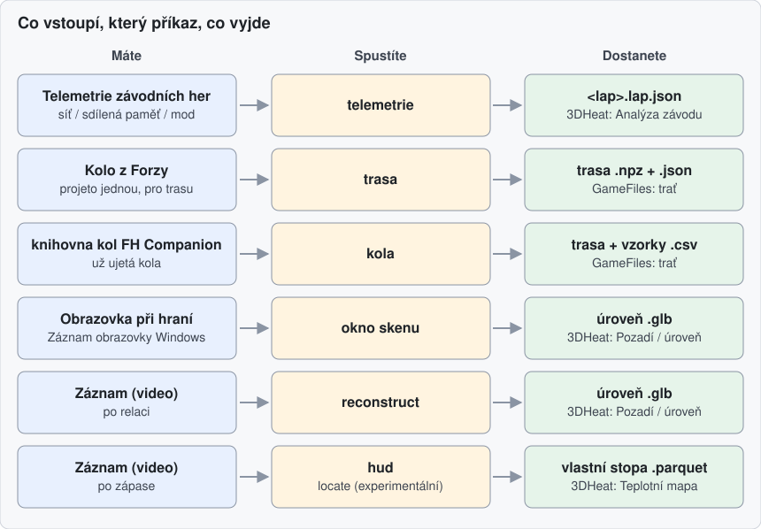

# 3DHeat GameCapture {#dheat-gamecapture}

**Co to je?** Nástroj, který zapisuje, co vám závodní hra říká o vaší jízdě, jeden soubor
na kolo. Umí také z videa, na kterém hrajete, sestavit hrubý 3D model úrovně.

**Proč ho používat?** Abyste viděli svá kola v [prohlížeči 3DHeat](https://holdi601.github.io/3DHeat/):
kde jste brzdili, kde jste byli pomalí, jak se liší dvě kola. A abyste měli úroveň pod svou teplotní
mapou, když ji nikdo nemá jako 3D model.

**Příklad:** zapněte u Forzy Data Out, spusťte jeden příkaz a ujeďte dvě kola. V `laps\` se objeví
dva soubory kol. Přetáhněte je na záložku Analýza závodu v prohlížeči.


Nikdy jste nepracovali s příkazovým řádkem? Nejdřív si přečtěte [Než začnete](before-you-start.md).

## Tři úlohy {#the-three-jobs}

1. **Telemetrie kol.** Zaznamenává každý kanál, který závodní hra zveřejňuje – Data Out u Forzy,
   sdílenou paměť her Assetto Corsa, síťové kanály rallye her, modul BeamNG, plugin Trackmanie –
   a zapisuje jeden soubor `heat3d-lap` na kolo nebo etapu, pro záložku Analýza závodu prohlížeče.
   iRacing nepotřebuje nahrávač: prohlížeč čte jeho vlastní soubory `.ibt`.
2. **Úrovně z hraní.** Mění to, co obrazovka ukazovala, když jste procházeli nebo projížděli
   úrovní, na 3D model `.glb`, který prohlížeč položí pod teplotní mapu.
3. **Váš vlastní zápas, až po něm.** `hud` čte HUD vašeho vlastního záznamu – vaše akce, smrti,
   stopu na minimapě a killfeed. `locate` (experimentální: zatím umisťuje jen několik skutečných
   snímků) zjišťuje, kde byl každý snímek pořízen, na 3D modelu úrovně.

Všechny tři se řídí jedním pravidlem: **do hry se nic nevkládá a nic se nezachytává háčkem.** Snímky pocházejí
z veřejného API pro zachytávání obrazovky, telemetrie z rozhraní, která hry zveřejňují pro tento účel.
Viz [Pravidla](rules.md).



Kód je v Pythonu (balíček `heat3d_capture`), licence MIT. Modely hloubky a pozic, které umí spouštět,
mají vlastní licence – viz [Modely a licence](models-and-licences.md).

## Rychlý start {#quick-start}

### Nahrávání kol {#record-laps}

Potřebujete Python 3.10 nebo novější ([Než začnete](before-you-start.md)). V PowerShellu:

```powershell
git clone https://github.com/Holdi601/3DHeat-GameCapture
cd 3DHeat-GameCapture
python -m venv .venv
.venv\Scripts\python -m pip install -r requirements.txt

# Forza: Settings -> HUD and Gameplay -> Data Out = ON, IP 127.0.0.1, port 5300
.venv\Scripts\python -m heat3d_capture telemetry -o laps
```

**Měli byste vidět** `listening on port 5300. Laps go to laps. Ctrl+C to stop.`, pak řádek na každé kolo,
jak projíždíte cílovou čáru, jako na obrázku výše. Zastavíte Ctrl+C. Soubory z `laps\` přetáhněte
na záložku Analýza závodu v prohlížeči. Každá další hra je jeden přepínač `--game` daleko:

```powershell
.venv\Scripts\python -m heat3d_capture telemetry --game acc -o laps
.venv\Scripts\python -m heat3d_capture telemetry --game dirtrally2 -o laps
```

Všechny hry a možnosti: [Nahrávače telemetrie](telemetry.md).

### Skenování úrovně {#scan-a-level}

Ve složce nástroje dvakrát klikněte na **`scan.bat`**. Najde Python (a když žádný není, nabídne
instalaci přes winget), vytvoří soukromé `.venv` a otevře okno skenování. Okno řekne, co chybí,
k čemu je který balíček a jak velké je stahování, a bez vašeho souhlasu nic neinstaluje.
Viz [Běhové prostředí a závislosti](runtime.md) a [Okno skenování](reconstruction-scan-ui.md).

Ručně: `.venv\Scripts\python -m heat3d_capture.ui`.

Pro přepočítání záznamu offline, s dráhou kamery vyřešenou najednou (potřebuje PyTorch, balíček
`vggt` a grafickou kartu – viz [Rekonstrukce offline](reconstruction-offline.md)):

```powershell
.venv\Scripts\python -m heat3d_capture reconstruct lap.mp4 -o lap.glb
```

## Přehled dokumentace {#map-of-the-documentation}

| Stránka | Co obsahuje |
|---|---|
| [Než začnete](before-you-start.md) | Python, terminál, první příkaz, časté chyby |
| [Pravidla](rules.md) | Žádné vkládání do her, jen zveřejněná rozhraní, a co to stojí |
| [Nahrávače telemetrie](telemetry.md) | Příkaz `telemetry` a přehled každé hry |
| [Forza](telemetry-forza.md) | Data Out, rozpoznání rozložení, přeposílání FH Companion a jeho `.tele.gz` |
| [Hry Assetto Corsa](telemetry-assetto-corsa.md) | AC, ACC, AC EVO, AC Rally ze sdílené paměti |
| [Rallye hry](telemetry-rally.md) | EA SPORTS WRC, DiRT Rally 2.0 / 1 / DiRT 4, Richard Burns Rally |
| [BeamNG.drive](telemetry-beamng.md) | Modifikace protokolu `heat3d` |
| [Trackmania](telemetry-trackmania.md) | Plugin `Heat3dRecorder` pro Openplanet |
| [iRacing](telemetry-iracing.md) | Čtení souborů `.ibt` v prohlížeči |
| [Dělení kol a etap](lap-splitting.md) | `LapSplitter`, `CounterSplitter`, `LineSplitter`, `StageSplitter` |
| [Skluz, driftování a odvozené kanály](slip-and-drift.md) | Jak se škáluje skluz a co prohlížeč odvozuje |
| [Soubor heat3d-lap](lap-format.md) | Formát souboru kola, kanály, jednotky, `meta` |
| [Hry](games.md) | Pro každou hru: jak nahrávat, co se posílá, které tratě lze exportovat |
| [Příkazy](commands.md) | `route`, `telemetry`, `laps`, `reconstruct`, `hud`, `locate`, krok za krokem |
| [Přehled příkazů](../cli-reference.md) | každá možnost, vygenerováno z `--help` |
| [Čtení HUD ze záznamu](hud-video.md) | `hud`: vlastní akce, smrti, stopa na minimapě a killfeed ze záznamu |
| [Umisťování snímků v úrovni](locate.md) | `locate`: kde byl každý snímek pořízen, podle geometrie úrovně |
| [Rekonstrukce úrovně](reconstruction.md) | Postup od snímků k `.glb` |
| [Okno skenování](reconstruction-scan-ui.md) | Každé ovládací prvky, klávesové zkratky a prvky překryvu |
| [Zachytávání, masky a kvalita snímků](reconstruction-capture.md) | Windows Graphics Capture, klíčové snímky, masky HUD, rady ke kvalitě |
| [Hloubka](reconstruction-depth.md) | Depth Anything V2, ONNX Runtime, sestavení modelu |
| [Poloha kamery a měřítko](reconstruction-pose.md) | Odometrie, relokalizace, polohy z telemetrie, měřítko země, bundle adjustment |
| [Fúze, pokrytí a barva](reconstruction-fusion-and-texture.md) | Objemová mřížka obsazenosti, mřížka pokrytí, slabá místa, barva vrcholů |
| [Výstup .glb](glb-output.md) | Soubor, který prohlížeč načítá |
| [Rekonstrukce offline](reconstruction-offline.md) | `reconstruct`, okna VGGT a slučování |
| [Modely a licence](models-and-licences.md) | Velikosti Depth Anything V2, VGGT, balíčky |
| [Běhové prostředí a závislosti](runtime.md) | Předletová kontrola, backendy, výkonnostní úrovně |
| [Omezení a ověření](limits.md) | Co se nedělá a co nebylo ověřeno |
| [Aktualizace](updates.md) | Kontrola vydání a `python -m heat3d_update` |
| [Vývoj](development.md) | Testy, virtuální prostředí, struktura repozitáře |
| [Údržba těchto dokumentů](maintaining.md) | Kontrolní seznam vydání pro kód a dokumentaci |

## Součást 3DHeat {#part-of-3dheat}

Soubory, které tento nástroj zapisuje, načítá **prohlížeč 3DHeat** –
[zdroj](https://github.com/Holdi601/3DHeat), [dokumentace](https://holdi601.github.io/3DHeat/).
Soubory kol jdou na záložku Analýza závodu, `.glb` úrovně do panelu Pozadí / úroveň, tabulky `hud` a `locate` na záložku Teplotní mapa; jak prohlížeč čte tabulky a soubory zápasů, je popsáno na stránkách
[Jeden soubor na zápas (.3dheat)](https://holdi601.github.io/3DHeat/container.html) a
[Získání dat](https://holdi601.github.io/3DHeat/getting-data-in.html).

| Nástroj | Co dělá | Dokumentace |
|---|---|---|
| [prohlížeč 3DHeat](https://github.com/Holdi601/3DHeat) | zobrazuje teplotní mapy, závody a zápasy ve 3D v prohlížeči | [dokumentace](https://holdi601.github.io/3DHeat/) |
| [GameFiles](https://github.com/Holdi601/3DHeat-GameFiles) | tratě a úrovně ze souborů, které hry dodávají, jako 3D modely | [dokumentace](https://holdi601.github.io/3DHeat-GameFiles/) |
| [GameCapture](https://github.com/Holdi601/3DHeat-GameCapture) | telemetrie kol ze závodních her; úrovně přestavěné z videa hry | [dokumentace](https://holdi601.github.io/3DHeat-GameCapture/) |
| [Unreal Exporter](https://github.com/Holdi601/3DHeat-UnrealExporter) | zásuvný modul pro Unreal Editor, který exportuje úroveň jako 3D model | [dokumentace](https://holdi601.github.io/3DHeat-UnrealExporter/) |
| [CS2](https://github.com/Holdi601/3DHeat-CS2) | dema Counter-Strike 2 do souborů zápasů; mapy do 3D modelů | [dokumentace](https://holdi601.github.io/3DHeat-CS2/) |
| [Watcher](https://github.com/Holdi601/3DHeat-Watcher) | na pozadí zaznamenává vaši hru z toho, co hry zveřejňují | [dokumentace](https://holdi601.github.io/3DHeat-Watcher/) |
| [Ext-WarThunder](https://github.com/Holdi601/3DHeat-Ext-WarThunder) | replaye War Thunder do souborů zápasů | [dokumentace](https://holdi601.github.io/3DHeat-Ext-WarThunder/) |
| [Ext-WoT](https://github.com/Holdi601/3DHeat-Ext-WoT) | replaye World of Tanks do souborů zápasů | [dokumentace](https://holdi601.github.io/3DHeat-Ext-WoT/) |
| [Ext-WoWs](https://github.com/Holdi601/3DHeat-Ext-WoWs) | replaye World of Warships do souborů zápasů | [dokumentace](https://holdi601.github.io/3DHeat-Ext-WoWs/) |
| [Ext-Squad](https://github.com/Holdi601/3DHeat-Ext-Squad) | dema serverů Squad do souborů zápasů | [dokumentace](https://holdi601.github.io/3DHeat-Ext-Squad/) |
| [Ext-DCS](https://github.com/Holdi601/3DHeat-Ext-DCS) | mapy DCS World do 3D modelů | [dokumentace](https://holdi601.github.io/3DHeat-Ext-DCS/) |
| [Ext-IL2](https://github.com/Holdi601/3DHeat-Ext-IL2) | mapy IL-2 Sturmovik do 3D modelů | [dokumentace](https://holdi601.github.io/3DHeat-Ext-IL2/) |

Vývojář, který má otevřený projekt hry, má použít Unreal exporter, který čte skutečnou geometrii
a je přesný. Tam, kde lze číst archivy hry samotné, GameFiles vytáhne přesnou trať. Rekonstrukce
z hraní je určena pro případ, kdy je k dispozici jen obrazovka.
