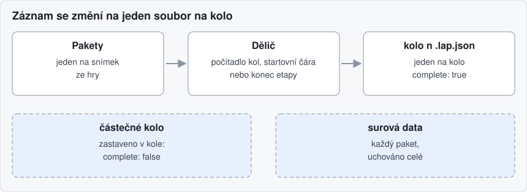

# Jak se rozdělují kola a etapy {#how-laps-and-stages-are-split}

Nahrávač vidí jeden souvislý proud vzorků. Přeměnu na kola provádí jeden ze čtyř
dělicích nástrojů, vybraný podle toho, co hra říká o kolech. Všechny se řídí
stejnou myšlenkou: použít počítadlo kol hry, kde nějaké existuje, jinak najít kolo
z poloh; nikdy nezapsat úsek příliš krátký na porovnání.

| Dělič | Kód | Používá |
|---|---|---|
| `LapSplitter` | [`fulllap.py`](https://github.com/Holdi601/3DHeat-GameCapture/blob/main/heat3d_capture/telemetry/fulllap.py) | Forza |
| `CounterSplitter` | [`kunos.py`](https://github.com/Holdi601/3DHeat-GameCapture/blob/main/heat3d_capture/telemetry/kunos.py) | Assetto Corsa, ACC |
| `LineSplitter` | [`kunos.py`](https://github.com/Holdi601/3DHeat-GameCapture/blob/main/heat3d_capture/telemetry/kunos.py) | AC EVO, AC Rally, BeamNG |
| `StageSplitter` | [`rally.py`](https://github.com/Holdi601/3DHeat-GameCapture/blob/main/heat3d_capture/telemetry/rally.py) | EA SPORTS WRC, DiRT Rally 2.0, DiRT Rally, DiRT 4, Richard Burns Rally |

Trackmania dělí jízdy uvnitř svého pluginu ([Trackmania](telemetry-trackmania.md)),
soubory iRacingu dělí prohlížeč podle počítadla kol simulátoru
([iRacing](telemetry-iracing.md)).

Při **Ctrl+C** každý nahrávač zavolá `flush()` svého dělicího nástroje, takže
otevřené kolo nebo etapa se zapíše, pokud splní stejná minima jako níže.

## LapSplitter (Forza) {#lapsplitter-forza}

Parametry: `minimum_metres = 400`, `gap_seconds = 2.0`.

Pro každý dekódovaný paket:

1. Pokud `timestampMs` hry skočila dopředu o více než 2 sekundy oproti
   předchozímu paketu, nebo šla dozadu, otevřené kolo se nejdřív uzavře.
2. Pokud je `isRaceOn` 0 (hra není v závodě), otevřené kolo se uzavře a paket se
   zahodí.
3. Pokud žádné kolo není otevřené, otevře se jedno s `lapNumber` paketu.
4. Pokud se `lapNumber` liší od čísla otevřeného kola, otevřené kolo se **uzavře
   jako dokončené**; jeho `seconds` je `lastLap` hry, je-li kladné. Kolo uzavřené
   tímto způsobem se zapíše bez ohledu na délku. Otevře se nové kolo.
5. Paket se připojí.

Nahrávač také kolo uzavře, když nepřijde žádný paket 2 sekundy reálného času
(hra je pozastavena nebo se zavřela uprostřed kola).

**Uzavření** ponechá otevřené kolo jen tehdy, má-li alespoň 2 vzorky a alespoň
400 m `distanceTravelled`; zapíše se jako nedokončené (`run`). Závod z bodu A do
bodu B nikdy nepočítá druhé kolo, takže vždy skončí takto.

## CounterSplitter (AC, ACC) {#countersplitter-ac-acc}

Parametr: `minimum_metres = 300`. Dostává každý vzorek s `completedLaps` a časem
posledního kola ze stránky grafiky.

- První vzorek otevře kolo očíslované aktuálním `completedLaps`.
- Když se `completedLaps` změní, otevřené kolo se uzavře. Je **dokončené**, s
  `seconds = čas posledního kola v ms / 1000` (je-li kladný), jen pokud počítadlo
  vzrostlo přesně o 1 - skok zpět na 0 (restart sezení) nebo o více kol je uzavře
  jako nedokončené.
- Uzavřené kolo se zapíše jen tehdy, má-li vzorky a alespoň 300 m ujeté dráhy.
- Uzavření ponechá otevřené kolo, pokud má více než jeden vzorek a alespoň 300 m.

## LineSplitter (AC EVO, AC Rally, BeamNG) {#linesplitter-ac-evo-ac-rally-beamng}

Parametry: `radius = 15 m`, `minimum_metres = 300`, `stop_seconds = 8`.

Tyto hry buď nemají počítadlo kol na stránce, kterou nahrávač čte, nebo jedou
etapy. **Čára je tam, kde nahrávání začalo**:

1. Vodorovná poloha prvního vzorku (`x`, `z`) se stane čárou.
2. Jakmile auto ujede více než 5 m, směr od čáry k autu se stane směrem kola.
3. **Zastavení** ukončí jízdu: když `speed` zůstane pod 1 m/s po dobu 8 sekund,
   otevřené kolo se uzavře (tak končí rallye etapa: auto zastaví v cíli).
4. **Přejetí čáry**: po více než 300 m jízdy se sbírají vzorky do 15 m od čáry.
   Když auto toto okolí zase opustí, nejbližší nasbíraný vzorek je přejetí. Pokud
   auto tam mířilo stejným směrem jako směr kola (skalární součin místního směru
   jízdy se směrem je kladný), kolo se uzavře na tom vzorku; jinak se průjezd
   ignoruje (auto projelo start opačným směrem).
5. `seconds` uzavřeného kola je čas od jeho prvního vzorku k přejetí. Je
   **dokončené jen tehdy, pokud jeho první vzorek byl rychlejší než 5 m/s**: kolo,
   které začalo z klidu, je rozjezd, ne kolo k porovnání. První kolo nahrávání
   začaté na startovním roštu je proto vždy nedokončené; nahrávání začaté při jízdě
   na plný plyn dá dokončené první kolo při dalším přejetí.
6. Další kolo začne vzorkem přejetí (patří oběma kolům).

Kola kratší než 300 m se zahodí. Uzavření (zastavení nebo Ctrl+C) ponechá
otevřené kolo, má-li alespoň 2 vzorky a 300 m, jako nedokončené. BeamNG uzavírá
stejně, když se vozidlo resetuje (jeho hodiny jdou zpět), před spuštěním nového
dělicího nástroje, takže jízda před resetem se zachová.

Vzdálenosti jsou vodorovné (`x`, `z`) pro počítadlo ujeté dráhy a test čáry a
plné trojrozměrné pro test délky 300 m.

## StageSplitter (rallye hry) {#stagesplitter-rally-games}

Parametr: `minimum_metres = 300`. Dostává každý vzorek s časovými hodinami etapy
hry, zda hra říká, že auto dojelo, a volitelně jeho čas z hry.

1. Jestliže hodiny jsou 0 nebo méně, nebo se vrátily o více než 0,5 s, otevřená
   etapa se **opustí**: zachová se jako částečná etapa, pokud není dokončená, má
   více než 10 vzorků a alespoň 300 m. Hodiny 0 nebo méně také zahodí vzorek (auto
   je na startu).
2. Pokud není otevřena žádná etapa, otevře se nová (číslovaná 1, 2, ... pro dané
   nahrávání).
3. Jakmile je etapa dokončena, další vzorky se ignorují, dokud se hodiny nevrátí.
4. Každý vzorek se uloží s `time` nastaveným na hodiny etapy.
5. Když hra řekne, že je dojeto, etapa je dokončena; její `seconds` je čas hry, je-li
   uveden a kladný, jinak hodiny. Zapíše se, pokud pokryla alespoň 300 m.

Co znamená „dojeto“ u jednotlivých her:

| Hra | Dojeto, když |
|---|---|
| EA SPORTS WRC | délka etapy > 0 a vzdálenost v etapě >= délka - 0,5 m |
| hry DiRT | počet dokončených kol vzrostl nad počet na začátku etapy, nebo (jednokolová akce) vzdálenost na kole >= 99,9 % délky trati |
| Richard Burns Rally | závodní hodiny > 0 a vzdálenost do cíle <= 0 |

U RBR se osa nahoru a rychlost ustálí, když se etapa zapisuje (viz
[Rallye hry](telemetry-rally.md#richard-burns-rally-rsf--ngp)).

## Čas a vzdálenost v souboru kola {#time-and-distance-in-the-lap-file}

U všech nahrávačů kromě Forzy se `time` přepočítá tak, aby první vzorek kola byl
0, a `distance` je kumulativní trojrozměrná vzdálenost mezi po sobě jdoucími
polohami. Forza používá vlastní časomíru kola a počítadlo ujeté dráhy hry,
přepočtené stejně.
