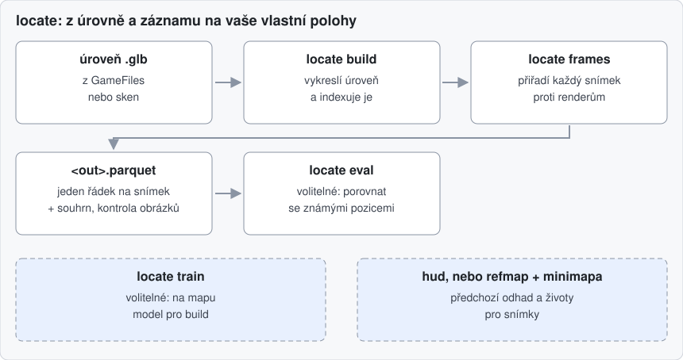

# Umísťování snímků v úrovni {#locating-frames-in-a-level}

`locate` zjistí, kde byl pořízen každý snímek herního záznamu - 3D pozici kamery a směr pohledu -
tak, že porovná obraz s vykresleními geometrie levelu. Je určen pro hry, které si nevedou žádný
záznam o tom, kde hráč byl: žádné demo, žádný soubor přehrávání, žádná telemetrie. Prvním je
Battlefield 6.

> **Experimentální.** Na skutečných záznamech zatím umístí jen malý podíl snímků; viz
> [Skutečné snímky: experimentální](#real-frames-experimental).

```bash
# Once per level: render it from every place a player can stand, and index the renders.
.venv\Scripts\python -m heat3d_capture locate build level.glb -o level.db

# Per recording: where was each frame taken?
.venv\Scripts\python -m heat3d_capture locate frames "<recording>.mp4" --db level.db -o out/match
```

Pozice se bere **z obrazu**, proti celému levelu, bez předchozího odhadu. Stopa z minimapy
z [čtečky HUD](hud-video.md) je jen záložní řešení pro snímky, které obraz neumí umístit, a každý
řádek říká, ze kterého z obou pochází.




## Čeho se to dotýká a čeho ne {#what-it-does-and-does-not-touch}

- Čte **vlastní záznam** hráče a soubor levelu, který hráč exportoval ze **své vlastní kopie** hry.
  Nikdy se nedotýká hry, její paměti, jejích souborů během běhu, ani její sítě, a běží až po
  zápase. Viz [Pravidla](rules.md).
- Umísťuje **jen vlastní kameru hráče**: snímek je vlastní pohled hráče.
- Level, databáze z něj postavená a vše, co se z něj vykreslilo, patří vydavateli hry. Nechte je
  lokálně.

## Požadavky {#requirements}

- Co uvádí `requirements.txt`, PyTorch (z pytorch.org, kvůli GPU) a `requirements-locate.txt`:

```bash
.venv\Scripts\python -m pip install -r requirements-locate.txt
```

- GPU s OpenGL 3.3 (4.3 je rychlejší) pro vykreslování, a ideálně CUDA pro modely. Na procesoru to
  funguje, ale pomalu.
- Modely se stáhnou při prvním použití (asi 450 MB): DINOv2 z Hugging Face, ALIKED a LightGlue přes
  kornia. Všechny mají licenci povolující komerční použití; viz [Licence](#licences).
- **Level** jako `.glb` (nebo `.gltf`) v rámci prohlížeče, Y nahoru, **s jeho texturami barvy
  základu**, jak je zapisují exportéry 3DHeat (části `ground:` / `structure:`; názvy částí nejsou
  potřeba). Jedna jednotka je jeden metr, pokud v horním `extras` souboru v `extras.unit_metres`
  není uvedeno jinak. Skenování GameCapture (`reconstruct`, okno skenování) se zapisuje v
  **centimetrech** a nese `extras.unit_metres: 0.01`, takže se načte ve skutečné velikosti.
  Level bez textur funguje mnohem hůř; viz [Omezení](#limits).

## Příkazy {#commands}

### `locate build <level> -o <db>` {#locate-build---o-}

Vykreslí level ze všech míst, odkud by hráč mohl stát, a uloží ke každému vykreslení jeho pozici a
jeden globální deskriptor.

| Volba | Výchozí | Význam |
|---|---|---|
| `level` | | `.glb` / `.gltf` levelu. |
| `-o`, `--out` | | Složka databáze, která se zapíše. |
| `--game` | `bf6` | Profil hry: výšky očí, zorné pole, boxy HUD, rychlost (níže). `generic` pro libovolnou hru z pohledu první osoby. |
| `--eye` | podle profilu | Výšky očí nad podlahou v metrech, nejdřív stojící. Jeden pohled databáze na každou výšku. |
| `--fov` / `--vfov` | podle profilu | Vodorovné zorné pole záznamu, nebo svislé (Battlefieldový posuvník) pro záznam 16:9. |
| `--spacing` | 2,5 | Metry mezi místy, odkud se berou pohledy. |
| `--yaw-step` | 30 | Stupně mezi směry pohledů. |
| `--pitch` | 0 | Sklony, pod kterými se vykresluje, ve stupních nahoru. |
| `--positions` | žádné | Tabulka (Parquet nebo CSV se `x`, `y`, `z` u chodidel, v rámci levelu), ze které se místa berou místo každé podlahy: například výstup předchozího běhu. |
| `--shadows` | vypnuto | Vrhat slunce stíny ve vykresleních (sluneční světlo levelu, když soubor uvádí `extras.sun`). |
| `--untextured` | vypnuto | Vykreslit jen tvar a světlo. |
| `--box X0 Z0 X1 Z1` | celý soubor | Jen místa uvnitř tohoto obdélníku (jednotky levelu): hrací oblast. |
| `--places` | `auto` | Odkud se berou pohledy: `nav` - hráči v očích výšky nad navigační sítí levelu (části `nav:`, přesně kam hra hráče pouští), kamery vozidel ve své výšce nad částmi `ground:` (terén a silnice) do 50 m od něj; `ground` - obojí nad `ground:`; `floors` - nad každou vzhůru obrácenou plochou (střechy a bedny také); `auto` - `nav`, když má level navigační síť, jinak `floors`. |
| `--head` | žádná | Model hlavy pro danou mapu z `locate train` pro deskriptory. |

Zapíše `<db>/db.json` (z čeho a jak byla postavena) a `<db>/views.npz` (pozice, deskriptory).

### `locate frames <recording> --db <db>` {#locate-frames----db-}

| Volba | Výchozí | Význam |
|---|---|---|
| `source` | | Video, obrázek, nebo složka obrázků (berou se v pořadí názvů, po `--fps`). |
| `--db` | | Databáze, kterou zapsal `build`. Její soubor levelu musí být pořád tam, kde byl (nebo `--level`). |
| `-o`, `--out` | `<source>.locate` | Cesta k výstupu bez přípony. |
| `--fps` | 2 | Umístěné snímky za sekundu videa. |
| `--start`, `--seconds` | všechno | Část videa, která se čte. |
| `--width` | 1280 | Šířka, na které se snímky porovnávají. |
| `--shortlist` | 8 | Pohledy databáze zkoušené na snímek v okolí odhadu nebo opravy. |
| `--search-shortlist` | 16 | Bez předchozího odhadu: pohledy databáze zkoušené na snímek ([hledané společně](#with-no-prior-frames-searched-together)). |
| `--no-search` | vypnuto | Bez předchozího odhadu: hledat každý snímek zvlášť a věřit jeho opravě bez sousedů. |
| `--accept-depth` | 0 (vypnuto) | Bez předchozího odhadu: věřit opravě, jen když je vzdálená hloubka jejích shod tolikrát větší než blízká. |
| `--accept-support` | 2 | Bez předchozího odhadu: souhlasící sousedé podél života, které oprava potřebuje, aby se jí věřilo. |
| `--checkpoint` | žádná | Uchovat stav běhu zde a pokračovat od něj, když tu je. |
| `--stop-file`, `--stop-process` | žádná | Zastavit se sám, stav uložen, kód konce 75, když existuje tento soubor nebo běží proces, jehož jméno začíná touto hodnotou (kontroluje se před každým snímkem; lze opakovat), aby dlouhý běh uvolnil počítač pro hru. Stejný příkaz pak pokračuje. |
| `--normalise` | žádná | Lehká normalizace před porovnáním: `clahe`, `gray`. |
| `--minimap` | žádná | Tabulka příkazu `hud`: **záložní řešení** pro snímky, které obraz neumí umístit. |
| `--prior-radius` | žádná | **Volitelné zrychlení**, ve výchozím stavu vypnuté: hledat jen pohledy databáze do tolika metrů od pozice na minimapě (vyžaduje `--minimap`). |
| `--minimap-anchor` | žádná | Soubor JSON, který váže minimapu k levelu ([minimapa jako předchozí odhad hledání](#the-minimap-as-a-search-prior)): minimapa zúží hledání od prvního snímku; takto nalezené opravy jsou `visual+minimap-prior`. |
| `--no-level-search` | vypnuto | S odhadem: když nic blízko něj nesedí, nehledat navíc v celém levelu (rychlejší). |
| `--lives` | tabulka `--minimap` | Tabulka příkazu `hud`, jejíž smrti, nasazení a oživení říkají, kdy byl hráč ve hře: pozice skáčou jen přes smrt ([životy z videa](#lives-from-the-footage)). |
| `--no-sequence` | vypnuto | Rozhodnout každý snímek zvlášť, ne podél běhu (níže). |
| `--fit-fov` | vypnuto | Po běhu přizpůsobit zorné pole nejsilnějším opravám, po pohledu, a nahlásit ho. |
| `--check-every` | 0 | Také každých N snímků, umístěných nebo ne, obrázek do `<out>.check`. |
| `--no-checks` | vypnuto | Nezapisovat kontrolní obrázky vizuálních oprav (níže). |
| `--no-zoomed` | vypnuto | Neřešit přiblížené pohledy z oprav jejich sousedů (níže). |
| `--no-grow` | vypnuto | Neprohledávat znovu blízko každé opravy kvůli snímkům kolem ní, které jich stále nemají. |
| `--game`, `--eye`, `--fov`, `--vfov`, `--mask`, `--no-hud-mask`, `--max-speed` | podle profilu | Jako výše; `--mask x,y,w,h` přidá box obrazovky (na obrazovce 1920x1080), který není level. |
| `--vehicle-vfov` | podle profilu | Svislé zorné pole kamer vozidel (posuvník vozidel v Battlefieldu). |
| `--settings` | nejnovější soubor nastavení | `bf6`: soubor nastavení hry, ze kterého se čtou zorná pole (jen pro čtení), když není zadán `--fov`/`--vfov`; ve výchozím stavu nejnovější `PROFSAVE*_profile` ve složce `Documents/Battlefield 6/settings`. Obsahuje nastavení tak, jak jsou teď, což nemusí být způsob, jakým byl starší záznam pořízen. |

### `locate refmap <level> <deploy screen> -o <refmap>` {#locate-refmap----o-}

Umístí vlastní mapu hry na level: referenci, proti které se čte minimapa
([minimapa čtená proti levelu](#the-minimap-read-against-the-level)). `<deploy screen>` je obrázek
obrazovky nasazení ukazující celou mapu, nebo záznam s `--at <seconds>` v takovém okamžiku; box
mapy z profilu se z něj vyřízne (`--whole-picture` zachová všechno). Zapíše `<refmap>.png` (mapa
převzorkovaná do vlastního rámce levelu, `--mpp` metrů na pixel, výchozí 0,5),
`<refmap>.valid.png` (kde je to mapa, ne značka nebo popisek) a `<refmap>.json` (rámec a kalibrace,
s tím, jak daleko byly dlaždice mapy od něj). `--topdown <prefix>` ponechá level vykreslený shora pro
další běh (`--topdown-mpp`, výchozí 0,656 m; `--box` ho omezí).

### `locate minimap <recording> --refmap <refmap> -o <table>.parquet` {#locate-minimap----refmap---o-parquet}

Přečte minimapu záznamu proti referenční mapě, snímek po snímku (`--fps`, výchozí 2): pozici, směr
a přiblížení každé minimapy, která se shoduje, v rámci levelu, zapsané jako tabulka minimapy s
kotvou vedle (`<table>.anchor.json`), kterou `locate frames` přebírá jako
`--minimap <table>.parquet --minimap-anchor <table>.anchor.json`. S tabulkou příkazu `hud`
(`--hud`) se její životy přenesou; s kotvou pro tuto tabulku také (`--hud-anchor`) je první hledání
kolem místa, kam ji položí hráče, a kde se žádná minimapa neshoduje, doplní se stopa HUD vlastní
a přesune se na nejbližší opravy z referenční mapy (`--hud-fill`, sekundy, výchozí 120; 0 to
vypne). `source` tabulky říká, které to je (`refmap`, `hud`).

### `locate eval <out>.parquet --truth <poses>` {#locate-eval-parquet---truth-}

Porovná výsledek se známými pózami kamery: tabulka `time`, `x`, `y`, `z` (oko), `yaw`, `pitch`
v rámci levelu. `--offset` je časový posun hodin (čas pravdy = čas videa + offset); bez něj se
offset hledá. `--unit-metres` převede chyby na metry.

## Profily hry {#game-profiles}

| | `bf6` | `generic` |
|---|---|---|
| Výšky očí | 1,6 m vestoje, 1,05 m v dřepu (zatím neměřeno ve hře) | 1,65, 1,1 m |
| Zorné pole | 55 stupňů svisle, asi 86 vodorovně při 16:9: **zadejte hráčovo vlastní** pomocí `--vfov` | 90 vodorovně |
| Maskované HUD | minimapa a seznam squadu, zpráva o zabitích, kompas, munice, zbraň hráče, vyskakovací okna, zaměřovač | zaměřovač |
| Nejrychlejší pěšky | 8 m/s | 8 m/s |
| Rozlišované pohledy | pěšky, vozidlo, přiblížené (níže) | každý snímek pěšky |
| Kamery vozidel | posuvník vozidla (ze souboru nastavení), vozidlo maskované, kamera až 8 m nad podlahou, 30 m/s | - |

Zorné pole nejvíc záleží: snímek vyřešený se špatným je vyřešen se špatnou ohniskovou vzdáleností
a jeho pozice klouže podél pohledu.

## Výstupy {#outputs}

### `<out>.parquet` {#parquet}

Jeden řádek na každý umístěný snímek, v **rámci levelu** (Y nahoru, jednotky levelu), se pokyny
pro čtení prohlížečem v zápatí (`kind: heat3d-locate`). Zápatí jmenuje každý sloupec, který nemá
vlastní roli, jako extra, takže prohlížeč si je všechny ponechá (jeho karta podrobností je ukazuje).

| Sloupec | Význam |
|---|---|
| `time` | Sekundy od začátku videa. |
| `event` | `start` na prvním řádku života, `position` na ostatních. |
| `x`, `y`, `z` | Oko, vyhlazené v rámci života. Prázdné, kde žádný zdroj snímek neumístil. |
| `yaw`, `pitch` | Stupně: yaw kolem osy nahoru (0 podél +X, rostoucí směrem k -Z, což je yaw hry v rámci prohlížeče), pitch nahoru od vodorovné. `pitch` je u řádků minimapy prázdný. |
| `dir_x`, `dir_y`, `dir_z` | Směr pohledu. |
| `player`, `team`, `session` | `me`, `own`, a `<video>#NN`, jeden na každý život. |
| `life` | Život, ve kterém záznam ukázal snímek (z HUD smrtí; 1 = první). Prázdné, když je mimo hru (mrtvý, sestřelený, nasazuje se), nebo když se životy nepřečetly. `session` je život stopy, který se může rozdělit i při skoku. |
| `source` | `visual` (z obrazu), `visual+minimap-prior` (z obrazu, hledání zúžené na předchozí odhad minimapy), `minimap` (záložní řešení), `minimap+nav-floor` (uvnitř budovy: minimapa a podlaha navigační sítě) nebo `none`. |
| `view` | `foot`, `vehicle`, `zoomed` nebo `screen` (níže). |
| `cam_x`, `cam_y`, `cam_z` | Kamera, která snímek viděla. Pěšky a přes záměrný dalekohled je to oko a `x`, `y`, `z` jsou totéž; v pohledu třetí osoby z vozidla jsou `x`, `y`, `z` vozidlo (model offsetu níže) a kamera jede za ním a nad ním. |
| `hfov`, `zoom` | Vodorovné zorné pole, se kterým se snímek vyřešil, a u přiblíženého pohledu jeho přiblížení proti normálnímu pohledu. |
| `confidence` | 0..1: jak moc věřit řádku (níže). |
| `uncertainty` | Typická chyba řádku, jednotky levelu: u vizuální opravy z jejích inlierů a sousedů, u řádku minimapy z přizpůsobení (níže). |
| `inliers`, `rmse` | Inliery PnP a chyba reprojekce vizuálního řešení (pixely při pracovní šířce). |
| `x_raw` ... `pitch_raw` | Vizuální řešení před vyhlazením (i pro odlehlé hodnoty, které hlasováním vypadly). |
| `kept` | Vizuální oprava přežila hlasování o odlehlých hodnotách. |
| `note` | Proč snímek nebyl umístěn, nebo byl vyřazen hlasováním. |

### `<out>.summary.json` {#summaryjson}

Snímky, vizuální opravy, odlehlé hodnoty, životy, řádky podle zdroje, přizpůsobení minimapy
(páry, inliery, reziduum), čas na snímek.

## Postup {#method}

### Databáze {#the-database}

Místa jsou body na každém trojúhelníku směřujícím nahoru v levelu, rozložené rovnoměrně (jedno na
`--spacing` na 3D mřížce, takže každé patro budovy dostane své). Každé se zkontroluje z jeho oka
šesti malými hloubkovými vykresleními: kamera uvnitř geometrie vidí hlavně zadní plochy, plazivý
prostor má něco pevného nad okem; obojí se zahodí. Z každého místa se level vykreslí v každé výšce
očí, každých `--yaw-step` a každého `--pitch`, a každé vykreslení popíše **DINOv2** (jeho tokeny
záplat sdružené zobecněným průměrem, spojené s tokenem třídy).

Lokální rysy a 3D body, proti kterým se snímek nakonec řeší, se **neukládají**: vytvoří se znovu,
když jsou potřeba, vykreslením několika pohledů, které vybralo vyhledávání, což trvá milisekundy.
Díky tomu zůstává databáze na několika stovkách megabajtů, ne desítkách gigabajtů, a to umožňuje
zpřesnění níže. Cena je, že `frames` potřebuje soubor levelu a GPU, nejen databázi.

### Jeden snímek {#one-frame}

1. **Maskovat**, co není level: boxy HUD profilu a zaměřovač, plus všechny `--mask`.
2. **Vyhledávání** přes **celý level**: globální deskriptor snímku proti každému pohledu databáze;
   několik desítek nejpodobnějších, zředěných tak, aby obsahovaly různá místa a směry, tvoří
   krátký seznam.
3. **Porovnání**: každý pohled na krátkém seznamu se znovu vykreslí ve velikosti a zorném poli
   snímku, s hloubkou. Klíčové body ALIKED snímku a vykreslení se páří pomocí LightGlue. Hladký
   bod vykreslení plus jeho hloubka je 3D bod levelu, takže každá shoda je korespondence 2D-3D;
   klíčové body na hraně hloubky (jejichž hloubka může patřit tomu, co je za nimi) se zahodí.
4. **Pozice**: PnP s RANSAC (SQPnP), pak robustní zpřesnění, které drží kameru vodorovně - pohled
   z první osoby se nenaklání - a minimalizuje chybu reprojekce inlierů.
5. **Je to možné?** Pozice musí být ve výšce očí hráče nad podlahou a mimo geometrii (hloubkové
   vykreslení přímo dolů). Podobná textura jinde - dlaždicová podlaha spárovaná se zdí ze stejného
   materiálu - může dát stovky inlierů v pozici, kterou by hráč nikdy nemohl zaujmout; ty se
   odloží, bez ohledu na počet inlierů.
6. **Vykreslit a porovnat**: level se vykreslí v řešené pozici a znovu se porovná, což nahradí
   pohled databáze vzdálený až několik metrů a desítky stupňů pohledem, který téměř souhlasí se
   snímkem. Opakuje se, dokud přibývají inliery (nejvýš dvakrát).
7. **Výběr**: tři nejsilnější místa (víc než asi 3 m od sebe) se zpřesní, než se jedno vybere.
   Podobná textura může vést před zpřesněním; správné místo z něj získá mnohem víc.
8. **Verdikt**: `confidence` skládá počet inlierů, nejlepší jiné místo (`runner_up`) a chybu
   reprojekce. Oprava je `ok` s alespoň 25 inliery, žádným jiným místem do 80 % jejích inlierů
   a důvěrou alespoň 0,85 - prahem, který měření níže staví na 97,5-99 % správně.

### Pohledy {#views}

Snímek není vždy oči hráče. Detektor profilu z HUD pozná, který pohled to je, a snímek se podle
toho vyřeší:

- **Pěšky**: pěchotní zorné pole a výšky očí.
- **Vozidlo** (Battlefield 6: nápovědy kláves v diagramu sedadla, `C CAMERA` a `E EXIT`, dole
  uprostřed): zorné pole vozidla, samotné vozidlo maskované (dolní střed obrazovky v jeho pohledu
  třetí osoby) a kamera povolená až 8 m nad podlahou. Oprava je kamery.
- **Obrazovka** (tmavé okraje kolem tmavého středu: mapa nasazení, menu, tabulka výsledků): není
  to pohled na level; přeskočí se.
- **Přiblížený** (záměrný dalekohled, dalekohled střelce, vlastní pohled z první osoby ve vozidle:
  jeden okraj obrazovky černý, oba tmavé, kolem světlého obrazu): nehledá se přes level - proužek
  levelu v záměrném dalekohledu se nepodobá žádnému širokému pohledu databáze - ale řeší se po
  běhu z nejbližší opravy do 6 s, níže. Vypne se `--no-zoomed`.

### Přiblížené pohledy {#zoomed-views}

Úzký pohled špatně určuje pozici: krok zpět s trochu větším přiblížením vypadá skoro stejně. Takže
přiblížený snímek začíná tam, kde mu soused říká, že je záměr - pěšky v oku té opravy, ve vozidle
2,5 m nad zemí pod středem vozidla (zaměřovač věže) - a jak daleko se mohl od té doby posunout:
2 m, plus 4 m za sekundu pěšky nebo 8 ve vozidle, nejvýš 12 m (`reach`).

1. **Směr a přiblížení, pozice držená.** Pro každé přiblížení 1, 1,2 (vlastní pohled vozidla,
   užší než pěšky), 1,5, 2, 3, 4, 6 a 8 se level vykreslí z místa záměru ve směrech do 30 stupňů od
   směru souseda (a od 3x i několika sklonů). Klíčové body snímku spárované s vykreslením, s body
   levelu pod nimi, jsou paprsky z místa; rotace se přizpůsobí po dvou (RANSAC) pro ohniskové
   vzdálenosti od 0,75 do 1,3 násobku té pro dané přiblížení, s bodem souhlasícím v úhlu, který
   počítá s tím, že místo je v `reach` mimo ve své vzdálenosti. Vyhraje přiblížení, směr a ohnisková
   vzdálenost, s nimiž souhlasí nejvíc bodů.
2. **Ustáleno.** Tyto body pak přizpůsobí pozici, směr a ohniskovou vzdálenost dohromady podle
   jejich chyby reprojekce, pozice držená na místě nákladem dvou pixelů na každý pohyb `reach`;
   vykreslí se ještě jednou v odpovědi a znovu přizpůsobí. Inliery a chyba se počítají v pixelech a
   oprava je `ok` podle stejné důvěry jako kterákoli jiná.

Zapsané přiblížení (`zoom`) je vůči zornému poli běhu pěšky; `hfov` je vyřešené. Ve vozidle je
zapsaná pozice pozicí vozidla, 2,5 m pod zaměřovačem, jako u jeho pohledu třetí osoby.

### Vozidla: kamera a vozidlo {#vehicles-the-camera-and-the-vehicle}

V pohledu třetí osoby z vozidla je vyřešená pozice kamery pronásledování, která jede za vozidlem a
nad ním a otáčí se kolem něj, jak se hráč rozhlíží. Zapsaná pozice (`x`, `y`, `z`) je vozidla -
země pod jeho středem: kamera plus `vehicle_offset` profilu, tolik metrů napřed podle vodorovného
směru pohledu kamery a tolik dolů. Kamera zůstává v `cam_x`, `cam_y`, `cam_z`. Převod se udělá před
sekvencí a stopou, takže se kamera otáčející se kolem stojícího vozidla nebere za pohyb. Zápatí
tabulky nese použitý offset a to, zda byl měřen (`vehicleOffset`). Pěšky a přes zaměřovač není
offset žádný.

Jak byl offset Battlefieldu 6 změřen: na správných opravách skutečných snímků třetí osoby tanku se
střed tanku označil okem na snímku a level vykreslený v opravě dal zemi v tom pixelu. Profil bere
medián: asi 10 m napřed od kamery a asi 4 m pod ní. Označení je dobré na metr nebo tak, a je to
jeden typ vozidla: auto nebo vrtulník jezdí se svou kamerou jinak.

### Bez předchozího odhadu: snímky hledané společně {#with-no-prior-frames-searched-together}

Globální deskriptor jednoho snímku proti celému levelu je slabý signál a inliery jednoho snímku
neřeknou správné místo od jeho dvojníka. Takže bez předchozího odhadu se snímky záznamu nejdřív
popíšou a hledají se společně (`search.py`), a oprava se věří jen se snímky kolem ní:

- **Krátký seznam.** Podobnosti každého pohledu se měří proti jeho vlastnímu průměru a rozptylu
  přes záznam, takže pohled podobný každému snímku přestane vyhrávat všude. Každý snímek boduje
  buňky 24 m mřížky podle pořadí jejich nejlepšího pohledu; nejlepší cesta buňkami podél každého
  života, v tom, co hráč může pokrýt mezi snímky, dá důvěru na buňku, a nejlepší pohled každé
  buňky, nejdřív nejvíc věřený, je jeden seznam. Obyčejné vyhledávání je ten druhý, a obě se berou
  střídavě: měření pohledů proti záznamu trestá místo, které hráč skoro neopouští, a tam si
  obyčejné vyhledávání vede dobře.
- **Věření.** Kandidát se počítá, jen když jeho inliery pokrývají alespoň 12 % mřížky 8 x 8 přes
  snímek: podobná textura je opakovaný objekt, zásobník kontejnerů, se stovkami inlierů na několika
  buňkách snímku. Oprava se věří, když leží na nejlepší cestě přes počítané kandidáty (níže)
  s alespoň dvěma sousedy do 6 s, kteří s ní souhlasí. Snímek mimo hru se vůbec nehledá.
- **Růst.** Roste se jen z toho, čemu se věří, a narostlá oprava musí pokrývat snímek stejným
  způsobem.

### Podél běhu {#along-the-run}

Každý snímek si nechá každou fyzicky možnou pozici, kterou našel, jednu na místo (`candidates`), ne
jen nejsilnější. Běh pak vybere jednu na snímek - nebo žádnou - tak, aby vybrané pozice tvořily
cestu, kterou by hráč mohl jít nebo jet, a co nejvíc inlierů leželo na ní: skrytý Markovův model,
dekódovaný najednou (Viterbi). Podobné místo, které vyhraje jeden snímek sám za sebe, prohraje
s místem, se kterým souhlasí jeho sousedé; slabý kandidát, kterým cesta prochází, s alespoň dvěma
souhlasícími sousedy, se stane opravou (`note`: chosen along the sequence); jistá oprava, které
všichni sousedé odporují, přestane být opravou. Soused souhlasí jen do 6 s: dál, vzdálenost, kterou
hráč - natož vozidlo - mohl ujet, je tak velká, že souhlas nic neříká. Vypne se `--no-sequence`.

### Časy snímků {#frame-times}

`time` řádku je vlastní časová značka snímku v záznamu, ne jeho počet podle nominální snímkové
frekvence. Záznamy se od nominální frekvence odchylují (o několik desetin sekundy uvnitř klipu, u
těch, které se měřily), a všechno, co čte snímek zpět podle jeho času - kontrolní obrázky,
přiblížený průchod, `locate train --real`, minimapa z příkazu `hud` - hledá podle časové značky.
Počítané snímky by postavily kontrolní obrázek o tolik dál od toho, který se umístil.

### Zorné pole z nasnímků {#the-field-of-view-from-the-frames}

`--fit-fov` si nechá nejsilnější opravy běhu (po pohledu) a zpřesní pozici a ohniskovou vzdálenost
každé z nich dohromady na jejích inlierech; medián z nich je zorné pole, se kterým byl záznam
pořízen, nahlášené v souhrnu (`hfov_fitted`) pro `--fov` dalšího běhu. Blízké a vzdálené body se
při změně ohniskové vzdálenosti hýbou jinak než při změně pozice, a právě to ji fixuje; potřebuje
opravy s hloubkou, ne plochou zeď.

### Model pro danou mapu {#a-per-map-model}

`locate train` natrénuje malou hlavu nad DINOv2 pro jeden level, na jeho vykresleních, aby
globální deskriptor našel správné pohledy skutečných snímků, a ne jen vykreslení:

- **Hlava**: každý token záplaty přes dvouvrstvou projekci, sdružený zobecněným průměrem přes
  záplaty, které ukazují level, spojený s promítnutým tokenem třídy. DINOv2 zůstává zmrazený.
  Všechno to je zde popsáno (MIT).
- **Dvojice**: místo na chodnosti zemi a směr, vykreslené dvakrát z poloh, které se liší nejvýš o
  metr nebo dva a o nejvýš desítku stupňů, při zorných polích lišících se nejvýš o 10 stupňů, za
  různého světla (slunce, stíny, okolní), každé přes herní vzhled: stupnice barev, zamlžení podle
  hloubky, záře, vinětace, kouř, lidé v cestě, vlastní vozidlo hráče ve výhledech vozidla, rozmazání
  pohybem, šum, JPEG (`augment.py`). Maskováno jako snímek. Místa do několika metrů se stejným
  směrem se nepočítají jako negativní.
- **Skutečné snímky**: snímky s pozicí, kterou našel samotný postup (pseudoznačky: opravy vybrané
  podél sekvence), se mohou připojit jako dvojice - snímek a vykreslení v jeho pozici - v druhém
  kole.
- **Ztráta**: kontrastní (InfoNCE) přes dávku.

`locate build --head <head.pt>` postaví databázi s ní; `frames` ji pak použije pro snímky.

| Volba `locate train` | Výchozí | Význam |
|---|---|---|
| `-o`, `--out` | povinné | Soubor hlavy, který se zapíše (`.pt`). |
| `--steps` | 600 | Kroky trénování. |
| `--real TABLE VIDEO` | žádná | Tabulka `locate frames` a jeho záznam: jeho jisté opravy se připojí jako skutečné dvojice. Lze opakovat. |
| `--real-confidence` | 0,85 | Důvěra, kterou oprava potřebuje, aby se připojila jako skutečná dvojice. |
| `--spacing`, `--box`, `--places`, a volby profilu | jako `build` | Kde jsou tréninková místa, a profil hry. |

### Kontrola očima {#checking-by-eye}

Každá vizuální oprava dostane obrázek v `<out>.check` - `<time>s_<view>_visual.jpg`: snímek, a vedle
něj level vykreslený z kamery opravy, s hranami snímku nakreslenými přes vykreslení. Kde na sebe
sedí, je oprava správná. Zapisuje se, až rozhodne sekvence a stopa, takže obrázky jsou přesně
řádky, které tabulka nazývá visual. Vypne se `--no-checks`.

### Minimapa čtená proti levelu {#the-minimap-read-against-the-level}

Minimapa složená do jedné mozaiky (z příkazu `hud`) není plochá: její měřítko se mění s přiblížením,
při kterém byla každá minimapa zaregistrována, místo viděné dvakrát se může nakreslit dvakrát a
mozaika každého klipu je vlastní. Podobnost přizpůsobená několika opravám pak drží poblíž nich, ale
několik desítek metrů mimo ně je mimo. Takže minimapu umísťuje sám level, ve dvou krocích, a nic se
neskládá:

- **Referenční mapa** (`locate refmap`). Obrazovka nasazení kreslí celou mapu orientovanou na sever,
  plochou, v jednom měřítku. Level vykreslený shora ukazuje tytéž věci stojící nad zemí (tanky,
  budovy, zdi): na levelu jejich výšku nad zemí do 15 m kolem; na mapě to, co je nakresleno světleji
  než zem kolem. Mapa se položí na level normalizovanou křížovou korelací obou přes měřítko a malé
  otočení, zpřesněná porovnáním jejích dlaždic jednu po druhé, a nakonec celou mapou najednou kolem
  té odpovědi (několik desítek dlaždic nechá měřítko volné o procento, metry na koncích mapy). Výsledek
  je jedna podobnost, pixel mapy na level.
- **Minimapa, snímek po snímku** (`locate minimap`). Každá vzorkovaná minimapa - výřez čtečky HUD a
  maska překryvu - se porovná (SIFT) s referenční mapou kolem místa, kde byl hráč naposled, nebo
  kdekoli, když není známo kde, a přizpůsobí se podobnost (otočení, přiblížení, posun). Bod hráče,
  který jí projde, je pozice, nahoru minimapy (kužel pohledu) je směr a její měřítko je přiblížení -
  naměřené, ne předpokládané.
- **Kde to neodpovídá.** Obrazovka nasazení nekreslí nic mimo hrací oblast; minimapa, která ukazuje
  většinou to, co leží mimo ni - hráč na okraji mapy - nemá s čím se shodovat. Tam nahradí stopa HUD
  samotná, posunutá o offset, který změřily nejbližší opravy z referenční mapy (`--hud-fill`); je
  tak dobrá, jak dobrá je mozaika poblíž těch oprav.

Na zkušebním levelu byla minimapa čtená tímto způsobem několik metrů (medián) od jistých
vizuálních oprav, stejně dobře mimo oblast, do které byla referenční mapa přizpůsobena, jako uvnitř.

### Minimapa jako předchozí odhad hledání {#the-minimap-as-a-search-prior}

Stopa minimapy z příkazu `hud` říká pro většinu snímků hry zhruba, kde je hráč a kam se dívá - ve
svých vlastních jednotkách (pixely minimapy, sever nahoře). Svázaná s levelem jednou zúží hledání na
malou část něj; samotná pozice pořád pochází z obrazu, podle stejných pravidel.

- **Kotva** (`--minimap-anchor <anchor.json>`): jedna podobnost na mapu, z minimapy do levelu -
  měřítko, otočení (se zrcadlem mezi pixely orientovanými na sever a osami levelu), posun -
  přizpůsobená na jistých vizuálních opravách (důvěra 0,7 a výš) několika klipů. Minimapa každého
  klipu je mozaika, kterou čtečka HUD složila sama, takže každá sedí jinde v jednotkách minimapy;
  dvě mozaiky jedné mapy se liší jen posunem, nalezeným porovnáním klíčových bodů mezi nimi (posun,
  na kterém se shodne nejvíc), a každá mozaika je navázána na jednu referenci přes všechny dvojice,
  které dobře souhlasí. Soubor kotvy nese podobnost mapy, posun klipu (`clip_shift`) a chybu, kterou
  kotva ukázala proti opravám klipů vynechaných z jejího přizpůsobení (`median`, `p90`, metry).
- **Kde a kterým směrem.** Směr minimapy je yaw kamery: na měřených klipech souhlasil s vyřešeným
  yaw do 2-5 stupňů. Takže snímek se nejdřív porovná s vykreslenými pohledy tam, kam minimapa umístí
  kameru - pěšky oko nad zemí tam, ve vozidle kamera pronásledování za ním a nad ním (offset
  vozidla) - s pohledem podél směru: bod a 4 m do každé strany, ve dvou sklonech (`seeds`). Teprve
  když žádné z nich neposkytne opravu, zkouší se pohledy samotné databáze uvnitř kruhu (30 m plus
  90. percentil chyby kotvy).
- **Opravuje se za běhu.** Každá jistá oprava blízko odhadu říká, jak daleko je kotva od místa; medián
  těch do 2 minut opravuje odhad a jejich rozptyl (nejméně 5 m) nahradí chybu kotvy v poloměru kruhu
  - nejvíc 10 m: opravy, které se liší víc, říkají, že minimapa je mimo místo, ne že cokoli 50 m
  pryč bude stačit. Bez opravy do 2 minut se odhad vůbec neopravuje (chyba jinde v klipu nic neříká
  o tomhle místě).
- **Kotvy s mřížkou.** Kotva může také nést `grid`: x a z levelu na pravidelné mřížce přes jednotky
  minimapy klipu, čtené bilineárně; uvnitř ní mřížka umísťuje bod, vně ní podobnost. Kotva tabulky
  `locate minimap` je identita (její tabulka už je v rámci levelu).
- **Slabá přizpůsobení.** S předchozím odhadem se přizpůsobení, které je slabé (25 inlierů nebo víc,
  ale ne dost jisté samo o sobě) a leží uvnitř kruhu, zachová - s nižší důvěrou - pro sekvenci a
  stopu, aby o něm rozhodly, a nezahodí se: kouř, suť a zničené zdi dávají skutečným snímkům méně
  shod.
- **Zdroje.** `visual` - obraz to umístil, bez předchozího odhadu; `visual+minimap-prior` - obraz to
  umístil, hledání zúžené na odhad; `minimap` - obraz ne, minimapa to nahradí; `minimap+nav-floor` -
  uvnitř budovy, níže.
- **Uvnitř budov** vede minimapa. Snímek, který obraz neumístil, pěšky, kde oko na pozici minimapy
  vidí level zblízka ze všech stran (medián vzdálenosti pod 8 m čtyřmi směry) a žádné nebe, je uvnitř
  budovy: dostane x a z minimapy a výšku podlahy navigační sítě tam - z několika pater to, které je
  nejblíž poslední opravě - s `source = minimap+nav-floor`, aby bylo jasné, že snímek neopravil obraz.

### Životy z videa {#lives-from-the-footage}

Pozice může skočit jen tam, kde hráč zemřel. Životy se neodhadují z pozic - jediná špatná oprava by
otevřela nový - ale čtou se z videa: tabulka čtečky HUD zaznamenává smrti, které ukázaly obrazovky
sestřelení a nasazení (`death`), sestřelení, které oživil spoluhráč (`downed`, `revived`), nasazení
(`spawn`) a kde hra začala a skončila (`start`, `end`); `lives.py` z nich dělá životy. Smrt uzavře
život, první snímek ve hře po obrazovce nasazení otevře další; oživení život nerozdělí (hráč je tam,
kde padl), a snímky během sestřelení se neumísťují; úsek menu nebo načítání delší než 10 s ho také
přeruší. Snímky mimo hru (mrtvý, nasazující se, sestřelený) se nikdy neumísťují.

Uvnitř života je spojitost pevným pravidlem: každý krok nejvýš rychlost krát čas mezi tím plus
1,5 m. Rychlost je rychlost snímku: pěšky rychlost profilu, ve vozidle rychlost, kterou ukazoval
vlastní údaj vozidla do 3 s (třetina navíc a 2 m/s pro zrychlování), nebo tam, kde žádný neukazuje,
limit jeho třídy. Během běhu (Viterbi) je krok přes smrt volný v jakékoli vzdálenosti, každý jiný
krok je omezený; snímek, který by potřeboval skok, se vynechá - slabší strana rozporu prohrává
(méně inlierů, menší podpora) - a život se na něm nikdy nerozdělí. Kde je vynechaná strana sama
silná (důvěra 0,9 a výš, dvě nebo více oprav, které se navzájem shodují), běh nehádá: obě strany se
ponechají a označí se `jump without detected death` (zmeškaná smrt, nebo skutečný teleport) a uvedou
se v souhrnu. Záložní řešení minimapou dodržuje tytéž životy.

Battlefield 6: první osoba tanků ukazuje rychlost (`<n> KPH`, vpravo od zaměřovače; čte se OCR
čtečky HUD); pohled třetí osoby ne. Údaje na zkušebních klipech byly pomalé, takže pozemním
vozidlům se tam, kde se nic nečte, povoluje 15 m/s. Lodě, vrtulníky a letadla dostanou velkorysé
limity (20, 90 a 280 m/s), které nejsou změřené: žádný klip neukazuje, že by některé z nich byl
někdo řízen nebo pilotován, a klasifikátor pohledu nerozlišuje vzduch od země - úsek rychlejší než
pozemní vozidlo se ukáže jako skok, označený, a nevěří se mu.

### Zničení {#destruction}

Soubory levelu jsou nepoškozený level; v zápase se zdi, domy a skály rozstřílejí, suť a kouř se
povalují a s postupem zápasu je to horší.

- **Porovnávání věří statickému levelu.** Část, kterou export označí jako ničitelnou (její název
  začíná `destructible:`, nebo `extras.destructible` na jejím uzlu, síti nebo primitivu), se
  vykreslí do masky `destructible` vykreslení. Shody, jejichž bod levelu na ní leží, se zahodí, když
  zbyde 40 nebo víc shod na statických částech - terén, silnice, velké stavby nesou řešení.
- **Trénink vidí, že to zmizelo.** Tréninková vykreslení (`locate train`) nahradí záplaty ničitelných
  částí šumem barvy suti a přidají prach nízko nad zemí, navrch kouře a zbytku herního vzhledu
  (`augment.py`), aby se model pro danou mapu neopíral o ně.
- **Chybějící geometrie není špatné místo**: s předchozím odhadem se slabá přizpůsobení uvnitř jeho
  kruhu zachovají (výše).

Dokud exporty tagy nenesou, nic se neoznačí jako ničitelné a tohle nedělá nic.

### Stopa {#the-track}

- **Odlehlé hodnoty**: oprava se porovná s opravami v 3 s před ní a zvlášť s těmi 3 s po ní;
  konzistentní znamená ne dál od sebe, než profil dovolí rychlostí, plus 1,5 m. Oprava, která
  nesouhlasí s většinou svých sousedů na **obou** stranách, se hlasováním vyřadí (zůstane ve sloupcích
  `_raw`, `kept` false). Požadavek obou stran chrání první opravu po znovuobjevení.
- **Životy**: s životy z videa (výše) stopa jde podle nich, a uvnitř života zahodí slabší stranu
  kroku, který poruší rychlost. Bez nich se láme tam, kde jsou dvě po sobě jdoucí ponechané opravy
  dál od sebe, než rychlost dovolí, kde je mezera delší než 8 s, a kde tabulka minimapy začíná nový
  život.
- **Vyhlazení**: uvnitř života se každá oprava slévá s přímkou procházející opravami kolem ní
  (vážená lokální lineární regrese, sigma 0,5 s), každá vážená svou nejistotou: silná oprava - přesná
  na centimetry - zůstane tam, kde je, slabá se přitáhne k silným sousedům. Přímka místo průměru,
  protože průměr táhne běžícího hráče zpět; průměr se zkusil jako první a z 3mm stopy udělal při 2
  snímcích za sekundu 0,3m. Úhly pohledu se nevyhlazují; otočení pohledu je skutečné a rychlé.

### Záložní řešení minimapou {#the-minimap-fallback}

Tabulka minimapy je v rámci vlastní mozaiky (pixely, x na východ, y na sever). S levelem je spojena
jednou podobností - otočení, měřítko, posun, a zrcadlo, pokud sedí lépe - přizpůsobenou robustně na
snímcích, kde mají obě pozici. Tam, kde obraz nedal nic, nebo jeho oprava byla hlasováním vyřazena,
pozice z minimapy nahradí obraz se `source = minimap`, důvěrou nejvýš 0,5 a nejistotou dvojnásobek
rezidua přizpůsobení plus 1,5 m. Minimapa nemá výšku: přebírá se z nejbližší vizuální opravy. Běh
jen z minimapy (bez vizuálních oprav) nelze navázat na level a nic neumístí.

`--prior-radius` používá totéž přizpůsobení obráceně: jakmile osm vizuálních oprav navázalo minimapu
na level, vyhledávání se dívá jen na pohledy databáze v tom poloměru od pozice minimapy, a když tam
nic nenajde, vrátí se na celý level. Je to rychlejší; je to ale jen tak správné, jak správná je
minimapa, proto je ve výchozím stavu vypnuto.

## Přesnost {#accuracy}

Měřeno na **laboratorním stanovišti**, kde je pravda přesná: zkušební level exportovaný s texturami
a snímky vykreslené ze známých poloh kamery *tak, aby vypadaly jako hra, ne jako databáze* - vlastní
slunce a stíny levelu, ostřejší kontrast, náhodná barevná úprava, vinětace a záře, tvary podobné
hráčům a kouř v cestě, HUD nakreslené do maskovaných boxů, rozmazání, šum a JPEG. Každý snímek se
umístí proti **celému levelu, bez předchozího odhadu**. Správně znamená do 1 m a 5 stupňů. Nic
z laboratoře (levely, vykreslení) není součástí tohoto repozitáře.

| Snímky bez předchozího odhadu | Výsledek |
|---|---|
| umístěno správně | asi 4 z 5 |
| z `ok` oprav (důvěra 0,85 a výš) správně | asi 97-99 % |
| chyba správných oprav | milimetry až centimetr; několik setin stupně |
| čas na snímek | asi 1 s na stolním GPU |

Důvěra je použitelná míra důvěry: téměř každá oprava 0,9 a výš byla správná, zatímco opravy pod 0,85
byly často špatné - proto práh 0,85 pro `ok`. Kde selhává: není nalezen žádný odpovídající pohled,
málo shod (zeď o krok dál, hlavně nebe, hlavně překážka), nebo dvě místa vypadají stejně.

**Stopa.** Testovací trasa kamery vykreslená jak výše do videa 30 fps, s tabulkou minimapy z téže
trasy (vlastní otočený, zvětšený, zrcadlený rámec, se šumem), spuštěná přes `locate frames` při 2
snímcích za sekundu a ohodnocená `locate eval`, který musel také najít časový offset hodin: každý
snímek ve hře byl umístěn, skoro všechny z obrazu; časový offset se našel na setiny sekundy; řádky
obrazu byly do několika centimetrů, řádky minimapy do asi metru.

**Co dělá rozdíl:**

- **Textury** jsou to, na čem stojí porovnávání. Bez nich se umístí jen malý podíl snímků; podlaha
  zredukovaná na jednu plochou barvu stojí asi třetinu jistých oprav.
- **Správné zorné pole.** 3 stupně vedle: chyba správných oprav roste z milimetrů na desítky
  centimetrů a většina oprav už není `ok`. Zadejte skutečné FOV.
- **Stíny** v herních vykresleních databáze (`--shadows`): malý přínos.
- **Delší krátký seznam**: malý přínos, několikrát pomalejší. Kratší: méně oprav, vyšší přesnost.
- Normalizace světla (CLAHE) nepřinesla žádný přínos a není výchozí.

Podobná místa jsou hlavní zdroj jistých omylů: pozice přesně o jeden modul budovy vedle, podél zdi
opakovaných modulů, vyřešená stejně přes několik snímků hráče stojícího na místě. Zpřesnění tří
nejsilnějších míst před výběrem a odložení nemožných pozic odstranily většinu ostatních.

### Skutečné snímky: experimentální {#real-frames-experimental}

Na skutečných záznamech `locate` **zatím nefunguje dobře**: z obrazu umístí jen malý podíl snímků,
hlavně snímky z vozidel (kamera třetí osoby vidí z výšky více levelu), a téměř žádné snímky pěšky
(hráč se dívá na zdi a zem zblízka). Co se naučilo na zkušebních záznamech:

- **Nalezení správného pohledu je to, co selhává.** Světlo hry, efekty a hrubé exportní textury
  odsunou skutečný snímek od vykreslení dál, než to udělala imitace na laboratorním stanovišti, takže
  správný pohled se řadí těsně, ale mimo, krátký seznam.
- **Model pro danou mapu pomáhá** (`locate train`): posune správný pohled výrazně výš, a skutečné
  snímky přidané jako tréninkové dvojice pomáhají víc na snímcích kolem nich.
- **Snímky blízko sebe si pomáhají**: při 2 snímcích za sekundu měl úsek ve vozidle asi třetinu
  snímků umístěnou; při jednom snímku každých 5 s téměř žádný.
- **Skutečné snímky ukazují chybu reprojekce 2-3 pixely** oproti 1 u vykreslení; profil bere 3 jako
  normální (`pixel_noise`).
- **Zorné pole** vyřešené ze snímků (`--fit-fov`) se může lišit od uložených nastavení: nastavení se
  mohlo od záznamu změnit.
- **Slabé opravy, které se staly `ok` jen díky vzdáleným sousedům**, byly ty špatné; sousedé se teď
  počítají jen do 6 s, a každá oprava s důvěrou 0,7 a výš byla správná.
- **Na souboru levelu záleží**: netexturovaná zem a listí nakreslené jako černé karty škodí.
  Vykreslovač respektuje výřezy (`alphaMode: MASK`): texel pod `alphaCutoff` materiálu (0,5, není-li
  uvedeno) se zahodí, takže pozadí prosvítá (`render.py`).

Co je třeba dál: mnohem víc skutečných pseudoznaček z mnoha klipů, na kterých by se trénovalo a
kalibrovala důvěra (`locate train --real <table> <video>`), levely s texturovanou zemí a způsob, jak
zvládnout přiblížené pohledy.

## Vykreslení proti snímkům {#renders-against-frames}

Vykreslení, ze kterých se databáze skládá, nejsou herní snímky. Na laboratorním stanovišti se mezera
imitovala (světlo, stíny, úprava, hráči, kouř, HUD) a stojí asi 10 bodů správných oprav (91 % proti
80-89 %, když se porovnává s vykresleními, jako je databáze); správné opravy zůstávají na
milimetrech. Pomohlo: slunce a stíny herní mapy v porovnávaných vykresleních (malé), delší krátký
seznam (malé, pomalé). Nepomohla normalizace světla CLAHE.

Co laboratoř nedokáže napodobit, je zbytek skutečného snímku: zapečené a odražené světlo, okolní
zastínění, mlha, částice, listí, které se hýbe, vlastní post-processing hry. Aby se to změřilo,
nahrajte přehrávání něčeho, jehož pozice kamery jsou přesné - demo hry nebo replay - a porovnejte
s `locate eval`; ten sám najde časový offset mezi záznamem a pozicemi, nebo ho vezme z `--offset`.

## Omezení {#limits}

- **Skutečné snímky se zatím sotva umísťují.** Jen s DINOv2 se bez předchozího odhadu téměř žádný
  skutečný snímek neumístí; s modelem pro danou mapu jich několik procent, správně, když se na ně
  podíváte (viz [Skutečné snímky: experimentální](#real-frames-experimental)). Každé číslo přesnosti
  výše je na vykresleních levelu, vyrobených tak, aby vypadala jako hra (její slunce, stíny,
  úprava, záře, šum, hráči, HUD), proti vykreslením téhož levelu. Skutečný snímek se liší způsoby,
  které vykreslení nedokáže napodobit: zapečené a odražené světlo, okolní zastínění, mlha, částice,
  decaly, které se mění, animované listí. Kolik to stojí, je otevřená otázka; viz
  [Vykreslení proti snímkům](#renders-against-frames), jak to změřit.
- **Level musí být ten, který se hrál**, ve stejné verzi, s texturami, včetně podlahy: viz
  [Co musí soubor levelu nést](#accuracy).
- **Podobná místa.** Levely opakují budovy, rekvizity a dlážděné materiály. Dvě místa, která vypadají
  stejně, dají dvě dobrá řešení; druhé se nahlásí (`runner_up`), oprava není `ok` a stopa nebo
  minimapa musí rozhodnout. Oprava, která je správná, ale označená jako nejednoznačná, se ztratí, není
  špatná.
- **Snímky s malým množstvím levelu**: zeď o krok dál, nebe, dýmovnice, černý obklad záměrného
  dalekohledu, obrazovka smrti nebo menu. Nedávají žádnou opravu a říká se, že žádnou nedávají.
- **Přiblížení.** Míření přes mířidla a dalekohledy zužuje zorné pole. Přiblížené snímky se řeší jen
  z opravy souseda (výše); dlouhý úsek přes záměrný dalekohled bez opravy kolem něj není.
- **Vozidla a kamery třetí osoby.** Kamera pak není ve výšce očí a není tam, kde je vozidlo; offset
  mezi nimi (výše) se změřil pro jeden typ vozidla, hlavní bojový tank. Jiná vozidla jezdí se svou
  kamerou jinak a jejich pozice jsou o rozdíl mimo - několik metrů. Vozidlo samo se maskuje
  (`vehicle_hud` profilu).
- **Co level nedrží**: zničení, vozidla, hráči, dveře, které se pohnuly. Maskováno, kde je to HUD;
  jinak musí RANSAC vidět přes to.
- **Rychlost.** Snímek stojí asi 0,5–1,5 s na stolním GPU (víc, když se o ni dělí jiná práce): vykreslení
  krátkého seznamu, porovnání a porovnání-a-vykreslení. Dva snímky za sekundu z 20minutového zápasu
  je 2 400 snímků, 20 minut až hodina. Databáze se staví jednou na level: asi 20-30 minut pro level o
  velikosti soutěžní střílečkové mapy při rozestupech 2,5 m; hrací oblast o velikosti Battlefieldu
  potřebuje `--box` a řidší rozestupy, nebo několik boxů.
- **Velké levely.** Soubor levelu může nést kilometry kulis: `--box` omezí místa na hrací oblast.
  Stíny (`--shadows`) se vrhají z jedné mapy stínů přes celý soubor, která u velmi velkých bývá hrubá.

## Licence {#licences}

| Součást | Licence |
|---|---|
| Váhy DINOv2 ViT-B/14 (`facebook/dinov2-base`) | Apache-2.0 |
| ALIKED (`aliked-n16`) | BSD-3-Clause |
| LightGlue, varianta ALIKED | Apache-2.0 |
| kornia, kornia-rs | Apache-2.0 |
| moderngl, glcontext | MIT |
| transformers, huggingface_hub, safetensors | Apache-2.0 |

Všechny dovolují komerční použití. Dvě běžné alternativy se vynechaly, protože jejich podmínky by
přešly na každý výsledek: váhy SuperPoint (nekomerční) a kód pro regresi souřadnic scény pod
nekomerčními licencemi. Viz [Modely a licence](models-and-licences.md).

## Spuštění na Battlefieldu 6 {#running-it-on-battlefield-6}

Co je potřeba, v pořadí:

1. **Level, s texturami**, z vlastní nainstalované kopie hráče, jako `.glb` v metrech, Y nahoru,
   v rámci, který používají tabulky čtečky HUD a prohlížeče. `extras.unit_metres` (1 pro metry;
   skenování GameCapture zapisuje 0.01, protože je v centimetrech) a, je-li známo,
   `extras.sun` (směr ke slunci) v horním `extras` souboru. Level bez textur se načte a vykreslí, ale
   viz [Omezení](#limits).
2. **Hrací oblast** jako box (`--box X0 Z0 X1 Z1`, metry): soubory levelů Battlefieldu nesou kulisy
   na kilometry kolem ní a databáze všeho je hlavně pohledy, které nikdo nevidí.
3. **Zorné pole hráče**: posuvník Battlefieldu je svislý; zadejte ho jako `--vfov` (55 stupňů
   profilu je zástupná hodnota). Záznamy v 16:9.
4. **Výšky očí** (`--eye`, nejdřív stojící, pak v dřepu) - 1,6 a 1,05 m profilu nejsou změřené.
   Změřte je na prvním dobrém běhu: `y` oprav hráče stojícího na místě na rovné zemi, minus výška
   podlahy tam.
5. **Boxy HUD** se kontrolovaly na záznamech 4K s výchozím rozložením (minimapa, seznam squadu,
   zpráva o zabitích, kompas a záměrný kompas, lišta skóre a vlajky cílů, chat, munice, výzvy,
   zbraň). Přesunuté nebo zvětšené HUD potřebuje `--mask`.
6. Postavit, pak lokalizovat s tabulkou čtečky HUD jako záložním řešením, a podívat se na vzorek
   oprav:

```bash
.venv\Scripts\python -m heat3d_capture locate build level.glb -o level.db --game bf6 --box X0 Z0 X1 Z1 --shadows
.venv\Scripts\python -m heat3d_capture hud "<recording>.mp4" --game bf6 -o out/match
.venv\Scripts\python -m heat3d_capture locate frames "<recording>.mp4" --db level.db --game bf6 --vfov <yours> --minimap out/match.parquet -o out/match.locate --check-every 20
```

Každá vizuální oprava dostane kontrolní obrázek (`<out>.check`; `--check-every 20` přidá každý 20.
snímek, umístěný nebo ne): snímek vedle levelu vykresleného v jeho opravě, s hranami snímku
nakreslenými přes vykreslení. Kde na sebe sedí, je oprava správná. U Battlefieldu není pravda, proti
které by se dalo porovnat, takže tento obrázek, podíl snímků umístěných z obrazu (`summary.json`) a
to, jak dobře přizpůsobení minimapy souhlasí s vizuálními opravami (její `residual`), jsou kontroly.
