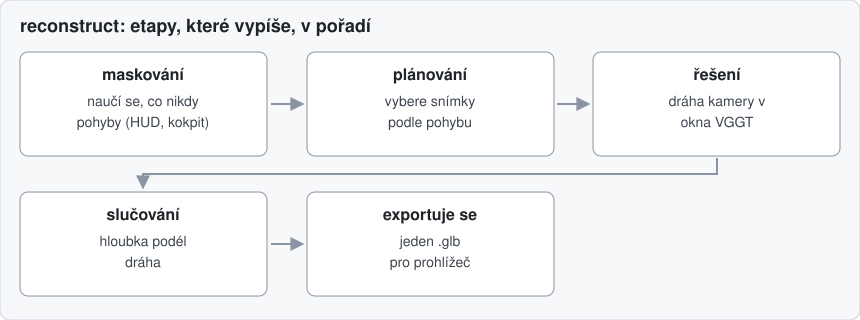

# Offline rekonstrukce {#offline-reconstruction}

```bash
python -m heat3d_capture reconstruct lap.mp4 -o lap.glb [--solve-budget 260] [--fuse-interval 0.4]
```

Kód: [`scan/offline.py`](https://github.com/Holdi601/3DHeat-GameCapture/blob/main/heat3d_capture/scan/offline.py),
[`pose/feedforward.py`](https://github.com/Holdi601/3DHeat-GameCapture/blob/main/heat3d_capture/pose/feedforward.py),
[`pose/vggt_model.py`](https://github.com/Holdi601/3DHeat-GameCapture/blob/main/heat3d_capture/pose/vggt_model.py),
[`pose/feedforward_source.py`](https://github.com/Holdi601/3DHeat-GameCapture/blob/main/heat3d_capture/pose/feedforward_source.py),
[`pose/solveprep.py`](https://github.com/Holdi601/3DHeat-GameCapture/blob/main/heat3d_capture/pose/solveprep.py).
Volby: [Přehled příkazů](commands.md#reconstruct).

## Proč druhá cesta {#why-a-second-path}

Postupné sledování je živé a levné a funguje tam, kde je struktura, za kterou se dá
chytit: interiér, ulice, mapa s krytím. **Závodní okruh je jeho nejhorší případ**:
silnice je hladká stuha s malou texturou, horizont se téměř nehýbe a jakmile se pár
poloh rozjede, nic pozdějšího je nevrátí zpět. Kolo vyjde jako křivka, která se
potuluje, místo aby se uzavřela.

Offline cesta předá **okna snímků** modelu, který předpovídá všechny jejich kamery
najednou, takže každý snímek omezuje každý jiný přímo, a ne řetězem. Potřebuje celý
záznam, než může odpovědět, takže není živá, a je pomalá: minuty na okno na
stolním GPU. Všechno po polohách - sloučení, pokrytí, barva, export - je stejný kód
jako u živého skenování: vyřešená dráha se předá rekonstruktoru jako zdroj poloh,
přesně tam, kam jde telemetrie Forzy.

## Požadavky {#requirements}

- **PyTorch** odpovídající vaší grafické kartě (projekt ho nepřipíná; nainstalujte ho
  před `requirements.txt`, viz [Běh](runtime.md)).
- **`vggt`** - kód modelu VGGT (`from vggt.models.vggt import VGGT`), z GitHub
  repozitáře Meta; není v indexu balíčků.
- **`transformers`**, protože offline cesta spouští hloubku přes PyTorch
  `DepthEstimator` (Depth Anything V2 Small), ne přes soubor ONNX.
- CUDA GPU v praxi; oba modely se vrátí na CPU, což není prakticky použitelné.

Nic z toho není v `requirements.txt`, protože skener to nepotřebuje. Jsou v
**`requirements-offline.txt`**, spolu se závislostmi samotného VGGT (`einops`,
`safetensors`, `huggingface_hub`, `Pillow`):

```bash
.venv\Scripts\python -m pip install -r requirements-offline.txt
.venv\Scripts\python -m pip install --no-deps "vggt @ git+https://github.com/facebookresearch/vggt.git"
```

VGGT se instaluje s `--no-deps`, protože jeho metadata připínají `numpy<2`, což by pip
dodržel tím, že by stáhl numpy, které tu potřebuje scipy. `reconstruct` všechny tyto
věci zkontroluje hned po vypsání řádku licence (seznam `OFFLINE` v
[`runtime/preflight.py`](https://github.com/Holdi601/3DHeat-GameCapture/blob/main/heat3d_capture/runtime/preflight.py)),
vypíše, co chybí, s velikostmi, a instaluje jen po souhlasu - VGGT s `--no-deps`, jak
je uvedeno výše. Odmítnutí, nebo žádný terminál, kde se ptát, skončí s kódem 1.

## Model a jeho licence {#the-model-and-its-licence}

**VGGT**, `facebook/VGGT-1B`: **CC-BY-NC-4.0, jen nekomerční, a rekonstrukce s ním
vytvořená to dědí.** Příkaz to vytiskne, než začne (`describe_licence`). Existuje
samostatně licencovaný `facebook/VGGT-1B-Commercial`, ale je to uzavřený repozitář,
který Meta uděluje po jednotlivých účtech, takže nemůže být výchozí. `--model
vggt-1b-commercial` řeší s ním (a místo toho vytiskne jeho řádek licence); bez
uděleného přístupu stahování selže. *Kód* `vggt` je pod vlastní „VGGT License“ Meta,
dohodou o výzkumných materiálech s zásadami přijatelného použití (čteno z
`LICENSE.txt` balíčku). Viz [Modely a licence](models-and-licences.md).

## Běh, fáze po fázi {#the-run-stage-by-stage}

Názvy fází jsou ty, které příkaz vypisuje anglicky: `masking`, `planning`, `solving`, `fusing`, `exporting`.



### maskování {#masking}

`FlowMask` se učí ze **4 běhů po 90 po sobě jdoucích snímcích**, vycentrovaných na 1/8,
3/8, 5/8 a 7/8 délky videa, při 960 x 540 ve stupních šedi (viz
[FlowMask](reconstruction-capture.md#flowmask-what-never-travels)). Jeho poznámka se
vypíše a uloží do souhrnu. Video kratší než 90 snímků masku nedostane.

#### Maska kamery se učí, neaplikuje se {#the-camera-mask-is-learned-not-applied}

Maska se **neaplikuje** na snímky předávané řešiteli. Maskování kokpitu vypadalo správně
podle statistik rysů (většina detekovaných rohů sedí na pixelech připevněných ke kameře) -
ale to je tvrzení o detektoru rysů, a řešitel je natrénovaná síť. Měřeno podle toho, jak
moc se obnovená dráha zatáčí mezi po sobě jdoucími kroky (auto se zatáčí o několik stupňů;
náhodná procházka devadesát), dávaly surové snímky nejmenší zatáčení, snímky se zvýšeným
kontrastem o něco víc, maskované snímky výrazně víc a obojí dohromady nejvíc. Řešitel tedy
dostává surové snímky. Maska se stále používá k plánování rozestupů snímků níže a
inkrementální sledovač ji používá v živém skenování. (`solveprep.enhance`, který maskuje
a zvedá lokální kontrast pomocí CLAHE, existuje, ale tento příkaz ho nepoužívá.)

### plánování: snímky rozestavěné podle pohybu {#planning-frames-spaced-by-motion}

`plan_by_motion` vybírá snímky řešitele podle **toho, jak moc se obraz pohnul**, ne podle
hodin: pevný interval dává pomalým úsekům snímky, které nepotřebují, a hladovějí rychlé,
kde po sobě jdoucí snímky přestávají být dost překrývající se, aby byly svázané.

- Cílový posun: **5 % šířky 960 pixelů** (48 px) mediánový posun rysů ORB mezi po sobě
  jdoucími vybranými snímky, měřený na snímcích 960 x 540 ve stupních šedi s kontrastem
  CLAHE, rysy jen na masce.
- Začíná se s mezerou 0,3 s; po každém kroku se další mezera stane
  `mezera x (0,5 + 0,5 x cíl / změřeno)`, omezená na **0,15-2,0 s**, aby jedno hlučné
  měření nehouplo plánem.
- Když se nic neshodlo, mezera se zmenší na 0,6 své hodnoty (příliš daleko od sebe je
  chyba, které se má předejít).
- Zastaví se na konci videa, nebo na `--solve-budget` snímcích (výchozí 260).

Méně než 4 naplánované snímky je chyba.

### řešení: okna a sešívání {#solving-windows-and-stitching}

Naplánované snímky se dekódují na 960 px šířky a řeší se v **překrývajících se oknech po
16 snímcích, 6 sdílených** s dalším (`plan_windows`; poslední okno se stáhne zpět, aby
končilo na posledním snímku, takže konec záznamu má stejně sousedů jako střed). Více než
**400** snímků v jednom běhu se odmítne.

Každé okno: snímky se zmenší tak, aby delší strana byla **518** a obě strany násobky
**14** (poměr stran zachován - stlačení by zkreslilo zorné pole), přepočítají se na
0..1 a proženou VGGT v bfloat16 autocastu (float16 dochází exponent u vzdálených
světových souřadnic). Vnější parametry kamer se převedou na rotace svět-z-kamery a středy
kamer. Mapy bodů se defaultně neuchovávají.

Každé okno se vrátí ve **svém vlastním libovolném rámci a své vlastní libovolné
velikosti**, takže okna se **sešijí** do rámce prvního z nich podobnostní transformací
(rotace, posun, jedno měřítko) přizpůsobenou kamerám, které sdílejí s tím, co už je
umístěno:

- **Rotace z orientací kamer**, ne z jejich poloh: sdílené kamery sedí podél dráhy a na
  rovince jsou téměř kolineární, což nechává fit jen podle poloh rotaci nevidět - každé
  okno se prohne a sešitý výsledek vyjde rovný. Rotace je průměr `cíl_R x zdroj_R^T`
  promítnutý zpět na skutečnou rotaci (s ochranou proti zrcadlení).
- **Měřítko a posun z poloh**, podél otočeného zdroje.
- Vyžadují se alespoň **4** sdílené kamery; méně je chyba.
- Překryv je třetina okna, aby měřítko bylo dobře určeno; chyba měřítka, která se
  hromadí okno za oknem, je to, co způsobí, že kolo spirálovitě ujíždí.

Pro každý šev se zaznamená nejhorší nesouhlas sdílených kamer po přizpůsobení, v
jednotkách průměrné vzdálenosti mezi nimi (`seam_error`).

### sloučení {#fusing}

Snímky každých `--fuse-interval` sekund (výchozí 0,4) se dekódují na 960 px, dostanou
hloubku od Depth Anything V2 Small (PyTorch) a sloučí se s pózou **interpolovanou** z
vyřešené dráhy v jejich časovém razítku (lineární poloha, sférická rotace;
`FeedForwardPoses`). Snímky mimo časový rozsah řešení se přeskočí, místo aby se
extrapolovaly. Kamera používá zorné pole **65 stupňů** horizontálně. Polohy z dopředného
řešení nesou jistotu 0,85 při sloučení a pokrytí.

### export {#exporting}

Síť se zapíše stejně jako u živého skenování ([Výstup .glb](glb-output.md)), pojmenovaná
podle videa.

## Souhrn {#the-summary}

```text
140 cameras solved over 182s
closure error 3.1% of path length
worst seam 0.42 frame spacings
<mask note>
wrote lap.glb
```

| Řádek | Význam |
|---|---|
| chyba uzavření | vzdálenost od první kamery k poslední dělená délkou dráhy. Pro jedno kolo je to poctivá míra driftu. Nad 10 %: `The lap does not close: its end is N% of the path length away from its start. Treat the shape as unreliable.` |
| nejhorší šev | největší nesouhlas při sešívání. Nad 1,0: `Windows disagreed by up to N frame spacings at a seam, so part of the path is stitched on weak evidence.` |
| žádný soubor | `Fusion produced no surface, so nothing was written.` Kód ukončení je pak 1. |

## Měřítko {#scale}

Sešitá dráha je v libovolných jednotkách prvního okna. Hloubka se kotví triangulací mezi
interpolovanými polohami (jako u telemetrie), takže geometrie je v souladu s dráhou -
ale **výsledek není v metrech**, pokud v metrech není dráha. Tento příkaz nezafixuje
globální měřítko; kalibrace země se nepoužije, když polohy přicházejí ze zdroje poloh.

## Stav této cesty {#state-of-this-path}

Při snímcích v pevném intervalu okna řešené do souvislé dráhy na některých úsecích kola
a na jiných do čmárance; selhání jsou v těsných zatáčkách, kde pohled prudce kmitá mezi
snímky, a hustší vzorkování těchto zatáček je opraví. Žádná statistika obrazu, která se
zkusila (jas, detail, počet rysů, poměr inlierů, posun), dopředu nepředpověděla, které
úseky selžou. Rozestupy proto nelze z obrazů předem plně naplánovat: musí se zvolit
řešením, změřením výsledku a přepočítáním hustěji tam, kde dráha není taková, kterou by
auto mohlo projet. Plánování podle pohybu je hotové; **adaptivní přepočet není**.
