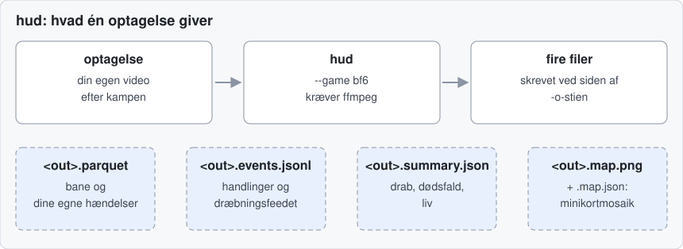

# Læsning af HUD fra en optagelse {#reading-the-hud-from-a-recording}

`hud` læser et spils skærm-HUD ud af spillerens **egen optagelse**, efter kampen: spillerens **egne**
handlinger fra point-popuppen, som spillet viser under sigtekornet (drab, assists, genoplivninger,
forsyninger, erobringer ...), deres dødsfald fra nedslags- og udsætningsskærmene, deres **egen**
bane fra minimappen og dræberlisten ved siden af som tidsstemplede hændelser - skrevet som en
3DHeat-tabel med minimappens mosaik som kortbillede, der kan lægges under den.

Kort fortalt: den ser din kampvideo og skriver dine drab, dine dødsfald og hvor du gik.

```bash
.venv\Scripts\python -m heat3d_capture hud "<recording>.mp4" --game bf6 --player <name> -o out/match
```

Battlefield 6 er den første spilprofil.



## Hvad det rører ved og ikke rører ved {#what-it-does-and-does-not-touch}

- Det læser en **videofil**: et ShadowPlay / Instant Replay-klip, en OBS-optagelse, alt ffmpeg kan
  dekode. Det rører aldrig spillet, dets hukommelse, dets filer eller dets netværk, og det kører
  efter kampen er slut. Se [Reglerne](rules.md).
- Det udleder **kun spillerens egen position**, fra spillerens egen minimap. Andre spilleres
  markører på minimappen maskeres væk og læses aldrig. Dræberlisten gemmes i sin helhed, men kun
  som det, den siger på skærmen (hvem, over hvem, med hvad, hvornår); der knyttes ingen position til
  andre end spilleren.
- OCR'en kører lokalt (RapidOCR med PaddleOCR-modellerne gennem ONNX Runtime). Ingen ramme eller
  udsnit forlader maskinen.
- En optagelse viser andre spilleres navne, og mosaikken er et billede af banen. Output er til
  spillerens eget brug; hold det lokalt.

## Krav {#requirements}

- **ffmpeg og ffprobe** på `PATH`. Et NVIDIA-kort bruges til dekodning, når der er et
  (`-hwaccel cuda`); ellers dekoder CPU'en, flere gange langsommere.
- Pakkerne i `requirements.txt`, og OCR'en uden dens egne afhængigheder (den beder om CPU-versionen
  af `onnxruntime`, som kolliderer med DirectML-versionen, projektet bruger):

```bash
.venv\Scripts\python -m pip install -r requirements.txt
.venv\Scripts\python -m pip install --no-deps rapidocr_onnxruntime==1.2.3
```

`rapidocr_onnxruntime` er tekstlæseren (OCR), der læser navne og ord af skærmen.
`--no-deps` forhindrer, at den erstatter projektets DirectML-`onnxruntime`.

For at installere ffmpeg på Windows: `winget install Gyan.FFmpeg`, åbn derefter en ny terminal og
kontrollér med `ffmpeg -version`. Ny til kommandolinjen? Læs [Før du går i gang](before-you-start.md).

- En optagelse i **16:9** i en hvilken som helst opløsning (1080p, 1440p, 4K). Andre billedformater
  afvises, fordi profilens felter ellers ville lande på de forkerte dele af skærmen.
- Spillets **standard HUD-layout**. Et flyttet eller skaleret HUD-element læses det forkerte sted.

## Valgmuligheder {#options}

| Valgmulighed | Standard | Betydning |
|---|---|---|
| `video` | | Optagelsen. |
| `-o`, `--out` | videoens navn, i den aktuelle mappe | Outputsti **uden** endelse; filerne er `<out>.parquet`, `.events.jsonl`, `.summary.json`, `.map.png`, `.map.json`. |
| `--game` | `bf6` | Hvis HUD der læses. `bf6` (Battlefield 6) er indtil videre den eneste profil. |
| `--player` | ingen | Spillerens navn, som dræberlisten viser det. Sammenlignes løst (OCR forveksler `l`/`I`/`1`, `O`/`0`, `rn`/`m`). Uden den gættes navnet (nedenfor). |
| `--fps` | 5 | Minimapsamples pr. sekund. Dræberlisten samples med halvt så mange, point-popuppen og dødsskærmene ligeledes med halvt så mange (en kvart, når ingen popup er fremme), kompasset hver 3. sekund, holdlisten hvert 15. sekund. |
| `--start` | 0 | Sekunder inde i videoen, hvor der begyndes. |
| `--seconds` | alt | Hvor meget af videoen der læses. |
| `--metres-per-pixel` | ingen | Minimapens skala, hvis den er kendt: meter pr. minimap-pixel ved det sædvanlige zoomniveau (minimappen er 296 pixels bred på en 1080p-skærm). Uden den er positioner i de pixels; se [Enheder](#north-and-units). |
| `--cpu` | fra | Dekod på CPU, også når et NVIDIA-kort er til stede. |

Der udskrives fremskridt hvert femte sekund; til sidst spilleren, drab, dødsfald, liv og de skrevne
filer.

## Output {#outputs}

### `<out>.parquet` - spillerens spor og hændelser {#parquet---the-players-track-and-events}

Én række pr. sample, hvor spilleren var i spil, og minimappen kunne placeres, plus én pr. hændelse
for dem. Fodnoten indeholder viewer'ens læsevejledning (`heat3d`-nøglen, `kind: heat3d-hud`), så
viewer'en kortlægger hver kolonne uden at spørge.

| Kolonne | Betydning |
|---|---|
| `time` | Sekunder fra videoens start. |
| `event` | `position`; `start` (videoen begyndte midt i et liv), `spawn` (tilbage i spil efter et dødsfald eller et langt ophold), `death`, `downed` og `revived` (fra dødsskærmene, nedenfor), `end` (et liv sluttede uden at noget siger hvordan); spillerens egne handlinger fra point-popuppen (`kill`, `assist`, `reviving`, `resupply`, `capture` ... - [hændelsestabellen](#event-table)); og dræberlinjerne om spilleren som `kill_feed`, `death_feed`, `teamkill_feed`, `suicide_feed`, `squadwipe_feed`. |
| `source` | Hvor rækkens hændelse kom fra: `points` (popuppen), `screen` (nedslags- og udsætningsskærmene), `feed` (dræberlisten); tom på positionsrækker. |
| `text` | På `points`-rækker: mærket som det er trykt (`KILL`, `SQUAD DAMAGE ASSIST` ...), eller titlen (`DOUBLE KILL`, et bånds navn), eller for et ukendt mærke det, der blev læst. |
| `points` | På `points`-rækker: hvor meget popuppens total steg i det øjeblik. Når flere handlinger kom i samme sample (et drab og det køretøj, det var i), er det deres sum, angivet på hver, og `shared` siger, hvor mange der delte den. Tom, når totalen ikke blev læst to gange på begge sider af øjeblikket. |
| `subject`, `subject_side` | På `points`-rækker: navnet popuppen viste sammen med handlingen - offeret ved et drab, den holdkammerat der blev genoplivet eller forsynet - og dets farve (`enemy`, `friendly`, `squad`). |
| `confirmed` | `feed`, når dræberlisten havde en linje for det samme drab eller den samme død (inden for 3 s, samme offer). |
| `x`, `y`, `z` | Position på mosaikken: `x` øst, `y` nord, `z` 0 (fodnoten siger, at `z` er op). Nord er rigtigt nord, når kompasset tillod det (se `north_up` i resuméet). |
| `player` | Altid `me`. Kun spillerens egne rækker har positioner. |
| `team` | `own`. |
| `session` | `<videonavn>#NN`, én pr. liv. Linjevarme-ruter krydser aldrig en session. |
| `heading` | Grader med uret fra nord (fra mosaikkens op, når nord er ukendt): hvor visningen pegede. |
| `dir_x`, `dir_y`, `dir_z` | Det samme som en retningsvektor, til viewer'ens kigge-retning. |
| `zoom` | Hvor langt minimappen var zoomet ud i forhold til sin sædvanlige zoom (over 1 i køretøjer). |
| `killer`, `victim`, `weapon`, `headshot`, `marker` | På drab- og dødsrækker, der har en dræberlinje: linjen (nedenfor). Et popup-drab uden dræberlinje har popupens navn som `victim`; et popup-drab vist som HEADSHOT har `headshot` sand. |

Hver hændelsesrække tager spillerens position på hændelsens tidspunkt (for et dødsfald eller et
nedslag den sidste position før det, for en genoplivning den første efter). Rækkerne passer direkte til
viewer'ens [linjevarme](https://holdi601.github.io/3DHeat/line-heat.html): dens forslag vælger `event`,
starter ved `start`, `spawn` og `revived`, slutter ved `death`, `downed` og `end`, og `position`-rækker
ligger langs ruten. De øvrige hændelser er navngivet, så forslaget ikke tager nogen af dem for en
start eller en slutning: at give en genoplivning er `reviving` (ikke `revive`), at holde et punkt
er `defense`, en holdkammerat der gyder ud ved spilleren er `teammate_arrived`, og dræberlinjerne
`kill_feed` og så videre; `kill` er ikke en slutning.

En optagelse med to runder på to kort giver to mosaikker, der ikke kan relateres til hinanden. Den
største er `<out>.parquet`; hver af de andre med mindst 30 s spor skrives ved siden af den som
`<out>.map2.parquet`, `<out>.map2.map.png` og så videre.

### `<out>.events.jsonl` - spillerens hændelser og dræberlisten {#eventsjsonl---the-players-events-and-the-kill-feed}

Ét JSON-objekt pr. linje, i tidsrækkefølge, hver med en `source`:

- `points`: én pr. handling af spillerens: `time`, `event`, `text`, `points`, `shared`,
  `subject`, `subject_side` (som i tabellen), `popup` (hvilken popup den kom fra, nummereret gennem
  kørslen), `seen` (hvor mange aflæsninger der viste den), `confirmed`, og `x`, `y` hvor spilleren var.
- `screen`: én pr. nedslag og pr. genoplivning: `event` (`death`, `downed` eller `revived`), `time` (hvornår
  spilleren gik ned; for `revived`, hvornår skærmene forsvandt), `until` (den sidste gang skærmene sås),
  `screens` (`down` og/eller `card`), `outcome` (`death`, `revived` eller `unknown`, når optagelsen
  slutter først), `killer` (fra dræberlinjen, når der er en), `x`, `y`.
- `feed`: hver linje dræberlisten viste, alles:

| Felt | Betydning |
|---|---|
| `time`, `last` | Første og sidste sample linjen blev læst i (sekunder fra videoens start). `time` er, hvornår drabet dukkede op, med en nøjagtighed på én feed-sample (0,4 s ved standardraten). |
| `kind` | Set fra spillerens side: `kill`, `death`, `teamkill`, `suicide`, `squadwipe`; for andre spilleres linjer `kill`, `squadwipe`, eller `death` for en linje uden dræber. |
| `killer`, `victim` | Navnene, som den hyppigste aflæsning på tværs af alle samples, der viste linjen (en længere aflæsning vinder, når den almindelige er dens start: et navn delvist skjult). `killer` er tom for en linje, der kun viste et ikon og et offer - en død over for verden, eller en linje, hvis dræber allerede var forsvundet. |
| `killer_side`, `victim_side` | Ud fra navnets farve: `friendly` (spillerens hold, blå), `enemy` (orange), `squad` (den blege grønne spillet bruger til spilleren og dennes trop), `neutral` (ingen af disse). |
| `weapon` | Våbenikonets klasse inden for denne kørsel: `icon01`, `icon02` ... Linjer, hvis ikoner ligner hinanden, deler klasse. Ikonerne er ikke navngivet; der findes ingen liste at navngive dem ud fra. |
| `marker` | Det lille ikon mellem våbnet og offeret: `skull`, `arrow`, `chevrons`, `crosses` eller tom. |
| `headshot` | `marker == "skull"` - en antagelse; se [Begrænsninger](#limits). |
| `seen` | Hvor mange feed-samples der viste linjen. |
| `me` | `killer`, `victim` eller null. |
| `matched` | For spillerens egne linjer: om en popup-handling eller en dødsskærm blev fundet til den. |
| `x`, `y` (, `map`) | For spillerens egne linjer: hvor de var. |

### `<out>.summary.json` {#summaryjson}

Spiller (og hvordan den blev fundet), hvor spillerens hændelser kom fra (`own_events_from`: popuppen
og skærmene, eller dræberlisten alene, når hverken popuppen eller skærmene kunne læses overhovedet),
drab, dødsfald, K/D, headshots, assists, genoplivninger givet (`revives`) og modtaget (`revived`), nedslag,
erobringer, neutraliseringer, forsyninger, heal, reparationer, ødelagte køretøjer, scoren (popupernes totaler
lagt sammen), hver handlingstype med sit antal (`actions`), antallet af popups, dødsfald kun
dræberlisten viste, dræberlistens egen optælling af drab og dødsfald og hvor mange af dens drab der
matchede et popup-drab, teamkills, selvmord, troppe-udslettelser, liv, sekunder i spil, tilbagelagt
afstand (i tabellens enheder), feed-linjer, pr. kort om det er nord op, og hvor mange kompasaflæsninger
der var enige, sporets optællinger (samples, i spil, placeret, ikke placeret, øer), de antagelser der
blev gjort, og tidsforbruget.

### `<out>.map.png` og `<out>.map.json` - kortet under sporet {#mappng-and-mapjson---the-map-under-the-track}

Mosaikken af alle kørslens minimaper, gennemsnittet, med overlejringer fjernet, drejet og skaleret
præcis som tabellen. JSON-sidefilen indeholder de to anker, viewer'ens **Kortbillede**-placering
kræver ([Kortbilleder](https://holdi601.github.io/3DHeat/map-images.html) i viewer'ens dokumentation):
indlæs PNG'en med **Kortbillede...**, behold **Vend nord/syd** slået til, og skriv anker 1 og anker 2
(`px`, `py`, `worldX`, `worldZ`) fra sidefilen. Billedet ligger så præcist under sporet.

Kun de dele af banen, spillerens minimap viste, er med i billedet.

## Metode {#method}

### Afkodning {#decoding}

ffmpeg dekoder på GPU'en, går ned til samplingraten, mens billederne stadig er på kortet, klipper
profilens områder ud (minimap, dræberliste, to kompasstrimler, holdliste, point-popuppen,
nedslagsskærmens ord, det nederste højre hjørne), skalerer hvert til en fast størrelse og stabler dem
i ét lille billede pr. sample. Kun det billede kommer over røret ind i Python. At dekode hver
eneste ramme af H.264-strømmen er bunden af køretiden.

To arbejdstråde tager samples: én registrerer minimapper (OpenCV), én læser tekst (ONNX Runtime).

### I spil eller ikke {#in-play-or-not}

Minimappens nøgle-hint-firkant (den lyse firkant med kortnøglen i, nederst til venstre på minimappen)
tegnes, når minimappen er der, og ikke på dødsskærme, kill-cam-skærme, udsætningsskærme, menuer eller
pointtavlen. Dens tilstedeværelse - en lys, farveløs firkant med et mørkt bogstav i midten, klart
lysere end det omkring den - søgt nogle pixels omkring sin plads, er testen for spil. En enkelt sample,
der er uenig med både sine naboer, ignoreres.

Et hul i spillet er et dødsfald eller en runde-skift (den næste strækning starter med `spawn`), når det
varer mindst 6 s, eller et dødsfald (fra skærmene, eller en dræberlinje der navngiver spilleren som
offer) kom inden for 40 s før det; et kortere hul uden dødsfald (det store kort blev åbnet) fortsætter
livet. Minimappen forbliver oppe, mens spilleren er nede, så en nedslået spiller er i spil.

### Sporet {#the-track}

Minimappen drejer med visningen og holder spilleren på et fast punkt (målt: midten, 49,7% nede). Hver
sample:

1. **Maskér** det, der ikke er banen: stærkt farvede eller næsten hvide pixels (objektivmarkører, trop-
   og køretøjsikoner, pings, spillezonens grænse, rutelinjer, tekst), det svage gul-grønne i visningskeglen,
   en skive omkring spillerens markør, keglens kile over den, nøgle-hintet og en tynd kant.
2. **Kendetegn**: SIFT-keypoints på det kontrastudjævnede gråtone-minimap, inden for masken.
3. **Registrer til mosaikken**, ikke til den foregående sample: keypoints matches mod de kendetegn, der
   er gemt indtil nu, i mosaik-koordinater, nær hvor spilleren sidst var; en ensartet transformation
   (drejning, zoom, forskydning) tilpasses med RANSAC. En tilpasning kræver nok inliers, en zoom inden
   for en tredjedel af den sidste og en forskydning under en tredjedel af minimappen pr. sample; en
   tilpasning, der søges hvor som helst på mosaikken (efter et dødsfald), kræver dobbelt så mange inliers.
4. **Voks mosaikken**: kendetegn mosaikken ikke har endnu, tilføjes (højst hver få tiendedele sekund
   bevægelse), og den maskerede minimap gennemsnittes ind i billedet.
5. Spillerens punkt, ført gennem tilpasningen, er deres **position**; minimappens op, ført gennem den,
   er deres **retning** på mosaikken.

Derefter fjernes et punkt, der springer mere end 10 pixels væk fra både de to samples før og de to
efter den (som er enige indbyrdes): en minimap matcher nu og da ved en forkert zoom i én sample.
Resuméet tæller dem (`dropped_as_jumps`).

Registrering til mosaikken er det, der forhindrer fejl i at lægge sig sammen: at vende tilbage til et
sted matcher de kendetegn, der blev gemt første gang. En gydning et sted, der ikke er set før, starter
en separat **ø**; hver tiende placerede sample prøves mod de andre øer, og det første gode match
forbinder dem (den mindste flyttes ind i den største, med sit spor). Øer, der aldrig blev forbundet
(et andet kort, eller jord der aldrig blev delt), skrives hver for sig som ovenfor.

### Nord og enheder {#north-and-units}

Kompasstrimlen læses hver 3. sekund: dens mærkater findes via deres blæk (lyst, farveløst, grupperet
over små huller, streger droppet), hver læses for sig, og to eller flere mærkater fastlægger både
trimlens skala og pejlingen under midtermærket - en enkelt mærkat fastlægger ingenting. Hver
kompasaflæsning parres med mosaikkens retning for samme sample; den cirkulære median af forskellene,
over aflæsningerne inden for 10 grader af den, er drejningen, der sætter mosaikken med nord op.
Den anvendes, når der er mindst tre aflæsninger, og halvdelen af alle er enige.

<a id="units"></a>Minimappens skala på jorden står ikke trykt nogen steder på skærmen, så positioner er i
**minimap-pixels ved det sædvanlige zoomniveau**: kørslens medianzoom skaleres til én tabelenhed pr.
pixel af en 296-pixels minimap (dens størrelse på en 1080p-skærm). Køretøjets zoom-ud fjernes af
registreringen, så en enhed er den samme til fods og i et køretøj. `--metres-per-pixel` ganger alt op til
meter, når skalaen er kendt (fra en kendt afstand på kortet, målt én gang).

### Dræberlisten {#the-kill-feed}

Dræberlisten læses 2,5 gange pr. sekund, men kun når dens farvede pixels er ændret mærkbart, eller
2 s er gået. Tekstlinjer findes af OCR'ens detektor; en linje, hvis billede matcher en, der blev læst i
den forrige sample (rækker ruller, så den kan være flyttet), tager den tekst i stedet for at blive læst
igen. Linjer for små til et navn, eller med et skråstreg (en fps-tæller i det hjørne), droppes.

Linjer grupperes i rækker efter højde; i en række er den venstre-mest navn dræberen og det højre-mest
offeret. Nabostykker i samme farve sammenføjes (et navn med et mellemrum). En enkelt linje, der løb
hen over ikonet fra det ene navn til det andet, skæres ved sit bredeste hul, når halvdelene er forskellige
i farve, og hver halvdel læses igen. Et enkelt navn i offer-kolonnen med et ikon lige til venstre for er
en linje uden dræber. To stykker i én farve uden et ikon imellem er ét navn, hvis dræber er forsvundet,
ikke et drab.

**Sider** kommer fra farve. Navne tegnes med en vis gennemsigtighed, så testen går på, hvor langt teksten
er fra sin egen baggrund: fortegnet for rød minus blå i den forskel er orange (fjende) eller blå
(ven) på enhver baggrund; ingen af dem, med grøn over de to andre, er trop-farven.

**Ikoner**: mellem navnene udgør pixels i dræberens farve våbnets silhuet; et lille separat ikon lige
før offeret er markøren, navngivet efter sin form (en klat med øjenhuller er en kranie; en lille trekant
en pil; flere stykker kors).

**Hændelser**: en række, der læses igen med begge navne ens (lighed 0,7 efter at have foldet de sædvanlige
OCR-forvekslinger, en af dem 0,8; en aflæsning, der er klippet kort, matcher starten af det fulde navn),
er den samme hændelse, så længe hændelsen sidst blev læst under 5 s før og er under 14 s gammel - ingen
række bliver oppe længere, så det samme par senere er et nyt drab. En række uden dræber matcher på offeret
alene. En hændelses tidspunkt er dens første sigtning; dens navne, sider og markør er flertallet på tværs af
sigtninger; rækker læst kun én gang droppes.

**Spilleren**: `--player`, ellers holdlistens fremhævede (lyseste) række, når der er mindst tre aflæsninger
og 60% af dem er enige, ellers det navn dræberlisten tegnede oftest i trop-farven. Ellers siger resuméet,
at spilleren er ukendt, og ingen dræberlinje tilskrives dem. (Popuppen og dødsskærmene er spillerens egne,
uanset deres navn; de har brug for intet navn.)

### Point-popuppen {#the-points-popup}

Alt spilleren scorer, viser Battlefield 6 i én popup lige til venstre for og under sigtekornet - på samme
sted til fods, i et køretøj og gennem et sigte:

```
            [ RIBBON ] (icon)          a title, now and then: a ribbon or a multi-kill
      (icon)(icon)(icon)  300          one icon per action; the popup's running total
                Some_Name              who it was about, for a moment: orange an enemy, blue a teammate
    [ KILL x2 ] [ VEHICLE DESTROYED ]  one boxed tag per kind of action, with a count
```

Popuppen vokser, mens spilleren fortsat scorer: et nyt drab gør `KILL` til `KILL x2`, tilføjer et
ikon og hæver totalen; en ny type handling tilføjer et mærke. Mærkerækken viser de sidste få typer
(en ældre glider ud, og tæller videre, når den kommer tilbage). Omkring tre sekunder efter den sidste
handling foldes popuppen sammen til én linje (`[KILL x2] 300`) og forsvinder. Teksten er lys grå, mærkerne
i tynde kasser, totalen i store tal fra x 760 på en 1920x1080-skærm, mærkerne højrestillede til x 750.

Den læses 2,5 gange i sekundet: OCR'ens detektor finder tekstlinjerne, kun linjer på en af popupens
rækker læses (tanksigtets egne mærkater i samme område gør det ikke), og en linje, hvis billede matcher
en, der blev læst i den forrige sample, tager den tekst. En linje, der løber fra et ikon, et navn eller et
foldet mærke ind i totalen (`Name10`, `REVIVE185`), skæres, hvor totalen begynder (x 755), og begge halvdele
læses igen. Mens ingen popup er fremme, holdes hver anden sample tilbage uden at blive læst; når den næste
viser en popup, læses den tilbageholdte først, så en popups start stadig findes til samplen.

**Mærker** matches til [hændelsestabellen](#event-table) efter at have foldet genkendelsesværktøjets
sædvanlige fejl (Q læst som O, et ciffer mellem bogstaver, I for L, et bogstav tabt i en kant): en aflæsning
er et mærke, når den er mindst 80% lig et (85% for mærker på fem bogstaver eller færre) og klart tættere på
det end på noget andet. Mærker, genkendelsesværktøjet har klumpet sammen (`CAPTUREDORDERCOMPLETED`), skilles ad
ved at skrælle kendte mærker af forrest. En optælling er `x2`, `X3`, et løst tegn og et ciffer, eller et ciffer
lige efter mærket. En lys grå, versaler-linje i mærkerækken, der ikke matcher noget, beholdes som en handling
`points` med sin tekst; en linje, der er en del af et kendt mærke i samme popup (`DESTROYED` ved siden af
`VEHICLE DESTROYED`), gør det ikke. Titler over totalen (lyse kasser, mørk tekst) er `multi_kills`
(`DOUBLE KILL` ...) eller `ribbon`. Navnet er den farvede linje mellem totalen og mærkerne; dens side
kommer fra dens farve som i dræberlisten.

**Popups og handlinger**: aflæsninger med mindre end 0,9 s tomrum imellem er én popup. En popup, der ser
ud til at slutte og kommer tilbage, før den kunne være foldet sammen (inden for 3,2 s fra sidst den voksede),
med hvert mærke på sin optælling eller mere og en total, der ikke er mindre, er den samme popup, der
midlertidigt gik tabt (sløring, en lys baggrund) - intet i den tælles to gange. I en popup er et mærkes
endelige optælling den højeste optælling læst mindst to gange; dens k-te handling tidsfæstes ved den første
aflæsning, der viser en optælling på k eller mere. En optælling læst i kun én sample er ikke en handling -
undtagen et drab, dræberlisten bekræfter (en linje af spillerens inden for 3 s, som intet andet drab tog):
det korte KILL-mærke er det, genkendelsesværktøjet oftest kun læser én gang. En titel tæller én gang pr. popup,
når den læses to gange. `points` er, hvor meget totalen - der kun tæller totaler læst to gange i træk - steg
fra før handlingens sample til efter den.

En ukendt linje tæller kun som et mærke på rækken med de kendte mærker i samme aflæsning (eller, uden et
kendt mærke, når der heller ikke er et navn), så et navn tegnet i en farve, sidetesten ikke kan se, ikke tages
for et.

### Dødsfald og genoplivninger {#deaths-and-revives}

Når spilleren går ned, siger spillet det under midten af skærmen (MAN DOWN, REQUEST REVIVE, SKIP (HOLD),
NEARBY MEDICS; når en genoplivning er bedt om, REVIVE REQUESTED, CANCEL REQUEST), og et kort nederst til
højre siger, hvem der gjorde det, med DAMAGE LOG eller PLAYER CARD under, og en linje "YOU n - n FOE" over.
Dræbt på stedet (et dødeligt headshot) viser kun kortet. Så genopliver en holdkammerat enten spilleren -
skærmene forsvinder, og spillet fortsætter - eller spilleren bløder ud eller giver op, og udsætningsskærmen
følger, med DEPLOY nederst til højre.

Disse ord læses sammen med popuppen, i samme OCR-gennemløb (popuppen, nedslagsskærmens bånd og det nederste
højre hjørne stablet i ét billede): 2,5 gange i sekundet, mens en popup er fremme, 1,25 gange ellers. Hjørnet
medtages kun, når spilleren er uden for spil eller set nede inden for de sidste 3 s; i spil viser det kun
ammunitionstallet. Sigtninger mindre end 4 s fra hinanden er ét forløb (mindst to sigtninger). Et forløb er et
**dødsfald**, når udsætningsskærmen vises inden for 12 s efter dets slutning, eller spilleren er uden for spil
3 s efter det og bliver der i 6 s eller mere; det er en **genoplivning** (`downed`, derefter `revived`), når
spilleren stadig er i spil 3 s efter at skærmene forsvandt; `unknown` (skrevet som `downed` alene), når
optagelsen slutter først. Dødsfaldets tidspunkt er, hvornår spilleren gik ned: dræberlinjen der navngiver dem
som offer, når der er en inden for 3 s før forløbet, ellers forløbets første sigtning minus en halv
aflæsningsinterval. Positioner efter et dødsfald udelades af ruten, indtil udsætningsskærmen.

Et dødsfald fra dræberlisten, som intet forløb forklarer (skærmene blev overset), er stadig et `death`, med
`source` `feed`, og bedømmes som før: hvis spilleren er i spil i over 40 s efter det, blev de genoplivet.

### Hændelsestabel {#event-table}

Hvad hvert mærke, hver titel og hver skærm bliver til. Flere mærker kan være én hændelse; `text` beholder,
hvilket.

| Hændelse | Fra | Betydning |
|---|---|---|
| `kill` | KILL; HEADSHOT | Spilleren dræbte nogen (navnet er offeret). Et headshot-drab viser HEADSHOT, hvor KILL ellers ville stå: `text` siger hvilket, og `headshot` er sand. |
| `assist` | ASSIST, KILL ASSIST, DAMAGE ASSIST, SQUAD DAMAGE ASSIST | Skade på nogen, en holdkammerat dræbte. |
| `kill_assist` | ASSIST COUNTS AS KILL | En assist spillet tæller som et drab. |
| `suppression`, `suppression_assist` | ENEMY SUPPRESSION; SUPPRESSION ASSIST | Undertrykkende ild mod en fjende; mod en en holdkammerat derefter dræbte. |
| `smoke_assist` | SMOKE ASSIST, SQUAD SMOKE ASSIST | Røg, der dækkede en holdkammerat. |
| `spot`, `spot_assist` | SPOT, SPOTTED, ENEMY DESIGNATION; SPOT ASSIST, SPOT BONUS | Spotte en fjende; et drab på en spilleren spottede. |
| `driver_assist` | DRIVER ASSIST | Et drab af spillerens køretøjs skytte. |
| `reviving`, `reviving_bonus` | REVIVE, SQUAD REVIVE; CONCEALED REVIVE | Spilleren genoplivede en holdkammerat; bonussen for at gøre det under dække. |
| `heal` | HEAL, SQUAD HEAL | Spilleren helbredte en holdkammerat. |
| `resupply` | SUPPLY, RESUPPLY, SQUAD SUPPLY | En holdkammerat tog ammunition fra spilleren. |
| `repair` | REPAIR, VEHICLE REPAIR, SQUAD REPAIR | Spilleren reparerede et køretøj. |
| `capturing`, `capture` | CAPTURING, RECAPTURING; CAPTURED, OBJECTIVE CAPTURED | Et erobringsfremskridt; målet erobret. |
| `neutralizing`, `neutralize` | NEUTRALIZING; NEUTRALIZED, OBJECTIVE NEUTRALIZED | Det samme for at bringe et fjendtligt mål ned til neutral. |
| `defense` | DEFENDING, OBJECTIVE DEFENDED | At holde et mål. |
| `offensive`, `defensive` | OFFENSIVE; DEFENSIVE | Bonussen for en handling nær et mål, der angribes; forsvaret. |
| `order` | ORDER COMPLETED | En troppeordre udført. |
| `vehicle_damage`, `vehicle_disabled`, `vehicle_destroyed`, `vehicle_destroyed_assist` | VEHICLE DAMAGE; VEHICLE DISABLED; VEHICLE DESTROYED; VEHICLE DESTROYED SUPPORT | Skade på et fjendtligt køretøj, op til at ødelægge det, eller at hjælpe med det. |
| `equipment_destroyed` | EQUIPMENT DESTROYED | Et fjendtligt udstyr ødelagt. |
| `forced_bail` | FORCED BAIL | En fjende tvunget ud af sit køretøj. |
| `squad_wipe` | SQUAD WIPE | Den sidste i en fjendtlig trop dræbt. |
| `savior`, `avenger` | SAVIOR; AVENGER | Et drab på en fjende, der skadede en holdkammerat; den, der lige havde dræbt en. |
| `teammate_arrived` | SPAWNED ON, SPAWN ASSIST, VEHICLE SPAWN, SQUAD VEHICLE SPAWN | En holdkammerat gydede ud ved spilleren eller i dennes køretøj. |
| `transport` | TEAM TRANSPORT | Transport af holdkammerater i et køretøj. |
| `fortify` | DEFENSE DEPLOYED | Et forsvar spilleren byggede. |
| `points` | alt andet i mærkerækken | En handling tabellen ikke kender: `text` er det, der blev læst. |
| `multi_kills` | DOUBLE KILL, TRIPLE KILL, QUAD KILL, MULTI KILL (titel) | Drab i hurtig rækkefølge. |
| `ribbon` | enhver anden titel | Et bånd, efter dets navn (BALLISTIC, TANK BUSTER, ENGINEER EXPERT, SPEARHEAD ...). |
| `downed` | nedslagsskærm, derefter i spil | Spilleren gik ned og blev genoplivet. |
| `revived` | skærmene forsvinder, spillet fortsætter | Spilleren blev genoplivet af en holdkammerat. |
| `death` | nedslags- eller kortskærm, derefter udsætning eller uden for spil | Spilleren døde. |

Teksterne i tabellen blev set i testoptagelserne, undtagen disse, som er spilserierens sædvanlige navne og
er med i tabellen, så de bliver navngivet i stedet for at blive gemt som `points`: HEADSHOT KILL, ASSIST, KILL
ASSIST, ASSIST COUNTS AS KILL, SPOT, SPOTTED, SPOT ASSIST, SPOT BONUS, SQUAD REVIVE, HEAL, SQUAD HEAL,
RESUPPLY, SQUAD SUPPLY, REPAIR, VEHICLE REPAIR, SQUAD REPAIR, VEHICLE DISABLED, SQUAD WIPE, AVENGER, formerne
OBJECTIVE ..., og titlerne TRIPLE KILL, QUADRUPLE KILL og MULTI KILL. Spillet på et andet sprog udskriver
andre ord: dets mærker kommer ud som `points` med det, der blev læst - ikke forvekslet med en kendt handling -
med deres totaler og navne; og da dødsskærmene kendes på deres engelske ord, kommer dødsfald så kun fra
dræberlisten alene, som `death`-rækker med `source` `feed`.

## Hvad er verificeret {#what-is-verified}

Kontrolleret med øjnene mod testoptagelser (spillerens egne, ikke en del af lageret) ved at tegne samples
tilfældigt og sammenligne hver med rammerne omkring den:

- **Spillerens egne hændelser.** Hver popup-handling, der blev samplet, var en ægte handling af den slags, fundet
  inden for én aflæsning (0,4 s) af sit tidspunkt; de fleste værdier og navne var rigtige (navne på nogle skrifter,
  såsom kyrillisk, kan komme ud forvrænget). Hvert dødsskærmbillede, der blev samplet, blev fundet.
- **Dræberlisten.** Det store flertal af dræberlinjerne blev fundet med begge navne rigtige; små OCR-fejl (et
  stort I læst som et lille l) er tilladt. Navne tegnet i tegn, spillet selv viser som firkanter, kan overses.
  Sider (farver) er forkerte for et par procent af navnene.
- **I spil.** Nøgle-hint-testen var enig med rammen på hvert samplet tidspunkt.
- **Spor.** Der er ingen grundsandhed for, hvor spilleren var, så sporet kontrolleres mod selve optagelsen: to
  minimapper registreres **direkte til hinanden**, og den forskydning sammenlignes med forskydningen mellem de to
  tabelpositioner. Medianafvigelsen er omkring 1-3 minimap-pixels (under 1% af minimappens bredde), mere på en
  overfyldt, udzoomet minimap. Kompasaflæsningerne er næsten altid inden for 10 grader af mosaikken.
- **Køretid.** Afkodning med omkring fem gange realtid er det meste af den, på et desktop-GPU; at læse point-popuppen
  lægger omkring en femtedel til en halv.

Set med øjnene: hver mosaik har sammenhængende veje og bygninger på tværs af de liv, der byggede den, og ruter fra
forskellige liv langs den samme vej ligger oven på hinanden. En strækning, hvor minimappens zoom ændrer sig, kan
komme ud for lang - se [Begrænsninger](#limits).

Testene (`tests/test_hud_*.py`) tegner alt, de læser: en opdigtet bane af veje, bygninger og højdekurver, minimapper
af gåture gennem den med de overlejringer, en rigtig har, kompastrimler, dræberlinjer med opdigtede navne. De
kontrollerer, at en løkke spores inden for to pixels og lukker sig, at en stående spiller bliver stående, mens
visningen drejer, at zoomændringer følges, at en gydning et andet sted forbindes tilbage, når stierne mødes, at
nord-drejningen og y-vendingen placerer sporet, hvor det virkelig gik, at kortbilledets ankre flugter det under
sporet, og at dræberlistens parsing, sider, markører og fjernelse af dubletter er rigtige. For spillerens egne
hændelser tegner de point-popuppe med opdigtede navne og mærker og kontrollerer mærketabellen og dens tolerance
over for genkendelsesværktøjets fejl, mærker klumpet sammen, popupens rækker, totalen skåret fra et navn,
optællingen mens en popup vokser, at den fortsætter efter et øjeblik uden læsning, at den skubber et mærke ud og
ind igen, eller slutter; at en optælling læst én gang holdes adskilt; dødsfald, genoplivninger og udfald fra
skærmenes ord; og på et opdigtet match, at handlingerne, dødsfaldene og genoplivningerne lander i tabellen,
hvor spilleren var, at dræberlinjerne ved siden af dem står under deres egne navne, og at ruten ender ved
dødsfaldet og ikke ved genoplivningen.

## Begrænsninger {#limits}

- **Enhederne er minimap-pixels**, ikke meter, medmindre `--metres-per-pixel` er angivet. Intet på spillets
  skærm angiver minimappens skala på jorden.
- **Kun det minimappen viste, kortlægges.** Mosaikken dækker jorden inden for en halv minimap af, hvor spilleren
  gik; to mosaikker, der aldrig delte jord (to runder på to kort, eller to liv i langt fra hinanden liggende hjørner
  af et stort kort), forbliver adskilte filer med ikke-relaterede koordinater.
- **Sporet er minimappens, ved 5 samples i sekundet**, udjævnet af intet. En minimap zoomet langt ud (en helikopter
  i testoptagelserne zoomede den ud til 2,3 gange) viser mindre detalje pr. pixel, og uden for spillezonen viser den
  næsten ingen, så registreringen der er grovere. Jetfly, og spilleren som passager, var ikke med i testoptagelserne.
- **Registreringsfejl er lokale og lægger sig ikke sammen**, men en mosaik bygget, mens der udforskes nyt terræn, kan
  bære en lille bøjning, som først rettes, når jorden ses igen. Hvor minimappens zoom ændrer sig kontinuerligt (et
  køretøj, der accelererer), kan den tilpassede zoom drive, og én sådan strækning blev set med en afstand omkring
  dobbelt så stor som den sande. En mosaik bygget af et overfyldt, udzoomet minimap for infanteri er den mindst
  præcise (fejl omkring 3 pixels typisk, op til 18).
- **Ingen optimering af posegrafen.** En løkke lukkes ved at matche gemte kendetegn, ikke ved at sprede korrektionen
  ud over løkken.
- **Våbenklasser virker endnu ikke.** Ikonets silhuet tages fra et gennemsigtigt ikon over en bevægelig baggrund, og
  den varierer for meget fra sample til sample: testoptagelserne kom ud med 220 til 340 klasser for 550 til 670 linjer,
  hvor et match har nogle snese våben. Behandl `weapon` som eksperimentel. Klasser er under alle omstændigheder pr.
  kørsel, og de er ikke navne.
- **Markørernes betydninger er ikke alle kendt.** Pilen (`▸`) tegnes foran spillerens eget navn, i linjer om dem; den er
  ikke en slags drab. Kraniet tages til at betyde et headshot; det er en antagelse, ikke noget spillet siger. `chevrons` og
  `crosses` (troppe-udslettelser) rapporteres som set.
- **Navne i andre skrifter end latinsk** (kyrillisk, for eksempel) kommer ud som de nærmeste latinske lignende bogstaver:
  genkendelsesværktøjet læser latinsk og kinesisk. Den samme spiller læses ens hver gang, så de stadig matcher, men teksten er
  ikke deres navn.
- **Overlejringer i dræberlistens hjørne** (en fps-tæller) kan skjule enden af den øverste række's offer. Tællertekst
  genkendes og droppes, og et navn klippet kort matches til sine fulde aflæsninger, men et navn, der kun nogensinde er set
  klippet kort, bliver ved med at være klippet kort.
- **Et dødsfald, hverken skærmene eller dræberlisten viste**, afslutter stadig ruten som `end`, når spilleren forlader spillet
  i 6 s eller mere.
- **Genoplivninger modtaget** kommer fra nedslagsskærmene. Kun for et dræberlistedødsfald, skærmene missede, udledes de
  stadig (i spil i over 40 s efter det), og en hurtig genoplivning kan så ikke skelnes.
- **Popup-handlinger tidsfæstes til en aflæsning**: inden for 0,4 s af mærket først vises; et mærke, der animeres ind, kan
  læses en sample for sent eller for tidligt.
- **Navne på popup-rækker** læses som dræberlistens: scripts andet end latinsk kommer ud forvrænget, og nu og da læses et
  holdkammerats navneskilt, der svæver i verden nær popuppen, som handlingens navn. Handlinger uden navn (et erobringsfremskridt,
  en ordre) bærer ingen.
- **`points`** mangler, hvor totalen ikke blev læst to gange på begge sider af en handling, og deles mellem handlinger, der
  kom i samme sample. Resuméets `score` lægger popupernes endelige totaler sammen, så en popup, hvis total aldrig blev læst to
  gange, er ikke med i den.
- **Mærkerækken er et vindue**: med fire eller flere typer i én popup glider det ældste mærke til venstre, forbi kanten af det
  område, der læses. Det blev talt, mens det var i syne; en optælling det får, mens det er halvt uden for skærmen, kan blive
  overset.
- **En popup tabt i længere tid, end den kunne have varet** (over omkring 4 s af ulæselige samples, mens den stadig voksede),
  tages for to, og et mærke med en optælling over én tælles så igen. Set ikke i kontrollerne nedenfor.
- **Andre UI-sprog**: mærker kommer ud som `points` med deres tekst, og dødsfald kommer fra dræberlisten alene (dødsskærmene
  matches på deres engelske ord).
- **Hændelser på en kort ø**: et liv, hvis spor var for kort til at skrives som et kort (under 30 s), beholder sine hændelser i
  `.events.jsonl` uden `x`, `y`, og ikke i nogen tabel.
- **HUD-layoutet er BF6's standard ved 16:9.** En ændret HUD-skala, en farveblind-palet eller en anden minimap-størrelse ville
  kræve en profil for sig selv.
