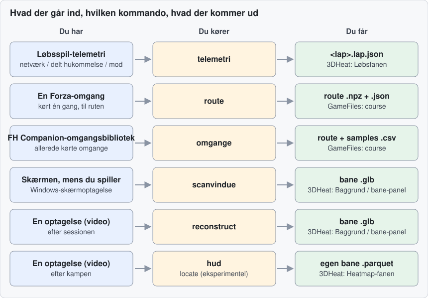

# 3DHeat GameCapture {#dheat-gamecapture}

**Hvad er det?** Et værktøj, der skriver ned, hvad et løbsspil fortæller det om din kørsel, én fil
pr. omgang. Det kan også genskabe en grov 3D-model af en bane ud fra en video af dig, der spiller.

**Hvorfor skulle jeg bruge det?** For at se dine omgange i [3DHeat-fremviseren](https://holdi601.github.io/3DHeat/):
hvor du bremsede, hvor du var langsom, og hvordan to omgange adskiller sig. Og for at have banen under dit
varmekort, når ingen har en 3D-model af den.

**Eksempel:** slå Forzas Data Out til, kør ét kommando, og kør to omgange. To omgangsfiler dukker op i
`laps\`. Læg dem på fremviserens Løbsfane.


Ny til kommandolinjen? Læs [Før du går i gang](before-you-start.md) først.

## De tre opgaver {#the-three-jobs}

1. **Omgangstelemetri.** Det optager hver kanal, et løbsspil udgiver - Forzas Data Out, Assetto Corsa-
   spillenes delte hukommelse, rally-spillenes netværksfeeds, en BeamNG-mod, et Trackmania-plugin - og skriver
   én `heat3d-lap`-fil pr. omgang eller etape til fremviserens Løbsfane. iRacing kræver ingen optager: fremviseren læser
   sine egne `.ibt`-filer.
2. **Baner fra spil.** Det gør det, skærmen viste, mens du gik eller kørte gennem en
   bane, til en 3D-model i `.glb`, som fremviseren lægger under varmekortet.
3. **Din egen kamp, bagefter.** `hud` læser HUD'et i din egen optagelse - dine handlinger, dødsfald,
   minikortets spor og dræbningsfeed. `locate` (eksperimentelt: den placerer endnu få rigtige billeder)
   finder ud af, hvor hvert billede er taget, på en banes 3D-model.

Alle tre følger én regel: **intet indsprøjtes i et spil, og intet hookes**. Billederne kommer fra det
offentlige API til skærmoptagelse, telemetrien fra grænseflader, spillene udgiver til det. Se
[Reglerne](../rules.md).



Koden er Python (pakken `heat3d_capture`), MIT-licenseret. De dybde- og positionsmodeller, den kan
køre, har deres egne licenser - se [Modeller og licenser](../models-and-licences.md).

## Hurtig start {#quick-start}

### Optag omgange {#record-laps}

Du har brug for Python 3.10 eller nyere ([Før du går i gang](before-you-start.md)). I PowerShell:

```powershell
git clone https://github.com/Holdi601/3DHeat-GameCapture
cd 3DHeat-GameCapture
python -m venv .venv
.venv\Scripts\python -m pip install -r requirements.txt

# Forza: Settings -> HUD and Gameplay -> Data Out = ON, IP 127.0.0.1, port 5300
.venv\Scripts\python -m heat3d_capture telemetry -o laps
```

**Du bør se** `listening on port 5300. Laps go to laps. Ctrl+C to stop.`, derefter en linje pr. omgang, når du
krydser målstregen, som på billedet ovenfor. Tryk Ctrl+C for at stoppe. Læg filerne fra `laps\` på fremviserens
Løbsfane. Alle andre spil er ét `--game` væk:

```powershell
.venv\Scripts\python -m heat3d_capture telemetry --game acc -o laps
.venv\Scripts\python -m heat3d_capture telemetry --game dirtrally2 -o laps
```

Se [Telemetrioptagere](../telemetry.md) for hvert spil og hver valgmulighed.

### Scan en bane {#scan-a-level}

Dobbeltklik på **`scan.bat`** i værktøjets mappe. Den finder Python (og tilbyder at installere det med
winget, hvis der ikke er nogen), laver en privat `.venv` og åbner scanvinduet. Vinduet siger, hvad der mangler,
hvad hver pakke bruges til, og hvor stor downloaden er, og det installerer intet uden et ja. Se
[Kørsel og afhængigheder](../runtime.md) og [Scanvinduet](../reconstruction-scan-ui.md).

I hånden: `.venv\Scripts\python -m heat3d_capture.ui`.

For at genskabe en optagelse offline, med kameraets bane løst på én gang (kræver PyTorch, pakken `vggt`
og en GPU - se [Offline-rekonstruktion](../reconstruction-offline.md)):

```powershell
.venv\Scripts\python -m heat3d_capture reconstruct lap.mp4 -o lap.glb
```

## Dokumentationens kort {#map-of-the-documentation}

| Side | Hvad den dækker |
|---|---|
| [Før du går i gang](before-you-start.md) | Python, en terminal, den første kommando, almindelige fejl |
| [Reglerne](../rules.md) | Ingen indsprøjtning, kun offentliggjorte grænseflader, og hvad det koster |
| [Telemetrioptagere](../telemetry.md) | Kommandoen `telemetry` og en oversigt over hvert spil |
| [Forza](../telemetry-forza.md) | Data Out, layoutgenkendelse, FH Companion-relæet og dets `.tele.gz` |
| [Assetto Corsa-spil](../telemetry-assetto-corsa.md) | AC, ACC, AC EVO, AC Rally fra delt hukommelse |
| [Rally-spil](../telemetry-rally.md) | EA SPORTS WRC, DiRT Rally 2.0 / 1 / DiRT 4, Richard Burns Rally |
| [BeamNG.drive](../telemetry-beamng.md) | `heat3d`-protokolmodden |
| [Trackmania](../telemetry-trackmania.md) | `Heat3dRecorder`-pluginnet til Openplanet |
| [iRacing](../telemetry-iracing.md) | Læsning af `.ibt`-filer i fremviseren |
| [Opdeling i omgange og etaper](../lap-splitting.md) | `LapSplitter`, `CounterSplitter`, `LineSplitter`, `StageSplitter` |
| [Slip, drift og afledte kanaler](../slip-and-drift.md) | Hvordan slip skaleres, og hvad fremviseren udleder |
| [Filen heat3d-lap](../lap-format.md) | Omgangsfilens format, kanaler, enheder, `meta` |
| [Spil](../games.md) | Pr. spil: hvordan man optager, hvad der sendes, hvilke baner der kan eksporteres |
| [Kommandoer](../commands.md) | `route`, `telemetry`, `laps`, `reconstruct`, `hud`, `locate`, trin for trin |
| [Kommandoreference](../cli-reference.md) | hver valgmulighed, genereret ud fra `--help` |
| [Læs HUD'et fra en optagelse](../hud-video.md) | `hud`: egne handlinger, dødsfald, minikortets spor og dræbningsfeed fra en optagelse |
| [Find billeder i en bane](../locate.md) | `locate`: hvor hvert billede er taget, mod banens geometri |
| [Banerekonstruktion](../reconstruction.md) | Forløbet fra billeder til en `.glb` |
| [Scanvinduet](../reconstruction-scan-ui.md) | Hver kontrol, genvej og overlay-element |
| [Optagelse, masker og billedkvalitet](../reconstruction-capture.md) | Windows Graphics Capture, nøglebilleder, HUD-masker, kvalitetsråd |
| [Dybde](../reconstruction-depth.md) | Depth Anything V2, ONNX Runtime, opbygning af modellen |
| [Kameraposition og skala](../reconstruction-pose.md) | Odometri, relokalisering, telemetripositioner, jordskala, bundle adjustment |
| [Sammensmeltning, dækning og farve](../reconstruction-fusion-and-texture.md) | Belægningsvolumen, dækningsgitteret, svage steder, vertexfarve |
| [.glb-outputtet](../glb-output.md) | Filen, fremviseren indlæser |
| [Offline-rekonstruktion](../reconstruction-offline.md) | `reconstruct`, VGGT-vinduer og sammensyning |
| [Modeller og licenser](../models-and-licences.md) | Størrelser af Depth Anything V2, VGGT, pakkerne |
| [Kørsel og afhængigheder](../runtime.md) | Preflight, backends, ydelsesniveauer |
| [Begrænsninger og verificering](../limits.md) | Hvad der ikke er gjort, og hvad der ikke er kontrolleret |
| [Opdateringer](../updates.md) | Udgivelsestjekket og `python -m heat3d_update` |
| [Udvikling](../development.md) | Tests, det virtuelle miljø, repositoriets layout |
| [Vedligeholdelse af disse dokumenter](../maintaining.md) | Udgivelsestjeklisten for kode og dokumentation |

## Del af 3DHeat {#part-of-3dheat}

Filerne, dette skriver, indlæses af **3DHeat-fremviseren** -
[kilde](https://github.com/Holdi601/3DHeat), [dokumentation](https://holdi601.github.io/3DHeat/).
Omgangsfiler går til dens Løbsfane, `.glb`-baner til dens Baggrund / bane-panel, og `hud`- og `locate`-tabellerne til
dens Heatmap-fane; hvordan fremviseren læser tabeller og kampfiler, står i
[Én fil pr. kamp (.3dheat)](https://holdi601.github.io/3DHeat/container.html) og
[Hent data ind](https://holdi601.github.io/3DHeat/getting-data-in.html).

| Værktøj | Hvad det gør | Dokumentation |
|---|---|---|
| [3DHeat-fremviser](https://github.com/Holdi601/3DHeat) | viser varmekort, løb og kampe i 3D, i browseren | [dokumentation](https://holdi601.github.io/3DHeat/) |
| [GameFiles](https://github.com/Holdi601/3DHeat-GameFiles) | baner og kort ud af de filer, spil leverer, som 3D-modeller | [dokumentation](https://holdi601.github.io/3DHeat-GameFiles/) |
| [GameCapture](https://github.com/Holdi601/3DHeat-GameCapture) | omgangstelemetri fra løbsspil; baner genskabt ud fra spilvideo | [dokumentation](https://holdi601.github.io/3DHeat-GameCapture/) |
| [Unreal Exporter](https://github.com/Holdi601/3DHeat-UnrealExporter) | et Unreal Editor-plugin, der eksporterer en bane som en 3D-model | [dokumentation](https://holdi601.github.io/3DHeat-UnrealExporter/) |
| [CS2](https://github.com/Holdi601/3DHeat-CS2) | Counter-Strike 2-demoer til kampfiler; kort til 3D-modeller | [dokumentation](https://holdi601.github.io/3DHeat-CS2/) |
| [Watcher](https://github.com/Holdi601/3DHeat-Watcher) | optager dit spil i baggrunden ud fra det, spil udgiver | [dokumentation](https://holdi601.github.io/3DHeat-Watcher/) |
| [Ext-WarThunder](https://github.com/Holdi601/3DHeat-Ext-WarThunder) | War Thunder-replays til kampfiler | [dokumentation](https://holdi601.github.io/3DHeat-Ext-WarThunder/) |
| [Ext-WoT](https://github.com/Holdi601/3DHeat-Ext-WoT) | World of Tanks-replays til kampfiler | [dokumentation](https://holdi601.github.io/3DHeat-Ext-WoT/) |
| [Ext-WoWs](https://github.com/Holdi601/3DHeat-Ext-WoWs) | World of Warships-replays til kampfiler | [dokumentation](https://holdi601.github.io/3DHeat-Ext-WoWs/) |
| [Ext-Squad](https://github.com/Holdi601/3DHeat-Ext-Squad) | Squad-serverdemoer til kampfiler | [dokumentation](https://holdi601.github.io/3DHeat-Ext-Squad/) |
| [Ext-DCS](https://github.com/Holdi601/3DHeat-Ext-DCS) | DCS World-kort til 3D-modeller | [dokumentation](https://holdi601.github.io/3DHeat-Ext-DCS/) |
| [Ext-IL2](https://github.com/Holdi601/3DHeat-Ext-IL2) | IL-2 Sturmovik-kort til 3D-modeller | [dokumentation](https://holdi601.github.io/3DHeat-Ext-IL2/) |

En udvikler, der har spillets projekt åbent, bør bruge Unreal-eksportøren, som læser den rigtige
geometri og er nøjagtig. Hvor et spils egne arkiver kan læses, udtrækker GameFiles den nøjagtige
bane. Rekonstruktion fra spil er til tilfældet, hvor kun skærmen er tilgængelig.
