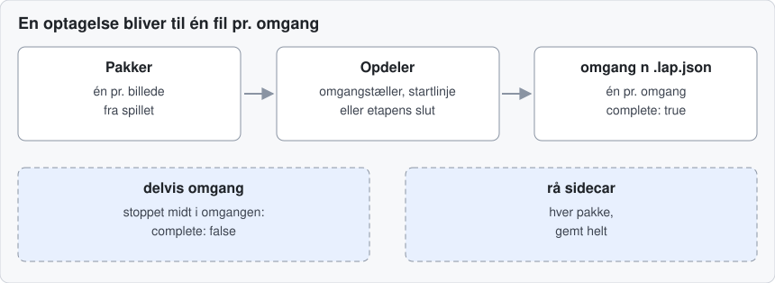

# Sådan opdeles omgange og etaper {#how-laps-and-stages-are-split}

En optager ser én sammenhængende strøm af prøver. Den gøres til omgange af en af fire opdelere, valgt efter hvad spillet siger om omgange. Alle følger den samme idé: brug spillets egen optælling, hvor der er en, og find ellers omgangen ud fra positionerne; skriv aldrig et fragment, der er for kort til at sammenligne.

| Opdeler | Kode | Bruges af |
|---|---|---|
| `LapSplitter` | [`fulllap.py`](https://github.com/Holdi601/3DHeat-GameCapture/blob/main/heat3d_capture/telemetry/fulllap.py) | Forza |
| `CounterSplitter` | [`kunos.py`](https://github.com/Holdi601/3DHeat-GameCapture/blob/main/heat3d_capture/telemetry/kunos.py) | Assetto Corsa, ACC |
| `LineSplitter` | [`kunos.py`](https://github.com/Holdi601/3DHeat-GameCapture/blob/main/heat3d_capture/telemetry/kunos.py) | AC EVO, AC Rally, BeamNG |
| `StageSplitter` | [`rally.py`](https://github.com/Holdi601/3DHeat-GameCapture/blob/main/heat3d_capture/telemetry/rally.py) | EA SPORTS WRC, DiRT Rally 2.0, DiRT Rally, DiRT 4, Richard Burns Rally |

Trackmania deler kørsler inde i sit plugin ([Trackmania](telemetry-trackmania.md)), og iRacing-filer deles af viewer'en ud fra simulatorens omgangstæller ([iRacing](telemetry-iracing.md)).

Ved **Ctrl+C** kalder hver optager sin opdelers `flush()`, så en åben omgang eller etape skrives, hvis den lever op til de samme minimumskrav som nedenfor.

## LapSplitter (Forza) {#lapsplitter-forza}

Parametre: `minimum_metres = 400`, `gap_seconds = 2.0`.

For hver afkodet pakke:

1. Hvis spillets `timestampMs` har hoppet frem med mere end 2 sekunder siden den sidste pakke, eller er gået baglæns, tømmes den åbne omgang først.
2. Hvis `isRaceOn` er 0 (spillet er ikke i et løb), tømmes den åbne omgang, og pakken kasseres.
3. Hvis ingen omgang er åben, åbnes en med pakkens `lapNumber`.
4. Hvis `lapNumber` er forskellig fra den åbne omgangs, **lukkes den åbne omgang som afsluttet**; dens `seconds` er spillets `lastLap`, når den er positiv. En omgang lukket sådan skrives, uanset længde. En ny omgang åbnes.
5. Pakken tilføjes.

Optageren tømmer også, når der ikke er kommet en pakke i 2 sekunders virkelig tid (spillet er sat på pause, eller lukket midt i en omgang).

**Tømning** beholder den åbne omgang kun, hvis den har mindst 2 prøver og mindst 400 m `distanceTravelled`; den skrives som ufuldstændig (en `run`). Et point-to-point-løb tæller aldrig en anden omgang, så det ender altid sådan.

## CounterSplitter (AC, ACC) {#countersplitter-ac-acc}

Parameter: `minimum_metres = 300`. Får hver prøve med grafiksidens `completedLaps` og sidste omgangstid.

- Den første prøve åbner en omgang, nummereret med det aktuelle `completedLaps`.
- Når `completedLaps` ændrer sig, lukkes den åbne omgang. Den er **afsluttet**, med `seconds = sidste omgangs ms / 1000` (hvis positiv), men kun hvis tælleren steg med præcis 1 - et hop tilbage til 0 (en genstart af sessionen) eller med flere lukker den som ufuldstændig.
- En lukket omgang skrives kun, hvis den har prøver og mindst 300 m kørt sti.
- Tømning beholder den åbne omgang, hvis den har mere end én prøve og mindst 300 m.

## LineSplitter (AC EVO, AC Rally, BeamNG) {#linesplitter-ac-evo-ac-rally-beamng}

Parametre: `radius = 15 m`, `minimum_metres = 300`, `stop_seconds = 8`.

Disse spil har enten ingen omgangstæller på en side, optageren læser, eller de kører etaper. **Linjen er det sted, hvor optagelsen begyndte**:

1. Den første prøves vandrette position (`x`, `z`) bliver linjen.
2. Når bilen har kørt mere end 5 m, bliver retningen fra linjen til bilen omgangens retning.
3. **Stop afslutter en kørsel**: når `speed` bliver under 1 m/s i 8 sekunder, tømmes den åbne omgang (sådan ender en rallyetape: bilen stopper ved målet).
4. **Passage af linjen**: efter mere end 300 m kørt samles prøver inden for 15 m fra linjen. Når bilen forlader radius igen, er den nærmeste samlede prøve passagen. Kørte bilen den samme vej som omgangens retning dér (prikproduktet af den lokale retning og retningen er positivt), lukkes omgangen ved den prøve; ellers ignoreres passagen (bilen krydsede startlinjen den modsatte vej).
5. En lukket omgangs `seconds` er tiden fra dens første prøve til passagen. Den er **kun afsluttet, hvis dens første prøve var hurtigere end 5 m/s**: en omgang, der begyndte fra stilstand, er en start, ikke en omgang at sammenligne. Første omgang i en optagelse, der startede på startgitteret, er derfor altid ufuldstændig; en optagelse, der startede på en flyvende omgang, giver en afsluttet første omgang ved næste passage.
6. Næste omgang starter ved passageprøven (den hører til begge omgange).

Omgange kortere end 300 m kasseres. Tømning (et stop eller Ctrl+C) beholder den åbne omgang, hvis den har mindst 2 prøver og 300 m, som ufuldstændig. BeamNG tømmer på samme måde, når køretøjet nulstilles (dets ur går tilbage), før en ny opdeler startes, så kørslen før nulstillingen beholdes.

Afstande er vandrette (`x`, `z`) for kørselstælleren og linjetesten, og fuld 3D for længdetesten på 300 m.

## StageSplitter (rallyspil) {#stagesplitter-rally-games}

Parameter: `minimum_metres = 300`. Får hver prøve med spillets etapeur, om spillet siger, at bilen er færdig, og eventuelt spillets egen tid for den.

1. Er uret 0 eller derunder, eller er det gået tilbage med mere end 0,5 s, **opgives den åbne etape**: den beholdes som en delvis etape, hvis den ikke er afsluttet, har mere end 10 prøver og mindst 300 m. Et ur på 0 eller derunder kasserer også prøven (bilen er ved start).
2. Hvis ingen etape er åben, åbnes en ny (nummereret 1, 2, ... for optagelsen).
3. Når en etape er afsluttet, ignoreres yderligere prøver, til uret går tilbage.
4. Hver prøve gemmes med `time` sat til etapeuret.
5. Når spillet siger, at den er færdig, er etapen afsluttet; dens `seconds` er spillets tid, når den er givet og positiv, ellers uret. Den skrives, hvis den dækkede mindst 300 m.

Hvad "færdig" betyder for hvert spil:

| Spil | Færdig, når |
|---|---|
| EA SPORTS WRC | etapelængde > 0 og etapedistance >= længde - 0,5 m |
| DiRT-spillene | antal gennemførte omgange steg over etapens startantal, eller (begivenhed med én omgang) omgangsdistance >= 99,9 % af banens længde |
| Richard Burns Rally | løbsur > 0 og afstand til enden <= 0 |

For RBR fastlægges opadretningen og hastigheden, når en etape skrives (se [Rallyspil](telemetry-rally.md#richard-burns-rally-rsf--ngp)).

## Tid og afstand i omgangsfilen {#time-and-distance-in-the-lap-file}

For alle optagere undtagen Forza bliver `time` omregnet, så den første prøve i omgangen er 0, og `distance` er den akkumulerede 3D-afstand mellem på hinanden følgende positioner. Forza bruger spillets eget omgangsur og afstandstæller, omregnet på samme måde.
