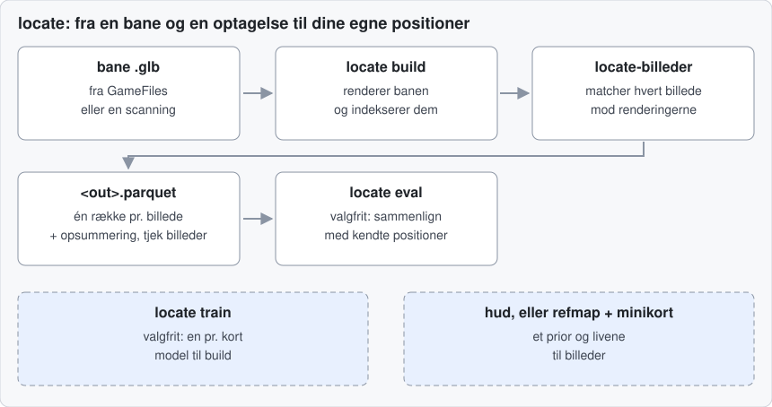

# Find billedrammer i en bane {#locating-frames-in-a-level}

`locate` finder ud af, hvor hver billedramme i en kampoptagelse blev taget - kameraets 3D-position og
synsretning - ved at matche billedet mod gengivelser af banens egen geometri. Det er til spil, der ikke
gemmer noget om, hvor spilleren var: ingen demo, ingen replay-fil, ingen telemetri. Battlefield 6 er det første.

> **Eksperimentelt.** På rigtige optagelser placerer det indtil videre kun en lille andel af rammerne; se
> [Rigtige rammer: eksperimentelt](#real-frames-experimental).

```bash
# Once per level: render it from every place a player can stand, and index the renders.
.venv\Scripts\python -m heat3d_capture locate build level.glb -o level.db

# Per recording: where was each frame taken?
.venv\Scripts\python -m heat3d_capture locate frames "<recording>.mp4" --db level.db -o out/match
```

Positionen kommer **fra billedet**, mod hele banen, uden forhåndsviden. Minimapsporet fra
[HUD-læseren](hud-video.md) er kun en reserve for rammer, billedet ikke kan placere, og hver række
siger, hvilken af de to den kom fra.




## Hvad det rører ved og ikke rører ved {#what-it-does-and-does-not-touch}

- Det læser spillerens **egen optagelse** og en banefil, spilleren har eksporteret fra sin **egen kopi** af spillet.
  Det rører aldrig spillet, dets hukommelse, dets filer, mens det kører, eller dets netværk, og det kører efter kampen.
  Se [Reglerne](rules.md).
- Det placerer **kun spillerens eget kamera**: rammen er spillerens egen visning.
- Banen, databasen bygget af den, og alt gengivet fra den tilhører spillets udgiver. Hold det lokalt.

## Krav {#requirements}

- Det `requirements.txt` lister, PyTorch (fra pytorch.org, til GPU'en), og `requirements-locate.txt`:

```bash
.venv\Scripts\python -m pip install -r requirements-locate.txt
```

- En GPU med OpenGL 3.3 (4.3 er hurtigere) til gengivelserne, og helst CUDA til modellerne. På en CPU virker
  det, langsomt.
- Modellerne hentes ved første brug (omkring 450 MB): DINOv2 fra Hugging Face, ALIKED og LightGlue gennem kornia.
  Alle er licenseret til kommerciel brug; se [Licenser](#licences).
- **Banen** som en `.glb` (eller `.gltf`) i viewer'ens koordinatsystem, Y op, **med sine grundfarvetekstruer**, som
  3DHeat-eksportørerne skriver den (dele `ground:` / `structure:`; delnavnene er ikke nødvendige). En enhed er en meter,
  medmindre filens øverste `extras.unit_metres` siger andet. En GameCapture-scanning (`reconstruct`, scanvinduet) skrives i
  **centimeter** og bærer `extras.unit_metres: 0.01`, så den læses i sin rigtige størrelse. En bane uden teksturer virker
  meget dårligere; se [Begrænsninger](#limits).

## Kommandoer {#commands}

### `locate build <level> -o <db>` {#locate-build---o-}

Gengiver banen fra hvert sted, en spiller kunne stå, og gemmer for hver gengivelse dens pose og ét globalt
deskriptor.

| Valgmulighed | Standard | Betydning |
|---|---|---|
| `level` | | Banens `.glb` / `.gltf`. |
| `-o`, `--out` | | Databasemappen der skrives. |
| `--game` | `bf6` | Spilprofilen: øjenhøjder, synsfelt, HUD-felter, hastighed (nedenfor). `generic` for ethvert førstepersonsspil. |
| `--eye` | profilens | Øjenhøjder over gulvet i meter, stående først. Én databasevisning pr. højde. |
| `--fov` / `--vfov` | profilens | Optagelsens vandrette synsfelt, eller det lodrette (Battlefields skyder) for en 16:9-optagelse. |
| `--spacing` | 2,5 | Meter mellem de steder, visninger tages fra. |
| `--yaw-step` | 30 | Grader mellem visningernes retninger. |
| `--pitch` | 0 | Hældninger at gengive ved, grader op. |
| `--positions` | ingen | En tabel (Parquet eller CSV med `x`, `y`, `z` ved fødderne, i banens koordinatsystem) at tage steder fra i stedet for hvert gulv: fx en tidligere kørsels output. |
| `--shadows` | fra | Kast solens skygger i gengivelserne (banens egen sol, når dens fil angiver en i `extras.sun`). |
| `--untextured` | fra | Gengiv kun form og lys. |
| `--box X0 Z0 X1 Z1` | hele filen | Kun steder inden for denne boks (banens enheder): spillezonen. |
| `--places` | `auto` | Hvor visninger tages fra: `nav` - spillere i øjenhøjde over banens navigationsnet (`nav:`-dele: præcis det sted, spillet tillader at gå), køretøjskameraer i deres højde over `ground:`-delene (terræn og veje) inden for 50 m af det; `ground` - begge over `ground:`; `floors` - over hver opadvendt flade (tage og kasser også); `auto` - `nav`, når banen har et navigationsnet, ellers `floors`. |
| `--head` | ingen | Et hoved pr. kort fra `locate train` til deskriptorerne. |

Skriver `<db>/db.json` (det, den blev bygget af og med) og `<db>/views.npz` (poser, deskriptorer).

### `locate frames <recording> --db <db>` {#locate-frames----db-}

| Valgmulighed | Standard | Betydning |
|---|---|---|
| `source` | | En video, et billede eller en mappe med billeder (taget i navnerækkefølge, `--fps` fra hinanden). |
| `--db` | | Databasen `build` skrev. Dens banefil skal stadig ligge, hvor den lå (eller `--level`). |
| `-o`, `--out` | `<source>.locate` | Outputsti uden endelse. |
| `--fps` | 2 | Billedrammer placeret pr. sekund video. |
| `--start`, `--seconds` | alt | Den del af videoen der læses. |
| `--width` | 1280 | Bredden rammerne matches ved. |
| `--shortlist` | 8 | Databasevisninger afprøvet pr. ramme nær en forhåndsviden eller et fund. |
| `--search-shortlist` | 16 | Uden forhåndsviden: databasevisninger afprøvet pr. ramme ([søgt sammen](#with-no-prior-frames-searched-together)). |
| `--no-search` | fra | Uden forhåndsviden: søg hver ramme for sig og tro på dens fund uden dens naboer. |
| `--accept-depth` | 0 (fra) | Uden forhåndsviden: tro kun på et fund, hvis dets matchers fjerne afstand er så mange gange deres nære. |
| `--accept-support` | 2 | Uden forhåndsviden: enige naboer langs livet, et fund skal have for at blive troet på. |
| `--checkpoint` | ingen | Gem kørslens tilstand her, og fortsæt derfra, hvis den er der. |
| `--stop-file`, `--stop-process` | ingen | Stop af sig selv, tilstand gemt, afslutningskode 75, når denne fil findes, eller en proces kører, hvis navn starter med dette (tjekket før hver ramme; kan gentages), så en lang kørsel frigiver maskinen til et spil. Den samme kommando fortsætter. |
| `--normalise` | ingen | Let normalisering før matching: `clahe`, `gray`. |
| `--minimap` | ingen | `hud`-kommandoens tabel: **reserven** for rammer, billedet ikke kan placere. |
| `--prior-radius` | ingen | **Valgfri hastighedsforbedring**, fra som standard: søg kun databasevisninger så mange meter fra minimappens position (kræver `--minimap`). |
| `--minimap-anchor` | ingen | En JSON-fil, der binder minimappen til banen ([minimappen som søgeforhåndsviden](#the-minimap-as-a-search-prior)): minimappen skærer søgningen fra den første ramme; fund fundet sådan er `visual+minimap-prior`. |
| `--no-level-search` | fra | Med en forhåndsviden: når intet nær den passer, søg ikke hele banen også (hurtigere). |
| `--lives` | `--minimap`-tabellen | `hud`-kommandoens tabel, hvis dødsfald, udsætninger og genoplivninger siger, hvornår spilleren var i spil: positioner hopper kun over et dødsfald ([liv fra optagelsen](#lives-from-the-footage)). |
| `--no-sequence` | fra | Afgør hver ramme for sig, ikke hen over kørslen (nedenfor). |
| `--fit-fov` | fra | Efter kørslen tilpasses synsfeltet til de stærkeste fund, pr. visning, og det rapporteres. |
| `--check-every` | 0 | Også hver N. ramme, placeret eller ej, et billede i `<out>.check`. |
| `--no-checks` | fra | Skriv ikke kontrolbillederne af de visuelle fund (nedenfor). |
| `--no-zoomed` | fra | Løs ikke zoomede visninger ud fra deres naboers fund (nedenfor). |
| `--no-grow` | fra | Søg ikke igen nær hvert fund efter de rammer omkring det, der stadig mangler et. |
| `--game`, `--eye`, `--fov`, `--vfov`, `--mask`, `--no-hud-mask`, `--max-speed` | profilens | Som ovenfor; `--mask x,y,w,h` tilføjer en skærmboks (på en 1920x1080-skærm), der ikke er banen. |
| `--vehicle-vfov` | profilens | Køretøjskameraers lodrette synsfelt (Battlefields køretøjsskyder). |
| `--settings` | den nyeste indstillingsfil | `bf6`: spillets indstillingsfil, synsfelterne læses fra (kun læsning), når der ikke gives `--fov`/`--vfov`; som standard den nyeste `PROFSAVE*_profile` under `Documents/Battlefield 6/settings`. Den indeholder indstillingerne, som de er nu, hvilket måske ikke er, hvordan en ældre optagelse blev lavet. |

### `locate refmap <level> <deploy screen> -o <refmap>` {#locate-refmap----o-}

Placerer spillets eget kort på banen: referencen minimappen læses mod
([minimappen, læst mod banen](#the-minimap-read-against-the-level)). `<deploy screen>` er et billede af
udsætningsskærmen, der viser hele kortet, eller en optagelse med `--at <seconds>` på et sådant tidspunkt;
profilens kortboks skæres ud af det (`--whole-picture` beholder det hele). Skriver `<refmap>.png` (kortet
omsamplet til banens egen ramme, `--mpp` meter pr. pixel, standard 0,5), `<refmap>.valid.png` (hvor det er
kortet, ikke en markør eller et mærke) og `<refmap>.json` (rammen og kalibreringen, med hvor langt kortets
fliser var fra den). `--topdown <prefix>` beholder banen gengivet ovenfra til næste kørsel (`--topdown-mpp`,
standard 0,656 m; `--box` begrænser den).

### `locate minimap <recording> --refmap <refmap> -o <table>.parquet` {#locate-minimap----refmap---o-parquet}

Læser optagelsens minimap mod referencekortet, billede for billede (`--fps`, standard 2): position, retning og
zoom for hver minimap, der matcher, i banens ramme, skrevet som en minimap-tabel med et anker ved siden af
(`<table>.anchor.json`), som `locate frames` tager som `--minimap <table>.parquet --minimap-anchor <table>.anchor.json`.
Med `hud`-kommandoens tabel (`--hud`) overføres dens liv; med et anker for den tabel også (`--hud-anchor`) er den første
søgning omkring hvor den placerer spilleren, og hvor ingen minimap matcher, udfylder HUD'ens eget spor, flyttet hen
på de nærmeste referencekort-fund (`--hud-fill`, sekunder, standard 120; 0 slår det fra). Tabellens `source` siger,
hvilken (`refmap`, `hud`).

### `locate eval <out>.parquet --truth <poses>` {#locate-eval-parquet---truth-}

Sammenligner et resultat med kendte kameraposer: en tabel med `time`, `x`, `y`, `z` (øjet), `yaw`, `pitch` i banens
ramme. `--offset` er urforskydningen (sand tid = videotid + offset); uden den søges forskydningen. `--unit-metres`
omregner fejlene til meter.

## Spilprofiler {#game-profiles}

| | `bf6` | `generic` |
|---|---|---|
| Øjenhøjder | 1,6 m stående, 1,05 m krøbet (endnu ikke målt i spillet) | 1,65, 1,1 m |
| Synsfelt | 55 grader lodret, omkring 86 vandret ved 16:9: **angiv spillerens eget** med `--vfov` | 90 vandret |
| HUD maskeret | minimap og holdliste, dræberliste, kompas, ammunition, spillerens våben, popups, sigtekornet | sigtekornet |
| Hurtigst til fods | 8 m/s | 8 m/s |
| Visninger skelnet | til fods, køretøj, zoomet (nedenfor) | hver ramme til fods |
| Køretøjskameraer | køretøjsskyderen (fra indstillingsfilen), køretøjet maskeret, kameraet op til 8 m over gulvet, 30 m/s | - |

Synsfeltet betyder mest: en ramme løst med det forkerte bliver løst med den forkerte brændvidde, og dens position glider
langs synsretningen.

## Output {#outputs}

### `<out>.parquet` {#parquet}

Én række pr. placeret ramme, i **banens ramme** (Y op, banens enheder), med viewer'ens læsevejledning i fodnoten
(`kind: heat3d-locate`). Fodnoten nævner hver kolonne uden egen rolle som et ekstra felt, så viewer'en beholder dem alle
(dens inspektionskort viser dem).

| Kolonne | Betydning |
|---|---|
| `time` | Sekunder fra videoens start. |
| `event` | `start` på den første række i et liv, `position` på resten. |
| `x`, `y`, `z` | Øjet, udjævnet inden for livet. Tom, hvor hverken kilde placerede rammen. |
| `yaw`, `pitch` | Grader: yaw om op-aksen (0 langs +X, vokser mod -Z, hvilket er et spils egen yaw i viewer'ens ramme), pitch op fra vandret. `pitch` er tom for minimap-rækker. |
| `dir_x`, `dir_y`, `dir_z` | Synsretningen. |
| `player`, `team`, `session` | `me`, `own` og `<video>#NN`, én pr. liv. |
| `life` | Livet optagelsen viste rammen i (fra HUD'ens dødsfald; 1 = det første). Tom, når ude af spil (død, nede, udsættes) eller når livene ikke blev læst. `session` er sporets liv, som også kan dele sig ved et hop. |
| `source` | `visual` (fra billedet), `visual+minimap-prior` (fra billedet, søgningen skåret til forhåndsviden fra minimappen), `minimap` (reserven), `minimap+nav-floor` (indendørs: minimappen og navigationsnettets gulv) eller `none`. |
| `view` | `foot`, `vehicle`, `zoomed` eller `screen` (nedenfor). |
| `cam_x`, `cam_y`, `cam_z` | Kameraet, der så rammen. Til fods og gennem et sigte er det øjet, og `x`, `y`, `z` er de samme; i et køretøjs tredjepersonsvisning er `x`, `y`, `z` køretøjet (forskydningsmodellen nedenfor), og kameraet rider bagved og over det. |
| `hfov`, `zoom` | Det vandrette synsfelt rammen blev løst med, og for en zoomet visning dens zoom mod den normale visning. |
| `confidence` | 0..1: hvor meget rækken kan stoles på (nedenfor). |
| `uncertainty` | Rækkens typiske fejl, banens enheder: for et visuelt fund fra dets inliers og naboer, for en minimap-række fra tilpasningen (nedenfor). |
| `inliers`, `rmse` | Den visuelle løsnings PnP-inliers og reprojektionsfejl (pixels ved arbejdsbredden). |
| `x_raw` ... `pitch_raw` | Den visuelle løsning før udjævning (også for udstødte afvigere). |
| `kept` | Det visuelle fund overlevede afstemningen om afvigere. |
| `note` | Hvorfor en ramme ikke blev placeret, eller blev stemt ud. |

### `<out>.summary.json` {#summaryjson}

Rammer, visuelle fund, afvigere, liv, rækker pr. kilde, minimap-tilpasningen (par, inliers, rest), tid pr. ramme.

## Metode {#method}

### Databasen {#the-database}

Steder er punkter på hver opadvendt trekant i banen, fordelt jævnt (én pr. `--spacing` på et 3D-gitter, så
gulvene i en bygning får hver sit). Hvert sted tjekkes fra sit øje med seks små dybdegengivelser: et kamera inde i
geometri ser mest bagsider; et krybekælder har noget fast over øjet; begge droppes. Fra hvert sted gengives banen i
hver øjenhøjde, hver `--yaw-step` og hver `--pitch`, og hver gengivelse beskrives af **DINOv2** (dens patch-tokens
samlet med generaliseret middelværdi, forbundet med class-tokenet).

De lokale kendetegn og 3D-punkter en ramme til sidst løses mod, **gemmes ikke**: de laves igen, når de skal bruges,
ved at gengive de få visninger, hentningen valgte, hvilket tager millisekunder. Det holder en database på nogle få
hundrede megabyte i stedet for titals gigabyte, og det er det, der gør genforfiningen nedenfor mulig. Prisen er, at
`frames` har brug for banefilen og en GPU, ikke kun databasen.

### Ét billede {#one-frame}

1. **Maskér** det, der ikke er banen: profilens HUD-bokse og sigtekornet, plus eventuelle `--mask`.
2. **Hentning** over **hele banen**: rammens deskriptor mod hver databasevisning; de mest lignende få snese, udtyndet,
   så de rummer forskellige steder og retninger, er kortlisten.
3. **Matching**: hver visning på kortlisten gengives igen i rammens størrelse og synsfelt, med sin dybde. ALIKED-keypoints
   fra ramme og gengivelse matches med LightGlue. En matchet gengivelsespixel plus dens dybde er et 3D-punkt i banen, så hvert
   match er en 2D-3D-korrespondance; keypoints på en dybdekant (hvis dybde kan høre til det bagved) droppes.
4. **Pose**: PnP med RANSAC (SQPnP), derefter en robust forfining, der holder kameraet vandret - en førstepersonsvisning
   ruller ikke - og minimerer reprojektionsfejlen for inliers.
5. **Er det muligt?** En pose skal være i en spillers øjenhøjde over et gulv og uden for geometri (en dybdegengivelse lige
   nedad). En look-alike-tekstur et andet sted - et flisebelagt gulv matchet til en væg af samme materiale - kan give
   hundredvis af inliers i en pose ingen spiller kunne have været i; de sættes til side, uanset hvor mange inliers de har.
6. **Gengiv og sammenlign**: banen gengives i den løste pose og matches igen, hvilket erstatter en databasevisning, der er op til
   nogle få meter og titals grader væk, med en, der næsten falder sammen med rammen. Gentages, mens den får inliers (højst to gange).
7. **Valg**: de stærkeste tre steder (mere end omkring 3 m fra hinanden) forfines hver før et vælges. En look-alike kan føre før
   forfining; det rigtige sted vinder meget mere af den.
8. **Dom**: `confidence` kombinerer antallet af inliers, det bedste andet sted (`runner_up`) og reprojektionsfejlen. Et fund er
   `ok` med mindst 25 inliers, intet andet sted inden for 80% af dets inliers, og en confidence på mindst 0,85 - tærsklen de
   målinger nedenfor sætter til 97,5-99% rigtige.

### Visninger {#views}

En ramme er ikke altid spillerens øjne. Profilens detektor læser ud fra HUD'en, hvilken visning den er, og rammen løses i overensstemmelse hermed:

- **Til fods**: infanteriets synsfelt og øjenhøjder.
- **Køretøj** (Battlefield 6: sædediagrammets tastetips, `C CAMERA` og `E EXIT`, nederst i midten): køretøjets synsfelt,
  selve køretøjet maskeret (den nederste midterste del af skærmen i dets tredjepersonsvisning), og et kamera tilladt op til
  8 m over gulvet. Fundet er kameraets.
- **Skærm** (mørke kanter rundt om en mørk midte: udsætningskortet, en menu, pointtavlen): ikke en visning af banen; springes over.
- **Zoomet** (et sigte, en skytte-sigte, et køretøjs egen førstepersonsvisning: den ene skærmkant sort, begge mørke, rundt om et
  lyst billede): søges ikke over banen - et sigtes lille udsnit af banen ligner ingen af databasens brede visninger - men løses
  efter kørslen ud fra det nærmeste fund inden for 6 s, nedenfor. Slået fra med `--no-zoomed`.

### Zoomede visninger {#zoomed-views}

En smal visning fastlægger positionen dårligt: et skridt tilbage med lidt mere zoom ser næsten ens ud. Så en zoomet ramme starter
fra, hvor dens nabo siger, at sigtet er - til fods den fundne øjne, i et køretøj 2,5 m over jorden under køretøjets midte (et
tårns sigte) - og hvor langt den må have bevæget sig siden: 2 m, plus 4 m i sekundet til fods eller 8 i et køretøj, højst 12 m (`reach`).

1. **Retning og zoom, positionen holdt.** For hver zoom af 1, 1,2 (et køretøjs egen visning, smallere end til fods), 1,5, 2, 3, 4, 6 og 8,
   gengives banen ved sædet i retninger inden for 30 grader af naboens (og fra 3x nogle få hældninger). Rammens keypoints matchet til en
   gengivelse, med banepunkterne under dem, er stråler fra sædet; en rotation tilpasses dem to ad gangen (RANSAC) for brændvidder fra 0,75
   til 1,3 gange den zooms, et punkt der er enig inden for en vinkel, der tillader sædet at være `reach` forkert i sin afstand. Den zoom,
   retning og brændvidde de fleste punkter er enige om, vinder.
2. **Afgjort.** Disse punkter tilpasses derefter position, retning og brændvidde samlet, efter deres reprojektionsfejl, positionen holdt til
   sædet af en omkostning på to pixels pr. `reach` flyttet; gengives endnu en gang ved svaret og tilpasses igen. Inliers og fejl tælles i pixels, og
   fundet er `ok` efter samme confidence som ethvert andet.

Den skrevne zoom (`zoom`) er i forhold til kørslens synsfelt til fods; `hfov` er det løste. I et køretøj er den skrevne position køretøjets, 2,5 m
under sigtet, som for dets tredjepersonsvisning.

### Køretøjer: kameraet og køretøjet {#vehicles-the-camera-and-the-vehicle}

I et køretøjs tredjepersonsvisning er den løste pose det kørende kameras, som rider bagved og over køretøjet og svinger rundt om det, når spilleren
kigger rundt. Den skrevne position (`x`, `y`, `z`) er køretøjets - jorden under dets midte: kameraets plus profilens `vehicle_offset`, så mange meter
frem langs kameraets vandrette synsretning og så mange ned. Kameraet bliver i `cam_x`, `cam_y`, `cam_z`. Omregningen sker før sekvensen og sporet, så et kamera,
der svinger rundt om et stående køretøj, ikke tages for bevægelse. Fodnoten i tabellen bærer den anvendte forskydning og om den var målt (`vehicleOffset`).
Til fods og gennem et sigte er der ingen forskydning.

Sådan blev Battlefield 6-forskydningen målt: på rigtige fund af tredjepersonsrammer af en tank blev tankens midte markeret med øjet på rammen, og banen
gengivet i fundet gav jorden ved den pixel. Profilen tager medianen: omkring 10 m foran kameraet og omkring 4 m under det. Markeringen er god til en meter
eller deromkring, og det er én køretøjstype: en bil eller en helikopter rider sit kamera anderledes.

### Uden forhåndsviden: rammer søgt sammen {#with-no-prior-frames-searched-together}

En enkelt rammes globale deskriptor mod en hel bane er et svagt signal, og en enkelt rammes kendetegn fortæller ikke et rigtigt sted fra en look-alike.
Så uden forhåndsviden beskrives en optagelses rammer først og søges sammen (`search.py`), og et fund troes kun på sammen med de rammer omkring det:

- **Kortliste.** Hver visnings ligheder måles mod dens eget gennemsnit og spredning over optagelsen, så en visning, der ligner alle rammer, holder op
  med at vinde overalt. Hver ramme scorer cellerne i et 24 m gitter efter rangen af dens bedste visning; den bedste sti gennem cellerne langs hvert liv,
  inden for det spilleren kan dække mellem rammerne, giver en tro pr. celle, og den bedste visning i hver celle, bedst troet først, er én liste. Almindelig
  hentning er den anden, og de to tages på skift: at måle visninger mod optagelsen straffer et sted, spilleren næsten ikke forlader, og det er der almindelig
  hentning klarer sig godt.
- **At tro på.** En kandidat tæller kun, hvis dens inliers dækker mindst 12% af et 8 x 8 gitter over rammen: en look-alike er et gentaget objekt, en stak
  containere, med hundredvis af inliers på få celler af rammen. Et fund troes på, når det ligger på den bedste sti gennem de talende kandidater (nedenfor)
  med mindst to naboer inden for 6 s, der er enige med det. En ramme uden for spil søges slet ikke.
- **Vækst.** Kun det, der troes på, vokses ud fra, og et voksende fund skal dække rammen på samme måde.

### Hen over kørslen {#along-the-run}

Hver ramme beholder hver fysisk mulig pose, den fandt, én pr. sted (`candidates`), ikke kun den stærkeste. Kørslen vælger så én pr. ramme - eller ingen - så de
valgte poser danner en sti, en spiller kunne have gået eller kørt, og så mange inliers som muligt ligger på den: en skjult Markov-model, afkodet på én gang
(Viterbi). En look-alike, der vinder én ramme alene, taber til stedet dens naboer er enige om; et svagt kandidat, stien løber igennem, med mindst to enige
naboer, bliver et fund (`note`: chosen along the sequence); et sikkert fund, alle dens naboer modsiger, holder op med at være et. En nabo tæller kun som enig inden
for 6 s: længere fra hinanden er den afstand, en spiller - for slet ikke at tale om et køretøj - kunne have dækket, så stor, at enighed ikke siger noget. Slået fra med
`--no-sequence`.

### Billedtider {#frame-times}

En rækkes `time` er rammens egen tidsstempel i optagelsen, ikke dens tælling over den nominelle billedrate. Optagelser afviger fra deres nominelle rate (med nogle få
tiendedele af et sekund inden for et klip, på dem der er målt), og alt, der læser en ramme tilbage efter dens tid - kontrolbillederne, det zoomede gennemløb,
`locate train --real`, minimappen fra `hud`-kommandoen - søger efter tidsstempel. Talte rammer ville få kontrolbilledets ramme til at ligge op til så langt fra den, der blev placeret.

### Synsfeltet, fra rammerne {#the-field-of-view-from-the-frames}

`--fit-fov` beholder kørslens stærkeste fund (pr. visning) og forfiner hvert fund's pose og brændvidde sammen på dets inliers; medianen over dem er det synsfelt,
optagelsen blev lavet med, rapporteret i resuméet (`hfov_fitted`) til næste kørsels `--fov`. Nære og fjerne punkter bevæger sig forskelligt ved en ændring af
brændvidde end ved en ændring af position, og det er det, der fastlægger den; det kræver fund med dybde i dem, ikke en flad væg.

### En model pr. kort {#a-per-map-model}

`locate train` træner en lille hoved-model oven på DINOv2 for én bane, på gengivelser af den, så den globale deskriptor finder de rigtige visninger af rigtige rammer i
stedet for af gengivelser alene:

- **Hoved**: hvert patch-token gennem en to-lags projektion, samlet med generaliseret middelværdi over de patches, der viser banen, forbundet med det projicerede class-token.
  DINOv2 forbliver frosset. Alt dette er skrevet her (MIT).
- **Par**: et sted på den gangbare jord og en retning, gengivet to gange fra positioner op til en-to meter og et dusin grader fra hinanden, ved synsfelter op til 10 grader
  fra hinanden, under forskelligt lys (sol, skygger, omgivelseslys), hver gennem et spilagtigt udseende: gradering, dis efter dybde, bloom, vignet, røg, mennesker i vejen,
  spillerens eget køretøj i køretøjsvisninger, bevægelsessløring, støj, JPEG (`augment.py`). Maskeret som en ramme. Steder inden for få meter, der vender samme vej,
  tælles ikke som negative.
- **Rigtige rammer**: rammer med en pose, rørledningen selv fandt (pseudo-etiketter: fund valgt langs en sekvens), kan indgå som par - rammen og en gengivelse
  ved dens pose - i en anden runde.
- **Tab**: kontrastivt (InfoNCE) over batchen.

`locate build --head <head.pt>` bygger databasen med den; `frames` bruger den så til rammerne.

| `locate train`-valgmulighed | Standard | Betydning |
|---|---|---|
| `-o`, `--out` | påkrævet | Hovedfilen der skrives (`.pt`). |
| `--steps` | 600 | Træningstrin. |
| `--real TABLE VIDEO` | ingen | En `locate frames`-tabel og dens optagelse: dens sikre fund indgår som rigtige par. Kan gentages. |
| `--real-confidence` | 0,85 | Den confidence et fund skal have for at indgå som rigtigt par. |
| `--spacing`, `--box`, `--places`, og profilvalgmulighederne | som `build` | Hvor træningsstederne er, og spilprofilen. |

### Kontrol med øjnene {#checking-by-eye}

Hvert visuelt fund får et billede i `<out>.check` - `<time>s_<view>_visual.jpg`: rammen, og ved siden af banen gengivet i fundets kamera med rammens kanter tegnet over gengivelsen.
Hvor de flugter, er fundet rigtigt. Skrevet efter sekvensen og sporet har besluttet, så billederne er præcis de rækker tabellen kalder visual. Slået fra med `--no-checks`.

### Minimappen, læst mod banen {#the-minimap-read-against-the-level}

En minimap syet til én mosaik (`hud`-kommandoens) er ikke flad: dens skala driver med den zoom, hver minimap blev registreret ved, et sted set to gange kan
tegnes to gange, og hver klips mosaik er sin egen. En lighedstransformation tilpasset nogle få fund holder så nær dem og er titals meter forkert væk fra dem.
Så minimappen placeres af selve banen, i to trin, og intet syes sammen:

- **Referencekortet** (`locate refmap`). Udsætningsskærmen tegner hele kortet med nord op, fladt, i én skala. Banen gengivet lige oppefra viser de samme ting stående
  op fra jorden (tanke, bygninger, vægge): på banen deres højde over jorden inden for 15 m; på kortet det, der er tegnet lysere end jorden omkring. Kortet lægges på banen
  ved normaliseret krydskorrelation af de to over skala og en lille drejning, forfinet ved at matche fliser af det en for en, og til sidst med hele kortet på én gang omkring
  svaret (få snese fliser lader skalaen være løs med en procent, meter ved kortets ender). Resultatet er én lighedstransformation, kortpixel til bane.
- **Minimappen, billede for billede** (`locate minimap`). Hver samplet minimap - `hud`-læserens udsnit og overlejringsmaske - matches (SIFT) til referencekortet
  nær hvor spilleren sidst var, eller hvor som helst når intet er kendt, og en lighedstransformation (drejning, zoom, forskydning) tilpasses. Spillerens punkt,
  ført gennem den, er positionen; minimappens op (synskeglen) retningen; dens skala zoomen - målt, ikke antaget.
- **Hvor den ikke matcher.** Udsætningsskærmen tegner intet uden for spillezonen; en minimap, der for det meste viser det, der ligger uden for den - en spiller ved kanten af
  kortet - har intet at matche. Der træder HUD'ens eget spor i stedet, flyttet med forskydningen de nærmeste referencekort-fund målte (`--hud-fill`); det er lige så godt, som mosaikken
  er nær de fund.

På testbanen var minimappen læst sådan få meter (median) fra sikre billedfund, lige så god uden for området referencekortet blev tilpasset i som inden for det.

### Minimappen som søgeforhåndsviden {#the-minimap-as-a-search-prior}

`hud`-kommandoens minimapspor siger for de fleste rammer i spil, nogenlunde hvor spilleren er, og hvilken vej de kigger - i sine egne enheder (minimap-pixels, nord op). Bundet
til banen én gang skærer det søgningen ned til en lille del af den; selve posen kommer stadig fra billedet, efter de samme regler.

- **Ankeret** (`--minimap-anchor <anchor.json>`): én lighedstransformation pr. kort, minimap til bane - skala, drejning (med spejlingen mellem nord-op-pixels og banens akser),
  forskydning - tilpasset de sikre visuelle fund (confidence 0,7 og op) fra flere klip. Hvert klips minimap er en mosaik, `hud`-læseren syede selv, så hver sidder et andet sted i
  minimap-enheder; to mosaikker af ét kort adskiller sig kun med en forskydning, fundet ved at matche keypoints mellem dem (den forskydning de fleste matcher er enige om), og hver mosaik
  er knyttet til én reference gennem alle de par, der er enige godt. Ankerfilen bærer kortets lighedstransformation, klippets forskydning (`clip_shift`), og den fejl ankeret viste mod fund
  fra klip, der var udeladt af dets tilpasning (`median`, `p90`, meter).
- **Hvor og hvilken vej.** Minimappens retning er kameraets yaw: på de målte klip var den enig med den løste yaw inden for 2-5 grader. Så matches en ramme først mod gengivelser lavet,
  hvor minimappen sætter kameraet - til fods et øje over jorden der, i et køretøj det rigtige kamera bagved og over det (køretøjsforskydningen) - og kigger langs retningen: punktet og 4 m
  til hver side, i to hældninger (`seeds`). Først når ingen af dem giver et fund, prøves databasens egne visninger inden for skiven (30 m plus ankerets 90-percentil-fejl).
- **Rettet, mens kørslen går.** Hvert sikre fund nær forhåndsviden siger, hvor langt ankeret er fra på det sted; medianen af dem inden for 2 minutter retter forhåndsviden, og deres spredning
  (mindst 5 m) erstatter ankerets fejl i skivens radius - op til 10 m: fund, der er mere uenige, siger, at minimappen er forkert med sted, ikke at noget 50 m væk duer. Uden et fund inden for 2
  minutter rettes forhåndsviden slet ikke (fejlen andre steder i klippet siger intet om her).
- **Ankre med et gitter.** Et anker kan også bære `grid`: bane-x og -z på et regulært gitter over klippets minimap-enheder, læst bilinjært; inden for det placerer gitteret punktet, uden for det
  lighedstransformationen. En `locate minimap`-tabels anker er identiteten (dens tabel er allerede i banens ramme).
- **Svage tilpasninger.** Med forhåndsviden beholdes en tilpasning, der er svag (25 inliers eller flere, men ikke sikker nok alene) og ligger inden for skiven - med sin lavere confidence -
  så sekvensen og sporet kan dømme den i stedet for at droppe den: røg, murbrokker og ødelagte vægge giver rigtige rammer færre matches.
- **Kilder.** `visual` - billedet placerede den, uden forhåndsviden; `visual+minimap-prior` - billedet placerede den, søgningen skåret til forhåndsviden; `minimap` - billedet gjorde det ikke,
  minimappen står i stedet; `minimap+nav-floor` - indendørs, nedenfor.
- **Indendørs fører minimappen.** En ramme billedet ikke placerede, til fods, hvor et øje ved minimappens position ser banen tæt hele vejen rundt (medianafstand under 8 m i fire retninger) og ingen himmel,
  er indendørs: den får minimappens x og z og højden på navigationsnettets gulv der - af flere etager den nærmeste til det sidste fund - med `source = minimap+nav-floor`, så det er tydeligt, at billedet
  ikke fastlagde den.

### Liv fra optagelsen {#lives-from-the-footage}

En position må kun hoppe, hvor spilleren døde. Livene gættes ikke ud fra positionerne - et enkelt forkert fund ville åbne et nyt - men læses fra optagelsen: `hud`-læserens tabel
registrerer de dødsfald nedslags- og udsætningsskærmene viste (`death`), de nedslag en holdkammerat genoplivede (`downed`, `revived`), udsætningerne (`spawn`) og hvor spillet startede og
stoppede (`start`, `end`); `lives.py` gør dem til liv. Et dødsfald lukker et liv, den første ramme i spil efter udsætningsskærmen åbner det næste; en genoplivning skærer ikke livet over (spilleren er
der, hvor de gik ned), og rammerne mens nede placeres ikke; et hul med menuer eller indlæsning længere end 10 s skærer det også. Rammer uden for spil (døde, udsat, nede) placeres aldrig.

Inden for et liv er kontinuitet en hård regel: hvert skridt højst hastigheden gange tiden imellem plus 1,5 m. Hastigheden er rammens: til fods profilens, i et køretøj den hastighed køretøjets egen
aflæsning viste inden for 3 s (en tredjedel mere, og 2 m/s, for at accelerere), eller hvor den ikke viser nogen, sin klasses grænse. Langs kørslen (Viterbi) er et skridt over et dødsfald frit i enhver
afstand, hvert andet skridt begrænset; en ramme, der ville kræve et hop, udelades - den svagere side af en modsigelse taber (færre inliers, mindre støtte) - og livet deles aldrig på den. Hvor den udeladte
side selv er stærk (confidence 0,9 og op, to eller flere fund, der er enige indbyrdes), gætter kørslen ikke: begge sider beholdes og markeres `jump without detected death` (et overset dødsfald, eller et ægte
teleport), og de står i resuméet.

Battlefield 6: stridsvognenes førstepersonsvisning viser hastigheden (`<n> KPH`, til højre for sigtet; læst med HUD-læserens OCR); tredjepersonsvisningen gør ikke. Aflæsningerne på testklippene var
langsomme, så jordkøretøjer får 15 m/s, hvor intet er læst. Både, helikoptere og jetfly får generøse grænser (20, 90 og 280 m/s), der ikke er målt: intet klip viser en kørt eller fløjet af dem, og
visningsklassificeringen skelner ikke luft fra jord - en strækning hurtigere end et jordkøretøj vises som et hop, markeret, ikke stolet på.

### Ødelæggelse {#destruction}

Banefilerne er den intakte bane; i et match skydes vægge, huse og klipper væk, murbrokker og røg hænger rundt, og det bliver værre, jo længere kampen varer.

- **Matchning stoler på den statiske bane.** En del, eksporten markerer som ødelæggelig (dens navn starter `destructible:`, eller `extras.destructible` på dens node, mesh eller primitiv), tegnes ind i gengivelsens
  `destructible`-maske. Matcher, hvis banepunkt ligger på den, droppes, når 40 eller flere matcher på statiske dele er tilbage - terræn, veje, de store strukturer bærer løsningen.
- **Træning ser den væk.** Træningsgengivelserne (`locate train`) erstatter lapper af de ødelæggelige dele med murbrokfarvet støj og tilføjer støv lavt over jorden, oven på røgen og resten af
  spillets look (`augment.py`), så den per-kort-model lærer ikke at læne sig op ad dem.
- **Manglende geometri er ikke et forkert sted**: med forhåndsviden beholdes svage tilpasninger inden for dens skive (ovenfor).

Indtil eksporterne bærer markeringerne, er intet markeret ødelæggeligt, og disse gør intet.

### Sporet {#the-track}

- **Afvigere**: et fund sammenlignes med fundene i de 3 s før det og, hver for sig, de 3 s efter det; enige betyder ikke længere fra hinanden end profilens hastighed tillader, plus 1,5 m. Et fund, der er uenig med
  de fleste af sine naboer på **begge** sider, stemmes ud (beholdes i `_raw`-kolonnerne, `kept` falsk). At kræve begge sider beskytter det første fund efter en genfødsel.
- **Liv**: med livene fra optagelsen (ovenfor) følger sporet dem, og inden for et liv droppes den svagere side af et skridt, der bryder hastigheden. Uden dem brydes det, hvor to på hinanden følgende
  beholdte fund ligger længere fra hinanden, end hastigheden tillader, hvor der er et hul på mere end 8 s, og hvor minimap-tabellen starter et nyt liv.
- **Udjævning**: inden for et liv fusioneres hvert fund med en ret linje gennem fundene omkring det (en vægtet lokal lineær tilpasning, sigma 0,5 s), hvert vægtet efter sin usikkerhed: et stærkt fund - godt
  til centimeter - bliver, hvor det er, et svagt trækkes mod sine stærke naboer. En linje og ikke et gennemsnit, fordi et gennemsnit slæber en løbende spiller bagud: gennemsnit blev prøvet først og
  gjorde et 3 mm spor til et 0,3 m ved 2 billeder i sekundet. Visningsvinklerne udjævnes ikke; en drejning af visningen er ægte, og hurtig.

### Minimap-reserven {#the-minimap-fallback}

Minimap-tabellen er i sin egen mosaiks ramme (pixels, x øst, y nord). Den knyttes til banen med én lighedstransformation - drejning, skala, forskydning, og en spejling hvis det passer bedre - tilpasset robust
på de rammer, hvor begge har en position. Hvor billedet gav intet, eller dets fund blev stemt ud, står minimappens position i stedet med `source = minimap`, en confidence på højst 0,5 og en usikkerhed på
to gange tilpasningens rest plus 1,5 m. Minimappen har ingen højde: den overføres fra det nærmeste visuelle fund. En kørsel med kun minimap (ingen visuelle fund) kan ikke knyttes til banen og placerer intet.

`--prior-radius` bruger den samme tilpasning den anden vej rundt: når otte visuelle fund har knyttet minimappen til banen, ser hentningen kun på databasevisninger inden for den radius fra minimappens position,
og falder tilbage til hele banen, når det ikke finder noget. Det er hurtigere; det er også kun så rigtigt som minimappen, hvorfor det er slået fra som standard.

## Nøjagtighed {#accuracy}

Målt på en **bænk**, hvor sandheden er eksakt: en testbane eksporteret med sine teksturer, og rammer gengivet fra kendte kameraposer *for at ligne et spil, ikke databasen* - banens egen sol og skygger,
hårdere kontrast, en tilfældig farvegradering, vignet og bloom, spillerstore former og røg i vejen, HUD'en tegnet i de maskerede bokse, sløring, støj og JPEG. Hver ramme placeres mod **hele banen,
uden forhåndsviden**. Rigtigt betyder inden for 1 m og 5 grader. Intet fra bænken (baner, gengivelser) er en del af dette lager.

| Rammer uden forhåndsviden | Resultat |
|---|---|
| placeret rigtigt | omkring 4 ud af 5 |
| af `ok`-fundene (confidence 0,85 og op), rigtige | omkring 97-99% |
| fejl på de rigtige fund | millimeter til en centimeter; et par hundrededele af en grad |
| tid pr. ramme | omkring 1 s på et desktop-GPU |

Confidence er et brugbart mål for tillid: næsten hvert fund på 0,9 og op var rigtigt, mens fund under 0,85 ofte var forkerte - derfor tærsklen 0,85 for `ok`. Hvor det fejler: ingen matchende visning
findes, for få matcher (en væg et skridt væk, for det meste himmel, for det meste en forhindring), eller to steder ser ens ud.

**Et spor.** En testkamerasti gengivet som ovenfor til en 30 fps-video, med en minimap-tabel lavet af den samme sti (dens egne drejede, skalerede, spejlede ramme, med støj), kørt gennem
`locate frames` med 2 billeder i sekundet og scoret med `locate eval`, som også skulle finde urforskydningen: hver ramme i spil blev placeret, næsten alle fra billedet; urforskydningen blev fundet inden
for hundrededele af et sekund; billedrækkerne var inden for få centimeter, minimap-rækkerne inden for omkring en meter.

**Hvad gør en forskel:**

- **Teksturer** er det, matchningen hviler på. Uden dem placeres kun en lille andel af rammer; et gulv reduceret til én flad farve koster omkring en tredjedel af de sikre fund.
- **Det rigtige synsfelt.** 3 grader fra, vokser fejlen på de rigtige fund fra millimeter til titals centimeter, og de fleste fund er ikke længere `ok`. Angiv det rigtige FOV.
- **Skygger** i databasegengivelserne (`--shadows`): en lille gevinst.
- **En længere kortliste**: en lille gevinst, flere gange langsommere. En kortere: færre fund, højere præcision.
- Lysnormalisering (CLAHE) gav ingen gevinst og er ikke standard.

Look-alike-steder er hovedkilden til sikre fejl: en pose præcis et bygningsmodul over, langs en væg af gentagne moduler, løst på samme måde over flere rammer af en spiller, der står stille. At forfine de
stærkeste tre steder, før et vælges, og at sætte umulige poser til side, fjernede det meste af resten.

### Rigtige rammer: eksperimentelt {#real-frames-experimental}

På rigtige optagelser **virker `locate` endnu ikke godt**: det placerer kun en lille andel af rammerne ud fra billedet, mest køretøjsrammer (tredjepersonskameraet ser mere af banen fra højere oppe),
og næsten ingen rammer til fods (spilleren kigger på vægge og jord fra tæt på). Det der er lært på testoptagelser:

- **At finde den rigtige visning er det, der fejler.** Spillets lys, effekter og grove eksporttekstruer flytter en rigtig ramme længere fra gengivelserne, end bænkens efterligning gjorde, så den rigtige
  visning rangerer tæt på, men uden for kortlisten.
- **En model pr. kort hjælper** (`locate train`): den rangerer den rigtige visning meget højere, og rigtige rammer lagt til som træningspar hjælper mere på rammerne omkring dem.
- **Rammer tæt på hinanden hjælper hinanden**: ved 2 billeder i sekundet blev omkring en tredjedel af rammerne i en strækning i et køretøj placeret; ved et billede hvert 5. sekund næsten ingen.
- **Rigtige rammer viser 2-3 pixels reprojektionsfejl** mod 1 på gengivelser; profilen tager 3 som normal (`pixel_noise`).
- **Synsfeltet** tilpasset fra rammerne (`--fit-fov`) kan afvige fra de gemte indstillinger: indstillingen kan være ændret siden optagelsen.
- **Svage fund gjort `ok` af fjerne naboer** var de forkerte; naboer tæller nu kun inden for 6 s, og hvert fund med confidence 0,7 og op var rigtigt.
- **Banefilen betyder noget**: utexturet jord og løv tegnet som sorte kort skader. Gengiveren respekterer udskæringer (`alphaMode: MASK`): en texel under materialets `alphaCutoff` (0,5 når den ikke er angivet)
  kasseres, så baggrunden skinner igennem (`render.py`).

Det næste der skal til: mange flere rigtige pseudo-etiketter fra mange klip at træne på og kalibrere confidence på (`locate train --real <table> <video>`), baner med teksturerede gulve, og en måde
at håndtere zoomede visninger på.

## Gengivelser mod rammer {#renders-against-frames}

Gengivelserne databasen består af, er ikke spillets rammer. På bænken blev kløften efterlignet (lys, skygger, gradering, spillere, røg, HUD) og koster omkring 10 point rigtige fund
(91% til 80-89%), mens de rigtige fund forbliver i millimeter. Det hjalp: banens egen sol og skygger i de gengivelser, der matches mod (lille), en længere kortliste (lille, langsom). Det hjalp ikke:
CLAHE-lysnormalisering.

Hvad bænken ikke kan efterligne, er resten af en rigtig ramme: indbagt og kastet lys, omgivelsesokklusion, tåge, partikler, løv der bevæger sig, spillets egen efterbehandling. For at måle det skal
man optage afspilningen af noget, hvis kameraposer er eksakte - et spils demo eller replay - og sammenligne med `locate eval`; den finder selv urforskydningen mellem optagelsen og posene, eller tager den med `--offset`.

## Begrænsninger {#limits}

- **Rigtige rammer placeres næsten ikke endnu.** Med DINOv2 alene placeres næsten ingen rigtig ramme uden forhåndsviden; med en model pr. kort placeres nogle få procent, rigtige når de ses på (se
  [Rigtige rammer: eksperimentelt](#real-frames-experimental)). Hver nøjagtighedsangivelse ovenfor er på gengivelser af banen, lavet, så de ligner spillet (dens sol, skygger, gradering, bloom, støj,
  spillere, HUD), mod gengivelser af samme bane. En rigtig ramme adskiller sig på måder, en gengivelse ikke kan efterligne: indbagt og kastet lys, omgivelsesokklusion, tåge, partikler, skiftende decals,
  animeret løv. Hvor meget det koster, er det åbne spørgsmål; se [Gengivelser mod rammer](#renders-against-frames) for, hvordan man måler det.
- **Banen skal være den, der blev spillet**, i samme version, med dens teksturer, inklusive gulvets: se [Hvad banefilen skal indeholde](#accuracy).
- **Look-alike-steder.** Baner genbruger bygninger, rekvisitter og flisemateriale. To steder, der ser ens ud, giver to gode løsninger; den anden rapporteres (`runner_up`), og fundet er ikke `ok`, og sporet
  eller minimappen må afgøre det. Et fund, der er rigtigt, men markeret tvetydigt, går tabt, men er ikke forkert.
- **Rammer med lidt bane i sig**: en væg et skridt væk, himlen, en røggranat, et sigtes sorte omkreds, en død- eller menuskærm. De giver intet fund og siges at give intet.
- **Zoom.** Sigtning ned ad sigter og skopes indsnævrer synsfeltet. Zoomede rammer løses kun ud fra et nabofund (ovenfor); en lang strækning gennem et sigte uden et fund omkring sig gør det ikke.
- **Køretøjer og tredjepersonskameraer.** Kameraet er så ikke i øjenhøjde og ikke der, hvor køretøjet er; forskydningen mellem dem (ovenfor) blev målt for én køretøjstype, en hovedkampvogn. Andre køretøjer rider
  deres kamera anderledes, og deres positioner er forskudt med forskellen - nogle få meter. Selve køretøjet maskeres (profilens `vehicle_hud`).
- **Hvad banen ikke rummer**: ødelæggelse, køretøjer, spillere, døre der er flyttet. Maskeret hvor det er HUD; ellers skal RANSAC kunne se forbi det.
- **Hastighed.** En ramme koster omkring 0,5-1,5 s på et desktop-GPU (mere, mens andet arbejde deler den): gengivelserne af en kortliste, matchningen, og gengiv-og-sammenlign. To billeder i sekundet af et 20-minutters
  match er 2.400 rammer, 20 minutter til en time. Databasen bygges én gang pr. bane: omkring 20-30 minutter for et bane af størrelsen på et konkurrencepræget skydekort ved 2,5 m afstand; et Battlefield-stort
  spillezone har brug for `--box` og en grovere afstand, eller flere bokse.
- **Store baner.** En banefil kan rumme kilometer af kulisse: `--box` begrænser stederne til spillezonen. Skygger (`--shadows`) kastes fra ét skyggekort over hele filen, hvilket bliver grovt på meget store.

## Licenser {#licences}

| Komponent | Licens |
|---|---|
| DINOv2 ViT-B/14-vægte (`facebook/dinov2-base`) | Apache-2.0 |
| ALIKED (`aliked-n16`) | BSD-3-Clause |
| LightGlue, ALIKED-variant | Apache-2.0 |
| kornia, kornia-rs | Apache-2.0 |
| moderngl, glcontext | MIT |
| transformers, huggingface_hub, safetensors | Apache-2.0 |

Alle tillader kommerciel brug. To almindelige alternativer blev udeladt, fordi deres vilkår ville gå videre til hvert
resultat: SuperPoints vægte (ikke-kommercielle) og kode til scene-koordinat-regression under ikke-kommercielle licenser.
Se [Modeller og licenser](models-and-licences.md).

## Kør det på Battlefield 6 {#running-it-on-battlefield-6}

Det der skal bruges, i rækkefølge:

1. **Banen, med teksturer**, fra spillerens egen installerede kopi, som en `.glb` i meter, Y op, i det koordinatsystem HUD-læserens og viewer'ens tabeller bruger. `extras.unit_metres` (1 for meter;
   en GameCapture-scanning skriver 0,01, fordi den er i centimeter) og, hvis den er kendt, `extras.sun` (retningen mod solen) i filens øverste `extras`. En bane uden teksturer indlæses og gengives,
   men se [Begrænsninger](#limits).
2. **Spillezonen** som en boks (`--box X0 Z0 X1 Z1`, meter): Battlefield-banefiler bærer kulissen kilometer rundt om den, og en database af det hele er mest visninger, ingen ser.
3. **Spillerens FOV**: Battlefields skyder er lodret; angiv den som `--vfov` (profilens 55 grader er en pladsholder). Optagelser i 16:9.
4. **Øjenhøjderne** (`--eye`, stående og derefter krøbet) - profilens 1,6 og 1,05 m er ikke målt. Mål dem på den første gode kørsel: `y` for fundene af en spiller, der står stille på fladt
   underlag, minus gulvets højde der.
5. **HUD-boksene** er kontrolleret på 4K-optagelser med standardlayoutet (minimap, holdliste, dræberliste, kompas og sigtekompas, pointlinjen og målflag, chat, ammunition, prompter,
   våbnet). Et flyttet eller skaleret HUD kræver `--mask`.
6. Byg, og find derefter med HUD-læserens tabel som reserve, og se på en prøve af fundene:

```bash
.venv\Scripts\python -m heat3d_capture locate build level.glb -o level.db --game bf6 --box X0 Z0 X1 Z1 --shadows
.venv\Scripts\python -m heat3d_capture hud "<recording>.mp4" --game bf6 -o out/match
.venv\Scripts\python -m heat3d_capture locate frames "<recording>.mp4" --db level.db --game bf6 --vfov <yours> --minimap out/match.parquet -o out/match.locate --check-every 20
```

Hvert visuelt fund får et kontrolbillede (`<out>.check`; `--check-every 20` tilføjer hver 20. ramme, placeret eller ej): rammen ved siden af banen gengivet ved dens fund, med rammens kanter tegnet over
gengivelsen. Hvor de flugter, er fundet rigtigt. Der er ingen sandhed at sammenligne med i Battlefield, så det billede, andelen af rammer placeret ud fra billedet (`summary.json`), og hvor godt minimappens
tilpasning stemmer med de visuelle fund (dens `residual`) er kontrollerne.
