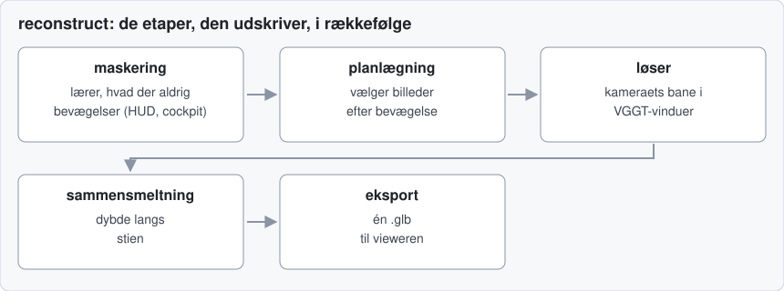

# Offline-rekonstruktion {#offline-reconstruction}

```bash
python -m heat3d_capture reconstruct lap.mp4 -o lap.glb [--solve-budget 260] [--fuse-interval 0.4]
```

Kode: [`scan/offline.py`](https://github.com/Holdi601/3DHeat-GameCapture/blob/main/heat3d_capture/scan/offline.py),
[`pose/feedforward.py`](https://github.com/Holdi601/3DHeat-GameCapture/blob/main/heat3d_capture/pose/feedforward.py),
[`pose/vggt_model.py`](https://github.com/Holdi601/3DHeat-GameCapture/blob/main/heat3d_capture/pose/vggt_model.py),
[`pose/feedforward_source.py`](https://github.com/Holdi601/3DHeat-GameCapture/blob/main/heat3d_capture/pose/feedforward_source.py),
[`pose/solveprep.py`](https://github.com/Holdi601/3DHeat-GameCapture/blob/main/heat3d_capture/pose/solveprep.py).
Valgmuligheder: [Kommandoreference](commands.md#reconstruct).

## Hvorfor en anden sti {#why-a-second-path}

Inkrementel sporing er live og billig, og den virker, hvor der er struktur at holde fast i: et interiør, en gade, et kort med dækning. En **racerbane er dens værste tilfælde**: vejen er et glat bånd med lidt tekstur, horisonten bevæger sig næsten ikke, og når nogle få positioner er drevet væk, er der intet, der senere trækker dem tilbage. En omgang kommer ud som en kurve, der vandrer i stedet for at lukke sig.

Den offline-sti giver **vinduer af billeder** til en model, der forudsiger alle deres kameraer samtidig, så hvert billede begrænser hvert andet direkte i stedet for gennem en kæde. Den kræver hele optagelsen, før den kan svare, så den er ikke live, og den er langsom: minutter pr. vindue på en desktop-GPU. Alt efter positionerne - fusion, dækning, farve, eksport - er det samme kode som i den live scanning: den løste bane gives til rekonstruktøren som en positionskilde, præcis dér hvor Forza-telemetri går ind.

## Krav {#requirements}

- **PyTorch**, passende til din GPU (ikke fastlagt af dette projekt; installer det før `requirements.txt`, se [Kørsel](runtime.md)).
- **`vggt`** - VGGT-modelkoden (`from vggt.models.vggt import VGGT`), fra Metas GitHub-repository; den findes ikke i pakkeindekset.
- **`transformers`**, fordi offline-stien kører dybde gennem PyTorch-`DepthEstimator` (Depth Anything V2 Small), ikke gennem ONNX-filen.
- En CUDA-GPU i praksis; begge modeller falder tilbage til CPU, hvilket ikke er praktisk.

Ingen af disse er i `requirements.txt`, fordi scanneren ikke har brug for dem. De er i **`requirements-offline.txt`**, sammen med VGGTs egne afhængigheder (`einops`, `safetensors`, `huggingface_hub`, `Pillow`):

```bash
.venv\Scripts\python -m pip install -r requirements-offline.txt
.venv\Scripts\python -m pip install --no-deps "vggt @ git+https://github.com/facebookresearch/vggt.git"
```

VGGT installeres med `--no-deps`, fordi dets pakkemetadata fastlægger `numpy<2`, og pip ville respektere det ved at nedgradere den numpy, scipy har brug for her. `reconstruct` tjekker alle disse, lige efter den skriver licenslinjen (listen `OFFLINE` i [`runtime/preflight.py`](https://github.com/Holdi601/3DHeat-GameCapture/blob/main/heat3d_capture/runtime/preflight.py)), lister, hvad der mangler med størrelser, og installerer kun ved et ja - VGGT med `--no-deps`, som ovenfor. Ved nej, eller uden en terminal at spørge i, afsluttes med kode 1.

## Modellen og dens licens {#the-model-and-its-licence}

**VGGT**, `facebook/VGGT-1B`: **CC-BY-NC-4.0, kun ikke-kommerciel, og en rekonstruktion lavet med den arver det.** Kommandoen skriver dette, før den starter (`describe_licence`). Der findes en separat licenseret `facebook/VGGT-1B-Commercial`, men det er et lukket repository, som Meta giver pr. konto, så det kan ikke være standard. `--model vggt-1b-commercial` løser med den (og skriver i stedet sin licenslinje); uden godkendt adgang fejler hentningen. `vggt`-*koden* er under Metas egen "VGGT License", en forskningsaftale med en brugspolitik (læst i pakkens `LICENSE.txt`). Se [Modeller og licenser](models-and-licences.md).

## Kørslen, trin for trin {#the-run-stage-by-stage}

Trinnenes navne er dem, kommandoen skriver ud.



### masking {#masking}

En `FlowMask` læres ud fra **4 kørsler af 90 på hinanden følgende billeder**, centreret ved 1/8, 3/8, 5/8 og 7/8 af videoen, ved 960 x 540 gråtoner (se [FlowMask](reconstruction-capture.md#flowmask-what-never-travels)). Dens besked skrives ud og gemmes i opsummeringen. En video kortere end 90 billeder får ingen maske.

#### Kameramasken læres, den anvendes ikke {#the-camera-mask-is-learned-not-applied}

Masken anvendes **ikke** på de billeder, der gives til løseren. At maskere cockpittet så rigtigt ud ud fra feature-statistik (de fleste fundne hjørner sidder på kamerafastgjorte pixels) - men det er en påstand om en feature-detektor, og løseren er et trænet netværk. Målt på hvor meget den genfundne sti drejer mellem på hinanden følgende skridt (en bil drejer få grader; en tilfældig gang nioghalvfems), gav rå billeder den mindste drejning, kontrastløftede billeder lidt mere, maskerede billeder klart mere, og begge dele sammen mest. Så løseren får rå billeder. Masken bruges stadig til at planlægge billedafstanden nedenfor, og den inkrementelle tracker bruger den i den live scanning. (`solveprep.enhance`, som maskerer og løfter lokal kontrast med CLAHE, findes, men bruges ikke af denne kommando.)

### planning: billeder med afstand efter bevægelse {#planning-frames-spaced-by-motion}

`plan_by_motion` vælger løserens billeder efter **hvor meget billedet har flyttet sig**, ikke efter uret: et fast interval giver langsomme afsnit billeder, de ikke har brug for, og sulter de hurtige, hvor på hinanden følgende billeder ikke overlapper nok til at være relateret.

- Målt forskydning: **5 % af en 960-pixel bredde** (48 px) median ORB-featureforskydning mellem på hinanden følgende valgte billeder, målt på 960 x 540 gråtonebilleder med CLAHE-kontrast, features kun på masken.
- Start med et 0,3 s interval; efter hvert trin bliver det næste interval `interval x (0,5 + 0,5 x mål / målt)`, begrænset til **0,15-2,0 s**, så én støjende måling ikke svinger planen.
- Når intet matchede, krymper intervallet til 0,6 af sig selv (for langt fra hinanden er den fejl, der undgås).
- Stopper ved videoens slutning eller ved `--solve-budget` billeder (standard 260).

Færre end 4 planlagte billeder er en fejl.

### solving: vinduer og sammensyning {#solving-windows-and-stitching}

De planlagte billeder afkodes i 960 px bredde og løses i **overlappende vinduer på 16 billeder, med 6 delt** med det næste (`plan_windows`; det sidste vindue trækkes tilbage, så det slutter på det sidste billede, så en optagelses ende har lige så mange naboer som midten). Mere end **400** billeder i én kørsel afvises.

Hvert vindue: billeder ændres i størrelse, så den lange side er **518** og begge sider er multipla af **14** (billedforholdet bevaret - at presse det ville forkert angive synsfeltet), skaleres til 0..1 og køres gennem VGGT under bfloat16-autocast (float16 løber tør for eksponent ved fjerne verdenskoordinater). Kameraernes ekstrinsiske parametre omregnes til rotationer fra verden-til-kamera og kamerascentre. Punktkort gemmes ikke som standard.

Hvert vindue kommer tilbage i **sin egen vilkårlige ramme og sin egen vilkårlige skala**, så vinduerne **sammensyes** ind i det første vindues ramme med en lighedstransformation (rotation, translation, én skala), tilpasset ud fra de kameraer, de deler med det, der allerede er placeret:

- **Rotation ud fra kameraernes orientering**, ikke deres positioner: de delte kameraer sidder langs stien og er næsten kollinære på en lige strækning, hvilket efterlader en positionsbaseret tilpasning blind for rotationen - hvert vindue krummer, og det sammensyede resultat bliver lige. Rotationen er middelværdien af `target_R x source_R^T`, projiceret tilbage på en egentlig rotation (med et spejlingsvagt).
- **Skala og forskydning ud fra positionerne**, langs den roterede kilde.
- Mindst **4** delte kameraer kræves; færre er en fejl.
- Overlappet er en tredjedel af vinduet, så skalaen er godt bestemt; skalafejl, der akkumuleres vindue for vindue, er det, der får en omgang til at spiralere.

For hver søm registreres den værste uenighed mellem de delte kameraer efter tilpasningen, i enheder af gennemsnitlig afstand mellem dem (`seam_error`).

### fusing {#fusing}

Billeder hvert `--fuse-interval` sekund (standard 0,4) afkodes i 960 px bredde, får dybde af Depth Anything V2 Small (PyTorch) og fusioneres med en pose **interpoleret** fra den løste bane ved deres tidsstempel (lineær position, sfærisk rotation; `FeedForwardPoses`). Billeder uden for den løste tidsspænd springes over frem for at ekstrapoleres. Kameraet bruger et **65 graders** vandret synsfelt. Feed-forward-positioner har konfidens 0,85 i fusion og dækning.

### exporting {#exporting}

Mesh'en skrives som for en live scanning ([.glb-outputtet](glb-output.md)), navngivet efter videoen.

## Opsummeringen {#the-summary}

```text
140 cameras solved over 182s
closure error 3.1% of path length
worst seam 0.42 frame spacings
<mask note>
wrote lap.glb
```

| Linje | Betydning |
|---|---|
| closure error | afstanden fra det første til det sidste kamera over stiens længde. For en enkelt omgang er det det ærlige mål for drift. Over 10 %: "The lap does not close ... Treat the shape as unreliable." |
| worst seam | den største sammensyningsuenighed. Over 1,0: "Windows disagreed by up to N frame spacings at a seam, so part of the path is stitched on weak evidence." |
| ingen fil | "Fusion produced no surface, so nothing was written." Afslutningskoden er så 1. |

## Skala {#scale}

Den sammensyede sti er i det første vindues vilkårlige enheder. Dybde ankres ved at trianguliere mellem de interpolerede positioner (som for telemetri), så geometrien er i overensstemmelse med stien - men **resultatet er ikke i meter**, medmindre stien er det. Ingen del af denne kommando fastlægger den globale skala; jordkalibreringen anvendes ikke, når positionerne kommer fra en positionskilde.

## Stand for denne sti {#state-of-this-path}

Med billeder i fast interval løses vinduerne til en sammenhængende sti på nogle afsnit af en omgang og et krøllet kludret spor på andre; fejlene ligger i de snævre sving, hvor udsigten svinger hårdt mellem billederne, og at sample disse sving tættere genskaber dem. Ingen billedstatistik, der blev afprøvet (lysstyrke, detaljegrad, antal features, inlier-andel, forskydning), forudsagde på forhånd, hvilke afsnit der ville fejle. Så afstanden kan ikke planlægges fuldt ud ud fra billederne på forhånd: den skal vælges ved at løse, måle resultatet og løse igen tættere, hvor stien ikke er en, en bil kunne have kørt. Bevægelsesbaseret planlægning er bygget; **den adaptive genløsning er ikke**.
