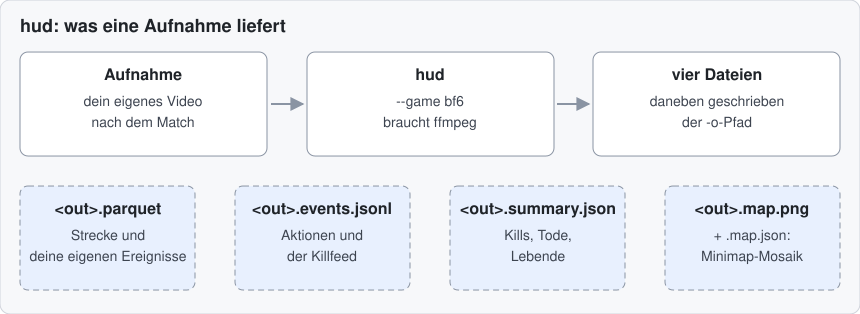

# Das HUD aus einer Aufnahme lesen {#reading-the-hud-from-a-recording}

`hud` liest das eingeblendete HUD eines Spiels aus der **eigenen Aufnahme** des Spielers, nach dem
Match: die **eigenen** Aktionen des Spielers aus dem Punkte-Popup, das das Spiel unter dem Fadenkreuz
zeigt (Abschüsse, Assists, Wiederbelebungen, Versorgungen, Eroberungen ...), seine Tode aus den
Bildschirmen für Ausgeschaltet und Einsatz, seine **eigene** Spur aus der Minikarte und den
Killfeed daneben als zeitgestempelte Ereignisse - geschrieben als 3DHeat-Tabelle, mit dem Mosaik der
Minikarte als Kartenbild, das man darunter legen kann.

Kurz gesagt: Es schaut sich dein Match-Video an und schreibt deine Abschüsse, Tode und deine
Laufwege auf.

```bash
.venv\Scripts\python -m heat3d_capture hud "<recording>.mp4" --game bf6 --player <name> -o out/match
```

Battlefield 6 ist das erste Spielprofil.



## Was es berührt und was nicht {#what-it-does-and-does-not-touch}

- Es liest eine **Videodatei**: einen ShadowPlay- / Instant-Replay-Clip, eine OBS-Aufnahme, alles,
  was ffmpeg dekodieren kann. Es fasst das Spiel, dessen Speicher, Dateien oder Netzwerk nie an und
  läuft erst nach dem Match. Siehe [Die Regeln](rules.md).
- Es leitet **nur die eigene Position des Spielers** ab, aus der eigenen Minikarte des Spielers. Die
  Markierungen anderer Spieler auf der Minikarte werden ausgeblendet und nie gelesen. Der Killfeed
  wird vollständig behalten, aber nur als das, was am Bildschirm steht (wer, wen, womit, wann); niemandem
  außer dem Spieler wird eine Position zugeordnet.
- Die Texterkennung (OCR) läuft lokal (RapidOCR mit den PaddleOCR-Modellen über ONNX Runtime). Kein
  Bild und kein Ausschnitt verlässt den Rechner.
- Eine Aufnahme zeigt die Namen anderer Spieler, und das Mosaik ist ein Bild des Levels. Die Ausgaben
  sind für den eigenen Gebrauch des Spielers bestimmt; halte sie lokal.

## Voraussetzungen {#requirements}

- **ffmpeg und ffprobe** im `PATH`. Eine NVIDIA-Karte wird zum Dekodieren genutzt, wenn eine da ist
  (`-hwaccel cuda`); sonst dekodiert die CPU, mehrfach langsamer.
- Die Pakete aus `requirements.txt`, und die OCR ohne ihre eigenen Abhängigkeiten (sie verlangt die
  CPU-Version von `onnxruntime`, die mit dem DirectML-Paket kollidiert, das das Projekt verwendet):

```bash
.venv\Scripts\python -m pip install -r requirements.txt
.venv\Scripts\python -m pip install --no-deps rapidocr_onnxruntime==1.2.3
```

`rapidocr_onnxruntime` ist der Textleser (OCR), der Namen und Wörter vom Bildschirm liest.
`--no-deps` verhindert, dass er das DirectML-`onnxruntime` des Projekts ersetzt.

Ffmpeg unter Windows installieren: `winget install Gyan.FFmpeg`, dann ein neues Terminal öffnen und mit
`ffmpeg -version` prüfen. Neu in der Kommandozeile? Lies [Bevor du anfängst](before-you-start.md).

- Eine Aufnahme im Format **16:9**, in beliebiger Auflösung (1080p, 1440p, 4K). Andere Seitenverhältnisse
  werden abgelehnt, weil die Kästen des Profils sonst auf den falschen Stellen des Bildschirms lägen.
- Das **Standard-HUD-Layout** des Spiels. Ein verschobenes oder skaliertes HUD-Element wird an der
  falschen Stelle gelesen.

## Optionen {#options}

| Option | Standard | Bedeutung |
|---|---|---|
| `video` | | Die Aufnahme. |
| `-o`, `--out` | der Name des Videos, im aktuellen Ordner | Ausgabepfad **ohne** Endung; die Dateien heißen `<out>.parquet`, `.events.jsonl`, `.summary.json`, `.map.png`, `.map.json`. |
| `--game` | `bf6` | Wessen HUD gelesen wird. `bf6` (Battlefield 6) ist bisher das einzige Profil. |
| `--player` | keiner | Der Name des Spielers, so wie der Killfeed ihn zeigt. Wird locker verglichen (die OCR verwechselt `l`/`I`/`1`, `O`/`0`, `rn`/`m`). Ohne ihn wird der Name geraten (unten). |
| `--fps` | 5 | Minikarten-Messwerte pro Sekunde. Der Killfeed wird mit der halben Rate abgetastet, das Punkte-Popup und die Todesbildschirme ebenfalls mit der halben Rate (ein Viertel, solange kein Popup angezeigt wird), der Kompass alle 3 s, die Squad-Liste alle 15 s. |
| `--start` | 0 | Sekunden ins Video, ab denen begonnen wird. |
| `--seconds` | alles | Wie viel vom Video gelesen wird. |
| `--metres-per-pixel` | keiner | Der Maßstab der Minikarte, falls bekannt: Meter pro Minikarten-Pixel bei der üblichen Zoomstufe (die Minikarte ist auf einem 1080p-Bildschirm 296 Pixel breit). Ohne ihn sind Positionen in diesen Pixeln; siehe [Einheiten](#north-and-units). |
| `--cpu` | aus | Auf der CPU dekodieren, auch wenn eine NVIDIA-Karte vorhanden ist. |

Der Fortschritt wird alle fünf Sekunden ausgegeben; am Ende gibt es den Spieler, Abschüsse, Tode,
Leben und die geschriebenen Dateien.

## Ausgaben {#outputs}

### `<out>.parquet` - die Spur und die Ereignisse des Spielers {#parquet---the-players-track-and-events}

Eine Zeile je Abtastung, in der der Spieler im Spiel war und die Minikarte eingeordnet werden konnte,
dazu eine je eigenem Ereignis. Die Fußzeile trägt die Leseanweisungen des Viewers (Schlüssel `heat3d`,
`kind: heat3d-hud`), damit der Viewer jede Spalte ohne Rückfrage zuordnet.

| Spalte | Bedeutung |
|---|---|
| `time` | Sekunden ab Beginn des Videos. |
| `event` | `position`; `start` (das Video begann mitten im Leben), `spawn` (wieder im Spiel nach einem Tod oder einer langen Pause), `death`, `downed` und `revived` (aus den Todesbildschirmen, unten), `end` (ein Leben endete, ohne dass etwas darüber gesagt werden konnte); die eigenen Aktionen des Spielers aus dem Punkte-Popup (`kill`, `assist`, `reviving`, `resupply`, `capture` ... - die [Ereignistabelle](#event-table)); und die Zeilen des Killfeeds über den Spieler als `kill_feed`, `death_feed`, `teamkill_feed`, `suicide_feed`, `squadwipe_feed`. |
| `source` | Woher das Ereignis der Zeile stammt: `points` (das Popup), `screen` (die Bildschirme für Ausgeschaltet und Einsatz), `feed` (der Killfeed); leer bei Positionszeilen. |
| `text` | Bei `points`-Zeilen: die Markierung, wie sie angezeigt wird (`KILL`, `SQUAD DAMAGE ASSIST` ...), oder der Titel (`DOUBLE KILL`, der Name eines Bands), oder bei einer unbekannten Markierung, was gelesen wurde. |
| `points` | Bei `points`-Zeilen: um wie viel die Gesamtsumme des Popups in diesem Moment gestiegen ist. Wenn mehrere Aktionen in derselben Abtastung kamen (ein Abschuss und das Fahrzeug, in dem er stattfand), ist es ihre Summe, bei jeder angegeben, und `shared` sagt, wie viele sie sich teilen. Leer, wenn die Summe nicht zweimal vor und zweimal nach dem Moment gelesen wurde. |
| `subject`, `subject_side` | Bei `points`-Zeilen: der Name, den das Popup mit der Aktion zeigte - das Opfer eines Abschusses, der wiederbelebte oder versorgte Teamkamerad - und seine Farbe (`enemy`, `friendly`, `squad`). |
| `confirmed` | `feed`, wenn der Killfeed eine Zeile für denselben Abschuss oder Tod hatte (innerhalb von 3 s, dasselbe Opfer). |
| `x`, `y`, `z` | Position auf dem Mosaik: `x` Ost, `y` Nord, `z` 0 (die Fußzeile sagt, dass `z` nach oben zeigt). Nord ist echter Norden, wenn der Kompass das zuließ (siehe `north_up` in der Zusammenfassung). |
| `player` | Immer `me`. Nur die eigenen Zeilen des Spielers haben Positionen. |
| `team` | `own`. |
| `session` | `<video name>#NN`, eine je Leben. Linienintensitäts-Routen überschreiten nie eine Sitzung. |
| `heading` | Grad im Uhrzeigersinn von Norden (von der Oben-Richtung des Mosaiks, wenn Norden unbekannt ist): wohin die Sicht zeigte. |
| `dir_x`, `dir_y`, `dir_z` | Dasselbe als Richtungsvektor, für die Blickrichtung im Viewer. |
| `zoom` | Wie weit die Minikarte gegenüber ihrer üblichen Zoomstufe herausgezoomt war (über 1 in Fahrzeugen). |
| `killer`, `victim`, `weapon`, `headshot`, `marker` | Bei Abschuss- und Todeszeilen, die eine Killfeed-Zeile haben: die Killfeed-Zeile (unten). Ein Popup-Abschuss ohne Killfeed-Zeile hat den Namen aus dem Popup als `victim`; ein Popup-Abschuss, der als HEADSHOT angezeigt wurde, hat `headshot` auf true. |

Jede Ereigniszeile übernimmt die Position des Spielers zur Zeit des Ereignisses (bei einem Tod oder
Ausgeschaltet die letzte Position davor, bei einer Wiederbelebung die erste danach). Die Zeilen passen
direkt zur [Linien-Intensität](https://holdi601.github.io/3DHeat/line-heat.html) des Viewers: Ihr
Vorschlag wählt `event`, beginnt bei `start`, `spawn` und `revived`, endet bei `death`, `downed` und
`end`, und `position`-Zeilen liegen entlang der Route. Die übrigen Ereignisse sind so benannt, dass der
Vorschlag keines davon als Anfang oder Ende nimmt: Eine Wiederbelebung zu geben ist `reviving` (nicht
`revive`), einen Punkt zu halten `defense`, ein Teamkamerad, der beim Spieler erscheint,
`teammate_arrived`, und die Zeilen des Killfeeds `kill_feed` und so weiter; `kill` ist kein Ende.

Ein Clip mit zwei Runden auf zwei Karten ergibt zwei Mosaike, die sich nicht zueinander bringen lassen.
Das größte ist `<out>.parquet`; jedes andere mit mindestens 30 s Spur wird daneben geschrieben als
`<out>.map2.parquet`, `<out>.map2.map.png` und so weiter.

### `<out>.events.jsonl` - die Ereignisse des Spielers und der Killfeed {#eventsjsonl---the-players-events-and-the-kill-feed}

Ein JSON-Objekt je Zeile, in zeitlicher Reihenfolge, jeweils mit einer `source`:

- `points`: eines je Aktion des Spielers: `time`, `event`, `text`, `points`, `shared`,
  `subject`, `subject_side` (wie in der Tabelle), `popup` (aus welchem Popup sie stammt, durchnummeriert
  über den ganzen Lauf), `seen` (wie viele Lesungen sie zeigten), `confirmed`, sowie `x`, `y`, wo der
  Spieler war.
- `screen`: eines je Zustand Ausgeschaltet und je Wiederbelebung: `event` (`death`, `downed` oder
  `revived`), `time` (wann der Spieler ausgeschaltet wurde; bei `revived`, wann die Bildschirme
  verschwanden), `until` (die letzte Sichtung der Bildschirme), `screens` (`down` und/oder `card`),
  `outcome` (`death`, `revived` oder `unknown`, wenn die Aufnahme vorher endet), `killer` (aus der
  Killfeed-Zeile, wenn es eine gibt), `x`, `y`.
- `feed`: jede Zeile, die der Killfeed zeigte, von allen:

| Feld | Bedeutung |
|---|---|
| `time`, `last` | Erste und letzte Abtastung, in der die Zeile gelesen wurde (Sekunden ab Beginn des Videos). `time` ist, wann der Abschuss erschien, auf eine Killfeed-Abtastung genau (0,4 s bei der Standardrate). |
| `kind` | Aus der Sicht des Spielers: `kill`, `death`, `teamkill`, `suicide`, `squadwipe`; für Zeilen anderer Spieler `kill`, `squadwipe`, oder `death` für eine Zeile ohne Angreifer. |
| `killer`, `victim` | Die Namen, als häufigste Lesung über alle Abtastungen, in denen die Zeile zu sehen war (eine längere Lesung gewinnt, wenn die häufige deren Anfang ist: ein teilweise verdeckter Name). `killer` ist leer bei einer Zeile, die nur ein Symbol und ein Opfer zeigte - ein Tod durch die Welt oder eine Zeile, deren Angreifer schon verblasst war. |
| `killer_side`, `victim_side` | Aus der Farbe des Namens: `friendly` (das Team des Spielers, blau), `enemy` (orange), `squad` (das blasse Grün, das das Spiel für den Spieler und seinen Trupp nutzt), `neutral` (keine davon). |
| `weapon` | Die Klasse des Waffensymbols innerhalb dieses Laufs: `icon01`, `icon02` ... Zeilen mit ähnlich aussehenden Symbolen teilen sich eine Klasse. Die Symbole sind nicht benannt; es gibt keine Liste, aus der man Namen nehmen könnte. |
| `marker` | Das kleine Symbol zwischen Waffe und Opfer: `skull`, `arrow`, `chevrons`, `crosses` oder leer. |
| `headshot` | `marker == "skull"` - eine Annahme, siehe [Grenzen](#limits). |
| `seen` | Wie viele Killfeed-Abtastungen die Zeile zeigten. |
| `me` | `killer`, `victim` oder null. |
| `matched` | Bei den eigenen Zeilen des Spielers: ob eine Popup-Aktion oder ein Todesbildschirm dazu gefunden wurde. |
| `x`, `y` (, `map`) | Bei den eigenen Zeilen des Spielers: wo er war. |

### `<out>.summary.json` {#summaryjson}

Spieler (und wie er gefunden wurde), woher die Ereignisse des Spielers stammen (`own_events_from`: das
Popup und die Bildschirme, oder der Killfeed allein, wenn keines von beiden gelesen werden konnte),
Abschüsse, Tode, K/D, Kopfschüsse, Assists, gegebene (`revives`) und erhaltene (`revived`)
Wiederbelebungen, Ausgeschaltete, Eroberungen, Neutralisierungen, Versorgungen, Heilungen, Reparaturen,
zerstörte Fahrzeuge, die Punktzahl (die Summen der Popups zusammengezählt), jede Aktionsart mit ihrer
Anzahl (`actions`), die Zahl der Popups, Tode, die nur der Killfeed zeigte, die eigene Zählung des
Killfeeds an Abschüssen und Toden und wie viele seiner Abschüsse zu einem Popup-Abschuss passten,
Teamkills, Selbstmorde, Squad-Auslöschungen, Leben, Sekunden im Spiel, zurückgelegte Strecke (in den
Einheiten der Tabelle), Zeilen des Killfeeds, je Karte ob Norden oben ist und wie viele Kompass-Lesungen
zustimmten, die Zählungen der Spur (Abtastungen, im Spiel, eingeordnet, nicht eingeordnet, Inseln), die
getroffenen Annahmen und die Zeitangaben.

### `<out>.map.png` und `<out>.map.json` - die Karte unter der Spur {#mappng-and-mapjson---the-map-under-the-track}

Das Mosaik aller Minikarten des Laufs, gemittelt, Overlays entfernt, gedreht und skaliert genau wie die
Tabelle. Die JSON-Begleitdatei enthält die zwei Anker, die die Platzierung **Kartenbild** des Viewers
verlangt ([Kartenbilder](https://holdi601.github.io/3DHeat/map-images.html) in der Dokumentation des
Viewers): Lade das PNG mit **Kartenbild...**, lass **Nord/Süd spiegeln** eingeschaltet und trage
Anker 1 und Anker 2 (`px`, `py`, `worldX`, `worldZ`) aus der Begleitdatei ein. Das Bild liegt dann genau
unter der Spur.

Im Bild sind nur die Teile des Levels, die die Minikarte des Spielers zeigte.

## Verfahren {#method}

### Dekodieren {#decoding}

ffmpeg dekodiert auf der GPU, reduziert die Rate auf die Abtastrate, solange die Bilder noch auf der
Karte liegen, schneidet die Bereiche des Profils aus (Minikarte, Killfeed, zwei Kompassstreifen,
Squad-Liste, das Punkte-Popup, die Worte des Bildschirms für Ausgeschaltet, die untere rechte Ecke),
skaliert jeden auf eine feste Größe und stapelt sie zu einem kleinen Bild je Abtastung. Nur dieses Bild
geht durch die Pipe in Python. Jeden Frame des H.264-Streams zu dekodieren ist die Untergrenze der Laufzeit.

Zwei Arbeitsthreads übernehmen die Abtastungen: einer registriert die Minikarten (OpenCV), einer liest den
Text (ONNX Runtime).

### Im Spiel oder nicht {#in-play-or-not}

Das Tastenhinweis-Quadrat der Minikarte (das helle Quadrat mit der Kartentaste darin, unten links auf der
Minikarte) wird immer gezeichnet, wenn die Minikarte es wird, und nicht auf Todes-, Killcam-, Einsatz-,
Menü- oder Scoreboard-Bildschirmen. Sein Vorhandensein - ein helles, farbloses Quadrat mit einem dunklen
Buchstaben in der Mitte, deutlich heller als seine Umgebung -, in einem Umkreis von wenigen Pixeln um
seinen Platz gesucht, ist der Test für „im Spiel“. Eine einzelne Abtastung, die beiden Nachbarn
widerspricht, wird ignoriert.

Eine Lücke im Spiel ist ein Tod oder ein Rundenwechsel (der nächste Abschnitt beginnt mit `spawn`), wenn sie
mindestens 6 s dauert oder ein Tod (aus den Bildschirmen oder einer Killfeed-Zeile mit dem Spieler als
Opfer) innerhalb von 40 s davor lag; eine kürzere Lücke ohne Tod (die große Karte wurde geöffnet) setzt das
Leben fort. Die Minikarte bleibt sichtbar, während der Spieler am Boden liegt, daher ist ein am Boden
liegender Spieler im Spiel.

### Die Spur {#the-track}

Die Minikarte dreht sich mit der Sicht und hält den Spieler an einem festen Punkt (gemessen: die Mitte, 49,7 %
nach unten). Jede Abtastung:

1. **Maskieren**, was nicht das Level ist: stark gefärbte oder nahezu weiße Pixel (Zielmarkierungen,
   Squad- und Fahrzeugsymbole, Pings, die Grenze des Spielfelds, Routenlinien, Text), das blasse Gelbgrün
   des Sichtkegels, eine Scheibe um die Markierung des Spielers, der Keil des Kegels darüber, der
   Tastenhinweis und ein dünner Rand.
2. **Merkmale**: SIFT-Schlüsselpunkte auf der kontrastangeglichenen grauen Minikarte, innerhalb der Maske.
3. **Am Mosaik registrieren**, nicht an der vorherigen Abtastung: Die Schlüsselpunkte werden mit den bisher
   gespeicherten Merkmalen verglichen, in Mosaik-Koordinaten, nahe dort, wo der Spieler zuletzt war; eine
   Ähnlichkeitstransformation (Drehung, Zoom, Verschiebung) wird mit RANSAC angepasst. Eine Anpassung braucht
   genug Inlier, einen Zoom innerhalb eines Drittels des letzten und eine Verschiebung von weniger als einem
   Drittel der Minikarte je Abtastung; eine Anpassung, die überall auf dem Mosaik gesucht wird (nach einem Tod),
   braucht die doppelte Anzahl Inlier.
4. **Das Mosaik wachsen lassen**: Merkmale, die das Mosaik noch nicht hat, werden hinzugefügt (höchstens alle
   paar Zehntelsekunden Bewegung), und die maskierte Minikarte wird ins Bild gemittelt.
5. Der Punkt des Spielers, durch die Anpassung getragen, ist seine **Position**; die Oben-Richtung der
   Minikarte, durch sie getragen, ist seine **Blickrichtung** auf dem Mosaik.

Danach wird ein Punkt verworfen, der mehr als 10 Pixel von beiden Abtastungen davor und beiden danach
springt (die untereinander übereinstimmen): Eine Minikarte passt ab und zu für eine Abtastung mit einer
falschen Zoomstufe. Die Zusammenfassung zählt sie (`dropped_as_jumps`).

Die Registrierung am Mosaik verhindert, dass sich Fehler aufsummieren: Wer an eine Stelle zurückkehrt,
passt zu den Merkmalen, die beim ersten Mal gespeichert wurden. Ein Spawn an einer noch nicht gesehenen
Stelle beginnt eine eigene **Insel**; jede zehnte eingeordnete Abtastung wird gegen die anderen Inseln
versucht, und der erste gute Treffer verbindet sie (die kleinere geht mit ihrer Spur in die größere
über). Inseln, die nie verbunden wurden (andere Karte oder Boden, der nie geteilt wurde), werden wie oben
getrennt geschrieben.

<a id="north-and-units"></a>

### Norden und Einheiten {#north-and-units}

Der Kompassstreifen wird alle 3 s gelesen: Seine Beschriftungen werden an ihrer Tinte gefunden (hell,
farblos, über kleine Lücken gruppiert, Striche verworfen), jede einzeln gelesen, und zwei oder mehr
Beschriftungen legen sowohl den Maßstab des Streifens als auch die Peilung unter der Mittelmarke fest - eine
einzelne Beschriftung legt nichts fest. Jede Kompass-Lesung wird mit der Mosaik-Blickrichtung derselben
Abtastung gepaart; der zirkuläre Median der Differenzen, über die Lesungen innerhalb von 10 Grad davon, ist
die Drehung, die Norden des Mosaiks nach oben bringt. Sie wird angewandt, wenn mindestens drei Lesungen und
die Hälfte aller übereinstimmen.

<a id="units"></a>Der Bodenmaßstab der Minikarte steht nirgendwo auf dem Bildschirm, daher sind Positionen in
**Minikarten-Pixeln bei der üblichen Zoomstufe**: Die mittlere Zoomstufe des Laufs wird auf eine Tabelleneinheit
je Pixel einer 296-Pixel-Minikarte skaliert (ihre Größe auf einem 1080p-Bildschirm). Das Herauszoomen im
Fahrzeug wird durch die Registrierung herausgerechnet, daher ist eine Einheit zu Fuß und im Fahrzeug
dieselbe. `--metres-per-pixel` multipliziert alles in Meter, wenn der Maßstab bekannt ist (aus einer bekannten
Strecke auf der Karte, einmal gemessen).

### Der Killfeed {#the-kill-feed}

Der Killfeed wird mit 2,5 Abtastungen pro Sekunde gelesen, aber nur, wenn sich seine farbigen Pixel
merklich geändert haben oder 2 s vergangen sind. Textzeilen werden durch den Detektor der OCR gefunden; eine
Zeile, deren Bild einer Lesung der vorherigen Abtastung entspricht (Zeilen scrollen, sie können sich also
verschoben haben), übernimmt diesen Text, statt neu gelesen zu werden. Zeilen, die zu klein für einen Namen
sind oder einen Schrägstrich haben (ein FPS-Zähler in dieser Ecke), werden verworfen.

Zeilen werden nach Höhe zu Reihen gruppiert; in einer Reihe ist der linkeste Name der Angreifer und der
rechteste das Opfer. Benachbarte Stücke derselben Farbe verbinden sich (ein Name mit Leerzeichen). Eine
einzelne Zeile, die über das Symbol hinweg von einem Namen zum anderen lief, wird an ihrer breitesten Lücke
geschnitten, wenn sich die Hälften in der Farbe unterscheiden, und jede Hälfte wird erneut gelesen. Ein
einzelner Name in der Opferspalte mit einem Symbol direkt links davon ist eine Zeile ohne Angreifer. Zwei
Stücke in einer Farbe ohne Symbol dazwischen sind ein Name, dessen Angreifer verblasst ist, kein Abschuss.

**Seiten** kommen aus der Farbe. Namen werden mit etwas Transparenz gezeichnet, daher prüft der Test, wie weit
der Text von seinem eigenen Hintergrund entfernt ist: Das Vorzeichen von Rot minus Blau in diesem Unterschied
ist orange (Gegner) oder blau (Freund) auf jedem Hintergrund; keines davon, mit Grün über den anderen beiden,
ist die Squad-Farbe.

**Symbole**: Zwischen den Namen bilden die Pixel in der Farbe des Angreifers die Silhouette der Waffe; ein
kleines separates Symbol direkt vor dem Opfer ist die Markierung, benannt nach seiner Form (ein Klecks mit
Augenlöchern ist ein Totenkopf; ein kleines Dreieck ein Pfeil; mehrere Teile Kreuze).

**Ereignisse**: Eine Zeile, die erneut gelesen wird, mit beiden Namen gleich (Ähnlichkeit 0,7 nach dem
Ausgleich der üblichen OCR-Verwechslungen, eine davon 0,8; eine abgeschnittene Lesung passt zum Anfang des
vollen Namens), ist dasselbe Ereignis, solange das Ereignis zuletzt weniger als 5 s vorher gelesen wurde und
weniger als 14 s alt ist - keine Zeile bleibt länger stehen, daher ist dasselbe Paar später ein neuer Abschuss.
Eine Zeile ohne Angreifer passt allein über das Opfer. Der Zeitpunkt eines Ereignisses ist seine erste
Sichtung; seine Namen, Seiten und Markierung sind die Mehrheit über alle Sichtungen; Zeilen, die nur einmal
gelesen wurden, werden verworfen.

**Der Spieler**: `--player`, sonst die hervorgehobene (hellste) Zeile der Squad-Liste, wenn mindestens drei
Lesungen und 60 % davon übereinstimmen, sonst der Name, den der Killfeed am häufigsten in der Squad-Farbe
zeigte. Andernfalls sagt die Zusammenfassung, dass der Spieler unbekannt ist, und keine Killfeed-Zeile wird
ihm zugeordnet. (Das Popup und die Todesbildschirme gehören dem Spieler unabhängig von seinem Namen; sie
brauchen keinen Namen.)

### Das Punkte-Popup {#the-points-popup}

Alles, was der Spieler erzielt, zeigt Battlefield 6 in einem Popup, direkt links unterhalb des Fadenkreuzes -
am selben Ort zu Fuß, im Fahrzeug und durch ein Visier:

```
            [ RIBBON ] (icon)          a title, now and then: a ribbon or a multi-kill
      (icon)(icon)(icon)  300          one icon per action; the popup's running total
                Some_Name              who it was about, for a moment: orange an enemy, blue a teammate
    [ KILL x2 ] [ VEHICLE DESTROYED ]  one boxed tag per kind of action, with a count
```

Das Popup wächst, während der Spieler weiter punktet: Ein neuer Abschuss macht aus `KILL` ein `KILL x2`,
fügt ein Symbol hinzu und erhöht die Summe; eine neue Aktionsart fügt eine Markierung hinzu. Die Markierungszeile
zeigt die letzten paar Arten (eine ältere rutscht heraus und zählt weiter, wenn sie zurückkehrt). Etwa drei
Sekunden nach der letzten Aktion faltet sich das Popup zu einer Zeile (`[KILL x2] 300`) und verschwindet.
Der Text ist hellgrau, die Markierungen stehen in dünnen Kästen, die Summe in großen Ziffern ab x 760 eines
1920x1080-Bildschirms, die Markierungen rechtsbündig bei x 750.

Es wird 2,5-mal pro Sekunde gelesen: Der Detektor der OCR findet die Textzeilen, nur Zeilen auf einer der
Reihen des Popups werden gelesen (die eigenen Beschriftungen des Panzervisiers im selben Bereich nicht), und
eine Zeile, deren Bild einer Lesung der Abtastung davor entspricht, übernimmt diesen Text. Eine Zeile, die von
einem Symbol, einem Namen oder einer gefalteten Markierung in die Summe hineinläuft (`Name10`, `REVIVE185`),
wird dort geschnitten, wo die Summe beginnt (x 755), und beide Hälften werden erneut gelesen. Solange kein
Popup angezeigt wird, wird jede zweite Abtastung ungelesen zurückgehalten; zeigt die nächste ein Popup, wird
die zurückgehaltene zuerst gelesen, damit der Anfang eines Popups bis auf die Abtastung genau gefunden wird.

**Markierungen** werden nach dem Ausgleich der üblichen Fehler des Erkenners den
[Ereignistabellen](#event-table) zugeordnet (Q als O gelesen, eine Ziffer zwischen Buchstaben, I statt L, ein am
Rand verlorener Buchstabe): Eine Lesung ist eine Markierung, wenn sie mindestens zu 80 % (85 % bei Markierungen
von fünf Buchstaben oder weniger) einer bekannten ähnelt und deutlich näher daran liegt als an jeder anderen.
Vom Erkenner zusammengeschriebene Markierungen (`CAPTUREDORDERCOMPLETED`) werden getrennt, indem bekannte
Markierungen vorn abgeschält werden. Eine Anzahl ist `x2`, `X3`, ein loses Zeichen und eine Ziffer, oder eine
Ziffer direkt hinter der Markierung. Eine hellgraue Zeile in großen Buchstaben in der Markierungszeile, die
nichts trifft, bleibt als Aktion `points` mit ihrem Text erhalten; eine Zeile, die ein Teil einer bekannten
Markierung im selben Popup ist (`DESTROYED` neben `VEHICLE DESTROYED`), nicht. Titel über der Summe
(helle Kästen, dunkler Text) sind `multi_kills` (`DOUBLE KILL` ...) oder `ribbon`. Der Name ist die farbige
Zeile zwischen Summe und Markierungen; ihre Seite kommt aus ihrer Farbe wie im Killfeed.

**Popups und Aktionen**: Lesungen mit weniger als 0,9 s Pause dazwischen sind ein Popup. Ein Popup, das zu
enden scheint und wiederkehrt, bevor es hätte verschwinden können (innerhalb von 3,2 s seit dem letzten
Wachsen), mit jeder Markierung auf ihrer Anzahl oder mehr und einer Summe, die nicht kleiner ist, ist dasselbe
Popup, für einen Moment verloren (Unschärfe, heller Hintergrund) - nichts darin wird doppelt gezählt. In einem
Popup ist die endgültige Anzahl einer Markierung die höchste Anzahl, die mindestens zweimal gelesen wurde; ihre
k-te Aktion wird zum ersten Lesen gezeitet, das eine Anzahl von k oder mehr zeigt. Eine Anzahl, die nur in einer
Abtastung gelesen wurde, ist keine Aktion - außer einem Abschuss, den der Killfeed bestätigt (eine Zeile des
Spielers innerhalb von 3 s, die kein anderer Abschuss beansprucht): Die kurze Markierung KILL ist die, die der
Erkenner am häufigsten nur einmal liest. Ein Titel zählt einmal je Popup, wenn er zweimal gelesen wird.
`points` ist, um wie viel die Summe - es zählen nur Summen, die zweimal hintereinander gelesen wurden - von der
Abtastung vor der Aktion bis zu der danach gestiegen ist.

Eine unbekannte Zeile zählt nur als Markierung auf der Reihe der bekannten Markierungen in derselben Lesung
(oder, ohne bekannte Markierung, wenn es auch keinen Namen gibt), damit ein Name in einer Farbe, die der
Seitentest nicht erkennt, nicht dafür gehalten wird.

### Tode und Wiederbelebungen {#deaths-and-revives}

Wenn der Spieler am Boden liegt, sagt das Spiel es unter der Bildschirmmitte (MAN DOWN, REQUEST REVIVE, SKIP
(HOLD), NEARBY MEDICS; sobald eine Wiederbelebung angefordert ist, REVIVE REQUESTED, CANCEL REQUEST), und eine
Karte unten rechts nennt, wer es getan hat, mit DAMAGE LOG oder PLAYER CARD darunter und einer Zeile
„YOU n - n FOE“ darüber. Wird er direkt getötet (ein tödlicher Kopfschuss), ist nur die Karte zu sehen. Dann
wiederbelebt entweder ein Teamkamerad den Spieler - die Bildschirme verschwinden und das Spiel geht weiter -
oder der Spieler verblutet oder gibt auf, und der Einsatzbildschirm folgt, mit DEPLOY unten rechts.

Diese Worte werden zusammen mit dem Popup gelesen, im selben Durchlauf der OCR (das Popup, das Band des Bildschirms
für Ausgeschaltet und die untere rechte Ecke übereinandergestapelt zu einem Bild): 2,5-mal pro Sekunde, solange
ein Popup angezeigt wird, sonst 1,25-mal. Die Ecke wird nur mitgelesen, wenn der Spieler außer Spiel ist oder in
den letzten 3 s am Boden gesehen wurde; im Spiel enthält sie nur die Munitionsanzeige.
Sichtungen, die weniger als 4 s auseinander liegen, bilden eine Episode (mindestens zwei Sichtungen). Eine Episode
ist ein **Tod**, wenn der Einsatzbildschirm innerhalb von 12 s nach ihrem Ende erscheint, oder wenn der Spieler
3 s danach außer Spiel ist und 6 s oder länger dort bleibt; sie ist eine **Wiederbelebung** (`downed`, dann
`revived`), wenn der Spieler 3 s nach dem Verschwinden der Bildschirme noch im Spiel ist; `unknown` (geschrieben
als `downed` allein), wenn die Aufnahme vorher endet. Die Todeszeit ist der Moment, in dem der Spieler am Boden
lag: die Killfeed-Zeile, die ihn als Opfer nennt, wenn es eine gibt, innerhalb von 3 s davor, sonst die erste
Sichtung der Episode abzüglich der halben Lesepause. Positionen nach einem Tod werden bis zum Einsatzbildschirm
aus der Route herausgelassen.

Ein Todesfall aus dem Killfeed, zu dem keine Episode passt (die Bildschirme wurden übersehen), ist trotzdem ein
`death`, mit `source` `feed`, und wird wie zuvor beurteilt: Bleibt der Spieler länger als 40 s nach ihm im Spiel,
wurde er wiederbelebt.

### Ereignistabelle {#event-table}

<a id="event-table"></a>

Was aus jeder Markierung, jedem Titel und jedem Bildschirm wird. Mehrere Markierungen können ein Ereignis sein;
`text` behält, welche es war.

| Ereignis | Aus | Bedeutung |
|---|---|---|
| `kill` | KILL; HEADSHOT | Der Spieler hat jemanden getötet (der Name ist das Opfer). Ein Kopfschuss-Abschuss zeigt HEADSHOT, wo sonst KILL stünde: `text` sagt, welches, und `headshot` ist true. |
| `assist` | ASSIST, KILL ASSIST, DAMAGE ASSIST, SQUAD DAMAGE ASSIST | Schaden an jemandem, den ein Teamkamerad getötet hat. |
| `kill_assist` | ASSIST COUNTS AS KILL | Ein Assist, den das Spiel als Abschuss zählt. |
| `suppression`, `suppression_assist` | ENEMY SUPPRESSION; SUPPRESSION ASSIST | Unterdrückungsfeuer auf einen Gegner; auf einen, den ein Teamkamerad danach tötete. |
| `smoke_assist` | SMOKE ASSIST, SQUAD SMOKE ASSIST | Rauch, der einen Teamkameraden deckte. |
| `spot`, `spot_assist` | SPOT, SPOTTED, ENEMY DESIGNATION; SPOT ASSIST, SPOT BONUS | Einen Gegner entdecken; ein Abschuss auf einen, den der Spieler entdeckt hat. |
| `driver_assist` | DRIVER ASSIST | Ein Abschuss durch den Richtschützen des Fahrzeugs des Spielers. |
| `reviving`, `reviving_bonus` | REVIVE, SQUAD REVIVE; CONCEALED REVIVE | Der Spieler hat einen Teamkameraden wiederbelebt; der Bonus für eine verdeckte Wiederbelebung. |
| `heal` | HEAL, SQUAD HEAL | Der Spieler hat einen Teamkameraden geheilt. |
| `resupply` | SUPPLY, RESUPPLY, SQUAD SUPPLY | Ein Teamkamerad hat Munition vom Spieler genommen. |
| `repair` | REPAIR, VEHICLE REPAIR, SQUAD REPAIR | Der Spieler hat ein Fahrzeug repariert. |
| `capturing`, `capture` | CAPTURING, RECAPTURING; CAPTURED, OBJECTIVE CAPTURED | Ein Eroberungs-Tick, während ein Ziel erobert wird. |
| `neutralizing`, `neutralize` | NEUTRALIZING; NEUTRALIZED, OBJECTIVE NEUTRALIZED | Dasselbe für das Neutralisieren eines gegnerischen Ziels bis zu neutral. |
| `defense` | DEFENDING, OBJECTIVE DEFENDED | Ein Ziel halten. |
| `offensive`, `defensive` | OFFENSIVE; DEFENSIVE | Bonus für eine Aktion nahe einem angegriffenen Ziel oder einem verteidigten Ziel. |
| `order` | ORDER COMPLETED | Ein Squad-Befehl ausgeführt. |
| `vehicle_damage`, `vehicle_disabled`, `vehicle_destroyed`, `vehicle_destroyed_assist` | VEHICLE DAMAGE; VEHICLE DISABLED; VEHICLE DESTROYED; VEHICLE DESTROYED SUPPORT | Schaden an einem gegnerischen Fahrzeug, bis zu seiner Zerstörung, oder Mithilfe dabei. |
| `equipment_destroyed` | EQUIPMENT DESTROYED | Ein gegnerisches Hilfsmittel zerstört. |
| `forced_bail` | FORCED BAIL | Ein Gegner aus seinem Fahrzeug gezwungen. |
| `squad_wipe` | SQUAD WIPE | Der letzte eines gegnerischen Squads getötet. |
| `savior`, `avenger` | SAVIOR; AVENGER | Ein Abschuss auf einen Gegner, der einen Teamkameraden verletzte; wer gerade einen getötet hatte. |
| `teammate_arrived` | SPAWNED ON, SPAWN ASSIST, VEHICLE SPAWN, SQUAD VEHICLE SPAWN | Ein Teamkamerad erschien beim Spieler oder in seinem Fahrzeug. |
| `transport` | TEAM TRANSPORT | Teamkameraden in einem Fahrzeug befördern. |
| `fortify` | DEFENSE DEPLOYED | Eine Verteidigung, die der Spieler gebaut hat. |
| `points` | alles andere in der Markierungszeile | Eine Aktion, die die Tabelle nicht kennt: `text` ist, was gelesen wurde. |
| `multi_kills` | DOUBLE KILL, TRIPLE KILL, QUAD KILL, MULTI KILL (Titel) | Abschüsse in schneller Folge. |
| `ribbon` | jeder andere Titel | Ein Band, nach seinem Namen (BALLISTIC, TANK BUSTER, ENGINEER EXPERT, SPEARHEAD ...). |
| `downed` | Bildschirm für Ausgeschaltet, dann Spiel | Der Spieler lag am Boden und wurde wiederbelebt. |
| `revived` | Die Bildschirme verschwinden, das Spiel geht weiter | Der Spieler wurde von einem Teamkameraden wiederbelebt. |
| `death` | Bildschirm für Ausgeschaltet oder Karte, dann Einsatz oder außer Spiel | Der Spieler ist gestorben. |

Die Texte in der Tabelle wurden in den Testaufnahmen gesehen, außer diesen, die die üblichen Namen der
Spielreihe sind und in der Tabelle stehen, damit sie benannt statt als `points` behalten werden:
HEADSHOT KILL, ASSIST, KILL ASSIST, ASSIST COUNTS AS KILL, SPOT, SPOTTED, SPOT ASSIST, SPOT BONUS,
SQUAD REVIVE, HEAL, SQUAD HEAL, RESUPPLY, SQUAD SUPPLY, REPAIR, VEHICLE REPAIR, SQUAD REPAIR,
VEHICLE DISABLED, SQUAD WIPE, AVENGER, die Formen OBJECTIVE ..., und die Titel TRIPLE KILL,
QUADRUPLE KILL und MULTI KILL. Das Spiel in einer anderen Sprache druckt
andere Worte: Seine Markierungen kommen als `points` mit dem, was gelesen wurde, heraus - nicht mit einer
bekannten Aktion verwechselt - mit ihren Summen und Namen; und da die Todesbildschirme an ihren englischen
Worten erkannt werden, kommen Tode dann allein aus dem Killfeed, als `death`-Zeilen mit `source` `feed`.

## Was verifiziert ist {#what-is-verified}

Von Auge geprüft an Testaufnahmen (des Spielers selbst, nicht Teil des Repositorys), indem Abtastungen zufällig
gezeichnet und jede mit den Bildern rundherum verglichen wurde:

- **Die eigenen Ereignisse des Spielers.** Jede gezogene Popup-Aktion war eine echte Aktion dieser Art, innerhalb
  einer Lesung (0,4 s) ihrer Zeit gefunden; die meisten Werte und Namen waren richtig (Namen in manchen Schriften,
  etwa Kyrillisch, können verstümmelt herauskommen). Jeder gezogene Todesbildschirm wurde gefunden.
- **Killfeed.** Die große Mehrheit der Feed-Zeilen wurde mit beiden Namen richtig gefunden; kleine OCR-Fehler (ein
  großes I als kleines l gelesen) sind zulässig. Namen in Glyphen, die das Spiel selbst als Kästchen zeigt, können
  fehlen. Seiten (Farben) sind bei einigen Prozent der Namen falsch.
- **Im Spiel.** Der Tastenhinweis-Test stimmte bei jedem geprüften Moment mit dem Bild überein.
- **Spur.** Es gibt keine Grundwahrheit darüber, wo der Spieler war, daher wird die Spur gegen die Aufnahme selbst
  geprüft: Zwei Minikarten werden **direkt zueinander** registriert, und dieser Versatz wird mit dem Versatz zwischen
  den beiden Tabellenpositionen verglichen. Die mittlere Abweichung beträgt etwa 1-3 Minikarten-Pixel (unter 1 % der
  Breite der Minikarte), mehr auf einer vollen, herausgezoomten Minikarte.
  Kompass-Lesungen stimmen mit dem Mosaik fast immer auf 10 Grad überein.
- **Laufzeit.** Das Dekodieren mit etwa dem Fünffachen der Echtzeit macht den größten Teil aus, auf einer Desktop-GPU;
  das Lesen des Punkte-Popups kommt etwa ein Fünftel bis die Hälfte hinzu.

Von Auge geprüft: Jedes Mosaik hat durchgehende Straßen und Gebäude über die Leben hinweg, die es gebaut haben, und
Routen verschiedener Leben auf derselben Straße liegen übereinander. Ein Abschnitt, in dem sich der Zoom der
Minikarte ändert, kann zu lang herauskommen - siehe [Grenzen](#limits).

Die Tests (`tests/test_hud_*.py`) zeichnen alles, was sie lesen: ein erfundenes Level aus Straßen, Gebäuden und
Höhenlinien, Minikarten von Wegen durch dieses Level mit den Overlays, die eine echte hat, Kompassstreifen,
Killfeed-Zeilen mit erfundenen Namen. Sie prüfen, dass eine Schleife auf zwei Pixel genau verfolgt wird und sich
schließt, dass ein stehender Spieler stehen bleibt, während sich die Sicht dreht, dass Zoomänderungen verfolgt
werden, dass ein Spawn an anderer Stelle wieder angeschlossen wird, wenn sich die Wege treffen, dass die Norddrehung
und die y-Spiegelung die Spur dorthin legen, wo sie wirklich verlief, dass die Anker des Kartenbildes es unter die
Spur ausrichten, und das Parsen, die Seiten, Markierungen und das Entfernen von Doppelten im Killfeed. Für die
eigenen Ereignisse des Spielers zeichnen sie Punkte-Popups mit erfundenen Namen und Markierungen und prüfen die
Markierungstabelle und ihre Toleranz gegenüber den Fehlern des Erkenners, zusammengeschriebene Markierungen, die
Zeilen des Popups, die aus einem Namen geschnittene Summe, das Zählen, während ein Popup wächst, das Weiterlaufen
nach einem Moment ungelesen, das Herausrutschen einer Markierung und Zurückkehren, oder das Ende; dass eine Anzahl,
die nur einmal gelesen wurde, getrennt bleibt; Tode, Wiederbelebungen und Ausgänge aus den Worten der Bildschirme;
und, an einem erfundenen Match, dass die Aktionen, Tode und Wiederbelebungen in der Tabelle dort landen, wo der
Spieler war, die Killfeed-Zeilen daneben unter ihren eigenen Namen, und die Route am Tod endet und nicht an der
Wiederbelebung.

<a id="limits"></a>

## Grenzen {#limits}

- **Einheiten sind Minikarten-Pixel**, keine Meter, sofern nicht `--metres-per-pixel` angegeben ist. Nichts auf dem
  Bildschirm des Spiels nennt den Bodenmaßstab der Minikarte.
- **Nur was die Minikarte zeigte, wird abgebildet.** Das Mosaik deckt den Boden innerhalb einer halben Minikarte um
  den Weg des Spielers ab; zwei Mosaike, die nie denselben Boden teilten (zwei Runden auf zwei Karten oder zwei Leben in
  weit auseinanderliegenden Ecken einer großen Karte), bleiben getrennte Dateien mit unzusammenhängenden Koordinaten.
- **Die Spur gehört der Minikarte, bei 5 Abtastungen pro Sekunde**, und wird durch nichts geglättet. Eine weit
  herausgezoomte Minikarte (ein Helikopter zoomte sie in den Testaufnahmen auf das 2,3-Fache heraus) zeigt weniger
  Details je Pixel, und außerhalb des Spielfelds zeigt sie fast keine, daher ist dort die Registrierung gröber.
  Jets und der Spieler als Passagier waren in den Testaufnahmen nicht vorhanden.
- **Registrierungsfehler sind lokal und summieren sich nicht auf**, aber ein Mosaik, das beim Erkunden neuen Bodens
  entsteht, kann eine kleine Krümmung tragen, die erst behoben wird, wenn der Boden wieder gesehen wird. Wo sich der
  Zoom der Minikarte stetig ändert (ein Fahrzeug, das beschleunigt), kann der angepasste Zoom abdriften; ein solcher
  Abschnitt wurde mit einer etwa doppelt so langen Strecke wie der wahren gesehen. Ein Mosaik aus einer vollen,
  herausgezoomten Infanterie-Minikarte ist am ungenauesten (Fehler typisch um 3 Pixel, bis zu 18).
- **Keine Optimierung des Posengraphen.** Eine Schleife schließt sich durch das Abgleichen gespeicherter Merkmale,
  nicht dadurch, dass die Korrektur über die Schleife verteilt wird.
- **Waffenklassen funktionieren noch nicht.** Die Silhouette des Symbols stammt von einem durchsichtigen Symbol über
  einem sich bewegenden Hintergrund und variiert von Abtastung zu Abtastung zu stark: Die Testaufnahmen ergaben
  220 bis 340 Klassen für 550 bis 670 Zeilen, wo ein Match ein paar Dutzend Waffen hat. Behandle `weapon` als
  experimentell. Klassen gelten ohnehin pro Lauf und sind keine Namen.
- **Die Bedeutungen der Markierungen sind nicht alle bekannt.** Der Pfeil (`▸`) wird vor dem eigenen Namen des
  Spielers gezeichnet, in Zeilen über ihn; er ist keine Art von Abschuss. Der Totenkopf wird als Kopfschuss
  angenommen; das ist eine Annahme, nichts, was das Spiel sagt. `chevrons` und `crosses` (Squad-Auslöschungen) werden
  so gemeldet, wie sie gesehen wurden.
- **Namen in anderen Schriften als lateinischen** (Kyrillisch zum Beispiel) kommen als die nächstliegenden lateinischen
  Doppelgänger-Buchstaben heraus: Der Erkenner liest Latein und Chinesisch. Derselbe Spieler wird jedes Mal gleich
  gelesen, daher passen sie trotzdem zusammen, aber der Text ist nicht sein Name.
- **Overlays in der Ecke des Killfeeds** (ein FPS-Zähler) können das Ende des Opfernamens der obersten Zeile verdecken.
  Zählertext wird erkannt und verworfen, und ein abgeschnittener Name wird seinen vollständigen Lesungen zugeordnet,
  aber ein Name, der nur abgeschnitten gesehen wurde, bleibt abgeschnitten.
- **Ein Tod, den weder die Bildschirme noch der Killfeed zeigten**, beendet die Route trotzdem als `end`, wenn der
  Spieler 6 s oder länger das Spiel verlässt.
- **Erhaltene Wiederbelebungen** kommen aus den Bildschirmen für Ausgeschaltet. Nur bei einem Todesfall aus dem Killfeed,
  den die Bildschirme übersahen, werden sie noch erschlossen (mehr als 40 s danach im Spiel), und eine schnelle
  Wiederbelebung wird dann nicht unterschieden.
- **Popup-Aktionen sind auf eine Lesung datiert**: innerhalb von 0,4 s nach dem ersten Erscheinen der Markierung; eine
  Markierung, die einblendet, kann eine Abtastung zu spät oder zu früh gelesen werden.
- **Namen auf Popup-Zeilen** werden wie die des Killfeeds gelesen: Schriften außer Latein kommen verstümmelt heraus, und
  gelegentlich wird der Namensschild eines Teamkameraden, der nahe dem Popup in der Welt schwebt, als Name der Aktion
  gelesen. Aktionen ohne Namen (ein Eroberungs-Tick, ein Befehl) tragen keinen.
- **`points`** fehlt, wo die Summe nicht zweimal auf beiden Seiten einer Aktion gelesen wurde, und wird zwischen Aktionen
  geteilt, die in derselben Abtastung kamen. Die `score` der Zusammenfassung addiert die endgültigen Summen der Popups,
  daher fehlt ein Popup, dessen Summe nie zweimal gelesen wurde.
- **Die Markierungszeile ist ein Fenster**: Bei vier oder mehr Arten in einem Popup rutscht die älteste Markierung nach
  links, über den Rand des gelesenen Bereichs hinaus. Sie wurde gezählt, solange sie im Bild war; eine Anzahl, die sie
  gewinnt, während sie halb außerhalb des Bildschirms ist, kann verpasst werden.
- **Ein Popup, das länger verloren war, als es hätte dauern können** (über etwa 4 s nicht lesbarer Abtastungen, während es
  noch wuchs), wird als zwei gezählt, und eine Markierung mit einer Anzahl über eins wird dann erneut gezählt. Nicht in den
  unten genannten Prüfungen gesehen.
- **Andere Sprachen der Benutzeroberfläche**: Markierungen kommen als `points` mit ihrem Text heraus, und Tode kommen
  allein aus dem Killfeed (die Todesbildschirme werden an ihren englischen Worten erkannt).
- **Ereignisse auf einer kurzen Insel**: Ein Leben, dessen Spur zu kurz war, um als Karte geschrieben zu werden (unter
  30 s), behält seine Ereignisse in `.events.jsonl` ohne `x`, `y`, und nicht in einer Tabelle.
- **Das HUD-Layout ist das Standard-Layout von BF6 bei 16:9.** Eine geänderte HUD-Skalierung, eine Farbpalette für
  Farbenblindheit oder eine andere Minikartengröße bräuchte ein eigenes Profil.
