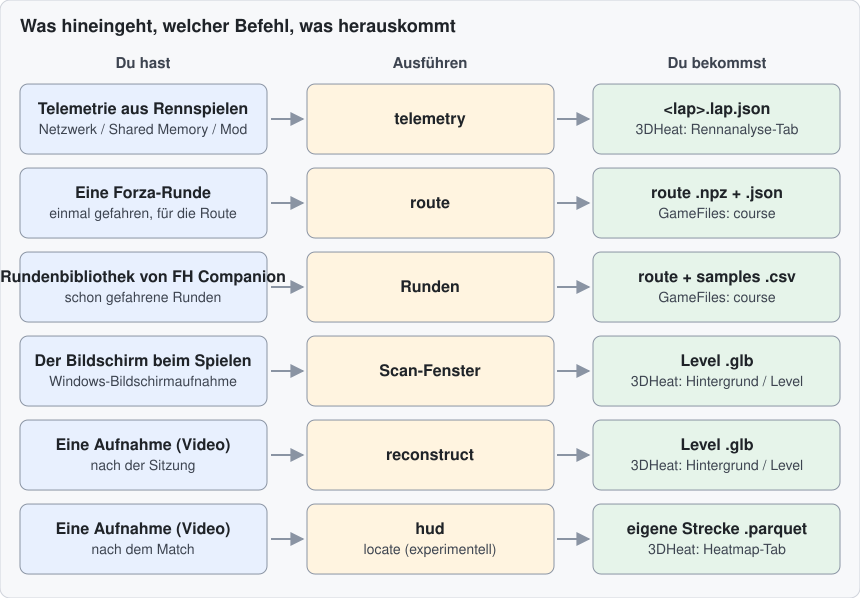

# 3DHeat GameCapture {#dheat-gamecapture}

**Was ist das?** Ein Werkzeug, das aufschreibt, was ein Rennspiel über deine Fahrt erzählt, eine Datei
pro Runde. Es kann auch aus einem Video, in dem du spielst, ein grobes 3D-Modell eines Levels nachbauen.

**Wozu brauche ich das?** Um deine Runden im [3DHeat-Viewer](https://holdi601.github.io/3DHeat/) zu sehen:
wo du gebremst hast, wo du langsam warst, wie sich zwei Runden unterscheiden. Und um das Level unter deiner
Heatmap zu haben, wenn niemand ein 3D-Modell davon hat.

**Beispiel:** Schalte Forzas Data Out ein, führe einen Befehl aus und fahre zwei Runden. Im Ordner `laps\`
erscheinen zwei Rundendateien. Zieh sie in den Rennanalyse-Tab des Viewers.


Neu in der Kommandozeile? Lies zuerst [Bevor du anfängst](before-you-start.md).

## Die drei Aufgaben {#the-three-jobs}

1. **Rundentelemetrie.** Es nimmt jeden Kanal auf, den ein Rennspiel veröffentlicht - Forzas Data Out, die
   Shared-Memory-Schnittstelle der Assetto-Corsa-Spiele, die Netzwerkfeeds der Rally-Spiele, ein BeamNG-Mod,
   ein Trackmania-Plugin - und schreibt pro Runde oder Etappe eine `heat3d-lap`-Datei für den Rennanalyse-Tab des
   Viewers. iRacing braucht keinen Recorder: Der Viewer liest seine eigenen `.ibt`-Dateien.
2. **Levels aus dem Spiel.** Es macht aus dem, was der Bildschirm zeigte, während du durch ein Level gelaufen
   oder gefahren bist, ein 3D-Modell im `.glb`-Format, das der Viewer unter die Heatmap legt.
3. **Dein eigenes Match, danach.** `hud` liest das HUD deiner eigenen Aufnahme - deine Aktionen, Tode,
   die Minimap-Strecke und den Killfeed. `locate` (experimentell: es platziert bisher wenige echte Frames)
   findet heraus, wo jeder Frame aufgenommen wurde, auf dem 3D-Modell eines Levels.

Alle drei folgen einer Regel: **Nichts wird in ein Spiel eingeschleust und nichts wird eingehakt.** Die Frames
kommen von der öffentlichen Bildschirmaufnahme-Schnittstelle, die Telemetrie von Schnittstellen, die die Spiele
dafür veröffentlichen. Siehe [Die Regeln](rules.md).



Der Code ist Python (Paket `heat3d_capture`), MIT-lizenziert. Die Tiefen- und Posenmodelle, die es ausführen
kann, haben eigene Lizenzen - siehe [Modelle und Lizenzen](models-and-licences.md).

## Schnellstart {#quick-start}

### Runden aufnehmen {#record-laps}

Du brauchst Python 3.10 oder neuer ([Bevor du anfängst](before-you-start.md)). In PowerShell:

```powershell
git clone https://github.com/Holdi601/3DHeat-GameCapture
cd 3DHeat-GameCapture
python -m venv .venv
.venv\Scripts\python -m pip install -r requirements.txt

# Forza: Settings -> HUD and Gameplay -> Data Out = ON, IP 127.0.0.1, port 5300
.venv\Scripts\python -m heat3d_capture telemetry -o laps
```

**Du solltest sehen** `listening on port 5300. Laps go to laps. Ctrl+C to stop.`, dann eine Zeile pro Runde,
sobald du die Linie überquerst, wie im Bild oben. Drücke Strg+C zum Beenden. Zieh die Dateien aus `laps\`
in den Rennanalyse-Tab des Viewers. Jedes andere Spiel ist nur einen `--game`-Schalter entfernt:

```powershell
.venv\Scripts\python -m heat3d_capture telemetry --game acc -o laps
.venv\Scripts\python -m heat3d_capture telemetry --game dirtrally2 -o laps
```

Siehe [Telemetrie-Recorder](telemetry.md) für jedes Spiel und jede Option.

### Ein Level scannen {#scan-a-level}

Doppelklicke auf **`scan.bat`** im Ordner des Werkzeugs. Es findet Python (und bietet an, es mit winget
zu installieren, falls keins da ist), legt eine eigene `.venv` an und öffnet das Scan-Fenster. Das Fenster sagt,
was fehlt, wofür jedes Paket ist und wie groß der Download ist, und installiert nichts ohne dein Ja. Siehe
[Laufzeit und Abhängigkeiten](runtime.md) und [Das Scan-Fenster](reconstruction-scan-ui.md).

Von Hand: `.venv\Scripts\python -m heat3d_capture.ui`.

Um eine Aufnahme offline nachzubauen, mit dem Kamerapfad, der auf einmal gelöst wird (braucht PyTorch, das Paket
`vggt` und eine GPU - siehe [Offline-Rekonstruktion](reconstruction-offline.md)):

```powershell
.venv\Scripts\python -m heat3d_capture reconstruct lap.mp4 -o lap.glb
```

## Karte der Dokumentation {#map-of-the-documentation}

| Seite | Was sie behandelt |
|---|---|
| [Bevor du anfängst](before-you-start.md) | Python, ein Terminal, der erste Befehl, häufige Fehler |
| [Die Regeln](rules.md) | Keine Einschleusung, nur veröffentlichte Schnittstellen, und was das kostet |
| [Telemetrie-Recorder](telemetry.md) | Der Befehl `telemetry` und ein Überblick über jedes Spiel |
| [Forza](telemetry-forza.md) | Data Out, Erkennung des Layouts, das FH-Companion-Relais und seine `.tele.gz` |
| [Assetto-Corsa-Spiele](telemetry-assetto-corsa.md) | AC, ACC, AC EVO, AC Rally aus dem Shared Memory |
| [Rally-Spiele](telemetry-rally.md) | EA SPORTS WRC, DiRT Rally 2.0 / 1 / DiRT 4, Richard Burns Rally |
| [BeamNG.drive](telemetry-beamng.md) | Der `heat3d`-Protokoll-Mod |
| [Trackmania](telemetry-trackmania.md) | Das Openplanet-Plugin `Heat3dRecorder` |
| [iRacing](telemetry-iracing.md) | Lesen von `.ibt`-Dateien im Viewer |
| [Runden- und Etappen-Teilung](lap-splitting.md) | `LapSplitter`, `CounterSplitter`, `LineSplitter`, `StageSplitter` |
| [Schlupf, Drift und abgeleitete Kanäle](slip-and-drift.md) | Wie Schlupf skaliert wird und was der Viewer ableitet |
| [Die heat3d-lap-Datei](lap-format.md) | Das Format der Rundendatei, Kanäle, Einheiten, `meta` |
| [Spiele](games.md) | Pro Spiel: wie aufgenommen wird, was gesendet wird, welche Strecken exportiert werden können |
| [Befehle](commands.md) | `route`, `telemetry`, `laps`, `reconstruct`, `hud`, `locate`, Schritt für Schritt |
| [Befehlsreferenz](../cli-reference.md) | jede Option, aus `--help` erzeugt |
| [Das HUD einer Aufnahme lesen](hud-video.md) | `hud`: eigene Aktionen, Tode, Minimap-Strecke und Killfeed aus einer Aufnahme |
| [Frames in einem Level finden](locate.md) | `locate`: wo jeder Frame aufgenommen wurde, gegen die Geometrie des Levels |
| [Level-Rekonstruktion](reconstruction.md) | Die Pipeline von Frames zu einer `.glb` |
| [Das Scan-Fenster](reconstruction-scan-ui.md) | Jedes Bedienelement, jede Taste und jedes Overlay |
| [Aufnahme, Masken und Framequalität](reconstruction-capture.md) | Windows Graphics Capture, Keyframes, HUD-Masken, Qualitätshinweise |
| [Tiefe](reconstruction-depth.md) | Depth Anything V2, ONNX Runtime, Aufbau des Modells |
| [Kamerapose und Maßstab](reconstruction-pose.md) | Odometrie, Relokalisierung, Posen aus der Telemetrie, Bodenmaßstab, Bündelausgleich |
| [Fusion, Abdeckung und Farbe](reconstruction-fusion-and-texture.md) | Das Belegungsvolumen, das Abdeckungsgitter, schwache Stellen, Vertexfarbe |
| [Die .glb-Ausgabe](glb-output.md) | Die Datei, die der Viewer lädt |
| [Offline-Rekonstruktion](reconstruction-offline.md) | `reconstruct`, VGGT-Fenster und Zusammensetzen |
| [Modelle und Lizenzen](models-and-licences.md) | Größen von Depth Anything V2, VGGT, die Pakete |
| [Laufzeit und Abhängigkeiten](runtime.md) | Vorprüfung, Backends, Leistungsstufen |
| [Grenzen und Prüfungen](limits.md) | Was nicht gemacht wird und was nicht geprüft wurde |
| [Updates](updates.md) | Die Release-Prüfung und `python -m heat3d_update` |
| [Entwicklung](development.md) | Tests, die virtuelle Umgebung, Aufbau des Repositorys |
| [Pflege](maintaining.md) | Die Release-Checkliste für Code und Dokumentation |

## Teil von 3DHeat {#part-of-3dheat}

Die Dateien, die dies schreibt, lädt der **3DHeat-Viewer** -
[Quelle](https://github.com/Holdi601/3DHeat), [Dokumentation](https://holdi601.github.io/3DHeat/).
Rundendateien gehen in seinen Rennanalyse-Tab, `.glb`-Levels in sein Panel „Hintergrund / Level“, die Tabellen von `hud` und `locate`
in seinen Heatmap-Tab; wie der Viewer Tabellen und Match-Dateien liest, steht in
[Eine Datei pro Match (.3dheat)](https://holdi601.github.io/3DHeat/container.html) und
[Daten hineinbringen](https://holdi601.github.io/3DHeat/getting-data-in.html).

| Werkzeug | Was es tut | Doku |
|---|---|---|
| [3DHeat-Viewer](https://github.com/Holdi601/3DHeat) | zeigt Heatmaps, Rennen und Matches in 3D, im Browser | [Doku](https://holdi601.github.io/3DHeat/) |
| [GameFiles](https://github.com/Holdi601/3DHeat-GameFiles) | Strecken und Levels aus den Dateien der Spiele, als 3D-Modelle | [Doku](https://holdi601.github.io/3DHeat-GameFiles/) |
| [GameCapture](https://github.com/Holdi601/3DHeat-GameCapture) | Rundentelemetrie aus Rennspielen; Levels aus Spielvideos nachgebaut | [Doku](https://holdi601.github.io/3DHeat-GameCapture/) |
| [Unreal Exporter](https://github.com/Holdi601/3DHeat-UnrealExporter) | ein Unreal-Editor-Plugin, das ein Level als 3D-Modell exportiert | [Doku](https://holdi601.github.io/3DHeat-UnrealExporter/) |
| [CS2](https://github.com/Holdi601/3DHeat-CS2) | Counter-Strike-2-Demos in Match-Dateien; Karten in 3D-Modelle | [Doku](https://holdi601.github.io/3DHeat-CS2/) |
| [Watcher](https://github.com/Holdi601/3DHeat-Watcher) | nimmt dein Spiel im Hintergrund auf, aus dem, was Spiele veröffentlichen | [Doku](https://holdi601.github.io/3DHeat-Watcher/) |
| [Ext-WarThunder](https://github.com/Holdi601/3DHeat-Ext-WarThunder) | War-Thunder-Replays in Match-Dateien | [Doku](https://holdi601.github.io/3DHeat-Ext-WarThunder/) |
| [Ext-WoT](https://github.com/Holdi601/3DHeat-Ext-WoT) | World-of-Tanks-Replays in Match-Dateien | [Doku](https://holdi601.github.io/3DHeat-Ext-WoT/) |
| [Ext-WoWs](https://github.com/Holdi601/3DHeat-Ext-WoWs) | World-of-Warships-Replays in Match-Dateien | [Doku](https://holdi601.github.io/3DHeat-Ext-WoWs/) |
| [Ext-Squad](https://github.com/Holdi601/3DHeat-Ext-Squad) | Squad-Server-Demos in Match-Dateien | [Doku](https://holdi601.github.io/3DHeat-Ext-Squad/) |
| [Ext-DCS](https://github.com/Holdi601/3DHeat-Ext-DCS) | DCS-World-Karten in 3D-Modelle | [Doku](https://holdi601.github.io/3DHeat-Ext-DCS/) |
| [Ext-IL2](https://github.com/Holdi601/3DHeat-Ext-IL2) | IL-2-Sturmovik-Karten in 3D-Modelle | [Doku](https://holdi601.github.io/3DHeat-Ext-IL2/) |

Ein Entwickler mit geöffnetem Projekt des Spiels sollte den Unreal-Exporter nutzen, der die echte Geometrie
liest und exakt ist. Wo die eigenen Archive eines Spiels lesbar sind, holt GameFiles die exakte Strecke heraus.
Der Nachbau aus dem Spiel ist für den Fall gedacht, dass nur der Bildschirm zur Verfügung steht.
