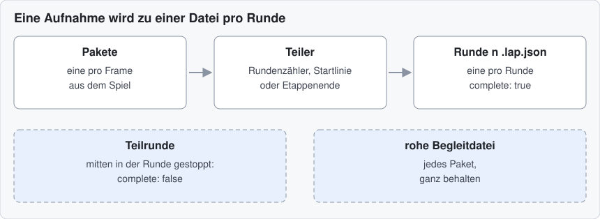

# Wie Runden und Etappen geteilt werden {#how-laps-and-stages-are-split}

Ein Recorder sieht einen durchgehenden Strom von Messpunkten. Ihn in Runden zu zerlegen, übernehmen
eine von vier Teilungsfunktionen, je nachdem, was das Spiel über Runden sagt. Alle folgen derselben
Idee: die eigene Zählung des Spiels nutzen, wo es eine gibt, und sonst die Runde aus den Positionen
finden. Nie wird ein Stück geschrieben, das zu kurz ist, um es zu vergleichen.

| Teiler | Code | Genutzt von |
|---|---|---|
| `LapSplitter` | [`fulllap.py`](https://github.com/Holdi601/3DHeat-GameCapture/blob/main/heat3d_capture/telemetry/fulllap.py) | Forza |
| `CounterSplitter` | [`kunos.py`](https://github.com/Holdi601/3DHeat-GameCapture/blob/main/heat3d_capture/telemetry/kunos.py) | Assetto Corsa, ACC |
| `LineSplitter` | [`kunos.py`](https://github.com/Holdi601/3DHeat-GameCapture/blob/main/heat3d_capture/telemetry/kunos.py) | AC EVO, AC Rally, BeamNG |
| `StageSplitter` | [`rally.py`](https://github.com/Holdi601/3DHeat-GameCapture/blob/main/heat3d_capture/telemetry/rally.py) | EA SPORTS WRC, DiRT Rally 2.0, DiRT Rally, DiRT 4, Richard Burns Rally |

Trackmania teilt seine Läufe innerhalb seines Plugins ([Trackmania](telemetry-trackmania.md)), und
iRacing-Dateien teilt der Viewer am Rundenzähler des Simulators ([iRacing](telemetry-iracing.md)).

Bei **Strg+C** ruft jeder Recorder `flush()` seines Teilers auf. So wird eine offene Runde oder Etappe
geschrieben, wenn sie dieselben Mindestwerte wie unten erfüllt.

## LapSplitter (Forza) {#lapsplitter-forza}

Parameter: `minimum_metres = 400`, `gap_seconds = 2.0`.

Für jedes dekodierte Paket:

1. Ist der `timestampMs` des Spiels seit dem letzten Paket um mehr als 2 Sekunden nach vorn gesprungen
   oder zurückgegangen, wird die offene Runde zuerst abgeschlossen.
2. Ist `isRaceOn` 0 (das Spiel ist nicht in einem Rennen), wird die offene Runde abgeschlossen und das
   Paket verworfen.
3. Ist keine Runde offen, öffnet sich eine mit der `lapNumber` des Pakets.
4. Weicht `lapNumber` von der der offenen Runde ab, wird die offene Runde **als vollständig geschlossen**;
   ihre `seconds` ist das `lastLap` des Spiels, wenn es positiv ist. Eine so geschlossene Runde wird
   geschrieben, egal wie lang sie ist. Eine neue Runde öffnet sich.
5. Das Paket wird angehängt.

Der Recorder schließt auch ab, wenn 2 Sekunden lang kein Paket gekommen ist, gemessen in Echtzeit (das
Spiel war pausiert oder wurde mitten in der Runde geschlossen).

**Abschließen** behält die offene Runde nur, wenn sie mindestens 2 Messpunkte und mindestens 400 m
`distanceTravelled` hat. Sie wird dann als unvollständig geschrieben (ein `run`). Ein Rennen von Punkt zu
Punkt zählt nie eine zweite Runde, deshalb endet es immer so.

## CounterSplitter (AC, ACC) {#countersplitter-ac-acc}

Parameter: `minimum_metres = 300`. Jeder Messpunkt bekommt die `completedLaps` und die letzte Rundenzeit
der Grafikseite.

- Der erste Messpunkt öffnet eine Runde, nummeriert mit der aktuellen `completedLaps`.
- Ändert sich `completedLaps`, wird die offene Runde geschlossen. Sie ist **vollständig**, mit
  `seconds = letzte Rundenzeit in ms / 1000` (wenn positiv), nur wenn der Zähler genau um 1 gestiegen ist.
  Springt er zurück auf 0 (ein Neustart der Sitzung) oder um mehrere, wird sie als unvollständig geschlossen.
- Eine geschlossene Runde wird nur geschrieben, wenn sie Messpunkte und mindestens 300 m gefahrene Strecke hat.
- Abschließen behält die offene Runde, wenn sie mehr als einen Messpunkt und mindestens 300 m hat.

## LineSplitter (AC EVO, AC Rally, BeamNG) {#linesplitter-ac-evo-ac-rally-beamng}

Parameter: `radius = 15 m`, `minimum_metres = 300`, `stop_seconds = 8`.

Diese Spiele haben entweder keinen Rundenzähler auf einer Seite, die der Recorder liest, oder sie fahren
Etappen. Die **Linie ist dort, wo die Aufnahme begann**:

1. Die horizontale Position (`x`, `z`) des ersten Messpunkts wird zur Linie.
2. Sobald das Auto mehr als 5 m gefahren ist, wird die Richtung von der Linie zum Auto zur Fahrtrichtung der Runde.
3. **Anhalten** beendet einen Lauf: Bleibt `speed` 8 Sekunden lang unter 1 m/s, wird die offene Runde
   abgeschlossen. So endet eine Rallye-Etappe: Das Auto hält am Ziel.
4. **Überqueren der Linie**: Nach mehr als 300 m Fahrt werden Messpunkte innerhalb von 15 m um die Linie
   gesammelt. Verlässt das Auto diesen Radius wieder, ist der nächste gesammelte Messpunkt die Überquerung.
   Fuhr das Auto dort in dieselbe Richtung wie die Fahrtrichtung der Runde (Skalarprodukt der lokalen
   Richtung mit der Fahrtrichtung ist positiv), schließt sich die Runde an diesem Messpunkt. Sonst wird
   der Durchgang ignoriert (das Auto hat die Ziellinie in die andere Richtung überquert).
5. Die Zeit einer geschlossenen Runde (`seconds`) ist die Zeit vom ersten Messpunkt bis zur Überquerung.
   Sie ist **nur vollständig, wenn ihr erster Messpunkt schneller als 5 m/s war**: Eine Runde, die aus dem
   Stand begann, ist ein Start, kein Vergleichswert. Die erste Runde einer am Start aufgezeichneten
   Aufnahme ist deshalb immer unvollständig. Eine Aufnahme, die auf einer fliegenden Runde begann, ergibt
   bei der nächsten Überquerung eine vollständige erste Runde.
6. Die nächste Runde beginnt am Überquerungs-Messpunkt (er gehört zu beiden Runden).

Runden, die kürzer als 300 m sind, werden verworfen. Abschließen (ein Halt oder Strg+C) behält die offene
Runde, wenn sie mindestens 2 Messpunkte und 300 m hat, als unvollständig. BeamNG schließt ebenso ab, wenn
das Fahrzeug zurückgesetzt wird (seine Uhr geht zurück), bevor ein neuer Teiler startet. So bleibt die
Fahrt vor dem Zurücksetzen erhalten.

Entfernungen sind horizontal (`x`, `z`) für den Weg-Zähler und den Linientest, und in 3D für die Länge
von 300 m.

## StageSplitter (Rallyespiele) {#stagesplitter-rally-games}

Parameter: `minimum_metres = 300`. Jeder Messpunkt bekommt die Etappenuhr des Spiels, ob das Spiel sagt,
dass das Auto fertig ist, und optional die eigene Zeit des Spiels dafür.

1. Ist die Uhr 0 oder kleiner, oder ist sie um mehr als 0,5 s zurückgegangen, wird die offene Etappe
   **verworfen**: Sie wird als Teilstück behalten, wenn sie nicht vollständig ist, mehr als 10 Messpunkte
   und mindestens 300 m hat. Eine Uhr von 0 oder weniger verwirft außerdem den Messpunkt (das Auto steht am Start).
2. Ist keine Etappe offen, öffnet sich eine neue (nummeriert 1, 2, ... für die Aufnahme).
3. Ist eine Etappe vollständig, werden weitere Messpunkte ignoriert, bis die Uhr zurückgeht.
4. Jeder Messpunkt wird mit `time` gleich der Etappenuhr gespeichert.
5. Sagt das Spiel, dass das Ziel erreicht ist, ist die Etappe vollständig. Ihre `seconds` ist die Zeit des
   Spiels, wenn sie gegeben und positiv ist, sonst die Uhr. Sie wird geschrieben, wenn sie mindestens 300 m
   umfasst.

Was „fertig“ je Spiel bedeutet:

| Spiel | Fertig, wenn |
|---|---|
| EA SPORTS WRC | Etappenlänge > 0 und Etappendistanz >= Länge - 0,5 m |
| DiRT-Spiele | die Anzahl der absolvierten Runden über den Ausgangswert der Etappe gestiegen ist, oder (Ein-Runden-Veranstaltung) Rundendistanz >= 99,9 % der Streckenlänge |
| Richard Burns Rally | Rennuhr > 0 und Entfernung zum Ziel <= 0 |

Bei RBR werden die Hochachse und die Geschwindigkeit festgelegt, wenn eine Etappe geschrieben wird (siehe
[Rallyespiele](telemetry-rally.md#richard-burns-rally-rsf--ngp)).

## Zeit und Entfernung in der Rundendatei {#time-and-distance-in-the-lap-file}

Bei jedem Recorder außer Forza wird `time` so verschoben, dass der erste Messpunkt der Runde 0 ist, und
`distance` ist die kumulierte 3D-Strecke zwischen aufeinanderfolgenden Positionen. Forza nutzt den eigenen
Rundentimer und Streckenzähler des Spiels, auf dieselbe Weise verschoben.
