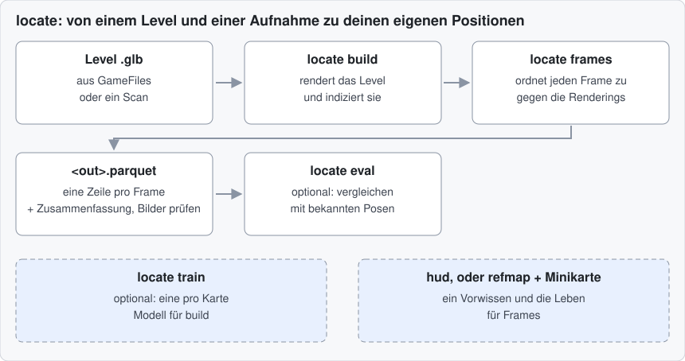

# Bilder in einem Level verorten {#locating-frames-in-a-level}

`locate` findet heraus, wo jedes Bild einer Spielaufnahme entstanden ist - die 3D-Position der Kamera und
ihre Blickrichtung - indem das Bild mit Renderings der Geometrie des Levels verglichen wird. Es ist für Spiele
gedacht, die keine Aufzeichnung darüber führen, wo der Spieler war: keine Demo, keine Replay-Datei, keine
Telemetrie. Battlefield 6 ist das erste.

> **Experimentell.** Auf echten Aufnahmen werden bisher nur wenige Bilder eingeordnet; siehe
> [Echte Bilder: experimentell](#real-frames-experimental).

```bash
# Einmal pro Level: von jedem Ort rendern, an dem ein Spieler stehen kann, und die Renderings indizieren.
.venv\Scripts\python -m heat3d_capture locate build level.glb -o level.db

# Pro Aufnahme: wo wurde jedes Bild aufgenommen?
.venv\Scripts\python -m heat3d_capture locate frames "<recording>.mp4" --db level.db -o out/match
```

Die Position kommt **aus dem Bild**, im Vergleich mit dem ganzen Level, ohne Vorgabe. Die Minikartenspur des
[HUD-Lesers](hud-video.md) ist nur ein Ersatz für Bilder, die das Bild nicht einordnen kann, und jede Zeile sagt,
aus welcher der beiden Quellen sie stammt.




## Was es berührt und was nicht {#what-it-does-and-does-not-touch}

- Es liest die **eigene Aufnahme** des Spielers und eine Leveldatei, die der Spieler aus der **eigenen Kopie** des
  Spiels exportiert hat. Es fasst das Spiel, dessen Speicher, seine Dateien während des Laufs oder sein Netzwerk nie an
  und läuft nach dem Match. Siehe [Die Regeln](rules.md).
- Es platziert **nur die eigene Kamera des Spielers**: das Bild ist die eigene Sicht des Spielers.
- Das Level, die daraus gebaute Datenbank und alles, was aus ihm gerendert wird, gehören dem Verlag des Spiels. Halte
  sie lokal.

## Voraussetzungen {#requirements}

- Die Pakete aus `requirements.txt`, PyTorch (von pytorch.org, passend zur GPU) und `requirements-locate.txt`:

```bash
.venv\Scripts\python -m pip install -r requirements-locate.txt
```

- Eine GPU mit OpenGL 3.3 (4.3 ist schneller) für die Renderings, und möglichst CUDA für die Modelle. Auf einer CPU
  funktioniert es, nur langsam.
- Die Modelle werden beim ersten Gebrauch geladen (etwa 450 MB): DINOv2 von Hugging Face, ALIKED und LightGlue über
  kornia. Alle sind für kommerzielle Nutzung lizenziert; siehe [Lizenzen](#licences).
- Das **Level** als `.glb` (oder `.gltf`) im Koordinatensystem des Viewers, Y nach oben, **mit seinen Basisfarben-Texturen**,
  so wie die 3DHeat-Exporter es schreiben (Teile `ground:` / `structure:`; die Teilnamen werden nicht gebraucht). Eine Einheit
  ist ein Meter, sofern in den obersten `extras` der Datei nicht `extras.unit_metres` etwas anderes sagt. Ein
  GameCapture-Scan (`reconstruct`, das Scan-Fenster) wird in **Zentimetern** geschrieben und trägt
  `extras.unit_metres: 0.01`, daher wird er in seiner wahren Größe gelesen. Ein Level ohne Texturen funktioniert deutlich
  schlechter; siehe [Grenzen](#limits).

## Befehle {#commands}

### `locate build <level> -o <db>` {#locate-build---o-}

Rendert das Level von jedem Ort, an dem ein Spieler stehen könnte, und speichert pro Rendering seine Pose und einen
globalen Deskriptor.

| Option | Standard | Bedeutung |
|---|---|---|
| `level` | | Die `.glb` / `.gltf` des Levels. |
| `-o`, `--out` | | Der zu schreibende Datenbankordner. |
| `--game` | `bf6` | Das Spielprofil: Augenhöhen, Sichtfeld, HUD-Kästen, Geschwindigkeit (unten). `generic` für jeden Ego-Shooter. |
| `--eye` | das des Profils | Augenhöhen über dem Boden in Metern, zuerst stehend. Eine Datenbankansicht je Höhe. |
| `--fov` / `--vfov` | das des Profils | Das horizontale Sichtfeld der Aufnahme oder das vertikale (Battlefields Schieber) für eine 16:9-Aufnahme. |
| `--spacing` | 2,5 | Meter zwischen den Orten, von denen aus Ansichten genommen werden. |
| `--yaw-step` | 30 | Grad zwischen den Blickrichtungen der Ansichten. |
| `--pitch` | 0 | Neigungen, in denen gerendert wird, in Grad nach oben. |
| `--positions` | keiner | Eine Tabelle (Parquet oder CSV mit `x`, `y`, `z` an den Füßen, im Koordinatensystem des Levels), aus der Orte statt jedem Boden genommen werden, etwa die Ausgabe eines früheren Laufs. |
| `--shadows` | aus | Die Schatten der Sonne in den Renderings werfen (die eigene Sonne des Levels, wenn seine Datei sie in `extras.sun` nennt). |
| `--untextured` | aus | Nur Form und Licht rendern. |
| `--box X0 Z0 X1 Z1` | die ganze Datei | Nur Orte innerhalb dieses Kastens (Einheiten des Levels): das Spielfeld. |
| `--places` | `auto` | Wo Ansichten genommen werden: `nav` - Spieler auf Augenhöhe über dem Navigationsnetz des Levels (`nav:`-Teile: genau dort, wo das Spiel das Gehen erlaubt), Fahrzeugkameras in ihrer Höhe über den `ground:`-Teilen (Gelände und Straßen) innerhalb von 50 m davon; `ground` - beides über `ground:`; `floors` - über jeder nach oben weisenden Fläche (auch Dächer und Kisten); `auto` - `nav`, wenn das Level ein Navigationsnetz hat, sonst `floors`. |
| `--head` | keiner | Ein Kopfmodell pro Karte aus `locate train` für die Deskriptoren. |

Schreibt `<db>/db.json` (woraus und womit sie gebaut wurde) und `<db>/views.npz` (Posen, Deskriptoren).

### `locate frames <recording> --db <db>` {#locate-frames----db-}

| Option | Standard | Bedeutung |
|---|---|---|
| `source` | | Ein Video, ein Bild oder ein Ordner mit Bildern (in Namensreihenfolge genommen, `--fps` auseinander). |
| `--db` | | Der Datenbankordner, den `build` schrieb. Seine Leveldatei muss noch dort liegen, wo sie war (oder `--level`). |
| `-o`, `--out` | `<source>.locate` | Ausgabepfad ohne Endung. |
| `--fps` | 2 | Pro Sekunde Video eingeordnete Bilder. |
| `--start`, `--seconds` | alles | Der Teil des Videos, der gelesen wird. |
| `--width` | 1280 | Die Breite, in der Bilder verglichen werden. |
| `--shortlist` | 8 | Datenbankansichten, die pro Bild nahe einer Vorgabe oder eines Fixpunkts versucht werden. |
| `--search-shortlist` | 16 | Ohne Vorgabe: Datenbankansichten, die pro Bild versucht werden ([gemeinsam durchsucht](#with-no-prior-frames-searched-together)). |
| `--no-search` | aus | Ohne Vorgabe: jedes Bild für sich suchen und seinen Fixpunkt ohne seine Nachbarn glauben. |
| `--accept-depth` | 0 (aus) | Ohne Vorgabe: einen Fixpunkt nur glauben, wenn die ferne Entfernung seiner Treffer das so-vielfache der nahen ist. |
| `--accept-support` | 2 | Ohne Vorgabe: übereinstimmende Nachbarn entlang des Lebens, die ein Fixpunkt braucht, um geglaubt zu werden. |
| `--checkpoint` | keiner | Den Zustand des Laufs hier speichern und von ihm weitermachen, wenn er vorhanden ist. |
| `--stop-file`, `--stop-process` | keiner | Von selbst anhalten, Zustand gespeichert, Exitcode 75, wenn diese Datei existiert oder ein Prozess läuft, dessen Name damit beginnt (vor jedem Bild geprüft; mehrfach angebbar), damit ein langer Lauf den Rechner für ein Spiel freigibt. Derselbe Befehl macht danach weiter. |
| `--normalise` | keiner | Leichte Normalisierung vor dem Vergleich: `clahe`, `gray`. |
| `--minimap` | keiner | Die Tabelle des `hud`-Befehls: der **Ersatz** für Bilder, die das Bild nicht einordnen kann. |
| `--prior-radius` | keiner | **Optionale Beschleunigung**, standardmäßig aus: nur Datenbankansichten suchen, die so viele Meter von der Position der Minikarte entfernt sind (braucht `--minimap`). |
| `--minimap-anchor` | keiner | Eine JSON-Datei, die die Minikarte an das Level bindet ([die Minikarte als Suchvorgabe](#the-minimap-as-a-search-prior)): die Minikarte schränkt die Suche ab dem ersten Bild ein; so gefundene Fixpunkte sind `visual+minimap-prior`. |
| `--no-level-search` | aus | Mit einer Vorgabe: wenn nichts in ihrer Nähe passt, nicht zusätzlich das ganze Level durchsuchen (schneller). |
| `--lives` | die Tabelle von `--minimap` | Die Tabelle des `hud`-Befehls, deren Tode, Einsätze und Wiederbelebungen sagen, wann der Spieler im Spiel war: Positionen springen nur über einen Tod ([Leben aus dem Material](#lives-from-the-footage)). |
| `--no-sequence` | aus | Jedes Bild für sich entscheiden, nicht entlang des Laufs (unten). |
| `--fit-fov` | aus | Nach dem Lauf das Sichtfeld an die stärksten Fixpunkte anpassen, pro Ansicht, und es melden. |
| `--check-every` | 0 | Außerdem alle N Bilder, platziert oder nicht, ein Bild nach `<out>.check`. |
| `--no-checks` | aus | Die Prüfbilder der visuellen Fixpunkte nicht schreiben (unten). |
| `--no-zoomed` | aus | Gezoomte Ansichten nicht aus den Fixpunkten ihrer Nachbarn lösen (unten). |
| `--no-grow` | aus | Nicht erneut nahe jedem Fixpunkt nach den Bildern rundherum suchen, die noch keinen haben. |
| `--game`, `--eye`, `--fov`, `--vfov`, `--mask`, `--no-hud-mask`, `--max-speed` | das des Profils | Wie oben; `--mask x,y,w,h` fügt einen Bildschirmkasten (auf einem 1920x1080-Bildschirm) hinzu, der nicht das Level ist. |
| `--vehicle-vfov` | das des Profils | Das vertikale Sichtfeld der Fahrzeugkameras (Battlefields Fahrzeugschieber). |
| `--settings` | die neueste Einstellungsdatei | `bf6`: die Einstellungsdatei des Spiels, aus der die Sichtfelder gelesen werden (nur lesend), wenn kein `--fov`/`--vfov` angegeben ist; standardmäßig das neueste `PROFSAVE*_profile` unter `Documents/Battlefield 6/settings`. Sie enthält die Einstellungen, wie sie jetzt sind, was bei einer älteren Aufnahme nicht ihrer damaligen Einstellung entsprechen muss. |

### `locate refmap <level> <deploy screen> -o <refmap>` {#locate-refmap----o-}

Legt die eigene Karte des Spiels auf das Level: die Referenz, gegen die die Minikarte gelesen wird
([die Minikarte, gegen das Level gelesen](#the-minimap-read-against-the-level)). `<deploy screen>` ist ein
Bild des Einsatzbildschirms, das die ganze Karte zeigt, oder eine Aufnahme mit `--at <seconds>` zu einem solchen
Moment; der Kartenkasten des Profils wird daraus ausgeschnitten (`--whole-picture` behält alles). Schreibt
`<refmap>.png` (die Karte, auf das eigene Koordinatensystem des Levels umgetastet, `--mpp` Meter pro Pixel, Standard
0,5), `<refmap>.valid.png` (wo es die Karte ist, nicht eine Markierung oder Beschriftung) und `<refmap>.json` (das
Koordinatensystem und die Kalibrierung, mit dem Abstand der Kacheln der Karte davon). `--topdown <prefix>` behält das
Level von oben gerendert für den nächsten Lauf (`--topdown-mpp`, Standard 0,656 m; `--box` begrenzt es).

### `locate minimap <recording> --refmap <refmap> -o <table>.parquet` {#locate-minimap----refmap---o-parquet}

Liest die Minikarte der Aufnahme gegen die Referenzkarte, Bild für Bild (`--fps`, Standard 2): Position, Blickrichtung
und Zoom jeder Minikarte, die passt, im Koordinatensystem des Levels, geschrieben als Minikartentabelle mit einem Anker
daneben (`<table>.anchor.json`), den `locate frames` als `--minimap <table>.parquet --minimap-anchor <table>.anchor.json`
nimmt. Mit der Tabelle des `hud`-Befehls (`--hud`) werden ihre Leben übernommen; mit einem Anker für diese Tabelle
ebenfalls (`--hud-anchor`) liegt die erste Suche rund um die Stelle, an die sie den Spieler setzt, und wo keine
Minikarte passt, füllt die eigene Spur des HUD die Lücken, verschoben auf die nächsten Fixpunkte der Referenzkarte
(`--hud-fill`, Sekunden, Standard 120; 0 schaltet es ab). Die `source` der Tabelle sagt, welche (`refmap`, `hud`).

### `locate eval <out>.parquet --truth <poses>` {#locate-eval-parquet---truth-}

Vergleicht ein Ergebnis mit bekannten Kameraposen: eine Tabelle mit `time`, `x`, `y`, `z` (das Auge), `yaw`, `pitch`
im Koordinatensystem des Levels. `--offset` ist der Zeitversatz der Uhr (Zeit der Wahrheit = Videozeit + Versatz);
ohne ihn wird der Versatz gesucht. `--unit-metres` rechnet die Fehler in Meter um.

## Spielprofile {#game-profiles}

| | `bf6` | `generic` |
|---|---|---|
| Augenhöhen | 1,6 m stehend, 1,05 m geduckt (im Spiel noch nicht gemessen) | 1,65, 1,1 m |
| Sichtfeld | 55 Grad vertikal, etwa 86 horizontal bei 16:9: **das des Spielers selbst angeben** mit `--vfov` | 90 horizontal |
| HUD maskiert | Minikarte und Squad-Liste, Killfeed, Kompass, Munition, die Waffe des Spielers, die Popups, das Fadenkreuz | das Fadenkreuz |
| Schnellste zu Fuß | 8 m/s | 8 m/s |
| Unterschiedene Ansichten | zu Fuß, Fahrzeug, gezoomt (unten) | jedes Bild zu Fuß |
| Fahrzeugkameras | der Fahrzeugschieber (aus der Einstellungsdatei), das Fahrzeug maskiert, die Kamera bis 8 m über dem Boden, 30 m/s | - |

Das Sichtfeld ist am wichtigsten: Ein Bild, das mit dem falschen gelöst wird, wird mit der falschen Brennweite gelöst,
und seine Position rutscht entlang der Blickrichtung.

## Ausgaben {#outputs}

### `<out>.parquet` {#parquet}

Eine Zeile je eingeordnetem Bild, im **Koordinatensystem des Levels** (Y nach oben, Einheiten des Levels), mit den
Leseanweisungen des Viewers in der Fußzeile (`kind: heat3d-locate`). Die Fußzeile benennt jede Spalte, die keine eigene
Rolle hat, als Zusatz, damit der Viewer sie alle behält (seine Prüfkarte zeigt sie).

| Spalte | Bedeutung |
|---|---|
| `time` | Sekunden ab Beginn des Videos. |
| `event` | `start` in der ersten Zeile eines Lebens, `position` in den übrigen. |
| `x`, `y`, `z` | Das Auge, innerhalb des Lebens geglättet. Leer, wo weder die eine noch die andere Quelle das Bild platziert hat. |
| `yaw`, `pitch` | Grad: Gier um die Oben-Achse (0 entlang +X, wachsend in Richtung -Z, was die eigene Gier eines Spiels im Koordinatensystem des Viewers ist), Neigung nach oben von der Horizontalen. `pitch` ist bei Minikartenzeilen leer. |
| `dir_x`, `dir_y`, `dir_z` | Die Blickrichtung. |
| `player`, `team`, `session` | `me`, `own` und `<video>#NN`, eines je Leben. |
| `life` | Das Leben, in dem das Material das Bild zeigte (aus den Toden des HUD; 1 = das erste). Leer, wenn außer Spiel (tot, am Boden, im Einsatz) oder wenn die Leben nicht gelesen wurden. `session` ist das Leben der Spur, das auch an einem Sprung geteilt werden kann. |
| `source` | `visual` (aus dem Bild), `visual+minimap-prior` (aus dem Bild, die Suche auf die Vorgabe der Minikarte beschränkt), `minimap` (der Ersatz), `minimap+nav-floor` (in Gebäuden: die Minikarte und der Boden des Navigationsnetzes) oder `none`. |
| `view` | `foot`, `vehicle`, `zoomed` oder `screen` (unten). |
| `cam_x`, `cam_y`, `cam_z` | Die Kamera, die das Bild sah. Zu Fuß und durch ein Visier ist es das Auge, und `x`, `y`, `z` sind dasselbe; in der Verfolgeransicht eines Fahrzeugs sind `x`, `y`, `z` das Fahrzeug (das Versatzmodell unten), und die Kamera fährt dahinter und darüber. |
| `hfov`, `zoom` | Das horizontale Sichtfeld, mit dem das Bild gelöst wurde, und bei einer gezoomten Ansicht ihr Zoom gegenüber der normalen Ansicht. |
| `confidence` | 0..1: wie sehr der Zeile zu trauen ist (unten). |
| `uncertainty` | Der übliche Fehler der Zeile, Einheiten des Levels: bei einem visuellen Fixpunkt aus seinen Inliern und seinen Nachbarn, bei einer Minikartenzeile aus der Anpassung (unten). |
| `inliers`, `rmse` | Die PnP-Inlier und der Reprojektionsfehler der visuellen Lösung (Pixel bei der Arbeitsbreite). |
| `x_raw` ... `pitch_raw` | Die visuelle Lösung vor der Glättung (auch für Ausreißer, die durch die Abstimmung verworfen wurden). |
| `kept` | Der visuelle Fixpunkt hat die Ausreißer-Abstimmung überstanden. |
| `note` | Warum ein Bild nicht platziert oder durch Abstimmung verworfen wurde. |

### `<out>.summary.json` {#summaryjson}

Bilder, visuelle Fixpunkte, Ausreißer, Leben, Zeilen je Quelle, die Anpassung der Minikarte (Paare, Inlier,
Restfehler), Zeit je Bild.

## Verfahren {#method}

### Die Datenbank {#the-database}

Orte sind Punkte auf jedem nach oben weisenden Dreieck des Levels, gleichmäßig verteilt (einer je `--spacing` auf einem
3D-Raster, damit die Stockwerke eines Gebäudes ihre jeweils bekommen). Jeder wird von seinem Auge aus mit sechs kleinen
Tiefen-Renderings geprüft: Eine Kamera im Geometrie-Inneren sieht überwiegend Rückseiten, ein Kriechraum hat etwas
Massives über dem Auge; beide werden verworfen. Von jedem Ort aus wird das Level auf jeder Augenhöhe gerendert, bei jedem
`--yaw-step` und jeder `--pitch`, und jedes Rendering wird von **DINOv2** beschrieben (seine Patch-Tokens, durch das
verallgemeinerte Mittel zusammengefasst, verbunden mit dem Klassen-Token).

Die lokalen Merkmale und 3D-Punkte, gegen die ein Bild schließlich gelöst wird, werden **nicht gespeichert**: Sie werden
bei Bedarf neu erzeugt, indem die wenigen Ansichten gerendert werden, die die Suche ausgewählt hat, was Millisekunden
dauert. Das hält eine Datenbank bei einigen hundert Megabyte statt zehn Gigabyte und macht die Verfeinerung unten erst
möglich. Der Preis: `frames` braucht die Leveldatei und eine GPU, nicht nur die Datenbank.

### Ein Bild {#one-frame}

1. **Maskieren**, was nicht das Level ist: die HUD-Kästen des Profils und das Fadenkreuz, dazu jedes `--mask`.
2. **Suche** über das **ganze Level**: der globale Deskriptor des Bildes gegen jede Datenbankansicht; die ähnlichsten paar
   Dutzend, ausgedünnt, damit sie verschiedene Orte und Richtungen haben, bilden die Vorauswahl.
3. **Abgleich**: Jede Ansicht der Vorauswahl wird bei der Größe und dem Sichtfeld des Bildes erneut gerendert, mit ihrer
   Tiefe. ALIKED-Keypoints von Bild und Rendering werden mit LightGlue verglichen. Ein abgeglichener Renderpixel plus seine
   Tiefe ist ein 3D-Punkt des Levels, daher ist jeder Treffer eine 2D-3D-Korrespondenz; Keypoints an einer Tiefenkante
   (deren Tiefe zu dem gehören kann, was dahinter liegt) werden verworfen.
4. **Pose**: PnP mit RANSAC (SQPnP), dann eine robuste Verfeinerung, die die Kamera waagerecht hält - eine Ich-Perspektive
   rollt nicht - und den Reprojektionsfehler der Inlier minimiert.
5. **Ist es möglich?** Eine Pose muss auf Augenhöhe eines Spielers über einem Boden liegen und außerhalb der Geometrie
   (ein Tiefen-Rendering senkrecht nach unten). Eine Look-alike-Textur an anderer Stelle - ein gekachelter Boden, der an
   einer Wand desselben Materials passt - kann Hunderte Inlier bei einer Pose ergeben, die kein Spieler je einnehmen könnte;
   diese werden beiseitegelegt, egal wie viele Inlier sie haben.
6. **Rendern und vergleichen**: Das Level wird in der gelösten Pose gerendert und erneut abgeglichen, was eine Datenbankansicht,
   die bis zu einigen Metern und Dutzenden Grad entfernt ist, durch eine ersetzt, die fast mit dem Bild übereinstimmt.
   Das wiederholt sich, solange es Inlier gewinnt (höchstens zweimal).
7. **Auswahl**: Die stärksten drei Orte (mehr als etwa 3 m auseinander) werden jeweils verfeinert, bevor einer gewählt wird.
   Ein Look-alike kann vor der Verfeinerung führen; der richtige Ort gewinnt dadurch weit mehr.
8. **Urteil**: `confidence` verbindet die Zahl der Inlier, den besten anderen Ort (`runner_up`) und den Reprojektionsfehler.
   Ein Fixpunkt ist `ok` mit mindestens 25 Inliern, keinem anderen Ort innerhalb von 80 % seiner Inlier und einer Confidence
   von mindestens 0,85 - der Schwellenwert, den die Messungen unten bei 97,5-99 % Treffer ansetzen.

### Ansichten {#views}

Ein Bild ist nicht immer das Auge des Spielers. Der Detektor des Profils liest aus dem HUD, welche Ansicht es ist, und das
Bild wird entsprechend gelöst:

- **Zu Fuß**: das Infanterie-Sichtfeld und die Augenhöhen.
- **Fahrzeug** (Battlefield 6: die Tastenhinweise des Sitzdiagramms, `C CAMERA` und `E EXIT`, unten in der Mitte): das
  Fahrzeug-Sichtfeld, das Fahrzeug selbst maskiert (die untere Mitte des Bildschirms in seiner Verfolgeransicht), und eine
  Kamera, die bis zu 8 m über dem Boden sein darf. Der Fixpunkt ist der der Kamera.
- **Bildschirm** (dunkle Ränder um eine dunkle Mitte: die Einsatzkarte, ein Menü, das Scoreboard): keine Ansicht des Levels;
  übersprungen.
- **Gezoomt** (ein Visier, ein Zielfernrohr des Richtschützen, die eigene Ich-Ansicht eines Fahrzeugs: ein Bildschirmrand
  schwarz, beide dunkel, um ein helles Bild): nicht über das Level gesucht - der schmale Ausschnitt eines Visiers ähnelt
  keiner der weiten Ansichten der Datenbank -, sondern nach dem Lauf aus dem nächsten Fixpunkt innerhalb von 6 s gelöst,
  unten. Aus mit `--no-zoomed`.

### Gezoomte Ansichten {#zoomed-views}

Eine enge Ansicht legt die Position schlecht fest: Ein Schritt zurück mit etwas mehr Zoom sieht fast gleich aus. Deshalb
startet ein gezoomtes Bild dort, wo sein Nachbar das Visier sagt - zu Fuß das Auge dieses Fixpunkts, im Fahrzeug 2,5 m über
dem Boden unter der Mitte des Fahrzeugs (das Visier eines Turms) - und wie weit es sich seitdem bewegt haben kann: 2 m, plus
4 m pro Sekunde zu Fuß oder 8 im Fahrzeug, höchstens 12 m (`reach`).

1. **Richtung und Zoom, die Position gehalten.** Für jeden Zoom von 1, 1,2 (die eigene Ansicht eines Fahrzeugs, enger als zu
   Fuß), 1,5, 2, 3, 4, 6 und 8 wird das Level am Sitz gerendert, in Richtungen innerhalb von 30 Grad der Richtung des Nachbarn
   (und ab 3x einige Neigungen). Die Keypoints des Bildes, mit einem Rendering abgeglichen, mit den Punkten des Levels darunter,
   sind Strahlen vom Sitz; eine Rotation wird paarweise an sie angepasst (RANSAC), für Brennweiten von 0,75 bis 1,3 mal der des
   Zooms, wobei ein Punkt zustimmt, wenn sein Winkel den Versatz des Sitzes um `reach` auf seiner Entfernung zulässt. Gewinnt der
   Zoom, die Richtung und die Brennweite, denen die meisten Punkte zustimmen.
2. **Festgelegt.** Diese Punkte passen dann Position, Richtung und Brennweite gemeinsam an ihrem Reprojektionsfehler; die Position
   wird mit einer Kostenfunktion von zwei Pixeln je bewegtem `reach` am Sitz gehalten; einmal mehr im Ergebnis gerendert und
   erneut angepasst. Inlier und Fehler werden in Pixeln gezählt, und der Fixpunkt ist `ok` nach derselben Confidence wie jeder andere.

Der geschriebene Zoom (`zoom`) bezieht sich auf das Sichtfeld des Laufs zu Fuß; `hfov` ist das gelöste. Im Fahrzeug ist die
geschriebene Position die des Fahrzeugs, 2,5 m unter dem Visier, wie für seine Verfolgeransicht.

### Fahrzeuge: die Kamera und das Fahrzeug {#vehicles-the-camera-and-the-vehicle}

In der Verfolgeransicht eines Fahrzeugs ist die gelöste Pose die der Verfolgerkamera, die hinter und über dem Fahrzeug fährt
und sich mit dem Blick des Spielers um es dreht. Die geschriebene Position (`x`, `y`, `z`) ist die des Fahrzeugs - der Boden unter
seiner Mitte: die Kamera plus den `vehicle_offset` des Profils, so viele Meter vorn entlang der horizontalen Blickrichtung der
Kamera und so viele nach unten. Die Kamera bleibt in `cam_x`, `cam_y`, `cam_z`. Die Umrechnung geschieht vor der Sequenz und der
Spur, damit eine Kamera, die sich um ein stehendes Fahrzeug dreht, nicht als Bewegung gilt. Die Fußzeile der Tabelle trägt den
verwendeten Versatz und ob er gemessen wurde (`vehicleOffset`). Zu Fuß und durch ein Visier gibt es keinen Versatz.

So wurde der Versatz für Battlefield 6 gemessen: An richtigen Fixpunkten echter Verfolgerbilder eines Panzers wurde die Mitte des
Panzers von Hand im Bild markiert, und das an dem Fixpunkt gerenderte Level ergab den Boden an diesem Pixel. Das Profil nimmt den
Median: etwa 10 m vor der Kamera und etwa 4 m darunter. Die Markierung ist auf einen Meter genau, und sie gilt für einen
Fahrzeugtyp; ein Auto oder ein Hubschrauber trägt seine Kamera anders.

### Ohne Vorgabe: Bilder gemeinsam durchsucht {#with-no-prior-frames-searched-together}

Die globale Beschreibung eines Bildes gegen ein ganzes Level ist ein schwaches Signal, und die Inlier eines einzelnen Bildes
sagen nicht, ob ein Ort richtig oder ein Look-alike ist. Deshalb werden ohne Vorgabe die Bilder einer Aufnahme zuerst beschrieben
und gemeinsam durchsucht (`search.py`), und ein Fixpunkt wird nur mit den Bildern rundherum geglaubt:

- **Vorauswahl.** Die Ähnlichkeiten jeder Ansicht werden gegen ihren eigenen Mittelwert und ihre Streuung über die Aufnahme
  gemessen, damit eine Ansicht, die jedem Bild ähnelt, nicht überall gewinnt. Jedes Bild bewertet die Zellen eines 24-m-Rasters
  nach dem Rang ihrer besten Ansicht; der beste Pfad durch die Zellen entlang jedes Lebens, innerhalb dessen, was der Spieler
  zwischen den Bildern zurücklegen kann, ergibt einen Glauben je Zelle, und die beste Ansicht jeder Zelle, zuerst die am
  stärksten geglaubte, ist eine Liste. Die einfache Suche ist die andere, und beide werden abwechselnd genommen: Ansichten gegen
  die Aufnahme zu messen bestraft einen Ort, den der Spieler kaum verlässt, und dort leistet die einfache Suche gute Dienste.
- **Glauben.** Ein Kandidat zählt nur, wenn seine Inlier mindestens 12 % eines 8x8-Rasters über dem Bild abdecken: Ein
  Look-alike ist ein wiederholtes Objekt, ein Stapel Container, mit Hunderten Inlier auf wenigen Zellen des Bildes. Ein
  Fixpunkt wird geglaubt, wenn er auf dem besten Pfad durch die zählenden Kandidaten liegt (unten) und mindestens zwei Nachbarn
  innerhalb von 6 s ihm zustimmen. Ein Bild außer Spiel wird gar nicht gesucht.
- **Wachsen.** Nur was geglaubt wird, wird weitergeführt, und ein gewachsener Fixpunkt muss das Bild auf dieselbe Weise abdecken.

### Entlang des Laufs {#along-the-run}

Jedes Bild behält jede physisch mögliche Pose, die es fand, eine je Ort (`candidates`), nicht nur die stärkste. Der Lauf wählt
dann je Bild eine - oder keine -, so dass die gewählten Posen einen Pfad bilden, den ein Spieler hätte gehen oder fahren können,
und möglichst viele Inlier auf ihm liegen: ein verborgenes Markov-Modell, auf einmal dekodiert (Viterbi). Ein Look-alike, das ein
Bild allein gewinnt, verliert gegen den Ort, dem seine Nachbarn zustimmen; ein schwacher Kandidat, durch den der Pfad läuft, mit
mindestens zwei zustimmenden Nachbarn, wird zu einem Fixpunkt (`note`: chosen along the sequence); ein sicherer Fixpunkt, dem alle
seine Nachbarn widersprechen, hört auf, einer zu sein. Ein Nachbar zählt als zustimmend nur innerhalb von 6 s: weiter entfernt ist
die Strecke, die ein Spieler - geschweige denn ein Fahrzeug - hätte zurücklegen können, so groß, dass Zustimmung nichts besagt.
Aus mit `--no-sequence`.

### Bildzeiten {#frame-times}

Die `time` einer Zeile ist der eigene Zeitstempel des Bildes in der Aufnahme, nicht seine Zählung über die nominelle Bildrate.
Aufnahmen weichen von ihrer nominellen Rate ab (um einige Zehntelsekunden innerhalb eines Clips, bei denen, die gemessen wurden),
und alles, was ein Bild über seine Zeit wieder liest - die Prüfbilder, die gezoomte Runde, `locate train --real`, die Minikarte
des `hud`-Befehls - sucht nach dem Zeitstempel. Gezählte Bilder würden das Prüfbild um bis zu diesen Betrag von dem Bild entfernt
zeigen, das eingeordnet wurde.

### Das Sichtfeld aus den Bildern {#the-field-of-view-from-the-frames}

`--fit-fov` behält die stärksten Fixpunkte eines Laufs (pro Ansicht) und verfeinert die Pose und die Brennweite jedes einzelnen
gemeinsam an seinen Inliern; der Median über sie ist das Sichtfeld, mit dem die Aufnahme gemacht wurde, im Bericht der
Zusammenfassung (`hfov_fitted`) für das `--fov` des nächsten Laufs. Nahe und ferne Punkte bewegen sich bei einer Änderung der
Brennweite anders als bei einer Änderung der Position, und genau das legt es fest; es braucht Fixpunkte mit Tiefe darin, keine flache Wand.

### Ein Modell pro Karte {#a-per-map-model}

`locate train` trainiert einen kleinen Kopf auf DINOv2 für ein Level, auf Renderings davon, so dass der globale Deskriptor die
richtigen Ansichten echter Bilder findet und nicht nur die von reinen Renderings:

- **Kopf**: jedes Patch-Token durch eine zweischichtige Projektion, durch das verallgemeinerte Mittel über die Patches zusammengefasst,
  die das Level zeigen, verbunden mit dem projizierten Klassen-Token. DINOv2 bleibt eingefroren. All das ist hier geschrieben (MIT).
- **Paare**: ein Ort auf dem begehbaren Boden und eine Richtung, zweimal gerendert aus Posen, die bis zu einem oder zwei Metern und
  einem Dutzend Grad auseinanderliegen, bei Sichtfeldern, die bis zu 10 Grad auseinanderliegen, unter verschiedenem Licht (Sonne,
  Schatten, Umgebung), jeweils durch einen spielähnlichen Look: Farbkorrektur, Dunst nach Tiefe, Bloom, Vignette, Rauch, Menschen im
  Weg, das eigene Fahrzeug des Spielers in Fahrzeugansichten, Bewegungsunschärfe, Rauschen, JPEG (`augment.py`). Maskiert wie ein
  Bild. Orte, die wenige Meter entfernt liegen und in dieselbe Richtung blicken, zählen nicht als Negative.
- **Echte Bilder**: Bilder mit einer Pose, die die Pipeline selbst fand (Pseudo-Labels: entlang eines Laufs gewählte Fixpunkte), können
  als Paare beitreten - das Bild und ein Rendering an seiner Pose - in einer zweiten Runde.
- **Verlust**: kontrastiv (InfoNCE) über den Stapel.

`locate build --head <head.pt>` baut die Datenbank damit; `frames` nutzt sie dann für die Bilder.

| Option von `locate train` | Standard | Bedeutung |
|---|---|---|
| `-o`, `--out` | erforderlich | Die zu schreibende Kopfdatei (`.pt`). |
| `--steps` | 600 | Trainingsschritte. |
| `--real TABLE VIDEO` | keiner | Eine Tabelle von `locate frames` und ihre Aufnahme: ihre sicheren Fixpunkte treten als echte Paare bei. Mehrfach angebbar. |
| `--real-confidence` | 0.85 | Die Confidence, die ein Fixpunkt braucht, um als echtes Paar beizutreten. |
| `--spacing`, `--box`, `--places`, und die Profiloptionen | wie `build` | Wo die Trainingsorte liegen, und das Profil des Spiels. |

### Mit dem Auge prüfen {#checking-by-eye}

Jeder visuelle Fixpunkt bekommt ein Bild in `<out>.check` - `<time>s_<view>_visual.jpg`: das Bild und daneben das bei der
Kameraposition des Fixpunkts gerenderte Level, mit den Kanten des Bildes über das Rendering gezeichnet. Wo sie übereinanderliegen,
ist der Fixpunkt richtig. Geschrieben, nachdem Sequenz und Spur entschieden haben, damit die Bilder genau die Zeilen sind, die die
Tabelle als visuell bezeichnet. Aus mit `--no-checks`.

### Die Minikarte, gegen das Level gelesen {#the-minimap-read-against-the-level}

Eine Minikarte, die zu einem Mosaik zusammengesetzt wurde (die des `hud`-Befehls), ist nicht flach: Ihr Maßstab driftet mit dem
Zoom, bei dem jede Minikarte registriert wurde, ein Ort, der zweimal gesehen wurde, kann zweimal gezeichnet sein, und das Mosaik
jedes Clips steht für sich. Eine Ähnlichkeitstransformation, die an wenige Fixpunkte angepasst wird, hält dann nahe bei ihnen und
liegt Dutzende Meter von ihnen entfernt daneben. Deshalb wird die Minikarte vom Level selbst platziert, in zwei Schritten, und
nichts wird zusammengesetzt:

- **Die Referenzkarte** (`locate refmap`). Der Einsatzbildschirm zeichnet die ganze Karte nach Norden oben, flach, in einem Maßstab.
  Das Level, von oben gerendert, zeigt dieselben Dinge, die vom Boden aufragen (Panzer, Gebäude, Mauern): auf dem Level ihre Höhe
  über dem Boden im Umkreis von 15 m; auf der Karte, was heller gezeichnet ist als der Boden rundherum. Die Karte wird auf das Level
  gelegt durch normierte Kreuzkorrelation der beiden über Maßstab und eine kleine Drehung, verfeinert durch den Abgleich einzelner
  Kacheln, und zuletzt durch die ganze Karte auf einmal rund um diese Antwort (einige Dutzend Kacheln lassen den Maßstab um ein Prozent
  offen, an den Rändern der Karte Meter). Das Ergebnis ist eine einzige Ähnlichkeitstransformation, Kartenpixel zum Level.
- **Die Minikarte, Bild für Bild** (`locate minimap`). Jede abgetastete Minikarte - der Ausschnitt des HUD-Lesers und seine Overlay-Maske -
  wird (SIFT) mit der Referenzkarte abgeglichen, nahe dort, wo der Spieler zuletzt war, oder überall, wenn nichts bekannt ist, und eine
  Ähnlichkeitstransformation (Drehung, Zoom, Verschiebung) wird angepasst. Der Punkt des Spielers, durch sie getragen, ist die Position,
  die Oben-Richtung der Minikarte (der Sichtkegel) die Blickrichtung, ihr Maßstab der Zoom - gemessen, nicht angenommen.
- **Wo es nicht passt.** Der Einsatzbildschirm zeichnet nichts außerhalb des Spielfelds; eine Minikarte, die überwiegend das zeigt, was
  außerhalb liegt - ein Spieler am Rand der Karte - hat nichts, worauf sie passen könnte. Dort tritt die eigene Spur des HUD ein, verschoben
  um den Versatz, den die nächsten Fixpunkte der Referenzkarte messen (`--hud-fill`); sie ist so gut wie das Mosaik nahe diesen Fixpunkten.

Auf dem Testlevel lag die so gelesene Minikarte im Median einige Meter von sicheren visuellen Fixpunkten entfernt, außerhalb des
Bereichs, aus dem die Referenzkarte gepasst wurde, ebenso gut wie innerhalb.

### Die Minikarte als Suchvorgabe {#the-minimap-as-a-search-prior}

Die Minikartenspur des `hud`-Befehls sagt für die meisten Bilder im Spiel ungefähr, wo der Spieler ist und in welche Richtung er blickt -
in ihren eigenen Einheiten (Minikarten-Pixel, Norden oben). Einmal an das Level gebunden, schränkt sie die Suche auf einen kleinen Teil davon
ein; die Pose selbst kommt weiterhin aus dem Bild, nach denselben Regeln.

- **Der Anker** (`--minimap-anchor <anchor.json>`): eine Ähnlichkeitstransformation je Karte, von der Minikarte zum Level - Maßstab, Drehung
  (mit der Spiegelung zwischen nordausgerichteten Pixeln und den Achsen des Levels), Verschiebung -, angepasst an den sicheren visuellen
  Fixpunkten (Confidence 0,7 und höher) mehrerer Clips. Die Minikarte jedes Clips ist ein Mosaik, das der HUD-Leser für sich
  zusammensetzte, daher sitzt jedes an einer anderen Stelle in Minikarten-Einheiten; zwei Mosaike derselben Karte unterscheiden sich nur
  durch eine Verschiebung, gefunden durch den Abgleich von Keypoints zwischen ihnen (die Verschiebung, auf die die meisten Treffer sich einigen),
  und jedes Mosaik wird über alle Paare, die gut übereinstimmen, an eine Referenz gebunden. Die Ankerdatei trägt die Ähnlichkeit der Karte,
  die Verschiebung des Clips (`clip_shift`) und den Fehler, den der Anker gegen Fixpunkte von Clips zeigte, die aus seiner Anpassung
  herausgelassen wurden (`median`, `p90`, Meter).
- **Wo und in welche Richtung.** Die Blickrichtung der Minikarte ist die Gier der Kamera: Auf den gemessenen Clips stimmte sie mit der
  gelösten Gier auf 2-5 Grad überein. Ein Bild wird also zuerst gegen Renderings verglichen, die dort gemacht werden, wohin die Minikarte die
  Kamera setzt - zu Fuß ein Auge über dem Boden dort, im Fahrzeug die Verfolgerkamera dahinter und darüber (der Fahrzeugversatz) -, mit Blick
  in die Richtung der Minikarte: der Punkt und 4 m zu jeder Seite, in zwei Neigungen (`seeds`). Nur wenn keiner davon einen Fixpunkt ergibt,
  werden die eigenen Ansichten der Datenbank innerhalb der Scheibe versucht (30 m plus das 90-Perzentil-Fehler des Ankers).
- **Korrigiert, während der Lauf läuft.** Jeder sichere Fixpunkt nahe der Vorgabe sagt, wie weit der Anker dort danebenliegt; der Median
  derer innerhalb von 2 Minuten korrigiert die Vorgabe, und ihre Streuung (mindestens 5 m) ersetzt den Fehler des Ankers im Radius der Scheibe -
  bis zu 10 m: Fixpunkte, die stärker abweichen, sagen, dass die Minikarte am Ort falsch liegt, nicht dass alles 50 m entfernt passt. Gibt es
  innerhalb von 2 Minuten keinen Fixpunkt, wird die Vorgabe überhaupt nicht korrigiert (der Fehler anderswo im Clip sagt nichts über hier).
- **Anker mit einem Raster.** Ein Anker kann auch ein `grid` tragen: Level-x und -z auf einem regelmäßigen Raster über den Minikarten-Einheiten
  des Clips, bilinear gelesen; innerhalb davon setzt das Raster den Punkt, außerhalb die Ähnlichkeitstransformation. Der Anker einer Tabelle
  von `locate minimap` ist die Identität (ihre Tabelle liegt schon im Koordinatensystem des Levels).
- **Schwache Anpassungen.** Mit einer Vorgabe wird eine schwache Anpassung (25 Inlier oder mehr, aber nicht sicher genug für sich allein)
  innerhalb der Scheibe behalten - mit ihrer niedrigeren Confidence - und dem Lauf und der Spur zur Beurteilung überlassen, nicht verworfen:
  Rauch, Schutt und zerstörte Mauern lassen echte Bilder mit weniger Treffern zurück.
- **Quellen.** `visual` - das Bild hat es platziert, ohne Vorgabe; `visual+minimap-prior` - das Bild hat es platziert, die Suche auf die Vorgabe
  beschränkt; `minimap` - das Bild konnte es nicht, die Minikarte springt ein; `minimap+nav-floor` - in Gebäuden, unten.
- **In Gebäuden** führt die Minikarte. Ein Bild, das das Bild nicht platzieren konnte, zu Fuß, wo ein Auge an der Position der Minikarte das
  Level von allen Seiten nah sieht (Median-Abstand unter 8 m in vier Richtungen) und keinen Himmel, ist innen: Es bekommt die x und z der
  Minikarte und die Höhe des Bodens des Navigationsnetzes dort - von mehreren Stockwerken das, das dem letzten Fixpunkt am nächsten liegt -
  mit `source = minimap+nav-floor`, damit klar ist, dass das Bild es nicht festgelegt hat.

### Leben aus dem Material {#lives-from-the-footage}

Eine Position darf nur dort springen, wo der Spieler starb. Die Leben werden nicht aus den Positionen geraten - ein einziger falscher Fixpunkt
würde ein neues Leben öffnen -, sondern aus dem Material gelesen: Die Tabelle des HUD-Lesers hält die Tode fest, die die Bildschirme für
Ausgeschaltet und Einsatz zeigten (`death`), die Ausfälle, die ein Teamkamerad wiederbelebte (`downed`, `revived`), die Einsätze (`spawn`) und
wo das Spiel begann und endete (`start`, `end`); `lives.py` macht daraus Leben. Ein Tod schließt ein Leben, das erste Bild im Spiel nach dem
Einsatzbildschirm öffnet das nächste; eine Wiederbelebung schneidet das Leben nicht (der Spieler ist dort, wo er am Boden lag), und die Bilder
am Boden werden nicht platziert; eine Strecke aus Menüs oder Ladebildschirmen, die länger als 10 s dauert, schneidet es ebenfalls. Bilder außer
Spiel (tot, im Einsatz, am Boden) werden nie platziert.

Innerhalb eines Lebens gilt Kontinuität als harte Regel: jeder Schritt höchstens die Geschwindigkeit mal die Zeit dazwischen plus 1,5 m. Die
Geschwindigkeit ist die des Bildes: zu Fuß die des Profils, im Fahrzeug die Geschwindigkeit, die die eigene Anzeige des Fahrzeugs innerhalb von
3 s zeigte (ein Drittel mehr und 2 m/s beim Beschleunigen), oder, wo keine angezeigt wird, das Limit seiner Klasse. Im Lauf (Viterbi) ist ein
Schritt über einen Tod in jeder Entfernung frei, jeder andere Schritt begrenzt; ein Bild, das einen Sprung bräuchte, wird weggelassen - die
schwächere Seite eines Widerspruchs verliert (weniger Inlier, weniger Zustimmung) - und das Leben wird an ihm nie geteilt. Ist die weggelassene
Seite selbst stark (Confidence 0,9 und höher, zwei oder mehr Fixpunkte, die einander zustimmen), rät der Lauf nicht: Beide Seiten bleiben erhalten
und werden mit `jump without detected death` markiert (ein übersehener Tod oder ein echter Teleport) und in der Zusammenfassung aufgeführt. Die
Minikarten-Ausweichlösung folgt denselben Leben.

Battlefield 6: Die Ich-Ansicht der Panzer zeigt die Geschwindigkeit (`<n> KPH`, rechts vom Visier; mit der OCR des HUD-Lesers gelesen); die
Verfolgeransicht zeigt sie nicht. Die Lesungen der Testclips waren langsam, daher sind Bodenfahrzeuge mit 15 m/s erlaubt, wo nichts gelesen wird.
Boote, Hubschrauber und Jets bekommen großzügige Grenzen (20, 90 und 280 m/s), die nicht gemessen sind: Kein Clip zeigt eines gefahren oder geflogen,
und der Ansichtsklassifikator unterscheidet Luft nicht von Boden - ein Abschnitt, der schneller ist als ein Bodenfahrzeug, zeigt sich als Sprung,
markiert, nicht vertraut.

### Zerstörung {#destruction}

Die Leveldateien sind das intakte Level; in einem Match werden Mauern, Häuser und Felsen weggeschossen, Schutt und Rauch hängen herum, und es wird
mit dem Verlauf des Matches schlimmer.

- **Der Abgleich vertraut dem statischen Level.** Ein Teil, den der Export als zerstörbar markiert (sein Name beginnt mit `destructible:`, oder
  `extras.destructible` an seinem Knoten, Netz oder Primitiv), wird in die Maske `destructible` des Renderings gezeichnet. Treffer, deren Punkt des
  Levels darauf liegt, werden verworfen, wenn 40 oder mehr Treffer auf statischen Teilen übrig bleiben - Gelände, Straßen, die großen Bauwerke tragen
  die Lösung.
- **Das Training sieht es als weg.** Die Trainingsrenderings (`locate train`) ersetzen Stücke der zerstörbaren Teile durch Rauschen in Schuttfarbe und
  setzen Staub niedrig über den Boden, zusätzlich zu Rauch und dem übrigen Spiellook (`augment.py`), damit das Modell lernt, sich auf sie nicht zu verlassen.
- **Fehlende Geometrie ist kein falscher Ort**: Mit einer Vorgabe bleiben schwache Anpassungen innerhalb ihrer Scheibe erhalten (oben).

Bis die Exporte die Markierungen tragen, ist nichts als zerstörbar markiert, und das hier tut nichts.

### Die Spur {#the-track}

- **Ausreißer**: Ein Fixpunkt wird mit den Fixpunkten in den 3 s davor und getrennt mit denen in den 3 s danach verglichen; übereinstimmend heißt, nicht weiter
  auseinander als das Profil an Geschwindigkeit erlaubt, plus 1,5 m. Ein Fixpunkt, der mit den meisten seiner Nachbarn **auf beiden** Seiten nicht übereinstimmt,
  wird durch Abstimmung verworfen (in den `_raw`-Spalten behalten, `kept` false). Dass beide Seiten gefordert werden, behält den ersten Fixpunkt nach einem Respawn.
- **Leben**: Mit den Leben aus dem Material (oben) folgt die Spur ihnen, und innerhalb eines Lebens wird die schwächere Seite eines Schritts verworfen,
  der die Geschwindigkeit bricht. Ohne sie bricht sie dort, wo zwei aufeinanderfolgende behaltene Fixpunkte weiter auseinanderliegen, als die Geschwindigkeit
  erlaubt, wo eine Lücke von mehr als 8 s ist, und wo die Minikartentabelle ein neues Leben beginnt.
- **Glättung**: Innerhalb eines Lebens wird jeder Fixpunkt mit einer geraden Linie durch die Fixpunkte rundherum verschmolzen (eine gewichtete lokale
  lineare Anpassung, Sigma 0,5 s), jeder gewichtet nach seiner Unsicherheit: Ein starker Fixpunkt - auf Zentimeter genau - bleibt, wo er ist, ein schwacher
  wird zu seinen starken Nachbarn gezogen. Eine Linie statt eines Mittels, weil ein Mittel einen laufenden Spieler zurückzieht: Mittelung wurde zuerst versucht
  und machte aus einer 3-mm-Spur bei 2 Bildern pro Sekunde eine von 0,3 m. Die Blickwinkel werden nicht geglättet; eine Drehung des Blicks ist echt und schnell.

### Der Ausweich-Fall der Minikarte {#the-minimap-fallback}

Die Minikartentabelle liegt in ihrem eigenen Mosaik-Koordinatensystem (Pixel, x nach Osten, y nach Norden). Sie wird über eine Ähnlichkeitstransformation -
Drehung, Maßstab, Verschiebung, und eine Spiegelung, wenn das besser passt - an das Level gebunden, robust angepasst an den Bildern, wo beide eine
Position haben. Wo das Bild nichts ergab oder sein Fixpunkt durch Abstimmung verworfen wurde, springt die Position der Minikarte ein, mit
`source = minimap`, einer Confidence von höchstens 0,5 und einer Unsicherheit von dem Doppelten des Restfehlers der Anpassung plus 1,5 m. Die Minikarte hat
keine Höhe: Sie wird von dem nächsten visuellen Fixpunkt übernommen. Ein Lauf nur mit Minikarte (ohne visuelle Fixpunkte) kann nicht an das Level gebunden
werden und platziert nichts.

`--prior-radius` nutzt dieselbe Anpassung in umgekehrter Richtung: Haben acht visuelle Fixpunkte die Minikarte an das Level gebunden, sucht die Suche nur
Datenbankansichten innerhalb dieses Radius um die Position der Minikarte und fällt auf das ganze Level zurück, wenn das nichts findet. Es ist schneller; es ist
aber nur so richtig wie die Minikarte, deshalb ist es standardmäßig aus.

<a id="accuracy"></a>

## Genauigkeit {#accuracy}

Gemessen an einer **Bank**, an der die Wahrheit exakt ist: ein Testlevel, mit seinen Texturen exportiert, und Bilder, die aus bekannten Kameraposen gerendert
werden, **damit sie wie ein Spiel aussehen, nicht wie die Datenbank** - die eigene Sonne und die Schatten des Levels, stärkerer Kontrast, eine zufällige Farbkorrektur,
Vignette und Bloom, spielergroße Formen und Rauch im Weg, das HUD in die maskierten Kästen gezeichnet, Unschärfe, Rauschen und JPEG. Jedes Bild wird gegen das
**ganze Level, ohne Vorgabe** eingeordnet. Richtig heißt innerhalb von 1 m und 5 Grad. Nichts von der Bank (Level, Renderings) ist Teil dieses Repositorys.

| Bilder ohne Vorgabe | Ergebnis |
|---|---|
| richtig platziert | etwa 4 von 5 |
| von den `ok`-Fixpunkten (Confidence 0,85 und höher) richtig | etwa 97-99 % |
| Fehler der richtigen Fixpunkte | Millimeter bis ein Zentimeter; einige Hundertstel Grad |
| Zeit je Bild | etwa 1 s auf einer Desktop-GPU |

Die Confidence ist ein brauchbares Maß für Vertrauen: Fast jeder Fixpunkt ab 0,9 war richtig, während Fixpunkte unter 0,85 oft falsch
waren - daher der Schwellenwert von 0,85 für `ok`. Wo es scheitert: keine passende Ansicht gefunden, zu wenige Treffer (eine Wand einen Schritt entfernt,
meist Himmel, meist ein Verdecker), oder zwei Orte sehen gleich aus.

**Eine Spur.** Ein Testkamerapfad, wie oben gerendert, in ein Video mit 30 fps, mit einer Minikartentabelle aus demselben Pfad (in seinem eigenen gedrehten,
skalierten, gespiegelten Koordinatensystem, mit Rauschen), durch `locate frames` bei 2 Bildern pro Sekunde laufen gelassen und mit `locate eval` bewertet, das
außerdem den Zeitversatz der Uhr finden musste: Jedes Bild im Spiel wurde platziert, fast alle aus dem Bild; der Zeitversatz wurde auf Hundertstel Sekunden
gefunden; die Bildzeilen lagen auf wenige Zentimeter, die Minikartenzeilen auf etwa einen Meter.

**Was einen Unterschied macht:**

- **Texturen** sind das, worauf der Abgleich beruht. Ohne sie wird nur ein kleiner Anteil der Bilder platziert; ein Boden, der auf eine einzige flache Farbe
  reduziert ist, kostet etwa ein Drittel der sicheren Fixpunkte.
- **Das richtige Sichtfeld.** 3 Grad daneben, wächst der Fehler richtiger Fixpunkte von Millimetern auf Zehntel Meter, und die meisten Fixpunkte sind nicht
  mehr `ok`. Das echte FOV angeben.
- **Schatten** in den Datenbank-Renderings (`--shadows`): ein kleiner Gewinn.
- **Eine längere Vorauswahl**: ein kleiner Gewinn, mehrfach langsamer. Eine kürzere: weniger Fixpunkte, höhere Präzision.
- Eine Lichtnormierung (CLAHE) brachte keinen Gewinn und ist nicht der Standard.

Look-alike-Orte sind die Hauptquelle sicherer Fehler: eine Pose genau ein Gebäudemodul daneben, entlang einer Wand aus wiederholten Modulen, über mehrere
Bilder eines still stehenden Spielers gleich gelöst. Die stärksten drei Orte vor der Auswahl zu verfeinern und unmögliche Posen beiseitezulegen, beseitigte die
meisten übrigen.

### Echte Bilder: experimentell {#real-frames-experimental}

<a id="real-frames-experimental"></a>

Auf echten Aufnahmen **funktioniert `locate` noch nicht gut**: Es platziert nur einen kleinen Teil der Bilder aus dem Bild, meist Fahrzeugbilder (die
Verfolgerkamera sieht von oben mehr vom Level), und fast keine Bilder zu Fuß (der Spieler sieht aus der Nähe auf Wände und den Boden). Was auf Testaufnahmen
gelernt wurde:

- **Das Finden der richtigen Ansicht ist, was scheitert.** Licht, Effekte und grob exportierte Texturen des Spiels bringen ein echtes Bild weiter von den
  Renderings weg, als es die Imitation der Bank tat, sodass die richtige Ansicht knapp außerhalb der Vorauswahl rangiert.
- **Ein Modell pro Karte hilft** (`locate train`): Es reiht die richtige Ansicht viel höher ein, und echte Bilder als Trainingspaare helfen noch mehr bei den
  Bildern rundherum.
- **Nahe beieinanderliegende Bilder helfen einander**: Bei 2 Bildern pro Sekunde wurde ein Abschnitt im Fahrzeug zu etwa einem Drittel seiner Bilder platziert;
  bei einem Bild alle 5 s fast keines.
- **Echte Bilder zeigen 2-3 Pixel Reprojektionsfehler** gegen 1 bei Renderings; das Profil nimmt 3 als normal (`pixel_noise`).
- **Das Sichtfeld**, das aus den Bildern gefittet wird (`--fit-fov`), kann von den gespeicherten Einstellungen abweichen: Die Einstellung kann sich seit der
  Aufnahme geändert haben.
- **Schwache Fixpunkte, die nur durch entfernte Nachbarn `ok` wurden**, waren die falschen; Nachbarn zählen nun nur innerhalb von 6 s, und jeder Fixpunkt ab
  Confidence 0,7 war richtig.
- **Die Leveldatei zählt**: ungetexturter Boden und Laub, als schwarze Karten gezeichnet, schaden. Der Renderer hält Ausschnitte ein (`alphaMode: MASK`): ein
  Texel unter dem `alphaCutoff` des Materials (0,5, wenn nicht angegeben) wird verworfen, so dass der Hintergrund durchscheint (`render.py`).

Was als Nächstes nötig ist: viel mehr echte Pseudo-Labels aus vielen Clips zum Trainieren und zum Kalibrieren der Confidence (`locate train --real <table> <video>`),
Level mit texturiertem Boden und eine Möglichkeit, gezoomte Ansichten zu behandeln.

<a id="renders-against-frames"></a>

## Renderings gegen Bilder {#renders-against-frames}

Die Renderings, aus denen die Datenbank besteht, sind nicht die Bilder des Spiels. Auf der Bank wurde die Lücke nachgeahmt (Licht, Schatten, Farbkorrektur,
Spieler, Rauch, HUD) und kostet etwa 10 Punkte richtiger Fixpunkte, gegen Bilder, die wie die Datenbank gerendert sind (91 % zu 80-89 %); die richtigen
Fixpunkte bleiben auf Millimeter genau. Was half: die eigene Sonne und Schatten des Levels in den Renderings, gegen die verglichen wird (klein), eine längere
Vorauswahl (klein, langsam). Was nicht half: die CLAHE-Lichtnormierung.

Was die Bank nicht nachahmen kann, ist der Rest eines echten Bildes: eingebautes und reflektiertes Licht, Umgebungsverdeckung, Nebel, Partikel, sich bewegendes
Laub, die eigene Nachbearbeitung des Spiels. Um es zu messen, nimm die Wiedergabe von etwas auf, dessen Kameraposen exakt sind - eine Demo oder ein Replay des
Spiels - und vergleiche mit `locate eval`; es findet den Zeitversatz zwischen Aufnahme und Posen selbst, oder nimmt ihn mit `--offset`.

## Grenzen {#limits}

- **Echte Bilder werden noch kaum platziert.** Mit DINOv2 allein wird fast kein echtes Bild ohne Vorgabe platziert; mit einem Modell pro Karte einige Prozent,
  richtig, wenn man hinschaut (siehe [Echte Bilder: experimentell](#real-frames-experimental)). Jede Genauigkeitszahl oben gilt für Renderings des Levels, so
  gemacht, dass sie wie das Spiel aussehen (seine Sonne, Schatten, Farbkorrektur, Bloom, Rauschen, Spieler, HUD), gegen Renderings desselben Levels. Ein echtes Bild
  unterscheidet sich in Weisen, die ein Rendering nicht nachahmen kann: eingebautes und reflektiertes Licht, Umgebungsverdeckung, Nebel, Partikel, sich ändernde
  Aufkleber, animiertes Laub. Wie viel das kostet, ist die offene Frage; siehe [Renderings gegen Bilder](#renders-against-frames), wie man es misst.
- **Das Level muss das gespielte sein**, in derselben Version, mit seinen Texturen, einschließlich des Bodens: siehe [Was die Leveldatei tragen muss](#accuracy).
- **Look-alike-Orte.** Levels verwenden Gebäude, Requisiten und gekachelte Materialien wieder. Zwei Orte, die gleich aussehen, ergeben zwei gute Lösungen; die
  zweite wird gemeldet (`runner_up`), der Fixpunkt ist nicht `ok`, und die Spur oder die Minikarte muss entscheiden. Ein Fixpunkt, der richtig, aber als mehrdeutig
  markiert ist, geht verloren, ist aber nicht falsch.
- **Bilder mit wenig Level darin**: eine Wand einen Schritt entfernt, der Himmel, eine Rauchgranate, der schwarze Rand eines Visiers, ein Tod- oder Menübildschirm. Sie
  ergeben keinen Fixpunkt und werden als keiner gemeldet.
- **Zoom.** Zielen über Kimme und Visier und Zielfernrohre verengen das Sichtfeld. Gezoomte Bilder werden nur aus einem benachbarten Fixpunkt gelöst (oben); ein langer
  Abschnitt durch ein Zielfernrohr ohne Fixpunkt rundherum wird es nicht.
- **Fahrzeuge und Verfolgerkameras.** Die Kamera ist dann nicht auf Augenhöhe und nicht dort, wo das Fahrzeug ist; der Versatz zwischen beiden (oben) wurde für einen
  Fahrzeugtyp gemessen, einen Kampfpanzer. Andere Fahrzeuge tragen ihre Kamera anders, und ihre Positionen sind um den Unterschied versetzt - einige Meter. Das Fahrzeug
  selbst ist maskiert (`vehicle_hud` des Profils).
- **Was das Level nicht enthält**: Zerstörung, Fahrzeuge, Spieler, Türen, die sich bewegt haben. Maskiert, wo es das HUD ist; sonst muss RANSAC daran vorbeisehen.
- **Geschwindigkeit.** Ein Bild kostet etwa 0,5-1,5 s auf einer Desktop-GPU (mehr, während andere Arbeit die GPU teilt): die Renderings einer Vorauswahl, der Abgleich,
  das Rendern und Vergleichen. Zwei Bilder pro Sekunde eines 20-minütigen Matches sind 2.400 Bilder, 20 Minuten bis eine Stunde. Die Datenbank wird einmal je
  Level gebaut: etwa 20-30 Minuten für ein Level von der Größe einer kompetitiven Shooter-Karte bei 2,5 m Abstand; ein Battlefield-großes Spielfeld braucht `--box`
  und einen gröberen Abstand, oder mehrere Kästen.
- **Große Levels.** Eine Leveldatei kann Kilometer Kulisse enthalten: `--box` begrenzt die Orte auf das Spielfeld. Schatten (`--shadows`) werden aus einer einzigen
  Schattenkarte über die ganze Datei geworfen, die bei sehr großen grob wird.

<a id="licences"></a>

## Lizenzen {#licences}

| Komponente | Lizenz |
|---|---|
| DINOv2 ViT-B/14-Gewichte (`facebook/dinov2-base`) | Apache-2.0 |
| ALIKED (`aliked-n16`) | BSD-3-Clause |
| LightGlue, ALIKED-Variante | Apache-2.0 |
| kornia, kornia-rs | Apache-2.0 |
| moderngl, glcontext | MIT |
| transformers, huggingface_hub, safetensors | Apache-2.0 |

Alle erlauben kommerzielle Nutzung. Zwei übliche Alternativen wurden weggelassen, weil ihre Bedingungen auf jedes Ergebnis übergingen: die Gewichte von SuperPoint
(nicht kommerziell) und Code für Szenen-Koordinatenregression unter nicht-kommerziellen Lizenzen. Siehe [Modelle und Lizenzen](models-and-licences.md).

## Auf Battlefield 6 ausführen {#running-it-on-battlefield-6}

Was nötig ist, in dieser Reihenfolge:

1. **Das Level, mit Texturen**, aus der eigenen installierten Kopie des Spielers, als `.glb` in Metern, Y nach oben, im Koordinatensystem, das die Tabellen des
   HUD-Lesers und des Viewers nutzen. `extras.unit_metres` (1 für Meter; ein GameCapture-Scan schreibt 0,01, weil er in Zentimetern ist) und, falls bekannt,
   `extras.sun` (die Richtung zur Sonne) in den obersten `extras` der Datei. Ein Level ohne Texturen lädt und rendert, aber siehe [Grenzen](#limits).
2. **Das Spielfeld** als Kasten (`--box X0 Z0 X1 Z1`, Meter): Battlefield-Leveldateien tragen die Kulisse kilometerweit darum herum, und eine Datenbank aus
   allem davon besteht meist aus Ansichten, die niemand sieht.
3. **Das FOV des Spielers**: Battlefields Schieber ist vertikal; als `--vfov` angeben (die 55 Grad des Profils sind ein Platzhalter). Aufnahmen bei 16:9.
4. **Die Augenhöhen** (`--eye`, zuerst stehend, dann geduckt) - die 1,6 und 1,05 m des Profils sind nicht gemessen. Auf dem ersten guten Lauf messen: das `y` der
   Fixpunkte eines still stehenden Spielers auf ebenem Boden, minus die Höhe des Bodens dort.
5. **Die HUD-Kästen** wurden an 4K-Aufnahmen mit dem Standard-Layout geprüft (Minikarte, Squad-Liste, Killfeed, Kompass und Visierkompass, Punktestand und
   Zielmarken, Chat, Munition, Hinweise, die Waffe). Ein verschobenes oder skaliertes HUD braucht `--mask`.
6. Bauen, dann mit der Tabelle des HUD-Lesers als Ersatz einordnen und eine Stichprobe der Fixpunkte ansehen:

```bash
.venv\Scripts\python -m heat3d_capture locate build level.glb -o level.db --game bf6 --box X0 Z0 X1 Z1 --shadows
.venv\Scripts\python -m heat3d_capture hud "<recording>.mp4" --game bf6 -o out/match
.venv\Scripts\python -m heat3d_capture locate frames "<recording>.mp4" --db level.db --game bf6 --vfov <yours> --minimap out/match.parquet -o out/match.locate --check-every 20
```

Jeder visuelle Fixpunkt bekommt ein Prüfbild (`<out>.check`; `--check-every 20` fügt jedes 20. Bild hinzu, platziert oder nicht): das Bild neben dem bei
seinem Fixpunkt gerenderten Level, mit den Kanten des Bildes über das Rendering gezeichnet. Wo sie übereinanderliegen, ist der Fixpunkt richtig. Es gibt in
Battlefield keine Wahrheit zum Vergleichen, daher sind dieses Bild, der Anteil der aus dem Bild platzierten Bilder (`summary.json`) und wie gut die Anpassung der
Minikarte mit den visuellen Fixpunkten übereinstimmt (ihr `residual`) die Prüfungen.
