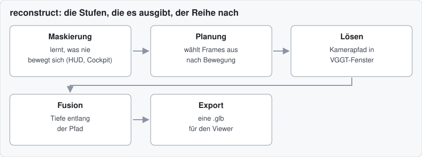

# Offline-Rekonstruktion {#offline-reconstruction}

```bash
python -m heat3d_capture reconstruct lap.mp4 -o lap.glb [--solve-budget 260] [--fuse-interval 0.4]
```

Code: [`scan/offline.py`](https://github.com/Holdi601/3DHeat-GameCapture/blob/main/heat3d_capture/scan/offline.py),
[`pose/feedforward.py`](https://github.com/Holdi601/3DHeat-GameCapture/blob/main/heat3d_capture/pose/feedforward.py),
[`pose/vggt_model.py`](https://github.com/Holdi601/3DHeat-GameCapture/blob/main/heat3d_capture/pose/vggt_model.py),
[`pose/feedforward_source.py`](https://github.com/Holdi601/3DHeat-GameCapture/blob/main/heat3d_capture/pose/feedforward_source.py),
[`pose/solveprep.py`](https://github.com/Holdi601/3DHeat-GameCapture/blob/main/heat3d_capture/pose/solveprep.py).
Optionen: [Befehlsreferenz](commands.md#reconstruct).

## Warum ein zweiter Weg {#why-a-second-path}

Die inkrementelle Verfolgung läuft live und ist günstig, und sie funktioniert, wo es Struktur zum Festhalten gibt: ein
Innenraum, eine Straße, eine Karte mit Deckung. Eine **Rennstrecke ist ihr schlimmster Fall**. Die Straße ist ein glattes
Band mit wenig Textur, der Horizont bewegt sich kaum, und sobald ein paar Posen driften, zieht nichts Späteres sie zurück.
Eine Runde kommt als wandernde Kurve heraus, statt sich zu schließen.

Der Offline-Weg übergibt **Fenster aus Bildern** an ein Modell, das alle ihre Kameras gemeinsam vorhersagt. So wirkt jedes
Bild direkt auf jedes andere, statt über eine Kette. Er braucht die ganze Aufnahme, bevor er antworten kann, ist also nicht
live, und er ist langsam: Minuten pro Fenster auf einer Desktop-GPU. Alles nach den Posen (Fusion, Abdeckung, Farbe, Export)
ist derselbe Code wie beim Live-Scan. Die gelöste Strecke wird dem Rekonstruktor als Posenquelle übergeben, genau dort, wo
Forza-Telemetrie hingeht.

## Voraussetzungen {#requirements}

- **PyTorch**, passend zu deiner GPU (dieses Projekt legt es nicht fest; installiere es vor `requirements.txt`, siehe
  [Laufzeit](runtime.md)).
- **`vggt`**, der VGGT-Modellcode (`from vggt.models.vggt import VGGT`), aus Metas GitHub-Repository. Er steht nicht im
  Paketindex.
- **`transformers`**, weil der Offline-Weg die Tiefe über den PyTorch-`DepthEstimator` (Depth Anything V2 Small) berechnet
  und nicht über die ONNX-Datei.
- In der Praxis eine CUDA-GPU. Beide Modelle fallen auf die CPU zurück, was aber nicht praktikabel ist.

Keines davon steht in `requirements.txt`, weil der Scanner es nicht braucht. Sie stehen in **`requirements-offline.txt`**,
mit den eigenen Abhängigkeiten von VGGT (`einops`, `safetensors`, `huggingface_hub`, `Pillow`):

```bash
.venv\Scripts\python -m pip install -r requirements-offline.txt
.venv\Scripts\python -m pip install --no-deps "vggt @ git+https://github.com/facebookresearch/vggt.git"
```

VGGT wird mit `--no-deps` installiert, weil seine Paketmetadaten `numpy<2` festlegen. pip würde das beachten und das
numpy herunterstufen, das scipy hier braucht. `reconstruct` prüft alle diese Pakete direkt nach dem Ausgeben der
Lizenzzeile (die Liste `OFFLINE` in [`runtime/preflight.py`](https://github.com/Holdi601/3DHeat-GameCapture/blob/main/heat3d_capture/runtime/preflight.py)).
Es nennt, was fehlt, mit Größen, und installiert nur auf ein Ja hin. VGGT mit `--no-deps`, wie oben. Ein Nein oder kein
Terminal zum Fragen beendet mit Exit-Code 1.

## Das Modell und seine Lizenz {#the-model-and-its-licence}

**VGGT**, `facebook/VGGT-1B`: **CC-BY-NC-4.0, nur nicht kommerziell, und eine damit erstellte Rekonstruktion erbt das.**
Der Befehl gibt das vor dem Start aus (`describe_licence`). Ein getrennt lizenziertes `facebook/VGGT-1B-Commercial` gibt
es, aber es ist ein gesperrtes Repository, dessen Zugang Meta pro Konto gewährt. Deshalb kann es nicht die Vorgabe sein.
`--model vggt-1b-commercial` löst damit (und gibt dann seine eigene Lizenzzeile aus). Ohne gewährten Zugang schlägt der
Download fehl. Der *Code* von `vggt` steht unter Metas eigener „VGGT License“, einer Vereinbarung über Forschungsmaterialien
mit einer Richtlinie zur akzeptablen Nutzung (gelesen aus der `LICENSE.txt` des Pakets). Siehe
[Modelle und Lizenzen](models-and-licences.md).

## Der Lauf, Stufe für Stufe {#the-run-stage-by-stage}

Die Stufennamen sind das, was der Befehl ausgibt.



### masking {#masking}

Eine `FlowMask` wird aus **4 Läufen zu je 90 aufeinanderfolgenden Bildern** gelernt, zentriert bei 1/8, 3/8, 5/8 und 7/8
des Videos, bei 960 x 540 in Graustufen (siehe [FlowMask](reconstruction-capture.md#flowmask-what-never-travels)). Ihr Hinweis
wird ausgegeben und in der Zusammenfassung behalten. Ein Video mit weniger als 90 Bildern bekommt keine Maske.

#### Die Kamera-Maske wird gelernt, nicht angewendet {#the-camera-mask-is-learned-not-applied}

Die Maske wird **nicht** auf die Bilder angewendet, die dem Löser übergeben werden. Das Maskieren des Cockpits sah nach den
Merkmalsstatistiken richtig aus, weil die meisten gefundenen Ecken auf kamerabefestigten Pixeln liegen. Das ist aber eine
Aussage über einen Merkmalsdetektor, und der Löser ist ein trainiertes Netz. Gemessen daran, wie weit sich der
wiedergewonnene Weg zwischen aufeinanderfolgenden Schritten dreht (ein Auto dreht sich um wenige Grad; eine Irrfahrt um
neunzig), ergaben rohe Bilder die kleinste Drehung, kontrastangehobene Bilder etwas mehr, maskierte Bilder deutlich mehr,
und beides zusammen am meisten. Deshalb bekommt der Löser rohe Bilder. Die Maske wird trotzdem genutzt, um den Bildabstand
unten zu planen, und der inkrementelle Tracker nutzt sie im Live-Scan.
(`solveprep.enhance`, das maskiert und den lokalen Kontrast mit CLAHE anhebt, existiert, wird aber von diesem Befehl nicht genutzt.)

### planning: Bilder nach Bewegung verteilt {#planning-frames-spaced-by-motion}

`plan_by_motion` wählt die Bilder des Lösers nach **wie weit sich das Bild bewegt hat**, nicht nach der Uhr. Ein fester Abstand
gäbe langsamen Abschnitten Bilder, die sie nicht brauchen, und würde schnelle aushungern, wo aufeinanderfolgende Bilder nicht
mehr genug überlappen, um zueinander in Beziehung zu stehen.

- Zielverschiebung: **5 % einer 960-Pixel-Breite** (48 px) mediane ORB-Merkmalsverschiebung zwischen aufeinanderfolgenden
  gewählten Bildern, gemessen an 960 x 540 Graustufenbildern mit CLAHE-Kontrast, Merkmale nur auf der Maske.
- Start bei einem Abstand von 0,3 s. Nach jedem Schritt wird der nächste Abstand zu
  `Abstand x (0,5 + 0,5 x Ziel / gemessen)`, begrenzt auf **0,15-2,0 s**, damit eine verrauschte Messung den Plan nicht
  ausschlägt.
- Wenn nichts gepaart wurde, schrumpft der Abstand auf 0,6 seiner selbst (zu weit auseinander ist der Fehler, den man vermeiden will).
- Endet am Ende des Videos oder bei `--solve-budget` Bildern (Vorgabe 260).

Weniger als 4 geplante Bilder ist ein Fehler.

### solving: Fenster und Zusammensetzen {#solving-windows-and-stitching}

Die geplanten Bilder werden auf 960 px Breite dekodiert und in überlappenden Fenstern von 16 Bildern gelöst, von denen
**6 mit dem nächsten geteilt werden** (`plan_windows`). Das letzte Fenster wird so zurückgezogen, dass es auf dem letzten
Bild endet. So hat das Ende einer Aufnahme ebenso viele Nachbarn wie die Mitte. Mehr als **400** Bilder in einem Lauf werden
abgelehnt.

Jedes Fenster: Bilder werden so skaliert, dass die lange Seite **518** ist und beide Seiten Vielfache von **14** sind
(das Seitenverhältnis bleibt erhalten, denn Stauchen würde das Sichtfeld falsch angeben), auf 0..1 gebracht und mit VGGT unter
bfloat16-Autocast ausgeführt (float16 läuft bei weit entfernten Weltkoordinaten aus dem Exponentenbereich). Die externen
Kameraparameter werden in Welt-von-Kamera-Rotationen und Kamerazentren umgerechnet. Punktkarten werden standardmäßig nicht
behalten.

Jedes Fenster kommt in **seinem eigenen beliebigen Koordinatensystem und seiner eigenen beliebigen Skala** zurück. Deshalb
werden die Fenster in das erste Fenster hinein **zusammengesetzt**, durch eine Ähnlichkeitstransformation (Rotation,
Verschiebung, eine Skala). Sie wird an den Kameras angepasst, die sie mit dem bereits Platzierten teilen:

- **Rotation aus den Ausrichtungen der Kameras**, nicht aus ihren Positionen. Die gemeinsamen Kameras liegen entlang des
  Weges und sind auf einer Geraden nahezu kollinear. Eine reine Positionsanpassung kann die Drehung dann nicht erkennen.
  Jedes Fenster würde sich krümmen, und das zusammengesetzte Ergebnis käme gerade heraus. Die Rotation ist der Mittelwert
  von `Ziel_R x Quelle_R^T`, zurück auf eine echte Rotation projiziert (mit einem Schutz gegen Spiegelung).
- **Skala und Versatz aus den Positionen**, entlang der gedrehten Quelle.
- Mindestens **4** gemeinsame Kameras sind nötig. Weniger ist ein Fehler.
- Die Überlappung beträgt ein Drittel des Fensters, damit die Skala gut bestimmt ist. Ein Skalenfehler, der sich von Fenster
  zu Fenster aufsummiert, ist das, was eine Runde zur Spirale macht.

Für jede Nahtstelle wird die schlimmste Abweichung der gemeinsamen Kameras nach der Anpassung festgehalten, in Einheiten des
mittleren Abstands zwischen ihnen (`seam_error`).

### fusing {#fusing}

Bilder alle `--fuse-interval` Sekunden (Vorgabe 0,4) werden auf 960 px Breite dekodiert, von Depth Anything V2 Small (PyTorch)
mit Tiefe versehen und mit einer Pose **interpoliert** aus der gelösten Strecke zu ihrem Zeitstempel fusioniert (lineare
Position, sphärische Rotation; `FeedForwardPoses`). Bilder außerhalb der gelösten Zeitspanne werden übersprungen, nicht
extrapoliert. Die Kamera nutzt ein horizontales Sichtfeld von **65 Grad**. Feed-Forward-Posen haben bei Fusion und Abdeckung
ein Vertrauen von 0,85.

### exporting {#exporting}

Das Netz wird wie bei einem Live-Scan geschrieben ([Die .glb-Ausgabe](glb-output.md)), benannt nach dem Video.

## Die Zusammenfassung {#the-summary}

```text
140 cameras solved over 182s
closure error 3.1% of path length
worst seam 0.42 frame spacings
<mask note>
wrote lap.glb
```

| Zeile | Bedeutung |
|---|---|
| closure error | Abstand von der ersten zur letzten Kamera, geteilt durch die Länge des Weges. Für eine einzelne Runde ist das das ehrliche Maß für Drift. Über 10 %: „The lap does not close ... Treat the shape as unreliable.“ |
| worst seam | die größte Abweichung bei einer Naht. Über 1,0: „Windows disagreed by up to N frame spacings at a seam, so part of the path is stitched on weak evidence.“ |
| keine Datei | „Fusion produced no surface, so nothing was written.“ Dann ist der Exit-Code 1. |

## Skala {#scale}

Der zusammengesetzte Weg steht im beliebigen Maßstab des ersten Fensters. Die Tiefe wird verankert, indem zwischen den
interpolierten Posen trianguliert wird (wie bei der Telemetrie). So passt die Geometrie zum Weg. Aber das Ergebnis ist **nicht
in Metern**, außer der Weg ist es. Dieser Befehl legt die globale Skala nicht fest. Die Bodenkalibrierung wird nicht angewendet,
wenn die Posen aus einer Posenquelle stammen.

## Zustand dieses Weges {#state-of-this-path}

Mit Bildern in festem Abstand lösen sich die Fenster auf manchen Abschnitten einer Runde zu einem zusammenhängenden Weg, auf
anderen zu einem Gekritzel. Die Fehler liegen in den engen Kurven, wo die Sicht zwischen den Bildern stark schwenkt. Dort dichter
abzutasten, bringt sie zurück. Keine Bildstatistik, die ausprobiert wurde (Helligkeit, Detail, Merkmalszahl, Inlier-Anteil,
Verschiebung), sagte im Voraus voraus, welche Abschnitte scheitern. Deshalb lässt sich der Abstand nicht allein aus den Bildern
vorab planen. Er muss durch Lösen gewählt werden, das Ergebnis messen und dort dichter neu lösen, wo der Weg nicht einer ist, den
ein Auto gefahren sein könnte. Die Planung nach Bewegung ist gebaut, **die adaptive Neulösung ist es nicht**.
