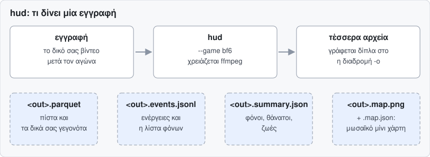

# Ανάγνωση του HUD από εγγραφή {#reading-the-hud-from-a-recording}

Η `hud` διαβάζει το οπτικό HUD του παιχνιδιού από τη **δική του εγγραφή** του παίκτη, μετά τον αγώνα: τις **δικές του**
ενέργειες από το αναδυόμενο παράθυρο πόντων που δείχνει το παιχνίδι κάτω από το στόχαστρο (φόνοι, βοηθείες,
αναβιώσεις, ανεφοδιασμοί, καταλήψεις...), τους θανάτους του από τις οθόνες πτώσης και ανάπτυξης, τη **δική του**
διαδρομή από τον χάρτη, και τη ροή των φόνων δίπλα της ως χρονισμένα συμβάντα. Όλα γράφονται σε έναν πίνακα 3DHeat,
με το μωσαϊκό του χάρτη ως εικόνα για να απλωθεί από κάτω.

Με λίγα λόγια: παρακολουθεί το βίντεο του αγώνα σας και καταγράφει τους φόνους και τους θανάτους σας, καθώς και πού
περπατήσατε.

```bash
.venv\Scripts\python -m heat3d_capture hud "<recording>.mp4" --game bf6 --player <name> -o out/match
```

Το Battlefield 6 είναι το πρώτο προφίλ παιχνιδιού.



## Τι αγγίζει και τι όχι {#what-it-does-and-does-not-touch}

- Διαβάζει ένα **αρχείο βίντεο**: ένα κλιπ ShadowPlay / Instant Replay, μια εγγραφή OBS, οτιδήποτε μπορεί να
  αποκωδικοποιήσει το ffmpeg. Δεν αγγίζει ποτέ το παιχνίδι, τη μνήμη του, τα αρχεία ή το δίκτυό του, και τρέχει
  αφού τελειώσει ο αγώνας. Βλ. [Οι κανόνες](rules.md).
- Παράγει **μόνο τη δική του θέση** του παίκτη, από τον δικό του χάρτη. Οι δείκτες των άλλων παικτών στον χάρτη
  καλύπτονται και δεν διαβάζονται ποτέ. Η ροή των φόνων κρατιέται ολόκληρη, αλλά μόνο όπως φαίνεται στην οθόνη
  (ποιος, σε ποιον, με τι, πότε)· καμία θέση δεν συνδέεται με κανέναν εκτός από τον ίδιο τον παίκτη.
- Το OCR τρέχει τοπικά (RapidOCR με τα μοντέλα PaddleOCR μέσω ONNX Runtime). Κανένα καρέ ή απόκομμα δεν φεύγει από
  τον υπολογιστή.
- Μια εγγραφή δείχνει ονόματα άλλων παικτών, και το μωσαϊκό είναι εικόνα του χάρτη. Τα αποτελέσματα προορίζονται για
  προσωπική χρήση του παίκτη· κρατήστε τα τοπικά.

## Απαιτήσεις {#requirements}

- **ffmpeg και ffprobe** στο `PATH`. Χρησιμοποιείται κάρτα NVIDIA για αποκωδικοποίηση όταν υπάρχει (`-hwaccel cuda`)·
  αλλιώς αποκωδικοποιεί ο επεξεργαστής, αρκετές φορές πιο αργά.
- Τα πακέτα του `requirements.txt`, και το OCR χωρίς τις δικές του εξαρτήσεις (ζητά τον `onnxruntime` του επεξεργαστή,
  που συγκρούεται με τον DirectML που χρησιμοποιεί το έργο):

```bash
.venv\Scripts\python -m pip install -r requirements.txt
.venv\Scripts\python -m pip install --no-deps rapidocr_onnxruntime==1.2.3
```

Το `rapidocr_onnxruntime` είναι ο αναγνώστης κειμένου (OCR) που διαβάζει ονόματα και λέξεις από την οθόνη. Το
`--no-deps` το εμποδίζει να αντικαταστήσει τον DirectML `onnxruntime` του έργου.

Για να εγκαταστήσετε το ffmpeg στα Windows: `winget install Gyan.FFmpeg`, και μετά ανοίξτε νέο τερματικό και ελέγξτε
με `ffmpeg -version`. Δεν έχετε ξανασυνεργαστεί με τη γραμμή εντολών; Διαβάστε το [Πριν ξεκινήσετε](before-you-start.md).

- Εγγραφή **16:9** σε οποιαδήποτε ανάλυση (1080p, 1440p, 4K). Άλλες αναλογίες απορρίπτονται, γιατί τα κουτιά του
  προφίλ θα έπεφταν σε λάθος σημεία της οθόνης.
- Η **προεπιλεγμένη διάταξη HUD** του παιχνιδιού. Ένα στοιχείο HUD που έχει μετακινηθεί ή αλλάξει κλίμακα διαβάζεται
  στο λάθος σημείο.

## Επιλογές {#options}

| Επιλογή | Προεπιλογή | Σημασία |
|---|---|---|
| `video` | | Η εγγραφή. |
| `-o`, `--out` | το όνομα του βίντεο, στον τρέχοντα φάκελο | Διαδρομή εξόδου **χωρίς** επέκταση· τα αρχεία είναι `<out>.parquet`, `.events.jsonl`, `.summary.json`, `.map.png`, `.map.json`. |
| `--game` | `bf6` | Ποιο HUD διαβάζεται. Το `bf6` (Battlefield 6) είναι μέχρι στιγμής το μόνο προφίλ. |
| `--player` | καμία | Το όνομα του παίκτη όπως το δείχνει η ροή φόνων. Συγκρίνεται χαλαρά (το OCR μπερδεύει το `l`/`I`/`1`, το `O`/`0`, το `rn`/`m`). Χωρίς αυτήν, το όνομα μαντεύεται (παρακάτω). |
| `--fps` | 5 | Δείγματα χάρτη ανά δευτερόλεπτο. Η ροή φόνων δειγματίζεται στο μισό, το αναδυόμενο παράθυρο πόντων και οι οθόνες θανάτου επίσης στο μισό (στο ένα τέταρτο όσο δεν εμφανίζεται κάποιο αναδυόμενο παράθυρο), η πυξίδα κάθε 3 δευτερόλεπτα, και η λίστα της ομάδας κάθε 15 δευτερόλεπτα. |
| `--start` | 0 | Δευτερόλεπτα μέσα στο βίντεο από όπου αρχίζει. |
| `--seconds` | όλο | Πόσο από το βίντεο θα διαβαστεί. |
| `--metres-per-pixel` | καμία | Η κλίμακα του χάρτη, αν είναι γνωστή: μέτρα ανά pixel του χάρτη στο συνηθισμένο ζουμ (ο χάρτης έχει πλάτος 296 pixel σε οθόνη 1080p). Χωρίς αυτήν, οι θέσεις είναι σε αυτά τα pixel· βλ. [Μονάδες](#north-and-units). |
| `--cpu` | απενεργοποιημένο | Αποκωδικοποίηση στον επεξεργαστή, ακόμη κι αν υπάρχει κάρτα NVIDIA. |

Η πρόοδος τυπώνεται κάθε πέντε δευτερόλεπτα· στο τέλος, ο παίκτης, οι φόνοι, οι θάνατοι, οι ζωές και τα αρχεία που
γράφτηκαν.

## Έξοδοι {#outputs}

### `<out>.parquet`: η διαδρομή και τα συμβάντα του παίκτη {#parquet---the-players-track-and-events}

Μία γραμμή για κάθε δείγμα όπου ο παίκτης ήταν σε παιχνίδι και ο χάρτης μπορούσε να τοποθετηθεί, συν μία για κάθε
συμβάν του. Το υποσέλιδο κουβαλά τις οδηγίες ανάγνωσης του viewer (κλειδί `heat3d`, `kind: heat3d-hud`), ώστε ο
viewer να αντιστοιχίζει κάθε στήλη χωρίς να ρωτήσει.

| Στήλη | Σημασία |
|---|---|
| `time` | Δευτερόλεπτα από την αρχή του βίντεο. |
| `event` | `position`· `start` (το βίντεο ξεκίνησε στη μέση μιας ζωής), `spawn` (πίσω στο παιχνίδι μετά από θάνατο ή μεγάλο κενό), `death`, `downed` και `revived` (από τις οθόνες θανάτου, παρακάτω), `end` (μια ζωή τελείωσε χωρίς να φαίνεται πώς)· οι δικές του ενέργειες του παίκτη από το αναδυόμενο παράθυρο πόντων (`kill`, `assist`, `reviving`, `resupply`, `capture`... - ο [πίνακας συμβάντων](#event-table))· και οι γραμμές της ροής των φόνων για τον παίκτη ως `kill_feed`, `death_feed`, `teamkill_feed`, `suicide_feed`, `squadwipe_feed`. |
| `source` | Από πού ήρθε το συμβάν της γραμμής: `points` (το παράθυρο), `screen` (οι οθόνες πτώσης και ανάπτυξης), `feed` (η ροή φόνων)· κενό στις γραμμές θέσης. |
| `text` | Στις γραμμές `points`: η ετικέτα όπως τυπώνεται (`KILL`, `SQUAD DAMAGE ASSIST`...), ή ο τίτλος (`DOUBLE KILL`, το όνομα μιας κορδέλας), ή για άγνωστη ετικέτα αυτό που διαβάστηκε. |
| `points` | Στις γραμμές `points`: κατά πόσο αυξήθηκε το σύνολο του παραθύρου εκείνη τη στιγμή. Όταν πολλές ενέργειες έρχονται στο ίδιο δείγμα (ένας φόνος και το όχημα όπου ήταν), είναι το άθροισμά τους, γραμμένο σε καθεμία, και το `shared` λέει πόσες το μοιράστηκαν. Κενό όταν το σύνολο δεν διαβάστηκε δύο φορές, και στις δύο πλευρές της στιγμής. |
| `subject`, `subject_side` | Στις γραμμές `points`: το όνομα που έδειξε το παράθυρο μαζί με την ενέργεια (το θύμα ενός φόνου, ο συμπαίκτης που αναβίωσε ή ανεφοδιάστηκε) και το χρώμα του (`enemy`, `friendly`, `squad`). |
| `confirmed` | `feed` όταν η ροή φόνων είχε γραμμή για τον ίδιο φόνο ή θάνατο (μέσα σε 3 δευτερόλεπτα, το ίδιο θύμα). |
| `x`, `y`, `z` | Θέση στον χάρτη: το `x` ανατολικά, το `y` βόρεια, το `z` 0 (το υποσέλιδο λέει ότι το `z` είναι το πάνω). Ο βορράς είναι ο πραγματικός βορράς όταν το επέτρεψε η πυξίδα (βλ. `north_up` στην περίληψη). |
| `player` | Πάντα `me`. Μόνο οι γραμμές του ίδιου του παίκτη έχουν θέσεις. |
| `team` | `own`. |
| `session` | `<video name>#NN`, μία για κάθε ζωή. Οι διαδρομές γραμμικής θερμότητας δεν διασχίζουν ποτέ μια συνεδρία. |
| `heading` | Μοίρες δεξιόστροφα από τον βορρά (από το πάνω μέρος του μωσαϊκού όταν ο βορράς είναι άγνωστος): προς τα πού έβλεπε η όψη. |
| `dir_x`, `dir_y`, `dir_z` | Το ίδιο, ως διάνυσμα κατεύθυνσης, για την κατεύθυνση βλέμματος στον viewer. |
| `zoom` | Πόσο ήταν μεγεθυμένος ο χάρτης σε σχέση με το συνηθισμένο ζουμ του (πάνω από 1 στα οχήματα). |
| `killer`, `victim`, `weapon`, `headshot`, `marker` | Στις γραμμές φόνου και θανάτου που έχουν γραμμή στη ροή: η γραμμή της ροής (παρακάτω). Ένας φόνος από το παράθυρο χωρίς γραμμή στη ροή έχει το όνομα του παραθύρου ως `victim`· ένας φόνος του παραθύρου που εμφανίστηκε ως HEADSHOT έχει `headshot` αληθές. |

Κάθε γραμμή συμβάντος παίρνει τη θέση του παίκτη τη στιγμή του συμβάντος (για θάνατο ή πτώση, την τελευταία θέση
πριν από αυτό· για αναβίωση, την πρώτη μετά). Οι γραμμές ταιριάζουν απευθείας με τη [γραμμική θερμότητα](https://holdi601.github.io/3DHeat/line-heat.html)
του viewer: η πρόταση της θερμότητας διαλέγει το `event`, ξεκινά από `start`, `spawn` και `revived`, τελειώνει σε
`death`, `downed` και `end`, και οι γραμμές `position` βρίσκονται κατά μήκος της διαδρομής. Τα άλλα συμβάντα είναι
ονομασμένα έτσι ώστε η πρόταση να μην πάρει κανένα από αυτά για αρχή ή τέλος: η αναβίωση συμμάχου είναι `reviving`
(όχι `revive`), η κράτηση σημείου `defense`, ένας συμπαίκτης που εμφανίζεται δίπλα στον παίκτη `teammate_arrived`, και
οι γραμμές της ροής `kill_feed` και τα παρόμοια· το `kill` δεν είναι τέλος.

Μια εγγραφή με δύο γύρους σε δύο χάρτες δίνει δύο μωσαϊκά που δεν μπορούν να συσχετιστούν. Το μεγαλύτερο είναι το
`<out>.parquet`· κάθε άλλο με τουλάχιστον 30 δευτερόλεπτα διαδρομής γράφεται δίπλα του ως `<out>.map2.parquet`,
`<out>.map2.map.png` και τα υπόλοιπα.

### `<out>.events.jsonl`: τα συμβάντα του παίκτη και η ροή των φόνων {#eventsjsonl---the-players-events-and-the-kill-feed}

Ένα αντικείμενο JSON ανά γραμμή, σε σειρά χρόνου, καθένα με ένα `source`:

- `points`: ένα για κάθε ενέργεια του παίκτη: `time`, `event`, `text`, `points`, `shared`, `subject`, `subject_side`
  (όπως στον πίνακα), `popup` (από ποιο αναδυόμενο παράθυρο προήλθε, αριθμημένο σε όλη τη διαδρομή), `seen` (πόσες
  αναγνώσεις το έδειξαν), `confirmed`, και `x`, `y` όπου βρισκόταν ο παίκτης.
- `screen`: ένα για κάθε πτώση και κάθε αναβίωση: `event` (`death`, `downed` ή `revived`), `time` (πότε έπεσε ο
  παίκτης· για `revived`, πότε έφυγαν οι οθόνες), `until` (η τελευταία φορά που φάνηκαν οι οθόνες), `screens` (`down`
  και/ή `card`), `outcome` (`death`, `revived` ή `unknown` όταν το βίντεο τελειώνει πρώτο), `killer` (από τη γραμμή της
  ροής, όταν υπάρχει), `x`, `y`.
- `feed`: κάθε γραμμή που έδειξε η ροή, όλων:

| Πεδίο | Σημασία |
|---|---|
| `time`, `last` | Το πρώτο και το τελευταίο δείγμα όπου διαβάστηκε η γραμμή (δευτερόλεπτα από την αρχή του βίντεο). Το `time` είναι πότε εμφανίστηκε ο φόνος, με ακρίβεια ενός δείγματος της ροής (0,4 s στον προεπιλεγμένο ρυθμό). |
| `kind` | Από την πλευρά του παίκτη: `kill`, `death`, `teamkill`, `suicide`, `squadwipe`· για γραμμές άλλων παικτών `kill`, `squadwipe`, ή `death` για γραμμή χωρίς δολοφόνο. |
| `killer`, `victim` | Τα ονόματα, όπως διαβάστηκαν συχνότερα σε όλα τα δείγματα που έδειχναν τη γραμμή (μια μακρύτερη ανάγνωση κερδίζει όταν η συχνότερη είναι η αρχή της· ένα όνομα κρυμμένο εν μέρει). Το `killer` είναι κενό για γραμμή που έδειξε μόνο ένα εικονίδιο και ένα θύμα: θάνατος από το περιβάλλον, ή γραμμή όπου ο δολοφόνος είχε ήδη σβήσει. |
| `killer_side`, `victim_side` | Από το χρώμα του ονόματος: `friendly` (η ομάδα του παίκτη, μπλε), `enemy` (πορτοκαλί), `squad` (το ανοιχτό πράσινο που χρησιμοποιεί το παιχνίδι για τον παίκτη και την ομάδα του), `neutral` (κανένα από αυτά). |
| `weapon` | Η κλάση του εικονιδίου του όπλου μέσα σε αυτή τη διαδρομή: `icon01`, `icon02`... Οι γραμμές με όμοια εικονίδια μοιράζονται κλάση. Τα εικονίδια δεν ονομάζονται· δεν υπάρχει λίστα από την οποία να ονομαστούν. |
| `marker` | Το μικρό εικονίδιο ανάμεσα στο όπλο και το θύμα: `skull`, `arrow`, `chevrons`, `crosses` ή κενό. |
| `headshot` | `marker == "skull"`· μια υπόθεση, βλ. [Όρια](#limits). |
| `seen` | Πόσα δείγματα της ροής έδειξαν τη γραμμή. |
| `me` | `killer`, `victim` ή null. |
| `matched` | Για τις γραμμές του ίδιου του παίκτη: αν βρέθηκε γι' αυτές ενέργεια στο αναδυόμενο παράθυρο ή οθόνη θανάτου. |
| `x`, `y` (, `map`) | Για τις γραμμές του ίδιου του παίκτη: πού βρισκόταν. |

### `<out>.summary.json` {#summaryjson}

Ο παίκτης (και πώς βρέθηκε), από πού ήρθαν τα συμβάντα του (`own_events_from`: το αναδυόμενο παράθυρο και οι οθόνες, ή η
ροή φόνων μόνο όταν δεν διαβάστηκε κανένα από τα δύο), οι φόνοι, οι θάνατοι, ο K/D, τα headshots, οι βοηθείες, οι
αναβιώσεις που έδωσε (`revives`) και που δέχτηκε (`revived`), τα downs, οι καταλήψεις, οι neutralize, οι ανεφοδιασμοί,
τα heals, οι επισκευές, τα οχήματα που καταστράφηκαν, το σκορ (τα τελικά σύνολα των παραθύρων προστιθέμενα), κάθε
είδος ενέργειας με το πλήθος του (`actions`), το πλήθος των παραθύρων, οι θάνατοι που φάνηκαν μόνο στη ροή, το δικό
της πλήθος φόνων και θανάτων και πόσοι από τους φόνους της ταίριαξαν με φόνο παραθύρου, οι φόνοι της ομάδας
(teamkills), οι αυτοκτονίες, τα squad wipes, οι ζωές, τα δευτερόλεπτα σε παιχνίδι, η απόσταση που διανύθηκε (στις
μονάδες του πίνακα), οι γραμμές της ροής, για κάθε χάρτη αν είναι με τον βορρά πάνω και πόσες αναγνώσεις της πυξίδας
συμφώνησαν, τα μετρά της διαδρομής (δείγματα, σε παιχνίδι, τοποθετημένα, μη τοποθετημένα, νησίδες), οι
παραδοχές που έγιναν, και ο χρονισμός.

### `<out>.map.png` και `<out>.map.json`: ο χάρτης κάτω από τη διαδρομή {#mappng-and-mapjson---the-map-under-the-track}

Το μωσαϊκό κάθε μίνι-χάρτη της εκτέλεσης, μέσος όρος, χωρίς τις επικαλύψεις, στραμμένο και κλιμακωμένο ακριβώς όπως ο
πίνακας. Το αρχείο JSON συνοδεύει δύο σημεία αγκύρωσης, που ζητά η τοποθέτηση **Εικόνα χάρτη** του viewer
([Εικόνες χάρτη](https://holdi601.github.io/3DHeat/map-images.html) στην τεκμηρίωση του viewer): φορτώστε το PNG με
**Εικόνα χάρτη...**, κρατήστε ενεργό το **Αναστροφή βορρά/νότου**, και πληκτρολογήστε την άγκυρα 1 και την άγκυρα 2
(`px`, `py`, `worldX`, `worldZ`) από το αρχείο. Η εικόνα τότε βρίσκεται ακριβώς κάτω από τη διαδρομή.

Εμφανίζονται μόνο τα μέρη της πίστας που έδειξε ο μίνι-χάρτης του παίκτη.

## Μέθοδος {#method}

### Αποκωδικοποίηση {#decoding}

Το ffmpeg αποκωδικοποιεί στην κάρτα γραφικών, μειώνει τον ρυθμό δειγματοληψίας ενώ τα καρέ είναι ακόμη στην κάρτα,
κόβει τις περιοχές του προφίλ (μίνι-χάρτης, ροή φόνων, δύο λωρίδες πυξίδας, λίστα ομάδας, το αναδυόμενο παράθυρο
πόντων, οι λέξεις της οθόνης πτώσης, η κάτω δεξιά γωνία), κλιμακώνει καθεμία σε σταθερό μέγεθος και τις στοιβάζει σε
μία μικρή εικόνα ανά δείγμα. Μόνο αυτή η εικόνα περνά στην Python. Η αποκωδικοποίηση κάθε καρέ του H.264 είναι το
κατώτερο όριο του χρόνου εκτέλεσης.

Δύο νήματα εργασίας παίρνουν τα δείγματα: το ένα ευθυγραμμίζει τους μίνι-χάρτες (OpenCV), το άλλο διαβάζει το κείμενο
(ONNX Runtime).

### Σε παιχνίδι ή όχι {#in-play-or-not}

Το τετράγωνο της υπόδειξης πλήκτρου του μίνι-χάρτη (το ανοιχτό τετράγωνο με το υπόμνημα του χάρτη, κάτω αριστερά) εμφανίζεται
πάντα όταν εμφανίζεται ο μίνι-χάρτης, και δεν εμφανίζεται στις οθόνες θανάτου, της κάμερας του φονέα, ανάπτυξης, μενού ή
βαθμολογίας. Η παρουσία του (ένα ανοιχτό, άχρωμο τετράγωνο, με ένα σκούρο γράμμα στη μέση, ξεκάθαρα πιο ανοιχτό από ό,τι
το περιβάλλει), αναζητούμενο σε λίγα pixel γύρω από τη θέση του, είναι η δοκιμασία του παιχνιδιού. Ένα μεμονωμένο δείγμα
που διαφωνεί και με τους δύο γείτονές του αγνοείται.

Ένα κενό στο παιχνίδι είναι θάνατος ή αλλαγή γύρου (η επόμενη χρονική περίοδος αρχίζει με `spawn`) όταν διαρκεί τουλάχιστον
6 δευτερόλεπτα, ή όταν ένας θάνατος (από τις οθόνες, ή γραμμή της ροής που ονομάζει τον παίκτη θύμα) ήρθε μέσα σε 40
δευτερόλεπτα πριν από αυτό· ένα μικρότερο κενό χωρίς θάνατο (ο μεγάλος χάρτης άνοιξε) συνεχίζει τη ζωή. Ο μίνι-χάρτης
μένει ανοιχτός όσο ο παίκτης είναι πεσμένος, άρα ένας πεσμένος παίκτης είναι σε παιχνίδι.

### Η διαδρομή {#the-track}

Ο μίνι-χάρτης γυρίζει μαζί με την όψη και κρατά τον παίκτη σε σταθερό σημείο (μετρήθηκε: στο κέντρο, 49,7% προς τα κάτω).
Κάθε δείγμα:

1. **Μάσκα** σε ό,τι δεν είναι η πίστα: έντονα χρωματισμένα ή σχεδόν λευκά pixel (δείκτες αντικειμένων, εικονίδια ομάδας και
   οχημάτων, σήματα, το όριο της περιοχής παιχνιδιού, γραμμές διαδρομών, κείμενο), το αχνό κιτρινο-πράσινο του κώνου
   όρασης, ένας δίσκος γύρω από τον δείκτη του παίκτη, η σφήνα του κώνου πάνω από αυτόν, η υπόδειξη πλήκτρου και ένα λεπτό
   πλαίσιο.
2. **Χαρακτηριστικά**: σημεία SIFT στη γκρι εικόνα του μίνι-χάρτη με εξισορροπημένη αντίθεση, μέσα στη μάσκα.
3. **Ευθυγράμμιση με το μωσαϊκό**, όχι με το προηγούμενο δείγμα: τα σημεία αντιστοιχίζονται με τα χαρακτηριστικά που έχουν
   ήδη αποθηκευτεί, σε συντεταγμένες μωσαϊκού, κοντά στο σημείο όπου βρισκόταν τελευταία φορά ο παίκτης. Μια ομοιότητα
   (στροφή, ζουμ, μετατόπιση) προσαρμόζεται με RANSAC. Η προσαρμογή χρειάζεται αρκετά inliers, ζουμ μέσα σε ένα τρίτο του
   τελευταίου, και μετατόπιση μικρότερη από ένα τρίτο του μίνι-χάρτη ανά δείγμα· μια προσαρμογή που αναζητείται
   οπουδήποτε στο μωσαϊκό (μετά από θάνατο) χρειάζεται διπλάσια inliers.
4. **Μεγάλωμα του μωσαϊκού**: τα χαρακτηριστικά που το μωσαϊκό δεν έχει ακόμη προστίθενται (το πολύ κάθε λίγα δέκατα του
   δευτερολέπτου κίνησης), και ο μάσκαρισμένος μίνι-χάρτης μπαίνει στον μέσο όρο της εικόνας.
5. Το σημείο του παίκτη που περνά μέσα από την προσαρμογή είναι η **θέση** του· η κορυφή του μίνι-χάρτη που περνά μέσα από
   αυτήν είναι η **κατεύθυνση** του στο μωσαϊκό.

Στη συνέχεια, ένα σημείο που πηδά περισσότερο από 10 pixel μακριά και από τα δύο δείγματα πριν από αυτό και από τα δύο μετά
(που συμφωνούν μεταξύ τους) αφαιρείται: ένας μίνι-χάρτης κάποτε ταιριάζει σε λάθος ζουμ για ένα δείγμα. Η περίληψη μετρά
αυτά τα σημεία (`dropped_as_jumps`).

Η ευθυγράμμιση με το μωσαϊκό είναι αυτό που εμποδίζει τα σφάλματα να προστίθενται: όταν ο παίκτης επιστρέφει σε ένα μέρος,
ταιριάζει με τα χαρακτηριστικά που αποθηκεύτηκαν την πρώτη φορά. Μια εμφάνιση σε μέρος που δεν έχει ακόμη δει ξεκινά μια
ξεχωριστή **νησίδα**· κάθε δέκατο τοποθετημένο δείγμα δοκιμάζεται απέναντι στις άλλες νησίδες, και η πρώτη καλή αντιστοίχιση
τις ενώνει (η μικρότερη μετακινείται μέσα στη μεγαλύτερη, με τη διαδρομή της). Οι νησίδες που δεν ενώθηκαν ποτέ (άλλος
χάρτης, ή έδαφος που δεν μοιράστηκαν ποτέ) γράφονται χωριστά, όπως παραπάνω.

### Βορράς και μονάδες {#north-and-units}

Η λωρίδα της πυξίδας διαβάζεται κάθε 3 δευτερόλεπτα: οι ετικέτες της βρίσκονται από τη μελάνη τους (φωτεινή, άχρωμη,
ομαδοποιημένη σε μικρά κενά, με τα σημάδια απορριμμένα), διαβάζεται η καθεμία χωριστά, και δύο ή περισσότερες ετικέτες
καθορίζουν και την κλίμακα της λωρίδας και τη φορά κάτω από το κεντρικό σημάδι· μία μόνο ετικέτα δεν καθορίζει τίποτα.
Κάθε ανάγνωση της πυξίδας ζευγαρώνεται με την κατεύθυνση του μωσαϊκού του ίδιου δείγματος· η κυκλική διάμεσος των διαφορών,
πάνω στις αναγνώσεις που απέχουν έως 10 μοίρες από αυτήν, είναι η στροφή που βάζει τον βορρά του μωσαϊκού πάνω. Εφαρμόζεται
όταν υπάρχουν τουλάχιστον τρεις αναγνώσεις και οι μισές από όλες συμφωνούν.

<a id="units"></a>Η κλίμακα εδάφους του μίνι-χάρτη δεν τυπώνεται πουθενά στην οθόνη, οπότε οι θέσεις είναι σε **pixel του
μίνι-χάρτη στο συνηθισμένο ζουμ**: το διάμεσο ζουμ της εκτέλεσης κλιμακώνεται σε μία μονάδα πίνακα ανά pixel ενός
μίνι-χάρτη 296 pixel (το μέγεθός του σε οθόνη 1080p). Η μείωση του ζουμ των οχημάτων αφαιρείται από την ευθυγράμμιση, ώστε
μια μονάδα να είναι η ίδια με τα πόδια και σε όχημα. Το `--metres-per-pixel` πολλαπλασιάζει τα πάντα σε μέτρα όταν η κλίμακα
είναι γνωστή (από μια γνωστή απόσταση στον χάρτη, μετρημένη μία φορά).

### Η ροή φόνων {#the-kill-feed}

Η ροή διαβάζεται 2,5 δείγματα το δευτερόλεπτο, αλλά μόνο όταν τα έγχρωμα pixel της άλλαξαν αισθητά ή πέρασαν 2 δευτερόλεπτα.
Οι γραμμές κειμένου βρίσκονται από τον ανιχνευτή του OCR· μια γραμμή της οποίας η εικόνα ταιριάζει με μία που διαβάστηκε στο
προηγούμενο δείγμα (οι γραμμές μετακινούνται, οπότε μπορεί να έχει αλλάξει θέση) παίρνει εκείνο το κείμενο αντί να
ξαναδιαβαστεί. Γραμμές πολύ μικρές για όνομα, ή με κάθετο (ένας μετρητής fps στη γωνία), απορρίπτονται.

Οι γραμμές ομαδοποιούνται σε σειρές κατά ύψος· σε μια σειρά, το πιο αριστερό όνομα είναι ο φονιάς και το πιο δεξιό το θύμα.
Γειτονικά κομμάτια του ίδιου χρώματος ενώνονται (όνομα με κενό). Μια μεμονωμένη γραμμή που πέρασε πάνω από το εικονίδιο από
το ένα όνομα στο άλλο κόβεται στο πιο πλατύ της κενό όταν τα δύο μισά διαφέρουν στο χρώμα, και κάθε μισό ξαναδιαβάζεται.
Ένα μόνο όνομα στη στήλη των θυμάτων με εικονίδιο αμέσως αριστερά του είναι γραμμή χωρίς φονιά. Δύο κομμάτια του ίδιου
χρώματος χωρίς εικονίδιο ανάμεσά τους είναι ένα όνομα του οποίου ο φονιάς έχει σβήσει, όχι φόνος.

**Οι πλευρές** προέρχονται από το χρώμα. Τα ονόματα σχεδιάζονται με κάποια διαφάνεια, οπότε η δοκιμασία γίνεται στο πόσο
απέχει το κείμενο από το δικό του φόντο: το πρόσημο του κόκκινου μείον το μπλε σε αυτή τη διαφορά είναι πορτοκαλί (εχθρός)
ή μπλε (φίλος) σε οποιοδήποτε φόντο· κανένα από τα δύο, με το πράσινο πάνω από τα άλλα δύο, είναι το χρώμα της ομάδας.

**Εικονίδια**: ανάμεσα στα ονόματα, τα pixel στο χρώμα του φονιά σχηματίζουν τη σιλουέτα του όπλου· ένα μικρό ξεχωριστό
εικονίδιο αμέσως πριν από το θύμα είναι ο δείκτης, και ονομάζεται από το σχήμα του (μια κηλίδα με τρύπες ματιών είναι
κρανίο· ένα μικρό τρίγωνο είναι βέλος· διάφορα κομμάτια είναι σταυροί).

**Συμβάντα**: μια γραμμή που διαβάζεται ξανά με τα δύο ονόματα όμοια (ομοιότητα 0,7 αφού διορθωθούν οι συνηθισμένες
συγχύσεις του OCR, μία από αυτές 0,8· μια ανάγνωση που κόπηκε νωρίς ταιριάζει με την αρχή του πλήρους ονόματος) είναι το ίδιο
συμβάν, όσο το συμβάν διαβάστηκε τελευταία φορά λιγότερο από 5 δευτερόλεπτα πριν και είναι μικρότερο από 14 δευτερόλεπτα·
καμία γραμμή δεν μένει πάνω περισσότερο, οπότε το ίδιο ζευγάρι αργότερα είναι νέος φόνος. Μια γραμμή χωρίς φονιά
ταιριάζει μόνο με το θύμα. Ο χρόνος ενός συμβάντος είναι η πρώτη του εμφάνιση· τα ονόματα, οι πλευρές και ο δείκτης του
είναι η πλειοψηφία στις εμφανίσεις, και οι γραμμές που διαβάστηκαν μόνο μία φορά απορρίπτονται.

**Ο παίκτης**: το `--player`, αλλιώς η επισημασμένη (η φωτεινότερη) γραμμή της λίστας της ομάδας όταν υπάρχουν τουλάχιστον
τρεις αναγνώσεις και το 60% συμφωνεί, αλλιώς το όνομα που η ροή έγραψε συχνότερα με το χρώμα της ομάδας. Διαφορετικά η
περίληψη λέει ότι ο παίκτης είναι άγνωστος, και καμία γραμμή της ροής δεν αποδίδεται σε αυτόν. (Το αναδυόμενο παράθυρο και
οι οθόνες θανάτου είναι του ίδιου του παίκτη, όποιο κι αν είναι το όνομά του· δεν χρειάζονται όνομα.)

### Το αναδυόμενο παράθυρο πόντων {#the-points-popup}

Ό,τι σκοράρει ο παίκτης, το Battlefield 6 το δείχνει σε ένα αναδυόμενο παράθυρο αμέσως αριστερά και κάτω από το στόχαστρο,
στην ίδια θέση στα πόδια, σε όχημα και μέσω στόχευστρου:

```
            [ RIBBON ] (icon)          a title, now and then: a ribbon or a multi-kill
      (icon)(icon)(icon)  300          one icon per action; the popup's running total
                Some_Name              who it was about, for a moment: orange an enemy, blue a teammate
    [ KILL x2 ] [ VEHICLE DESTROYED ]  one boxed tag per kind of action, with a count
```

Το παράθυρο μεγαλώνει όσο ο παίκτης συνεχίζει να σκοράρει: ένας νέος φόνος μετατρέπει το `KILL` σε `KILL x2`, προσθέτει ένα
εικονίδιο και αυξάνει το σύνολο· ένα νέο είδος ενέργειας προσθέτει μια ετικέτα. Η σειρά των ετικετών δείχνει τα τελευταία λίγα
είδη (ένα παλαιότερο γλιστράει έξω, και συνεχίζει να μετράει όταν επιστρέψει). Περίπου τρία δευτερόλεπτα μετά την τελευταία
ενέργεια, το παράθυρο διπλώνεται σε μία γραμμή (`[KILL x2] 300`) και εξαφανίζεται. Το κείμενο είναι ανοιχτό γκρι, οι ετικέτες
σε λεπτά πλαίσια, το σύνολο σε μεγάλα ψηφία που αρχίζουν από το x 760 σε οθόνη 1920x1080, και οι ετικέτες στοιχίζονται δεξιά
στο x 750.

Διαβάζεται 2,5 φορές το δευτερόλεπτο: ο ανιχνευτής του OCR βρίσκει τις γραμμές κειμένου, διαβάζονται μόνο οι γραμμές μιας
από τις σειρές του παραθύρου (οι δικές του ετικέτες του στόχου στην ίδια περιοχή δεν διαβάζονται), και μια γραμμή που ταιριάζει
με μία που διαβάστηκε το προηγούμενο δείγμα παίρνει εκείνο το κείμενο. Μια γραμμή που περνά από εικονίδιο, όνομα ή διπλωμένη
ετικέτα μέσα στο σύνολο (`Name10`, `REVIVE185`) κόβεται εκεί που αρχίζει το σύνολο (x 755) και καθένα από τα δύο μισά
ξαναδιαβάζεται. Όσο δεν εμφανίζεται κανένα παράθυρο, κάθε άλλο δείγμα κρατιέται χωρίς ανάγνωση· όταν το επόμενο δείξει
παράθυρο, το κρατημένο διαβάζεται πρώτο, ώστε η αρχή ενός παραθύρου να βρίσκεται στο δείγμα.

**Οι ετικέτες** ταιριάζουν με τον [πίνακα συμβάντων](#event-table) αφού διορθωθούν τα συνηθισμένα λάθη του αναγνώστη (το Q
ως O, ένα ψηφίο ανάμεσα σε γράμματα, το I αντί του L, ένα γράμμα χαμένο στην άκρη)· μια ανάγνωση είναι ετικέτα όταν μοιάζει
τουλάχιστον 80% με μία (85% για ετικέτες πέντε γραμμάτων ή λιγότερων) και είναι ξεκάθαρα πιο κοντά σε αυτήν παρά σε οποιαδήποτε
άλλη. Οι ετικέτες που ο αναγνώστης έγραψε ενωμένες (`CAPTUREDORDERCOMPLETED`) χωρίζονται αφαιρώντας γνωστές ετικέτες από την
αρχή. Μια καταμέτρηση είναι `x2`, `X3`, ένα αδέσποτο σύμβολο και ένα ψηφίο, ή ένα ψηφίο αμέσως μετά την ετικέτα. Μια γραμμή με
ανοιχτό γκρι, κεφαλαία γράμματα στη σειρά των ετικετών που δεν ταιριάζει με τίποτα διατηρείται ως ενέργεια `points` με το
κείμενό της· μια γραμμή που είναι τμήμα γνωστής ετικέτας στο ίδιο παράθυρο (`DESTROYED` δίπλα στο `VEHICLE DESTROYED`) δεν
είναι. Οι τίτλοι πάνω από το σύνολο (ανοιχτά κουτιά, σκούρο κείμενο) είναι `multi_kills` (`DOUBLE KILL` ...) ή `ribbon`. Το
όνομα είναι η έγχρωμη γραμμή ανάμεσα στο σύνολο και τις ετικέτες· η πλευρά του προέρχεται από το χρώμα του, όπως στη ροή.

**Παράθυρα και ενέργειες**: αναγνώσεις με λιγότερο από 0,9 δευτερόλεπτα κενό ανάμεσά τους είναι ένα παράθυρο. Ένα παράθυρο που
φαίνεται να τελειώνει και ξαναεμφανίζεται πριν θα μπορούσε να έχει διπλωθεί (μέσα σε 3,2 δευτερόλεπτα από την τελευταία
αύξηση), με κάθε ετικέτα στην καταμέτρησή της ή πάνω και σύνολο όχι μικρότερο, είναι το ίδιο παράθυρο που χάθηκε για λίγο
(θάμπωμα, φωτεινό φόντο)· τίποτα μέσα του δεν μετράται δύο φορές. Σε ένα παράθυρο, η τελική καταμέτρηση μιας ετικέτας είναι η
υψηλότερη καταμέτρηση που διαβάστηκε τουλάχιστον δύο φορές· η k-οστή ενέργειά της χρονίζεται στην πρώτη ανάγνωση που δείχνει
καταμέτρηση k ή μεγαλύτερη. Μια καταμέτρηση που διαβάστηκε σε ένα μόνο δείγμα δεν είναι ενέργεια, εκτός από φόνο που το
ρεύμα των φόνων επιβεβαιώνει (μια γραμμή του παίκτη μέσα σε 3 δευτερόλεπτα που κανένας άλλος φόνος δεν πήρε)· η σύντομη ετικέτα
KILL είναι εκείνη που ο αναγνώστης διαβάζει πιο συχνά μόνο μία φορά. Ένας τίτλος μετράει μία φορά ανά παράθυρο, όταν διαβαστεί
δύο φορές. Το `points` είναι πόσο μεγάλωσε το σύνολο (μετρώντας μόνο συνόλα που διαβάστηκαν δύο φορές στη σειρά) από το δείγμα
πριν από την ενέργεια έως το δείγμα μετά.

Μια άγνωστη γραμμή μετράει ως ετικέτα μόνο στη σειρά των γνωστών ετικετών της ίδιας ανάγνωσης (ή, χωρίς γνωστή ετικέτα, όταν
δεν υπάρχει ούτε όνομα), έτσι ώστε ένα όνομα με χρώμα που το τεστ πλευράς δεν μπορεί να διακρίνει να μην παίρνεται για ετικέτα.

### Θάνατοι και αναβιώσεις {#deaths-and-revives}

Όταν ο παίκτης πέφτει, το παιχνίδι το δείχνει κάτω από το κέντρο της οθόνης (MAN DOWN, REQUEST REVIVE, SKIP (HOLD),
NEARBY MEDICS· μόλις ζητηθεί αναβίωση, REVIVE REQUESTED, CANCEL REQUEST), και μια κάρτα κάτω δεξιά λέει ποιος το έκανε,
με DAMAGE LOG ή PLAYER CARD από κάτω και μια γραμμή "YOU n - n FOE" από πάνω. Αν σκοτωθεί αμέσως (θανατηφόρο headshot), φαίνεται
μόνο η κάρτα. Έπειτα είτε ένας συμπαίκτης τον αναβιώνει (οι οθόνες φεύγουν και το παιχνίδι συνεχίζεται), είτε ο παίκτης
αιμορραγεί ή τα παρατά, και ακολουθεί η οθόνη ανάπτυξης, με DEPLOY κάτω δεξιά.

Αυτές οι λέξεις διαβάζονται μαζί με το αναδυόμενο παράθυρο, στο ίδιο πέρασμα του OCR (το παράθυρο, η λωρίδα της οθόνης
πτώσης και η κάτω δεξιά γωνία στοιβαγμένα σε μία εικόνα): 2,5 φορές το δευτερόλεπτο όσο υπάρχει αναδυόμενο παράθυρο, και 1,25
φορές αλλιώς. Η γωνία συμπεριλαμβάνεται μόνο όταν ο παίκτης είναι εκτός παιχνιδιού ή φάνηκε πεσμένος τα τελευταία 3
δευτερόλεπτα· σε παιχνίδι κρατά μόνο τον αριθμό των σφαιρών.
Οι εμφανίσεις που απέχουν λιγότερο από 4 δευτερόλεπτα αποτελούν ένα επεισόδιο (τουλάχιστον δύο εμφανίσεις). Ένα επεισόδιο
είναι **θάνατος** όταν η οθόνη ανάπτυξης εμφανίζεται μέσα σε 12 δευτερόλεπτα από το τέλος του, ή όταν ο παίκτης είναι εκτός
παιχνιδιού 3 δευτερόλεπτα μετά και μένει έτσι για 6 δευτερόλεπτα ή περισσότερο· είναι **αναβίωση** (`downed`, μετά `revived`)
όταν ο παίκτης είναι ακόμη σε παιχνίδι 3 δευτερόλεπτα μετά που έφυγαν οι οθόνες· `unknown` (γράφεται ως `downed` μόνο) όταν το
βίντεο τελειώνει πρώτο. Ο χρόνος του θανάτου είναι πότε έπεσε ο παίκτης: η γραμμή της ροής που τον ονομάζει θύμα, όταν υπάρχει
μία μέσα σε 3 δευτερόλεπτα πριν από το επεισόδιο, αλλιώς η πρώτη εμφάνιση του επεισοδίου μείον μισό διάστημα ανάγνωσης. Οι θέσεις
μετά από θάνατο λείπουν από τη διαδρομή μέχρι την οθόνη ανάπτυξης.

Ένας θάνατος της ροής που κανένα επεισόδιο δεν εξηγεί (οι οθόνες χάθηκαν) είναι πάλι `death`, με `source` `feed`, και κρίνεται
όπως πριν: αν ο παίκτης μένει σε παιχνίδι για πάνω από 40 δευτερόλεπτα μετά, αναβιώθηκε.

### Πίνακας συμβάντων {#event-table}

Τι γίνεται κάθε ετικέτα, τίτλος και οθόνη. Αρκετές ετικέτες μπορεί να είναι ένα συμβάν· το `text` κρατά ποια.

| Συμβάν | Από | Σημασία |
|---|---|---|
| `kill` | KILL; HEADSHOT | Ο παίκτης σκότωσε κάποιον (το όνομα είναι το θύμα). Ένας φόνος με headshot δείχνει HEADSHOT εκεί που θα ήταν KILL: το `text` λέει ποιο, και το `headshot` είναι αληθές. |
| `assist` | ASSIST, KILL ASSIST, DAMAGE ASSIST, SQUAD DAMAGE ASSIST | Ζημιά σε κάποιον που σκότωσε συμπαίκτης. |
| `kill_assist` | ASSIST COUNTS AS KILL | Βοήθεια που το παιχνίδι μετράει ως φόνο. |
| `suppression`, `suppression_assist` | ENEMY SUPPRESSION; SUPPRESSION ASSIST | Καταστολή με πυρά σε εχθρό· σε εκείνον που σκότωσε έπειτα συμπαίκτης. |
| `smoke_assist` | SMOKE ASSIST, SQUAD SMOKE ASSIST | Καπνός που κάλυψε συμπαίκτη. |
| `spot`, `spot_assist` | SPOT, SPOTTED, ENEMY DESIGNATION; SPOT ASSIST, SPOT BONUS | Εντοπισμός εχθρού· φόνος σε εκείνον που εντόπισε ο παίκτης. |
| `driver_assist` | DRIVER ASSIST | Φόνος από τον σκοπευτή του οχήματος του παίκτη. |
| `reviving`, `reviving_bonus` | REVIVE, SQUAD REVIVE; CONCEALED REVIVE | Ο παίκτης αναβίωσε συμπαίκτη· το μπόνους για να το κάνει κρυφά. |
| `heal` | HEAL, SQUAD HEAL | Ο παίκτης θεράπευσε συμπαίκτη. |
| `resupply` | SUPPLY, RESUPPLY, SQUAD SUPPLY | Συμπαίκτης πήρε πυρομαχικά από τον παίκτη. |
| `repair` | REPAIR, VEHICLE REPAIR, SQUAD REPAIR | Ο παίκτης επισκεύασε όχημα. |
| `capturing`, `capture` | CAPTURING, RECAPTURING; CAPTURED, OBJECTIVE CAPTURED | Ένα βήμα κατάληψης· ο στόχος που πάρθηκε. |
| `neutralizing`, `neutralize` | NEUTRALIZING; NEUTRALIZED, OBJECTIVE NEUTRALIZED | Το ίδιο για την επαναφορά ενός εχθρικού στόχου σε ουδέτερο. |
| `defense` | DEFENDING, OBJECTIVE DEFENDED | Υπεράσπιση ενός στόχου. |
| `offensive`, `defensive` | OFFENSIVE; DEFENSIVE | Το μπόνους για ενέργεια κοντά σε στόχο που δέχεται επίθεση· για υπεράσπισή του. |
| `order` | ORDER COMPLETED | Εντολή ομάδας που εκτελέστηκε. |
| `vehicle_damage`, `vehicle_disabled`, `vehicle_destroyed`, `vehicle_destroyed_assist` | VEHICLE DAMAGE; VEHICLE DISABLED; VEHICLE DESTROYED; VEHICLE DESTROYED SUPPORT | Ζημιά σε εχθρικό όχημα, μέχρι την καταστροφή του, ή βοήθεια σε αυτή. |
| `equipment_destroyed` | EQUIPMENT DESTROYED | Καταστράφηκε εχθρικό εργαλείο. |
| `forced_bail` | FORCED BAIL | Εχθρός εκτοπίστηκε από το όχημά του. |
| `squad_wipe` | SQUAD WIPE | Σκοτώθηκε ο τελευταίος της εχθρικής ομάδας. |
| `savior`, `avenger` | SAVIOR; AVENGER | Φόνος σε εχθρό που πλήγωνε συμπαίκτη· σε εκείνον που μόλις είχε σκοτώσει συμπαίκτη. |
| `teammate_arrived` | SPAWNED ON, SPAWN ASSIST, VEHICLE SPAWN, SQUAD VEHICLE SPAWN | Συμπαίκτης εμφανίστηκε πάνω στον παίκτη ή στο όχημά του. |
| `transport` | TEAM TRANSPORT | Μεταφορά συμπαικτών σε όχημα. |
| `fortify` | DEFENSE DEPLOYED | Άμυνα που έχτισε ο παίκτης. |
| `points` | οτιδήποτε άλλο στη σειρά των ετικετών | Ενέργεια που ο πίνακας δεν γνωρίζει: το `text` είναι αυτό που διαβάστηκε. |
| `multi_kills` | DOUBLE KILL, TRIPLE KILL, QUAD KILL, MULTI KILL (τίτλος) | Φόνοι σε γρήγορη διαδοχή. |
| `ribbon` | κάθε άλλος τίτλος | Κορδέλα, με το όνομά της (BALLISTIC, TANK BUSTER, ENGINEER EXPERT, SPEARHEAD...). |
| `downed` | οθόνη πτώσης, μετά παιχνίδι | Ο παίκτης έπεσε και αναβίωσε. |
| `revived` | φεύγουν οι οθόνες, το παιχνίδι συνεχίζεται | Ο παίκτης αναβίωσε από συμπαίκτη. |
| `death` | οθόνη πτώσης ή κάρτα, μετά ανάπτυξη ή εκτός παιχνιδιού | Ο παίκτης πέθανε. |

Τα κείμενα του πίνακα έχουν φανεί στις δοκιμαστικές εγγραφές, εκτός από αυτά που είναι τα συνηθισμένα ονόματα της σειράς
παιχνιδιών και μπαίνουν στον πίνακα ώστε να ονομάζονται αντί να διατηρούνται ως `points`: HEADSHOT KILL, ASSIST, KILL ASSIST,
ASSIST COUNTS AS KILL, SPOT, SPOTTED, SPOT ASSIST, SPOT BONUS, SQUAD REVIVE, HEAL, SQUAD HEAL, RESUPPLY, SQUAD SUPPLY, REPAIR,
VEHICLE REPAIR, SQUAD REPAIR, VEHICLE DISABLED, SQUAD WIPE, AVENGER, οι μορφές OBJECTIVE ..., και οι τίτλοι TRIPLE KILL,
QUADRUPLE KILL και MULTI KILL. Το παιχνίδι σε άλλη γλώσσα τυπώνει άλλες λέξεις: οι ετικέτες του βγαίνουν ως `points` με ό,τι
διαβάστηκε, χωρίς να συγχέονται με γνωστή ενέργεια, με τα σύνολα και τα ονόματά τους· και επειδή οι οθόνες θανάτου
αναγνωρίζονται από τις αγγλικές τους λέξεις, οι θάνατοι προέρχονται τότε μόνο από τη ροή φόνων, ως γραμμές `death` με
`source` `feed`.

## Τι έχει επαληθευτεί {#what-is-verified}

Ελέγχθηκε με το μάτι σε δοκιμαστικές εγγραφές (του ίδιου του παίκτη, δεν ανήκουν στο αποθετήριο), σχεδιάζοντας δείγματα στην
τύχη και συγκρίνοντας καθένα με τα καρέ γύρω του:

- **Τα συμβάντα του ίδιου του παίκτη.** Κάθε ενέργεια του παραθύρου που δειγματίστηκε ήταν πραγματική ενέργεια του είδους της,
  βρέθηκε μέσα σε μία ανάγνωση (0,4 s) από τον χρόνο της· οι περισσότερες τιμές και τα ονόματα ήταν σωστά (τα ονόματα σε
  ορισμένα αλφάβητα, όπως το κυριλλικό, μπορεί να βγουν παραμορφωμένα). Κάθε οθόνη θανάτου που δειγματίστηκε βρέθηκε.
- **Ροή φόνων.** Η μεγάλη πλειοψηφία των γραμμών βρέθηκε με και τα δύο ονόματα σωστά· μικρά λάθη του OCR (ένα κεφαλαίο I
  διαβάζεται ως μικρό l) επιτρέπονται. Ονόματα σε γλυφές που το ίδιο το παιχνίδι δείχνει ως τετράγωνα μπορεί να χαθούν. Τα
  χρώματα (πλευρές) είναι λάθος για λίγα τοις εκατό των ονομάτων.
- **Σε παιχνίδι.** Το τεστ της υπόδειξης πλήκτρου συμφώνησε με το καρέ σε κάθε δειγματοληπτούμενη στιγμή.
- **Διαδρομή.** Δεν υπάρχει αλήθεια εδάφους για το πού βρισκόταν ο παίκτης, οπότε η διαδρομή ελέγχεται με το ίδιο το βίντεο:
  δύο μίνι-χάρτες ευθυγραμμίζονται **απευθείας μεταξύ τους**, και αυτή η μετατόπιση συγκρίνεται με τη μετατόπιση ανάμεσα στις
  δύο θέσεις του πίνακα. Η διάμεση απόκλιση είναι περίπου 1-3 pixel μίνι-χάρτη (κάτω από το 1% του πλάτους του μίνι-χάρτη),
  περισσότερα σε πυκνό, μεγεθυμένο προς τα έξω μίνι-χάρτη.
- **Χρόνος εκτέλεσης.** Η αποκωδικοποίηση με περίπου 5 φορές τον πραγματικό χρόνο είναι το μεγαλύτερο μέρος του· η ανάγνωση του
  αναδυόμενου παραθύρου πόντων προσθέτει περίπου το ένα πέμπτο με τη μισή.

Ελέγχθηκε με το μάτι: κάθε μωσαϊκό έχει συνεχείς δρόμους και κτίρια στις ζωές που το έχτισαν, και οι διαδρομές διαφορετικών
ζωών στον ίδιο δρόμο βρίσκονται η μία πάνω στην άλλη. Ένα τμήμα όπου αλλάζει το ζουμ του μίνι-χάρτη μπορεί να βγει πολύ
μακρύ· βλ. [Όρια](#limits).

Τα τεστ (`tests/test_hud_*.py`) σχεδιάζουν ό,τι διαβάζουν: ένα φανταστικό επίπεδο με δρόμους, κτίρια και ισοϋψείς, μίνι-χάρτες
από περιπάτους μέσα του με τις επικαλύψεις που έχει ένας πραγματικός, λωρίδες πυξίδας, γραμμές ροής φόνων με φανταστικά
ονόματα. Ελέγχουν ότι ένας βρόχος παρακολουθείται με ακρίβεια δύο pixel και κλείνει, ότι ένας ακίνητος παίκτης μένει στη θέση
του ενώ η όψη γυρίζει, ότι οι αλλαγές ζουμ ακολουθούνται, ότι μια εμφάνιση αλλού ενώνεται πίσω όταν τα μονοπάτια συναντιούνται,
ότι η στροφή του βορρά και η αναστροφή του y βάζουν τη διαδρομή εκεί που πράγματι πήγε, ότι οι άγκυρες της εικόνας χάρτη την
ευθυγραμμίζουν κάτω από τη διαδρομή, και την ανάλυση, τα σύμβολα και την αφαίρεση διπλών της ροής. Για τα συμβάντα του ίδιου
του παίκτη σχεδιάζουν αναδυόμενα παράθυρα πόντων με φανταστικά ονόματα και ετικέτες και ελέγχουν τον πίνακα ετικετών και την
ανοχή του στα λάθη του αναγνώστη, τις ενωμένες ετικέτες, τις σειρές του παραθύρου, το σύνολο που κόβεται από ένα όνομα, την
καταμέτρηση καθώς μεγαλώνει το παράθυρο, τη συνέχεια μετά από μια στιγμή που δεν διαβάστηκε, μια ετικέτα που γλιστρά έξω και
ξαναμπαίνει, ή που τελειώνει· ότι μια καταμέτρηση που διαβάστηκε μία φορά κρατιέται χωριστά· τους θανάτους, τις αναβιώσεις και
τα αποτελέσματα από τις λέξεις των οθονών· και, σε φανταστικό αγώνα, ότι οι ενέργειες, οι θάνατοι και οι αναβιώσεις μπαίνουν
στον πίνακα εκεί που βρισκόταν ο παίκτης, οι γραμμές της ροής δίπλα τους με τα δικά τους ονόματα, και η διαδρομή τελειώνει στον
θάνατο και όχι στην αναβίωση.

## Όρια {#limits}

- **Οι μονάδες είναι pixel μίνι-χάρτη**, όχι μέτρα, εκτός αν δοθεί το `--metres-per-pixel`. Τίποτα στην οθόνη του παιχνιδιού δεν
  δηλώνει την κλίμακα εδάφους του μίνι-χάρτη.
- **Χαρτογραφείται μόνο ό,τι έδειξε ο μίνι-χάρτης.** Το μωσαϊκό καλύπτει το έδαφος σε απόσταση έως μισό μίνι-χάρτη από όπου πήγε
  ο παίκτης· δύο μωσαϊκά που δεν μοιράστηκαν ποτέ έδαφος (δύο γύροι σε δύο χάρτες, ή δύο ζωές σε μακρινές γωνιές ενός μεγάλου
  χάρτη) μένουν χωριστά αρχεία με άσχετες συντεταγμένες.
- **Η διαδρομή είναι του μίνι-χάρτη, με 5 δείγματα το δευτερόλεπτο**, χωρίς καμία εξομάλυνση. Ένας μίνι-χάρτης πολύ μακρινά
  μεγεθυμένος (ένα ελικόπτερο στις δοκιμαστικές εγγραφές τον μεγέθυνε 2,3 φορές) δείχνει λιγότερη λεπτομέρεια ανά pixel, και
  έξω από την περιοχή παιχνιδιού δείχνει σχεδόν καθόλου, οπότε η ευθυγράμμιση εκεί είναι πιο αδρή. Τα τζετ, και ο παίκτης ως
  επιβάτης, δεν υπήρχαν στις δοκιμαστικές εγγραφές.
- **Τα σφάλματα ευθυγράμμισης είναι τοπικά και δεν αθροίζονται**, αλλά ένα μωσαϊκό που χτίζεται ενώ εξερευνείται νέο έδαφος μπορεί
  να έχει μια μικρή καμπή που διορθώνεται μόνο όταν ξαναδει το έδαφος. Όπου το ζουμ του μίνι-χάρτη αλλάζει συνεχώς (ένα όχημα που
  επιταχύνει), το προσαρμοσμένο ζουμ μπορεί να παρασυρθεί, και ένα τέτοιο τμήμα είδαμε με απόσταση περίπου διπλάσια της πραγματικής.
  Ένα μωσαϊκό από πυκνό, μεγεθυμένο προς τα έξω μίνι-χάρτη πεζικού είναι το λιγότερο ακριβές (σφάλματα περίπου 3 pixel τυπικά,
  έως 18).
- **Καμία βελτιστοποίηση γράφου στάσεων.** Ένας βρόχος κλείνει με αντιστοίχιση των αποθηκευμένων χαρακτηριστικών, όχι με διάχυση
  της διόρθωσης σε όλο τον βρόχο.
- **Οι κλάσεις όπλων δεν λειτουργούν ακόμη.** Η σιλουέτα του εικονιδίου παίρνεται από ένα ημιδιαφανές εικονίδιο πάνω σε κινούμενο
  φόντο, και αλλάζει υπερβολικά από δείγμα σε δείγμα: οι δοκιμαστικές εγγραφές βγήκαν με 220 έως 340 κλάσεις για 550 έως 670
  γραμμές, ενώ μια αντιστοίχιση έχει λίγες δεκάδες όπλα. Αντιμετωπίστε το `weapon` ως πειραματικό. Οι κλάσεις είναι πάντως ανά
  εκτέλεση, και δεν είναι ονόματα.
- **Οι έννοιες των δεικτών δεν είναι όλες γνωστές.** Το βέλος (`▸`) σχεδιάζεται πριν από το δικό του όνομα του παίκτη, στις γραμμές
  γι' αυτόν· δεν είναι είδος φόνου. Το κρανίο θεωρείται headshot· αυτή είναι υπόθεση, όχι κάτι που λέει το παιχνίδι. Τα `chevrons`
  και τα `crosses` (squad wipes) αναφέρονται όπως φαίνονται.
- **Ονόματα σε αλφάβητα εκτός του λατινικού** (το κυριλλικό, για παράδειγμα) βγαίνουν ως τα κοντινότερα λατινικά όμοια γράμματα:
  ο αναγνώστης διαβάζει λατινικά και κινέζικα. Ο ίδιος παίκτης διαβάζεται με τον ίδιο τρόπο κάθε φορά, οπότε συνδέονται μεταξύ
  τους, αλλά το κείμενο δεν είναι το όνομά του.
- **Επικαλύψεις στη γωνία της ροής φόνων** (ένας μετρητής fps) μπορεί να κρύψουν το τέλος του θύματος της πάνω σειράς. Το κείμενο
  του μετρητή αναγνωρίζεται και απορρίπτεται, και ένα όνομα κομμένο νωρίς αντιστοιχίζεται με τις πλήρεις αναγνώσεις του, αλλά ένα
  όνομα που φάνηκε ποτέ μόνο κομμένο μένει κομμένο.
- **Ένας θάνατος που δεν έδειξαν ούτε οι οθόνες ούτε η ροή** τερματίζει πάλι τη διαδρομή, ως `end`, όταν ο παίκτης φεύγει από το
  παιχνίδι για 6 δευτερόλεπτα ή περισσότερο.
- **Οι αναβιώσεις που δέχθηκε** προέρχονται από τις οθόνες πτώσης. Μόνο για θάνατο της ροής που έχασαν οι οθόνες συμπεραίνονται
  ακόμη (εκτός παιχνιδιού για πάνω από 40 δευτερόλεπτα μετά), και τότε μια γρήγορη αναβίωση δεν ξεχωρίζει.
- **Οι ενέργειες του αναδυόμενου παραθύρου χρονίζονται σε μία ανάγνωση**: μέσα σε 0,4 s από την πρώτη εμφάνιση της ετικέτας· μια
  ετικέτα που εμφανίζεται με κίνηση μπορεί να διαβαστεί ένα δείγμα νωρίτερα ή αργότερα.
- **Τα ονόματα στις σειρές του παραθύρου** διαβάζονται όπως της ροής: τα αλφάβητα εκτός του λατινικού βγαίνουν παραμορφωμένα, και
  κατά καιρούς η ετικέτα ονόματος ενός συμπαίκτη που επιπλέει στον κόσμο κοντά στο παράθυρο διαβάζεται ως όνομα της ενέργειας.
  Ενέργειες χωρίς όνομα (μια κατάληψη, μια εντολή) δεν έχουν κανένα.
- **Το `points`** λείπει όπου το σύνολο δεν διαβάστηκε δύο φορές και από τις δύο πλευρές μιας ενέργειας, και μοιράζεται ανάμεσα σε
  ενέργειες που ήρθαν στο ίδιο δείγμα. Το `score` της περίληψης αθροίζει τα τελικά σύνολα των παραθύρων, οπότε ένα παράθυρο του
  οποίου το σύνολο δεν διαβάστηκε ποτέ δύο φορές δεν περιλαμβάνεται.
- **Η σειρά των ετικετών είναι παράθυρο**: με τέσσερα ή περισσότερα είδη σε ένα παράθυρο, η παλαιότερη ετικέτα γλιστρά προς τα αριστερά,
  έξω από την περιοχή που διαβάζεται. Μετρήθηκε όσο ήταν ορατή· μια καταμέτρηση που κερδίζει ενώ είναι μισή έξω από την οθόνη μπορεί
  να χαθεί.
- **Ένα παράθυρο που χάθηκε για περισσότερο από όσο θα μπορούσε να διαρκέσει** (πάνω από περίπου 4 δευτερόλεπτα μη αναγνώσιμων
  δειγμάτων ενώ ακόμη μεγάλωνε) θεωρείται δύο, και μια ετικέτα με καταμέτρηση πάνω από ένα μετράται τότε ξανά. Δεν έχει φανεί στους
  ελέγχους που περιγράφηκαν.
- **Άλλες γλώσσες της διεπαφής**: οι ετικέτες βγαίνουν ως `points` με το κείμενό τους, και οι θάνατοι προέρχονται μόνο από τη ροή
  (οι οθόνες θανάτου αναγνωρίζονται από τις αγγλικές τους λέξεις).
- **Συμβάντα σε μικρή νησίδα**: μια ζωή της οποίας η διαδρομή ήταν πολύ μικρή για να γραφτεί ως χάρτης (κάτω από 30 δευτερόλεπτα)
  κρατά τα συμβάντα της στο `.events.jsonl`, χωρίς `x`, `y`, και όχι σε κανέναν πίνακα.
- **Η διάταξη του HUD είναι η προεπιλεγμένη του BF6 στα 16:9.** Μια αλλαγμένη κλίμακα HUD, μια παλέτα για daltonism ή διαφορετικό
  μέγεθος μίνι-χάρτη θα χρειαζόταν δικό της προφίλ.
