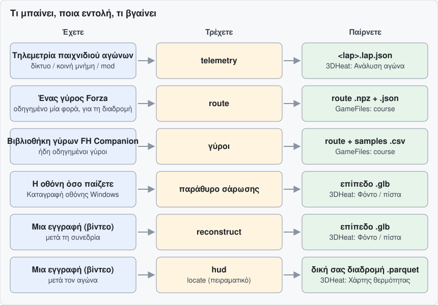

# 3DHeat GameCapture {#dheat-gamecapture}

**Τι είναι;** Ένα εργαλείο που καταγράφει τι του λέει ένα παιχνίδι αγώνων για την οδήγησή σας, ένα αρχείο
ανά γύρο. Μπορεί επίσης να ανακατασκευάσει ένα χονδρικό τρισδιάστατο μοντέλο ενός επιπέδου από ένα βίντεο
όπου παίζετε.

**Γιατί να το χρησιμοποιήσω;** Για να δείτε τους γύρους σας στον [προβολέα 3DHeat](https://holdi601.github.io/3DHeat/):
πού φρενάρατε, πού ήσασταν αργοί, πώς διαφέρουν δύο γύροι. Και για να έχετε το επίπεδο κάτω από τον θερμικό σας
χάρτη, όταν κανείς δεν έχει τρισδιάστατο μοντέλο του.

**Παράδειγμα:** ενεργοποιήστε το Data Out του Forza, τρέξτε μία εντολή, οδηγήστε δύο γύρους. Δύο αρχεία γύρων
εμφανίζονται στο `laps\`. Σύρετέ τα στην καρτέλα Ανάλυση αγώνα του προβολέα.


Δεν έχετε ξαναδουλέψει με τη γραμμή εντολών; Διαβάστε πρώτα το [Πριν ξεκινήσετε](before-you-start.md).

## Οι τρεις δουλειές {#the-three-jobs}

1. **Τηλεμετρία γύρων.** Καταγράφει κάθε κανάλι που δημοσιεύει ένα παιχνίδι αγώνων — το Data Out του Forza, την
   κοινή μνήμη των παιχνιδιών Assetto Corsa, τις δικτυακές ροές των ράλι, ένα mod του BeamNG, ένα
   plugin του Trackmania — και γράφει ένα αρχείο `heat3d-lap` ανά γύρο ή ανά ειδική διαδρομή, για την καρτέλα
   Ανάλυση αγώνα του προβολέα. Το iRacing δεν χρειάζεται καταγραφέα: ο προβολέας διαβάζει τα δικά του αρχεία `.ibt`.
2. **Επίπεδα από το παιχνίδι.** Μετατρέπει ό,τι έδειξε η οθόνη καθώς περπατούσατε ή οδηγούσατε μέσα σε
   ένα επίπεδο σε τρισδιάστατο μοντέλο `.glb`, που ο προβολέας τοποθετεί κάτω από τον θερμικό χάρτη.
3. **Ο δικός σας αγώνας, μετά από αυτόν.** Το `hud` διαβάζει το HUD της δικής σας εγγραφής — τις ενέργειές σας, τους θανάτους,
   τη διαδρομή στον μίνι χάρτη και τη λίστα φόνων. Το `locate` (πειραματικό: μέχρι τώρα τοποθετεί λίγα πραγματικά
   καρέ) βρίσκει πού τραβήχτηκε κάθε καρέ, πάνω στο τρισδιάστατο μοντέλο ενός επιπέδου.

Όλες οι δουλειές ακολουθούν έναν κανόνα: **τίποτα δεν εισάγεται σε παιχνίδι και τίποτα δεν υποκλέπτεται.**
Τα καρέ προέρχονται από το δημόσιο API καταγραφής οθόνης, η τηλεμετρία από διεπαφές που τα ίδια τα παιχνίδια
δημοσιεύουν γι' αυτόν τον σκοπό. Δείτε [Οι κανόνες](rules.md).



Ο κώδικας είναι Python (πακέτο `heat3d_capture`), με άδεια MIT. Τα μοντέλα βάθους και στάσης που μπορεί να τρέξει
έχουν τις δικές τους άδειες· δείτε [Μοντέλα και άδειες](models-and-licences.md).

## Γρήγορη εκκίνηση {#quick-start}

### Καταγραφή γύρων {#record-laps}

Χρειάζεστε Python 3.10 ή νεότερη ([Πριν ξεκινήσετε](before-you-start.md)). Στο PowerShell:

```powershell
git clone https://github.com/Holdi601/3DHeat-GameCapture
cd 3DHeat-GameCapture
python -m venv .venv
.venv\Scripts\python -m pip install -r requirements.txt

# Forza: Settings -> HUD and Gameplay -> Data Out = ON, IP 127.0.0.1, port 5300
.venv\Scripts\python -m heat3d_capture telemetry -o laps
```

**Θα δείτε** `listening on port 5300. Laps go to laps. Ctrl+C to stop.`, και μετά μία γραμμή για κάθε γύρο καθώς
περνάτε τη γραμμή, όπως στην εικόνα παραπάνω. Πατήστε Ctrl+C για να σταματήσετε. Σύρετε τα αρχεία από το `laps\`
στην καρτέλα Ανάλυση αγώνα του προβολέα.
Για κάθε άλλο παιχνίδι, προσθέστε `--game`:

```powershell
.venv\Scripts\python -m heat3d_capture telemetry --game acc -o laps
.venv\Scripts\python -m heat3d_capture telemetry --game dirtrally2 -o laps
```

Δείτε τους [Καταγραφείς τηλεμετρίας](telemetry.md) για κάθε παιχνίδι και επιλογή.

### Σάρωση ενός επιπέδου {#scan-a-level}

Κάντε διπλό κλικ στο **`scan.bat`** στον φάκελο του εργαλείου. Βρίσκει την Python (και σας προτείνει να την εγκαταστήσει
με το winget αν δεν υπάρχει), φτιάχνει ένα ιδιωτικό `.venv`, και ανοίγει το παράθυρο σάρωσης. Το παράθυρο λέει τι λείπει,
σε τι χρησιμεύει κάθε πακέτο και πόσο μεγάλο είναι το κατέβασμα, και δεν εγκαθιστά τίποτα χωρίς ναι. Δείτε
[Χρόνος εκτέλεσης και εξαρτήσεις](runtime.md) και [Το παράθυρο σάρωσης](reconstruction-scan-ui.md).

Με το χέρι: `.venv\Scripts\python -m heat3d_capture.ui`.

Για να ανακατασκευάσετε μια εγγραφή εκτός σύνδεσης, με τη διαδρομή της κάμερας λυμένη όλη μαζί (χρειάζεται PyTorch,
το πακέτο `vggt` και μια GPU — δείτε [Ανακατασκευή εκτός σύνδεσης](reconstruction-offline.md)):

```powershell
.venv\Scripts\python -m heat3d_capture reconstruct lap.mp4 -o lap.glb
```

## Χάρτης της τεκμηρίωσης {#map-of-the-documentation}

| Σελίδα | Τι καλύπτει |
|---|---|
| [Πριν ξεκινήσετε](before-you-start.md) | Python, τερματικό, η πρώτη εντολή, συνηθισμένα σφάλματα |
| [Οι κανόνες](rules.md) | Χωρίς εισαγωγή, μόνο δημοσιευμένες διεπαφές, και τι κοστίζει αυτό |
| [Καταγραφείς τηλεμετρίας](telemetry.md) | Η εντολή `telemetry` και μια επισκόπηση κάθε παιχνιδιού |
| [Forza](telemetry-forza.md) | Data Out, ανίχνευση διάταξης, η αναμετάδοση του FH Companion και το `.tele.gz` της |
| [Παιχνίδια Assetto Corsa](telemetry-assetto-corsa.md) | AC, ACC, AC EVO, AC Rally από κοινή μνήμη |
| [Παιχνίδια ράλι](telemetry-rally.md) | EA SPORTS WRC, DiRT Rally 2.0 / 1 / DiRT 4, Richard Burns Rally |
| [BeamNG.drive](telemetry-beamng.md) | Το mod πρωτοκόλλου `heat3d` |
| [Trackmania](telemetry-trackmania.md) | Το plugin Openplanet `Heat3dRecorder` |
| [iRacing](telemetry-iracing.md) | Ανάγνωση αρχείων `.ibt` στον προβολέα |
| [Διαχωρισμός γύρων και ειδικών διαδρομών](lap-splitting.md) | `LapSplitter`, `CounterSplitter`, `LineSplitter`, `StageSplitter` |
| [Ολίσθηση, drift και παράγωγα κανάλια](slip-and-drift.md) | Πώς κλιμακώνεται η ολίσθηση, και τι παράγει ο προβολέας |
| [Το αρχείο heat3d-lap](lap-format.md) | Η μορφή του αρχείου γύρου, τα κανάλια, οι μονάδες, το `meta` |
| [Παιχνίδια](games.md) | Ανά παιχνίδι: πώς καταγράφεται, τι στέλνεται, ποιες πίστες εξάγονται |
| [Εντολές](commands.md) | `route`, `telemetry`, `laps`, `reconstruct`, `hud`, `locate`, βήμα προς βήμα |
| [Αναφορά εντολών](../cli-reference.md) | κάθε επιλογή, παραγόμενη από το `--help` |
| [Ανάγνωση του HUD από μια εγγραφή](hud-video.md) | `hud`: οι δικές σας ενέργειες, θάνατοι, διαδρομή μίνι χάρτη και λίστα φόνων από μια εγγραφή |
| [Εντοπισμός καρέ σε ένα επίπεδο](locate.md) | `locate`: πού τραβήχτηκε κάθε καρέ, σε σχέση με τη γεωμετρία του επιπέδου |
| [Ανακατασκευή επιπέδου](reconstruction.md) | Η διαδικασία από καρέ σε `.glb` |
| [Το παράθυρο σάρωσης](reconstruction-scan-ui.md) | Κάθε χειριστήριο, συντόμευση και στοιχείο επικάλυψης |
| [Λήψη, μάσκες και ποιότητα καρέ](reconstruction-capture.md) | Windows Graphics Capture, βασικά καρέ, μάσκες HUD, συμβουλές ποιότητας |
| [Βάθος](reconstruction-depth.md) | Depth Anything V2, ONNX Runtime, κατασκευή του μοντέλου |
| [Στάση κάμερας και κλίμακα](reconstruction-pose.md) | Οδομετρία, επανατοποθέτηση, στάσεις από τηλεμετρία, κλίμακα εδάφους, bundle adjustment |
| [Συγχώνευση, κάλυψη και χρώμα](reconstruction-fusion-and-texture.md) | Ο όγκος κατάληψης, το πλέγμα κάλυψης, αδύναμα σημεία, χρώμα κορυφών |
| [Η έξοδος .glb](glb-output.md) | Το αρχείο που φορτώνει ο προβολέας |
| [Ανακατασκευή εκτός σύνδεσης](reconstruction-offline.md) | `reconstruct`, παράθυρα VGGT και ενοποίηση |
| [Μοντέλα και άδειες](models-and-licences.md) | Μεγέθη Depth Anything V2, VGGT, τα πακέτα |
| [Χρόνος εκτέλεσης και εξαρτήσεις](runtime.md) | Προέλεγχος, backends, βαθμίδες απόδοσης |
| [Όρια και επαλήθευση](limits.md) | Τι δεν γίνεται, και τι δεν έχει ελεγχθεί |
| [Ενημερώσεις](updates.md) | Ο έλεγχος έκδοσης και το `python -m heat3d_update` |
| [Ανάπτυξη](development.md) | Τεστ, το εικονικό περιβάλλον, η δομή του αποθετηρίου |
| [Συντήρηση αυτών των σελίδων](maintaining.md) | Η λίστα ελέγχου κυκλοφορίας για κώδικα και τεκμηρίωση |

## Μέρος του 3DHeat {#part-of-3dheat}

Τα αρχεία που γράφει αυτό τα φορτώνει ο **προβολέας 3DHeat** —
[πηγαίος κώδικας](https://github.com/Holdi601/3DHeat), [τεκμηρίωση](https://holdi601.github.io/3DHeat/).
Τα αρχεία γύρων πηγαίνουν στην καρτέλα Ανάλυση αγώνα, τα `.glb` επίπεδα στο πάνελ «Φόντο / πίστα», και οι πίνακες των
`hud` και `locate` στην καρτέλα Χάρτης θερμότητας· πώς ο προβολέας διαβάζει πίνακες και αρχεία αγώνων
περιγράφεται στο [Ένα αρχείο ανά αγώνα (.3dheat)](https://holdi601.github.io/3DHeat/container.html) και στο
[Εισαγωγή δεδομένων](https://holdi601.github.io/3DHeat/getting-data-in.html).

| Εργαλείο | Τι κάνει | Τεκμηρίωση |
|---|---|---|
| [3DHeat viewer](https://github.com/Holdi601/3DHeat) | δείχνει θερμικούς χάρτες, αγώνες και αναμετρήσεις σε 3D, στον περιηγητή | [τεκμηρίωση](https://holdi601.github.io/3DHeat/) |
| [GameFiles](https://github.com/Holdi601/3DHeat-GameFiles) | πίστες και επίπεδα από τα αρχεία που κυκλοφορούν τα παιχνίδια, ως τρισδιάστατα μοντέλα | [τεκμηρίωση](https://holdi601.github.io/3DHeat-GameFiles/) |
| [GameCapture](https://github.com/Holdi601/3DHeat-GameCapture) | τηλεμετρία γύρων από αγώνες· επίπεδα ανακατασκευασμένα από βίντεο παιχνιδιού | [τεκμηρίωση](https://holdi601.github.io/3DHeat-GameCapture/) |
| [Unreal Exporter](https://github.com/Holdi601/3DHeat-UnrealExporter) | ένα πρόσθετο του Unreal Editor που εξάγει ένα επίπεδο ως τρισδιάστατο μοντέλο | [τεκμηρίωση](https://holdi601.github.io/3DHeat-UnrealExporter/) |
| [CS2](https://github.com/Holdi601/3DHeat-CS2) | demo του Counter-Strike 2 σε αρχεία αγώνων· χάρτες σε τρισδιάστατα μοντέλα | [τεκμηρίωση](https://holdi601.github.io/3DHeat-CS2/) |
| [Watcher](https://github.com/Holdi601/3DHeat-Watcher) | καταγράφει το παιχνίδι σας στο παρασκήνιο, από όσα δημοσιεύουν τα παιχνίδια | [τεκμηρίωση](https://holdi601.github.io/3DHeat-Watcher/) |
| [Ext-WarThunder](https://github.com/Holdi601/3DHeat-Ext-WarThunder) | replay του War Thunder σε αρχεία αγώνων | [τεκμηρίωση](https://holdi601.github.io/3DHeat-Ext-WarThunder/) |
| [Ext-WoT](https://github.com/Holdi601/3DHeat-Ext-WoT) | replay του World of Tanks σε αρχεία αγώνων | [τεκμηρίωση](https://holdi601.github.io/3DHeat-Ext-WoT/) |
| [Ext-WoWs](https://github.com/Holdi601/3DHeat-Ext-WoWs) | replay του World of Warships σε αρχεία αγώνων | [τεκμηρίωση](https://holdi601.github.io/3DHeat-Ext-WoWs/) |
| [Ext-Squad](https://github.com/Holdi601/3DHeat-Ext-Squad) | demo από servers του Squad σε αρχεία αγώνων | [τεκμηρίωση](https://holdi601.github.io/3DHeat-Ext-Squad/) |
| [Ext-DCS](https://github.com/Holdi601/3DHeat-Ext-DCS) | χάρτες του DCS World σε τρισδιάστατα μοντέλα | [τεκμηρίωση](https://holdi601.github.io/3DHeat-Ext-DCS/) |
| [Ext-IL2](https://github.com/Holdi601/3DHeat-Ext-IL2) | χάρτες του IL-2 Sturmovik σε τρισδιάστατα μοντέλα | [τεκμηρίωση](https://holdi601.github.io/3DHeat-Ext-IL2/) |

Ένας προγραμματιστής με ανοιχτό το project του παιχνιδιού πρέπει να χρησιμοποιεί τον Unreal Exporter, που διαβάζει την
πραγματική γεωμετρία και είναι ακριβής. Όπου μπορούν να διαβαστούν τα αρχεία ενός παιχνιδιού, το GameFiles εξάγει την
ακριβή πίστα. Η ανακατασκευή από το παιχνίδι προορίζεται για την περίπτωση όπου είναι διαθέσιμη μόνο η οθόνη.
