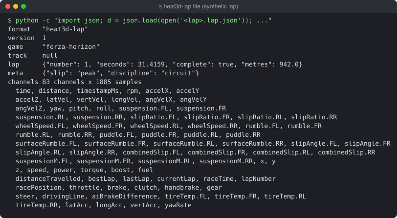

# Το αρχείο `heat3d-lap` {#the-heat3d-lap-file}

Κάθε καταγραφέας τηλεμετρίας σε αυτό το αποθετήριο γράφει ένα αρχείο ανά γύρο ή στάδιο, με το ίδιο
σχήμα όποιο κι αν είναι το παιχνίδι. Η εξαγωγή διαδρομής στο [3DHeat GameFiles](https://github.com/Holdi601/3DHeat-GameFiles)
το διαβάζει για να βρει το παιχνίδι, την πίστα και τη διαδρομή που οδηγήθηκε. Οτιδήποτε διαβάζει
JSON μπορεί να το διαβάσει.



## Το έγγραφο {#the-document}

Ένα αντικείμενο JSON. Τα κανάλια αποθηκεύονται ως στήλες: ένας πίνακας ανά κανάλι, όλοι του ίδιου
μήκους, ένα στοιχείο ανά δείγμα.

```json
{
  "format": "heat3d-lap",
  "version": 1,
  "game": "assetto-corsa-rally",
  "track": "stage name, when the game says",
  "recordedAt": "2026-09-21T12:48:59+02:00",
  "car": {},
  "lap": {"number": 3, "seconds": 52.103, "complete": true, "metres": 1908.9},
  "meta": {"slip": "scaled", "discipline": "rally", "surface": "loose"},
  "units": {"speed": "m/s", "tireTemp": "degC"},
  "channels": {
    "time": [0.0, 0.0167],
    "distance": [0.0, 0.41],
    "x": [], "y": [], "z": [],
    "speed": [],
    "tireTemp.FL": [], "tireTemp.FR": [], "tireTemp.RL": [], "tireTemp.RR": []
  }
}
```

| Πεδίο | Σημασία |
|---|---|
| `format`, `version` | `heat3d-lap`, `1` |
| `game` | από ποιο παιχνίδι είναι ο γύρος· βλ. τη λίστα παρακάτω |
| `track` | το όνομα της πίστας, του σταδίου ή του χάρτη, όταν το στέλνει το παιχνίδι |
| `layout` | μόνο για Forza: ποια διάταξη πακέτου Data Out αποκωδικοποιήθηκε |
| `car` | ό,τι λέει το παιχνίδι για το όχημα· ελεύθερης μορφής |
| `lap` | ο αριθμός του γύρου, ο χρόνος του όπως τον μέτρησε το παιχνίδι (ή το εύρος των δειγμάτων), αν ολοκληρώθηκε, και το μήκος του |
| `meta` | πώς να διαβαστούν οι αριθμοί όπου τα παιχνίδια διαφέρουν· βλ. παρακάτω |
| `units` | η μονάδα κάθε παρόντος καναλιού, για αναγνώστη που δεν ξέρει τον παρακάτω πίνακα |
| `channels` | τα δείγματα |
| `unparsed` | μόνο για Forza, όταν το πακέτο έχει bytes χωρίς όνομα πεδίου: `ranges` (τα εύρη τους σε bytes μέσα στο πακέτο, `[start, end)`) και `hex` (ανά δείγμα, αυτά τα bytes σε δεκαεξαδική μορφή), ώστε μόνο το αρχείο να περιέχει ολόκληρο το πακέτο |

Το `game` είναι ένα από τα `forza-horizon`, `forza-motorsport`, `forza` (η διάταξη του πακέτου δεν
ξεχωρίζει), `assetto-corsa`, `assetto-corsa-competizione`, `assetto-corsa-evo`,
`assetto-corsa-rally`, `ea-sports-wrc`, `dirt-rally-2`, `dirt-rally`, `dirt-4`,
`richard-burns-rally`, `beamng`, `trackmania`.

Το `meta` λέει τι σημαίνουν οι αριθμοί εκεί όπου τα παιχνίδια διαφέρουν:

- `slip`: τι περιέχουν τα κανάλια ολίσθησης, όπου το παιχνίδι στέλνει τέτοια - `peak`
  (κανονικοποιημένη, οπότε πάνω από 1 το ελαστικό χάνει την πρόσφυση: Forza), `scaled` (φυσική
  ολίσθηση διαιρεμένη με έναν τυπικό συντελεστή αίσθησης ασφάλτου: τα παιχνίδια Assetto Corsa),
  `physical` (ένα κλάσμα και ακτίνια), `index` (ένα μέτρο ολίσθησης 0..1: Trackmania)·
- `discipline`: `circuit`, `rally` ή `arcade`·
- `surface`: `tarmac`, `loose`, `snow`, `ice` ή `mixed`, όταν είναι γνωστή (οι καταγραφείς ράλι την
  παίρνουν από το `--surface`).

## Κανάλια {#channels}

Ένα κανάλι που δεν στέλνει το παιχνίδι απουσιάζει και δεν γεμίζεται με μηδενικά. Τα κανάλια ανά
τροχό φέρουν το όνομα του τροχού μετά από μια τελεία: `.FL`, `.FR`, `.RL`, `.RR`.

Οι θέσεις είναι ο κόσμος του παιχνιδιού, σε μέτρα, με το `y` προς τα πάνω. Ένα παιχνίδι του οποίου
ο κόσμος είναι Z προς τα πάνω μετατρέπεται σε Y προς τα πάνω από τον καταγραφέα του· τίποτε άλλο
δεν αλλάζει, οπότε ένας αριστερόστροφος κόσμος (του Forza) μένει αριστερόστροφος.

| Κανάλι | Μονάδα | Σημασία |
|---|---|---|
| `time` | s | από το πρώτο δείγμα του γύρου |
| `distance` | m | κατά μήκος της διαδρομής από το πρώτο δείγμα |
| `x`, `y`, `z` | m | θέση· `y` είναι το ύψος |
| `speed` | m/s | |
| `throttle`, `brake`, `clutch`, `handbrake` | 0..1 | πεντάλ και μοχλός |
| `steer` | -1..1 | θετικό δεξιά |
| `gear` | | όπως το μετράει το παιχνίδι |
| `latAcc`, `longAcc`, `vertAcc` | m/s² | σύστημα οχήματος |
| `yaw`, `pitch`, `roll` | rad | κατεύθυνση και στάση |
| `yawRate` | rad/s | |
| `latVel`, `longVel`, `vertVel` | m/s | ταχύτητα στο σύστημα του οχήματος: δεξιά, μπροστά, πάνω |
| `bodySlip` | rad | γωνία παρέκκλισης, όπου την στέλνει το παιχνίδι |
| `loose` | 0/1 | σε χαλαρό έδαφος (Trackmania) |
| `airborne` | 0/1 | κανένας τροχός στο έδαφος |
| `rpm` | rpm | |
| `power`, `torque` | W, N m | |
| `boost`, `fuel` | | όπως τα στέλνει το παιχνίδι |
| `waterTemp`, `oilTemp` | °C | |
| `absActive`, `tcActive`, `drs`, `pitLimiter` | 0/1 | βοηθήματα σε λειτουργία, συστήματα ενεργά |
| `absLevel`, `tcLevel` | | ρυθμίσεις βοηθημάτων |
| `brakeBias` | 0..1 | μερίδιο εμπρός |
| `tireTemp`, `tireTempInner`, `tireTempMiddle`, `tireTempOuter` | °C | ανά τροχό |
| `tirePressure` | psi | ανά τροχό |
| `tireWear` | 0..1 | ανά τροχό |
| `slipRatio`, `slipAngle`, `combinedSlip` | βλ. `meta.slip` | ανά τροχό |
| `slipIndex` | 0..1 | ανά τροχό, μέτρο ολίσθησης (Trackmania) |
| `camber` | rad | ανά τροχό |
| `brakeTemp` | °C | ανά τροχό |
| `padLife`, `discLife` | | ανά τροχό |
| `suspensionM` | m | ανά τροχό, διαδρομή ανάρτησης |
| `suspension` | 0..1 | ανά τροχό, διαδρομή ανάρτησης, στο εύρος που χρησιμοποίησε ο γύρος |
| `wheelLoad` | N | ανά τροχό |
| `wheelSpeed` | rad/s | ανά τροχό, περιστροφή |
| `wheelSurfaceSpeed` | m/s | ανά τροχό, ταχύτητα επαφής του ελαστικού |
| `groundContact` | 0/1 | ανά τροχό |
| `rumble`, `surfaceRumble` | | ανά τροχό: πάνω σε ρίγες κράσπεδου· η δόνηση της επιφάνειας |
| `puddle` | | ανά τροχό, βάθος νερού στην επιφάνεια |

Ένας καταγραφέας μπορεί να προσθέσει δικά του κανάλια με άλλα ονόματα· ένας αναγνώστης κρατά όσα
δεν γνωρίζει.

Κανένα από τα παιχνίδια ράλι δεν στέλνει ολίσθηση ελαστικών. Ένας αναγνώστης μπορεί να την
υπολογίσει από την ταχύτητα επαφής ή επιφάνειας του κάθε τροχού σε σύγκριση με την ταχύτητα του
οχήματος, `(τροχός - όχημα) / όχημα`, ή από την περιστροφή του και μια ακτίνα κύλισης μετρημένη
πάνω στον ίδιο τον γύρο, όταν στέλνεται μόνο η περιστροφή. Η γωνία παρέκκλισης προκύπτει από την
ταχύτητα του ίδιου του οχήματος (`latVel`, `longVel`), όπου στέλνεται, ή από την ταχύτητα του
οχήματος στον κόσμο προβεβλημένη στους άξονές του.

## Η μορφή CSV {#the-csv-form}

Ο καταγραφέας του Trackmania γράφει αντί γι' αυτό `heat3d-lap-csv`: μια πρώτη γραμμή που αρχίζει
με `# ` και ένα αντικείμενο JSON (`format`, `version`, `game`, `track`, `complete`, `seconds`,
`meta`), μια γραμμή με τα ονόματα των καναλιών, και μετά μία γραμμή ανά δείγμα. Τα ονόματα των
καναλιών είναι τα ίδια όπως παραπάνω.

## Τι γράφει πραγματικά κάθε καταγραφέας {#what-each-recorder-actually-writes}

Το σχήμα παραπάνω είναι το συμβόλαιο· οι καταγραφείς το συμπληρώνουν λίγο διαφορετικά, και ένας
αναγνώστης πρέπει να ανέχεται όλα αυτά (ελέγχθηκαν με βάση τον κώδικα):

| Καταγραφέας | `track` | `layout` | `meta` | `units` | Κανάλια πέρα από τον πίνακα |
|---|---|---|---|---|---|
| Forza (`fulllap.py`) | `null` (ο αριθμός πίστας του Forza Motorsport 2023 είναι το `lap.trackOrdinal`) | η ανιχνευμένη διάταξη πακέτου | `slip: peak`, `discipline: circuit` | μόνο οι μονάδες των παρόντων καναλιών | `distanceTravelled`, `currentLap`, `lapNumber`, `racePosition`, `accelX/Y/Z`, `angVelX/Y/Z`, `drivingLine`, `aiBrakeDifference`, το ρολόι του παιχνιδιού `timestampMs`, `raceTime`, `bestLap`, `lastLap`· η ταχύτητα του οχήματος είναι στο κανονικό `latVel`, `vertVel`, `longVel`· το `unparsed` δίπλα στα κανάλια |
| Παιχνίδια Assetto Corsa (`kunos.py`) | από τη στατική σελίδα, ή `null` | απουσιάζει | `slip: scaled`, `discipline: circuit` ή `rally` | μια σταθερή λίστα | `slipRatioRaw.*`, `slipAngleRaw.*`, `packetId`, `steerAngle` (όπως στάλθηκε), `worldVelX/Y/Z`, `angVelX`, `angVelZ`, `tcActing`, `absActing`, `wheelSlip.*`, `contactX/Y/Z.*` |
| Παιχνίδια ράλι (`rally.py` μέσω `lapfile.py`) | `null` | απουσιάζει | `discipline: rally`, `slip: null`, `surface` μόνο όταν δόθηκε `--surface` (αλλιώς το συμπεραίνει ο viewer) | μόνο οι μονάδες των παρόντων καναλιών | `stageDistance`· WRC: `gameTime`, `gameDelta`, `packetUid`, `gearIndex`, `transmissionSpeed`, `rpmMax`, `rpmIdle`, `stageLength`, `hubVel.*`, `worldVel/worldAcc/left/forward/up` `X/Y/Z`· DiRT: `totalTime`, `lapNumber`, `lapsCompleted`, `totalLaps`, `stageLength`, `lastLapTime`, `suspensionVel.*`, `worldVel/side/forward` `X/Y/Z`, `float<i>` για τους αριθμούς που δεν έχουν καθοριστικό όνομα· RBR: `attitudeX/Y/Z`, `totalSteps`, `stageIndex`, `progress`, `raceTime`, `distanceToEnd`, `speedRaw`, `accelZ` |
| BeamNG (`beamng.py` μέσω `lapfile.py`) | `null` | απουσιάζει | `discipline: circuit` | μόνο οι μονάδες των παρόντων καναλιών | `wheelSurfaceSpeedRaw.*`, `wheelMaterial.*`, `forward/up/worldVel` `X/Y/Z` |
| Plugin Trackmania (CSV) | το όνομα του χάρτη | - | `slip: index`, `discipline: arcade` | - | `respawns` |

Το `car` είναι το μπλοκ του οχήματος του Forza (`carOrdinal`, `carClass`, `carPI`, `drivetrain`,
`cylinders`, `rpmMax`, `rpmIdle`), `{"name": ...}` για τα παιχνίδια Kunos όταν η στατική σελίδα
ονομάζει όχημα, και `{}` αλλιώς. Το `lap.metres` είναι η διαφορά της απόστασης που διανύθηκε από
τον μετρητή του παιχνιδιού για το Forza, και η συνολική τρισδιάστατη απόσταση μεταξύ των δειγμάτων
αλλού. Οι τιμές στρογγυλοποιούνται κατά την εγγραφή: το `time` σε 4 δεκαδικά, το `distance` σε 3,
τα υπόλοιπα κινητά σε 5. Το JSON γράφεται συμπαγές (χωρίς κενά).

Κάθε πακέτο ή σελίδα που έλαβε ο καταγραφέας - όχι μόνο αυτά των γύρων - κρατιέται ολόκληρο δίπλα
στα αρχεία γύρων, στο `<stamp>_<game>.raw.parquet`, με έναν αυτοέλεγχο στο
`<stamp>_<game>.summary.json` (η ενότητα "Completeness" του README).

Ένα δείγμα για το οποίο ένα κανάλι δεν έχει τιμή - λείπει από το καρέ, ή δεν είναι πεπερασμένος
αριθμός όπως τον έστειλε το παιχνίδι - γράφεται ως `null` από κάθε καταγραφέα (`lapfile.clean`), και
η ανάρτηση που προκύπτει από αυτό είναι `null` επίσης. Τα `NaN` και `Infinity` δεν γράφονται ποτέ:
δεν είναι JSON, και το `JSON.parse` ενός browser απορρίπτει ολόκληρο το αρχείο εξαιτίας ενός από
αυτά. Ένας αναγνώστης πρέπει να περιμένει `null` μέσα στον πίνακα ενός καναλιού.

Τα αρχεία του Forza έχουν `"game": "forza-horizon"`, `"forza-motorsport"` ή `"forza"` ανάλογα με τη
διάταξη που ανιχνεύθηκε. Ο αναγνώστης του viewer για τα αρχεία `.tele.gz` του FH Companion
παράγει γύρους με `"game": "forza-horizon"` και `meta.slip = "peak"`· αυτός ο αναγνώστης βρίσκεται
στον viewer, όχι εδώ. Οι γύροι του iRacing (διαβάζονται από `.ibt` στον viewer) έχουν
`"game": "iracing"`, που δεν υπάρχει στη λίστα των τιμών `game` των καταγραφέων παραπάνω, επειδή
κανένας καταγραφέας δεν το γράφει.

Βλ. [Διαχωρισμός γύρων και σταδίων](lap-splitting.md) για το πώς αποφασίζονται το `lap.number`,
το `lap.seconds` και το `lap.complete`, και [Ολίσθηση, παρέκκλιση και παράγωγα κανάλια](slip-and-drift.md)
για ό,τι συμπεραίνει ο viewer από αυτά τα κανάλια.
