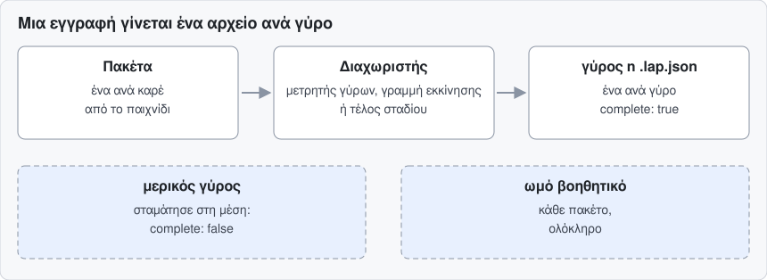

# Πώς χωρίζονται οι γύροι και τα στάδια {#how-laps-and-stages-are-split}

Ένας καταγραφέας βλέπει μία συνεχή ροή δειγμάτων. Τη μετατρέπει σε γύρους ένας από τέσσερις
διαχωριστές, που επιλέγεται με βάση ό,τι λέει το παιχνίδι για τους γύρους. Όλοι ακολουθούν την
ίδια ιδέα: χρησιμοποιούν το δικό του μέτρημα του παιχνιδιού όπου υπάρχει, αλλιώς βρίσκουν τον γύρο
από τις θέσεις· και ποτέ δεν γράφουν τμήμα τόσο σύντομο που δεν μπορεί να συγκριθεί.

| Διαχωριστής | Κώδικας | Χρησιμοποιείται από |
|---|---|---|
| `LapSplitter` | [`fulllap.py`](https://github.com/Holdi601/3DHeat-GameCapture/blob/main/heat3d_capture/telemetry/fulllap.py) | Forza |
| `CounterSplitter` | [`kunos.py`](https://github.com/Holdi601/3DHeat-GameCapture/blob/main/heat3d_capture/telemetry/kunos.py) | Assetto Corsa, ACC |
| `LineSplitter` | [`kunos.py`](https://github.com/Holdi601/3DHeat-GameCapture/blob/main/heat3d_capture/telemetry/kunos.py) | AC EVO, AC Rally, BeamNG |
| `StageSplitter` | [`rally.py`](https://github.com/Holdi601/3DHeat-GameCapture/blob/main/heat3d_capture/telemetry/rally.py) | EA SPORTS WRC, DiRT Rally 2.0, DiRT Rally, DiRT 4, Richard Burns Rally |

Το Trackmania χωρίζει τις διαδρομές μέσα στο δικό του plugin ([Trackmania](telemetry-trackmania.md)),
και τα αρχεία iRacing χωρίζονται από τον viewer με βάση τον μετρητή γύρων του προσομοιωτή
([iRacing](telemetry-iracing.md)).

Με **Ctrl+C** κάθε καταγραφέας καλεί το `flush()` του διαχωριστή του, οπότε ένας ανοιχτός γύρος ή
στάδιο γράφεται αν περνά τα ίδια ελάχιστα όρια που περιγράφονται παρακάτω.

## LapSplitter (Forza) {#lapsplitter-forza}

Παράμετροι: `minimum_metres = 400`, `gap_seconds = 2.0`.

Για κάθε αποκωδικοποιημένο πακέτο:

1. Αν το `timestampMs` του παιχνιδιού άλλαξε κατά περισσότερο από 2 δευτερόλεπτα προς τα εμπρός από
   το τελευταίο πακέτο, ή πήγε πίσω, ο ανοιχτός γύρος κλείνει πρώτα.
2. Αν το `isRaceOn` είναι 0 (το παιχνίδι δεν είναι σε αγώνα), ο ανοιχτός γύρος κλείνει και το πακέτο
   απορρίπτεται.
3. Αν δεν υπάρχει ανοιχτός γύρος, ανοίγει ένας με το `lapNumber` του πακέτου.
4. Αν το `lapNumber` διαφέρει από αυτό του ανοιχτού γύρου, ο ανοιχτός γύρος **κλείνει ως
   ολοκληρωμένος**· το `seconds` του είναι το `lastLap` του παιχνιδιού, όταν είναι θετικό. Ένας γύρος
   που κλείνει έτσι γράφεται όποιο κι αν είναι το μήκος του. Ανοίγει ένας νέος γύρος.
5. Το πακέτο προστίθεται.

Ο καταγραφέας κλείνει επίσης τον γύρο όταν δεν έχει φτάσει πακέτο για 2 δευτερόλεπτα πραγματικού
χρόνου (το παιχνίδι σταμάτησε στη μέση του γύρου, ή έκλεισε).

**Η εκκαθάριση** κρατά τον ανοιχτό γύρο μόνο αν έχει τουλάχιστον 2 δείγματα και τουλάχιστον 400 m
από το `distanceTravelled`· γράφεται ως ημιτελής (μια `run`). Μια αγώνας από σημείο σε σημείο δεν
μετρά ποτέ δεύτερο γύρο, οπότε πάντα τελειώνει έτσι.

## CounterSplitter (AC, ACC) {#countersplitter-ac-acc}

Παράμετρος: `minimum_metres = 300`. Του τροφοδοτείται κάθε δείγμα με το `completedLaps` και τον
χρόνο του τελευταίου γύρου από τη σελίδα γραφικών.

- Το πρώτο δείγμα ανοίγει έναν γύρο με αριθμό το τρέχον `completedLaps`.
- Όταν αλλάζει το `completedLaps`, ο ανοιχτός γύρος κλείνει. Είναι **ολοκληρωμένος**, με
  `seconds = χρόνος τελευταίου γύρου σε ms / 1000` (αν είναι θετικός), μόνο αν ο μετρητής αυξήθηκε
  κατά ακριβώς 1· αν έπεσε πίσω στο 0 (επανεκκίνηση της συνεδρίας) ή αυξήθηκε κατά περισσότερα,
  κλείνει ως ημιτελής.
- Ένας κλειστός γύρος γράφεται μόνο αν έχει δείγματα και τουλάχιστον 300 m διαδρομής.
- Η εκκαθάριση κρατά τον ανοιχτό γύρο αν έχει περισσότερα από ένα δείγματα και τουλάχιστον 300 m.

## LineSplitter (AC EVO, AC Rally, BeamNG) {#linesplitter-ac-evo-ac-rally-beamng}

Παράμετροι: `radius = 15 m`, `minimum_metres = 300`, `stop_seconds = 8`.

Αυτά τα παιχνίδια είτε δεν έχουν μετρητή γύρων σε σελίδα που διαβάζει ο καταγραφέας, είτε
οδηγούν στάδια. **Η γραμμή είναι όπου ξεκίνησε η εγγραφή**:

1. Η οριζόντια θέση (`x`, `z`) του πρώτου δείγματος γίνεται η γραμμή.
2. Μόλις το όχημα διανύσει περισσότερα από 5 m, η κατεύθυνση από τη γραμμή προς το όχημα γίνεται
   η κατεύθυνση του γύρου.
3. **Η ακινησία** τερματίζει μια εκτέλεση: όταν το `speed` μένει κάτω από 1 m/s για 8 δευτερόλεπτα,
   ο ανοιχτός γύρος εκκαθαρίζεται (έτσι τελειώνει ένα στάδιο ράλι: το αυτοκίνητο σταματά στον
   τερματισμό).
4. **Διέλευση από τη γραμμή**: μετά από περισσότερα από 300 m διαδρομής, συλλέγονται τα δείγματα
   μέσα σε 15 m από τη γραμμή. Όταν το όχημα βγει ξανά από αυτή την ακτίνα, το πλησιέστερο
   συλλεγμένο δείγμα είναι η διέλευση. Αν το όχημα κινούνταν προς την ίδια κατεύθυνση με την
   κατεύθυνση του γύρου εκεί (θετικό εσωτερικό γινόμενο της τοπικής κατεύθυνσης με τη διεύθυνση), ο
   γύρος κλείνει σε εκείνο το δείγμα· αλλιώς η διέλευση αγνοείται (το αυτοκίνητο πέρασε την
   αφετηρία προς την αντίθετη κατεύθυνση).
5. Το `seconds` ενός κλειστού γύρου είναι ο χρόνος από το πρώτο του δείγμα ως τη διέλευση. Είναι
   **ολοκληρωμένος μόνο αν το πρώτο του δείγμα ήταν ταχύτερο από 5 m/s**: ένας γύρος που ξεκίνησε
   από ακινησία είναι εκκίνηση, όχι γύρος για σύγκριση. Ο πρώτος γύρος μιας εγγραφής που ξεκίνησε
   από τη θέση εκκίνησης είναι λοιπόν πάντα ημιτελής· μια εγγραφή που ξεκίνησε σε γύρο εν κινήσει
   δίνει έναν ολοκληρωμένο πρώτο γύρο στην επόμενη διέλευση.
6. Ο επόμενος γύρος ξεκινά στο δείγμα της διέλευσης (ανήκει και στους δύο γύρους).

Οι γύροι κάτω των 300 m απορρίπτονται. Η εκκαθάριση (μια ακινησία ή Ctrl+C) κρατά τον ανοιχτό γύρο
αν έχει τουλάχιστον 2 δείγματα και 300 m, ως ημιτελή. Το BeamNG εκκαθαρίζει με τον ίδιο τρόπο όταν
το όχημα επαναφέρεται (το ρολόι του πηγαίνει πίσω), πριν ξεκινήσει νέος διαχωριστής, ώστε η
διαδρομή που οδηγήθηκε πριν από την επαναφορά να διατηρηθεί.

Οι αποστάσεις είναι οριζόντιες (`x`, `z`) για τον μετρητή διαδρομής και για τον έλεγχο της γραμμής,
και πλήρως τρισδιάστατες για τον έλεγχο μήκους των 300 m.

## StageSplitter (παιχνίδια ράλι) {#stagesplitter-rally-games}

Παράμετρος: `minimum_metres = 300`. Του τροφοδοτείται κάθε δείγμα με το ρολόι σταδίου του παιχνιδιού,
αν το παιχνίδι λέει ότι το όχημα τερμάτισε, και προαιρετικά με τον δικό του χρόνο για αυτό.

1. Αν το ρολόι είναι 0 ή κάτω, ή έχει πάει πίσω περισσότερο από 0,5 s, το ανοιχτό στάδιο
   **εγκαταλείπεται**: κρατιέται ως μερικό στάδιο αν δεν είναι ολοκληρωμένο, έχει περισσότερα από 10
   δείγματα και τουλάχιστον 300 m. Ένα ρολόι 0 ή κάτω επίσης απορρίπτει το δείγμα (το όχημα είναι
   στην αφετηρία).
2. Αν δεν υπάρχει ανοιχτό στάδιο, ανοίγει ένα νέο (αριθμημένο 1, 2, ... για την εγγραφή).
3. Όταν ένα στάδιο έχει ολοκληρωθεί, τα επόμενα δείγματα αγνοούνται μέχρι να πάει πίσω το ρολόι.
4. Κάθε δείγμα αποθηκεύεται με `time` ίσο με το ρολόι του σταδίου.
5. Όταν το παιχνίδι λέει ότι τερμάτισε, το στάδιο είναι ολοκληρωμένο· το `seconds` του είναι ο χρόνος
   του παιχνιδιού όταν δίνεται και είναι θετικός, αλλιώς το ρολόι. Γράφεται αν κάλυψε τουλάχιστον 300 m.

Τι σημαίνει "τερμάτισε" ανά παιχνίδι:

| Παιχνίδι | Τερμάτισε όταν |
|---|---|
| EA SPORTS WRC | το μήκος σταδίου είναι > 0 και η απόσταση σταδίου ≥ μήκος - 0,5 m |
| Παιχνίδια DiRT | ο αριθμός ολοκληρωμένων γύρων ανέβηκε πάνω από την τιμή στην αρχή του σταδίου, ή (γεγονός με έναν μόνο γύρο) η απόσταση γύρου ≥ 99,9% του μήκους της πίστας |
| Richard Burns Rally | το ρολόι αγώνα > 0 και η απόσταση ως το τέλος ≤ 0 |

Για το RBR ο άξονας προς τα πάνω και η ταχύτητα καθορίζονται όταν γράφεται ένα στάδιο (βλ.
[Παιχνίδια ράλι](telemetry-rally.md#richard-burns-rally-rsf--ngp)).

## Χρόνος και απόσταση στο αρχείο γύρου {#time-and-distance-in-the-lap-file}

Για κάθε καταγραφέα εκτός του Forza, το `time` μετατοπίζεται ώστε το πρώτο δείγμα του γύρου να είναι
0, και το `distance` είναι η αθροιστική τρισδιάστατη απόσταση μεταξύ διαδοχικών θέσεων. Το Forza
χρησιμοποιεί τον δικό του χρονομετρητή γύρου και μετρητή απόστασης του παιχνιδιού, μετατοπισμένους
με τον ίδιο τρόπο.
