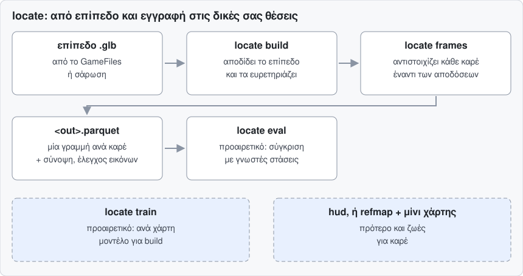

# Εντοπισμός καρέ σε πίστα {#locating-frames-in-a-level}

Το `locate` βρίσκει πού λήφθηκε κάθε καρέ μιας εγγραφής gameplay: τη 3D θέση της κάμερας και την κατεύθυνση βλέμματος,
ταιριάζοντας την εικόνα με αποδόσεις της γεωμετρίας της πίστας. Είναι για παιχνίδια που δεν κρατούν αρχείο με το πού
βρισκόταν ο παίκτης: ούτε demo, ούτε αρχείο replay, ούτε τηλεμετρία. Το Battlefield 6 είναι το πρώτο.

> **Πειραματικό.** Σε πραγματικές εγγραφές τοποθετεί μέχρι στιγμής μόνο ένα μικρό μέρος των καρέ· βλ.
> [Πραγματικά καρέ: πειραματικό](#real-frames-experimental).

```bash
# Once per level: render it from every place a player can stand, and index the renders.
.venv\Scripts\python -m heat3d_capture locate build level.glb -o level.db

# Per recording: where was each frame taken?
.venv\Scripts\python -m heat3d_capture locate frames "<recording>.mp4" --db level.db -o out/match
```

Η θέση προέρχεται **από την εικόνα**, απέναντι σε ολόκληρη την πίστα, χωρίς προηγούμενη εκτίμηση. Η διαδρομή του
μίνι-χάρτη από τον [αναγνώστη HUD](hud-video.md) είναι μόνο εναλλακτική για καρέ που η εικόνα δεν μπορεί να
τοποθετήσει, και κάθε γραμμή λέει από ποιο από τα δύο προήλθε.




## Τι αγγίζει και τι όχι {#what-it-does-and-does-not-touch}

- Διαβάζει την **δική του εγγραφή** του παίκτη και ένα αρχείο πίστας που ο παίκτης εξήγαγε από **το δικό του αντίγραφο**
  του παιχνιδιού. Δεν αγγίζει ποτέ το παιχνίδι, τη μνήμη του, τα αρχεία του ενώ τρέχει, ή το δίκτυό του, και τρέχει
  αφού τελειώσει ο αγώνας. Βλ. [Οι κανόνες](rules.md).
- Τοποθετεί **μόνο την κάμερα του ίδιου του παίκτη**: το καρέ είναι η δική του όψη.
- Η πίστα, η βάση δεδομένων που χτίζεται από αυτήν και ό,τι αποδίδεται από αυτήν ανήκουν στον εκδότη του παιχνιδιού.
  Κρατήστε τα τοπικά.

## Απαιτήσεις {#requirements}

- Όσα περιέχει το `requirements.txt`, το PyTorch (από το pytorch.org, για την GPU), και το `requirements-locate.txt`:

```bash
.venv\Scripts\python -m pip install -r requirements-locate.txt
```

- Μια GPU με OpenGL 3.3 (το 4.3 είναι γρηγορότερο) για τις αποδόσεις, και κατά προτίμηση CUDA για τα μοντέλα. Σε CPU
  λειτουργεί, αλλά αργά.
- Τα μοντέλα κατεβαίνουν στην πρώτη χρήση (περίπου 450 MB): το DINOv2 από το Hugging Face, και τα ALIKED και LightGlue
  μέσω kornia. Όλα επιτρέπουν εμπορική χρήση· βλ. [Άδειες](#licences).
- Η **πίστα** ως `.glb` (ή `.gltf`) στο πλαίσιο του viewer, με Y προς τα πάνω, **με τις υφές του βασικού χρώματος**, όπως
  τη γράφουν οι εξαγωγείς του 3DHeat (τμήματα `ground:` / `structure:`· τα ονόματα των τμημάτων δεν χρειάζονται). Μία
  μονάδα είναι ένα μέτρο, εκτός αν το `extras.unit_metres` στο ανώτατο επίπεδο του αρχείου λέει κάτι άλλο. Μια σάρωση του
  GameCapture (`reconstruct`, το παράθυρο σάρωσης) γράφεται σε **εκατοστά** και φέρει `extras.unit_metres: 0.01`, οπότε
  διαβάζεται στο πραγματικό της μέγεθος. Μια πίστα χωρίς υφές δουλεύει πολύ χειρότερα· βλ. [Όρια](#limits).

## Εντολές {#commands}

### `locate build <level> -o <db>` {#locate-build---o-}

Αποδίδει την πίστα από κάθε θέση όπου θα μπορούσε να σταθεί ένας παίκτης, και αποθηκεύει για κάθε απόδοση τη στάση της και
έναν καθολικό περιγραφέα.

| Επιλογή | Προεπιλογή | Σημασία |
|---|---|---|
| `level` | | Το `.glb` / `.gltf` της πίστας. |
| `-o`, `--out` | | Ο φάκελος της βάσης δεδομένων που θα γραφτεί. |
| `--game` | `bf6` | Το προφίλ παιχνιδιού: ύψη ματιών, οπτικό πεδίο, κουτιά HUD, ταχύτητα (παρακάτω). `generic` για κάθε παιχνίδι πρώτου προσώπου. |
| `--eye` | του προφίλ | Ύψη ματιών πάνω από το δάπεδο σε μέτρα, πρώτα το όρθιο. Μία όψη βάσης δεδομένων για κάθε ύψος. |
| `--fov` / `--vfov` | του προφίλ | Το οριζόντιο οπτικό πεδίο της εγγραφής, ή το κάθετο (η ρύθμιση του Battlefield) για εγγραφή 16:9. |
| `--spacing` | 2,5 | Μέτρα ανάμεσα στις θέσεις από τις οποίες λαμβάνονται οι όψεις. |
| `--yaw-step` | 30 | Μοίρες ανάμεσα στις κατευθύνσεις των όψεων. |
| `--pitch` | 0 | Κλίσεις για απόδοση, σε μοίρες προς τα πάνω. |
| `--positions` | καμία | Πίνακας (Parquet ή CSV με `x`, `y`, `z` στα πόδια, στο πλαίσιο της πίστας) από τον οποίο παίρνονται οι θέσεις αντί για κάθε δάπεδο· π.χ. η έξοδος προηγούμενης εκτέλεσης. |
| `--shadows` | απενεργοποιημένο | Σκιές του ήλιου στις αποδόσεις (ο ήλιος της πίστας, όταν το αρχείο του τον ονομάζει στο `extras.sun`). |
| `--untextured` | απενεργοποιημένο | Απόδοση μόνο του σχήματος και του φωτός. |
| `--box X0 Z0 X1 Z1` | ολόκληρο το αρχείο | Μόνο θέσεις μέσα σε αυτό το κουτί (μονάδες πίστας): η περιοχή παιχνιδιού. |
| `--places` | `auto` | Από πού λαμβάνονται οι όψεις: `nav` - παίκτες στο ύψος των ματιών πάνω στο πλέγμα πλοήγησης της πίστας (τμήματα `nav:`: ακριβώς εκεί που επιτρέπει το παιχνίδι να περπατήσει κανείς), κάμερες οχημάτων στο ύψος τους πάνω στα τμήματα `ground:` (έδαφος και δρόμοι) έως 50 m από αυτά· `ground` - και τα δύο πάνω στο `ground:`· `floors` - πάνω από κάθε ανοδική όψη (και στέγες, και κιβώτια)· `auto` - `nav` όταν η πίστα έχει πλέγμα πλοήγησης, αλλιώς `floors`. |
| `--head` | καμία | Ένα ανά χάρτη μοντέλο από το `locate train` για τους περιγραφείς. |

Γράφει το `<db>/db.json` (από τι και με τι χτίστηκε) και το `<db>/views.npz` (στάσεις, περιγραφείς).

### `locate frames <recording> --db <db>` {#locate-frames----db-}

| Επιλογή | Προεπιλογή | Σημασία |
|---|---|---|
| `source` | | Ένα βίντεο, μια εικόνα, ή ένας φάκελος εικόνων (στη σειρά των ονομάτων, ανά `--fps`). |
| `--db` | | Η βάση που έγραψε το `build`. Το αρχείο της πίστας πρέπει ακόμη να βρίσκεται εκεί που ήταν (ή `--level`). |
| `-o`, `--out` | `<source>.locate` | Διαδρομή εξόδου χωρίς επέκταση. |
| `--fps` | 2 | Καρέ που τοποθετούνται ανά δευτερόλεπτο βίντεο. |
| `--start`, `--seconds` | όλο | Το μέρος του βίντεο που διαβάζεται. |
| `--width` | 1280 | Το πλάτος στο οποίο ταιριάζονται τα καρέ. |
| `--shortlist` | 8 | Όψεις της βάσης που δοκιμάζονται ανά καρέ κοντά σε εκτίμηση ή διόρθωση. |
| `--search-shortlist` | 16 | Χωρίς εκτίμηση: όψεις της βάσης που δοκιμάζονται ανά καρέ ([αναζητούνται μαζί](#with-no-prior-frames-searched-together)). |
| `--no-search` | απενεργοποιημένο | Χωρίς εκτίμηση: κάθε καρέ αναζητείται μόνο του, και η διόρθωσή του πιστεύεται χωρίς τους γείτονές του. |
| `--accept-depth` | 0 (απενεργοποιημένο) | Χωρίς εκτίμηση: μια διόρθωση γίνεται δεκτή μόνο αν η μακρινή απόσταση των αντιστοιχήσεών της είναι τόσες φορές η κοντινή. |
| `--accept-support` | 2 | Χωρίς εκτίμηση: γειτονικά καρέ κατά μήκος της ζωής που συμφωνούν, ώστε μια διόρθωση να πιστεύεται. |
| `--checkpoint` | καμία | Κρατά την κατάσταση της εκτέλεσης εδώ, και συνεχίζει από εκεί αν υπάρχει. |
| `--stop-file`, `--stop-process` | καμία | Σταματά μόνο του, με την κατάσταση αποθηκευμένη, και κωδικό εξόδου 75, όταν υπάρχει αυτό το αρχείο ή τρέχει διεργασία της οποίας το όνομα αρχίζει έτσι (ελέγχεται πριν από κάθε καρέ, μπορεί να επαναληφθεί), ώστε μια μακρά εκτέλεση να αφήνει τη μηχανή ελεύθερη για ένα παιχνίδι. Η ίδια εντολή συνεχίζει μετά. |
| `--normalise` | καμία | Ελαφριά κανονικοποίηση φωτός πριν από την αντιστοίχιση: `clahe`, `gray`. |
| `--minimap` | καμία | Ο πίνακας της εντολής `hud`: η **εναλλακτική** για καρέ που η εικόνα δεν μπορεί να τοποθετήσει. |
| `--prior-radius` | καμία | **Προαιρετική επιτάχυνση**, απενεργοποιημένη από προεπιλογή: αναζητά μόνο όψεις της βάσης σε αυτήν την απόσταση σε μέτρα από τη θέση του μίνι-χάρτη (χρειάζεται `--minimap`). |
| `--minimap-anchor` | καμία | Ένα αρχείο JSON που δένει τον μίνι-χάρτη με την πίστα ([ο μίνι-χάρτης ως εκτίμηση αναζήτησης](#the-minimap-as-a-search-prior)): ο μίνι-χάρτης περιορίζει την αναζήτηση από το πρώτο καρέ· οι διορθώσεις που βρίσκονται έτσι είναι `visual+minimap-prior`. |
| `--no-level-search` | απενεργοποιημένο | Με εκτίμηση: όταν τίποτα κοντά της δεν ταιριάζει, δεν αναζητείται και ολόκληρη η πίστα (πιο γρήγορα). |
| `--lives` | ο πίνακας του `--minimap` | Ο πίνακας της εντολής `hud` του οποίου οι θάνατοι, οι αναπτύξεις και οι αναβιώσεις δείχνουν πότε ο παίκτης ήταν σε παιχνίδι: οι θέσεις πηδούν μόνο μέσα από έναν θάνατο ([ζωές από το βίντεο](#lives-from-the-footage)). |
| `--no-sequence` | απενεργοποιημένο | Κάθε καρέ αποφασίζεται μόνο του, όχι κατά μήκος της εκτέλεσης (παρακάτω). |
| `--fit-fov` | απενεργοποιημένο | Μετά την εκτέλεση, προσαρμόζει το οπτικό πεδίο στις ισχυρότερες διορθώσεις, ανά όψη, και το αναφέρει. |
| `--check-every` | 0 | Επίσης κάθε N καρέ, τοποθετημένο ή όχι, μια εικόνα στο `<out>.check`. |
| `--no-checks` | απενεργοποιημένο | Δεν γράφονται οι εικόνες ελέγχου των οπτικών διορθώσεων (παρακάτω). |
| `--no-zoomed` | απενεργοποιημένο | Οι μεγεθυμένες όψεις δεν λύνονται από τις διορθώσεις των γειτόνων τους (παρακάτω). |
| `--no-grow` | απενεργοποιημένο | Δεν γίνεται νέα αναζήτηση κοντά σε κάθε διόρθωση για τα καρέ γύρω της που μένουν χωρίς. |
| `--game`, `--eye`, `--fov`, `--vfov`, `--mask`, `--no-hud-mask`, `--max-speed` | του προφίλ | Όπως παραπάνω· το `--mask x,y,w,h` προσθέτει ένα κουτί οθόνης (σε οθόνη 1920x1080) που δεν είναι η πίστα. |
| `--vehicle-vfov` | του προφίλ | Το κάθετο οπτικό πεδίο των καμερών οχήματος (η ρύθμιση οχημάτων του Battlefield). |
| `--settings` | το νεότερο αρχείο ρυθμίσεων | `bf6`: το αρχείο ρυθμίσεων του παιχνιδιού από το οποίο διαβάζονται τα οπτικά πεδία (μόνο για ανάγνωση), όταν δεν δίνεται `--fov`/`--vfov`· από προεπιλογή το νεότερο `PROFSAVE*_profile` κάτω από `Documents/Battlefield 6/settings`. Περιέχει τις ρυθμίσεις όπως είναι τώρα, που μπορεί να μην είναι όπως ήταν όταν έγινε μια παλαιότερη εγγραφή. |

### `locate refmap <level> <deploy screen> -o <refmap>` {#locate-refmap----o-}

Τοποθετεί τον ίδιο τον χάρτη του παιχνιδιού πάνω στην πίστα: την αναφορά απέναντί στην οποία διαβάζεται ο μίνι-χάρτης
([ο μίνι-χάρτης, διαβασμένος απέναντι στην πίστα](#the-minimap-read-against-the-level)). Το `<deploy screen>` είναι μια εικόνα
της οθόνης ανάπτυξης που δείχνει ολόκληρο τον χάρτη, ή μια εγγραφή με `--at <seconds>` σε μια τέτοια στιγμή· το κουτί του
χάρτη του προφίλ κόβεται από αυτήν (το `--whole-picture` κρατά όλη την εικόνα). Γράφει `<refmap>.png` (ο χάρτης
επαναδειγματισμένος στο δικό του πλαίσιο της πίστας, `--mpp` μέτρα ανά pixel, προεπιλογή 0,5), `<refmap>.valid.png` (όπου
είναι ο χάρτης, και όχι δείκτης ή ετικέτα) και `<refmap>.json` (το πλαίσιο και η βαθμονόμηση, με το πόσο απείχαν τα πλακίδια
του χάρτη από αυτήν). Το `--topdown <prefix>` κρατά την πίστα αποδομένη από ψηλά για την επόμενη εκτέλεση (`--topdown-mpp`,
προεπιλογή 0,656 m· το `--box` την περιορίζει).

### `locate minimap <recording> --refmap <refmap> -o <table>.parquet` {#locate-minimap----refmap---o-parquet}

Διαβάζει τον μίνι-χάρτη της εγγραφής απέναντι στον χάρτη αναφοράς, καρέ προς καρέ (`--fps`, προεπιλογή 2): θέση, κατεύθυνση
και ζουμ κάθε μίνι-χάρτη που ταιριάζει, στο πλαίσιο της πίστας, γραμμένα σε πίνακα μίνι-χάρτη με μια άγκυρα δίπλα του
(`<table>.anchor.json`), που η `locate frames` δέχεται ως `--minimap <table>.parquet --minimap-anchor <table>.anchor.json`.
Με τον πίνακα της εντολής `hud` (`--hud`) μεταφέρονται οι ζωές του· με άγκυρα και για εκείνον τον πίνακα (`--hud-anchor`), η
πρώτη αναζήτηση γίνεται γύρω από το σημείο όπου τοποθετεί τον παίκτη, και όπου κανένας μίνι-χάρτης δεν ταιριάζει, η διαδρομή
του HUD γεμίζει τα κενά, μεταφερμένη πάνω στις πλησιέστερες διορθώσεις του χάρτη αναφοράς (`--hud-fill`, δευτερόλεπτα,
προεπιλογή 120· το 0 το απενεργοποιεί). Το `source` του πίνακα λέει ποιο (`refmap`, `hud`).

### `locate eval <out>.parquet --truth <poses>` {#locate-eval-parquet---truth-}

Συγκρίνει ένα αποτέλεσμα με γνωστές στάσεις κάμερας: έναν πίνακα με `time`, `x`, `y`, `z` (τα μάτια), `yaw`, `pitch` στο
πλαίσιο της πίστας. Το `--offset` είναι η μετατόπιση του ρολογιού (χρόνος αλήθειας = χρόνος βίντεο + offset)· χωρίς αυτήν,
η μετατόπιση αναζητείται. Το `--unit-metres` μετατρέπει τα σφάλματα σε μέτρα.

## Προφίλ παιχνιδιών {#game-profiles}

| | `bf6` | `generic` |
|---|---|---|
| Ύψη ματιών | 1,6 m όρθιος, 1,05 m σκυφτός (δεν έχει ακόμη μετρηθεί στο παιχνίδι) | 1,65, 1,1 m |
| Οπτικό πεδίο | 55 μοίρες κάθετα, περίπου 86 οριζόντια σε 16:9: **δώστε αυτό του παίκτη** με `--vfov` | 90 οριζόντια |
| Κρυμμένο HUD | μίνι-χάρτης και λίστα ομάδας, ροή φόνων, πυξίδα, πυρομαχικά, το όπλο του παίκτη, τα αναδυόμενα, το στόχαστρο | το στόχαστρο |
| Ταχύτερο στα πόδια | 8 m/s | 8 m/s |
| Διακρίνονται οι όψεις | στα πόδια, σε όχημα, μεγεθυμένη (παρακάτω) | κάθε καρέ στα πόδια |
| Κάμερες οχημάτων | η ρύθμιση οχημάτων (από το αρχείο ρυθμίσεων), το όχημα κρυμμένο, η κάμερα έως 8 m πάνω από το δάπεδο, 30 m/s | - |

Το οπτικό πεδίο έχει τη μεγαλύτερη σημασία: ένα καρέ που λύνεται με το λάθος πεδίο λύνεται με λάθος εστιακή απόσταση, και η
θέση του γλιστρά κατά μήκος της όψης.

## Έξοδοι {#outputs}

### `<out>.parquet` {#parquet}

Μία γραμμή για κάθε τοποθετημένο καρέ, στο **πλαίσιο της πίστας** (Y προς τα πάνω, οι μονάδες της πίστας), με τις οδηγίες
ανάγνωσης του viewer στο υποσέλιδο (`kind: heat3d-locate`). Το υποσέλιδο ονομάζει κάθε στήλη που δεν έχει δικό της ρόλο ως
επιπλέον, ώστε ο viewer τις κρατά όλες (η κάρτα επιθεώρησής του τις δείχνει).

| Στήλη | Σημασία |
|---|---|
| `time` | Δευτερόλεπτα από την αρχή του βίντεο. |
| `event` | `start` στην πρώτη γραμμή μιας ζωής, `position` στις υπόλοιπες. |
| `x`, `y`, `z` | Τα μάτια, εξομαλυμένα μέσα στη ζωή. Κενό όπου καμία από τις δύο πηγές δεν τοποθέτησε το καρέ. |
| `yaw`, `pitch` | Μοίρες: yaw γύρω από τον άξονα προς τα πάνω (0 κατά +X, αυξάνει προς -Z, που είναι το yaw του ίδιου του παιχνιδιού στο πλαίσιο του viewer), pitch προς τα πάνω από τον ορίζοντα. Το `pitch` είναι κενό στις γραμμές μίνι-χάρτη. |
| `dir_x`, `dir_y`, `dir_z` | Η κατεύθυνση βλέμματος. |
| `player`, `team`, `session` | `me`, `own`, και `<video>#NN`, μία για κάθε ζωή. |
| `life` | Η ζωή στην οποία το βίντεο δείχνει το καρέ (από τους θανάτους του HUD· 1 = η πρώτη). Κενό όταν ο παίκτης είναι εκτός παιχνιδιού (νεκρός, πεσμένος, σε ανάπτυξη) ή όταν οι ζωές δεν διαβάστηκαν. Το `session` είναι η ζωή της διαδρομής, που μπορεί να σπάσει και σε ένα πήδημα. |
| `source` | `visual` (από την εικόνα), `visual+minimap-prior` (από την εικόνα, με την αναζήτηση περιορισμένη από την εκτίμηση του μίνι-χάρτη), `minimap` (η εναλλακτική), `minimap+nav-floor` (σε κλειστό χώρο: ο μίνι-χάρτης και το δάπεδο του πλέγματος πλοήγησης) ή `none`. |
| `view` | `foot`, `vehicle`, `zoomed` ή `screen` (παρακάτω). |
| `cam_x`, `cam_y`, `cam_z` | Η κάμερα που είδε το καρέ. Στα πόδια και μέσω στόχευστρου είναι τα μάτια, και τα `x`, `y`, `z` είναι τα ίδια· στην τρίτη προσωπική όψη οχήματος τα `x`, `y`, `z` είναι το όχημα (το μοντέλο μετατόπισης παρακάτω) και η κάμερα είναι πίσω και πάνω από αυτό. |
| `hfov`, `zoom` | Το οριζόντιο οπτικό πεδίο με το οποίο λύθηκε το καρέ, και για μεγεθυμένη όψη το ζουμ της σε σχέση με την κανονική. |
| `confidence` | 0..1: πόσο να εμπιστευτείτε τη γραμμή (παρακάτω). |
| `uncertainty` | Το συνηθισμένο σφάλμα της γραμμής, σε μονάδες πίστας: για οπτική διόρθωση από τα inliers της και τους γείτονές της, για γραμμή μίνι-χάρτη από την προσαρμογή (παρακάτω). |
| `inliers`, `rmse` | Τα PnP inliers της οπτικής λύσης και το σφάλμα αναπροβολής (pixel στο πλάτος εργασίας). |
| `x_raw` ... `pitch_raw` | Η οπτική λύση πριν από την εξομάλυνση (και για τις διορθώσεις που απορρίφθηκαν από την ψηφοφορία). |
| `kept` | Η οπτική διόρθωση επέζησε της ψηφοφορίας των ακραίων τιμών. |
| `note` | Γιατί ένα καρέ δεν τοποθετήθηκε, ή απορρίφθηκε από την ψηφοφορία. |

### `<out>.summary.json` {#summaryjson}

Καρέ, οπτικές διορθώσεις, ακραίες τιμές, ζωές, γραμμές ανά πηγή, η προσαρμογή του μίνι-χάρτη (ζεύγη, inliers, υπόλειμμα),
χρόνος ανά καρέ.

## Μέθοδος {#method}

### Η βάση δεδομένων {#the-database}

Τα σημεία είναι σημεία πάνω σε κάθε τρίγωνο που κοιτάζει προς τα πάνω, απλωμένα ομοιόμορφα (ένα ανά `--spacing` σε ένα
τρισδιάστατο πλέγμα, ώστε οι όροφοι ενός κτιρίου να παίρνουν το καθένα τα δικά του). Καθένα ελέγχεται από τα μάτια του με έξι
μικρές αποδόσεις βάθους: μια κάμερα μέσα σε γεωμετρία βλέπει κυρίως πίσω όψεις, ένας χώρος ερπυσμού έχει κάτι στερεό πάνω
από τα μάτια· και τα δύο απορρίπτονται. Από κάθε σημείο η πίστα αποδίδεται σε κάθε ύψος ματιών, σε κάθε `--yaw-step` και σε
κάθε `--pitch`, και κάθε απόδοση περιγράφεται από το **DINOv2** (τα tokens των κομματιών της συγκεντρώνονται με γενικευμένο
μέσο όρο, ενωμένα με το token της κλάσης).

Τα τοπικά χαρακτηριστικά και τα τρισδιάστατα σημεία απέναντι στα οποία τελικά λύνεται ένα καρέ **δεν αποθηκεύονται**: ξαναφτιάχνονται
όταν χρειάζονται, αποδίδοντας τις λίγες όψεις που επέλεξε η ανάκτηση, κάτι που παίρνει χιλιοστά του δευτερολέπτου. Έτσι μια
βάση μένει στα λίγα εκατοντάδες megabyte αντί για δεκάδες gigabyte, και αυτό επιτρέπει τη βελτίωση παρακάτω. Το κόστος είναι ότι
το `frames` χρειάζεται το αρχείο της πίστας και GPU, όχι μόνο τη βάση.

### Ένα καρέ {#one-frame}

1. **Μάσκα** σε ό,τι δεν είναι η πίστα: τα κουτιά HUD του προφίλ και το στόχαστρο, συν ό,τι δίνει το `--mask`.
2. **Ανάκτηση** σε **ολόκληρη την πίστα**: ο περιγραφέας του καρέ απέναντι σε κάθε όψη της βάσης· οι πιο όμοιες λίγες
   δεκάδες, αραιωμένες ώστε να καλύπτουν διαφορετικά μέρη και κατευθύνσεις, είναι η shortlist.
3. **Αντιστοίχιση**: κάθε όψη της shortlist αποδίδεται ξανά στο μέγεθος και το οπτικό πεδίο του καρέ, με το βάθος της. Τα
   σημεία ενδιαφέροντος ALIKED του καρέ και της απόδοσης αντιστοιχίζονται με το LightGlue. Ένα αντιστοιχισμένο pixel της
   απόδοσης μαζί με το βάθος του είναι ένα τρισδιάστατο σημείο της πίστας, οπότε κάθε αντιστοίχιση είναι μια αντιστοιχία
   2D-3D· τα σημεία σε όριο βάθους (των οποίων το βάθος μπορεί να ανήκει σε ό,τι βρίσκεται πίσω τους) απορρίπτονται.
4. **Στάση**: PnP με RANSAC (SQPnP), και μετά μια ανθεκτική βελτίωση που κρατά την κάμερα οριζόντια (μια όψη πρώτου προσώπου
   δεν γέρνει) και ελαχιστοποιεί το σφάλμα αναπροβολής των inliers.
5. **Είναι δυνατό;** Μια στάση πρέπει να είναι στο ύψος των ματιών ενός παίκτη πάνω σε δάπεδο και έξω από γεωμετρία (ένα βάθος
   απόδοσης ακριβώς προς τα κάτω). Μια υφή που μοιάζει αλλού (ένα πλακάκι που ταιριάζει με τοίχο του ίδιου υλικού) μπορεί να
   δώσει εκατοντάδες inliers σε στάση που κανένας παίκτης δεν θα μπορούσε να έχει· αυτές μπαίνουν στην άκρη, όσα inliers κι αν έχουν.
6. **Απόδοση και σύγκριση**: η πίστα αποδίδεται στη λυμένη στάση και ξαναταιριάζεται, κάτι που αντικαθιστά μια όψη της βάσης
   που απέχει έως μερικά μέτρα και δεκάδες μοίρες με μία που σχεδόν συμπίπτει με το καρέ. Επαναλαμβάνεται όσο κερδίζει inliers
   (το πολύ δύο φορές).
7. **Επιλογή**: οι τρεις ισχυρότερες θέσεις (περισσότερο από 3 m μακριά η μία από την άλλη) βελτιώνεται η καθεμία, πριν
   επιλεγεί μία. Ένα «δίδυμο» μπορεί να προηγηθεί πριν από τη βελτίωση· η σωστή θέση κερδίζει πολύ περισσότερα από αυτήν.
8. **Απόφαση**: το `confidence` συνδυάζει το πλήθος των inliers, την καλύτερη άλλη θέση (`runner_up`) και το σφάλμα αναπροβολής.
   Μια διόρθωση είναι `ok` με τουλάχιστον 25 inliers, καμία άλλη θέση πάνω στο 80% των inliers της, και confidence τουλάχιστον
   0,85 — το κατώφλι που οι μετρήσεις παρακάτω βάζουν στο 97,5-99% σωστό.

### Όψεις {#views}

Ένα καρέ δεν είναι πάντα τα μάτια του παίκτη. Ο ανιχνευτής του προφίλ διαβάζει από το HUD ποια όψη είναι, και το καρέ λύνεται
ανάλογα:

- **Στα πόδια**: το πεδίο όρασης του πεζικού και τα ύψη των ματιών.
- **Όχημα** (Battlefield 6: οι υποδείξεις πλήκτρων του διαγράμματος θέσης, `C CAMERA` και `E EXIT`, στο κάτω κέντρο): το οπτικό
  πεδίο του οχήματος, το ίδιο το όχημα κρυμμένο (το κάτω μεσαίο μέρος της οθόνης στην τρίτη προσωπική του όψη), και κάμερα
  επιτρεπόμενη έως 8 m πάνω από το δάπεδο. Η διόρθωση είναι της κάμερας.
- **Οθόνη** (σκούρες άκρες γύρω από σκούρο κέντρο: ο χάρτης ανάπτυξης, ένα μενού, η βαθμολογία): δεν είναι όψη της πίστας· παρακάμπτεται.
- **Μεγεθυμένη** (ένα στόχευστρο, το σκόπευτρο ενός πυροβολητή, η όψη πρώτου προσώπου ενός οχήματος: η μία άκρη της οθόνης μαύρη,
  και οι δύο σκούρες, γύρω από μια φωτεινή εικόνα): δεν αναζητείται πάνω στην πίστα· ένα λεπτό κομμάτι της πίστας μέσα από
  στόχευστρο μοιάζει με καμία από τις πλατιές όψεις της βάσης· λύνεται μετά την εκτέλεση από την πιο κοντινή διόρθωση μέσα σε
  6 s, παρακάτω. Απενεργοποιείται με `--no-zoomed`.

### Μεγεθυμένες όψεις {#zoomed-views}

Μια στενή όψη καθορίζει τη θέση φτωχά: ένα βήμα πίσω με λίγο περισσότερο ζουμ μοιάζει σχεδόν ίδιο. Έτσι μια μεγεθυμένη
λήψη ξεκινά από εκεί όπου της λέει ο γείτονάς της ότι είναι το στόχευστρο (στα πόδια, τα μάτια αυτής της διόρθωσης· σε όχημα,
2,5 m πάνω από το έδαφος κάτω από το μέσο του οχήματος, το στόχευστρο του πύργου), και πόσο μπορεί να έχει μετακινηθεί από
εκεί: 2 m, συν 4 m το δευτερόλεπτο στα πόδια ή 8 σε όχημα, το πολύ 12 m (`reach`).

1. **Κατεύθυνση και ζουμ, με τη θέση κρατημένη.** Για κάθε ζουμ 1, 1,2 (η δική της όψη του οχήματος, πιο στενή από τα πόδια),
   1,5, 2, 3, 4, 6 και 8, η πίστα αποδίδεται στο κάθισμα σε κατευθύνσεις έως 30 μοίρες από αυτές του γείτονα (και, από το 3x,
   μερικές κλίσεις). Τα σημεία ενδιαφέροντος του καρέ που αντιστοιχίζονται σε απόδοση, μαζί με τα σημεία της πίστας κάτω από
   αυτά, είναι ακτίνες από το κάθισμα· μια περιστροφή προσαρμόζεται σε αυτές δύο-δύο (RANSAC) για εστιακές αποστάσεις από 0,75
   έως 1,3 φορές εκείνη του ζουμ, με ένα σημείο να συμφωνεί μέσα σε γωνία που επιτρέπει στο κάθισμα να είναι `reach` έξω σε
   αυτή την απόστασή του. Κερδίζει το ζουμ, η κατεύθυνση και η εστιακή απόσταση με τα περισσότερα σύμφωνα σημεία.
2. **Κλείδωμα.** Τα σημεία αυτά προσαρμόζουν έπειτα μαζί τη θέση, την κατεύθυνση και την εστιακή απόσταση, με βάση το σφάλμα
   αναπροβολής τους· η θέση κρατιέται στο κάθισμα με κόστος δύο pixel για κάθε `reach` που μετακινείται. Αποδίδεται ακόμη μία
   φορά στην απάντηση και προσαρμόζεται ξανά. Τα inliers και το σφάλμα μετρώνται σε pixel, και η διόρθωση είναι `ok` με το ίδιο
   confidence όπως κάθε άλλη.

Το ζουμ που γράφεται (`zoom`) είναι ως προς το οπτικό πεδίο της εκτέλεσης στα πόδια· το `hfov` είναι το λυμένο. Σε όχημα, η
θέση που γράφεται είναι του οχήματος, 2,5 m κάτω από το στόχευστρο, όπως και για την τρίτη προσωπική του όψη.

### Οχήματα: η κάμερα και το όχημα {#vehicles-the-camera-and-the-vehicle}

Στην τρίτη προσωπική όψη ενός οχήματος, η λυμένη στάση είναι της κάμερας που ακολουθεί, η οποία βρίσκεται πίσω και πάνω από το
όχημα και γυρίζει γύρω του καθώς ο παίκτης κοιτάζει τριγύρω. Η θέση που γράφεται (`x`, `y`, `z`) είναι του οχήματος: το έδαφος
κάτω από το μέσο του, δηλαδή η κάμερα συν το `vehicle_offset` του προφίλ, τόσα μέτρα μπροστά κατά την οριζόντια κατεύθυνση
βλέμματος της κάμερας και τόσα κάτω. Η κάμερα μένει στα `cam_x`, `cam_y`, `cam_z`. Η μετατροπή γίνεται πριν από την
ακολουθία και τη διαδρομή, ώστε μια κάμερα που γυρίζει γύρω από ένα ακίνητο όχημα να μην περνά για κίνηση. Το υποσέλιδο του
πίνακα έχει τη μετατόπιση που χρησιμοποιήθηκε και αν μετρήθηκε (`vehicleOffset`). Στα πόδια και μέσω στόχευστρου δεν υπάρχει
μετατόπιση.

Πώς μετρήθηκε η μετατόπιση του Battlefield 6: σε σωστές λύσεις πάνω σε πραγματικά καρέ τρίτου προσώπου ενός τανκ, το μέσο του
τανκ σημειώθηκε με το μάτι πάνω στο καρέ, και η πίστα αποδομένη στη λύση έδωσε το έδαφος σε εκείνο το pixel. Το προφίλ
παίρνει τη διάμεσο: περίπου 10 m μπροστά από την κάμερα και 4 m κάτω από αυτήν. Η σημείωση είναι ακριβής σε ένα μέτρο περίπου,
και αφορά ένα είδος οχήματος· ένα αυτοκίνητο ή ελικόπτερο ακολουθεί την κάμερά του αλλιώς.

### Χωρίς εκτίμηση: τα καρέ αναζητούνται μαζί {#with-no-prior-frames-searched-together}

Ο περιγραφέας του ενός καρέ απέναντι σε ολόκληρη την πίστα είναι ασθενές σήμα, και τα inliers του ενός καρέ δεν ξεχωρίζουν τη
σωστή θέση από ένα «δίδυμο». Γι' αυτό, χωρίς εκτίμηση, τα καρέ μιας εγγραφής περιγράφονται πρώτα και αναζητούνται μαζί
(`search.py`), και μια διόρθωση πιστεύεται μόνο με τα καρέ γύρω της:

- **Shortlist.** Οι ομοιότητες κάθε όψης μετρώνται ως προς τη δική της μέση τιμή και διασπορά σε ολόκληρη την εγγραφή, ώστε μια
  όψη που μοιάζει με κάθε καρέ να μην κερδίζει παντού. Κάθε καρέ βαθμολογεί τα κελιά ενός πλέγματος των 24 m με τη θέση της
  καλύτερης όψης του· το καλύτερο μονοπάτι μέσα από τα κελιά κατά μήκος κάθε ζωής, εντός όσων μπορεί να καλύψει ο παίκτης μεταξύ
  των καρέ, δίνει μια πίστη ανά κελί, και η καλύτερη όψη κάθε κελιού, με την πιο πιστευτή πρώτη, είναι μια λίστα. Η απλή ανάκτηση
  είναι η άλλη, και οι δύο εναλλάσσονται: η μέτρηση των όψεων απέναντι στην εγγραφή τιμωρεί μια θέση που ο παίκτης σχεδόν δεν
  εγκαταλείπει, και εκεί η απλή ανάκτηση τα πηγαίνει καλά.
- **Πίστευση.** Μια υποψηφία μετράει μόνο αν τα inliers της καλύπτουν τουλάχιστον 12% ενός πλέγματος 8 x 8 πάνω στο καρέ:
  ένα «δίδυμο» είναι ένα επαναλαμβανόμενο αντικείμενο, μια στοίβα κοντέινερ, με εκατοντάδες inliers σε λίγα κελιά του καρέ.
  Μια διόρθωση πιστεύεται όταν βρίσκεται πάνω στο καλύτερο μονοπάτι μέσα από τις μετρούμενες υποψήφιες (παρακάτω), με τουλάχιστον
  δύο γείτονες μέσα σε 6 s που συμφωνούν μαζί της. Ένα καρέ εκτός παιχνιδιού δεν αναζητείται καθόλου.
- **Μεγάλωμα.** Μεγαλώνει μόνο από ό,τι πιστεύεται, και μια διόρθωση που μεγάλωσε πρέπει να καλύπτει το καρέ με τον ίδιο τρόπο.

### Κατά μήκος της εκτέλεσης {#along-the-run}

Κάθε καρέ κρατά κάθε φυσικά δυνατή στάση που βρήκε, μία για κάθε θέση (`candidates`), και όχι μόνο την ισχυρότερη. Η εκτέλεση
επιλέγει μετά μία ανά καρέ — ή καμία — ώστε οι επιλεγμένες στάσεις να σχηματίζουν μονοπάτι που θα μπορούσε να έχει περπατήσει
ή οδηγήσει ένας παίκτης, και όσα περισσότερα inliers να πέφτουν πάνω του: ένα κρυφό μοντέλο Markov, αποκωδικοποιημένο όλο μαζί
(Viterbi). Ένα «δίδυμο» που κερδίζει ένα καρέ μόνο του χάνει από τη θέση που συμφωνούν οι γείτονές του· μια ασθενής υποψήφια
πάνω από την οποία περνά το μονοπάτι, με τουλάχιστον δύο συμφωνούντες γείτονες, γίνεται διόρθωση (`note`: chosen along the
sequence)· μια ισχυρή διόρθωση που όλοι οι γείτονές της την αντιφάσκουν παύει να είναι. Ένας γείτονας μετράει ως σύμφωνος μόνο
μέσα σε 6 s: πιο μακριά, η απόσταση που θα μπορούσε να έχει διανύσει ένας παίκτης — πόσο μάλλον ένα όχημα — είναι τόσο μεγάλη
που η συμφωνία δεν λέει τίποτα. Απενεργοποιείται με `--no-sequence`.

### Χρόνοι καρέ {#frame-times}

Ο χρόνος `time` μιας γραμμής είναι ο δικός χρονικός σημάδι του καρέ μέσα στην εγγραφή, όχι η μέτρησή του ως προς τον ονομαστικό
ρυθμό καρέ. Οι εγγραφές αποκλίνουν από τον ονομαστικό τους ρυθμό (κατά μερικά δέκατα του δευτερολέπτου μέσα σε ένα κλιπ, στις
μετρημένες), και ό,τι διαβάζει ένα καρέ πίσω με τον χρόνο του — οι εικόνες ελέγχου, το ζουμένο πέρασμα, το `locate train --real`,
ο μίνι-χάρτης από την εντολή `hud` — αναζητά με χρονικό σημάδι. Μετρημένα καρέ θα έβαζαν την εικόνα ελέγχου κατά μέχρι εκείνη
την απόσταση μακριά από το καρέ που τοποθετήθηκε.

### Το οπτικό πεδίο, από τα καρέ {#the-field-of-view-from-the-frames}

Το `--fit-fov` κρατά τις ισχυρότερες διορθώσεις μιας εκτέλεσης (ανά όψη) και βελτιώνει τη στάση και την εστιακή απόσταση καθεμιάς
μαζί, πάνω στα inliers της· η διάμεσος όλων είναι το οπτικό πεδίο με το οποίο γυρίστηκε η εγγραφή, και αναφέρεται στην περίληψη
(`hfov_fitted`) για το `--fov` της επόμενης εκτέλεσης. Τα κοντινά και τα μακρινά σημεία κινούνται διαφορετικά όταν αλλάζει η
εστιακή απόσταση από ό,τι όταν αλλάζει η θέση, και αυτό είναι που την καθορίζει· χρειάζονται διορθώσεις με βάθος, όχι ένας
επίπεδος τοίχος.

### Ένα μοντέλο ανά χάρτη {#a-per-map-model}

Το `locate train` εκπαιδεύει μια μικρή κεφαλή πάνω στο DINOv2 για μία πίστα, πάνω σε αποδόσεις της, ώστε ο καθολικός περιγραφέας
να βρίσκει τις σωστές όψεις πραγματικών καρέ και όχι μόνο αποδόσεων:

- **Κεφαλή**: κάθε token κομματιού περνά από μια προβολή δύο επιπέδων, συγκεντρώνεται με γενικευμένο μέσο όρο πάνω στα κομμάτια
  που δείχνουν την πίστα, και ενώνεται με την προβαλλόμενη κλάση token. Το DINOv2 μένει παγωμένο. Όλα όσα γράφονται εδώ είναι
  δικά μας (MIT).
- **Ζεύγη**: μια θέση πάνω στο περπατήσιμο έδαφος και μια κατεύθυνση, αποδοσμένες δύο φορές από στάσεις έως ένα ή δύο μέτρα και
  μια δωδεκάδα μοίρες μακριά, σε οπτικά πεδία έως 10 μοίρες μακριά, κάτω από διαφορετικό φως (ήλιος, σκιές, περιβάλλον), και
  μέσα από μια εμφάνιση παιχνιδιού: διόρθωση χρώματος, θολούρα ανάλογα με το βάθος, λάμψη, βινιέτα, καπνός, άνθρωποι στη μέση,
  το όχημα του παίκτη σε όψεις οχημάτων, θολούρα κίνησης, θόρυβος, JPEG (`augment.py`). Μασκαρισμένα όπως ένα καρέ. Θέσεις σε
  απόσταση μερικών μέτρων που κοιτάζουν προς την ίδια μεριά δεν μετρούν ως αρνητικές.
- **Πραγματικά καρέ**: καρέ με στάση που βρήκε η ίδια η διαδικασία (ψευδοετικέτες: διορθώσεις που επιλέχθηκαν κατά μήκος μιας
  ακολουθίας) μπορούν να μπουν ως ζεύγη — το καρέ και μια απόδοση στη στάση του — σε δεύτερο γύρο.
- **Απώλεια**: αντιθετική (InfoNCE) πάνω στην παρτίδα.

Το `locate build --head <head.pt>` χτίζει τη βάση με αυτό, και το `frames` το χρησιμοποιεί μετά για τα καρέ.

| Επιλογή του `locate train` | Προεπιλογή | Σημασία |
|---|---|---|
| `-o`, `--out` | απαιτείται | Το αρχείο της κεφαλής που θα γραφτεί (`.pt`). |
| `--steps` | 600 | Βήματα εκπαίδευσης. |
| `--real TABLE VIDEO` | καμία | Ένας πίνακας του `locate frames` και η εγγραφή του: οι σίγουρες διορθώσεις του μπαίνουν ως πραγματικά ζεύγη. Επαναλαμβάνεται. |
| `--real-confidence` | 0,85 | Η εμπιστοσύνη που χρειάζεται μια διόρθωση για να μπει ως πραγματικό ζεύγος. |
| `--spacing`, `--box`, `--places`, και οι επιλογές του προφίλ | όπως το `build` | Πού είναι τα σημεία εκπαίδευσης, και το προφίλ του παιχνιδιού. |

### Έλεγχος με το μάτι {#checking-by-eye}

Κάθε οπτική διόρθωση παίρνει μια εικόνα στο `<out>.check`: `<time>s_<view>_visual.jpg`, το καρέ, και δίπλα του η πίστα αποδομένη
από την κάμερα της διόρθωσης, με τις άκρες του καρέ σχεδιασμένες πάνω στην απόδοση. Όπου ταιριάζουν, η διόρθωση είναι σωστή.
Γράφεται αφού αποφασίσουν η ακολουθία και η διαδρομή, ώστε οι εικόνες να είναι ακριβώς οι γραμμές που ο πίνακας ονομάζει
`visual`. Απενεργοποιείται με `--no-checks`.

### Ο μίνι-χάρτης, διαβασμένος απέναντι στην πίστα {#the-minimap-read-against-the-level}

Ένα μωσαϊκό μίνι-χάρτη (της εντολής `hud`) δεν είναι επίπεδο: η κλίμακά του παρασύρεται με το ζουμ στο οποίο ευθυγραμμίστηκε
κάθε μίνι-χάρτης, ένα σημείο που φαίνεται δύο φορές μπορεί να σχεδιαστεί δύο φορές, και το μωσαϊκό κάθε κλιπ είναι δικό του.
Μια ομοιότητα που προσαρμόζεται σε λίγες διορθώσεις κρατά κοντά σε αυτές, και απέχει δεκάδες μέτρα μακριά από αυτές. Γι' αυτό ο
μίνι-χάρτης τοποθετείται από την ίδια την πίστα, σε δύο βήματα, και τίποτα δεν ράβεται:

- **Ο χάρτης αναφοράς** (`locate refmap`). Η οθόνη ανάπτυξης δείχνει ολόκληρο τον χάρτη με τον βορρά πάνω, επίπεδο, σε μία
  κλίμακα. Η πίστα αποδομένη από ψηλά δείχνει τα ίδια πράγματα να στέκονται πάνω από το έδαφος (τανκ, κτίρια, τοίχοι): στην
  πίστα, το ύψος τους πάνω από το έδαφος σε ακτίνα 15 m· στον χάρτη, ό,τι είναι πιο ανοιχτό από το έδαφος γύρω του. Ο χάρτης
  τοποθετείται πάνω στην πίστα με κανονικοποιημένη διασταυρούμενη συσχέτιση των δύο, πάνω από κλίμακα και μια μικρή στροφή,
  βελτιωμένη αντιστοιχίζοντας πλακίδια του ένα προς ένα, και τελευταία ολόκληρος ο χάρτης μαζί γύρω από την απάντηση (λίγες
  δεκάδες πλακίδια αφήνουν την κλίμακα χαλαρή κατά ένα τοις εκατό, μέτρα στα άκρα του χάρτη). Το αποτέλεσμα είναι μία ομοιότητα,
  από pixel του χάρτη σε πίστα.
- **Ο μίνι-χάρτης, καρέ προς καρέ** (`locate minimap`). Κάθε δειγματοληπτούμενος μίνι-χάρτης (το απόκομμα και η μάσκα της εντολής
  `hud`) αντιστοιχίζεται (SIFT) με τον χάρτη αναφοράς γύρω από το σημείο όπου ήταν ο παίκτης τελευταία, ή παντού όταν δεν είναι
  γνωστό πού, και προσαρμόζεται μια ομοιότητα (στροφή, ζουμ, μετατόπιση). Το σημείο του παίκτη που περνά μέσα από αυτήν είναι η
  θέση, η κορυφή του μίνι-χάρτη (ο κώνος όρασης) η κατεύθυνση, η κλίμακά του το ζουμ — μετρημένα, όχι υποτιθέμενα.
- **Όπου δεν ταιριάζει.** Η οθόνη ανάπτυξης δεν σχεδιάζει τίποτα έξω από την περιοχή παιχνιδιού· ένας μίνι-χάρτης που δείχνει κυρίως
  ό,τι βρίσκεται έξω από αυτήν — ένας παίκτης στην άκρη του χάρτη — δεν έχει τι να ταιριάξει. Εκεί στη θέση του μπαίνει η
  διαδρομή του ίδιου του HUD, μετατοπισμένη κατά το offset που μέτρησαν οι πλησιέστεροι κοντινοί στόχοι του χάρτη αναφοράς
  (`--hud-fill`)· είναι τόσο καλή όσο το μωσαϊκό κοντά σε αυτές τις διορθώσεις.

Με αυτόν τον τρόπο διαβασμένος ο μίνι-χάρτης βρισκόταν λίγα μέτρα (η διάμεσος) μακριά από σίγουρες οπτικές διορθώσεις στη
δοκιμαστική πίστα, εξίσου καλά έξω από την περιοχή στην οποία προσαρμόστηκε ο χάρτης αναφοράς όσο και μέσα της.

### Ο μίνι-χάρτης ως εκτίμηση αναζήτησης {#the-minimap-as-a-search-prior}

Η διαδρομή του μίνι-χάρτη από την εντολή `hud` λέει, για τα περισσότερα καρέ παιχνιδιού, περίπου πού είναι ο παίκτης και προς τα πού
κοιτάζει — στις δικές της μονάδες (pixel μίνι-χάρτη, βορράς πάνω). Δεμένη μία φορά με την πίστα, περιορίζει την αναζήτηση σε ένα
μικρό μέρος της· η στάση αυτή καθαυτή εξακολουθεί να προέρχεται από την εικόνα, με τους ίδιους κανόνες.

- **Η άγκυρα** (`--minimap-anchor <anchor.json>`): μία ομοιότητα ανά χάρτη, από μίνι-χάρτη σε πίστα — κλίμακα, στροφή (με τον
  καθρέφτη ανάμεσα στα pixel με βορρά πάνω και στους άξονες της πίστας) και μετατόπιση — προσαρμοσμένη στις σίγουρες οπτικές
  διορθώσεις (confidence 0,7 και πάνω) πολλών κλιπ. Ο μίνι-χάρτης κάθε κλιπ είναι ένα μωσαϊκό που έφτιαξε μόνο του το HUD, οπότε
  κάθε ένα βρίσκεται κάπου αλλού στις μονάδες του μίνι-χάρτη· δύο μωσαϊκά του ίδιου χάρτη διαφέρουν μόνο κατά μια μετατόπιση,
  που βρίσκεται αντιστοιχίζοντας σημεία ενδιαφέροντος ανάμεσά τους (η μετατόπιση με τις περισσότερες συμφωνίες), και κάθε
  μωσαϊκό δένεται με μία αναφορά μέσα από όλα τα ζεύγη που συμφωνούν καλά. Το αρχείο της άγκυρας κρατά την ομοιότητα του χάρτη, τη
  μετατόπιση του κλιπ (`clip_shift`), και το σφάλμα που έδειξε η άγκυρα απέναντι σε διορθώσεις κλιπ που έμειναν έξω από την
  προσαρμογή της (`median`, `p90`, μέτρα).
- **Πού και προς τα πού.** Η κατεύθυνση του μίνι-χάρτη είναι το yaw της κάμερας: στα κλιπ που μετρήθηκαν συμφώνησε με το λυμένο yaw
  μέσα σε 2-5 μοίρες. Έτσι ένα καρέ αντιστοιχίζεται πρώτα με αποδόσεις που γίνονται εκεί όπου βάζει ο μίνι-χάρτης την κάμερα — στα
  πόδια ένα μάτι πάνω στο έδαφος εκεί, σε όχημα η κάμερα που ακολουθεί πίσω και πάνω από αυτό (η μετατόπιση οχήματος) — και
  κοιτάζουν προς την κατεύθυνση: το σημείο και 4 m σε κάθε πλευρά, σε δύο κλίσεις (`seeds`). Μόνο όταν καμία από αυτές δεν δίνει
  διόρθωση, δοκιμάζονται οι δικές της όψεις της βάσης μέσα στον δίσκο (30 m συν το 90ο εκατοστημόριο του σφάλματος της άγκυρας).
- **Διορθώνεται καθώς τρέχει.** Κάθε σίγουρη διόρθωση κοντά στην εκτίμηση λέει πόσο μακριά είναι η άγκυρα εκεί· η διάμεσος όσων
  είναι μέσα σε 2 λεπτά διορθώνει την εκτίμηση, και η διασπορά τους (τουλάχιστον 5 m) αντικαθιστά το σφάλμα της άγκυρας στην ακτίνα
  του δίσκου — έως 10 m: διορθώσεις που διαφωνούν περισσότερο λένε ότι ο μίνι-χάρτης είναι εκτός θέσης, όχι ότι κάτι 50 m μακριά
  είναι εντάξει. Χωρίς διόρθωση μέσα σε 2 λεπτά, η εκτίμηση δεν διορθώνεται καθόλου (το σφάλμα αλλού στο κλιπ δεν λέει τίποτα για
  εδώ).
- **Άγκυρες με πλέγμα.** Μια άγκυρα μπορεί να έχει και `grid`: τα x και z της πίστας πάνω σε κανονικό πλέγμα πάνω από τις μονάδες
  του μίνι-χάρτη του κλιπ, διαβασμένα γραμμικά. Μέσα του το πλέγμα τοποθετεί το σημείο, έξω από αυτό η ομοιότητα. Η άγκυρα ενός
  πίνακα του `locate minimap` είναι η ταυτότητα (ο πίνακας είναι ήδη στο πλαίσιο της πίστας).
- **Ασθενείς προσαρμογές.** Με εκτίμηση, μια προσαρμογή που είναι ασθενής (25 inliers ή περισσότερα, αλλά όχι αρκετά σίγουρη μόνη της)
  και βρίσκεται μέσα στον δίσκο κρατιέται — με τη χαμηλότερη εμπιστοσύνη της — για να την κρίνουν η ακολουθία και η διαδρομή, και
  δεν πετιέται: καπνός, συντρίμμια και καταστραμμένοι τοίχοι αφήνουν λιγότερες αντιστοιχίσεις στα πραγματικά καρέ.
- **Πηγές.** `visual` - η εικόνα τοποθέτησε το καρέ, χωρίς εκτίμηση· `visual+minimap-prior` - η εικόνα το τοποθέτησε, η αναζήτηση
  περιορίστηκε από την εκτίμηση· `minimap` - η εικόνα δεν το τοποθέτησε, και ο μίνι-χάρτης παίρνει τη θέση· `minimap+nav-floor` -
  σε κλειστό χώρο, παρακάτω.
- **Σε κλειστό χώρο** ο μίνι-χάρτης οδηγεί. Ένα καρέ που η εικόνα δεν τοποθέτησε, πεζός, εκεί όπου ένα μάτι στη θέση του μίνι-χάρτη
  βλέπει την πίστα κοντά από όλες τις μεριές (διάμεση απόσταση κάτω από 8 m προς τέσσερις κατευθύνσεις) και δεν βλέπει ουρανό, είναι
  σε κλειστό χώρο: παίρνει το x και το z του μίνι-χάρτη και το ύψος του δαπέδου του πλέγματος πλοήγησης εκεί — από πολλούς ορόφους,
  εκείνο που είναι πλησιέστερα στην τελευταία διόρθωση — με `source = minimap+nav-floor`, ώστε να φαίνεται ότι η εικόνα δεν το
  διόρθωσε.

### Ζωές από το βίντεο {#lives-from-the-footage}

Μια θέση μπορεί να πηδήξει μόνο εκεί που πέθανε ο παίκτης. Οι ζωές δεν μαντεύονται από τις θέσεις — μια μόνο λάθος διόρθωση θα
άνοιγε μια νέα ζωή — αλλά διαβάζονται από το βίντεο: ο πίνακας του αναγνώστη HUD καταγράφει τους θανάτους που έδειξαν οι οθόνες
πτώσης και ανάπτυξης (`death`), τις πτώσεις που αναβίωσε συμπαίκτης (`downed`, `revived`), τις αναπτύξεις (`spawn`) και πού
ξεκίνησε και σταμάτησε το παιχνίδι (`start`, `end`)· το `lives.py` τα μετατρέπει σε ζωές. Ένας θάνατος κλείνει μια ζωή, το πρώτο καρέ
παιχνιδιού μετά την οθόνη ανάπτυξης ανοίγει την επόμενη· μια αναβίωση δεν κόβει τη ζωή (ο παίκτης είναι εκεί που έπεσε), και τα
καρέ όσο είναι πεσμένος δεν τοποθετούνται· ένα διάστημα μενού ή φόρτωσης μεγαλύτερο από 10 s την κόβει επίσης. Τα καρέ εκτός παιχνιδιού
(νεκρός, σε ανάπτυξη, πεσμένος) δεν τοποθετούνται ποτέ.

Μέσα σε μια ζωή η συνέχεια είναι σκληρός κανόνας: κάθε βήμα το πολύ η ταχύτητα επί τον χρόνο ανάμεσα συν 1,5 m. Η ταχύτητα είναι
του καρέ: στα πόδια του προφίλ, σε όχημα η ταχύτητα που έδειξε το δικό του ταχύμετρο μέσα σε 3 s (ένα τρίτο ακόμη, και 2 m/s, για
επιτάχυνση) ή, όπου δεν δείχνει καμία, το όριο της κατηγορίας του. Στην εκτέλεση (Viterbi) ένα βήμα μέσα από θάνατο είναι
ελεύθερο σε οποιαδήποτε απόσταση, κάθε άλλο βήμα περιορίζεται· ένα καρέ που θα χρειαζόταν πήδημα αφήνεται έξω — η ασθενέστερη
πλευρά μιας αντίφασης χάνει (λιγότερα inliers, λιγότερη υποστήριξη)· και η ζωή δεν σπάει ποτέ εξαιτίας του. Όπου η πλευρά που
μένει έξω είναι η ίδια ισχυρή (confidence 0,9 και πάνω, δύο ή περισσότερες διορθώσεις που συμφωνούν μεταξύ τους), η εκτέλεση δεν
μαντεύει: και οι δύο πλευρές κρατιούνται και σημειώνονται `jump without detected death` (ένας θάνατος που χάθηκε, ή μια πραγματική
μεταφορά), και αναφέρονται στην περίληψη. Η εναλλακτική του μίνι-χάρτη ακολουθεί τις ίδιες ζωές.

Στο Battlefield 6, το μάτι του τανκ σε πρώτο πρόσωπο δείχνει την ταχύτητα (`<n> KPH`, δεξιά του στόχαστρου· διαβάζεται με το OCR
του αναγνώστη HUD)· η όψη τρίτου προσώπου δεν την δείχνει. Οι μετρήσεις στα δοκιμαστικά κλιπ ήταν αργές, οπότε τα χερσαία οχήματα
επιτρέπονται 15 m/s όπου δεν διαβάζεται τίποτα. Τα σκάφη, τα ελικόπτερα και τα τζετ παίρνουν γενναιόδωρα όρια (20, 90 και 280 m/s)
που δεν μετρήθηκαν: κανένα κλιπ δεν δείχνει κάποιο να οδηγείται ή να πετά, και ο ταξινομητής όψεων δεν ξεχωρίζει αέρα από έδαφος
— ένα τμήμα γρηγορότερο από ένα χερσαίο όχημα εμφανίζεται ως πήδημα, σημειωμένο, και όχι εμπιστεύσιμο.

### Καταστροφή {#destruction}

Τα αρχεία της πίστας είναι η άθικτη πίστα· σε έναν αγώνα τοίχοι, σπίτια και βράχοι καταστρέφονται, συντρίμμια και καπνός μένουν
στον αέρα, και γίνεται χειρότερα όσο προχωρά ο αγώνας.

- **Η αντιστοίχιση εμπιστεύεται την στατική πίστα.** Ένα τμήμα που ο εξαγωγέας σημειώνει ως καταστρέψιμο (το όνομά του αρχίζει με
  `destructible:`, ή το `extras.destructible` στον κόμβο, το πλέγμα ή το πρωτόγονο) σχεδιάζεται στη μάσκα `destructible` της
  απόδοσης. Οι αντιστοιχίσεις των οποίων το σημείο της πίστας πέφτει πάνω του απορρίπτονται, όταν μένουν 40 ή περισσότερες σε
  στατικά τμήματα — το έδαφος, οι δρόμοι, οι μεγάλες κατασκευές σηκώνουν τη λύση.
- **Η εκπαίδευση το βλέπει χαλασμένο.** Οι αποδόσεις εκπαίδευσης (`locate train`) αντικαθιστούν κομμάτια των καταστρέψιμων τμημάτων με
  θόρυβο στο χρώμα των συντριμμιών, και προσθέτουν σκόνη χαμηλά πάνω από το έδαφος, πάνω στον καπνό και στην υπόλοιπη εμφάνιση του
  παιχνιδιού (`augment.py`), ώστε το μοντέλο να μάθει να μην στηρίζεται σε αυτά.
- **Η λείπουσα γεωμετρία δεν είναι λάθος θέση**: με εκτίμηση, οι ασθενείς προσαρμογές μέσα στον δίσκο της κρατιούνται (παραπάνω).

Μέχρι να φέρουν οι εξαγωγές τις ετικέτες, τίποτα δεν σημειώνεται ως καταστρέψιμο, και αυτά δεν κάνουν τίποτα.

### Η διαδρομή {#the-track}

- **Ακραίες τιμές**: μια διόρθωση συγκρίνεται με τις διορθώσεις των 3 s πριν από αυτήν και, χωριστά, των 3 s μετά· συνεπής σημαίνει
  όχι πιο μακριά απ' όσο επιτρέπει η ταχύτητα του προφίλ, συν 1,5 m. Μια διόρθωση που διαφωνεί με τους περισσότερους γείτονές της
  και στις **δύο** πλευρές απορρίπτεται (μένει στις στήλες `_raw`, `kept` false). Η απαίτηση και των δύο πλευρών κρατά την πρώτη
  διόρθωση μετά από αναβίωση.
- **Ζωές**: με τις ζωές του βίντεο (παραπάνω) η διαδρομή τις ακολουθεί, και μέσα σε μια ζωή αφαιρεί την ασθενέστερη πλευρά ενός
  βήματος που σπάει την ταχύτητα. Χωρίς αυτές, σπάει όπου δύο διαδοχικές κρατημένες διορθώσεις απέχουν περισσότερο απ' όσο επιτρέπει
  η ταχύτητα, όπου υπάρχει κενό μεγαλύτερο από 8 s, και όπου ο πίνακας του μίνι-χάρτη ξεκινά νέα ζωή.
- **Εξομάλυνση**: μέσα σε μια ζωή, κάθε διόρθωση συντήκεται με μια ευθεία που περνά από τις διορθώσεις γύρω της (ένα σταθμισμένο
  τοπικό γραμμικό προσάρμοσμα, σίγμα 0,5 s), με βάρος την αβεβαιότητά της: μια ισχυρή διόρθωση — ακριβής σε εκατοστά — μένει εκεί
  που είναι, μια ασθενής τραβιέται προς τους ισχυρούς γείτονές της. Ευθεία και όχι μέσος όρος, γιατί ένας μέσος όρος σέρνει έναν
  τρέχοντα παίκτη πίσω· ο μέσος όρος δοκιμάστηκε πρώτος και μετέτρεψε μια διαδρομή 3 mm σε μία 0,3 m στα 2 καρέ το δευτερόλεπτο.
  Οι γωνίες της όψης δεν εξομαλύνονται· μια στροφή της όψης είναι πραγματική, και γρήγορη.

### Η εναλλακτική του μίνι-χάρτη {#the-minimap-fallback}

Ο πίνακας του μίνι-χάρτη είναι στο δικό του μωσαϊκό (pixel, x ανατολικά, y βόρεια). Δένεται με την πίστα με μία ομοιότητα — στροφή,
κλίμακα, μετατόπιση, και καθρέφτη αν ταιριάζει καλύτερα — προσαρμοσμένη εύρωστα στα καρέ όπου και οι δύο έχουν θέση. Όπου η εικόνα
δεν έδωσε τίποτα, ή η διόρθωσή της απορρίφθηκε από την ψηφοφορία, η θέση του μίνι-χάρτη παίρνει τη θέση με `source = minimap`, με
εμπιστοσύνη το πολύ 0,5 και αβεβαιότητα διπλάσια από το υπόλοιπο της προσαρμογής συν 1,5 m. Ο μίνι-χάρτης δεν έχει ύψος: το
παίρνει από την πλησιέστερη οπτική διόρθωση. Μια εκτέλεση μόνο με μίνι-χάρτη (χωρίς οπτικές διορθώσεις) δεν μπορεί να δεθεί με
την πίστα, και δεν τοποθετεί τίποτα.

Το `--prior-radius` χρησιμοποιεί την ίδια προσαρμογή αντίστροφα: μόλις οκτώ οπτικές διορθώσεις έχουν δέσει τον μίνι-χάρτη με την
πίστα, η ανάκτηση κοιτάζει μόνο όψεις της βάσης μέσα σε αυτήν την ακτίνα από τη θέση του μίνι-χάρτη, και πέφτει σε ολόκληρη την
πίστα όταν δεν βρίσκει τίποτα. Είναι γρηγορότερο· είναι όμως τόσο σωστό όσο ο μίνι-χάρτης, γι' αυτό είναι απενεργοποιημένο από
προεπιλογή.

## Ακρίβεια {#accuracy}

Μετρημένη σε ένα **εργαστήριο** όπου η αλήθεια είναι ακριβής: μια δοκιμαστική πίστα εξαγμένη με τις υφές της, και καρέ
αποδομένα από γνωστές στάσεις κάμερας **ώστε να μοιάζουν με παιχνίδι, όχι με τη βάση**: ο ήλιος και οι σκιές της ίδιας της πίστας,
πιο σκληρή αντίθεση, τυχαία διόρθωση χρώματος, βινιέτα και λάμψη, σχήματα παικτών και καπνός στη μέση, το HUD ζωγραφισμένο μέσα
στα κουτιά μάσκας, θολούρα, θόρυβος και JPEG. Κάθε καρέ τοποθετείται απέναντι σε **ολόκληρη την πίστα, χωρίς εκτίμηση**. Σωστό
σημαίνει μέσα σε 1 m και 5 μοίρες. Τίποτα από το εργαστήριο (πίστες, αποδόσεις) δεν περιλαμβάνεται σε αυτό το αποθετήριο.

| Καρέ χωρίς εκτίμηση | Αποτέλεσμα |
|---|---|
| τοποθετήθηκαν σωστά | περίπου 4 στα 5 |
| από τις διορθώσεις `ok` (confidence 0,85 και πάνω), σωστές | περίπου 97-99% |
| σφάλμα των σωστών διορθώσεων | χιλιοστά έως ένα εκατοστό· μερικά εκατοστά της μοίρας |
| χρόνος ανά καρέ | περίπου 1 s σε επιτραπέζια κάρτα γραφικών |

Η εμπιστοσύνη είναι χρήσιμο μέτρο της εμπιστοσύνης: σχεδόν κάθε διόρθωση 0,9 και πάνω ήταν σωστή, ενώ οι διορθώσεις κάτω από 0,85
ήταν συχνά λάθος — γι' αυτό το κατώφλι 0,85 για το `ok`. Όπου αποτυγχάνει: δεν βρίσκεται καμία ταιριαστή όψη, λίγες αντιστοιχίσεις
(ένας τοίχος ένα βήμα μακριά, κυρίως ουρανός, κυρίως ένα εμπόδιο), ή δύο θέσεις μοιάζουν ίδιες.

**Μια διαδρομή.** Μια δοκιμαστική διαδρομή κάμερας αποδομένη όπως παραπάνω σε βίντεο 30 fps, με πίνακα μίνι-χάρτη φτιαγμένο από την
ίδια διαδρομή (το δικό του στραμμένο, κλιμακωμένο, καθρεφτισμένο πλαίσιο, με θόρυβο), τρέχει μέσα από το `locate frames` σε 2 καρέ το
δευτερόλεπτο και βαθμολογείται με το `locate eval`, που έπρεπε επίσης να βρει τη μετατόπιση του ρολογιού: κάθε καρέ σε παιχνίδι
τοποθετήθηκε, σχεδόν όλα από την εικόνα· η μετατόπιση του ρολογιού βρέθηκε μέσα σε εκατοστά του δευτερολέπτου· οι γραμμές της εικόνας
ήταν μέσα σε λίγα εκατοστά, οι γραμμές του μίνι-χάρτη μέσα σε περίπου ένα μέτρο.

**Τι κάνει διαφορά:**

- **Οι υφές** είναι αυτό πάνω στο οποίο στηρίζεται η αντιστοίχιση. Χωρίς αυτές τοποθετείται μόνο ένα μικρό μέρος των καρέ· ένα δάπεδο
  μειωμένο σε ένα επίπεδο χρώμα κοστίζει περίπου το ένα τρίτο των σίγουρων διορθώσεων.
- **Το σωστό οπτικό πεδίο.** Με 3 μοίρες λάθος, το σφάλμα των σωστών διορθώσεων μεγαλώνει από χιλιοστά σε δεκάδες εκατοστά και οι
  περισσότερες διορθώσεις δεν είναι πια `ok`. Δώστε το πραγματικό FOV.
- **Οι σκιές** στις αποδόσεις της βάσης (`--shadows`): μικρό κέρδος.
- **Μεγαλύτερη shortlist**: μικρό κέρδος, αρκετές φορές πιο αργό. Μια μικρότερη: λιγότερες διορθώσεις, μεγαλύτερη ακρίβεια.
- Η κανονικοποίηση φωτός (CLAHE) δεν έδωσε κέρδος και δεν είναι η προεπιλογή.

Τα «δίδυμα» είναι η κύρια πηγή σίγουρων λαθών: μια στάση ακριβώς ένα τμήμα κτιρίου πιο πέρα, κατά μήκος ενός τοίχου από
επαναλαμβανόμενα τμήματα, λυμένη με τον ίδιο τρόπο σε πολλά καρέ ενός παίκτη που στέκεται ακίνητος. Η βελτίωση των τριών
ισχυρότερων θέσεων πριν από την επιλογή και η απόρριψη αδύνατων στάσεων αφαίρεσαν τα περισσότερα από τα υπόλοιπα.

### Πραγματικά καρέ: πειραματικό {#real-frames-experimental}

Σε πραγματικές εγγραφές το `locate` **δεν δουλεύει ακόμη καλά**: τοποθετεί μόνο ένα μικρό μέρος των καρέ από την εικόνα, κυρίως
καρέ οχημάτων (η κάμερα τρίτου προσώπου βλέπει περισσότερο της πίστας από ψηλά), και σχεδόν κανένα καρέ πεζού (ο παίκτης κοιτάζει
τοίχους και το έδαφος από κοντά). Αυτά που μάθαμε στις δοκιμαστικές εγγραφές:

- **Το δύσκολο είναι να βρεθεί η σωστή όψη.** Το φως του παιχνιδιού, τα εφέ και οι χονδροειδείς υφές της εξαγωγής απομακρύνουν ένα
  πραγματικό καρέ από τις αποδόσεις περισσότερο απ' όσο η μίμηση του εργαστηρίου, οπότε η σωστή όψη κατατάσσεται κοντά στην
  shortlist, αλλά έξω από αυτήν.
- **Ένα μοντέλο ανά χάρτη βοηθά** (`locate train`): κατατάσσει τη σωστή όψη πολύ ψηλότερα, και τα πραγματικά καρέ που μπαίνουν ως
  ζεύγη εκπαίδευσης βοηθούν περισσότερο στα καρέ γύρω τους.
- **Τα καρέ κοντά μεταξύ τους βοηθούν το ένα το άλλο**: σε 2 καρέ το δευτερόλεπτο, ένα τμήμα σε όχημα είχε τοποθετημένο περίπου το
  ένα τρίτο των καρέ του· ένα καρέ κάθε 5 s, σχεδόν κανένα.
- **Τα πραγματικά καρέ δείχνουν 2-3 pixel σφάλμα αναπροβολής** απέναντι σε 1 στις αποδόσεις· το προφίλ παίρνει το 3 ως κανονικό
  (`pixel_noise`).
- **Το οπτικό πεδίο** που προσαρμόζεται από τα καρέ (`--fit-fov`) μπορεί να διαφέρει από τις αποθηκευμένες ρυθμίσεις: η ρύθμιση
  μπορεί να έχει αλλάξει από τότε που έγινε η εγγραφή.
- **Οι αδύνατες διορθώσεις που έγιναν `ok` μόνο από μακρινούς γείτονες** ήταν οι λάθος· οι γείτονες μετρούν τώρα μόνο μέσα σε 6 s, και
  κάθε διόρθωση με confidence 0,7 και πάνω ήταν σωστή.
- **Το αρχείο της πίστας έχει σημασία**: το άχρωμο έδαφος και η βλάστηση που σχεδιάζεται ως μαύρες κάρτες βλάπτουν. Ο αποδομητής
  σέβεται τα κομμάτια-αποκοπές (`alphaMode: MASK`): ένα texel κάτω από το `alphaCutoff` του υλικού (0,5 όταν δεν δίνεται)
  απορρίπτεται, ώστε να φαίνεται το φόντο (`render.py`).

Τι χρειάζεται στη συνέχεια: πολλά περισσότερα πραγματικά ψευδοσημειωμένα δεδομένα από πολλά κλιπ για εκπαίδευση και για βαθμονόμηση
της εμπιστοσύνης (`locate train --real <table> <video>`), πίστες με υφασμένο έδαφος, και τρόπο να χειριστούμε τις μεγεθυμένες όψεις.

## Αποδόσεις απέναντι σε καρέ {#renders-against-frames}

Οι αποδόσεις πάνω στις οποίες στηρίζεται η βάση δεν είναι τα καρέ του παιχνιδιού. Στο εργαστήριο το χάσμα μιμήθηκε (φως,
σκιές, διόρθωση, παίκτες, καπνός, HUD) και κοστίζει περίπου 10 ποσοστιαίες μονάδες σωστών διορθώσεων (από 91% σε 80-89%)
απέναντι σε καρέ αποδομένα όπως η βάση· οι σωστές διορθώσεις μένουν στα χιλιοστά. Βοήθησαν: ο ήλιος και οι σκιές της ίδιας
της πίστας στις αποδόσεις με τις οποίες γίνεται η αντιστοίχιση (μικρό), μια μεγαλύτερη shortlist (μικρό, αργό). Δεν βοήθησε: η
κανονικοποίηση φωτός CLAHE.

Αυτό που το εργαστήριο δεν μπορεί να μιμηθεί είναι το υπόλοιπο ενός πραγματικού καρέ: φως που έχει ψηθεί και αναπηδήσει, περιβάλλον
σκιές, ομίχλη, σωματίδια, βλάστηση που κινείται, η ίδια η μετα-επεξεργασία του παιχνιδιού. Για να μετρηθεί αυτό, ηχογραφήστε την
αναπαραγωγή κάτι που έχει ακριβείς στάσεις κάμερας — ένα demo ή replay του παιχνιδιού — και συγκρίνετε με το `locate eval`· βρίσκει
μόνο του τη μετατόπιση ρολογιού ανάμεσα στην εγγραφή και στις στάσεις, ή τη λαμβάνει από το `--offset`.

## Όρια {#limits}

- **Τα πραγματικά καρέ σχεδόν δεν τοποθετούνται ακόμη.** Μόνο με το DINOv2, σχεδόν κανένα πραγματικό καρέ δεν τοποθετείται χωρίς
  εκτίμηση· με μοντέλο ανά χάρτη, μερικά τοις εκατό, σωστά όταν ελέγχονται με το μάτι (βλ.
  [Πραγματικά καρέ: πειραματικό](#real-frames-experimental)). Κάθε αριθμός ακρίβειας παραπάνω είναι σε αποδόσεις της πίστας,
  φτιαγμένες ώστε να μοιάζουν με το παιχνίδι (ο ήλιος της, οι σκιές της, η διόρθωση χρώματος, η λάμψη, ο θόρυβος, οι παίκτες,
  το HUD), απέναντι σε αποδόσεις της ίδιας πίστας. Ένα πραγματικό καρέ διαφέρει με τρόπους που μια απόδοση δεν μπορεί να μιμηθεί:
  φως που έχει ψηθεί και αναπηδήσει, περιβάλλουσα σκιά, ομίχλη, σωματίδια, αλλαγμένες αποκάλυψεις, κινούμενη βλάστηση. Πόσο κοστίζει
  αυτό είναι το ανοιχτό ερώτημα· βλ. [Αποδόσεις απέναντι σε καρέ](#renders-against-frames) για το πώς μετράται.
- **Η πίστα πρέπει να είναι αυτή που παίχτηκε**, στην ίδια έκδοση, με τις υφές της, συμπεριλαμβανομένου του δαπέδου: βλ.
  [Τι πρέπει να έχει το αρχείο της πίστας](#accuracy).
- **Δίδυμες θέσεις.** Τα επίπεδα επαναχρησιμοποιούν κτίρια, αντικείμενα και υλικά με πλακάκια. Δύο θέσεις που μοιάζουν δίνουν δύο καλές
  λύσεις· η δεύτερη αναφέρεται (`runner_up`), η διόρθωση δεν είναι `ok`, και η διαδρομή ή ο μίνι-χάρτης πρέπει να αποφασίσουν. Μια
  διόρθωση που είναι σωστή αλλά σημειωμένη ως διφορούμενη χάνεται, δεν είναι λάθος.
- **Καρέ με λίγη πίστα μέσα τους**: ένας τοίχος ένα βήμα μακριά, ο ουρανός, μια καπνογόνος βόμβα, το μαύρο περιβάλλον ενός
  στόχευστρου, μια οθόνη θανάτου ή μενού. Δεν δίνουν διόρθωση, και λέγεται ότι δεν δίνουν.
- **Ζουμ.** Το σκόπευση με στόχευστρα και σκόπευτρα στενεύει το οπτικό πεδίο. Τα μεγεθυμένα καρέ λύνονται μόνο από μια γειτονική
  διόρθωση (παραπάνω)· μια μακρά διαδρομή μέσα από στόχευστρο χωρίς διόρθωση γύρω της δεν λύνεται.
- **Οχήματα και κάμερες τρίτου προσώπου.** Τότε η κάμερα δεν είναι στο ύψος των ματιών και δεν βρίσκεται εκεί που είναι το όχημα·
  η μετατόπιση ανάμεσά τους (παραπάνω) μετρήθηκε για έναν τύπο οχήματος, ένα κύριο άρμα μάχης. Τα άλλα οχήματα ακολουθούν την κάμερά
  τους αλλιώς, και οι θέσεις τους απέχουν λίγα μέτρα από τη διαφορά. Το ίδιο το όχημα κρύβεται (`vehicle_hud` του προφίλ).
- **Ό,τι δεν κρατά η πίστα**: καταστροφές, οχήματα, παίκτες, πόρτες που μετακινήθηκαν. Κρύβονται όπου είναι το HUD· αλλιώς το RANSAC
  πρέπει να τα προσπεράσει.
- **Ταχύτητα.** Ένα καρέ κοστίζει περίπου 0,5-1,5 s σε επιτραπέζια κάρτα γραφικών (περισσότερο όταν μοιράζεται την κάρτα με άλλη
  δουλειά): οι αποδόσεις μιας shortlist, η αντιστοίχιση, και η σύγκριση-και-απόδοση. Δύο καρέ το δευτερόλεπτο ενός αγώνα 20 λεπτών
  είναι 2.400 καρέ, 20 λεπτά έως μία ώρα. Η βάση χτίζεται μία φορά ανά πίστα: περίπου 20-30 λεπτά για πίστα στο μέγεθος ενός
  ανταγωνιστικού χάρτη σε απόσταση 2,5 m· μια περιοχή παιχνιδιού στο μέγεθος του Battlefield χρειάζεται `--box` και πιο αραιή
  απόσταση, ή περισσότερα κουτιά.
- **Μεγάλες πίστες.** Ένα αρχείο πίστας μπορεί να έχει χιλιόμετρα φόντου: το `--box` περιορίζει τις θέσεις στην περιοχή παιχνιδιού.
  Οι σκιές (`--shadows`) ρίχνονται από έναν χάρτη σκιών σε ολόκληρο το αρχείο, που γίνεται χονδροειδής σε πολύ μεγάλα.

## Άδειες {#licences}

| Συστατικό | Άδεια |
|---|---|
| Βάρη DINOv2 ViT-B/14 (`facebook/dinov2-base`) | Apache-2.0 |
| ALIKED (`aliked-n16`) | BSD-3-Clause |
| LightGlue, παραλλαγή ALIKED | Apache-2.0 |
| kornia, kornia-rs | Apache-2.0 |
| moderngl, glcontext | MIT |
| transformers, huggingface_hub, safetensors | Apache-2.0 |

Όλα επιτρέπουν εμπορική χρήση. Δύο συνηθισμένες εναλλακτικές αφέθηκαν έξω, γιατί οι όροι τους θα περνούσαν σε κάθε αποτέλεσμα:
τα βάρη του SuperPoint (μη εμπορικά) και ο κώδικας scene-coordinate-regression με μη εμπορικές άδειες. Βλ. [Μοντέλα και άδειες](models-and-licences.md).

## Εκτέλεση στο Battlefield 6 {#running-it-on-battlefield-6}

Τι χρειάζεται, με τη σειρά του:

1. **Η πίστα, με υφές**, από το δικό σας εγκατεστημένο αντίγραφο, ως `.glb` σε μέτρα, με Y προς τα πάνω, στο πλαίσιο που
   χρησιμοποιούν ο αναγνώστης HUD και οι πίνακες του viewer. Το `extras.unit_metres` (1 για μέτρα· μια σάρωση του GameCapture
   γράφει 0,01, επειδή είναι σε εκατοστά) και, αν είναι γνωστό, το `extras.sun` (η κατεύθυνση προς τον ήλιο) στο ανώτατο
   επίπεδο `extras` του αρχείου. Μια πίστα χωρίς υφές φορτώνεται και αποδίδεται, αλλά βλ. [Όρια](#limits).
2. **Η περιοχή παιχνιδιού** ως κουτί (`--box X0 Z0 X1 Z1`, μέτρα): τα αρχεία πίστας του Battlefield κουβαλούν φόντο για χιλιόμετρα
   γύρω της, και μια βάση για όλο αυτό είναι κυρίως όψεις που δεν βλέπει κανείς.
3. **Το οπτικό πεδίο του παίκτη**: η ρύθμιση του Battlefield είναι κάθετη· δώστε την ως `--vfov` (το 55 μοιρών του προφίλ είναι
   placeholder). Εγγραφές σε 16:9.
4. **Τα ύψη των ματιών** (`--eye`, όρθιος και μετά σκυφτός) — τα 1,6 και 1,05 m του προφίλ δεν έχουν μετρηθεί. Μετρήστε τα στην
   πρώτη καλή εκτέλεση: το `y` των διορθώσεων ενός παίκτη που στέκεται ακίνητος σε επίπεδο έδαφος, μείον το ύψος του δαπέδου εκεί.
5. **Τα κουτιά HUD** ελέγχθηκαν σε εγγραφές 4K με την προεπιλεγμένη διάταξη (μίνι-χάρτης, λίστα ομάδας, ροή φόνων, πυξίδα και
   πυξίδα στόχευσης, γραμμή σκορ και σημαίες στόχων, συνομιλία, πυρομαχικά, υποδείξεις, το όπλο). Ένα μετακινημένο ή αλλαγμένης
   κλίμακας HUD χρειάζεται `--mask`.
6. Χτίστε, και μετά κάντε locate με τον πίνακα του αναγνώστη HUD ως εναλλακτική, και κοιτάξτε ένα δείγμα από τις διορθώσεις:

```bash
.venv\Scripts\python -m heat3d_capture locate build level.glb -o level.db --game bf6 --box X0 Z0 X1 Z1 --shadows
.venv\Scripts\python -m heat3d_capture hud "<recording>.mp4" --game bf6 -o out/match
.venv\Scripts\python -m heat3d_capture locate frames "<recording>.mp4" --db level.db --game bf6 --vfov <yours> --minimap out/match.parquet -o out/match.locate --check-every 20
```

Κάθε οπτική διόρθωση παίρνει εικόνα ελέγχου (`<out>.check`· το `--check-every 20` προσθέτει κάθε 20ο καρέ, τοποθετημένο ή όχι): το
καρέ δίπλα στην πίστα αποδομένη στη διόρθωσή του, με τις άκρες του καρέ σχεδιασμένες πάνω στην απόδοση. Όπου ταιριάζουν, η διόρθωση
είναι σωστή. Δεν υπάρχει αλήθεια για σύγκριση στο Battlefield, οπότε αυτή η εικόνα, το ποσοστό των καρέ που τοποθετήθηκαν από την
εικόνα (`summary.json`), και το πόσο συμφωνεί η προσαρμογή του μίνι-χάρτη με τις οπτικές διορθώσεις (το `residual` της) είναι οι
έλεγχοι.
