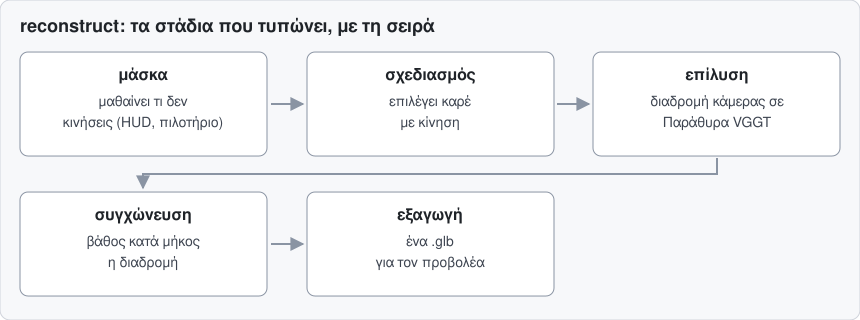

# Εκτός σύνδεσης ανακατασκευή {#offline-reconstruction}

```bash
python -m heat3d_capture reconstruct lap.mp4 -o lap.glb [--solve-budget 260] [--fuse-interval 0.4]
```

Κώδικας: [`scan/offline.py`](https://github.com/Holdi601/3DHeat-GameCapture/blob/main/heat3d_capture/scan/offline.py),
[`pose/feedforward.py`](https://github.com/Holdi601/3DHeat-GameCapture/blob/main/heat3d_capture/pose/feedforward.py),
[`pose/vggt_model.py`](https://github.com/Holdi601/3DHeat-GameCapture/blob/main/heat3d_capture/pose/vggt_model.py),
[`pose/feedforward_source.py`](https://github.com/Holdi601/3DHeat-GameCapture/blob/main/heat3d_capture/pose/feedforward_source.py),
[`pose/solveprep.py`](https://github.com/Holdi601/3DHeat-GameCapture/blob/main/heat3d_capture/pose/solveprep.py).
Επιλογές: [Αναφορά εντολών](commands.md#reconstruct).

## Γιατί δεύτερη διαδρομή {#why-a-second-path}

Η σταδιακή παρακολούθηση είναι ζωντανή και φθηνή και δουλεύει όπου υπάρχει δομή να πιαστεί κανείς: ένας
εσωτερικός χώρος, ένας δρόμος, ένας χάρτης με κάλυψη. Η **πίστα αγώνων είναι η χειρότερη περίπτωσή της**: ο
δρόμος είναι μια λεία ταινία με λίγη υφή, ο ορίζοντας σχεδόν δεν κινείται, και μόλις μερικές στάσεις
παρεκκλίνουν, καμία μεταγενέστερη δεν τις τραβά πίσω. Ένας γύρος βγαίνει ως καμπύλη που περιπλανιέται
αντί να κλείνει.

Η εκτός σύνδεσης διαδρομή δίνει **παράθυρα καρέ** σε ένα μοντέλο που προβλέπει όλες τις κάμερές τους μαζί,
ώστε κάθε καρέ να περιορίζει κάθε άλλο άμεσα αντί να το κάνει μέσω μιας αλυσίδας. Χρειάζεται ολόκληρη την
εγγραφή πριν μπορέσει να απαντήσει, οπότε δεν είναι ζωντανή, και είναι αργή: λεπτά ανά παράθυρο σε
επιτραπέζια GPU. Όλα όσα έρχονται μετά τις στάσεις - σύντηξη, κάλυψη, χρώμα, εξαγωγή - είναι ο ίδιος κώδικας
με τη ζωντανή σάρωση: η λυμένη διαδρομή δίνεται στον ανακατασκευαστή ως πηγή στάσεων, ακριβώς εκεί όπου
μπαίνει η τηλεμετρία του Forza.

## Απαιτήσεις {#requirements}

- **PyTorch** ταιριασμένο με τη GPU σας (δεν καρφιτσώνεται από αυτό το έργο· εγκαταστήστε το πριν από το
  `requirements.txt`, βλ. [Περιβάλλον εκτέλεσης](runtime.md)).
- **`vggt`** - ο κώδικας του μοντέλου VGGT (`from vggt.models.vggt import VGGT`), από το αποθετήριο GitHub
  της Meta· δεν υπάρχει στον δείκτη πακέτων.
- **`transformers`**, επειδή η εκτός σύνδεσης διαδρομή τρέχει το βάθος μέσω του `DepthEstimator` σε PyTorch
  (Depth Anything V2 Small), όχι μέσω του αρχείου ONNX.
- Στην πράξη μια GPU CUDA· και τα δύο μοντέλα πέφτουν σε CPU, που δεν είναι πρακτικό.

Τίποτα από αυτά δεν βρίσκεται στο `requirements.txt`, επειδή ο σαρωτής δεν τα χρειάζεται. Βρίσκονται στο
**`requirements-offline.txt`**, μαζί με τις δικές τους εξαρτήσεις του VGGT (`einops`, `safetensors`,
`huggingface_hub`, `Pillow`):

```bash
.venv\Scripts\python -m pip install -r requirements-offline.txt
.venv\Scripts\python -m pip install --no-deps "vggt @ git+https://github.com/facebookresearch/vggt.git"
```

Το VGGT εγκαθίσταται με `--no-deps` επειδή τα μεταδεδομένα του καρφιτσώνουν `numpy<2`, και το pip θα
υποβίβαζε το numpy που χρειάζεται εδώ το scipy. Το `reconstruct` ελέγχει όλα αυτά αμέσως μετά την εκτύπωση
της γραμμής άδειας (η λίστα `OFFLINE` στο
[`runtime/preflight.py`](https://github.com/Holdi601/3DHeat-GameCapture/blob/main/heat3d_capture/runtime/preflight.py)),
λέει τι λείπει με τα μεγέθη, και εγκαθιστά μόνο με ναι - το VGGT με `--no-deps`, όπως παραπάνω. Αν
αρνηθείτε, ή δεν υπάρχει τερματικό για να ρωτήσει, βγαίνει με κωδικό 1.

## Το μοντέλο και η άδειά του {#the-model-and-its-licence}

**VGGT**, `facebook/VGGT-1B`: **CC-BY-NC-4.0, μόνο μη εμπορική χρήση, και μια ανακατασκευή που γίνεται μαζί του
κληρονομεί αυτόν τον περιορισμό.** Η εντολή τυπώνει αυτή τη γραμμή πριν ξεκινήσει (`describe_licence`). Υπάρχει
και ένα ξεχωριστά αδειοδοτημένο `facebook/VGGT-1B-Commercial`, αλλά είναι αποθετήριο με πύλη που η Meta
παραχωρεί ανά λογαριασμό, οπότε δεν μπορεί να είναι η προεπιλογή. Το `--model vggt-1b-commercial` λύνει με
αυτό (και τυπώνει τη δική του γραμμή άδειας)· χωρίς παραχωρημένη πρόσβαση η λήψη αποτυγχάνει. Ο *κώδικας*
του `vggt` βρίσκεται κάτω από τη δική της "VGGT License" της Meta, μια συμφωνία για ερευνητικά υλικά με πολιτική
αποδεκτής χρήσης (διαβάστηκε από το `LICENSE.txt` του πακέτου). Βλ. [Μοντέλα και άδειες](models-and-licences.md).

## Η εκτέλεση, στάδιο προς στάδιο {#the-run-stage-by-stage}

Τα ονόματα των σταδίων είναι αυτά που τυπώνει η εντολή.



### masking {#masking}

Ένα `FlowMask` μαθαίνεται από **4 εκτελέσεις των 90 συνεχόμενων καρέ**, κεντραρισμένες στο 1/8, 3/8, 5/8 και
7/8 του βίντεο, σε 960 x 540 γκρι (βλ. [FlowMask](reconstruction-capture.md#flowmask-what-never-travels)). Η
σημείωσή του τυπώνεται και διατηρείται στη σύνοψη. Ένα βίντεο κοντύτερο από 90 καρέ δεν παίρνει μάσκα.

#### Η μάσκα κάμερας μαθαίνεται, δεν εφαρμόζεται {#the-camera-mask-is-learned-not-applied}

Η μάσκα **δεν** εφαρμόζεται στα καρέ που δίνονται στον επιλύτη. Η μάσκαρισμα του καμπίνας φαινόταν σωστό από
τα στατιστικά χαρακτηριστικών (τα περισσότερα από τα ανιχνευμένα σημεία γωνιών βρίσκονται σε pixels
στερεωμένα στην κάμερα)· όμως αυτό είναι δήλωση για έναν ανιχνευτή χαρακτηριστικών, και ο επιλύτης είναι ένα
εκπαιδευμένο δίκτυο. Μετρημένο από το πόσο στρίβει η ανακτημένη διαδρομή μεταξύ διαδοχικών βημάτων (ένα
αυτοκίνητο στρίβει λίγες μοίρες· ένας τυχαίος περίπατος ενενήντα), τα ακατέργαστα καρέ έδωσαν το μικρότερο
στρίψιμο, τα καρέ με ενισχυμένη αντίθεση λίγο περισσότερο, τα καρέ με μάσκα σαφώς περισσότερο, και και τα δύο
μαζί το περισσότερο. Γι' αυτό ο επιλύτης παίρνει ακατέργαστα καρέ. Η μάσκα χρησιμοποιείται ακόμη για τον
σχεδιασμό της απόστασης των καρέ παρακάτω, και η σταδιακή παρακολούθηση την χρησιμοποιεί στη ζωντανή σάρωση.
(Το `solveprep.enhance`, που μασκάρει και ανεβάζει την τοπική αντίθεση με CLAHE, υπάρχει αλλά δεν
χρησιμοποιείται από αυτή την εντολή.)

### planning: καρέ αραιωμένα με βάση την κίνηση {#planning-frames-spaced-by-motion}

Το `plan_by_motion` επιλέγει τα καρέ του επιλύτη με βάση **πόσο κινήθηκε η εικόνα**, όχι με βάση το ρολόι: ένα
σταθερό διάστημα δίνει στα αργά τμήματα καρέ που δεν χρειάζονται και στερεί τα γρήγορα, όπου τα διαδοχικά
καρέ σταματούν να επικαλύπτονται αρκετά ώστε να σχετίζονται.

- Στόχος μετατόπισης: **5% ενός πλάτους 960 pixels** (48 px) διάμεση μετατόπιση χαρακτηριστικών ORB μεταξύ των
  διαδοχικών επιλεγμένων καρέ, μετρημένη σε καρέ 960 x 540 γκρι με αντίθεση CLAHE, με χαρακτηριστικά μόνο στη
  μάσκα.
- Αρχή με διάστημα 0,3 s· μετά από κάθε βήμα, το επόμενο διάστημα γίνεται
  `διάστημα x (0,5 + 0,5 x στόχος / μετρημένο)`, περιορισμένο στο **0,15-2,0 s**, ώστε μία θορυβώδης μέτρηση να
  μην ανατρέπει το πλάνο.
- Όταν δεν ταίριαξε τίποτα, το διάστημα μικραίνει στο 0,6 του εαυτού του (το να είναι πολύ απομακρυσμένα τα
  καρέ είναι η αποτυχία που αποφεύγεται).
- Σταματά στο τέλος του βίντεο ή στο `--solve-budget` καρέ (προεπιλογή 260).

Λιγότερα από 4 σχεδιασμένα καρέ είναι σφάλμα.

### solving: παράθυρα και ραφή {#solving-windows-and-stitching}

Τα σχεδιασμένα καρέ αποκωδικοποιούνται σε πλάτος 960 px και επιλύονται σε **επικαλυπτόμενα παράθυρα των 16
καρέ, με 6 κοινά** με το επόμενο (`plan_windows`· το τελευταίο παράθυρο τραβιέται πίσω ώστε να τελειώνει στο
τελικό καρέ, ώστε το τέλος μιας λήψης να έχει τόσους γείτονες όσο και η μέση). Περισσότερα από **400** καρέ
σε μία εκτέλεση απορρίπτονται.

Κάθε παράθυρο: τα καρέ αλλάζουν μέγεθος ώστε η μεγάλη πλευρά να είναι **518** και και οι δύο πλευρές να είναι
πολλαπλάσια του **14** (ο λόγος διαστάσεων διατηρείται - το στρίμωγμα θα παραμόρφωνε το οπτικό πεδίο), κλιμακώνονται
σε 0..1, και τρέχουν στο VGGT με αυτόματη ακρίβεια bfloat16 (το float16 εξαντλεί το εκθετικό εύρος στις πολύ
μακρινές συντεταγμένες του κόσμου). Οι εξωτερικές παράμετροι της κάμερας μετατρέπονται σε περιστροφές
κόσμου-από-κάμερας και κέντρα κάμερας. Οι χάρτες σημείων δεν κρατιούνται από προεπιλογή.

Κάθε παράθυρο επιστρέφεται στο **δικό του αυθαίρετο σύστημα και στη δική του αυθαίρετη κλίμακα**, οπότε τα
παράθυρα **ράβονται** στο σύστημα του πρώτου με έναν μετασχηματισμό ομοιότητας (περιστροφή, μετατόπιση, μία
κλίμακα) που προσαρμόζεται στις κάμερες που μοιράζονται με ό,τι έχει ήδη τοποθετηθεί:

- **Περιστροφή από τον προσανατολισμό των καμερών**, όχι από τις θέσεις τους: οι κοινές κάμερες βρίσκονται κατά
  μήκος της διαδρομής και είναι σχεδόν συγγραμμικές σε μια ευθεία, πράγμα που αφήνει μια προσαρμογή μόνο με
  θέσεις τυφλή στην περιστροφή - κάθε παράθυρο θα κυρτωνόταν και το τελικό αποτέλεσμα θα έβγαινε ευθύ. Η
  περιστροφή είναι ο μέσος όρος των `target_R x source_R^T` προβεβλημένος πίσω σε πραγματική περιστροφή (με
  φύλακα ανάκλασης).
- **Κλίμακα και μετατόπιση από τις θέσεις**, κατά μήκος της περιστραμμένης πηγής.
- Απαιτούνται τουλάχιστον **4** κοινές κάμερες· λιγότερες είναι σφάλμα.
- Η επικάλυψη είναι το ένα τρίτο του παραθύρου, ώστε η κλίμακα να είναι καλά ορισμένη· το σφάλμα κλίμακας που
  συσσωρεύεται από παράθυρο σε παράθυρο είναι αυτό που κάνει έναν γύρο να σπειροειδεί.

Για κάθε ραφή καταγράφεται η χειρότερη διαφωνία των κοινών καμερών μετά την προσαρμογή, σε μονάδες του μέσου
διαστήματος μεταξύ τους (`seam_error`).

### fusing {#fusing}

Καρέ ανά `--fuse-interval` δευτερόλεπτα (προεπιλογή 0,4) αποκωδικοποιούνται σε πλάτος 960 px, παίρνουν βάθος από
το Depth Anything V2 Small (PyTorch), και συντήκονται με στάση **παρεμβαλλόμενη** από τη λυμένη διαδρομή στη
χρονική τους σήμανση (γραμμική θέση, σφαιρική περιστροφή· `FeedForwardPoses`). Καρέ εκτός του λυμένου χρονικού
διαστήματος παραλείπονται αντί να εξωτερικεύονται. Η κάμερα χρησιμοποιεί οριζόντιο οπτικό πεδίο **65 μοιρών**. Οι
στάσεις feed-forward φέρουν εμπιστοσύνη 0,85 στη σύντηξη και στην κάλυψη.

### exporting {#exporting}

Το πλέγμα γράφεται όπως σε μια ζωντανή σάρωση ([Η έξοδος .glb](glb-output.md)), με το όνομα του βίντεου.

## Η σύνοψη {#the-summary}

```text
140 cameras solved over 182s
closure error 3.1% of path length
worst seam 0.42 frame spacings
<mask note>
wrote lap.glb
```

| Γραμμή | Σημασία |
|---|---|
| closure error | απόσταση από την πρώτη ως την τελευταία κάμερα ως ποσοστό του μήκους της διαδρομής. Για έναν μόνο γύρο είναι το ειλικρινές μέτρο της παρέκκλισης. Πάνω από 10%: "The lap does not close ... Treat the shape as unreliable." |
| worst seam | η μεγαλύτερη διαφωνία ραφής. Πάνω από 1,0: "Windows disagreed by up to N frame spacings at a seam, so part of the path is stitched on weak evidence." |
| no file | "Fusion produced no surface, so nothing was written." Ο κωδικός εξόδου είναι τότε 1. |

## Κλίμακα {#scale}

Η ραμμένη διαδρομή είναι στις αυθαίρετες μονάδες του πρώτου παραθύρου. Το βάθος αγκυρώνεται με τριγωνισμό ανάμεσα
στις παρεμβαλλόμενες στάσεις (όπως για την τηλεμετρία), οπότε η γεωμετρία συμφωνεί με τη διαδρομή - αλλά **το
αποτέλεσμα δεν είναι σε μέτρα** εκτός αν είναι η διαδρομή. Τίποτα σε αυτή την εντολή δεν καθορίζει την καθολική
κλίμακα· η βαθμονόμηση εδάφους δεν εφαρμόζεται όταν οι στάσεις έρχονται από πηγή στάσεων.

## Κατάσταση αυτής της διαδρομής {#state-of-this-path}

Με καρέ σε σταθερό διάστημα, τα παράθυρα λύνονται σε μια συνεκτική διαδρομή σε ορισμένα τμήματα ενός γύρου και
σε μια γραφή-μουτζούρα σε άλλα· οι αποτυχίες είναι οι σφιχτές στροφές, όπου η θέαση αλλάζει απότομα ανάμεσα σε
καρέ, και η πυκνότερη δειγματοληψία εκείνων των στροφών τις ανακτά. Καμία στατιστική εικόνας που δοκιμάστηκε
(φωτεινότητα, λεπτομέρεια, πλήθος χαρακτηριστικών, αναλογία inliers, μετατόπιση) δεν προέβλεψε εκ των προτέρων
ποια τμήματα θα αποτύχουν. Άρα η απόσταση δεν μπορεί να σχεδιαστεί πλήρως από τις εικόνες εκ των προτέρων: πρέπει
να επιλεγεί με επίλυση, μέτρηση του αποτελέσματος και επανεπίλυση πυκνότερα εκεί όπου η διαδρομή δεν είναι μία
που θα μπορούσε να έχει οδηγήσει ένα αυτοκίνητο. Ο σχεδιασμός με βάση την κίνηση είναι χτισμένος· **η
προσαρμοστική επανεπίλυση δεν είναι**.
