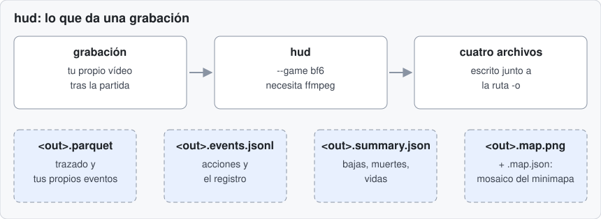

# Leer el HUD de una grabación {#reading-the-hud-from-a-recording}

`hud` lee el HUD del juego, es decir, la información en pantalla, de la **propia grabación** del jugador,
después de la partida: las acciones **propias** del jugador a partir del aviso de puntos que el juego muestra
bajo la mira (eliminaciones, asistencias, reanimaciones, reabastecimientos, capturas...), sus muertes a partir
de las pantallas de caída y de despliegue, su **propio** recorrido desde el minimapa, y el registro de
eliminaciones junto a ellos como eventos con marca de tiempo. Todo se escribe como una tabla de 3DHeat, con
el mosaico del minimapa como imagen de mapa para colocar debajo.

En resumen: mira el vídeo de tu partida y anota tus eliminaciones, tus muertes y por dónde caminaste.

```bash
.venv\Scripts\python -m heat3d_capture hud "<recording>.mp4" --game bf6 --player <name> -o out/match
```

Battlefield 6 es el primer perfil de juego.



## Qué hace y qué no toca {#what-it-does-and-does-not-touch}

- Lee un **archivo de vídeo**: un clip de ShadowPlay / Instant Replay, una grabación de OBS, cualquier cosa que
  ffmpeg pueda decodificar. Nunca toca el juego, su memoria, sus archivos ni su red, y se ejecuta cuando la
  partida ya ha terminado. Ver [Las reglas](rules.md).
- Deriva **solo la posición del propio jugador**, a partir de su propio minimapa. Las marcas de otros jugadores
  en el minimapa se enmascaran y nunca se leen. El registro de eliminaciones se conserva completo, pero solo como
  lo que dice en pantalla (quién, a quién, con qué, cuándo); no se asocia ninguna posición a nadie más que al
  jugador.
- El OCR se ejecuta en local (RapidOCR con los modelos de PaddleOCR a través de ONNX Runtime). Ningún fotograma
  ni recorte sale de la máquina.
- Una grabación muestra los nombres de otros jugadores, y el mosaico es una imagen del nivel. Los resultados son
  para uso propio del jugador; guárdalos en local.

## Requisitos {#requirements}

- **ffmpeg y ffprobe** en `PATH`. Si hay una tarjeta NVIDIA, se usa para decodificar (`-hwaccel cuda`); si no, la
  CPU decodifica, varias veces más despacio.
- Los paquetes de `requirements.txt`, y el OCR sin sus propias dependencias (pide la `onnxruntime` de CPU, que
  choca con la de DirectML que usa el proyecto):

```bash
.venv\Scripts\python -m pip install -r requirements.txt
.venv\Scripts\python -m pip install --no-deps rapidocr_onnxruntime==1.2.3
```

`rapidocr_onnxruntime` es el lector de texto (OCR) que lee los nombres y las palabras de la pantalla.
`--no-deps` evita que sustituya la `onnxruntime` de DirectML del proyecto.

Para instalar ffmpeg en Windows: `winget install Gyan.FFmpeg`, después abre una terminal nueva y comprueba con
`ffmpeg -version`. ¿Nuevo en la línea de comandos? Lee [Antes de empezar](before-you-start.md).

- Una grabación **16:9** de cualquier resolución (1080p, 1440p, 4K). Otras proporciones se rechazan, porque las
  cajas del perfil caerían en partes equivocadas de la pantalla.
- El **diseño de HUD por defecto** del juego. Un elemento del HUD movido o escalado se lee en el lugar equivocado.

## Opciones {#options}

| Opción | Por defecto | Significado |
|---|---|---|
| `video` | | La grabación. |
| `-o`, `--out` | el nombre del vídeo, en la carpeta actual | Ruta de salida **sin** extensión; los archivos son `<out>.parquet`, `.events.jsonl`, `.summary.json`, `.map.png`, `.map.json`. |
| `--game` | `bf6` | De qué juego se lee el HUD. `bf6` (Battlefield 6) es, de momento, el único perfil. |
| `--player` | ninguno | El nombre del jugador tal como lo muestra el registro de eliminaciones. Se compara de forma flexible (el OCR confunde `l`/`I`/`1`, `O`/`0`, `rn`/`m`). Sin él, el nombre se adivina (más abajo). |
| `--fps` | 5 | Muestras del minimapa por segundo. El registro de eliminaciones se muestrea a la mitad de esa frecuencia, el aviso de puntos y las pantallas de muerte también a la mitad (a un cuarto mientras no hay ningún aviso), la brújula cada 3 s, la lista de escuadra cada 15 s. |
| `--start` | 0 | Segundos del vídeo en los que empezar. |
| `--seconds` | todo | Cuánto del vídeo leer. |
| `--metres-per-pixel` | ninguno | La escala del minimapa, si se conoce: metros por píxel del minimapa con el zoom habitual (el minimapa mide 296 píxeles de ancho en una pantalla de 1080p). Sin ella las posiciones van en esos píxeles; ver [Unidades](#north-and-units). |
| `--cpu` | desactivado | Decodificar en la CPU aunque haya una tarjeta NVIDIA. |

El progreso se imprime cada cinco segundos; al final, el jugador, las eliminaciones, las muertes, las vidas y los
archivos escritos.

## Salidas {#outputs}

### `<out>.parquet` - el recorrido y los eventos del jugador {#parquet---the-players-track-and-events}

Una fila por muestra en la que el jugador estaba en juego y el minimapa pudo ubicarse, más una por cada evento
suyo. El pie del archivo lleva las instrucciones de lectura del visor (clave `heat3d`, `kind: heat3d-hud`), así
que el visor asigna cada columna sin preguntar.

| Columna | Significado |
|---|---|
| `time` | Segundos desde el inicio del vídeo. |
| `event` | `position`; `start` (el vídeo empezó a mitad de una vida), `spawn` (de vuelta en juego tras una muerte o un hueco largo), `death`, `downed` y `revived` (de las pantallas de muerte, más abajo), `end` (una vida terminó sin que nada indique cómo); las acciones propias del jugador del aviso de puntos (`kill`, `assist`, `reviving`, `resupply`, `capture`... - la [tabla de eventos](#event-table)); y las líneas del registro de eliminaciones sobre el jugador como `kill_feed`, `death_feed`, `teamkill_feed`, `suicide_feed`, `squadwipe_feed`. |
| `source` | De dónde viene el evento de la fila: `points` (el aviso), `screen` (las pantallas de caída y de despliegue), `feed` (el registro de eliminaciones); vacío en las filas de posición. |
| `text` | En las filas `points`: la etiqueta tal como aparece (`KILL`, `SQUAD DAMAGE ASSIST`...), o el título (`DOUBLE KILL`, el nombre de una cinta), o, para una etiqueta desconocida, lo que se leyó. |
| `points` | En las filas `points`: cuánto subió el total del aviso en ese momento. Cuando varias acciones llegan en la misma muestra (una eliminación y el vehículo en el que iba) es su suma, indicada en cada una, y `shared` dice cuántas la compartieron. Vacío cuando el total no se leyó dos veces, a ambos lados del momento. |
| `subject`, `subject_side` | En las filas `points`: el nombre que mostró el aviso junto a la acción (la víctima de una eliminación, el compañero reanimado o reabastecido) y su color (`enemy`, `friendly`, `squad`). |
| `confirmed` | `feed` cuando el registro de eliminaciones tenía una línea para la misma baja o muerte (dentro de 3 s, con la misma víctima). |
| `x`, `y`, `z` | Posición en el mosaico: `x` este, `y` norte, `z` 0 (el pie del archivo dice que `z` es hacia arriba). El norte es el norte real cuando la brújula lo permitió (ver `north_up` en el resumen). |
| `player` | Siempre `me`. Solo las filas del propio jugador tienen posiciones. |
| `team` | `own`. |
| `session` | `<nombre del vídeo>#NN`, una por vida. Las rutas de calor en líneas nunca cruzan una sesión. |
| `heading` | Grados en sentido horario desde el norte (desde la parte superior del mosaico cuando el norte es desconocido): hacia dónde miraba la vista. |
| `dir_x`, `dir_y`, `dir_z` | Lo mismo como vector de dirección, para la dirección de mirada del visor. |
| `zoom` | Cuánto estaba alejado el minimapa respecto a su zoom habitual (por encima de 1 en vehículos). |
| `killer`, `victim`, `weapon`, `headshot`, `marker` | En las filas de eliminación y muerte que tienen una línea del registro: esa línea (más abajo). Una eliminación del aviso sin línea del registro tiene como `victim` el nombre del aviso; una eliminación del aviso mostrada como HEADSHOT tiene `headshot` en true. |

Cada fila de evento toma la posición del jugador en el momento del evento (en una muerte o una caída, la última
posición antes; en una reanimación, la primera después). Las filas encajan directamente en el
[calor en líneas](https://holdi601.github.io/3DHeat/line-heat.html) del visor: su sugerencia elige `event`,
empieza en `start`, `spawn` y `revived`, termina en `death`, `downed` y `end`, y las filas `position` quedan
a lo largo de la ruta. Los demás eventos se nombran de modo que la sugerencia no tome ninguno como inicio o fin:
dar una reanimación es `reviving` (no `revive`), mantener un punto es `defense`, un compañero que aparece sobre el
jugador es `teammate_arrived`, las líneas del registro son `kill_feed` y así sucesivamente; `kill` no es un fin.

Un clip con dos rondas en dos mapas da dos mosaicos que no se pueden relacionar. El más grande es
`<out>.parquet`; cada uno de los demás con al menos 30 s de recorrido se escribe junto a él como
`<out>.map2.parquet`, `<out>.map2.map.png`, y así sucesivamente.

### `<out>.events.jsonl` - los eventos del jugador y el registro de eliminaciones {#eventsjsonl---the-players-events-and-the-kill-feed}

Un objeto JSON por línea, en orden de tiempo, cada uno con un `source`:

- `points`: uno por cada acción del jugador: `time`, `event`, `text`, `points`, `shared`,
  `subject`, `subject_side` (como en la tabla), `popup` (de qué aviso vino, numerado a lo largo de la
  ejecución), `seen` (cuántas lecturas lo mostraron), `confirmed`, y `x`, `y` donde estaba el jugador.
- `screen`: uno por cada caída y cada reanimación: `event` (`death`, `downed` o `revived`), `time` (cuando
  el jugador cayó; en `revived`, cuando se fueron las pantallas), `until` (la última vez que se vieron las
  pantallas), `screens` (`down` y/o `card`), `outcome` (`death`, `revived` o `unknown` cuando el vídeo
  termina antes), `killer` (de la línea del registro, cuando la hay), `x`, `y`.
- `feed`: cada línea que mostró el registro, de todos:

| Campo | Significado |
|---|---|
| `time`, `last` | Primera y última muestra en la que se leyó la línea (segundos desde el inicio del vídeo). `time` es cuando apareció la baja, con una precisión de una muestra del registro (0,4 s con la frecuencia por defecto). |
| `kind` | Desde el lado del jugador: `kill`, `death`, `teamkill`, `suicide`, `squadwipe`; para las líneas de otros jugadores `kill`, `squadwipe`, o `death` para una línea sin asesino. |
| `killer`, `victim` | Los nombres, como la lectura más frecuente entre todas las muestras que mostraron la línea (gana una lectura más larga cuando la común es su inicio: un nombre parcialmente oculto). `killer` queda vacío en una línea que solo mostró un icono y una víctima: una muerte causada por el entorno, o una línea cuyo asesino ya se había desvanecido. |
| `killer_side`, `victim_side` | Según el color del nombre: `friendly` (el equipo del jugador, azul), `enemy` (naranja), `squad` (el verde pálido que usa el juego para el jugador y su escuadra), `neutral` (ninguno de estos). |
| `weapon` | La clase del icono del arma dentro de esta ejecución: `icon01`, `icon02`... Las líneas cuyos iconos se parecen comparten clase. Los iconos no tienen nombre; no hay una lista de la que tomarlos. |
| `marker` | El pequeño icono entre el arma y la víctima: `skull`, `arrow`, `chevrons`, `crosses` o vacío. |
| `headshot` | `marker == "skull"` - una suposición, ver [Límites](#limits). |
| `seen` | Cuántas muestras del registro mostraron la línea. |
| `me` | `killer`, `victim` o null. |
| `matched` | En las líneas propias del jugador: si se encontró para ella una acción del aviso o una pantalla de muerte. |
| `x`, `y` (, `map`) | En las líneas propias del jugador: dónde estaba. |

### `<out>.summary.json` {#summaryjson}

Jugador (y cómo se encontró), de dónde vinieron los eventos del jugador (`own_events_from`: el aviso y las
pantallas, o solo el registro de eliminaciones cuando no se leyó ninguno de los dos), eliminaciones, muertes,
K/D, headshots, asistencias, reanimaciones dadas (`revives`) y recibidas (`revived`), caídas, capturas,
neutralizaciones, reabastecimientos, curaciones, reparaciones, vehículos destruidos, la puntuación (la suma de
los totales de los avisos), cada tipo de acción con su número (`actions`), el número de avisos, las muertes que
solo mostró el registro, el propio recuento de eliminaciones y muertes del registro y cuántas de sus
eliminaciones coincidieron con una del aviso, las bajas por fuego amigo, los suicidios, las aniquilaciones de
escuadra, las vidas, los segundos en juego, la distancia recorrida (en las unidades de la tabla), las líneas
del registro, por mapa si está orientado al norte y cuántas lecturas de brújula coincidieron, los recuentos del
recorrido (muestras, en juego, ubicadas, no ubicadas, islas), las suposiciones hechas y los tiempos.

### `<out>.map.png` y `<out>.map.json` - el mapa bajo el recorrido {#mappng-and-mapjson---the-map-under-the-track}

El mosaico de todos los minimapas de la ejecución, promediado, sin superposiciones, girado y escalado exactamente
como la tabla. El archivo JSON complementario contiene las dos anclas que pide la colocación **Imagen de mapa**
del visor ([Imágenes de mapa](https://holdi601.github.io/3DHeat/map-images.html) en la documentación del visor):
carga el PNG con **Imagen de mapa...**, deja activado **Invertir norte/sur** y escribe el ancla 1 y el ancla 2
(`px`, `py`, `worldX`, `worldZ`) desde el archivo complementario. La imagen queda entonces exactamente debajo del
recorrido.

Solo aparecen en la imagen las partes del nivel que mostró el minimapa del jugador.

## Método {#method}

### Decodificación {#decoding}

ffmpeg decodifica en la GPU, reduce a la frecuencia de muestreo mientras los fotogramas siguen en la tarjeta,
recorta las regiones del perfil (minimapa, registro de eliminaciones, dos tiras de brújula, la lista de
escuadra, el aviso de puntos, las palabras de la pantalla de caída, la esquina inferior derecha), escala cada una a
un tamaño fijo y las apila en una imagen pequeña por muestra. Solo esa imagen pasa por la tubería hacia Python.
Decodificar cada fotograma del flujo H.264 es el mínimo del tiempo de ejecución.

Dos hilos de trabajo toman las muestras: uno registra los minimapas (OpenCV), otro lee el texto (ONNX Runtime).

### En juego o no {#in-play-or-not}

El cuadro de la indicación de tecla del minimapa (el cuadrado claro con la tecla del mapa dentro, abajo a la
izquierda del minimapa) se dibuja siempre que se dibuja el minimapa, y no en las pantallas de muerte, de
repetición de la muerte, de despliegue, de menú o de marcador. Su presencia (un cuadrado claro y sin color, con una
letra oscura en el centro, claramente más claro que lo que lo rodea), buscada a unos píxeles de su lugar, es la
prueba de juego. Una muestra única que discrepa de sus dos vecinas se ignora.

Un hueco en el juego es una muerte o un cambio de ronda (el siguiente tramo empieza con `spawn`) cuando dura al
menos 6 s, o cuando una muerte (de las pantallas, o una línea del registro que nombra al jugador como víctima)
ocurrió hasta 40 s antes; un hueco más corto sin muerte (se abrió el mapa grande) continúa la vida. El minimapa
sigue visible mientras el jugador está caído, así que un jugador caído está en juego.

### El recorrido {#the-track}

El minimapa gira con la vista y mantiene al jugador en un punto fijo (medido: el centro, 49,7% hacia abajo). Cada
muestra:

1. **Enmascarar** lo que no es el nivel: píxeles de color intenso o casi blancos (marcadores de objetivo, iconos de
   escuadra y de vehículos, avisos, el borde de la zona de juego, líneas de ruta, texto), el amarillo-verdoso
   tenue del cono de visión, un disco alrededor del marcador del jugador, la cuña del cono encima de él, la
   indicación de tecla y un borde fino.
2. **Características**: puntos clave SIFT sobre el minimapa en gris con el contraste igualado, dentro de la máscara.
3. **Registrar en el mosaico**, no en la muestra anterior: los puntos clave se comparan con las características
   guardadas hasta ahora, en coordenadas del mosaico, cerca de donde estuvo el jugador por última vez; una
   similitud (giro, zoom, desplazamiento) se ajusta con RANSAC. Un ajuste necesita suficientes inliers, un zoom a
   menos de un tercio del anterior y un desplazamiento de menos de un tercio del minimapa por muestra; un ajuste
   buscado en cualquier parte del mosaico (tras una muerte) necesita el doble de inliers.
4. **Hacer crecer el mosaico**: se añaden las características que el mosaico aún no tiene (como mucho cada pocas
   décimas de segundo de movimiento), y el minimapa enmascarado se promedia en la imagen.
5. El punto del jugador llevado a través del ajuste es su **posición**; el arriba del minimapa llevado a través de
   él es su **orientación** en el mosaico.

Después, un punto que salta más de 10 píxeles lejos de los dos anteriores y de los dos siguientes (que concuerdan
entre sí) se descarta: a veces un minimapa encaja con un zoom erróneo durante una muestra. El resumen cuenta estos
casos (`dropped_as_jumps`).

Registrar en el mosaico es lo que evita que los errores se acumulen: volver a un lugar encaja con las
características guardadas la primera vez. Una aparición en un sitio aún no visto inicia una **isla** aparte; cada
décima muestra ubicada se prueba contra las otras islas, y la primera buena coincidencia las une (la más pequeña se
mete en la más grande, con su recorrido). Las islas que nunca se unen (otro mapa, o terreno que nunca se compartió)
se escriben por separado, como antes.

### Norte y unidades {#north-and-units}

La tira de la brújula se lee cada 3 s: sus etiquetas se encuentran por su tinta (brillante, sin color, agrupada a
través de huecos pequeños, sin las marcas), cada una se lee por separado, y dos o más etiquetas fijan tanto la
escala de la tira como el rumbo bajo la marca central; una sola etiqueta no fija nada. Cada lectura de brújula se
empareja con la orientación del mosaico de la misma muestra; la mediana circular de las diferencias, sobre las
lecturas a menos de 10 grados de ella, es el giro que pone el norte del mosaico hacia arriba. Se aplica cuando hay
al menos tres lecturas y la mitad de todas coinciden.

<a id="units"></a>La escala terrestre del minimapa no aparece impresa en ningún lugar de la pantalla, así que las
posiciones van en **píxeles del minimapa con el zoom habitual**: el zoom mediano de la ejecución se escala a una
unidad de tabla por píxel de un minimapa de 296 píxeles (su tamaño en una pantalla de 1080p). La reducción de zoom
del vehículo se elimina en el registro, así que una unidad es la misma a pie y en vehículo. `--metres-per-pixel`
multiplica todo a metros cuando la escala es conocida (a partir de una distancia conocida en el mapa, medida una
vez).

### El registro de eliminaciones {#the-kill-feed}

El registro se lee a 2,5 muestras por segundo, pero solo cuando sus píxeles de color cambiaron de forma apreciable o
pasaron 2 s. Las líneas de texto las encuentra el detector del OCR; una línea cuya imagen coincide con una leída en
la muestra anterior (las filas se desplazan, así que puede haberse movido) toma ese texto en lugar de leerse de
nuevo. Se descartan las líneas demasiado pequeñas para un nombre, o con una barra (un contador de FPS en esa
esquina).

Las líneas se agrupan en filas por altura; en una fila, el nombre más a la izquierda es el asesino y el más a la
derecha la víctima. Los trozos vecinos del mismo color se unen (un nombre con un espacio). Una sola línea que cruzó el
icono desde un nombre hasta el otro se corta en su hueco más ancho cuando las mitades difieren en color, y cada mitad
se vuelve a leer. Un único nombre en la columna de víctimas con un icono justo a su izquierda es una línea sin
asesino. Dos trozos del mismo color sin un icono entre ellos son un solo nombre cuyo asesino se ha desvanecido, no
una eliminación.

**Los lados** salen del color. Los nombres se dibujan con algo de transparencia, así que la prueba se hace según
cuánto se aleja el texto de su propio fondo: el signo de rojo menos azul en esa diferencia es naranja (enemigo) o azul
(amigo) sobre cualquier fondo; ni uno ni otro, con el verde por encima de los otros dos, es el color de escuadra.

**Iconos**: entre los nombres, los píxeles del color del asesino forman la silueta del arma; un icono pequeño y
separado justo antes de la víctima es el marcador, con nombre según su forma (una mancha con agujeros de ojos es una
calavera; un pequeño triángulo, una flecha; varios trozos, cruces).

**Eventos**: una fila leída de nuevo con los dos nombres iguales (similitud 0,7 tras corregir las confusiones habituales
del OCR, una de ellas 0,8; una lectura cortada coincide con el inicio del nombre completo) es el mismo evento, mientras
el evento se leyó por última vez hace menos de 5 s y tiene menos de 14 s; ninguna fila permanece más tiempo, así que el
mismo par más tarde es una nueva eliminación. Una fila sin asesino coincide solo por la víctima. El tiempo de un evento
es su primera aparición; sus nombres, lados y marcador son la mayoría entre las apariciones; las filas leídas solo una
vez se descartan.

**El jugador**: `--player`; si no, la fila resaltada (la más brillante) de la lista de escuadra cuando hay al menos tres
lecturas y el 60% coincide; si no, el nombre que el registro dibujó más veces en el color de escuadra. Si no, el
resumen dice que el jugador es desconocido, y ninguna línea del registro se atribuye a nadie. (El aviso y las pantallas
de muerte son del propio jugador sea cual sea su nombre; no necesitan nombre).

### El aviso de puntos {#the-points-popup}

Todo lo que puntúa el jugador, Battlefield 6 lo muestra en un solo aviso justo a la izquierda y debajo de la mira, en el
mismo lugar a pie, en vehículo y a través de una mira:

```
            [ RIBBON ] (icon)          a title, now and then: a ribbon or a multi-kill
      (icon)(icon)(icon)  300          one icon per action; the popup's running total
                Some_Name              who it was about, for a moment: orange an enemy, blue a teammate
    [ KILL x2 ] [ VEHICLE DESTROYED ]  one boxed tag per kind of action, with a count
```

El aviso crece mientras el jugador sigue puntuando: una nueva eliminación convierte `KILL` en `KILL x2`, añade un
icono y sube el total; un nuevo tipo de acción añade una etiqueta. La fila de etiquetas muestra los últimos tipos (una
más antigua sale deslizándose, y sigue contando cuando vuelve). Unos tres segundos después de la última acción, el aviso
se pliega en una sola línea (`[KILL x2] 300`) y desaparece. El texto es gris claro, las etiquetas van en recuadros finos,
el total en cifras grandes a partir de x 760 de una pantalla de 1920x1080, y las etiquetas alineadas a la derecha en
x 750.

Se lee 2,5 veces por segundo: el detector del OCR encuentra las líneas de texto, solo se leen las líneas de una de las
filas del aviso (las etiquetas propias del visor del tanque en la misma zona no), y una línea cuya imagen coincide con
una leída en la muestra anterior toma ese texto. Una línea que cruza desde un icono, un nombre o una etiqueta plegada
hasta el total (`Name10`, `REVIVE185`) se corta donde empieza el total (x 755) y ambas mitades se vuelven a leer. Mientras
no hay ningún aviso, cada dos muestras se retienen sin leer; cuando la siguiente muestra un aviso, la retenida se lee
primero, así que el inicio de un aviso se encuentra hasta la muestra.

**Las etiquetas** se asocian a la [tabla de eventos](#event-table) tras corregir los errores habituales del reconocedor
(Q leída como O, un dígito entre letras, I por L, una letra perdida en un borde): una lectura es una etiqueta cuando
se parece al menos en un 80% a una (85% para etiquetas de cinco letras o menos) y está claramente más cerca de ella que
de cualquier otra. Las etiquetas que el reconocedor juntó (`CAPTUREDORDERCOMPLETED`) se separan quitando por delante las
etiquetas conocidas. Un recuento es `x2`, `X3`, un signo suelto y un dígito, o un dígito justo después de la etiqueta. Una
línea en gris claro, en mayúsculas, en la fila de etiquetas que no coincide con nada se conserva como una acción `points`
con su texto; una línea que es un trozo de una etiqueta conocida en el mismo aviso (`DESTROYED` junto a `VEHICLE
DESTROYED`) no. Los títulos encima del total (recuadros claros, texto oscuro) son `multi_kills` (`DOUBLE KILL`...) o
`ribbon`. El nombre es la línea coloreada entre el total y las etiquetas; su lado sale de su color, como en el registro.

**Avisos y acciones**: lecturas con menos de 0,9 s sin nada entre ellas forman un aviso. Un aviso que parece terminar y
vuelve antes de que pudiera haberse plegado (dentro de 3,2 s desde que último creció), con cada etiqueta en su recuento o
más y un total no menor, es el mismo aviso perdido un momento (borrón, fondo brillante): nada en él se cuenta dos veces.
Dentro de un aviso, el recuento final de una etiqueta es el más alto leído al menos dos veces; su k-ésima acción se
fecha en la primera lectura que muestra un recuento de k o más. Un recuento leído en una sola muestra no es una acción,
salvo una eliminación que el registro del jugador respalda (una línea del jugador dentro de 3 s que ninguna otra
eliminación reclamó): la etiqueta corta KILL es la que el reconocedor más a menudo lee una sola vez. Un título se cuenta
una vez por aviso, cuando se lee dos veces. `points` es cuánto creció el total (contando solo los totales leídos dos
veces seguidas) desde antes de la muestra de la acción hasta después.

Una línea desconocida cuenta como etiqueta solo en la fila de las etiquetas conocidas de la misma lectura (o, sin ninguna
etiqueta conocida, cuando tampoco hay nombre), así que un nombre dibujado en un color que la prueba de lado no distingue
no se toma por una etiqueta.

### Muertes y reanimaciones {#deaths-and-revives}

Cuando el jugador cae, el juego lo indica bajo el centro de la pantalla (MAN DOWN, REQUEST REVIVE, SKIP (HOLD), NEARBY
MEDICS; una vez pedida una reanimación, REVIVE REQUESTED, CANCEL REQUEST), y una tarjeta abajo a la derecha dice quién lo
hizo, con DAMAGE LOG o PLAYER CARD debajo y una línea "YOU n - n FOE" encima. Si murió de golpe (un disparo en la cabeza
mortal), solo aparece la tarjeta. Después, o un compañero reanima al jugador (las pantallas desaparecen y la partida sigue),
o el jugador se desangra o se rinde, y aparece la pantalla de despliegue, con DEPLOY abajo a la derecha.

Estas palabras se leen junto con el aviso, en la misma pasada del OCR (el aviso, la franja de la pantalla de caída y la
esquina inferior derecha apilados en una sola imagen): 2,5 veces por segundo mientras hay un aviso, 1,25 veces en los
demás casos. La esquina se incluye solo cuando el jugador está fuera de juego o se le vio caído en los últimos 3 s; en
juego solo contiene el contador de munición. Las apariciones con menos de 4 s entre sí forman un episodio (al menos dos
apariciones). Un episodio es una **muerte** cuando la pantalla de despliegue aparece dentro de 12 s de su final, o cuando
el jugador está fuera de juego 3 s después del episodio y lo sigue durante 6 s o más; es una **reanimación** (`downed`,
luego `revived`) cuando el jugador sigue en juego 3 s después de que se fueran las pantallas; `unknown` (escrito como
`downed` solo) cuando el vídeo termina antes. La hora de la muerte es cuando el jugador cayó: la línea del registro que
lo nombra como víctima, cuando hay una dentro de los 3 s anteriores al episodio, si no la primera aparición del episodio
menos medio intervalo de lectura. Las posiciones tras una muerte se dejan fuera de la ruta hasta la pantalla de despliegue.

Una muerte del registro que ningún episodio explica (se perdieron las pantallas) sigue siendo una `death`, con `source`
`feed`, y se juzga como antes: si el jugador sigue en juego más de 40 s después, fue reanimado.

### Tabla de eventos {#event-table}

Lo que se convierte cada etiqueta, título y pantalla. Varias etiquetas pueden ser un mismo evento; `text` conserva cuál.

| Evento | Desde | Significado |
|---|---|---|
| `kill` | KILL; HEADSHOT | El jugador mató a alguien (el nombre es la víctima). Una eliminación de cabeza muestra HEADSHOT donde estaría KILL: `text` indica cuál, y `headshot` es true. |
| `assist` | ASSIST, KILL ASSIST, DAMAGE ASSIST, SQUAD DAMAGE ASSIST | Daño a alguien que mató un compañero. |
| `kill_assist` | ASSIST COUNTS AS KILL | Una asistencia que el juego cuenta como eliminación. |
| `suppression`, `suppression_assist` | ENEMY SUPPRESSION; SUPPRESSION ASSIST | Fuego de supresión sobre un enemigo; sobre uno que después mató un compañero. |
| `smoke_assist` | SMOKE ASSIST, SQUAD SMOKE ASSIST | Humo que cubrió a un compañero. |
| `spot`, `spot_assist` | SPOT, SPOTTED, ENEMY DESIGNATION; SPOT ASSIST, SPOT BONUS | Localizar a un enemigo; una eliminación de uno que localizó el jugador. |
| `driver_assist` | DRIVER ASSIST | Una eliminación por el artillero del vehículo del jugador. |
| `reviving`, `reviving_bonus` | REVIVE, SQUAD REVIVE; CONCEALED REVIVE | El jugador reanimó a un compañero; la bonificación por hacerlo a cubierto. |
| `heal` | HEAL, SQUAD HEAL | El jugador curó a un compañero. |
| `resupply` | SUPPLY, RESUPPLY, SQUAD SUPPLY | Un compañero tomó munición del jugador. |
| `repair` | REPAIR, VEHICLE REPAIR, SQUAD REPAIR | El jugador reparó un vehículo. |
| `capturing`, `capture` | CAPTURING, RECAPTURING; CAPTURED, OBJECTIVE CAPTURED | Un tick de captura; el objetivo tomado. |
| `neutralizing`, `neutralize` | NEUTRALIZING; NEUTRALIZED, OBJECTIVE NEUTRALIZED | Lo mismo para llevar un objetivo enemigo a neutral. |
| `defense` | DEFENDING, OBJECTIVE DEFENDED | Mantener un objetivo. |
| `offensive`, `defensive` | OFFENSIVE; DEFENSIVE | La bonificación por una acción cerca de un objetivo atacado; defendido. |
| `order` | ORDER COMPLETED | Una orden de escuadra cumplida. |
| `vehicle_damage`, `vehicle_disabled`, `vehicle_destroyed`, `vehicle_destroyed_assist` | VEHICLE DAMAGE; VEHICLE DISABLED; VEHICLE DESTROYED; VEHICLE DESTROYED SUPPORT | Daño a un vehículo enemigo, hasta destruirlo, o ayudar a hacerlo. |
| `equipment_destroyed` | EQUIPMENT DESTROYED | Un equipo enemigo destruido. |
| `forced_bail` | FORCED BAIL | Un enemigo obligado a salir de su vehículo. |
| `squad_wipe` | SQUAD WIPE | El último de una escuadra enemiga eliminado. |
| `savior`, `avenger` | SAVIOR; AVENGER | Una eliminación de un enemigo que hería a un compañero; de quien acababa de matar a uno. |
| `teammate_arrived` | SPAWNED ON, SPAWN ASSIST, VEHICLE SPAWN, SQUAD VEHICLE SPAWN | Un compañero apareció sobre el jugador o en su vehículo. |
| `transport` | TEAM TRANSPORT | Llevar compañeros en un vehículo. |
| `fortify` | DEFENSE DEPLOYED | Una defensa que construyó el jugador. |
| `points` | cualquier otra cosa en la fila de etiquetas | Una acción que la tabla no conoce: `text` es lo que se leyó. |
| `multi_kills` | DOUBLE KILL, TRIPLE KILL, QUAD KILL, MULTI KILL (título) | Eliminaciones en rápida sucesión. |
| `ribbon` | cualquier otro título | Una cinta, por su nombre (BALLISTIC, TANK BUSTER, ENGINEER EXPERT, SPEARHEAD...). |
| `downed` | pantalla de caída, luego juego | El jugador cayó y fue reanimado. |
| `revived` | se van las pantallas, la partida sigue | El jugador fue reanimado por un compañero. |
| `death` | pantalla de caída o de tarjeta, luego despliegue o fuera de juego | El jugador murió. |

Los textos de la tabla se vieron en las grabaciones de prueba, excepto estos, que son los nombres habituales de la
serie de juegos y están en la tabla para que se nombren en lugar de guardarse como `points`: HEADSHOT KILL, ASSIST,
KILL ASSIST, ASSIST COUNTS AS KILL, SPOT, SPOTTED, SPOT ASSIST, SPOT BONUS, SQUAD REVIVE, HEAL, SQUAD HEAL, RESUPPLY,
SQUAD SUPPLY, REPAIR, VEHICLE REPAIR, SQUAD REPAIR, VEHICLE DISABLED, SQUAD WIPE, AVENGER, las formas OBJECTIVE ...,
y los títulos TRIPLE KILL, QUADRUPLE KILL y MULTI KILL. El juego en otro idioma imprime otras palabras: sus etiquetas
salen como `points` con lo que se leyó - sin confundirse con una acción conocida - con sus totales y nombres; y como las
pantallas de muerte se reconocen por sus palabras en inglés, las muertes entonces vienen solo del registro de
eliminaciones, como filas `death` con `source` `feed`.

## Lo que está verificado {#what-is-verified}

Comprobado a ojo con grabaciones de prueba (del propio jugador, no forman parte del repositorio), dibujando muestras al
azar y comparando cada una con los fotogramas de alrededor:

- **Los eventos propios del jugador.** Cada acción del aviso que se muestreó era una acción real de ese tipo, encontrada
  con una sola lectura (0,4 s) de su hora; la mayoría de los valores y nombres estaban bien (los nombres en algunos
  alfabetos, como el cirílico, pueden salir desfigurados). Se encontró cada pantalla de muerte muestreada.
- **El registro de eliminaciones.** La gran mayoría de las filas del registro se encontraron con ambos nombres bien;
  se permiten pequeños errores del OCR (una I mayúscula leída como una l minúscula). Los nombres dibujados con glifos que el
  propio juego muestra como cuadros pueden perderse. Los lados (colores) están mal en un pequeño porcentaje de nombres.
- **En juego.** La prueba de la indicación de tecla coincidió con el fotograma en cada momento muestreado.
- **Recorrido.** No hay una verdad de referencia de dónde estuvo el jugador, así que el recorrido se comprueba contra la
  propia grabación: dos minimapas se registran **directamente entre sí**, y ese desfase se compara con el desfase entre
  las dos posiciones de la tabla. La discrepancia mediana es de unos 1-3 píxeles del minimapa (menos del 1% de su
  anchura), más en un minimapa concurrido y alejado.
  Las lecturas de brújula coinciden con el mosaico dentro de 10 grados casi siempre.
- **Tiempo de ejecución.** La decodificación a unas 5 veces el tiempo real es la mayor parte, en una GPU de escritorio;
  leer el aviso de puntos añade entre una quinta parte y la mitad.

Mirado a ojo: cada mosaico tiene carreteras y edificios continuos a lo largo de las vidas que lo construyeron, y las
rutas de vidas distintas por la misma carretera quedan una encima de otra. Un tramo en el que cambia el zoom del minimapa
puede salir demasiado largo; ver [Límites](#limits).

Las pruebas (`tests/test_hud_*.py`) dibujan todo lo que leen: un nivel inventado de carreteras, edificios y curvas de
nivel, minimapas de paseos por él con las superposiciones que tiene uno real, tiras de brújula, filas del registro de
eliminaciones con nombres inventados. Comprueban que un bucle se sigue con una precisión de dos píxeles y se cierra, que
un jugador quieto permanece en su sitio mientras gira la vista, que los cambios de zoom se siguen, que una aparición en
otro sitio se vuelve a unir cuando los caminos se encuentran, que el giro al norte y el volteo en y dejan el recorrido
donde realmente fue, que los puntos de anclaje de la imagen de mapa la alinean bajo el recorrido, y el análisis, los
lados, los marcadores y la eliminación de duplicados del registro. Para los eventos propios del jugador dibujan avisos
con nombres y etiquetas inventados y comprueban la tabla de etiquetas y su tolerancia a los errores del reconocedor,
etiquetas juntas, las filas del aviso, el total separado de un nombre, el recuento a medida que el aviso crece, la
continuidad tras un momento sin leer, una etiqueta que se desliza fuera y vuelve, o que termina; que un recuento leído
una vez se mantiene aparte; las muertes, reanimaciones y resultados a partir de las palabras de las pantallas; y, en una
partida inventada, que las acciones, muertes y reanimaciones caen en la tabla donde estaba el jugador, las líneas del
registro junto a ellas con sus propios nombres, y la ruta termina en la muerte y no en la reanimación.

## Límites {#limits}

- **Las unidades son píxeles del minimapa**, no metros, salvo que se dé `--metres-per-pixel`. Nada en la pantalla del
  juego indica la escala terrestre del minimapa.
- **Solo se mapea lo que mostró el minimapa.** El mosaico cubre el terreno a menos de medio minimapa de donde fue el
  jugador; dos mosaicos que nunca compartieron terreno (dos rondas en dos mapas, o dos vidas en esquinas muy alejadas de
  un mapa grande) se quedan como archivos separados con coordenadas sin relación.
- **El recorrido es el del minimapa, a 5 muestras por segundo**, sin suavizar. Un minimapa muy alejado (en las grabaciones
  de prueba, un helicóptero lo alejó hasta 2,3 veces) muestra menos detalle por píxel, y fuera de la zona de juego muestra
  casi nada, así que el registro allí es más basto. No había aviones ni el jugador como pasajero en las grabaciones de prueba.
- **Los errores de registro son locales y no se acumulan**, pero un mosaico construido mientras se explora terreno nuevo
  puede tener una pequeña curva que solo se corrige cuando se vuelve a ver el terreno. Donde el zoom del minimapa cambia de
  forma continua (un vehículo que acelera), el zoom ajustado puede derivar, y se vio un tramo así con una distancia unas
  dos veces la real. Un mosaico construido con un minimapa de infantería concurrido y alejado es el menos preciso (errores
  de unos 3 píxeles típicos, hasta 18).
- **Sin optimización de grafo de poses.** Un bucle se cierra por coincidencia de características guardadas, no repartiendo
  la corrección a lo largo del bucle.
- **Las clases de armas aún no funcionan.** La silueta del icono se toma de un icono translúcido sobre un fondo en
  movimiento, y varía demasiado de una muestra a otra: las grabaciones de prueba salieron con 220 a 340 clases para 550 a
  670 líneas, cuando una partida tiene unas pocas decenas de armas. Trata `weapon` como experimental. De todos modos, las
  clases son por ejecución, y no son nombres.
- **No se conocen todos los significados de los marcadores.** La flecha (`▸`) se dibuja antes del nombre propio del jugador,
  en las líneas sobre él; no es un tipo de eliminación. Se supone que la calavera significa un headshot; es una suposición,
  no algo que diga el juego. `chevrons` y `crosses` (aniquilaciones de escuadra) se informan tal como se ven.
- **Los nombres en alfabetos distintos del latino** (el cirílico, por ejemplo) salen como las letras latinas más parecidas:
  el reconocedor lee latín y chino. El mismo jugador se lee igual cada vez, así que siguen emparejándose, pero el texto no
  es su nombre.
- **Los superpuestos en la esquina del registro de eliminaciones** (un contador de FPS) pueden ocultar el final de la
  víctima de la fila superior. El texto del contador se reconoce y se descarta, y un nombre cortado se empareja con sus
  lecturas completas, pero un nombre que solo se vio cortado sigue cortado.
- **Una muerte que ni las pantallas ni el registro mostraron** todavía termina la ruta, como `end`, cuando el jugador sale
  del juego durante 6 s o más.
- **Las reanimaciones recibidas** vienen de las pantallas de caída. Solo para una muerte del registro que se les escapó a
  las pantallas se siguen infiriendo (en juego más de 40 s después), y una reanimación rápida entonces no se distingue.
- **Las acciones del aviso se fechan con una lectura**: dentro de 0,4 s desde que la etiqueta apareció por primera vez;
  una etiqueta que se anima al entrar puede leerse una muestra antes o después.
- **Los nombres en las filas del aviso** se leen como los del registro: los alfabetos distintos del latino salen
  desfigurados, y de vez en cuando el nombre de etiqueta de un compañero flotando en el mundo cerca del aviso se lee como
  el nombre de la acción. Las acciones sin nombre (un tick de captura, una orden) no llevan ninguno.
- **`points`** falta cuando el total no se leyó dos veces a ambos lados de una acción, y se comparte entre acciones que
  llegaron en la misma muestra. La `score` del resumen suma los totales finales de los avisos, así que un aviso cuyo total
  nunca se leyó dos veces no está incluido.
- **La fila de etiquetas es una ventana**: con cuatro o más tipos en un aviso, la etiqueta más antigua se desliza hacia la
  izquierda, fuera del borde de la región que se lee. Se contó mientras estaba a la vista; un recuento que gana mientras
  está medio fuera de la pantalla puede perderse.
- **Un aviso perdido durante más tiempo del que podría haber durado** (más de unos 4 s de muestras ilegibles mientras
  seguía creciendo) se toma por dos, y una etiqueta con un recuento superior a uno se cuenta de nuevo. No se vio en las
  comprobaciones de abajo.
- **Otros idiomas de la interfaz**: las etiquetas salen como `points` con su texto, y las muertes vienen solo del registro
  (las pantallas de muerte se reconocen por sus palabras en inglés).
- **Eventos en una isla corta**: una vida cuyo recorrido era demasiado corto para escribirse como mapa (menos de 30 s)
  conserva sus eventos en `.events.jsonl` sin `x`, `y`, y no en ninguna tabla.
- **El diseño del HUD es el de BF6 por defecto, en 16:9.** Una escala de HUD cambiada, una paleta para daltónicos o un
  tamaño de minimapa distinto necesitarían un perfil propio.
