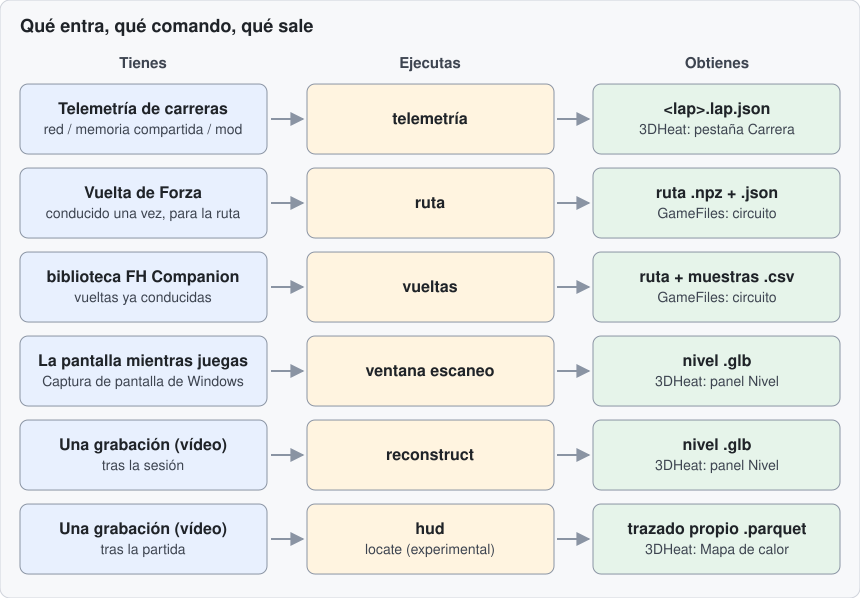

# 3DHeat GameCapture {#dheat-gamecapture}

**¿Qué es?** Una herramienta que anota lo que un juego de carreras le cuenta sobre tu conducción,
un archivo por vuelta. También puede reconstruir un modelo 3D aproximado de un nivel a partir de un
vídeo de tu partida.

**¿Para qué lo usaría?** Para ver tus vueltas en el [visor 3DHeat](https://holdi601.github.io/3DHeat/):
dónde frenaste, dónde ibas lento, en qué se diferencian dos vueltas. Y para tener el nivel bajo tu
mapa de calor cuando nadie tiene un modelo 3D de él.

**Ejemplo:** activa Data Out de Forza, ejecuta un comando y da dos vueltas. Aparecen dos archivos de
vuelta en `laps\`. Suéltalos en la pestaña Análisis de carrera del visor.


¿Nuevo en la línea de comandos? Lee primero [Antes de empezar](before-you-start.md).

## Las tres tareas {#the-three-jobs}

1. **Telemetría de vueltas.** Graba cada canal que publica un juego de carreras - Data Out de Forza,
   la memoria compartida de los juegos de Assetto Corsa, las señales de red de los juegos de rallies,
   un mod de BeamNG, un plugin de Trackmania - y escribe un archivo `heat3d-lap` por vuelta o tramo,
   para la pestaña Análisis de carrera del visor. iRacing no necesita grabador: el visor lee sus propios archivos
   `.ibt`.
2. **Niveles a partir de la partida.** Convierte lo que mostró la pantalla mientras caminabas o
   conducías por un nivel en un modelo 3D `.glb`, que el visor coloca bajo el mapa de calor.
3. **Tu propia partida, después.** `hud` lee el HUD de tu propia grabación: tus acciones, muertes,
   el trazado del minimapa y el registro de bajas. `locate` (experimental: por ahora ubica pocos
   fotogramas reales) calcula dónde se tomó cada fotograma, sobre el modelo 3D de un nivel.

Las tres siguen una regla: **no se inyecta nada en un juego y no se engancha nada**. Los fotogramas
vienen de la API pública de captura de pantalla, y la telemetría de las interfaces que los juegos
publican para ello. Consulta [Las normas](rules.md).



El código es Python (paquete `heat3d_capture`), con licencia MIT. Los modelos de profundidad y de pose
que puede ejecutar tienen sus propias licencias: consulta [Modelos y licencias](models-and-licences.md).

## Inicio rápido {#quick-start}

### Grabar vueltas {#record-laps}

Necesitas Python 3.10 o posterior ([Antes de empezar](before-you-start.md)). En PowerShell:

```powershell
git clone https://github.com/Holdi601/3DHeat-GameCapture
cd 3DHeat-GameCapture
python -m venv .venv
.venv\Scripts\python -m pip install -r requirements.txt

# Forza: Settings -> HUD and Gameplay -> Data Out = ON, IP 127.0.0.1, port 5300
.venv\Scripts\python -m heat3d_capture telemetry -o laps
```

**Deberías ver** `listening on port 5300. Laps go to laps. Ctrl+C to stop.`, y luego una línea por
vuelta al cruzar la meta, como en la imagen de arriba. Pulsa Ctrl+C para parar. Suelta los archivos de
`laps\` en la pestaña Análisis de carrera del visor. Cada otro juego está a un `--game` de distancia:

```powershell
.venv\Scripts\python -m heat3d_capture telemetry --game acc -o laps
.venv\Scripts\python -m heat3d_capture telemetry --game dirtrally2 -o laps
```

Consulta [Grabadores de telemetría](telemetry.md) para cada juego y cada opción.

### Escanear un nivel {#scan-a-level}

Haz doble clic en **`scan.bat`** en la carpeta de la herramienta. Encuentra Python (y ofrece instalarlo
con winget si no hay ninguno), crea un `.venv` privado y abre la ventana de escaneo. La ventana indica
qué falta, para qué sirve cada paquete y cuánto ocupa la descarga, y no instala nada sin un sí.
Consulta [Entorno de ejecución y dependencias](runtime.md) y
[La ventana de escaneo](reconstruction-scan-ui.md).

A mano: `.venv\Scripts\python -m heat3d_capture.ui`.

Para reconstruir una grabación sin conexión, con la trayectoria de la cámara resuelta de una vez
(necesita PyTorch, el paquete `vggt` y una GPU - ver [Reconstrucción sin conexión](reconstruction-offline.md)):

```powershell
.venv\Scripts\python -m heat3d_capture reconstruct lap.mp4 -o lap.glb
```

## Mapa de la documentación {#map-of-the-documentation}

| Página | Qué cubre |
|---|---|
| [Antes de empezar](before-you-start.md) | Python, una terminal, el primer comando, errores habituales |
| [Las normas](rules.md) | Sin inyección, solo interfaces publicadas, y lo que eso cuesta |
| [Grabadores de telemetría](telemetry.md) | El comando `telemetry` y un resumen de cada juego |
| [Forza](telemetry-forza.md) | Data Out, detección del diseño, el relé de FH Companion y su `.tele.gz` |
| [Juegos de Assetto Corsa](telemetry-assetto-corsa.md) | AC, ACC, AC EVO, AC Rally desde la memoria compartida |
| [Juegos de rally](telemetry-rally.md) | EA SPORTS WRC, DiRT Rally 2.0 / 1 / DiRT 4, Richard Burns Rally |
| [BeamNG.drive](telemetry-beamng.md) | El mod del protocolo `heat3d` |
| [Trackmania](telemetry-trackmania.md) | El plugin de Openplanet `Heat3dRecorder` |
| [iRacing](telemetry-iracing.md) | Leer archivos `.ibt` en el visor |
| [División de vueltas y tramos](lap-splitting.md) | `LapSplitter`, `CounterSplitter`, `LineSplitter`, `StageSplitter` |
| [Deslizamiento, deriva y canales derivados](slip-and-drift.md) | Cómo se escala el deslizamiento, y lo que deriva el visor |
| [El archivo heat3d-lap](lap-format.md) | El formato del archivo de vuelta, canales, unidades, `meta` |
| [Juegos](games.md) | Por juego: cómo grabar, qué se envía, qué circuitos se pueden exportar |
| [Comandos](commands.md) | `route`, `telemetry`, `laps`, `reconstruct`, `hud`, `locate`, paso a paso |
| [Referencia de comandos](../cli-reference.md) | cada opción, generada desde `--help` |
| [Leer el HUD de una grabación](hud-video.md) | `hud`: acciones propias, muertes, trazado del minimapa y registro de bajas de una grabación |
| [Localizar fotogramas en un nivel](locate.md) | `locate`: dónde se tomó cada fotograma, frente a la geometría del nivel |
| [Reconstrucción de niveles](reconstruction.md) | La canalización desde los fotogramas hasta un `.glb` |
| [La ventana de escaneo](reconstruction-scan-ui.md) | Cada control, atajo y elemento superpuesto |
| [Captura, máscaras y calidad de fotograma](reconstruction-capture.md) | Windows Graphics Capture, fotogramas clave, máscaras del HUD, consejos de calidad |
| [Profundidad](reconstruction-depth.md) | Depth Anything V2, ONNX Runtime, construcción del modelo |
| [Pose de cámara y escala](reconstruction-pose.md) | Odometría, relocalización, poses de telemetría, escala del suelo, ajuste de haces |
| [Fusión, cobertura y color](reconstruction-fusion-and-texture.md) | El volumen de ocupación, la rejilla de cobertura, puntos débiles, color por vértice |
| [La salida .glb](glb-output.md) | El archivo que carga el visor |
| [Reconstrucción sin conexión](reconstruction-offline.md) | `reconstruct`, ventanas VGGT y unión |
| [Modelos y licencias](models-and-licences.md) | Tamaños de Depth Anything V2, VGGT, los paquetes |
| [Entorno de ejecución y dependencias](runtime.md) | Verificación previa, backends, niveles de rendimiento |
| [Límites y verificación](limits.md) | Lo que no se hace, y lo que no se ha comprobado |
| [Actualizaciones](updates.md) | La comprobación de versiones y `python -m heat3d_update` |
| [Desarrollo](development.md) | Pruebas, el entorno virtual, estructura del repositorio |
| [Mantenimiento de estas páginas](maintaining.md) | La lista de comprobación de código y documentación |

## Parte de 3DHeat {#part-of-3dheat}

Los archivos que escribe esta herramienta los carga el **visor 3DHeat** -
[código](https://github.com/Holdi601/3DHeat), [documentación](https://holdi601.github.io/3DHeat/).
Los archivos de vuelta van a su pestaña Análisis de carrera, los `.glb` de niveles a su panel Fondo / nivel, y las tablas
de `hud` y `locate` a su pestaña Mapa de calor; cómo lee el visor las tablas y los archivos de
partida está en [Un archivo por partida (.3dheat)](https://holdi601.github.io/3DHeat/container.html) y
[Cómo cargar datos](https://holdi601.github.io/3DHeat/getting-data-in.html).

| Herramienta | Qué hace | Documentación |
|---|---|---|
| [Visor 3DHeat](https://github.com/Holdi601/3DHeat) | muestra mapas de calor, carreras y partidas en 3D, en el navegador | [docs](https://holdi601.github.io/3DHeat/) |
| [GameFiles](https://github.com/Holdi601/3DHeat-GameFiles) | circuitos y niveles a partir de los archivos que traen los juegos, como modelos 3D | [docs](https://holdi601.github.io/3DHeat-GameFiles/) |
| [GameCapture](https://github.com/Holdi601/3DHeat-GameCapture) | telemetría de vueltas de juegos de carreras; niveles reconstruidos a partir de vídeo de juego | [docs](https://holdi601.github.io/3DHeat-GameCapture/) |
| [Unreal Exporter](https://github.com/Holdi601/3DHeat-UnrealExporter) | un plugin del editor de Unreal que exporta un nivel como modelo 3D | [docs](https://holdi601.github.io/3DHeat-UnrealExporter/) |
| [CS2](https://github.com/Holdi601/3DHeat-CS2) | demos de Counter-Strike 2 en archivos de partida y tablas; mapas en modelos 3D | [docs](https://holdi601.github.io/3DHeat-CS2/) |
| [Watcher](https://github.com/Holdi601/3DHeat-Watcher) | registra tu juego en segundo plano a partir de lo que publican los juegos | [docs](https://holdi601.github.io/3DHeat-Watcher/) |
| [Ext-WarThunder](https://github.com/Holdi601/3DHeat-Ext-WarThunder) | repeticiones de War Thunder en tablas y documentos de partida | [docs](https://holdi601.github.io/3DHeat-Ext-WarThunder/) |
| [Ext-WoT](https://github.com/Holdi601/3DHeat-Ext-WoT) | repeticiones de World of Tanks en tablas y documentos de partida | [docs](https://holdi601.github.io/3DHeat-Ext-WoT/) |
| [Ext-WoWs](https://github.com/Holdi601/3DHeat-Ext-WoWs) | repeticiones de World of Warships en tablas y documentos de partida | [docs](https://holdi601.github.io/3DHeat-Ext-WoWs/) |
| [Ext-Squad](https://github.com/Holdi601/3DHeat-Ext-Squad) | demos de servidores de Squad en tablas y documentos de partida | [docs](https://holdi601.github.io/3DHeat-Ext-Squad/) |
| [Ext-DCS](https://github.com/Holdi601/3DHeat-Ext-DCS) | mapas de DCS World en modelos 3D | [docs](https://holdi601.github.io/3DHeat-Ext-DCS/) |
| [Ext-IL2](https://github.com/Holdi601/3DHeat-Ext-IL2) | mapas de IL-2 Sturmovik en modelos 3D | [docs](https://holdi601.github.io/3DHeat-Ext-IL2/) |

Un desarrollador con el proyecto del juego abierto debería usar el exportador de Unreal, que lee la
geometría real y es exacto. Cuando se pueden leer los archivos propios de un juego, GameFiles extrae
el circuito exacto. La reconstrucción a partir de la partida es para el caso en que solo se dispone de
la pantalla.
