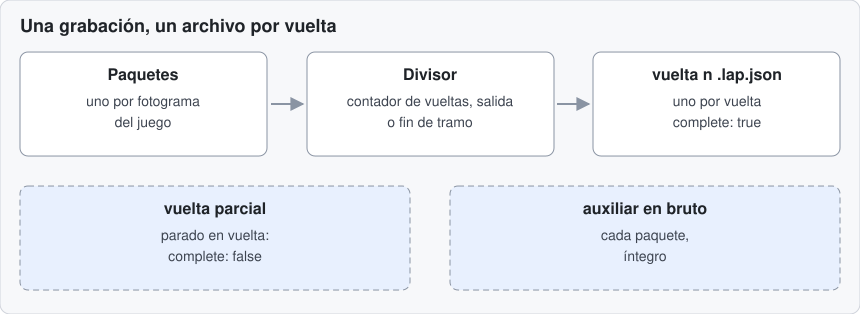

# Cómo se dividen las vueltas y los tramos {#how-laps-and-stages-are-split}

Un grabador ve un flujo continuo de muestras. Convertirlo en vueltas lo hace uno
de cuatro divisores, elegido según lo que el juego diga sobre las vueltas. Todos
siguen la misma idea: usar el recuento propio del juego cuando existe, y si no,
encontrar la vuelta a partir de las posiciones; nunca escribir un fragmento
demasiado corto para compararlo.

| Divisor | Código | Usado por |
|---|---|---|
| `LapSplitter` | [`fulllap.py`](https://github.com/Holdi601/3DHeat-GameCapture/blob/main/heat3d_capture/telemetry/fulllap.py) | Forza |
| `CounterSplitter` | [`kunos.py`](https://github.com/Holdi601/3DHeat-GameCapture/blob/main/heat3d_capture/telemetry/kunos.py) | Assetto Corsa, ACC |
| `LineSplitter` | [`kunos.py`](https://github.com/Holdi601/3DHeat-GameCapture/blob/main/heat3d_capture/telemetry/kunos.py) | AC EVO, AC Rally, BeamNG |
| `StageSplitter` | [`rally.py`](https://github.com/Holdi601/3DHeat-GameCapture/blob/main/heat3d_capture/telemetry/rally.py) | EA SPORTS WRC, DiRT Rally 2.0, DiRT Rally, DiRT 4, Richard Burns Rally |

Trackmania divide las carreras dentro de su complemento ([Trackmania](telemetry-trackmania.md)),
y los archivos de iRacing los divide el visor según el contador de vueltas del simulador
([iRacing](telemetry-iracing.md)).

Con **Ctrl+C**, cada grabador llama al `flush()` de su divisor, de modo que una
vuelta o tramo abierto se escribe si cumple los mismos mínimos que abajo.

## LapSplitter (Forza) {#lapsplitter-forza}

Parámetros: `minimum_metres = 400`, `gap_seconds = 2.0`.

Para cada paquete decodificado:

1. Si el `timestampMs` del juego saltó hacia delante más de 2 segundos desde el
   último paquete, o retrocedió, la vuelta abierta se vacía primero.
2. Si `isRaceOn` es 0 (el juego no está en carrera), la vuelta abierta se vacía
   y el paquete se descarta.
3. Si no hay ninguna vuelta abierta, se abre una con el `lapNumber` del paquete.
4. Si `lapNumber` es distinto del de la vuelta abierta, la vuelta abierta **se
   cierra como completa**; su `seconds` es el `lastLap` del juego cuando es
   positivo. Una vuelta cerrada así se escribe sea cual sea su longitud. Se abre
   una nueva vuelta.
5. El paquete se añade.

El grabador también vacía cuando no ha llegado ningún paquete durante 2 segundos
de tiempo real (el juego se pausó, o se cerró a mitad de vuelta).

**Vaciar** conserva la vuelta abierta solo si tiene al menos 2 muestras y al menos
400 m de `distanceTravelled`; se escribe como incompleta (un `run`). Una carrera de
punto a punto nunca cuenta una segunda vuelta, así que siempre acaba de este modo.

## CounterSplitter (AC, ACC) {#countersplitter-ac-acc}

Parámetro: `minimum_metres = 300`. Recibe cada muestra con el `completedLaps` de
la página gráfica y el tiempo de la última vuelta.

- La primera muestra abre una vuelta numerada con el `completedLaps` actual.
- Cuando cambia `completedLaps`, la vuelta abierta se cierra. Es **completa**, con
  `seconds = tiempo de la última vuelta en ms / 1000` (si es positivo), solo si el
  contador subió exactamente 1; si volvió a 0 (un reinicio de sesión) o subió varios,
  se cierra como incompleta.
- Una vuelta cerrada solo se escribe si tiene muestras y al menos 300 m de
  trayectoria recorrida.
- Vaciar conserva la vuelta abierta si tiene más de una muestra y al menos 300 m.

## LineSplitter (AC EVO, AC Rally, BeamNG) {#linesplitter-ac-evo-ac-rally-beamng}

Parámetros: `radius = 15 m`, `minimum_metres = 300`, `stop_seconds = 8`.

Estos juegos no tienen contador de vueltas en una página que lea el grabador, o
conducen tramos. **La línea está donde empezó la grabación**:

1. La posición horizontal (`x`, `z`) de la primera muestra se convierte en la línea.
2. Cuando el coche ha recorrido más de 5 m, la dirección desde la línea hasta el
   coche se convierte en la dirección de la vuelta.
3. **Parar** termina una tanda: cuando `speed` se mantiene por debajo de 1 m/s
   durante 8 segundos, la vuelta abierta se vacía (así termina un tramo de rally:
   el coche se detiene en la meta).
4. **Cruzar la línea**: tras más de 300 m recorridos, se recogen las muestras a
   menos de 15 m de la línea. Cuando el coche vuelve a salir de ese radio, la
   muestra recogida más cercana es el cruce. Si el coche iba en el mismo sentido
   que la dirección de la vuelta en ese punto (el producto escalar del rumbo local
   con la dirección es positivo), la vuelta se cierra en esa muestra; si no, el
   paso se ignora (el coche cruzó la salida en sentido contrario).
5. El `seconds` de una vuelta cerrada es el tiempo desde su primera muestra hasta
   el cruce. Es **completa solo si su primera muestra iba a más de 5 m/s**: una
   vuelta que empezó desde parado es una salida, no una vuelta para comparar. Así,
   la primera vuelta de una grabación iniciada en parrilla es siempre incompleta;
   si la grabación empezó en una vuelta lanzada, la primera vuelta es completa en
   el siguiente cruce.
6. La siguiente vuelta empieza en la muestra del cruce (pertenece a ambas vueltas).

Las vueltas de menos de 300 m se descartan. Vaciar (una parada, o Ctrl+C) conserva
la vuelta abierta si tiene al menos 2 muestras y 300 m, como incompleta. BeamNG
vacía del mismo modo cuando el vehículo se reinicia (su reloj retrocede), antes de
empezar un nuevo divisor, de modo que se conserva la tanda conducida antes del
reinicio.

Las distancias son horizontales (`x`, `z`) para el contador de recorrido y la
prueba de la línea, y 3D completas para la prueba de 300 m de longitud.

## StageSplitter (juegos de rally) {#stagesplitter-rally-games}

Parámetro: `minimum_metres = 300`. Recibe cada muestra con el reloj de tramo del
juego, si el juego dice que el coche ha terminado, y opcionalmente el tiempo propio
del juego para ese tramo.

1. Si el reloj es 0 o menos, o ha retrocedido más de 0,5 s, el tramo abierto se
   **abandona**: se conserva como tramo parcial si no está completo, tiene más de
   10 muestras y al menos 300 m. Un reloj en 0 o menos también descarta la muestra
   (el coche está en la salida).
2. Si no hay ningún tramo abierto, se abre uno nuevo (numerado 1, 2, ... para la
   grabación).
3. Una vez completo un tramo, las muestras siguientes se ignoran hasta que el reloj
   retroceda.
4. Cada muestra se guarda con `time` igual al reloj del tramo.
5. Cuando el juego dice que ha terminado, el tramo está completo; su `seconds` es
   el tiempo del juego cuando se da y es positivo, si no el reloj. Se escribe si
   cubrió al menos 300 m.

Qué significa "terminado" en cada juego:

| Juego | Terminado cuando |
|---|---|
| EA SPORTS WRC | longitud del tramo > 0 y distancia del tramo >= longitud - 0,5 m |
| Juegos DiRT | las vueltas completadas superan el recuento inicial del tramo, o (evento de una sola vuelta) la distancia de la vuelta >= 99,9 % de la longitud del circuito |
| Richard Burns Rally | reloj de carrera > 0 y distancia al final <= 0 |

En RBR, el eje vertical y la velocidad se fijan cuando se escribe un tramo (ver
[Juegos de rally](telemetry-rally.md#richard-burns-rally-rsf--ngp)).

## Tiempo y distancia en el archivo de vuelta {#time-and-distance-in-the-lap-file}

Para todos los grabadores salvo Forza, `time` se rebasa para que la primera
muestra de la vuelta sea 0, y `distance` es la distancia 3D acumulada entre
posiciones consecutivas. Forza usa el propio cronómetro de vuelta y el contador de
distancia del juego, rebasados del mismo modo.
