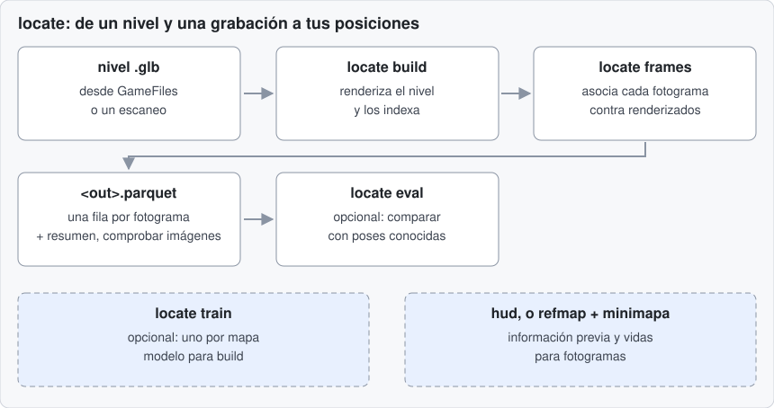

# Ubicar fotogramas en un nivel {#locating-frames-in-a-level}

`locate` averigua dónde se tomó cada fotograma de una grabación de juego (la posición 3D de la cámara y la dirección de
la vista) comparando la imagen con renderizados de la geometría propia del nivel. Es para juegos que no guardan ningún
registro de dónde estaba el jugador: ni demo, ni archivo de repetición, ni telemetría. Battlefield 6 es el primero.

> **Experimental.** Con grabaciones reales, por ahora ubica solo una pequeña parte de los fotogramas; ver
> [Fotogramas reales: experimental](#real-frames-experimental).

```bash
# Una vez por nivel: renderizarlo desde todos los lugares en los que puede estar un jugador, e indexar los renderizados.
.venv\Scripts\python -m heat3d_capture locate build level.glb -o level.db

# Por grabación: ¿dónde se tomó cada fotograma?
.venv\Scripts\python -m heat3d_capture locate frames "<recording>.mp4" --db level.db -o out/match
```

La posición sale **de la imagen**, frente a todo el nivel, sin información previa. El recorrido del minimapa del
[lector de HUD](hud-video.md) es solo una alternativa para los fotogramas que la imagen no puede ubicar, y cada fila
indica de cuál de las dos fuentes vino.




## Qué hace y qué no toca {#what-it-does-and-does-not-touch}

- Lee la **propia grabación** del jugador y un archivo de nivel que el jugador exportó desde **su propia copia** del
  juego. Nunca toca el juego, su memoria, sus archivos mientras se ejecuta, ni su red, y se ejecuta después de la partida.
  Ver [Las reglas](rules.md).
- Ubica **solo la cámara propia del jugador**: el fotograma es la vista propia del jugador.
- El nivel, la base de datos creada a partir de él y todo lo renderizado a partir de él pertenecen al editor del juego.
  Guárdalos en local.

## Requisitos {#requirements}

- Lo que indica `requirements.txt`, PyTorch (desde pytorch.org, para la GPU), y `requirements-locate.txt`:

```bash
.venv\Scripts\python -m pip install -r requirements-locate.txt
```

- Una GPU con OpenGL 3.3 (4.3 es más rápida) para los renderizados, y preferiblemente CUDA para los modelos. En una CPU
  funciona, pero despacio.
- Los modelos se descargan la primera vez que se usan (unos 450 MB): DINOv2 desde Hugging Face, ALIKED y LightGlue a través
  de kornia. Todos tienen licencia para uso comercial; ver [Licencias](#licences).
- El **nivel** como `.glb` (o `.gltf`) en el sistema de coordenadas del visor, Y hacia arriba, **con sus texturas de color
  base**, tal como lo escriben los exportadores de 3DHeat (partes `ground:` / `structure:`; los nombres de las partes no
  hacen falta). Una unidad es un metro, salvo que `extras.unit_metres` en el nivel superior del archivo indique otra cosa.
  Un escaneo de GameCapture (`reconstruct`, la ventana de escaneo) se escribe en **centímetros** y lleva
  `extras.unit_metres: 0.01`, así que se lee a su tamaño real. Un nivel sin texturas funciona mucho peor; ver
  [Límites](#limits).

## Comandos {#commands}

### `locate build <level> -o <db>` {#locate-build---o-}

Renderiza el nivel desde todos los lugares en los que podría estar un jugador, y guarda para cada renderizado su pose y un
descriptor global.

| Opción | Por defecto | Significado |
|---|---|---|
| `level` | | El `.glb` / `.gltf` del nivel. |
| `-o`, `--out` | | La carpeta de la base de datos que se escribe. |
| `--game` | `bf6` | El perfil de juego: alturas de los ojos, campo de visión, cajas del HUD, velocidad (más abajo). `generic` para cualquier juego en primera persona. |
| `--eye` | la del perfil | Alturas de los ojos sobre el suelo en metros, de pie primero. Una vista de la base de datos por cada altura. |
| `--fov` / `--vfov` | la del perfil | El campo de visión horizontal de la grabación, o el vertical (el control deslizante de Battlefield) para una grabación 16:9. |
| `--spacing` | 2.5 | Metros entre los lugares desde los que se toman las vistas. |
| `--yaw-step` | 30 | Grados entre las direcciones de las vistas. |
| `--pitch` | 0 | Inclinaciones a renderizar, en grados hacia arriba. |
| `--positions` | ninguno | Una tabla (Parquet o CSV con `x`, `y`, `z` en los pies, en el sistema del nivel) de la que tomar los lugares en lugar de cada suelo: la salida de una ejecución anterior, por ejemplo. |
| `--shadows` | desactivado | Proyecta las sombras del sol en los renderizados (el sol propio del nivel, cuando su archivo lo nombra en `extras.sun`). |
| `--untextured` | desactivado | Renderiza solo forma y luz. |
| `--box X0 Z0 X1 Z1` | el archivo entero | Solo lugares dentro de esta caja (unidades del nivel): la zona de juego. |
| `--places` | `auto` | De dónde se toman las vistas: `nav` - jugadores a la altura de los ojos sobre la malla de navegación del nivel (partes `nav:`: exactamente por donde el juego deja caminar), cámaras de vehículo a su altura sobre las partes `ground:` (terreno y carreteras) a menos de 50 m de ellas; `ground` - ambas sobre `ground:`; `floors` - sobre cada cara orientada hacia arriba (también tejados y cajas); `auto` - `nav` cuando el nivel tiene malla de navegación, si no `floors`. |
| `--head` | ninguno | Un modelo de cabeza por mapa de `locate train` para los descriptores. |

Escribe `<db>/db.json` (con qué y cómo se construyó) y `<db>/views.npz` (poses, descriptores).

### `locate frames <recording> --db <db>` {#locate-frames----db-}

| Opción | Por defecto | Significado |
|---|---|---|
| `source` | | Un vídeo, una imagen o una carpeta de imágenes (en orden de nombre, separadas `--fps`). |
| `--db` | | La base de datos que escribió `build`. Su archivo de nivel debe seguir donde estaba (o `--level`). |
| `-o`, `--out` | `<source>.locate` | Ruta de salida sin extensión. |
| `--fps` | 2 | Fotogramas ubicados por segundo de vídeo. |
| `--start`, `--seconds` | todo | La parte del vídeo que se lee. |
| `--width` | 1280 | El ancho al que se comparan los fotogramas. |
| `--shortlist` | 8 | Vistas de la base de datos probadas por fotograma cerca de una información previa o una posición fijada. |
| `--search-shortlist` | 16 | Sin información previa: vistas de la base de datos probadas por fotograma ([buscadas en conjunto](#with-no-prior-frames-searched-together)). |
| `--no-search` | desactivado | Sin información previa: busca cada fotograma por separado y da por buena su posición sin mirar a sus vecinos. |
| `--accept-depth` | 0 (desactivado) | Sin información previa: da por buena una posición solo si la distancia lejana de sus coincidencias es este número de veces su distancia cercana. |
| `--accept-support` | 2 | Sin información previa: vecinos que concuerden a lo largo de la vida que necesita una posición para darla por buena. |
| `--checkpoint` | ninguno | Guarda el estado de la ejecución aquí y continúa desde él si está. |
| `--stop-file`, `--stop-process` | ninguno | Se detiene solo, con el estado guardado, código de salida 75, cuando existe este archivo o se ejecuta un proceso cuyo nombre empieza por esto (se comprueba antes de cada fotograma; puede repetirse), para que una ejecución larga libere la máquina para un juego. El mismo comando continúa después. |
| `--normalise` | ninguno | Normalización de luz antes de comparar: `clahe`, `gray`. |
| `--minimap` | ninguno | La tabla del verbo `hud`: la **alternativa** para los fotogramas que la imagen no puede ubicar. |
| `--prior-radius` | ninguno | **Aceleración opcional**, desactivada por defecto: busca solo las vistas de la base de datos a estos metros de la posición del minimapa (necesita `--minimap`). |
| `--minimap-anchor` | ninguno | Un archivo JSON que ata el minimapa al nivel ([el minimapa como información previa de búsqueda](#the-minimap-as-a-search-prior)): el minimapa recorta la búsqueda desde el primer fotograma; las posiciones así encontradas son `visual+minimap-prior`. |
| `--no-level-search` | desactivado | Con información previa: cuando nada cercano encaja, no busca también en todo el nivel (más rápido). |
| `--lives` | la tabla de `--minimap` | La tabla del verbo `hud` cuyas muertes, despliegues y reanimaciones indican cuándo estaba el jugador en juego: las posiciones solo saltan al cruzar una muerte ([vidas a partir de la grabación](#lives-from-the-footage)). |
| `--no-sequence` | desactivado | Decide cada fotograma por separado, no a lo largo de la ejecución (más abajo). |
| `--fit-fov` | desactivado | Tras la ejecución, ajusta el campo de visión a las posiciones más fuertes, por vista, y lo informa. |
| `--check-every` | 0 | Además, cada N fotogramas, ubicados o no, una imagen en `<out>.check`. |
| `--no-checks` | desactivado | No escribe las imágenes de comprobación de las posiciones visuales (más abajo). |
| `--no-zoomed` | desactivado | No resuelve las vistas con zoom a partir de las posiciones de sus vecinos (más abajo). |
| `--no-grow` | desactivado | No vuelve a buscar cerca de cada posición los fotogramas de alrededor que siguen sin una. |
| `--game`, `--eye`, `--fov`, `--vfov`, `--mask`, `--no-hud-mask`, `--max-speed` | los del perfil | Como arriba; `--mask x,y,w,h` añade una caja de pantalla (en una pantalla de 1920x1080) que no es el nivel. |
| `--vehicle-vfov` | la del perfil | El campo de visión vertical de las cámaras de vehículo (el control deslizante de vehículo de Battlefield). |
| `--settings` | el archivo de ajustes más reciente | `bf6`: el archivo de ajustes del juego del que se leen los campos de visión (solo lectura) cuando no se da `--fov`/`--vfov`; por defecto, el `PROFSAVE*_profile` más reciente bajo `Documents/Battlefield 6/settings`. Guarda los ajustes tal como están ahora, que puede que no sean los de una grabación más antigua. |

### `locate refmap <level> <deploy screen> -o <refmap>` {#locate-refmap----o-}

Coloca el mapa propio del juego sobre el nivel: la referencia contra la que se lee el minimapa
([el minimapa, leído contra el nivel](#the-minimap-read-against-the-level)). `<deploy screen>` es una imagen de la pantalla
de despliegue que muestra el mapa completo, o una grabación con `--at <seconds>` en ese momento; la caja del mapa del perfil
se recorta de ella (`--whole-picture` conserva todo). Escribe `<refmap>.png` (el mapa remuestreado sobre el propio sistema
del nivel, `--mpp` metros por píxel, 0,5 por defecto), `<refmap>.valid.png` (dónde es el mapa y no un marcador o una
etiqueta) y `<refmap>.json` (el sistema y la calibración, con lo lejos que estaban las baldosas del mapa de él). `--topdown <prefix>`
guarda el nivel renderizado desde arriba para la siguiente ejecución (`--topdown-mpp`, 0,656 m por defecto; `--box` lo limita).

### `locate minimap <recording> --refmap <refmap> -o <table>.parquet` {#locate-minimap----refmap---o-parquet}

Lee el minimapa de la grabación contra el mapa de referencia, fotograma a fotograma (`--fps`, 2 por defecto): posición,
orientación y zoom de cada minimapa que encaja, en el sistema del nivel, escritos como una tabla de minimapa con un ancla
al lado (`<table>.anchor.json`) que `locate frames` acepta como `--minimap <table>.parquet --minimap-anchor <table>.anchor.json`.
Con la tabla del verbo `hud` (`--hud`) se conservan sus vidas; con un ancla para esa tabla también (`--hud-anchor`), la
primera búsqueda se hace alrededor de donde la tabla pone al jugador, y donde ningún minimapa encaja, el recorrido propio
del HUD rellena los huecos, desplazado hasta las posiciones más cercanas del mapa de referencia (`--hud-fill`, segundos, 120
por defecto; 0 lo desactiva). El `source` de la tabla indica cuál (`refmap`, `hud`).

### `locate eval <out>.parquet --truth <poses>` {#locate-eval-parquet---truth-}

Compara un resultado con poses de cámara conocidas: una tabla de `time`, `x`, `y`, `z` (el ojo), `yaw`, `pitch` en el sistema
del nivel. `--offset` es el desfase de reloj (tiempo de la verdad = tiempo del vídeo + desfase); sin él, el desfase se busca.
`--unit-metres` convierte los errores a metros.

## Perfiles de juego {#game-profiles}

| | `bf6` | `generic` |
|---|---|---|
| Alturas de los ojos | 1,6 m de pie, 1,05 m agachado (aún no medido en el juego) | 1,65, 1,1 m |
| Campo de visión | 55 grados verticales, unos 86 horizontales en 16:9: **pasa el propio del jugador** con `--vfov` | 90 horizontales |
| HUD enmascarado | minimapa y lista de escuadra, registro de eliminaciones, brújula, munición, arma del jugador, avisos, mira | la mira |
| Más rápido a pie | 8 m/s | 8 m/s |
| Vistas distinguidas | a pie, vehículo, con zoom (más abajo) | cada fotograma a pie |
| Cámaras de vehículo | el control deslizante de vehículo (del archivo de ajustes), el vehículo enmascarado, la cámara hasta 8 m sobre el suelo, 30 m/s | - |

El campo de visión es lo que más importa: un fotograma resuelto con el campo de visión equivocado se resuelve con la
distancia focal equivocada, y su posición se desliza a lo largo de la vista.

## Salidas {#outputs}

### `<out>.parquet` {#parquet}

Una fila por fotograma ubicado, en el **sistema del nivel** (Y hacia arriba, las unidades del nivel), con las instrucciones
de lectura del visor en el pie (`kind: heat3d-locate`). El pie nombra como extra cada columna que no tiene función propia, así
que el visor las conserva todas (su tarjeta de inspección las muestra).

| Columna | Significado |
|---|---|
| `time` | Segundos desde el inicio del vídeo. |
| `event` | `start` en la primera fila de una vida, `position` en el resto. |
| `x`, `y`, `z` | El ojo, suavizado dentro de la vida. Vacío cuando ninguna fuente ubicó el fotograma. |
| `yaw`, `pitch` | Grados: guiñada alrededor del eje vertical (0 a lo largo de +X, creciendo hacia -Z, que es la guiñada propia de un juego en el sistema del visor), cabeceo hacia arriba desde la horizontal. `pitch` está vacío en las filas de minimapa. |
| `dir_x`, `dir_y`, `dir_z` | La dirección de la vista. |
| `player`, `team`, `session` | `me`, `own`, y `<video>#NN`, uno por vida. |
| `life` | La vida en la que la grabación mostró el fotograma (a partir de las muertes del HUD; 1 = la primera). Vacío cuando está fuera de juego (muerto, caído, desplegando) o cuando no se leyeron las vidas. `session` es la vida del recorrido, que también puede dividirse en un salto. |
| `source` | `visual` (desde la imagen), `visual+minimap-prior` (desde la imagen, la búsqueda recortada a la información previa del minimapa), `minimap` (la alternativa), `minimap+nav-floor` (en interiores: el minimapa y el suelo de la malla de navegación) o `none`. |
| `view` | `foot`, `vehicle`, `zoomed` o `screen` (más abajo). |
| `cam_x`, `cam_y`, `cam_z` | La cámara que vio el fotograma. A pie y a través de una mira es el ojo, y `x`, `y`, `z` son lo mismo; en la vista de tercera persona de un vehículo, `x`, `y`, `z` son el vehículo (el modelo de desplazamiento, más abajo) y la cámara va detrás y por encima de él. |
| `hfov`, `zoom` | El campo de visión horizontal con el que se resolvió el fotograma, y para una vista con zoom, su zoom frente a la vista normal. |
| `confidence` | 0..1: cuánto confiar en la fila (más abajo). |
| `uncertainty` | El error típico de la fila, en unidades del nivel: para una posición visual, a partir de sus inliers y sus vecinos; para una fila de minimapa, a partir del ajuste (más abajo). |
| `inliers`, `rmse` | Los inliers PnP de la resolución visual y el error de reproyección (píxeles en el ancho de trabajo). |
| `x_raw` ... `pitch_raw` | La resolución visual antes del suavizado (también para los valores atípicos que se descartaron por votación). |
| `kept` | La posición visual sobrevivió a la votación de valores atípicos. |
| `note` | Por qué no se ubicó un fotograma, o por qué se descartó en la votación. |

### `<out>.summary.json` {#summaryjson}

Fotogramas, posiciones visuales, valores atípicos, vidas, filas por fuente, el ajuste del minimapa (pares, inliers,
residuo), tiempo por fotograma.

## Método {#method}

### La base de datos {#the-database}

Los lugares son puntos sobre cada triángulo del nivel orientado hacia arriba, repartidos de forma uniforme (uno por
`--spacing` en una rejilla 3D, así que cada planta de un edificio tiene el suyo). Cada uno se comprueba desde su ojo con
seis pequeños renderizados de profundidad: una cámara dentro de la geometría ve sobre todo caras traseras, un hueco bajo
un techo tiene algo sólido sobre el ojo; ambos se descartan. Desde cada lugar se renderiza el nivel a cada altura de ojo,
cada `--yaw-step` y cada `--pitch`, y cada renderizado se describe con **DINOv2** (sus tokens de parche agrupados por
media generalizada, unidos al token de clase).

Los rasgos locales y los puntos 3D contra los que finalmente se resuelve un fotograma **no se guardan**: se vuelven a
generar cuando hacen falta, renderizando las pocas vistas que eligió la recuperación, lo que tarda milisegundos. Así una
base de datos ocupa unos pocos cientos de megabytes en lugar de decenas de gigabytes, y eso es lo que permite el
refinamiento de más abajo. El coste es que `frames` necesita el archivo del nivel y una GPU, no solo la base de datos.

### Un fotograma {#one-frame}

1. **Enmascarar** lo que no es el nivel: las cajas del HUD del perfil y la mira, más cualquier `--mask`.
2. **Recuperación** sobre **todo el nivel**: el descriptor global del fotograma contra cada vista de la base de datos; las
   pocas decenas más parecidas, reducidas para que representen lugares y direcciones distintos, forman la lista corta.
3. **Comparación**: cada vista de la lista corta se vuelve a renderizar al tamaño y campo de visión del fotograma, con su
   profundidad. Los puntos clave ALIKED del fotograma y del renderizado se emparejan con LightGlue. Un píxel del renderizado
   más su profundidad es un punto 3D del nivel, así que cada coincidencia es una correspondencia 2D-3D; los puntos clave en
   un borde de profundidad (cuya profundidad puede pertenecer a lo que hay detrás) se descartan.
4. **Pose**: PnP con RANSAC (SQPnP), y luego un refinamiento robusto que mantiene la cámara nivelada (una vista en primera
   persona no se inclina de lado) y minimiza el error de reproyección de los inliers.
5. **¿Es posible?** Una pose debe estar a la altura de los ojos de un jugador sobre un suelo y fuera de la geometría (un
   renderizado de profundidad hacia abajo). Una textura parecida en otro lugar (un suelo de baldosas emparejado con una pared
   del mismo material) puede dar cientos de inliers en una pose que ningún jugador podría tener; esas se apartan, aunque
   tengan muchos inliers.
6. **Renderizar y comparar**: el nivel se renderiza en la pose resuelta y se vuelve a comparar, lo que sustituye una vista de
   la base de datos situada a unos metros y decenas de grados por una que casi coincide con el fotograma. Se repite mientras
   gane inliers (como mucho dos veces).
7. **Elección**: los tres lugares más fuertes (a más de unos 3 m entre sí) se refinan uno a uno antes de elegir. Una
   parecida puede ir en cabeza antes del refinamiento; el lugar correcto gana mucho más con él.
8. **Veredicto**: `confidence` combina el número de inliers, el mejor otro lugar (`runner_up`) y el error de reproyección.
   Una posición es `ok` con al menos 25 inliers, ningún otro lugar a menos del 80% de sus inliers, y una confianza de al menos
   0,85: el umbral que sitúan las mediciones de más abajo en un 97,5-99% de aciertos.

### Vistas {#views}

Un fotograma no siempre son los ojos del jugador. El detector del perfil lee de qué vista se trata a partir del HUD, y el
fotograma se resuelve en consecuencia:

- **A pie**: el campo de visión de infantería y las alturas de los ojos.
- **Vehículo** (Battlefield 6: los avisos de teclas del diagrama de asientos, `C CAMERA` y `E EXIT`, abajo en el centro): el
  campo de visión del vehículo, el propio vehículo enmascarado (la parte central inferior de la pantalla en su vista de
  tercera persona), y una cámara permitida hasta 8 m sobre el suelo. La posición es la de la cámara.
- **Pantalla** (bordes oscuros alrededor de un centro oscuro: el mapa de despliegue, un menú, el marcador): no es una vista del
  nivel; se salta.
- **Con zoom** (una mira, la mira de un artillero, la vista en primera persona de un vehículo: un borde de la pantalla en negro,
  ambos oscuros, alrededor de una imagen brillante): no se busca sobre el nivel (la franja de nivel que ve una mira no se parece
  a ninguna de las vistas amplias de la base de datos), sino que se resuelve después de la ejecución a partir de la posición más
  cercana a menos de 6 s, más abajo. Desactivado con `--no-zoomed`.

### Vistas con zoom {#zoomed-views}

Una vista estrecha fija mal la posición: un paso atrás con un poco más de zoom se ve casi igual. Así que un fotograma con zoom
parte de donde dice su vecino que está la mira (a pie, el ojo de esa posición; en un vehículo, 2,5 m sobre el suelo bajo el centro
del vehículo, la mira de una torreta) y de cuánto pudo moverse desde entonces: 2 m, más 4 m por segundo a pie u 8 en vehículo, como
máximo 12 m (`reach`).

1. **Dirección y zoom, con la posición fija.** Para cada zoom de 1, 1,2 (la vista propia de un vehículo, más estrecha que a pie),
   1,5, 2, 3, 4, 6 y 8, el nivel se renderiza desde la mira en direcciones a menos de 30 grados de las del vecino (y, desde 3x,
   algunas inclinaciones). Los puntos clave del fotograma emparejados con un renderizado, con los puntos del nivel debajo, son
   rayos desde la mira; se ajusta una rotación a ellos de dos en dos (RANSAC) para distancias focales de 0,75 a 1,3 veces las del
   zoom de ese momento, con un punto que concuerda dentro de un ángulo que admite que la mira esté `reach` desplazada a esa
   distancia. Gana el zoom, la dirección y la distancia focal con los que más puntos concuerdan.
2. **Asentado.** Esos puntos ajustan después posición, dirección y distancia focal a la vez, por su error de reproyección, con la
   posición sujeta a la mira por un coste de dos píxeles por cada `reach` movido; se renderiza una vez más en la respuesta y se
   vuelve a ajustar. Los inliers y el error se cuentan en píxeles, y la posición es `ok` con la misma confianza que cualquier otra.

El zoom escrito (`zoom`) es respecto al campo de visión de la ejecución a pie; `hfov` es el resuelto. En un vehículo, la posición
escrita es la del vehículo, 2,5 m por debajo de la mira, como para su vista de tercera persona.

### Vehículos: la cámara y el vehículo {#vehicles-the-camera-and-the-vehicle}

En la vista de tercera persona de un vehículo, la pose resuelta es la de la cámara de persecución, que va detrás y por encima del
vehículo y gira alrededor de él cuando el jugador mira alrededor. La posición escrita (`x`, `y`, `z`) es la del vehículo: el suelo
bajo su centro, es decir, la cámara más el `vehicle_offset` del perfil, tantos metros hacia delante según la dirección horizontal
de la vista de la cámara, y tantos hacia abajo. La cámara se queda en `cam_x`, `cam_y`, `cam_z`. La conversión se hace antes de la
secuencia y del recorrido, así que una cámara que gira alrededor de un vehículo parado no se toma por movimiento. El pie de la tabla
lleva el desplazamiento usado y si se midió (`vehicleOffset`). A pie y a través de una mira no hay desplazamiento.

Cómo se midió el desplazamiento de Battlefield 6: en posiciones correctas de fotogramas reales de tercera persona de un tanque, el
centro del tanque se marcó a ojo en el fotograma, y el nivel renderizado en la posición dio el suelo en ese píxel. El perfil toma la
mediana: unos 10 m por delante de la cámara y unos 4 m por debajo. La marca es buena a un metro más o menos, y es de un tipo de
vehículo: un coche o un helicóptero llevan su cámara de otra manera.

### Sin información previa: fotogramas buscados en conjunto {#with-no-prior-frames-searched-together}

El descriptor global de un fotograma contra un nivel entero es una señal débil, y los inliers de un solo fotograma no distinguen un
lugar correcto de uno parecido. Así que sin información previa, los fotogramas de una grabación se describen primero y se buscan en
conjunto (`search.py`), y una posición solo se da por buena con los fotogramas de alrededor:

- **Lista corta.** Las similitudes de cada vista se miden contra su propia media y dispersión en la grabación, para que una vista que
  se parece a todos los fotogramas deje de ganar en todas partes. Cada fotograma puntúa las celdas de una rejilla de 24 m por el rango
  de su mejor vista; el mejor camino por las celdas a lo largo de cada vida, dentro de lo que el jugador puede cubrir entre fotogramas,
  da una creencia por celda, y la mejor vista de cada celda, la más creída primero, es una lista. La recuperación simple es la otra, y
  las dos se toman por turnos: medir vistas contra la grabación penaliza un lugar que el jugador apenas abandona, que es donde la
  recuperación simple funciona bien.
- **Creer.** Un candidato cuenta solo si sus inliers cubren al menos el 12% de una rejilla de 8 x 8 sobre el fotograma: una parecida
  es un objeto repetido, una pila de contenedores, con cientos de inliers en unas pocas celdas del fotograma. Una posición se cree
  cuando cae en el mejor camino por los candidatos que cuentan (más abajo) con al menos dos vecinos a menos de 6 s que concuerdan con
  ella. Un fotograma fuera de juego no se busca en absoluto.
- **Crecer.** Solo se crece a partir de lo creído, y una posición que crece debe cubrir el fotograma de la misma manera.

### A lo largo de la ejecución {#along-the-run}

Cada fotograma conserva cada pose físicamente posible que encontró, una por lugar (`candidates`), no solo la más fuerte. La ejecución
elige después una por fotograma, o ninguna, de modo que las poses elegidas formen un camino que un jugador podría haber recorrido
caminando o conduciendo, y que el mayor número posible de inliers caiga sobre él: un modelo oculto de Markov, decodificado de una vez
(Viterbi). Una parecida que gana un fotograma por sí sola pierde frente al lugar en el que concuerdan sus vecinos; un candidato débil
por el que pasa el camino, con al menos dos vecinos que concuerden, se convierte en posición (`note`: chosen along the sequence); una
posición segura que todos sus vecinos contradicen deja de serlo. Un vecino solo cuenta como concordante a menos de 6 s: a más distancia,
la distancia que un jugador, y no digamos un vehículo, podría haber cubierto es tan grande que concordar no dice nada. Desactivado con
`--no-sequence`.

### Tiempos de fotograma {#frame-times}

El `time` de una fila es la marca de tiempo propia del fotograma en la grabación, no su cuenta sobre la frecuencia nominal. Las grabaciones
se desvían de su frecuencia nominal (unas pocas décimas de segundo dentro de un clip, en las que se midieron), y todo lo que vuelve a leer
un fotograma por su tiempo (las imágenes de comprobación, la pasada con zoom, `locate train --real`, el minimapa del verbo `hud`) busca por
marca de tiempo. Contar fotogramas dejaría la imagen de comprobación hasta esa distancia del fotograma ubicado.

### El campo de visión, a partir de los fotogramas {#the-field-of-view-from-the-frames}

`--fit-fov` conserva las posiciones más fuertes de una ejecución (por vista) y refina la pose y la distancia focal de cada una juntas
sobre sus inliers; la mediana de ellas es el campo de visión con el que se grabó, informado en el resumen (`hfov_fitted`) para el
siguiente `--fov`. Los puntos cercanos y lejanos se mueven de forma distinta con un cambio de distancia focal que con un cambio de
posición, y eso es lo que lo fija; hacen falta posiciones con profundidad, no una pared plana.

### Un modelo por mapa {#a-per-map-model}

`locate train` entrena una pequeña cabeza sobre DINOv2 para un nivel, con renderizados de él, para que el descriptor global encuentre
las vistas correctas de fotogramas reales y no solo de renderizados:

- **Cabeza**: cada token de parche pasa por una proyección de dos capas, se agrupa por media generalizada sobre los parches que muestran
  el nivel, y se une al token de clase proyectado. DINOv2 se queda congelado. Todo esto está escrito aquí (MIT).
- **Pares**: un lugar sobre el suelo transitable y una dirección, renderizados dos veces desde poses separadas hasta uno o dos metros y una
  docena de grados, con campos de visión separados hasta 10 grados, bajo distinta luz (sol, sombras, ambiente), cada uno con un aspecto
  de juego: gradación, neblina por profundidad, resplandor, viñeteado, humo, personas en medio, el vehículo propio del jugador en las vistas
  de vehículo, desenfoque de movimiento, ruido, JPEG (`augment.py`). Enmascarados como un fotograma. Los lugares a pocos metros que miran
  en la misma dirección no cuentan como negativos.
- **Fotogramas reales**: los fotogramas con una pose que encontró la propia tubería (pseudoetiquetas: posiciones elegidas a lo largo de una
  secuencia) pueden unirse como pares, el fotograma y un renderizado en su pose, en una segunda ronda.
- **Pérdida**: contrastiva (InfoNCE) sobre el lote.

`locate build --head <head.pt>` construye la base de datos con él; `frames` lo usa después para los fotogramas.

| Opción de `locate train` | Por defecto | Significado |
|---|---|---|
| `-o`, `--out` | obligatorio | El archivo de cabeza que se escribe (`.pt`). |
| `--steps` | 600 | Pasos de entrenamiento. |
| `--real TABLE VIDEO` | ninguno | Una tabla de `locate frames` y su grabación: sus posiciones seguras se unen como pares reales. Se puede repetir. |
| `--real-confidence` | 0.85 | La confianza que necesita una posición para unirse como par real. |
| `--spacing`, `--box`, `--places`, y las opciones de perfil | como en `build` | Dónde están los lugares de entrenamiento, y el perfil del juego. |

### Comprobar a ojo {#checking-by-eye}

Cada posición visual tiene una imagen en `<out>.check` - `<time>s_<view>_visual.jpg`: el fotograma y, a su lado, el nivel renderizado en
la cámara de la posición con los bordes del fotograma dibujados sobre el renderizado. Donde coinciden, la posición es correcta. Se escribe
después de que la secuencia y el recorrido hayan decidido, así que las imágenes son exactamente las filas que la tabla llama visuales.
Desactivado con `--no-checks`.

### El minimapa, leído contra el nivel {#the-minimap-read-against-the-level}

Un minimapa unido en un solo mosaico (el del verbo `hud`) no es plano: su escala deriva con el zoom al que se registró cada minimapa,
un lugar visto dos veces puede dibujarse dos veces, y el mosaico de cada clip es propio. Una similitud ajustada a unas pocas posiciones
entonces encaja cerca de ellas y se aleja decenas de metros de ellas. Por eso el minimapa se ubica con el propio nivel, en dos pasos, y
no se une nada:

- **El mapa de referencia** (`locate refmap`). La pantalla de despliegue dibuja todo el mapa con el norte arriba, plano, a una sola escala.
  El nivel renderizado desde arriba muestra las mismas cosas levantadas sobre el suelo (tanques, edificios, muros): en el nivel, su altura
  sobre el suelo en 15 m a la redonda; en el mapa, lo que se dibuja más claro que el suelo que lo rodea. El mapa se coloca sobre el nivel
  mediante correlación cruzada normalizada de ambos, sobre la escala y un pequeño giro, refinada comparando baldosas del mapa una a una, y al
  final todo el mapa a la vez alrededor de esa respuesta (unas pocas decenas de baldosas dejan la escala suelta en un uno por ciento, metros en
  los extremos del mapa). El resultado es una única similitud, del píxel del mapa al nivel.
- **El minimapa, fotograma a fotograma** (`locate minimap`). Cada minimapa muestreado (el recorte del lector del HUD y su máscara de
  superposición) se compara (SIFT) con el mapa de referencia alrededor de donde estuvo el jugador por última vez, o en cualquier parte si no
  se sabe dónde, y se ajusta una similitud (giro, zoom, desplazamiento). El punto del jugador, llevado a través de ella, es la posición; el
  arriba del minimapa (el cono de visión), la orientación; su escala, el zoom: medido, no supuesto.
- **Cuando no encaja.** La pantalla de despliegue no dibuja nada fuera de la zona de juego; un minimapa que muestra sobre todo lo que queda
  fuera de ella (un jugador en el borde del mapa) no tiene nada con qué encajar. Allí, el recorrido propio del HUD hace de sustituto, desplazado
  por el desfase que miden las posiciones más cercanas del mapa de referencia (`--hud-fill`); es tan bueno como lo sea el mosaico cerca de esas
  posiciones.

En el nivel de prueba, el minimapa leído así estuvo a unos pocos metros (mediana) de las posiciones visuales seguras; igual de bueno fuera de la
zona en la que se ajustó el mapa de referencia que dentro de ella.

### El minimapa como información previa de búsqueda {#the-minimap-as-a-search-prior}

El recorrido del minimapa del verbo `hud` indica, para la mayoría de los fotogramas de juego, aproximadamente dónde está el jugador y hacia
dónde mira, en sus propias unidades (píxeles del minimapa, norte arriba). Una vez atado al nivel, reduce la búsqueda a una pequeña parte de
él; la pose en sí sigue saliendo de la imagen, con las mismas reglas.

- **El ancla** (`--minimap-anchor <anchor.json>`): una similitud por mapa, del minimapa al nivel (escala, giro, con el espejo entre los píxeles
  con el norte arriba y los ejes del nivel, desplazamiento), ajustada a las posiciones visuales seguras (confianza de 0,7 en adelante) de varios
  clips. El minimapa de cada clip es un mosaico que el lector del HUD unió por su cuenta, así que cada uno está en un sitio distinto en unidades
  del minimapa; dos mosaicos de un mismo mapa solo se diferencian en un desplazamiento, que se halla emparejando puntos clave entre ellos (el
  desplazamiento que más coincidencias concuerdan), y cada mosaico se ata a una referencia común a través de todos los pares que concuerdan
  bien. El archivo del ancla lleva la similitud del mapa, el desplazamiento del clip (`clip_shift`) y el error que el ancla mostró frente a
  posiciones de clips dejados fuera de su ajuste (`median`, `p90`, en metros).
- **Dónde y hacia dónde.** La orientación del minimapa es el yaw de la cámara: en los clips medidos concordó con el yaw resuelto dentro de 2-5
  grados. Así que un fotograma se compara primero con renderizados hechos donde el minimapa pone la cámara (a pie, un ojo sobre el suelo en ese
  lugar; en un vehículo, la cámara de persecución detrás y por encima de él, con el desplazamiento del vehículo) mirando en la dirección indicada:
  el punto y 4 m a cada lado, a dos inclinaciones (`seeds`). Solo cuando ninguno de esos da una posición se prueban las vistas propias de la base
  de datos dentro del disco (30 m más el error del percentil 90 del ancla).
- **Corregido según avanza la ejecución.** Cada posición segura cerca de la información previa dice cuánto se aleja el ancla allí; la mediana de
  las que están dentro de 2 minutos corrige la información previa, y su dispersión (al menos 5 m) sustituye el error del ancla en el radio del disco,
  hasta 10 m: las posiciones que discrepan más dicen que el minimapa está mal situado, no que cualquier cosa a 50 m servirá. Sin ninguna posición
  dentro de 2 minutos, la información previa no se corrige en absoluto (el error en otro lugar del clip no dice nada sobre este).
- **Anclas con una rejilla.** Un ancla también puede llevar `grid`: x y z del nivel en una rejilla regular sobre las unidades del minimapa del clip,
  leídas de forma bilineal; dentro de ella la rejilla sitúa el punto, fuera de ella la similitud. El ancla de una tabla de `locate minimap` es la
  identidad (su tabla ya está en el sistema del nivel).
- **Ajustes débiles.** Con una información previa, un ajuste débil (25 inliers o más, pero no lo bastante seguro por sí solo) y que cae dentro del disco
  se conserva, con su menor confianza, para que lo juzguen la secuencia y el recorrido, no se descarta: el humo, los escombros y los muros destruidos
  dejan a los fotogramas reales con menos coincidencias.
- **Fuentes.** `visual` - la imagen lo ubicó, sin información previa; `visual+minimap-prior` - la imagen lo ubicó, la búsqueda recortada a la información
  previa; `minimap` - la imagen no lo ubicó, el minimapa hace de sustituto; `minimap+nav-floor` - en interiores, más abajo.
- **En interiores** manda el minimapa. Un fotograma que la imagen no ubicó, a pie, donde un ojo en la posición del minimapa ve el nivel de cerca por
  todos lados (distancia mediana por debajo de 8 m en cuatro direcciones) y no ve cielo, está en un interior: recibe la x y la z del minimapa y la altura
  del suelo de la malla de navegación allí (de varios pisos, el más cercano a la última posición) con `source = minimap+nav-floor`, para que quede claro
  que la imagen no lo fijó.

### Vidas a partir de la grabación {#lives-from-the-footage}

Una posición solo puede saltar donde murió el jugador. Las vidas no se adivinan a partir de las posiciones (una sola posición errónea abriría una
vida nueva), sino que se leen de la grabación: la tabla del lector del HUD registra las muertes que mostraron las pantallas de caída y de despliegue
(`death`), las caídas que reanimó un compañero (`downed`, `revived`), los despliegues (`spawn`) y dónde empezó y terminó el juego (`start`, `end`);
`lives.py` las convierte en vidas. Una muerte cierra una vida; el primer fotograma en juego tras la pantalla de despliegue abre la siguiente; una
reanimación no corta la vida (el jugador está donde cayó), y los fotogramas mientras está caído no se ubican; un tramo de menús o de carga de más de
10 s también la corta. Los fotogramas fuera de juego (muerto, desplegando, caído) nunca se ubican.

Dentro de una vida, la continuidad es una regla estricta: cada paso como máximo la velocidad por el tiempo transcurrido, más 1,5 m. La velocidad es la del
fotograma: a pie, la del perfil; en un vehículo, la velocidad que mostró el propio indicador del vehículo dentro de 3 s (un tercio más, y 2 m/s, para
acelerar), o, donde no muestra ninguna, el límite de su clase. A lo largo de la ejecución (Viterbi), un paso a través de una muerte es libre a cualquier
distancia, cada otro paso está acotado; un fotograma que necesitaría un salto se deja fuera: pierde el lado más débil de una contradicción (menos inliers,
menos apoyo), y nunca se parte la vida por él. Cuando el lado descartado es en sí mismo fuerte (confianza de 0,9 en adelante, dos o más posiciones que
concuerdan entre sí), la ejecución no adivina: se conservan los dos lados y se marcan como `jump without detected death` (una muerte no detectada, o un
teletransporte real), y se listan en el resumen. El minimapa de reserva sigue las mismas vidas.

Battlefield 6: la vista en primera persona de los tanques muestra la velocidad (`<n> KPH`, a la derecha de la mira; se lee con el OCR del lector del HUD);
la de tercera persona no. Las lecturas de los clips de prueba fueron lentas, así que los vehículos terrestres pueden ir a 15 m/s donde no se lee nada.
Los barcos, helicópteros y aviones tienen límites generosos (20, 90 y 280 m/s) que no se han medido: ningún clip muestra uno conducido o pilotado, y el
clasificador de vistas no distingue el aire del suelo; un tramo más rápido que un vehículo terrestre aparece como salto, marcado, y no es de fiar.

### Destrucción {#destruction}

Los archivos del nivel son el nivel intacto; en una partida se destruyen muros, casas y rocas, quedan escombros y humo, y empeora a medida que avanza
la partida.

- **La comparación confía en el nivel estático.** Una parte que la exportación marca como destructible (su nombre empieza por `destructible:`, o
  `extras.destructible` en su nodo, malla o primitiva) se dibuja en la máscara `destructible` del renderizado. Las coincidencias cuyo punto del nivel cae
  sobre ella se descartan cuando quedan 40 o más coincidencias sobre partes estáticas: el terreno, las carreteras y las grandes estructuras sostienen la
  resolución.
- **El entrenamiento lo ve desaparecido.** Los renderizados de entrenamiento (`locate train`) sustituyen parches de las partes destructibles por ruido del
  color de los escombros, y añaden polvo bajo, sobre el suelo, encima del humo y del resto del aspecto de juego (`augment.py`), para que el modelo por mapa
  aprenda a no apoyarse en ellas.
- **La geometría que falta no es un lugar equivocado**: con una información previa, los ajustes débiles dentro de su disco se conservan (más arriba).

Hasta que las exportaciones lleven las etiquetas, nada se marca como destructible, y estas funciones no hacen nada.

### El recorrido {#the-track}

- **Valores atípicos**: una posición se compara con las posiciones de los 3 s anteriores y, por separado, con las de los 3 s posteriores; es coherente
  si no está más lejos de ellas de lo que permite la velocidad del perfil, más 1,5 m. Una posición que discrepa de la mayoría de sus vecinas a **ambos** lados se
  descarta por votación (se conserva en las columnas `_raw`, `kept` a false). Exigir ambos lados conserva la primera posición tras un reaparecer.
- **Vidas**: con las vidas de la grabación (más arriba), el recorrido las sigue, y dentro de una vida elimina el lado más débil de un paso que rompe la velocidad.
  Sin ellas, se corta donde dos posiciones seguidas conservadas están más lejos de lo que permite la velocidad, donde hay un hueco de más de 8 s, y donde la
  tabla del minimapa empieza una vida nueva.
- **Suavizado**: dentro de una vida, cada posición se fusiona con una recta que pasa por las posiciones de alrededor (un ajuste lineal local ponderado, sigma
  0,5 s), cada una ponderada por su incertidumbre: una posición fuerte, buena a centímetros, se queda donde está; una débil se acerca a sus vecinas fuertes.
  Una recta y no una media, porque una media arrastra a un jugador que corre por detrás: se probó la media primero y convirtió un recorrido de 3 mm en uno de
  0,3 m a 2 fotogramas por segundo. Los ángulos de la vista no se suavizan; un giro de la vista es real, y rápido.

### El minimapa de reserva {#the-minimap-fallback}

La tabla del minimapa está en el marco de su propio mosaico (píxeles, x al este, y al norte). Se ata al nivel mediante una única similitud (giro, escala,
desplazamiento, y un espejo si encaja mejor), ajustada de forma robusta en los fotogramas donde ambos tienen posición. Cuando la imagen no dio nada, o su
posición fue descartada por votación, la posición del minimapa hace de sustituto con `source = minimap`, una confianza de como máximo 0,5 y una incertidumbre
de dos veces el residuo del ajuste más 1,5 m. El minimapa no tiene altura: se toma de la posición visual más cercana. Una ejecución solo con minimapa (sin
posiciones visuales) no puede atarse al nivel y no ubica nada.

`--prior-radius` usa el mismo ajuste en sentido contrario: una vez que ocho posiciones visuales han atado el minimapa al nivel, la recuperación solo mira
las vistas de la base de datos dentro de ese radio desde la posición del minimapa, y recurre a todo el nivel cuando allí no encuentra nada. Es más rápido; también
es tan correcto como el minimapa, por eso está desactivado por defecto.

## Precisión {#accuracy}

Medida en un **banco** donde la verdad es exacta: un nivel de prueba exportado con sus texturas, y fotogramas renderizados desde poses de cámara conocidas
*para parecer un juego, no la base de datos*: el propio sol y las sombras del nivel, un contraste más duro, una gradación de color aleatoria, viñeteado y
resplandor, formas del tamaño de un jugador y humo en medio, el HUD dibujado en las cajas enmascaradas, desenfoque, ruido y JPEG. Cada fotograma se ubica
contra **todo el nivel, sin información previa**. Acertar significa dentro de 1 m y 5 grados. Nada del banco (niveles, renderizados) forma parte de este
repositorio.

| Fotogramas sin información previa | Resultado |
|---|---|
| ubicados bien | alrededor de 4 de cada 5 |
| de las posiciones `ok` (confianza de 0,85 en adelante), acertadas | alrededor del 97-99% |
| error de las posiciones acertadas | de milímetros a un centímetro; unas pocas centésimas de grado |
| tiempo por fotograma | alrededor de 1 s en una GPU de escritorio |

La confianza es una medida útil de la fiabilidad: casi todas las posiciones de 0,9 en adelante fueron acertadas, mientras que las de menos de 0,85 a menudo
estaban mal; de ahí el umbral de 0,85 para `ok`. Donde falla: no se encuentra ninguna vista correspondiente, muy pocas coincidencias (un muro a un paso, sobre
todo cielo, sobre todo un obstáculo), o dos lugares que se parecen.

**Un recorrido.** Una trayectoria de cámara de prueba renderizada como arriba en un vídeo de 30 fps, con una tabla de minimapa hecha a partir de la misma
trayectoria (en su propio marco, girado, escalado y reflejado, con ruido), se ejecutó con `locate frames` a 2 fotogramas por segundo y se puntuó con `locate eval`,
que además tuvo que hallar el desfase del reloj: se ubicó todo fotograma en juego, casi todos desde la imagen; el desfase del reloj se encontró a centésimas de
segundo; las filas de la imagen quedaron a unos pocos centímetros, las del minimapa a alrededor de un metro.

**Lo que marca la diferencia:**

- **Las texturas** son en lo que se apoya la comparación. Sin ellas solo se ubica una pequeña parte de los fotogramas; un suelo reducido a un solo color cuesta
  alrededor de un tercio de las posiciones seguras.
- **El campo de visión correcto.** 3 grados de desvío, y el error de las posiciones acertadas pasa de milímetros a decenas de centímetros, y la mayoría de las
  posiciones dejan de ser `ok`. Pasa el campo de visión real.
- **Las sombras** en los renderizados de la base de datos (`--shadows`): una pequeña mejora.
- **Una lista corta más larga**: una pequeña mejora, varias veces más lenta. Una más corta: menos posiciones, más precisión.
- La normalización de luz (CLAHE) no mejoró nada y no es el valor por defecto.

Los lugares parecidos son la principal fuente de errores seguros: una pose exactamente un módulo de edificio más allá, a lo largo de una pared de módulos repetidos,
resuelta igual en varios fotogramas de un jugador quieto. Refinar los tres lugares más fuertes antes de elegir, y apartar las poses imposibles, eliminó la mayoría de los demás.

### Fotogramas reales: experimental {#real-frames-experimental}

Con grabaciones reales, `locate` **todavía no funciona bien**: solo ubica una pequeña parte de los fotogramas a partir de la imagen, sobre todo fotogramas de
vehículo (la cámara de tercera persona ve más del nivel desde más arriba), y casi ningún fotograma a pie (el jugador mira muros y el suelo desde muy cerca).
Lo que se aprendió con grabaciones de prueba:

- **Encontrar la vista correcta es lo que falla.** La luz del juego, sus efectos y las texturas gruesas de la exportación alejan un fotograma real de los
  renderizados más de lo que lo hacía la imitación del banco, así que la vista correcta queda cerca de la lista corta, pero fuera de ella.
- **Un modelo por mapa ayuda** (`locate train`): clasifica la vista correcta mucho más arriba, y los fotogramas reales añadidos como pares de entrenamiento
  ayudan más a los fotogramas de alrededor.
- **Los fotogramas cercanos se ayudan entre sí**: a 2 fotogramas por segundo, un tramo en vehículo tuvo alrededor de un tercio de sus fotogramas ubicados; a
  uno cada 5 s, casi ninguno.
- **Los fotogramas reales muestran de 2 a 3 píxeles de error de reproyección**, frente a 1 en los renderizados; el perfil toma 3 como normal (`pixel_noise`).
- **El campo de visión** ajustado a partir de los fotogramas (`--fit-fov`) puede diferir de los ajustes guardados: el ajuste puede haber cambiado desde la grabación.
- **Las posiciones débiles dadas por buenas solo por vecinos lejanos** eran las equivocadas; ahora los vecinos cuentan solo dentro de 6 s, y cada posición de confianza
  de 0,7 en adelante fue correcta.
- **El archivo del nivel importa**: el terreno sin textura y el follaje dibujado como tarjetas negras perjudican. El renderizador respeta los recortes
  (`alphaMode: MASK`): un texel por debajo del `alphaCutoff` del material (0,5 si no se da) se descarta, y el fondo se ve a través (`render.py`).

Lo que se necesita a continuación: muchas más pseudoetiquetas reales de muchos clips para entrenar y para calibrar la confianza (`locate train --real <table> <video>`),
niveles con terreno texturizado, y una forma de tratar las vistas con zoom.

## Renderizados frente a fotogramas {#renders-against-frames}

Los renderizados de los que se compone la base de datos no son los fotogramas del juego. En el banco se imitó la diferencia (luz, sombras, gradación, jugadores,
humo, HUD) y cuesta unos 10 puntos de posiciones acertadas frente a fotogramas renderizados como la base de datos (91% frente a 80-89%); las posiciones acertadas
siguen en milímetros. Lo que ayudó: el propio sol y las sombras del mapa en los renderizados con los que se compara (poco), una lista corta más larga (poco, lento).
Lo que no: la normalización de luz CLAHE.

Lo que el banco no puede imitar es el resto de un fotograma real: la luz horneada y rebotada, la oclusión ambiental, la niebla, las partículas, el follaje que se
mueve, el postprocesado propio del juego. Para medirlo, graba la reproducción de algo cuyas poses de cámara sean exactas, como una demo o una repetición del juego, y
compara con `locate eval`; encuentra por sí mismo el desfase del reloj entre la grabación y las poses, o lo toma con `--offset`.

## Límites {#limits}

- **Los fotogramas reales apenas se ubican todavía.** Con DINOv2 solo, casi ningún fotograma real se ubica sin información previa; con un modelo por mapa, algunos
  por ciento, correctos cuando se miran (ver [Fotogramas reales: experimental](#real-frames-experimental)). Cada cifra de precisión de arriba es sobre renderizados del
  nivel, hechos para parecer el juego (su sol, sombras, gradación, resplandor, ruido, jugadores, HUD), comparados con renderizados del mismo nivel. Un fotograma real se
  diferencia en cosas que un renderizado no puede imitar: la luz horneada y rebotada, la oclusión ambiental, la niebla, las partículas, las calcomanías que cambian, el
  follaje animado. Cuánto cuesta eso es la pregunta abierta; ver [Renderizados frente a fotogramas](#renders-against-frames) para saber cómo medirlo.
- **El nivel debe ser el que se jugó**, en la misma versión, con sus texturas, incluido el suelo: ver [Qué debe llevar el archivo del nivel](#accuracy).
- **Lugares parecidos.** Los niveles reutilizan edificios, objetos y materiales de baldosas. Dos lugares que se ven igual dan dos buenas resoluciones; la segunda
  se informa (`runner_up`), la posición no es `ok`, y el recorrido o el minimapa tienen que decidir. Una posición que es correcta pero se marca como ambigua se pierde,
  no sale mal.
- **Fotogramas con poco nivel en ellos**: un muro a un paso, el cielo, una granada de humo, el entorno negro de una mira, una pantalla de muerte o de menú. No dan
  posición, y se dice que no la dan.
- **Zoom.** Apuntar con la mira y las miras telescópicas estrechan el campo de visión. Los fotogramas con zoom solo se resuelven a partir de una posición vecina
  (más arriba); un tramo largo a través de una mira sin posición alrededor no se resuelve.
- **Vehículos y cámaras de tercera persona.** La cámara entonces no está a la altura de los ojos ni donde está el vehículo; el desplazamiento entre ambos (más arriba) se
  midió para un tipo de vehículo, un tanque de combate principal. Otros vehículos llevan su cámara de otra manera, y sus posiciones se desvían por la diferencia: unos
  pocos metros. El propio vehículo se enmascara (`vehicle_hud` del perfil).
- **Lo que el nivel no contiene**: destrucción, vehículos, jugadores, puertas que se movieron. Se enmascara cuando es el HUD; si no, RANSAC tiene que ver a través de ello.
- **Velocidad.** Un fotograma cuesta alrededor de 0,5-1,5 s en una GPU de escritorio (más mientras otro trabajo comparte la GPU): los renderizados de una lista corta, la
  comparación y el renderizar-y-comparar. Dos fotogramas por segundo de una partida de 20 minutos son 2.400 fotogramas, de 20 minutos a una hora. La base de datos se
  construye una vez por nivel: unos 20-30 minutos para un nivel del tamaño de un mapa de tiro competitivo con una separación de 2,5 m; una zona de juego del tamaño de
  Battlefield necesita `--box` y una separación mayor, o varias cajas.
- **Niveles grandes.** Un archivo de nivel puede contener kilómetros de fondo: `--box` limita los lugares a la zona de juego. Las sombras (`--shadows`) se proyectan desde
  un único mapa de sombras sobre todo el archivo, que se vuelve basto en los muy grandes.

## Licencias {#licences}

| Componente | Licencia |
|---|---|
| Pesos de DINOv2 ViT-B/14 (`facebook/dinov2-base`) | Apache-2.0 |
| ALIKED (`aliked-n16`) | BSD-3-Clause |
| LightGlue, variante ALIKED | Apache-2.0 |
| kornia, kornia-rs | Apache-2.0 |
| moderngl, glcontext | MIT |
| transformers, huggingface_hub, safetensors | Apache-2.0 |

Todas permiten el uso comercial. Se dejaron fuera dos alternativas habituales porque sus condiciones pasarían a cada resultado: los pesos de SuperPoint (no comercial)
y el código de regresión de coordenadas de escena con licencias no comerciales. Ver [Modelos y licencias](models-and-licences.md).

## Cómo usarlo con Battlefield 6 {#running-it-on-battlefield-6}

Lo que hace falta, en orden:

1. **El nivel, con texturas**, desde la copia instalada del propio jugador, como un `.glb` en metros, Y hacia arriba, en el marco que usan las tablas del lector
   del HUD y del visor. `extras.unit_metres` (1 para metros; un escaneo de GameCapture escribe 0,01, porque está en centímetros) y, si se conoce, `extras.sun`
   (la dirección hacia el sol) en el `extras` de nivel superior del archivo. Un nivel sin texturas se carga y se renderiza, pero ver [Límites](#limits).
2. **La zona de juego** como caja (`--box X0 Z0 X1 Z1`, metros): los archivos de nivel de Battlefield traen el fondo a kilómetros a su alrededor, y una base de datos de
   todo eso son sobre todo vistas que nadie ve.
3. **El campo de visión del jugador**: el control deslizante de Battlefield es vertical; pásalo como `--vfov` (los 55 grados del perfil son un valor provisional).
   Grabaciones en 16:9.
4. **Las alturas de los ojos** (`--eye`, de pie y luego agachado): los 1,6 y 1,05 m del perfil no están medidos. Mídelos en la primera buena ejecución: la `y`
   de las posiciones de un jugador quieto sobre suelo llano, menos la altura del suelo allí.
5. **Las cajas del HUD** se comprobaron en grabaciones 4K con el diseño por defecto (minimapa, lista de escuadra, registro de eliminaciones, brújula y brújula de
   mira, barra de puntuación y banderas de objetivo, chat, munición, avisos, el arma). Un HUD movido o escalado necesita `--mask`.
6. Construir, después localizar con la tabla del lector del HUD como alternativa, y revisar una muestra de las posiciones:

```bash
.venv\Scripts\python -m heat3d_capture locate build level.glb -o level.db --game bf6 --box X0 Z0 X1 Z1 --shadows
.venv\Scripts\python -m heat3d_capture hud "<recording>.mp4" --game bf6 -o out/match
.venv\Scripts\python -m heat3d_capture locate frames "<recording>.mp4" --db level.db --game bf6 --vfov <yours> --minimap out/match.parquet -o out/match.locate --check-every 20
```

Cada posición visual tiene una imagen de comprobación (`<out>.check`; `--check-every 20` añade cada 20.º fotograma, ubicado o no): el fotograma junto al nivel
renderizado en su posición, con los bordes del fotograma dibujados sobre el renderizado. Donde coinciden, la posición es correcta. No hay verdad con la que comparar
en Battlefield, así que esa imagen, la proporción de fotogramas ubicados a partir de la imagen (`summary.json`), y lo bien que concuerda el ajuste del minimapa con las
posiciones visuales (su `residual`) son las comprobaciones.
