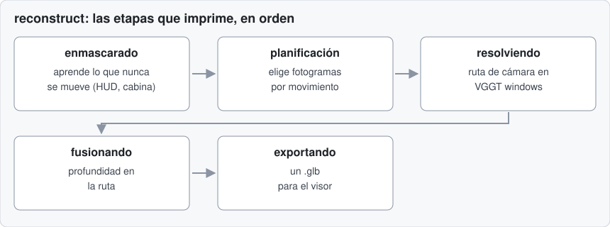

# Reconstrucción sin conexión {#offline-reconstruction}

```bash
python -m heat3d_capture reconstruct lap.mp4 -o lap.glb [--solve-budget 260] [--fuse-interval 0.4]
```

Código: [`scan/offline.py`](https://github.com/Holdi601/3DHeat-GameCapture/blob/main/heat3d_capture/scan/offline.py),
[`pose/feedforward.py`](https://github.com/Holdi601/3DHeat-GameCapture/blob/main/heat3d_capture/pose/feedforward.py),
[`pose/vggt_model.py`](https://github.com/Holdi601/3DHeat-GameCapture/blob/main/heat3d_capture/pose/vggt_model.py),
[`pose/feedforward_source.py`](https://github.com/Holdi601/3DHeat-GameCapture/blob/main/heat3d_capture/pose/feedforward_source.py),
[`pose/solveprep.py`](https://github.com/Holdi601/3DHeat-GameCapture/blob/main/heat3d_capture/pose/solveprep.py).
Opciones: [Referencia de comandos](commands.md#reconstruct).

## Por qué una segunda ruta {#why-a-second-path}

El seguimiento incremental es en directo y barato, y funciona donde hay estructura a la
que agarrarse: un interior, una calle, un mapa con cobertura. Un **circuito de carreras es
su peor caso**: la carretera es una cinta lisa con poca textura, el horizonte apenas se
mueve, y una vez que unas pocas poses derivan, nada posterior las vuelve a traer. Una
vuelta sale como una curva que divaga en lugar de cerrarse.

La ruta sin conexión entrega **ventanas de fotogramas** a un modelo que predice todas sus
cámaras a la vez, así que cada fotograma restringe directamente a todos los demás en lugar
de hacerlo a través de una cadena. Necesita toda la grabación antes de poder responder, así
que no es en directo, y es lenta: minutos por ventana en una GPU de escritorio. Todo lo que
viene después de las poses - fusión, cobertura, color, exportación - es el mismo código que
el escaneo en directo: la trayectoria resuelta se entrega al reconstructor como fuente de
poses, exactamente donde entra la telemetría de Forza.

## Requisitos {#requirements}

- **PyTorch** acorde con tu GPU (este proyecto no lo fija; instálalo antes de
  `requirements.txt`, ver [Runtime](runtime.md)).
- **`vggt`** - el código del modelo VGGT (`from vggt.models.vggt import VGGT`), del
  repositorio de GitHub de Meta; no está en el índice de paquetes.
- **`transformers`**, porque la ruta sin conexión ejecuta la profundidad a través de
  `DepthEstimator` de PyTorch (Depth Anything V2 Small), no del archivo ONNX.
- En la práctica, una GPU CUDA; ambos modelos vuelven a CPU, que no es práctico.

Ninguno de estos está en `requirements.txt`, porque el escáner no los necesita. Están en
**`requirements-offline.txt`**, con las dependencias propias de VGGT (`einops`,
`safetensors`, `huggingface_hub`, `Pillow`):

```bash
.venv\Scripts\python -m pip install -r requirements-offline.txt
.venv\Scripts\python -m pip install --no-deps "vggt @ git+https://github.com/facebookresearch/vggt.git"
```

VGGT se instala con `--no-deps` porque sus metadatos fijan `numpy<2`, y pip lo
respetaría rebajando el numpy que scipy necesita aquí. `reconstruct` comprueba todos
estos paquetes justo después de imprimir la línea de licencia (la lista `OFFLINE` en
[`runtime/preflight.py`](https://github.com/Holdi601/3DHeat-GameCapture/blob/main/heat3d_capture/runtime/preflight.py)),
muestra lo que falta con sus tamaños, e instala solo con un sí - VGGT con `--no-deps`, como
arriba. Si se rechaza, o no hay terminal donde preguntar, sale con el código 1.

## El modelo y su licencia {#the-model-and-its-licence}

**VGGT**, `facebook/VGGT-1B`: **CC-BY-NC-4.0, solo no comercial, y una reconstrucción hecha
con él hereda esa restricción.** El comando lo imprime antes de empezar (`describe_licence`).
Existe un `facebook/VGGT-1B-Commercial` con licencia separada, pero es un repositorio
restringido que Meta concede por cuenta, así que no puede ser el predeterminado.
`--model vggt-1b-commercial` resuelve con él (e imprime su línea de licencia en su lugar);
sin acceso concedido, la descarga falla. El *código* de `vggt` está bajo la "VGGT License"
de Meta, un acuerdo de materiales de investigación con una política de uso aceptable (se
lee del `LICENSE.txt` del paquete). Ver [Modelos y licencias](models-and-licences.md).

## La ejecución, etapa a etapa {#the-run-stage-by-stage}

Los nombres de las etapas son los que imprime el comando.



### masking (enmascarado) {#masking}

Se aprende un `FlowMask` a partir de **4 tandas de 90 fotogramas consecutivos**, centradas
en 1/8, 3/8, 5/8 y 7/8 del vídeo, a 960 x 540 en gris (ver [FlowMask](reconstruction-capture.md#flowmask-what-never-travels)).
Su nota se imprime y se guarda en el resumen. Un vídeo de menos de 90 fotogramas no recibe máscara.

#### La máscara de la cámara se aprende, no se aplica {#the-camera-mask-is-learned-not-applied}

La máscara **no** se aplica a los fotogramas que recibe el solucionador. Enmascarar la cabina
parecía correcto según las estadísticas de rasgos (la mayoría de las esquinas detectadas
están sobre píxeles sujetos a la cámara), pero eso es una afirmación sobre un detector de
rasgos, y el solucionador es una red entrenada. Medido por cuánto gira la trayectoria
recuperada entre pasos consecutivos (un coche gira unos pocos grados; un paseo aleatorio,
noventa), los fotogramas sin tocar dieron el giro más pequeño, los fotogramas con el
contraste realzado algo más, los fotogramas enmascarados claramente más, y ambos a la vez el
mayor. Así que el solucionador recibe fotogramas sin tocar. La máscara se sigue usando para
planificar el espaciado de fotogramas de abajo, y el seguidor incremental la usa en el
escaneo en directo. (`solveprep.enhance`, que enmascara y realza el contraste local con
CLAHE, existe pero este comando no lo usa.)

### planning (planificación): fotogramas espaciados por movimiento {#planning-frames-spaced-by-motion}

`plan_by_motion` elige los fotogramas del solucionador por **cuánto se movió la imagen**, no
por el reloj: un intervalo fijo da a los tramos lentos fotogramas que no necesitan y deja sin
ellos a los rápidos, donde los fotogramas consecutivos dejan de solaparse lo suficiente para
relacionarse.

- Desplazamiento objetivo: **5 % de un ancho de 960 píxeles** (48 px) de mediana de
  desplazamiento de rasgos ORB entre fotogramas elegidos consecutivos, medido en fotogramas
  en gris de 960 x 540 con contraste CLAHE, rasgos solo sobre la máscara.
- Se empieza con un hueco de 0,3 s; tras cada paso el siguiente hueco pasa a ser
  `hueco x (0,5 + 0,5 x objetivo / medido)`, limitado a **0,15-2,0 s**, para que una medición
  ruidosa no mueva el plan bruscamente.
- Cuando nada coincidió, el hueco se reduce a 0,6 de sí mismo (demasiado separados es el
  fallo que se evita).
- Se detiene al final del vídeo o en `--solve-budget` fotogramas (predeterminado 260).

Menos de 4 fotogramas planificados es un error.

### solving (resolución): ventanas y cosido {#solving-windows-and-stitching}

Los fotogramas planificados se decodifican a 960 px de ancho y se resuelven en **ventanas
solapadas de 16 fotogramas, con 6 compartidos** con la siguiente (`plan_windows`; la última
ventana se retrae para terminar en el fotograma final, de modo que el final de una captura
tiene tantos vecinos como el centro). Más de **400** fotogramas en una sola pasada se rechazan.

Cada ventana: los fotogramas se redimensionan para que el lado largo sea **518** y ambos
lados sean múltiplos de **14** (relación de aspecto mantenida - aplastarlos falsearía el
campo de visión), se escalan a 0..1, y pasan por VGGT con autocast bfloat16 (float16 se
queda sin exponente con coordenadas del mundo muy lejanas). Los extrínsecos de la cámara se
convierten en rotaciones mundo-desde-cámara y centros de cámara. Los mapas de puntos no se
conservan por defecto.

Cada ventana vuelve en **su propio marco arbitrario y su propia escala arbitraria**, así que
las ventanas se **cosen** al marco de la primera mediante una transformación de semejanza
(rotación, traslación, una escala), ajustada con las cámaras que comparten con lo ya
colocado:

- **Rotación a partir de las orientaciones de las cámaras**, no de sus posiciones: las
  cámaras compartidas se sitúan a lo largo del camino y son casi colineales en una recta, lo
  que deja a un ajuste solo por posición incapaz de ver la rotación - cada ventana se curva y
  el resultado cosido sale recto. La rotación es la media de `target_R x source_R^T`
  proyectada de nuevo sobre una rotación verdadera (con una guarda contra reflejos).
- **Escala y desplazamiento a partir de las posiciones**, a lo largo del origen ya rotado.
- Se requieren al menos **4** cámaras compartidas; menos es un error.
- El solape es un tercio de la ventana para que la escala quede bien determinada; el error de
  escala que se acumula ventana tras ventana es lo que hace que una vuelta se espiral.

Para cada costura se registra el peor desacuerdo de las cámaras compartidas tras el ajuste,
en unidades de la separación media entre ellas (`seam_error`).

### fusing (fusión) {#fusing}

Cada `--fuse-interval` segundos (predeterminado 0,4) se decodifican fotogramas a 960 px de
ancho, se les asigna profundidad con Depth Anything V2 Small (PyTorch), y se fusionan con una
pose **interpolada** de la trayectoria resuelta en su marca de tiempo (posición lineal,
rotación esférica; `FeedForwardPoses`). Los fotogramas fuera del intervalo de tiempo resuelto
se omiten en lugar de extrapolarlos. La cámara usa un **campo de visión horizontal de 65
grados**. Las poses de alimentación directa llevan confianza 0,85 en la fusión y la cobertura.

### exporting (exportación) {#exporting}

La malla se escribe como en un escaneo en directo ([La salida .glb](glb-output.md)), con
el nombre del vídeo.

## El resumen {#the-summary}

```text
140 cameras solved over 182s
closure error 3.1% of path length
worst seam 0.42 frame spacings
<mask note>
wrote lap.glb
```

| Línea | Significado |
|---|---|
| closure error | distancia del primer al último punto de cámara dividida por la longitud del camino. Para una sola vuelta, la medida honesta de la deriva. Por encima del 10 %: "The lap does not close ... Treat the shape as unreliable." |
| worst seam | el mayor desacuerdo de costura. Por encima de 1,0: "Windows disagreed by up to N frame spacings at a seam, so part of the path is stitched on weak evidence." |
| no file | "Fusion produced no surface, so nothing was written." El código de salida es entonces 1. |

## Escala {#scale}

La trayectoria cosida está en las unidades arbitrarias de la primera ventana. La profundidad
se ancla triangulando entre las poses interpoladas (como con la telemetría), así que la
geometría es coherente con la trayectoria - pero **el resultado no está en metros** a menos
que la trayectoria lo esté. Nada en este comando fija la escala global; la calibración del
suelo no se aplica cuando las poses vienen de una fuente de poses.

## Estado de esta ruta {#state-of-this-path}

Con fotogramas a intervalo fijo, las ventanas se resuelven en una trayectoria coherente en
algunos tramos de una vuelta y en un garabato en otros; los fallos están en las curvas
cerradas, donde la vista gira bruscamente entre fotogramas, y muestrear esas curvas con más
densidad las recupera. Ningún estadístico de imagen probado (brillo, detalle, número de
rasgos, proporción de inliers, desplazamiento) predijo de antemano qué tramos fallarían. Así
que el espaciado no se puede planificar del todo a partir de las imágenes de antemano: hay
que elegirlo resolviendo, midiendo el resultado y resolviendo de nuevo más denso donde la
trayectoria no es una que un coche podría haber recorrido. La planificación por movimiento
está construida; **el re-resolver adaptativo no lo está**.
