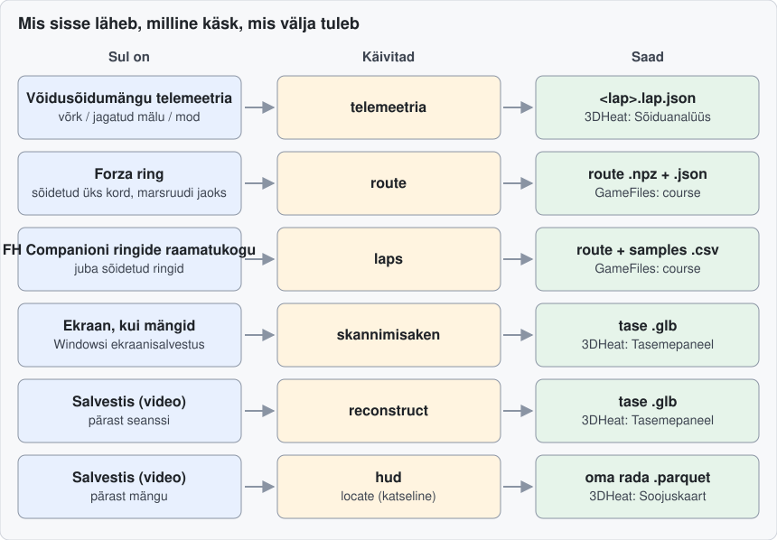

# 3DHeat GameCapture {#dheat-gamecapture}

**Mis see on?** Tööriist, mis kirjutab üles, mida võidusõidumäng sulle sinu sõidu kohta räägib, üks
fail ringi kohta. See võib ka taastada umbkaudse 3D-mudeli tasemest, mängides tehtud videost.

**Miks ma seda kasutaksin?** Et näha oma ringe [3DHeat vaatajas](https://holdi601.github.io/3DHeat/):
kus pidurdasid, kus olid aeglane, kuidas kaks ringi erinevad. Ja et tasemel oleks 3D-mudel su kuumuskaardi all,
kui keegi seda mudelit ei ole teinud.

**Näide:** lülita Forza Data Out sisse, käivita üks käsk ja sõida kaks ringi. Kaks ringifaili ilmuvad
kausta `laps\`. Lohista need vaataja võistlusvahelehele.


Pole sul käsurealt kogemust? Alusta lehest [Enne alustamist](before-you-start.md).

## Kolm tööd {#the-three-jobs}

1. **Ringi telemeetria.** See salvestab iga kanali, mida võidusõidumäng avaldab: Forza Data Out,
   Assetto Corsa mängude jagatud mälu, rallimängude võrguvood, BeamNG-i mod, Trackmania
   plugin ja kirjutab ühe `heat3d-lap` faili ringi või etapi kohta vaataja võistlusvahelehele.
   iRacing ei vaja salvestajat: vaataja loeb tema enda `.ibt`-faile.
2. **Tasemed mängust.** See muudab selle, mida ekraanil näidati, kui kõndisid või sõitsid läbi
   taseme, `.glb` 3D-mudeliks, mille vaataja paneb kuumuskaardi alla.
3. **Sinu enda mäng pärast seda.** `hud` loeb sinu salvestuse HUD-i: sinu tegevused, surmad,
   minikaardi rada ja tapmiste loendi. `locate` (katseline: see paigutab seni vähe päris kaadreid)
   selgitab, kust iga kaader tehti, taseme 3D-mudelil.

Kõik kolm järgivad ühte reeglit: **midagi ei süstita mängu ja midagi ei haagita**. Kaadrid tulevad
avalikust ekraanisalvestuse API-st, telemeetria liidestest, mille mängud selleks avaldavad. Vaata
[Reeglid](../rules.md).



Kood on Pythonis (pakett `heat3d_capture`), litsents MIT. Sügavus- ja asendimudelitel, mida see
saab käivitada, on oma litsentsid: vaata [Mudelid ja litsentsid](../models-and-licences.md).

## Kiire algus {#quick-start}

### Salvesta ringid {#record-laps}

Vajad Python 3.10 või uuemat ([Enne alustamist](before-you-start.md)). PowerShellis:

```powershell
git clone https://github.com/Holdi601/3DHeat-GameCapture
cd 3DHeat-GameCapture
python -m venv .venv
.venv\Scripts\python -m pip install -r requirements.txt

# Forza: Settings -> HUD and Gameplay -> Data Out = ON, IP 127.0.0.1, port 5300
.venv\Scripts\python -m heat3d_capture telemetry -o laps
```

**Peaksid nägema** `listening on port 5300. Laps go to laps. Ctrl+C to stop.`, seejärel rea iga ringi kohta, kui ületad joone, nagu
ülal olevas pildis. Peata Ctrl+C-ga. Lohista failid kaustast `laps\` vaataja võistlusvahelehele.
Iga teine mäng on ühe `--game` kaugusel:

```powershell
.venv\Scripts\python -m heat3d_capture telemetry --game acc -o laps
.venv\Scripts\python -m heat3d_capture telemetry --game dirtrally2 -o laps
```

Iga mängu ja valiku kohta vaata [Telemeetria salvestajad](../telemetry.md).

### Skanni tase {#scan-a-level}

Topeltklõpsa **`scan.bat`**-il tööriista kaustas. See leiab Pythoni (ja pakub selle paigaldamist
wingetiga, kui seda ei ole), teeb privaatse `.venv`, ja avab skannimisakna. Aken ütleb, mis puudu on,
mida iga pakett teeb ja kui suur allalaadimine on, ning ei paigalda midagi ilma jaatuseta. Vaata
[Käitusaeg ja sõltuvused](../runtime.md) ja [Skannimisaken](../reconstruction-scan-ui.md).

Käsitsi: `.venv\Scripts\python -m heat3d_capture.ui`.

Salvestuse taastamiseks võrguühenduseta, kui kaamera tee on korraga lahendatud (vajab PyTorchi, paketti
`vggt` ja GPU-d, vt [Võrguühenduseta rekonstrueerimine](../reconstruction-offline.md)):

```powershell
.venv\Scripts\python -m heat3d_capture reconstruct lap.mp4 -o lap.glb
```

## Dokumentatsiooni kaart {#map-of-the-documentation}

| Leht | Mida see käsitleb |
|---|---|
| [Enne alustamist](before-you-start.md) | Python, terminal, esimene käsk, tavalised vead |
| [Reeglid](../rules.md) | Ei mingit süstimist, ainult avaldatud liidesed, ja mida see maksab |
| [Telemeetria salvestajad](../telemetry.md) | käsk `telemetry` ja ülevaade igast mängust |
| [Forza](../telemetry-forza.md) | Data Out, paigutuse tuvastamine, FH Companioni edastus ja selle `.tele.gz` |
| [Assetto Corsa mängud](../telemetry-assetto-corsa.md) | AC, ACC, AC EVO, AC Rally jagatud mälust |
| [Rallimängud](../telemetry-rally.md) | EA SPORTS WRC, DiRT Rally 2.0 / 1 / DiRT 4, Richard Burns Rally |
| [BeamNG.drive](../telemetry-beamng.md) | `heat3d` protokolli mod |
| [Trackmania](../telemetry-trackmania.md) | `Heat3dRecorder` Openplanet plugin |
| [iRacing](../telemetry-iracing.md) | `.ibt`-failide lugemine vaatajas |
| [Ringide ja etappide jagamine](../lap-splitting.md) | `LapSplitter`, `CounterSplitter`, `LineSplitter`, `StageSplitter` |
| [Libisemine, triiv ja tuletatud kanalid](../slip-and-drift.md) | kuidas libisemist skaleeritakse ja mida vaataja tuletab |
| [heat3d-lap fail](../lap-format.md) | ringifaili vorming, kanalid, ühikud, `meta` |
| [Mängud](../games.md) | mängu kaupa: kuidas salvestada, mida saadetakse, millised rajad saab eksportida |
| [Käsud](../commands.md) | `route`, `telemetry`, `laps`, `reconstruct`, `hud`, `locate`, samm-sammult |
| [Käsu viide](../cli-reference.md) | iga valik, genereeritud `--help`-ist |
| [HUD-i lugemine salvestusest](../hud-video.md) | `hud`: oma tegevused, surmad, minikaardi rada ja tapmiste loend salvestusest |
| [Kaadrite leidmine tasemel](../locate.md) | `locate`: kust iga kaader tehti, taseme geomeetria vastu |
| [Taseme rekonstrueerimine](../reconstruction.md) | torujuhe kaadritest `.glb`-ni |
| [Skannimisaken](../reconstruction-scan-ui.md) | iga juhtnupp, kiirklahv ja kattekiht |
| [Jäädvustus, maskid ja kaadri kvaliteet](../reconstruction-capture.md) | Windows Graphics Capture, võtmekaadrid, HUD-maskid, kvaliteedi nõuanded |
| [Sügavus](../reconstruction-depth.md) | Depth Anything V2, ONNX Runtime, mudeli ehitamine |
| [Kaamera asend ja mõõtkava](../reconstruction-pose.md) | odomeetria, uuesti lokaliseerimine, telemeetria asendid, maapinna mõõtkava, kimbu korrigeerimine |
| [Liitmine, katvus ja värv](../reconstruction-fusion-and-texture.md) | hõivatuse maht, katvusruudustik, nõrgad kohad, tipuvärv |
| [.glb väljund](../glb-output.md) | fail, mille vaataja laadib |
| [Võrguühenduseta rekonstrueerimine](../reconstruction-offline.md) | `reconstruct`, VGGT aknad ja liitmine |
| [Mudelid ja litsentsid](../models-and-licences.md) | Depth Anything V2 suurused, VGGT, paketid |
| [Käitusaeg ja sõltuvused](../runtime.md) | eelkontroll, taustaprogrammid, jõudluse tasemed |
| [Piirangud ja kontroll](../limits.md) | mida ei ole tehtud ja mida ei ole kontrollitud |
| [Uuendused](../updates.md) | väljalaske kontroll ja `python -m heat3d_update` |
| [Arendus](../development.md) | testid, virtuaalkeskkond, hoidla paigutus |
| [Nende dokumentide hooldamine](../maintaining.md) | väljalaske kontrollnimekiri koodile ja dokumentatsioonile |

## Osa 3DHeatist {#part-of-3dheat}

Failid, mida see kirjutab, laadib **3DHeat vaataja**
([lähtekood](https://github.com/Holdi601/3DHeat), [dokumentatsioon](https://holdi601.github.io/3DHeat/)).
Ringifailid lähevad tema võistlusvahelehele, `.glb`-tasemed tema Taseme paneelile, `hud` ja `locate`
tabelid tema Soojuskaardi vahelehele; kuidas vaataja tabeleid ja mängufaile loeb, on kirjas lehtedel
[Üks fail mängu kohta: `.3dheat`](https://holdi601.github.io/3DHeat/container.html) ja
[Andmete sisestamine](https://holdi601.github.io/3DHeat/getting-data-in.html).

| Tööriist | Mida see teeb | Dokumentatsioon |
|---|---|---|
| [3DHeat vaataja](https://github.com/Holdi601/3DHeat) | näitab kuumuskaarte, võistlusi ja mänge 3D-na brauseris | [dokumentatsioon](https://holdi601.github.io/3DHeat/) |
| [GameFiles](https://github.com/Holdi601/3DHeat-GameFiles) | rajad ja tasemed mängude failidest 3D-mudelitena | [dokumentatsioon](https://holdi601.github.io/3DHeat-GameFiles/) |
| [GameCapture](https://github.com/Holdi601/3DHeat-GameCapture) | ringi telemeetria võidusõidumängudest; tasemed taastatud mänguvideost | [dokumentatsioon](https://holdi601.github.io/3DHeat-GameCapture/) |
| [Unreal Exporter](https://github.com/Holdi601/3DHeat-UnrealExporter) | Unreal Editori plugin, mis eksportib taseme 3D-mudelina | [dokumentatsioon](https://holdi601.github.io/3DHeat-UnrealExporter/) |
| [CS2](https://github.com/Holdi601/3DHeat-CS2) | Counter-Strike 2 demod mängufailideks; kaardid 3D-mudeliteks | [dokumentatsioon](https://holdi601.github.io/3DHeat-CS2/) |
| [Watcher](https://github.com/Holdi601/3DHeat-Watcher) | salvestab sinu mängu taustal sellest, mida mängud avaldavad | [dokumentatsioon](https://holdi601.github.io/3DHeat-Watcher/) |
| [Ext-WarThunder](https://github.com/Holdi601/3DHeat-Ext-WarThunder) | War Thunderi replayd mängufailideks | [dokumentatsioon](https://holdi601.github.io/3DHeat-Ext-WarThunder/) |
| [Ext-WoT](https://github.com/Holdi601/3DHeat-Ext-WoT) | World of Tanksi replayd mängufailideks | [dokumentatsioon](https://holdi601.github.io/3DHeat-Ext-WoT/) |
| [Ext-WoWs](https://github.com/Holdi601/3DHeat-Ext-WoWs) | World of Warshipsi replayd mängufailideks | [dokumentatsioon](https://holdi601.github.io/3DHeat-Ext-WoWs/) |
| [Ext-Squad](https://github.com/Holdi601/3DHeat-Ext-Squad) | Squadi serverdemod mängufailideks | [dokumentatsioon](https://holdi601.github.io/3DHeat-Ext-Squad/) |
| [Ext-DCS](https://github.com/Holdi601/3DHeat-Ext-DCS) | DCS Worldi kaardid 3D-mudeliteks | [dokumentatsioon](https://holdi601.github.io/3DHeat-Ext-DCS/) |
| [Ext-IL2](https://github.com/Holdi601/3DHeat-Ext-IL2) | IL-2 Sturmovigi kaardid 3D-mudeliteks | [dokumentatsioon](https://holdi601.github.io/3DHeat-Ext-IL2/) |

Arendaja, kellel on mängu projekt avatud, peaks kasutama Unreali eksporterit, mis loeb päris geomeetria ja on täpne.
Kus mängu enda arhiive saab lugeda, eraldab GameFiles täpse raja. Rekonstrueerimine mängust on mõeldud juhuks,
kui on saadaval ainult ekraan.
