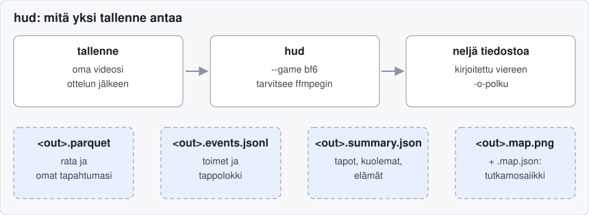

# HUDin lukeminen tallenteesta {#reading-the-hud-from-a-recording}

`hud` lukee pelin näytöllä olevan HUDin pelaajan **omasta tallenteesta** pelin jälkeen: pelaajan
**omat** toiminnot pisteponnahduksesta, jonka peli näyttää tähtäimen alla (tappo, avustus, elvytys,
täydennys, valtaus...), heidän kuolemansa kaatumis- ja käyttöönottoruuduista, heidän **oman** radan
pienoiskartasta sekä tappolokin heidän vierestään aikaleimattuina tapahtumina. Tulos kirjoitetaan
3DHeat-taulukkona, jonka alle voi asettaa pienoiskartan mosaiikin karttakuvana.

Lyhyesti: se katsoo ottelun videota ja kirjaa ylös tapposi, kuolemasi ja missä kävelit.

```bash
.venv\Scripts\python -m heat3d_capture hud "<recording>.mp4" --game bf6 --player <name> -o out/match
```

Battlefield 6 on ensimmäinen peliprofiili.



## Mihin se koskee ja mihin ei {#what-it-does-and-does-not-touch}

- Se lukee **videotiedoston**: ShadowPlay- tai Instant Replay -klipin, OBS-tallenteen, minkä tahansa,
  jonka ffmpeg osaa purkaa. Se ei koske peliin, sen muistiin, tiedostoihin eikä verkkoon, ja se ajetaan
  ottelun päätyttyä. Katso [Säännöt](rules.md).
- Se johtaa **vain pelaajan oman sijainnin**, pelaajan oman pienoiskartan perusteella. Muiden pelaajien
  merkit pienoiskartalla peitetään eikä niitä lueta. Tappolokki säilytetään kokonaan, mutta vain sellaisena
  kuin se ruudulla lukee (kuka, keneen, millä, milloin); kenellekään muulle kuin pelaajalle ei liitetä
  sijaintia.
- OCR ajetaan paikallisesti (RapidOCR, PaddleOCR-mallit ONNX Runtimella). Yksikään kehys tai rajaus ei
  poistu koneelta.
- Tallenteessa näkyvät muiden pelaajien nimet, ja mosaiikki on kuva tasosta. Tulokset ovat pelaajan
  omaan käyttöön; pidä ne paikallisina.

## Vaatimukset {#requirements}

- **ffmpeg ja ffprobe** `PATH`-polulla. NVIDIA-näytönohjainta käytetään dekoodaukseen, kun sellainen on
  (`-hwaccel cuda`); muuten prosessori dekoodaa, ja se on useita kertoja hitaampi.
- Paketit tiedostosta `requirements.txt`, ja OCR ilman omia riippuvuuksiaan (se pyytää prosessorin
  `onnxruntime`-paketin, joka on ristiriidassa projektin DirectML-version kanssa):

```bash
.venv\Scripts\python -m pip install -r requirements.txt
.venv\Scripts\python -m pip install --no-deps rapidocr_onnxruntime==1.2.3
```

`rapidocr_onnxruntime` on tekstinlukija (OCR), joka lukee nimet ja sanat ruudulta. `--no-deps` estää sitä
korvaamasta projektin DirectML-versiota `onnxruntime`-paketista.

Asentaaksesi ffmpegin Windowsiin: `winget install Gyan.FFmpeg`, avaa sitten uusi terminaali ja tarkista
komennolla `ffmpeg -version`. Oletko uusi komentorivin kanssa? Lue [Ennen aloittamista](before-you-start.md).

- **16:9**-tallenne millä tahansa resoluutiolla (1080p, 1440p, 4K). Muut kuvasuhteet hylätään, koska
  profiilin laatikot osuisivat väärään kohtaan ruutua.
- Pelin **oletusarvoinen HUD-asettelu**. Siirretty tai skaalattu HUD-elementti luetaan väärästä kohdasta.

## Asetukset {#options}

| Asetus | Oletus | Merkitys |
|---|---|---|
| `video` | | Tallenne. |
| `-o`, `--out` | videon nimi nykyisessä kansiossa | Tulostepolku **ilman** tiedostopäätettä; tiedostot ovat `<out>.parquet`, `.events.jsonl`, `.summary.json`, `.map.png`, `.map.json`. |
| `--game` | `bf6` | Minkä pelin HUD luetaan. `bf6` (Battlefield 6) on toistaiseksi ainoa profiili. |
| `--player` | ei mitään | Pelaajan nimi sellaisena kuin tappolokki sen näyttää. Verrataan löyhästi (OCR sekoittaa `l`/`I`/`1`, `O`/`0`, `rn`/`m`). Ilman sitä nimi arvataan (alla). |
| `--fps` | 5 | Pienoiskartan näytteitä sekunnissa. Tappolokki näytteistetään puolella tästä, pistepopup ja kuolemaruudut myös puolella (neljäsosalla, kun popup ei ole näkyvissä), kompassi 3 sekunnin välein ja joukkuelista 15 sekunnin välein. |
| `--start` | 0 | Sekunti videossa, josta aloitetaan. |
| `--seconds` | kaikki | Kuinka paljon videota luetaan. |
| `--metres-per-pixel` | ei mitään | Pienoiskartan mittakaava, jos se tunnetaan: metriä pienoiskartan pikseliä kohden tavallisella zoomilla (pienoiskartta on 296 pikseliä leveä 1080p-näytöllä). Ilman sitä sijainnit ovat näissä pikseleissä; katso [Yksiköt](#north-and-units). |
| `--cpu` | pois | Dekoodaa prosessorilla, vaikka NVIDIA-näytönohjain on käytettävissä. |

Edistyminen tulostetaan viiden sekunnin välein; lopussa tulostetaan pelaaja, tappot, kuolemat, elämät ja
kirjoitetut tiedostot.

## Tulosteet {#outputs}

### `<out>.parquet` - pelaajan rata ja tapahtumat {#parquet---the-players-track-and-events}

Yksi rivi jokaisesta näytteestä, jolloin pelaaja oli pelissä ja pienoiskartan saattoi paikantaa, sekä
yksi rivi jokaisesta hänen tapahtumastaan. Lopussa (footer) on katselimen lukuohje (`heat3d`-avain,
`kind: heat3d-hud`), joten katselin kytkee jokaisen sarakkeen ilman kysymyksiä.

| Sarake | Merkitys |
|---|---|
| `time` | Sekunteja videon alusta. |
| `event` | `position`; `start` (video alkoi kesken elämän), `spawn` (takaisin pelissä kuoleman tai pitkän tauon jälkeen), `death`, `downed` ja `revived` (kuolemaruuduista, alla), `end` (elämä päättyi, eikä mistään näy miten); pelaajan omat toiminnot pistepopupista (`kill`, `assist`, `reviving`, `resupply`, `capture`... - [tapahtumataulukko](#event-table)); ja tappolokin rivit pelaajasta nimellä `kill_feed`, `death_feed`, `teamkill_feed`, `suicide_feed` ja `squadwipe_feed`. |
| `source` | Mistä rivin tapahtuma tuli: `points` (popup), `screen` (kaatumis- ja käyttöönottoruudut), `feed` (tappolokki); tyhjä sijaintirivillä. |
| `text` | `points`-riveillä: merkki sellaisena kuin se on tulostettu (`KILL`, `SQUAD DAMAGE ASSIST`...), tai otsikko (`DOUBLE KILL`, nauhan nimi), tai tuntemattomalla merkillä se, mitä luettiin. |
| `points` | `points`-riveillä: kuinka paljon popupin summa kasvoi juuri silloin. Kun samassa näytteessä tuli useita toimintoja (tappo ja auto, jossa se tehtiin), se on niiden summa, annettuna kullekin, ja `shared` kertoo, kuinka moni jakoi sen. Tyhjä, jos summaa ei luettu kahdesti hetken molemmin puolin. |
| `subject`, `subject_side` | `points`-riveillä: nimi, jonka popup näytti toiminnon kanssa - tapon uhri tai elvytetty tai täydennetty joukkuetoveri - ja sen väri (`enemy`, `friendly`, `squad`). |
| `confirmed` | `feed`, kun tappolokissa oli rivi samalle tappolle tai kuolemalle (3 sekunnin sisällä, sama uhri). |
| `x`, `y`, `z` | Sijainti mosaiikilla: `x` itään, `y` pohjoiseen, `z` 0 (footer kertoo, että `z` on ylös). Pohjoinen on todellinen pohjoinen, kun kompassi salli sen (ks. `north_up` yhteenvedossa). |
| `player` | Aina `me`. Vain pelaajan omilla riveillä on sijainti. |
| `team` | `own`. |
| `session` | `<video name>#NN`, yksi per elämä. Viivalämpöreitit eivät koskaan ylitä istuntoa. |
| `heading` | Asteita myötäpäivään pohjoisesta (mosaiikin ylhäältä, kun pohjoinen on tuntematon): mihin näkymä osoitti. |
| `dir_x`, `dir_y`, `dir_z` | Sama suuntavektorina katselimen katselusuuntaa varten. |
| `zoom` | Kuinka paljon pienoiskarttaa oli loitonnettu tavalliseen zoomiin verrattuna (yli 1 ajoneuvossa). |
| `killer`, `victim`, `weapon`, `headshot`, `marker` | Tappo- ja kuolemariveillä, joilla on tappolokin rivi: se rivi (alla). Popup-tappo ilman lokirivia saa popupin nimen `victim`-kentäksi; popup-tappo, joka näkyi HEADSHOTina, saa `headshot`-arvon true. |

Jokainen tapahtumarivi saa pelaajan sijainnin tapahtuman hetkellä (kuolemalle tai kaatumiselle viimeinen
sijainti ennen sitä, elvytykselle ensimmäinen sen jälkeen). Rivit sopivat suoraan katselimen
[viivalämpöön](https://holdi601.github.io/3DHeat/line-heat.html): sen ehdotus valitsee `event`-sarakkeen,
alkaa kohdasta `start`, `spawn` ja `revived`, ja päättyy kohtiin `death`, `downed` ja `end`, ja
`position`-rivit kulkevat reittiä pitkin. Muut tapahtumat on nimetty niin, ettei ehdotus ota niistä
alkua tai loppua: elvytyksen antaminen on `reviving` (ei `revive`), pisteen pitäminen `defense`,
joukkuetoverin synnyttyä pelaajan viereen `teammate_arrived`, ja lokin rivit `kill_feed` ja niin
edelleen; `kill` ei ole loppu.

Klippi, jossa on kaksi kierrosta kahdella kartalla, antaa kaksi mosaiikkia, joita ei voi yhdistää. Suurin on
`<out>.parquet`; jokainen muu, jolla on vähintään 30 s rataa, kirjoitetaan sen viereen nimellä
`<out>.map2.parquet`, `<out>.map2.map.png` ja niin edelleen.

### `<out>.events.jsonl` - pelaajan tapahtumat ja tappolokki {#eventsjsonl---the-players-events-and-the-kill-feed}

Yksi JSON-olio per rivi, aikajärjestyksessä, kukin `source`-kentällä varustettuna:

- `points`: yksi per pelaajan toiminto: `time`, `event`, `text`, `points`, `shared`, `subject`,
  `subject_side` (kuten taulukossa), `popup` (mistä popupista se tuli, numeroitu koko ajon ajan), `seen`
  (kuinka monta lukua näytti sen), `confirmed`, ja `x`, `y` missä pelaaja oli.
- `screen`: yksi per kaatuminen ja per elvytys: `event` (`death`, `downed` tai `revived`), `time` (kun
  pelaaja kaatui; `revived`-riville, kun ruudut katosivat), `until` (viimeinen havainto ruuduista),
  `screens` (`down` ja/tai `card`), `outcome` (`death`, `revived` tai `unknown`, kun tallenne päättyy
  ensin), `killer` (tappolokin rivistä, kun sellainen on), `x`, `y`.
- `feed`: jokainen tappolokin näyttämä rivi, kaikkien: 

| Kenttä | Merkitys |
|---|---|
| `time`, `last` | Ensimmäinen ja viimeinen näyte, jolla rivi luettiin (sekunteja videon alusta). `time` on hetki, jolloin tappo ilmestyi, yhden lokinäytteen tarkkuudella (0,4 s oletusnopeudella). |
| `kind` | Pelaajan puolelta: `kill`, `death`, `teamkill`, `suicide`, `squadwipe`; muiden pelaajien riveillä `kill`, `squadwipe`, tai `death` rivillä, jolla ei ole tappajaa. |
| `killer`, `victim` | Nimet sellaisina kuin ne luettiin useimmin kaikista riviä näyttäneistä näytteistä (pidempi luku voittaa, kun yleisin on sen alku: osittain piilossa oleva nimi). `killer` on tyhjä rivillä, joka näytti vain kuvakkeen ja uhrin - kuolema maailmaan, tai rivi, jonka tappaja oli jo haalistunut. |
| `killer_side`, `victim_side` | Nimen värin mukaan: `friendly` (pelaajan joukkue, sininen), `enemy` (oranssi), `squad` (vaaleanvihreä, jota peli käyttää pelaajalle ja hänen squadilleen), `neutral` (ei mikään näistä). |
| `weapon` | Aseen kuvakkeen luokka tämän ajon sisällä: `icon01`, `icon02`... Rivit, joiden kuvakkeet näyttävät samalta, jakavat luokan. Kuvakkeita ei ole nimetty; nimiä varten ei ole listaa. |
| `marker` | Pieni kuvake aseen ja uhrin välissä: `skull`, `arrow`, `chevrons`, `crosses` tai tyhjä. |
| `headshot` | `marker == "skull"` - oletus, katso [Rajat](#limits). |
| `seen` | Kuinka monta tappolokin näytettä näytti rivin. |
| `me` | `killer`, `victim` tai null. |
| `matched` | Pelaajan omilla riveillä: löytyikö niille popup-toiminto tai kuolemaruutu. |
| `x`, `y` (, `map`) | Pelaajan omilla riveillä: missä pelaaja oli. |

### `<out>.summary.json` {#summaryjson}

Pelaaja (ja miten hänet löydettiin), mistä pelaajan tapahtumat tulivat (`own_events_from`: popup ja
ruudut, tai pelkkä tappolokki, kun kumpaakaan ei luettu lainkaan), tapot, kuolemat, K/D, headshotit,
avustukset, annetut (`revives`) ja saadut (`revived`) elvytykset, kaatumiset (`downs`), valtaukset,
neutralisoinnit, täydennykset, parannukset, korjaukset, tuhotut ajoneuvot, pisteet (popupien summat
yhteen laskettuina), jokainen toimintotyyppi laskureineen (`actions`), popupien määrä, kuolemat, jotka
näkyivät vain tappolokissa, tappolokin oma tappo- ja kuolemalaskuri ja kuinka monta sen tappoa vastasi
popup-tappoa, joukkuetappot, itsemurhat, squad-tuhoutumiset, elämät, sekunnit pelissä, kuljettu matka
(taulukon yksiköissä), lokirivit, kunkin kartan kohdalla onko pohjoinen ylhäällä ja kuinka monta
kompassilukemaa oli samaa mieltä, radan laskurit (näytteet, pelissä, paikannettu, ei paikannettu,
saarekkeet), tehdyt oletukset ja ajoitus.

### `<out>.map.png` ja `<out>.map.json` - kartta radan alla {#mappng-and-mapjson---the-map-under-the-track}

Ajon kaikkien pienoiskarttojen mosaiikki, keskiarvo, peitteet poistettuina, käännettynä ja skaalattuna
täsmälleen kuten taulukko. JSON-sivutiedosto sisältää kaksi ankkuria, joita katselimen **Karttakuva**-sijoitus
kysyy ([Karttakuvat](https://holdi601.github.io/3DHeat/map-images.html) katselimen dokumentaatiossa):
lataa PNG painikkeella **Karttakuva...**, pidä **Käännä pohjoinen/etelä** päällä ja kirjoita ankkuri 1 ja
ankkuri 2 (`px`, `py`, `worldX`, `worldZ`) sivutiedostosta. Kuva asettuu sitten täsmälleen radan alle.

Kuvassa on vain ne tason osat, jotka pelaajan pienoiskartta näytti.

## Menetelmä {#method}

### Dekoodaus {#decoding}

ffmpeg dekoodaa GPU:lla, putoaa näytteenottotaajuuteen, kun kehykset ovat vielä kortilla, leikkaa irti
profiilin alueet (pienoiskartta, tappolokki, kaksi kompassinauhaa, joukkuelista, pistepopup, kaatumisruudun
sanat, oikean alakulman), skaalaa kukin kiinteään kokoon ja pinoaa ne yhdeksi pieneksi kuvaksi näytettä
kohden. Vain se kuva siirtyy putken kautta Pythoniin. H.264-virran jokaisen kehyksen dekoodaus on ajoajan
alaraja.

Kaksi työsäiettä ottaa näytteet: toinen rekisteröi pienoiskartat (OpenCV), toinen lukee tekstin (ONNX Runtime).

### Pelissä vai ei {#in-play-or-not}

Pienoiskartan avainvihjeen neliö (vaalea neliö, jossa on karttanäppäin, pienoiskartan alavasemmalla) piirretään
aina, kun pienoiskartta piirretään, eikä kuolema-, tappokamera-, käyttöönotto-, valikko- tai tulostaulunäkymissä.
Sen läsnäolo - vaalea, värittömä neliö, jonka keskellä on tumma kirjain ja joka on selvästi vaaleampi kuin sen
ympäristö, etsittynä muutaman pikselin päästä sen paikasta - on pelissä-testi. Yksittäinen näyte, joka ei
ole samaa mieltä kummankaan naapurinsa kanssa, ohitetaan.

Pelitauko on kuolema tai kierroksen vaihto (seuraava jakso alkaa `spawn`-merkillä), kun se kestää vähintään
6 s tai kuolema (kuolemaruuduista tai tappolokin rivistä, jossa pelaaja on uhri) tuli 40 sekuntia ennen sitä;
lyhyempi tauko ilman kuolemaa (iso kartta avattiin) jatkaa elämää. Pienoiskartta pysyy näkyvissä, kun pelaaja
on kaatunut, joten kaatunut pelaaja on pelissä.

### Rata {#the-track}

Pienoiskartta kääntyy katselun mukana ja pitää pelaajan kiinteässä pisteessä (mitattu: keskellä, 49,7 %
alaspäin). Jokaisessa näytteessä:

1. **Peite**: kaikki, mikä ei ole tasoa: vahvasti värilliset tai lähes valkoiset pikselit (tavoitemerkit,
   squad- ja ajoneuvokuvakkeet, pingit, pelialueen raja, reittiviivat, teksti), näkökartion himmeä
   keltavihreä, ympyrä pelaajan merkin ympärillä, kartion kiila sen yläpuolella, avainvihje ja ohut reuna.
2. **Piirteet**: SIFT-avainpisteet kontrastitasoitetusta harmaasta pienoiskartasta, peitteen sisällä.
3. **Rekisteröinti mosaiikkiin**, ei edelliseen näytteeseen: avainpisteitä verrataan tähän asti tallennettuihin
   piirteisiin mosaiikin koordinaateissa, lähellä paikkaa, jossa pelaaja viimeksi oli; yhdenmuotoisuus
   (kääntö, zoom, siirto) sovitetaan RANSACilla. Sovitus vaatii tarpeeksi sisäpisteitä, zoomin, joka on
   kolmasosan sisällä edellisestä, ja siirron, joka on alle kolmasosa pienoiskartasta näytettä kohden; mosaiikin
   mistä tahansa kohdasta etsitty sovitus (kuoleman jälkeen) tarvitsee kaksinkertaisen määrän sisäpisteitä.
4. **Mosaiikin kasvattaminen**: piirteet, joita mosaiikilla ei vielä ole, lisätään (korkeintaan joka muutaman
   kymmenesosan sekunnin liikkeen kohdalla), ja peitetty pienoiskartta keskiarvoistetaan kuvaan.
5. Pelaajan piste, joka kulkee sovituksen läpi, on hänen **sijaintinsa**; pienoiskartan ylös, joka kulkee
   sen läpi, on hänen **suuntansa** mosaiikilla.

Sen jälkeen piste, joka hyppää yli 10 pikseliä kaukana sekä kahdesta edeltävästä että kahdesta seuraavasta
näytteestä (jotka ovat samaa mieltä keskenään), pudotetaan: pienoiskartta osuu joskus väärään zoomiin yhden
näytteen ajaksi. Yhteenveto laskee ne (`dropped_as_jumps`).

Rekisteröinti mosaiikkiin estää virheiden kasautumisen: palatessa paikkaan se osuu ensimmäisen kerran
tallennettuihin piirteisiin. Synnytys jossain vielä näkemättömässä paikassa aloittaa erillisen **saaren**;
joka kymmenes sijoitettu näyte kokeillaan muita saaria vastaan, ja ensimmäinen hyvä osuma liittää ne
(pienempi siirtyy suuremman sisään, radan kanssa). Saaret, joita ei koskaan liitetty (toinen kartta tai maa,
jota ei koskaan jaettu), kirjoitetaan erikseen, kuten yllä.

### Pohjoinen ja yksiköt {#north-and-units}

Kompassinauha luetaan 3 sekunnin välein: sen tekstit löydetään niiden musteesta (kirkas, väritön, ryhmitelty
pienten välien yli, merkit pudotettu), jokainen luetaan erikseen, ja kaksi tai useampi tekstiä kiinnittää sekä
nauhan mittakaavan että keskimerkin alla olevan suunnan - yksi teksti ei kiinnitä mitään. Jokainen kompassilukema
parittuu saman näytteen mosaiikkisuunnan kanssa; niiden erojen ympyrämediaani, niiden lukemien yli, jotka ovat
10 asteen sisällä siitä, on käännös, joka asettaa mosaiikin pohjoisen ylös. Se sovelletaan, kun vähintään
kolme lukemaa ja puolet kaikista ovat samaa mieltä.

<a id="units"></a>Pienoiskartan maanpäällinen mittakaava ei ole painettuna missään ruudulla, joten sijainnit ovat
**pienoiskartan pikseleitä tavallisella zoomilla**: ajon mediaanizoom skaalataan yhdeksi taulukkoyksiköksi
pikseliä kohden 296 pikselin pienoiskartalla (sen koko 1080p-näytöllä). Ajoneuvon loitonnus poistetaan
rekisteröinnillä, joten yksikkö on sama jalan ja ajoneuvossa. `--metres-per-pixel` kertoo kaiken metreiksi,
kun mittakaava tunnetaan (kartan tunnetusta etäisyydestä, mitattu kerran).

### Tappolokki {#the-kill-feed}

Lokia luetaan 2,5 näytettä sekunnissa, mutta vain kun sen värilliset pikselit muuttuivat selvästi tai kaksi
sekuntia kului. Tekstirivit löytää OCR:n ilmaisin; rivi, jonka kuva vastaa edellisessä näytteessä luettua
(rivit vierivät, joten se on saattanut liikkua), ottaa sen tekstin sen sijaan, että se luettaisiin uudelleen.
Liian pienet nimeä varten tai kauttaviivalliset rivit (fps-laskuri siinä nurkassa) pudotetaan.

Rivit ryhmitellään korkeuden mukaan; rivillä vasemmanpuoleisin nimi on tappaja ja oikeanpuoleisin uhri.
Saman värin naapuripalat yhdistyvät (nimi, jossa on väli). Yksi rivi, joka kulki kuvakkeen yli nimestä toiseen,
leikataan leveimmästä välistään, kun puoliskot eroavat värissä, ja kumpikin luetaan uudelleen. Yksi nimi uhrien
sarakkeessa, jonka vasemmalla on kuvake, on rivi ilman tappajaa. Kaksi samanväristä palaa ilman kuvaketta niiden
välissä on yksi nimi, jonka tappaja on haalistunut, ei tappo.

**Puolet** tulevat väristä. Nimet piirretään osittain läpinäkyvinä, joten testi tehdään sen mukaan, kuinka kaukana
teksti on omasta taustastaan: punaisen ja sinisen erotuksen merkki tuossa erossa on oranssi (vihollinen) tai
sininen (ystävä) millä tahansa taustalla; kumpikaan, ja vihreä kahden muun yläpuolella, on squad-väri.

**Kuvakkeet**: nimien välissä pelaajan oman värin pikselit muodostavat aseen siluetin; pieni erillinen kuvake
heti ennen uhria on merkki, joka nimetään muodon mukaan (silmäaukkoinen möhkäle on kallo; pieni kolmio on nuoli;
useampi pala on ristit).

**Tapahtumat**: rivi, joka luetaan uudelleen samoilla nimillä (samankaltaisuus 0,7 sen jälkeen, kun tavalliset
OCR-sekoitukset on taitettu, yksi niistä 0,8; katkaistu luku täsmää koko nimen alkuun) on sama tapahtuma, niin
kauan kuin tapahtuma luettiin viimeksi alle 5 s aiemmin ja on alle 14 s vanha - yksikään rivi ei pysy pystyssä
kauempaa, joten sama pari myöhemmin on uusi tappo. Rivi ilman tappajaa täsmää pelkästään uhriin. Tapahtuman
aika on sen ensimmäinen havainto; sen nimet, puolet ja merkki ovat enemmistö havainnoista; kerran luetut rivit
pudotetaan.

**Pelaaja**: `--player`, muuten joukkuelistan korostettu (kirkkain) rivi, kun siinä on vähintään kolme lukemaa ja
60 % niistä on samaa mieltä, muuten nimi, jonka tappolokki piirsi useimmin squad-värillä. Muuten yhteenveto sanoo,
ettei pelaaja ole tiedossa, eikä yksikään lokirivi liitetä häneen. (Popup ja kuolemaruudut ovat pelaajan omia
nimestä riippumatta; ne eivät tarvitse nimeä.)

### Pistepopup {#the-points-popup}

Kaiken, minkä pelaaja pisteyttää, Battlefield 6 näyttää yhdessä popupissa tähtäimen vasemmalla puolella ja
alapuolella - samassa paikassa jalan, ajoneuvossa ja tähtäimen kautta:

```
            [ RIBBON ] (icon)          a title, now and then: a ribbon or a multi-kill
      (icon)(icon)(icon)  300          one icon per action; the popup's running total
                Some_Name              who it was about, for a moment: orange an enemy, blue a teammate
    [ KILL x2 ] [ VEHICLE DESTROYED ]  one boxed tag per kind of action, with a count
```

Popup kasvaa, kun pelaaja pisteyttää: uusi tappo muuttaa `KILL`-merkin `KILL x2`:ksi, lisää kuvakkeen ja nostaa
summaa; uusi toimintotyyppi lisää merkin. Merkkirivi näyttää viimeisimmät muutamat tyypit (vanhin liukuu ulos ja
laskee edelleen, kun se palaa). Noin kolme sekuntia viimeisen toiminnon jälkeen popup taittuu yhdeksi riviksi
(`[KILL x2] 300`) ja katoaa. Teksti on vaaleanharmaata, merkit ohuissa laatikoissa, summa suurilla numeroilla
alkaen x 760:sta 1920x1080-näytöllä, ja merkit kohdistettuina oikealle x 750:een.

Sitä luetaan 2,5 kertaa sekunnissa: OCR:n ilmaisin löytää tekstirivit, vain popupin yhden rivin rivit luetaan
(tankin tähtäimen omat tekstit samalla alueella eivät), ja rivi, jonka kuva vastaa edellisen näytteen luettua,
ottaa sen tekstin. Rivi, joka on ajettu kuvakkeesta, nimestä tai taitetusta merkistä summaan (`Name10`,
`REVIVE185`), leikataan siitä, mihin summa alkaa (x 755), ja molemmat puoliskot luetaan uudelleen. Kun popupia ei
ole näkyvissä, joka toinen näyte jätetään lukematta; kun seuraavassa näkyy popup, pidetty luetaan ensin, joten
popupin alku löydetään näytteen tarkkuudella.

**Merkit** täsmäytetään [tapahtumataulukkoon](#event-table), kun tunnistimen tavalliset lipsahdukset on taitettu
(Q luettu O:ksi, numero kirjainten välissä, I L:n sijasta, reunalta kadonnut kirjain): luku on merkki, kun se on
vähintään 80 % samanlainen jollekin (85 % viiden kirjaimen tai lyhyemmille merkeille) ja selvästi lähempänä sitä
kuin mitään muuta. Tunnistimen yhteen ajamat merkit (`CAPTUREDORDERCOMPLETED`) erotetaan kuorimalla tunnetut
merkit alusta. Laskuri on `x2`, `X3`, satunnainen merkki ja numero, tai numero heti merkin perässä. Vaaleanharmaa,
isoin kirjaimin kirjoitettu rivi merkkirivillä, joka ei täsmää mihinkään, säilytetään toimintona `points` sen
tekstillä; rivi, joka on tunnetun merkin pala samassa popupissa (`DESTROYED` `VEHICLE DESTROYEDin` vieressä), ei ole.
Otsikot summan yläpuolella (vaaleat laatikot, tumma teksti) ovat `multi_kills` (`DOUBLE KILL` ...) tai `ribbon`.
Nimi on värillinen rivi summan ja merkkien välissä; sen puoli tulee väristä kuten tappolokista.

**Popupit ja toiminnot**: lukemat, joiden välissä on alle 0,9 s tyhjää, ovat yksi popup. Popup, joka näyttää
loppuvan ja palaa ennen kuin se olisi voinut taittua (3,2 s sisällä viimeisestä kasvusta), jokaisen merkin
ollessa samalla laskurilla tai suuremmalla ja summan ei olevan pienempi, on sama popup, joka hetkeksi katosi
(sumu, kirkas tausta) - mitään siinä ei lasketa kahdesti. Popupissa merkin lopullinen laskuri on korkein laskuri,
joka luettiin vähintään kahdesti; sen k:s toiminto ajoitetaan ensimmäiseen lukemaan, jossa laskuri on k tai
enemmän. Laskuri, joka luettiin vain yhdessä näytteessä, ei ole toiminto - paitsi tappo, jonka tappolokki
vahvistaa (pelaajan rivi kolmen sekunnin sisällä, jota mikään muu tappo ei vienyt): lyhyt KILL-merkki on se, jonka
tunnistin useimmin lukee vain kerran. Otsikko lasketaan kerran popupia kohden, kun se luetaan kahdesti.
`points` on se, kuinka paljon summa - laskien vain summat, jotka luettiin kahdesti peräkkäin - kasvoi toiminnon
näytteen edeltä sen jälkeen.

Tuntematon rivi lasketaan merkiksi vain tunnettujen merkkien rivillä samasta lukemasta (tai, kun tunnettuja
merkkejä ei ole, kun nimeä ei myöskään ole), joten väriltään nimeä, jota puolen testi ei tunnista, ei oteta
merkiksi.

### Kuolemat ja elvytykset {#deaths-and-revives}

Kun pelaaja kaatuu, peli kertoo sen ruudun keskellä (MAN DOWN, REQUEST REVIVE, SKIP (HOLD), NEARBY MEDICS; kun
elvytystä on pyydetty, REVIVE REQUESTED, CANCEL REQUEST), ja kortti oikeassa alakulmassa nimeää tekijän, ja sen
alla DAMAGE LOG tai PLAYER CARD ja sen yläpuolella rivi "YOU n - n FOE". Jos pelaaja kuoli suoraan (tappava
kopsaus), näkyy vain kortti. Sitten joko joukkuetoveri elvyttää pelaajan - ruudut katoavat ja peli jatkuu - tai
pelaaja vuotaa kuiviin tai luovuttaa, ja käyttöönottoruutu seuraa, ja sen oikeassa alakulmassa on DEPLOY.

Nämä sanat luetaan yhdessä popupin kanssa samassa OCR-kierroksessa (popup, kaatumisruudun nauha ja oikean
alakulman kuva pinottuna yhdeksi kuvaksi): 2,5 kertaa sekunnissa, kun popup on näkyvissä, 1,25 kertaa muuten.
Kulma sisällytetään vain, kun pelaaja on pelin ulkopuolella tai hänet nähtiin kaatuneena viimeisen 3 s aikana; pelissä
se sisältää vain ammuslaskurin.
Havainnot, jotka ovat alle 4 s välein, muodostavat yhden jakson (vähintään kaksi havaintoa). Jakso on
**kuolema**, kun käyttöönottoruutu näkyy 12 s sisällä sen päättymisestä, tai kun pelaaja on pelin ulkopuolella
3 s sen jälkeen ja pysyy siellä vähintään 6 s; se on **elvytys** (`downed`, sitten `revived`), kun pelaaja on
edelleen pelissä 3 s sen jälkeen, kun ruudut katosivat; `unknown` (kirjoitettuna pelkkänä `downed`), kun tallenne
päättyy ensin. Kuoleman aika on hetki, jolloin pelaaja kaatui: tappolokin rivi, jossa pelaaja on uhri, jos sellainen
on 3 s ennen jaksoa, muuten jakson ensimmäinen havainto vähennettynä puolella lukuvälistä. Kuoleman jälkeiset
sijainnit jätetään reitistä käyttöönottoruutuun asti.

Tappolokin kuolema, jota mikään jakso ei selitä (ruudut jäivät huomaamatta), on silti `death`, lähteenä `feed`, ja
arvioidaan kuten ennen: jos pelaaja pysyy pelissä yli 40 s sen jälkeen, hänet elvytettiin.

### Tapahtumataulukko {#event-table}

Mikä kukin merkki, otsikko ja ruutu tulee. Useat merkit voivat olla yksi tapahtuma; `text` säilyttää, mikä.

| Tapahtuma | Mistä | Merkitys |
|---|---|---|
| `kill` | KILL; HEADSHOT | Pelaaja tappoi jonkun (nimi on uhri). Kopsauksen tappo näyttää HEADSHOTin KILLin paikalla: `text` kertoo, mikä, ja `headshot` on true. |
| `assist` | ASSIST, KILL ASSIST, DAMAGE ASSIST, SQUAD DAMAGE ASSIST | Vahinko jollekulle, jonka joukkuetoveri tappoi. |
| `kill_assist` | ASSIST COUNTS AS KILL | Avustus, jonka peli laskee tappona. |
| `suppression`, `suppression_assist` | ENEMY SUPPRESSION; SUPPRESSION ASSIST | Painostava tuli viholliseen; sellaiseen, jonka joukkuetoveri sitten tappoi. |
| `smoke_assist` | SMOKE ASSIST, SQUAD SMOKE ASSIST | Savu, joka suojasi joukkuetoveria. |
| `spot`, `spot_assist` | SPOT, SPOTTED, ENEMY DESIGNATION; SPOT ASSIST, SPOT BONUS | Vihollisen paljastaminen; tappo sellaisen, jonka pelaaja paljasti. |
| `driver_assist` | DRIVER ASSIST | Pelaajan ajoneuvon ampujan tappo. |
| `reviving`, `reviving_bonus` | REVIVE, SQUAD REVIVE; CONCEALED REVIVE | Pelaaja elvytti joukkuetoverin; bonus siitä, että teki sen suojassa. |
| `heal` | HEAL, SQUAD HEAL | Pelaaja paransi joukkuetoveria. |
| `resupply` | SUPPLY, RESUPPLY, SQUAD SUPPLY | Joukkuetoveri otti pelaajalta ammuksia. |
| `repair` | REPAIR, VEHICLE REPAIR, SQUAD REPAIR | Pelaaja korjasi ajoneuvon. |
| `capturing`, `capture` | CAPTURING, RECAPTURING; CAPTURED, OBJECTIVE CAPTURED | Valtauksen tikitys; valloitettu tavoite. |
| `neutralizing`, `neutralize` | NEUTRALIZING; NEUTRALIZED, OBJECTIVE NEUTRALIZED | Sama vihollisen tavoitteen neutralisoimiseksi neutraaliksi. |
| `defense` | DEFENDING, OBJECTIVE DEFENDED | Tavoitteen pitäminen. |
| `offensive`, `defensive` | OFFENSIVE; DEFENSIVE | Bonus toiminnosta tavoitteen lähellä, jota hyökätään; puolustettu. |
| `order` | ORDER COMPLETED | Squadin käsky suoritettu. |
| `vehicle_damage`, `vehicle_disabled`, `vehicle_destroyed`, `vehicle_destroyed_assist` | VEHICLE DAMAGE; VEHICLE DISABLED; VEHICLE DESTROYED; VEHICLE DESTROYED SUPPORT | Vahinko vihollisen ajoneuvoon, aina tuhoamiseen asti, tai siinä auttaminen. |
| `equipment_destroyed` | EQUIPMENT DESTROYED | Vihollisen laite tuhottu. |
| `forced_bail` | FORCED BAIL | Vihollinen pakotettiin ulos ajoneuvostaan. |
| `squad_wipe` | SQUAD WIPE | Vihollissquadin viimeinen tapettu. |
| `savior`, `avenger` | SAVIOR; AVENGER | Tappo vihollisesta, joka haavoitti joukkuetoveria; tappo sellaisesta, joka oli juuri tappanut joukkuetoverin. |
| `teammate_arrived` | SPAWNED ON, SPAWN ASSIST, VEHICLE SPAWN, SQUAD VEHICLE SPAWN | Joukkuetoveri synnytettiin pelaajan viereen tai hänen ajoneuvoonsa. |
| `transport` | TEAM TRANSPORT | Joukkuetoverien kuljettaminen ajoneuvossa. |
| `fortify` | DEFENSE DEPLOYED | Pelaajan rakentama puolustus. |
| `points` | mikä tahansa muu merkkirivillä | Toiminto, jonka taulukko ei tunne: `text` on se, mitä luettiin. |
| `multi_kills` | DOUBLE KILL, TRIPLE KILL, QUAD KILL, MULTI KILL (otsikko) | Tappoja nopeasti peräkkäin. |
| `ribbon` | mikä tahansa muu otsikko | Nauha nimensä mukaan (BALLISTIC, TANK BUSTER, ENGINEER EXPERT, SPEARHEAD...). |
| `downed` | kaatumisruutu, sitten pelissä | Pelaaja kaatui ja elvytettiin. |
| `revived` | ruudut katoavat, peli jatkuu | Joukkuetoveri elvytti pelaajan. |
| `death` | kaatumis- tai korttiruutu, sitten käyttöönotto tai pelin ulkopuolella | Pelaaja kuoli. |

Taulukon tekstit on nähty testitallenteilla, paitsi nämä, jotka ovat sarjan tavallisia nimiä ja ovat taulukossa,
jotta ne nimetään eikä säilytetä `points`-merkkinä: HEADSHOT KILL, ASSIST, KILL ASSIST, ASSIST COUNTS AS KILL, SPOT,
SPOTTED, SPOT ASSIST, SPOT BONUS, SQUAD REVIVE, HEAL, SQUAD HEAL, RESUPPLY, SQUAD SUPPLY, REPAIR, VEHICLE REPAIR,
SQUAD REPAIR, VEHICLE DISABLED, SQUAD WIPE, AVENGER, OBJECTIVE ... -muodot sekä otsikot TRIPLE KILL,
QUADRUPLE KILL ja MULTI KILL. Peli muulla kielellä tulostaa muita sanoja: sen merkit tulevat `points`-merkeiksi sen
mukaan, mitä luettiin - eikä niitä sekoiteta tunnettuihin toimintoihin - niiden summat ja nimet mukaan lukien; ja
koska kuolemaruudut tunnetaan englanninkielisten sanojensa mukaan, kuolemat tulevat sitten pelkästä tappolokista,
`death`-riveinä lähteellä `feed`.

## Mitä on varmistettu {#what-is-verified}

Tarkistettu silmämääräisesti testitallenteita vastaan (pelaajan omia, ei osa repositoriota) piirtämällä näytteitä
satunnaisesti ja vertaamalla jokaista sen ympäröiviin kehyksiin:

- **Pelaajan omat tapahtumat.** Jokainen näytteistetty popup-toiminto oli todellinen kyseisen tyyppinen toiminto,
  löytyi yhden luvun (0,4 s) sisältä ajastaan; useimmat arvot ja nimet olivat oikein (nimet joissakin kirjoituksissa,
  kuten kyrillisessä, voivat tulla vääristyneinä). Jokainen näytteistetty kaatumisruutu löytyi.
- **Tappolokki.** Suuri enemmistö lokiriveistä löytyi oikeilla nimillä molemmille; pienet OCR-lipsahdukset (iso I
  luettu pieneksi l:ksi) sallitaan. Nimet, jotka on piirretty glyfeillä, jotka peli itse näyttää laatikkoina, voivat
  jäädä huomaamatta. Puolet (värit) ovat väärin muutamalla prosentilla nimistä.
- **Pelissä.** Avainvihjetesti täsmäsi kehyksen kanssa jokaisella näytteistetyllä hetkellä.
- **Rata.** Pelaajan todellisesta sijainnista ei ole totuutta, joten rataa verrataan itse tallenteeseen: kaksi
  pienoiskarttaa rekisteröidään **suoraan toisiinsa**, ja tuo siirtymä verrataan kahden taulukkosijainnin väliseen
  siirtymään. Mediaanierotus on noin 1-3 pienoiskarttapikseliä (alle 1 % pienoiskartan leveydestä), enemmän
  ruuhkaisella, loitonnetulla pienoiskartalla. Kompassilukemat täsmäävät mosaiikin kanssa lähes aina 10 asteen sisällä.
- **Ajoaika.** Dekoodaus noin 5-kertaisella reaaliajalla on suurin osa siitä pöytätietokoneen näytönohjaimella;
  pistepopupin lukeminen lisää noin viidesosan - puolet.

Silmämääräisesti tarkistettuna: jokaisella mosaiikilla on jatkuvat tiet ja rakennukset niiden elämien yli, jotka
sen rakensivat, ja eri elämien reitit samaa tietä pitkin asettuvat päällekkäin. Kohta, jossa pienoiskartan zoom
muuttuu, voi tulla liian pitkäksi - katso [Rajat](#limits).

Testit (`tests/test_hud_*.py`) piirtävät kaiken, minkä ne lukevat: keksitty taso teistä, rakennuksista ja
korkokäyristä, pienoiskarttoja kävelyistä sen läpi todellisen pienoiskartan peitteillä, kompassinauhoja ja
tappolokin rivejä keksityillä nimillä. Ne tarkistavat, että silmukka seurataan kahden pikselin tarkkuudella ja
sulkeutuu, että paikallaan seisova pelaaja pysyy paikallaan katsoessaan kääntyy, että zoomin muutokset seurataan, että
muualla synnytty saari liitetään takaisin, kun polut kohtaavat, että pohjoisen käännös ja y-käännös asettavat radan
sinne, minne se todella meni, että karttakuvan ankkurit asettavat sen radan alle, ja lokin jäsennyksen, puolet,
merkit ja poiston. Pelaajan omille tapahtumille ne piirtävät pistepopupeja keksityillä nimillä ja merkeillä ja
tarkistavat merkkitaulukon ja sen sietokyvyn tunnistimen lipsahduksille, yhteen ajetut merkit, popupin rivit,
summan leikkaamisen nimestä, laskemisen popupin kasvaessa, jatkumisen hetken lukematta jälkeen, merkin liukumisen ulos
ja takaisin tai loppumisen; että kerran luettu laskuri pysyy erillään; kuolemat, elvytykset ja lopputulokset ruutujen
sanoista; ja keksityssä ottelussa, että toiminnot, kuolemat ja elvytykset osuvat taulukkoon siihen kohtaan, missä
pelaaja oli, lokin rivit niiden vieressä omilla nimillään ja reitti päättyy kuolemaan eikä elvytykseen.

## Rajat {#limits}

- **Yksiköt ovat pienoiskartan pikseleitä**, ei metrejä, ellei `--metres-per-pixel` ole annettu. Pelin ruudulla
  ei ole mitään, mikä kertoisi pienoiskartan maanpäällisen mittakaavan.
- **Vain se, minkä pienoiskartta näytti, kartoitetaan.** Mosaiikki kattaa maan puolen pienoiskartan etäisyydellä
  siitä, mihin pelaaja meni; kaksi mosaiikkia, jotka eivät koskaan jakaneet maata (kaksi kierrosta kahdella
  kartalla, tai kaksi elämää kaukana toisistaan suuren kartan kulmissa), pysyvät erillisinä tiedostoina ja
  koordinaatit eivät liity toisiinsa.
- **Rata on pienoiskartan rata, 5 näytettä sekunnissa**, eikä mikään tasoita sitä. Pienoiskartta, joka on loitonnettu
  kauas (helikopteri testitallenteilla loitonsi sen 2,3-kertaiseksi), näyttää vähemmän yksityiskohtia pikseliä kohden,
  ja pelialueen ulkopuolella se näyttää lähes ei mitään, joten rekisteröinti siellä on karkeampaa. Suihkukoneita ja
  pelaajaa matkustajana ei ollut testitallenteilla.
- **Rekisteröinnin virheet ovat paikallisia eivätkä kasaudu**, mutta mosaiikki, joka rakennetaan uutta maata
  tutkiessa, voi kantaa pienen mutkan, joka korjataan vasta, kun maa nähdään uudelleen. Kohdassa, jossa pienoiskartan
  zoom muuttuu jatkuvasti (ajoneuvo kiihtyy), sovitettu zoom voi ajautua, ja yksi tällainen osuus nähtiin, jonka matka
  oli noin kaksinkertainen todelliseen nähden. Ruuhkaisen, loitonnetun jalkaväen pienoiskartan mosaiikki on epätarkin
  (virheet tyypillisesti noin 3 pikseliä, enintään 18).
- **Ei gradientin optimointia pistekaaviolla.** Silmukka sulkeutuu sovittamalla tallennettuja piirteitä, ei
  levittämällä korjausta silmukan yli.
- **Asealuokat eivät vielä toimi.** Kuvakkeen siluetti otetaan läpinäkyvästä kuvakkeesta liikkuvaa taustaa vasten,
  ja se vaihtelee liikaa näytteestä toiseen: testitallenteilla tuli 220-340 luokkaa 550-670 rivistä, kun osuvia
  aseita on muutama kymmenen. Pidä `weapon` kokeellisena. Luokat ovat joka tapauksessa ajokohtaisia eivätkä nimiä.
- **Merkkien merkitykset eivät ole kaikki tiedossa.** Nuoli (`▸`) piirretään pelaajan oman nimen eteen rivillä,
  joka koskee heitä; se ei ole tappotyyppi. Kallo tulkitaan headshotiksi; se on oletus, ei jotain, minkä peli sanoo.
  `chevrons` ja `crosses` (squad-tuhoutumiset) raportoidaan sellaisina kuin ne nähtiin.
- **Muut kuin latinankieliset nimet** (kyrillinen, esimerkiksi) tulevat ulos lähimpinä latinalaisina näköisinä
  kirjaimina: tunnistin lukee latinalaista ja kiinalaista. Sama pelaaja lukeutuu samalla tavalla joka kerta, joten
  ne täsmäävät silti, mutta teksti ei ole heidän nimensä.
- **Peitteet tappolokin kulmassa** (fps-laskuri) voivat piilottaa ylärivin uhrin lopun. Laskurin teksti tunnistetaan ja
  pudotetaan, ja katkaistu nimi täsmätään sen kokonaisiin lukemiin, mutta nimi, joka on koskaan nähty vain katkaistuna,
  pysyy katkaistuna.
- **Kuolema, jota eivät ruudut eivätkä tappolokki näyttäneet,** lopettaa silti reitin, `end`-merkillä, kun pelaaja poistuu
  pelistä 6 s tai kauemmin.
- **Saadut elvytykset** tulevat kaatumisruuduista. Vain lokin kuolemalle, jonka ruudut jäivät huomaamatta, ne
  päätellään edelleen (pelissä yli 40 s sen jälkeen), eikä nopeaa elvytystä erotella siitä.
- **Popup-toiminnot ajoitetaan lukuun**: 0,4 s sisällä siitä, kun merkki ensin näkyi; merkki, joka animoituu sisään, voi
  luetaan yhden näytteen myöhässä tai aikaisin.
- **Nimet popupin riveillä** luetaan kuten lokin: muut kuin latinankieliset tulevat vääristyneinä, ja silloin tällöin
  joukkuetoverin nimilappu, joka leijuu maailmassa popupin lähellä, luetaan toiminnon nimeksi. Toiminnoilla ilman nimeä
  (valtauksen tikitys, käsky) ei ole nimeä.
- **`points`** puuttuu, kun summaa ei luettu kahdesti toiminnon molemmin puolin, ja se on jaettu saman näytteen
  toimintojen kesken. Yhteenvedon `score` laskee popupien lopulliset summat yhteen, joten popup, jonka summaa ei koskaan
  luettu kahdesti, ei ole siinä mukana.
- **Merkkirivi on ikkuna**: kun popupissa on neljä tai useampi tyyppi, vanhin merkki liukuu vasemmalle luettavan alueen
  reunan yli. Se laskettiin, kun se oli näkyvissä; laskuri, jonka se saa puoliksi ulos ollessaan, voidaan menettää.
- **Popup, joka on kadonnut pidempään kuin se olisi voinut kestää** (yli noin 4 s lukukelvottomia näytteitä, vaikka se
  yhä kasvoi), otetaan kahdeksi, ja merkki, jonka laskuri on yli yhden, lasketaan silloin uudelleen. Ei nähty alla olevissa
  tarkistuksissa.
- **Muut käyttöliittymän kielet**: merkit tulevat ulos `points`-merkkeinä omalla tekstillään, ja kuolemat tulevat pelkästä
  tappolokista (kuolemaruudut tunnistetaan englanninkielisillä sanoillaan).
- **Tapahtumat lyhyellä saarella**: elämä, jonka rata oli liian lyhyt kirjoitettavaksi kartaksi (alle 30 s), säilyttää
  tapahtumansa tiedostossa `.events.jsonl` ilman `x`- ja `y`-arvoja, eikä missään taulukossa.
- **HUD-asettelu on BF6:n oletus 16:9:llä.** Muutettu HUD-skaala, värisokeille sopiva paletti tai erikokoinen pienoiskartta
  tarvitsisi oman profiilinsa.
