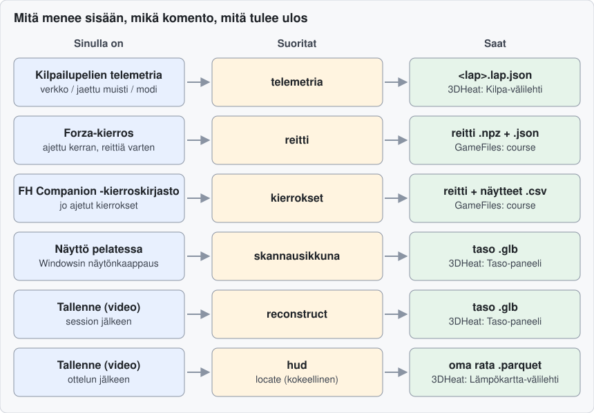

# 3DHeat GameCapture {#dheat-gamecapture}

**Mitä se on?** Työkalu, joka kirjaa ylös, mitä kilpailupeli kertoo ajotavastasi, yksi
tiedosto kierrosta kohden. Se voi myös rakentaa karkean 3D-mallin kentästä videosta, jossa pelaat.

**Miksi käyttäisin sitä?** Nähdäksesi kierroksesi [3DHeat-katselimessa](https://holdi601.github.io/3DHeat/):
missä jarrutit, missä olit hidas, miten kaksi kierrosta eroavat. Ja saadaksesi kentän
lämpökartan alle, kun kukaan ei ole tehnyt sille 3D-mallia.

**Esimerkki:** kytke Forzan Data Out päälle, suorita yksi komento ja aja kaksi kierrosta.
Kaksi kierrostiedostoa ilmestyy kansioon `laps\`. Pudota ne katselimen Kilpa-välilehdelle.


Uusi komentorivin kanssa? Lue ensin [Ennen aloittamista](before-you-start.md).

## Kolme tehtävää {#the-three-jobs}

1. **Kierrostelemetria.** Se tallentaa jokaisen kanavan, jonka kilpailupeli julkaisee – Forzan Data Out,
   Assetto Corsa -pelien jaettu muisti, rally-pelien verkkosyötteet, BeamNG-modi, Trackmania-liitännäinen –
   ja kirjoittaa yhden `heat3d-lap`-tiedoston kierrosta tai osuutta kohden katselimen Kilpa-välilehteä varten.
   iRacing ei tarvitse tallentajaa: katselin lukee sen omat `.ibt`-tiedostot.
2. **Kentät pelistä.** Se muuttaa sen, mitä näyttö näytti, kun kuljit tai ajoit kentän läpi,
   `.glb`-3D-malliksi, jonka katselin asettaa lämpökartan alle.
3. **Oma ottelu jälkikäteen.** `hud` lukee oman tallenteesi HUD-näytön – omat toimet, kuolemat,
   tutkan radan ja tappolokin. `locate` (kokeellinen: se sijoittaa toistaiseksi vain harvat todelliset
   kehykset) selvittää, mistä kohdasta kukin kehys on otettu kentän 3D-mallilla.

Kaikki kolme noudattavat yhtä sääntöä: **mihinkään peliin ei injektoida mitään eikä mitään kiinnitetä
koukulla**. Kehykset tulevat julkisesta näytönkaappaus-rajapinnasta, telemetria rajapinnoista, jotka pelit
julkaisevat sitä varten. Katso [Säännöt](../rules.md).



Koodi on Pythonia (paketti `heat3d_capture`), MIT-lisenssillä. Syvyys- ja asentomalleilla,
joita se voi ajaa, on omat lisenssinsä – katso [Mallit ja lisenssit](../models-and-licences.md).

## Pikaohje {#quick-start}

### Tallenna kierrokset {#record-laps}

Tarvitset Python 3.10:n tai uudemman ([Ennen aloittamista](before-you-start.md)). PowerShellissä:

```powershell
git clone https://github.com/Holdi601/3DHeat-GameCapture
cd 3DHeat-GameCapture
python -m venv .venv
.venv\Scripts\python -m pip install -r requirements.txt

# Forza: Settings -> HUD and Gameplay -> Data Out = ON, IP 127.0.0.1, port 5300
.venv\Scripts\python -m heat3d_capture telemetry -o laps
```

**Pitäisi näkyä** `listening on port 5300. Laps go to laps. Ctrl+C to stop.`, sitten rivi kierrosta kohden
kun ylität maalilinjan, kuten yllä olevassa kuvassa. Lopeta painamalla Ctrl+C. Pudota `laps\`-kansion
tiedostot katselimen Kilpa-välilehdelle. Jokainen muu peli on yhden `--game`-asetuksen päässä:

```powershell
.venv\Scripts\python -m heat3d_capture telemetry --game acc -o laps
.venv\Scripts\python -m heat3d_capture telemetry --game dirtrally2 -o laps
```

Katso [Telemetriatallentajat](../telemetry.md) jokaiselle pelille ja asetukselle.

### Skannaa kenttä {#scan-a-level}

Kaksoisnapsauta **`scan.bat`** työkalun kansiossa. Se löytää Pythonin (ja tarjoutuu asentamaan sen
wingetillä, jos sitä ei ole), luo yksityisen `.venv`-kansion ja avaa skannausikkunan. Ikkuna kertoo,
mitä puuttuu, mihin kukin paketti on ja kuinka suuri lataus on, eikä asenna mitään ilman kyllä-vastausta.
Katso [Ajoaika ja riippuvuudet](../runtime.md) ja [Skannausikkuna](../reconstruction-scan-ui.md).

Käsin: `.venv\Scripts\python -m heat3d_capture.ui`.

Rakentaaksesi tallenteen uudelleen offline, kameran reitti ratkaistuna kerralla (tarvitsee PyTorchin,
`vggt`-paketin ja GPU:n – katso [Offline-rekonstruktio](../reconstruction-offline.md)):

```powershell
.venv\Scripts\python -m heat3d_capture reconstruct lap.mp4 -o lap.glb
```

## Dokumentaation kartta {#map-of-the-documentation}

| Sivu | Mitä se kattaa |
|---|---|
| [Ennen aloittamista](before-you-start.md) | Python, pääte, ensimmäinen komento, yleisimmät virheet |
| [Säännöt](../rules.md) | Ei injektointia, vain julkaistut rajapinnat, ja mitä se maksaa |
| [Telemetriatallentajat](../telemetry.md) | `telemetry`-komento ja yleiskatsaus jokaisesta pelistä |
| [Forza](../telemetry-forza.md) | Data Out, asettelun tunnistus, FH Companion -välitys ja sen `.tele.gz` |
| [Assetto Corsa -pelit](../telemetry-assetto-corsa.md) | AC, ACC, AC EVO, AC Rally jaetusta muistista |
| [Rally-pelit](../telemetry-rally.md) | EA SPORTS WRC, DiRT Rally 2.0 / 1 / DiRT 4, Richard Burns Rally |
| [BeamNG.drive](../telemetry-beamng.md) | `heat3d`-protokollamodi |
| [Trackmania](../telemetry-trackmania.md) | `Heat3dRecorder` Openplanet-liitännäinen |
| [iRacing](../telemetry-iracing.md) | `.ibt`-tiedostojen lukeminen katselimessa |
| [Kierrosten ja osuuksien jako](../lap-splitting.md) | `LapSplitter`, `CounterSplitter`, `LineSplitter`, `StageSplitter` |
| [Luiston, ajautumisen ja johdettujen kanavien](../slip-and-drift.md) | Miten luisto skaalataan ja mitä katselin johtaa |
| [heat3d-lap-tiedosto](../lap-format.md) | kierrostiedoston muoto, kanavat, yksiköt, `meta` |
| [Pelit](../games.md) | Pelikohtaisesti: miten tallentaa, mitä lähetetään, mitkä radat voi viedä |
| [Komennot](../commands.md) | `route`, `telemetry`, `laps`, `reconstruct`, `hud`, `locate`, vaihe vaiheelta |
| [Komentoviite](../cli-reference.md) | jokainen asetus, luotu `--help`-tulosteesta |
| [HUD-tallenteen lukeminen](../hud-video.md) | `hud`: omat toimet, kuolemat, tutkan rata ja tappolokki tallenteesta |
| [Kehysten paikantaminen kentässä](../locate.md) | `locate`: mistä kohdasta kukin kehys on otettu, kentän geometriaa vasten |
| [Kentän rekonstruktio](../reconstruction.md) | putki kehyksistä `.glb`-tiedostoon |
| [Skannausikkuna](../reconstruction-scan-ui.md) | jokainen säädin, pikanäppäin ja peittokuvan elementti |
| [Kaappaus, maskit ja kehyksen laatu](../reconstruction-capture.md) | Windows Graphics Capture, avainkehykset, HUD-maskit, laatuneuvot |
| [Syvyys](../reconstruction-depth.md) | Depth Anything V2, ONNX Runtime, mallin rakentaminen |
| [Kameran asento ja mittakaava](../reconstruction-pose.md) | odometria, uudelleenpaikannus, telemetria-asennot, maanpinnan mittakaava, nippusäätö |
| [Fuusio, peitto ja väri](../reconstruction-fusion-and-texture.md) | miehitystilavuus, peittoruudukko, heikot kohdat, kärkiväri |
| [.glb-tulos](../glb-output.md) | tiedosto, jonka katselin lataa |
| [Offline-rekonstruktio](../reconstruction-offline.md) | `reconstruct`, VGGT-ikkunat ja yhdistäminen |
| [Mallit ja lisenssit](../models-and-licences.md) | Depth Anything V2 -koot, VGGT, paketit |
| [Ajoaika ja riippuvuudet](../runtime.md) | esitarkistus, taustaohjelmat, suorituskykyluokat |
| [Rajoitukset ja tarkistukset](../limits.md) | mitä ei tehdä, ja mitä ei ole tarkistettu |
| [Päivitykset](../updates.md) | julkaisutarkistus ja `python -m heat3d_update` |
| [Kehitys](../development.md) | testit, virtuaaliympäristö, repositorion rakenne |
| [Ylläpito](../maintaining.md) | julkaisun tarkistuslista koodille ja dokumentaatiolle |

## Osa 3DHeatia {#part-of-3dheat}

Tiedostot, joita tämä kirjoittaa, lataa **3DHeat-katselin** –
[lähdekoodi](https://github.com/Holdi601/3DHeat), [dokumentaatio](https://holdi601.github.io/3DHeat/).
Kierrostiedostot menevät sen Kilpa-välilehdelle, `.glb`-kentät sen Tausta / kenttä -paneeliin, `hud`- ja `locate`-taulukot
sen Lämpökartta-välilehdelle. Miten katselin lukee taulukot ja ottelutiedostot, on kuvattu sivuilla
[Yksi tiedosto ottelua kohden: `.3dheat`](https://holdi601.github.io/3DHeat/container.html) ja
[Tietojen tuominen](https://holdi601.github.io/3DHeat/getting-data-in.html).

| Työkalu | Mitä se tekee | Dokumentaatio |
|---|---|---|
| [3DHeat-katselin](https://github.com/Holdi601/3DHeat) | näyttää lämpökartat, kilpailut ja ottelut 3D:nä selaimessa | [dokumentaatio](https://holdi601.github.io/3DHeat/) |
| [GameFiles](https://github.com/Holdi601/3DHeat-GameFiles) | radat ja kentät pelien toimittamista tiedostoista 3D-malleina | [dokumentaatio](https://holdi601.github.io/3DHeat-GameFiles/) |
| [GameCapture](https://github.com/Holdi601/3DHeat-GameCapture) | kierrosten telemetria kilpailupeleistä; kentät rakennettu pelivideosta | [dokumentaatio](https://holdi601.github.io/3DHeat-GameCapture/) |
| [Unreal Exporter](https://github.com/Holdi601/3DHeat-UnrealExporter) | Unreal Editor -liitännäinen, joka vie kentän yhtenä 3D-mallina | [dokumentaatio](https://holdi601.github.io/3DHeat-UnrealExporter/) |
| [CS2](https://github.com/Holdi601/3DHeat-CS2) | Counter-Strike 2 -demot taulukoiksi ja ottelutiedostoiksi; kartat 3D-malleiksi | [dokumentaatio](https://holdi601.github.io/3DHeat-CS2/) |
| [Watcher](https://github.com/Holdi601/3DHeat-Watcher) | tallentaa pelaamisesi taustalla pelien julkaisemasta datasta | [dokumentaatio](https://holdi601.github.io/3DHeat-Watcher/) |
| [Ext-WarThunder](https://github.com/Holdi601/3DHeat-Ext-WarThunder) | War Thunder -tallenteet taulukoiksi ja ottelutiedostoiksi | [dokumentaatio](https://holdi601.github.io/3DHeat-Ext-WarThunder/) |
| [Ext-WoT](https://github.com/Holdi601/3DHeat-Ext-WoT) | World of Tanks -tallenteet taulukoiksi ja ottelutiedostoiksi | [dokumentaatio](https://holdi601.github.io/3DHeat-Ext-WoT/) |
| [Ext-WoWs](https://github.com/Holdi601/3DHeat-Ext-WoWs) | World of Warships -tallenteet taulukoiksi ja ottelutiedostoiksi | [dokumentaatio](https://holdi601.github.io/3DHeat-Ext-WoWs/) |
| [Ext-Squad](https://github.com/Holdi601/3DHeat-Ext-Squad) | Squad-palvelindemot taulukoiksi ja ottelutiedostoiksi | [dokumentaatio](https://holdi601.github.io/3DHeat-Ext-Squad/) |
| [Ext-DCS](https://github.com/Holdi601/3DHeat-Ext-DCS) | DCS World -kartat 3D-malleiksi | [dokumentaatio](https://holdi601.github.io/3DHeat-Ext-DCS/) |
| [Ext-IL2](https://github.com/Holdi601/3DHeat-Ext-IL2) | IL-2 Sturmovik -kartat 3D-malleiksi | [dokumentaatio](https://holdi601.github.io/3DHeat-Ext-IL2/) |

Kehittäjä, jolla on pelin projekti auki, käyttää Unreal-vientiä, joka lukee todellisen geometrian ja on tarkka.
Missä pelin omia arkistoja voidaan lukea, GameFiles purkaa tarkan radan. Rekonstruktio pelistä on tarkoitettu
tapaukseen, jossa vain näyttö on käytettävissä.
