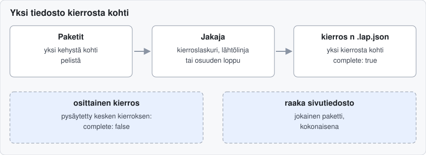

# Miten kierrokset ja osuudet jaetaan {#how-laps-and-stages-are-split}

Tallennin näkee yhden yhtenäisen näytevirran. Sen muuttamiseen kierroksiksi käytetään
yhtä neljästä jakajasta, ja valinta riippuu siitä, mitä peli kierroksista kertoo. Kaikki
noudattavat samaa ajatusta: käytä pelin omaa laskentaa, jos sellainen on, muuten selvitä
kierros sijainneista. Liian lyhyttä pätkää ei koskaan kirjoiteta vertailukelpoiseksi.

| Jakaja | Koodi | Käyttäjä |
|---|---|---|
| `LapSplitter` | [`fulllap.py`](https://github.com/Holdi601/3DHeat-GameCapture/blob/main/heat3d_capture/telemetry/fulllap.py) | Forza |
| `CounterSplitter` | [`kunos.py`](https://github.com/Holdi601/3DHeat-GameCapture/blob/main/heat3d_capture/telemetry/kunos.py) | Assetto Corsa, ACC |
| `LineSplitter` | [`kunos.py`](https://github.com/Holdi601/3DHeat-GameCapture/blob/main/heat3d_capture/telemetry/kunos.py) | AC EVO, AC Rally, BeamNG |
| `StageSplitter` | [`rally.py`](https://github.com/Holdi601/3DHeat-GameCapture/blob/main/heat3d_capture/telemetry/rally.py) | EA SPORTS WRC, DiRT Rally 2.0, DiRT Rally, DiRT 4, Richard Burns Rally |

Trackmania jakaa ajot liitännäisensä sisällä ([Trackmania](telemetry-trackmania.md)), ja
iRacing-tiedostot jakaa katselin simulaattorin kierroslaskurin mukaan ([iRacing](telemetry-iracing.md)).

Kun painat **Ctrl+C**, jokainen tallennin kutsuu jakajansa `flush()`-metodia, joten avoin
kierros tai osuus kirjoitetaan, jos se täyttää alla olevat vähimmäisvaatimukset.

## LapSplitter (Forza) {#lapsplitter-forza}

Parametrit: `minimum_metres = 400`, `gap_seconds = 2.0`.

Jokaiselle dekoodatulle paketille:

1. Jos pelin `timestampMs` hyppää eteenpäin yli 2 sekuntia edellisestä paketista tai menee
   taaksepäin, avoin kierros kirjoitetaan ensin.
2. Jos `isRaceOn` on 0 (peli ei ole kilpailussa), avoin kierros kirjoitetaan ja paketti
   hylätään.
3. Jos kierros ei ole auki, yksi avautuu paketin `lapNumber`-arvolla.
4. Jos `lapNumber` poikkeaa avoimen kierroksen numerosta, avoin kierros **suljetaan
   päätettynä**; sen `seconds` on pelin `lastLap`, kun se on positiivinen. Näin suljettu
   kierros kirjoitetaan pituudestaan riippumatta. Uusi kierros avautuu.
5. Paketti liitetään kierrokseen.

Tallennin kirjoittaa avoimen kierroksen myös, jos paketteja ei ole tullut 2 sekuntiin
seinäkellon mukaan (peli pysähtyi tai suljettiin kesken kierroksen).

**Kirjoittaminen** säilyttää avoimen kierroksen vain, jos siinä on vähintään 2 näytettä ja
vähintään 400 m `distanceTravelled`-arvoa; se kirjoitetaan keskeneräisenä (`run`).
Pistemäinen kilpa ei koskaan laske toista kierrosta, joten se päättyy aina näin.

## CounterSplitter (AC, ACC) {#countersplitter-ac-acc}

Parametri: `minimum_metres = 300`. Jokaiselle näytteelle annetaan grafiikkasivun
`completedLaps` ja viimeisen kierroksen aika.

- Ensimmäinen näyte avaa kierroksen, jonka numero on nykyinen `completedLaps`.
- Kun `completedLaps` muuttuu, avoin kierros sulkeutuu. Se on **päätetty**, `seconds =
  viimeisen kierroksen ms / 1000` (kun se on positiivinen), vain jos laskuri nousi täsmälleen
  yhdellä - hyppy takaisin 0:aan (istunnon uudelleenkäynnistys) tai useampi kuin yksi askel
  sulkee kierroksen keskeneräisenä.
- Suljettu kierros kirjoitetaan vain, jos siinä on näytteitä ja vähintään 300 m ajettua
  matkaa.
- Kirjoittaminen säilyttää avoimen kierroksen, jos siinä on yli yksi näyte ja vähintään 300 m.

## LineSplitter (AC EVO, AC Rally, BeamNG) {#linesplitter-ac-evo-ac-rally-beamng}

Parametrit: `radius = 15 m`, `minimum_metres = 300`, `stop_seconds = 8`.

Näissä peleissä ei ole kierroslaskuria, jonka tallennin lukisi, tai ne ajavat osuuksia.
**Linja on siinä, missä tallennus alkoi:**

1. Ensimmäisen näytteen vaakasuuntainen sijainti (`x`, `z`) muodostaa linjan.
2. Kun auto on ajanut yli 5 m, suunta linjalta autoon on kierroksen suunta.
3. **Pysähtyminen** päättää ajon: kun `speed` pysyy alle 1 m/s:ssa 8 sekuntia, avoin kierros
   kirjoitetaan (näin rallin osuus päättyy: auto pysähtyy maalissa).
4. **Linjan ylitys:** yli 300 m matkan jälkeen kerätään näytteet, jotka ovat 15 m:n sisällä
   linjasta. Kun auto poistuu tältä säteeltä, kerätyistä näytteistä lähin on ylitys. Jos auto
   oli siinä suunnassa sama kuin kierroksen suunta (paikallisen suunnan ja suunnan pistetulo
   on positiivinen), kierros sulkeutuu siihen näytteeseen; muuten ylitys ohitetaan (auto
   ylitti lähdön väärään suuntaan).
5. Suljetun kierroksen `seconds` on aika ensimmäisestä näytteestä ylitykseen. Se on
   **päätetty vain, jos ensimmäinen näyte oli nopeampi kuin 5 m/s**: kierros, joka alkoi
   paikaltaan, on lähtö eikä kierros, johon voi verrata. Ensimmäinen kierros ruudukosta
   aloitetulla tallennuksella on siis aina keskeneräinen; lentävältä kierrokselta alkanut
   tallennus antaa päätetyn ensimmäisen kierroksen seuraavassa ylityksessä.
6. Seuraava kierros alkaa ylityksen näytteestä (se kuuluu molempiin kierroksiin).

Alle 300 m pituiset kierrokset pudotetaan. Kirjoittaminen (pysähdys tai Ctrl+C) säilyttää
avoimen kierroksen, jos siinä on vähintään 2 näytettä ja 300 m, keskeneräisenä. BeamNG
kirjoittaa samalla tavalla, kun ajoneuvo nollataan (sen kello menee taaksepäin), ennen uuden
jakajan aloittamista, joten nollausta edeltävä ajo säilyy.

Etäisyydet ovat vaakasuuntaisia (`x`, `z`) matkalaskurille ja linjatestille, ja täysi 3D
300 m pituustestiin.

## StageSplitter (rallipelit) {#stagesplitter-rally-games}

Parametri: `minimum_metres = 300`. Jokaiselle näytteelle annetaan pelin osuuskello, tieto
siitä, onko auto pelin mukaan maalissa, ja tarvittaessa pelin oma aika sille.

1. Jos kello on 0 tai pienempi, tai se on mennyt taaksepäin yli 0,5 s, avoin osuus
   **hylätään**: se säilytetään osuutena, jos se ei ole päättynyt, siinä on yli 10 näytettä
   ja vähintään 300 m. Kello, joka on 0 tai pienempi, pudottaa myös näytteen (auto on
   lähdössä).
2. Jos osuus ei ole auki, uusi avautuu (numeroidaan 1, 2, ... tallennusta kohden).
3. Kun osuus on päättynyt, lisänäytteitä ei oteta, ennen kuin kello menee taaksepäin.
4. Jokainen näyte tallennetaan `time`-arvolla, joka on osuuskello.
5. Kun peli sanoo maaliin pääsyn, osuus on päättynyt; sen `seconds` on pelin aika, kun se
   on annettu ja positiivinen, muuten kello. Se kirjoitetaan, jos se kattoi vähintään 300 m.

Mitä "maalissa" tarkoittaa kullekin pelille:

| Peli | Maalissa, kun |
|---|---|
| EA SPORTS WRC | osuuden pituus > 0 ja osuusmatka >= pituus - 0,5 m |
| DiRT-pelit | suoritettujen kierrosten määrä kasvoi lähtömäärän yläpuolelle tai (yhden kierroksen tapahtuma) kierrosmatka >= 99,9 % radan pituudesta |
| Richard Burns Rally | kilpakello > 0 ja matka loppuun <= 0 |

RBR:n ylösakseli ja nopeus kiinnitetään, kun osuus kirjoitetaan (katso
[Rallipelit](telemetry-rally.md#richard-burns-rally-rsf--ngp)).

## Aika ja matka kierrostiedostossa {#time-and-distance-in-the-lap-file}

Kaikilla tallentimilla paitsi Forzalla `time` siirretään niin, että kierroksen ensimmäinen
näyte on 0, ja `distance` on peräkkäisten sijaintien kumulatiivinen 3D-matka. Forza käyttää
pelin omaa kierrosajastinta ja matkalaskuria, siirrettynä samalla tavalla.
