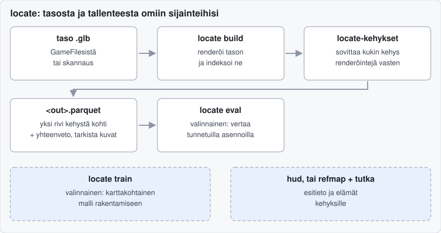

# Kehysten paikantaminen tasossa {#locating-frames-in-a-level}

`locate` selvittää, missä jokainen pelitallenteen kehys on otettu - kameran 3D-sijainti ja katselusuunta -
sovittamalla kuvan tason oman geometrian renderöintejä vasten. Se on tarkoitettu peleille, jotka eivät pidä
kirjaa siitä, missä pelaaja oli: ei demoa, ei uusintatiedostoa, ei telemetriaa. Battlefield 6 on ensimmäinen.

> **Kokeellinen.** Oikeilla tallenteilla se paikantaa toistaiseksi vain pienen osan kehyksistä; katso
> [Oikeat kehykset: kokeellinen](#real-frames-experimental).

```bash
# Once per level: render it from every place a player can stand, and index the renders.
.venv\Scripts\python -m heat3d_capture locate build level.glb -o level.db

# Per recording: where was each frame taken?
.venv\Scripts\python -m heat3d_capture locate frames "<recording>.mp4" --db level.db -o out/match
```

Sijainti tulee **kuvasta**, koko tasoa vasten, ilman ennakkotietoa. [HUD-lukijan](hud-video.md)
pienoiskartan rata on vain varasuunnitelma kehyksille, joita kuva ei voi paikantaa, ja jokainen rivi kertoo,
kumpi kahdesta lähteestä sen antoi.




## Mihin se koskee ja mihin ei {#what-it-does-and-does-not-touch}

- Se lukee pelaajan **oman tallenteen** ja tason tiedoston, jonka pelaaja vei omasta **kopiostaan** pelistä.
  Se ei koske peliin, sen muistiin, sen tiedostoihin ajon aikana eikä sen verkkoon, ja se ajetaan ottelun jälkeen.
  Katso [Säännöt](rules.md).
- Se paikantaa **vain pelaajan oman kameran**: kehys on pelaajan oma näkymä.
- Taso, sen pohjalta tehty tietokanta ja kaikki siitä renderöity kuuluvat pelin julkaisijalle. Pidä ne paikallisina.

## Vaatimukset {#requirements}

- Mitä `requirements.txt` listaa, PyTorch (pytorch.org-sivulta, GPU:lle) ja `requirements-locate.txt`:

```bash
.venv\Scripts\python -m pip install -r requirements-locate.txt
```

- GPU, jossa on OpenGL 3.3 (4.3 on nopeampi) renderöintiin, ja mieluiten CUDA malleille. Prosessorilla se toimii,
  mutta hitaasti.
- Mallit haetaan ensimmäisellä käyttökerralla (noin 450 MB): DINOv2 Hugging Facesta, ALIKED ja LightGlue kornian
  kautta. Kaikki on lisensoitu kaupalliseen käyttöön; katso [Lisenssit](#licences).
- **Taso** `.glb`-tiedostona (tai `.gltf`) viewerin koordinaatistossa, Y ylös, **sen pohjaväritekstuureineen**, sellaisena
  kuin 3DHeat-exporterit sen kirjoittavat (osat `ground:` / `structure:`; osien nimillä ei ole väliä). Yksi yksikkö on
  metri, ellei tiedoston ylimmän tason `extras.unit_metres` sano toisin. GameCapture-skannaus (`reconstruct`, skannausikkuna)
  kirjoitetaan **senttimetreinä** ja sen `extras.unit_metres` on `0.01`, joten se luetaan oikeassa koossaan. Tekstuuriton
  taso toimii paljon huonommin; katso [Rajat](#limits).

## Komennot {#commands}

### `locate build <level> -o <db>` {#locate-build---o-}

Renderöi tason jokaisesta paikasta, johon pelaaja voisi seisoa, ja tallentaa jokaiselle renderöinnille sen asennon
ja yhden globaalin kuvaajan.

| Asetus | Oletus | Merkitys |
|---|---|---|
| `level` | | Tason `.glb` / `.gltf`. |
| `-o`, `--out` | | Kirjoitettava tietokantakansio. |
| `--game` | `bf6` | Pelin profiili: silmien korkeudet, näkökenttä, HUD-laatikot, nopeus (alla). `generic` mille tahansa ensimmäisen persoonan pelille. |
| `--eye` | profiilin | Silmien korkeudet lattiasta metreinä, seisova ensin. Yksi tietokantanäkymä per korkeus. |
| `--fov` / `--vfov` | profiilin | Tallenteen vaakasuuntainen näkökenttä, tai pystysuuntainen (Battlefieldin liukusäädin) 16:9-tallenteelle. |
| `--spacing` | 2,5 | Metriä paikkojen välillä, joista näkymät otetaan. |
| `--yaw-step` | 30 | Asteita näkymien suuntien välillä. |
| `--pitch` | 0 | Kallistukset, joissa renderöidään, astetta ylös. |
| `--positions` | ei mitään | Taulukko (Parquet tai CSV, jossa `x`, `y`, `z` jalkojen kohdalla tason koordinaatistossa), josta paikat otetaan lattioiden sijaan: esimerkiksi edellisen ajon tulos. |
| `--shadows` | pois | Heitä auringon varjot renderöinteihin (tason oma aurinko, kun sen tiedosto nimeää sen kohdassa `extras.sun`). |
| `--untextured` | pois | Renderöi vain muodon ja valon. |
| `--box X0 Z0 X1 Z1` | koko tiedosto | Vain paikat tämän laatikon sisällä (tason yksiköissä): pelialue. |
| `--places` | `auto` | Mistä näkymät otetaan: `nav` - pelaajat silmien korkeudella tason navigointiverkon päällä (`nav:`-osat: täsmälleen ne paikat, joihin peli sallii kävellä), ajoneuvokamerat niiden korkeudella `ground:`-osien päällä (maasto ja tiet) 50 metrin säteellä; `ground` - molemmat `ground:`-osien päällä; `floors` - jokaisen ylöspäin osoittavan pinnan päällä (katot ja laatikot mukaan lukien); `auto` - `nav`, kun tasossa on navigointiverkko, muuten `floors`. |
| `--head` | ei mitään | Kartakohtainen pää `locate train`:sta kuvaajia varten. |

Kirjoittaa `<db>/db.json` (mistä ja millä se tehtiin) ja `<db>/views.npz` (asennot, kuvaajat).

### `locate frames <recording> --db <db>` {#locate-frames----db-}

| Asetus | Oletus | Merkitys |
|---|---|---|
| `source` | | Video, kuva tai kuvakansio (otetaan nimijärjestyksessä, `--fps`:n välein). |
| `--db` | | Tietokanta, jonka `build` kirjoitti. Sen tasotiedoston on oltava yhä paikallaan (tai `--level`). |
| `-o`, `--out` | `<source>.locate` | Tulostepolku ilman tiedostopäätettä. |
| `--fps` | 2 | Paikannettuja kehyksiä videon sekuntia kohden. |
| `--start`, `--seconds` | kaikki | Osa videosta, joka luetaan. |
| `--width` | 1280 | Leveys, jolla kehykset sovitetaan. |
| `--shortlist` | 8 | Tietokantanäkymät, joita kokeillaan kehystä kohden ennakkotiedon tai kiintopisteen lähellä. |
| `--search-shortlist` | 16 | Ilman ennakkotietoa: tietokantanäkymät kehystä kohden ([etsitään yhdessä](#with-no-prior-frames-searched-together)). |
| `--no-search` | pois | Ilman ennakkotietoa: etsi jokainen kehys erikseen ja usko sen kiintopiste ilman naapureita. |
| `--accept-depth` | 0 (pois) | Ilman ennakkotietoa: usko kiintopiste vain, jos sen osumien kaukainen etäisyys on tämä monta kertaa lähimmän. |
| `--accept-support` | 2 | Ilman ennakkotietoa: samaa mieltä olevia naapureita elämän varrella, joita kiintopiste tarvitsee uskottavaksi. |
| `--checkpoint` | ei mitään | Säilytä ajon tila tässä ja jatka siitä, jos se on olemassa. |
| `--stop-file`, `--stop-process` | ei mitään | Pysähdy itsestään, tila tallennettuna, koodilla 75, kun tämä tiedosto on olemassa tai kun prosessi, jonka nimi alkaa tällä, on käynnissä (tarkistetaan ennen jokaista kehystä; voidaan toistaa), jotta pitkä ajo vapauttaa koneen pelille. Sama komento jatkaa. |
| `--normalise` | ei mitään | Valon normalisointi ennen sovittamista: `clahe`, `gray`. |
| `--minimap` | ei mitään | `hud`-komennon taulukko: **varavaihtoehto** kehyksille, joita kuva ei voi paikantaa. |
| `--prior-radius` | ei mitään | **Valinnainen nopeutus**, oletuksena pois: etsi vain tietokantanäkymiä niin monen metrin päästä pienoiskartan sijainnista (vaatii `--minimap`). |
| `--minimap-anchor` | ei mitään | JSON-tiedosto, joka sitoo pienoiskartan tasoon ([pienoiskartta hakuennakkotietona](#the-minimap-as-a-search-prior)): pienoiskartta rajaa haun ensimmäisestä kehyksestä lähtien; näin löydetyt kiintopisteet ovat `visual+minimap-prior`. |
| `--no-level-search` | pois | Ennakkotiedon kanssa: kun mikään lähellä ei sovi, älä etsi koko tasoa (nopeampi). |
| `--lives` | `--minimap`-taulukko | `hud`-komennon taulukko, jonka kuolemat, käyttöönotot ja elvytykset kertovat, milloin pelaaja oli pelissä: sijainnit hyppäävät vain kuoleman yli ([elämät tallenteesta](#lives-from-the-footage)). |
| `--no-sequence` | pois | Päätä jokainen kehys erikseen, ei ajon varrella (alla). |
| `--fit-fov` | pois | Ajon jälkeen sovita näkökenttä vahvimpiin kiintopisteisiin näkymittäin ja raportoi se. |
| `--check-every` | 0 | Joka N:s kehys, paikannettu tai ei, kuva tiedostoon `<out>.check`. |
| `--no-checks` | pois | Älä kirjoita näkyvien kiintopisteiden tarkistuskuvia (alla). |
| `--no-zoomed` | pois | Älä ratkaise zoomattuja näkymiä naapureidensa kiintopisteistä (alla). |
| `--no-grow` | pois | Älä etsi uudelleen kunkin kiintopisteen läheisyydestä kehyksiä ympäriltä, joilla ei vielä ole sellaista. |
| `--game`, `--eye`, `--fov`, `--vfov`, `--mask`, `--no-hud-mask`, `--max-speed` | profiilin | Kuten yllä; `--mask x,y,w,h` lisää ruutulaatikon (1920x1080-näytöllä), joka ei ole tasoa. |
| `--vehicle-vfov` | profiilin | Ajoneuvokameroiden pystysuuntainen näkökenttä (Battlefieldin ajoneuvoliukusäädin). |
| `--settings` | uusin asetustiedosto | `bf6`: pelin asetustiedosto, josta näkökentät luetaan (vain lukuun), kun `--fov`/`--vfov` ei ole annettu; oletuksena uusin `PROFSAVE*_profile` kansiosta `Documents/Battlefield 6/settings`. Se sisältää asetukset juuri nyt, mikä ei välttämättä vastaa, miten vanhempi tallenne tehtiin. |

### `locate refmap <level> <deploy screen> -o <refmap>` {#locate-refmap----o-}

Asettaa pelin oman kartan tasoon: viite, jota pienoiskarttaa verrataan
([pienoiskartta, luettuna tasoa vasten](#the-minimap-read-against-the-level)). `<deploy screen>` on kuva
käyttöönottoruudusta, joka näyttää koko kartan, tai tallenne `--at <seconds>` -asetuksella sellaisella hetkellä;
profiilin karttalaatikko leikataan siitä (`--whole-picture` säilyttää kaiken). Kirjoittaa `<refmap>.png` (kartta
uudelleennäytteistettynä tason omaan koordinaatistoon, `--mpp` metriä pikseliä kohden, oletus 0,5),
`<refmap>.valid.png` (missä se on karttaa, ei merkki eikä teksti) ja `<refmap>.json` (koordinaatisto ja kalibrointi,
sekä kuinka kaukana kartan laatat olivat siitä). `--topdown <prefix>` säilyttää tason renderöintinä ylhäältä seuraavaa
ajoa varten (`--topdown-mpp`, oletus 0,656 m; `--box` rajaa sen).

### `locate minimap <recording> --refmap <refmap> -o <table>.parquet` {#locate-minimap----refmap---o-parquet}

Lukee tallenteen pienoiskartan viitekarttaa vasten kehys kerrallaan (`--fps`, oletus 2): sijainti, suunta ja zoom
jokaisesta sopivasta pienoiskartasta tason koordinaatistossa, kirjoitettuna pienoiskarttataulukkona, jonka vieressä on
ankkuri (`<table>.anchor.json`). `locate frames` ottaa sen `--minimap <table>.parquet --minimap-anchor <table>.anchor.json`.
`hud`-komennon taulukolla (`--hud`) sen elämät siirtyvät mukaan; kun sille on myös ankkuri (`--hud-anchor`), ensimmäinen haku
tehdään sen paikan ympäriltä, johon HUD sijoittaa pelaajan, ja kohdat, joissa mikään pienoiskartta ei sovi, täytetään HUDin
omalla radalla, siirrettynä lähimpiin viitekartan kiintopisteisiin (`--hud-fill`, sekunteja, oletus 120; 0 kytkee sen pois).
Taulukon `source` kertoo, kumpi (`refmap`, `hud`).

### `locate eval <out>.parquet --truth <poses>` {#locate-eval-parquet---truth-}

Vertaa tulosta tunnettuihin kameran asentoihin: taulukko, jossa `time`, `x`, `y`, `z` (silmä), `yaw`, `pitch` tason
koordinaatistossa. `--offset` on kellon siirtymä (totuuden aika = videon aika + offset); ilman sitä siirtymä etsitään.
`--unit-metres` muuttaa virheet metreiksi.

## Pelin profiilit {#game-profiles}

| | `bf6` | `generic` |
|---|---|---|
| Silmien korkeudet | 1,6 m seisoen, 1,05 m kyykyssä (ei vielä mitattu pelissä) | 1,65, 1,1 m |
| Näkökenttä | 55 astetta pystysuunnassa, noin 86 vaakasuunnassa 16:9:llä: **anna pelaajan oma** `--vfov`:lla | 90 vaakasuunnassa |
| HUD peitetty | pienoiskartta ja joukkuelista, tappolokki, kompassi, ammukset, pelaajan ase, popupit, tähtäin | tähtäin |
| Nopein jalan | 8 m/s | 8 m/s |
| Erotettavat näkymät | jalan, ajoneuvo, zoomattu (alla) | jokainen kehys jalan |
| Ajoneuvokamerat | ajoneuvoliukusäädin (asetustiedostosta), ajoneuvo peitetty, kamera jopa 8 m lattian yläpuolella, 30 m/s | - |

Näkökentällä on suurin merkitys: väärällä ratkaistu kehys ratkaistaan väärällä polttovälillä, ja sen sijainti
liukuu pitkin näkölinjaa.

## Tulosteet {#outputs}

### `<out>.parquet` {#parquet}

Yksi rivi per paikannettu kehys, **tason koordinaatistossa** (Y ylös, tason yksiköt), ja lukuohje footerissa
(`kind: heat3d-locate`). Footer nimeää jokaisen sarakkeen, jolla ei ole omaa roolia, lisäsarakkeeksi, joten
katselin säilyttää ne kaikki (sen tarkastelukortti näyttää ne).

| Sarake | Merkitys |
|---|---|
| `time` | Sekunteja videon alusta. |
| `event` | `start` elämän ensimmäisellä rivillä, `position` muilla. |
| `x`, `y`, `z` | Silmä, tasoitettuna elämän sisällä. Tyhjä, kun kumpikaan lähde ei paikantanut kehystä. |
| `yaw`, `pitch` | Asteita: yaw akselin ympäri ylös (0 pitkin +X, kasvaa kohti -Z:aa, mikä on pelin oma yaw katselimen koordinaatistossa), pitch ylös vaakasuorasta. `pitch` on tyhjä pienoiskarttariveillä. |
| `dir_x`, `dir_y`, `dir_z` | Katselusuunta. |
| `player`, `team`, `session` | `me`, `own` ja `<video>#NN`, yksi per elämä. |
| `life` | Elämä, jossa tallenne näytti kehyksen (HUDin kuolemista; 1 = ensimmäinen). Tyhjä, kun ei pelissä (kuollut, kaatunut, käyttöönotossa) tai kun elämiä ei luettu. `session` on radan elämä, joka voi myös jakautua hypyssä. |
| `source` | `visual` (kuvasta), `visual+minimap-prior` (kuvasta, haku rajattu pienoiskartan ennakkotietoon), `minimap` (varavaihtoehto), `minimap+nav-floor` (sisätiloissa: pienoiskartta ja navigointiverkon lattia) tai `none`. |
| `view` | `foot`, `vehicle`, `zoomed` tai `screen` (alla). |
| `cam_x`, `cam_y`, `cam_z` | Kamera, joka näki kehyksen. Jalan tai tähtäimen kautta se on silmä, ja `x`, `y`, `z` ovat samat; ajoneuvon kolmannen persoonan näkymässä `x`, `y`, `z` ovat ajoneuvo (alla oleva siirtymämalli), ja kamera ajaa sen takana ja yläpuolella. |
| `hfov`, `zoom` | Vaakasuuntainen näkökenttä, jolla kehys ratkaistiin, ja zoomatussa näkymässä sen zoom tavalliseen näkymään nähden. |
| `confidence` | 0..1: kuinka paljon riviin voi luottaa (alla). |
| `uncertainty` | Rivin tyypillinen virhe, tason yksiköissä: näkyvälle kiintopisteelle sen sisäpisteistä ja naapureista, pienoiskarttarivillä sovituksesta (alla). |
| `inliers`, `rmse` | Näkyvän ratkaisun PnP-sisäpisteet ja uudelleenprojektiovirhe (pikseleitä työleveydellä). |
| `x_raw` ... `pitch_raw` | Näkyvä ratkaisu ennen tasoitusta (myös äänestyksessä hylätyille poikkeavuuksille). |
| `kept` | Näkyvä kiintopiste selvisi poikkeavuusäänestyksestä. |
| `note` | Miksi kehystä ei paikannettu tai se hylättiin äänestyksessä. |

### `<out>.summary.json` {#summaryjson}

Kehykset, näkyvät kiintopisteet, poikkeavuudet, elämät, rivit lähdettä kohden, pienoiskartan sovitus (parit,
sisäpisteet, jäännös), aika kehystä kohden.

## Menetelmä {#method}

### Tietokanta {#the-database}

Paikat ovat pisteitä jokaisella ylöspäin osoittavalla kolmiolla tasolla, jaettuna tasaisesti (yksi `--spacing`-välein
3D-ruudukossa, joten rakennuksen kerrokset saavat kukin omansa). Jokainen tarkistetaan silmästään kuudella pienellä
syvyysrenderöinnillä: geometrian sisällä oleva kamera näkee enimmäkseen takapintoja, ryömintätilassa on jotain kiinteää
silmän yllä; molemmat pudotetaan. Jokaisesta paikasta taso renderöidään jokaisella silmän korkeudella, jokaisella
`--yaw-step`-askeleella ja jokaisella `--pitch`:llä, ja jokainen renderöinti kuvataan **DINOv2:lla** (sen patch-tokenit
yleistetyllä keskiarvolla yhdistettynä luokkatokeniin).

Paikalliset piirteet ja 3D-pisteet, joita vasten kehys lopulta ratkaistaan, **eivät ole tallessa**: ne tehdään uudelleen
tarvittaessa renderöimällä ne muutama näkymä, jotka haku valitsi, mikä kestää millisekunteja. Tämä pitää tietokannan
muutamassa sadassa megatavussa eikä kymmenissä gigatavuissa, ja se mahdollistaa alla olevan hienosäädön. Hintana on, että
`frames` tarvitsee tasotiedoston ja GPU:n, ei vain tietokantaa.

### Yksi kehys {#one-frame}

1. **Peite**: kaikki, mikä ei ole tasoa: profiilin HUD-laatikot ja tähtäin, sekä mahdolliset `--mask`-alueet.
2. **Haku** koko **tasoa** vasten: kehyksen kuvaaja jokaista tietokantanäkymää vastaan; yleisimmät muutama kymmenen,
   harvennettuna niin, että ne kattavat eri paikkoja ja suuntia, muodostavat lyhyen listan.
3. **Sovitus**: jokainen lyhyen listan näkymä renderöidään uudelleen kehyksen koossa ja näkökentällä, syvyys mukana.
   Kehyksen ja renderöinnin ALIKED-avainpisteet sovitetaan LightGlue-algoritmilla. Sovitettu renderöinnin pikseli
   syvyyksineen on tason 3D-piste, joten jokainen osuma on 2D-3D-vastaavuus; syvyysreunoilla olevat avainpisteet
   (joiden syvyys saattaa kuulua niiden takana olevalle) pudotetaan.
4. **Asento**: PnP RANSACilla (SQPnP), ja sen jälkeen vankka hienosäätö, joka pitää kameran vaakatasossa - ensimmäisen
   persoonan näkymä ei kierry - ja minimoi sisäpisteiden uudelleenprojektiovirheen.
5. **Onko se mahdollinen?** Asennon on oltava pelaajan silmän korkeudella lattian päällä ja geometrian ulkopuolella
   (syvyysrenderöinti suoraan alas). Toisaalta samannäköinen tekstuuri jossain muualla - rikkoutumaton lattia, joka
   sovittuu saman materiaalin seinään - voi antaa satoja sisäpisteitä asennossa, jossa kukaan pelaaja ei olisi voinut olla;
   ne asetetaan sivuun, sisäpisteiden määrästä riippumatta.
6. **Renderöi ja vertaa**: taso renderöidään ratkaistussa asennossa ja sovitetaan uudelleen, mikä korvaa tietokantanäkymän
   muutaman metrin ja kymmenien asteiden päästä sellaisella, joka melkein osuu kehykseen. Toistetaan, niin kauan kuin se
   saa sisäpisteitä (enintään kahdesti).
7. **Valinta**: vahvimmat kolme paikkaa (yli noin 3 m toisistaan) hienosäädetään kukin ennen kuin yksi valitaan. Samannäköinen
   paikka voi johtaa ennen hienosäätöä; oikea paikka hyötyy siitä paljon enemmän.
8. **Tuomio**: `confidence` yhdistää sisäpisteiden määrän, parhaan muun paikan (`runner_up`) ja uudelleenprojektiovirheen.
   Kiintopiste on `ok`, kun sisäpisteitä on vähintään 25, mikään muu paikka ei ole 80 %:n sisällä sen sisäpisteistä, ja
   luottamus on vähintään 0,85 - kynnys, jonka alla olevat mittaukset asettavat 97,5-99 % oikeaksi.

### Näkymät {#views}

Kehys ei aina ole pelaajan silmät. Profiilin tunnistin lukee HUDista, mikä näkymä on, ja kehys ratkaistaan sen mukaan:

- **Jalan**: jalkaväen näkökenttä ja silmien korkeudet.
- **Ajoneuvo** (Battlefield 6: istuinkaavion näppäinkehotteet, `C CAMERA` ja `E EXIT`, alareunan keskellä): ajoneuvon
  näkökenttä, ajoneuvo itse peitettynä (ruudun alakeskiosa sen kolmannen persoonan näkymässä), ja kamera, joka saa olla
  jopa 8 m lattian yläpuolella. Kiintopiste on kameran.
- **Ruutu** (tummat reunat tumman keskiosan ympärillä: käyttöönottokartta, valikko, tulostaulu): ei tason näkymä;
  ohitetaan.
- **Zoomattu** (tähtäin, tykkimiehen tähtäin, ajoneuvon oma ensimmäisen persoonan näkymä: yksi ruudun reuna musta, molemmat
  tummia, kirkkaan kuvan ympärillä): ei etsitä tasosta - tähtäimen kapea siivu tasosta ei muistuta mitään tietokannan
  laajoista näkymistä - vaan ratkaistaan jälkikäteen lähimmästä kiintopisteestä 6 s sisällä, alla. Pois `--no-zoomed`:llä.

### Zoomatut näkymät {#zoomed-views}

Kapea näkymä paikantaa sijainnin huonosti: askel taaksepäin hieman lisäzoomilla näyttää melkein samalta. Zoomattu kehys
alkaa siitä, mihin sen naapurin kiintopiste sanoo tähtäimen olevan - jalan kautta tuon kiintopisteen silmästä, ajoneuvossa
2,5 m lattian yläpuolella ajoneuvon keskellä olevan pisteen alla (tykin tähtäin) - ja siitä, kuinka kauas se on saattanut
liikkua: 2 m, plus 4 m sekunnissa jalan tai 8 ajoneuvossa, enintään 12 m (`reach`).

1. **Suunta ja zoom, sijainti pidettynä.** Jokaiselle zoomille 1, 1,2 (ajoneuvon oma näkymä, kapeampi kuin jalan), 1,5, 2,
   3, 4, 6 ja 8 taso renderöidään tähtäimestä suuntiin, jotka ovat 30 asteen sisällä naapurin suunnasta (ja 3x:stä alkaen
   muutamalla kallistuksella). Kehyksen avainpisteet, sovitettuina renderöintiin tason pisteiden kanssa niiden alla, ovat
   säteitä tähtäimestä; kierto sovitetaan niihin kaksi kerrallaan (RANSAC) polttovälille 0,75-1,3 kertaa kyseisen zoomin
   polttoväli, pisteen ollessa samaa mieltä kulmalla, joka sallii tähtäimen olevan `reach`-etäisyyden päässä siitä etäisyydellä.
   Zoom, suunta ja polttoväli, joiden kanssa useimmat pisteet ovat samaa mieltä, voittavat.
2. **Ratkaistu.** Nämä pisteet sovittavat sitten sijainnin, suunnan ja polttovälin yhdessä niiden uudelleenprojektiovirheen
   mukaan, sijainnin ollessa pidettynä tähtäimessä kahden pikselin hinnalla siirrettyä `reach`-metriä kohden; renderöidään
   vielä kerran vastauksessa ja sovitetaan uudelleen. Sisäpisteet ja virhe lasketaan pikseleinä, ja kiintopiste on `ok`
   samalla luottamuksella kuin mikä tahansa muu.

Kirjoitettu zoom (`zoom`) on suhteessa ajon näkökenttään jalan; `hfov` on ratkaistu. Ajoneuvossa kirjoitettu sijainti on
ajoneuvon, 2,5 m tähtäimen alapuolella, kuten sen kolmannen persoonan näkymässä.

### Ajoneuvot: kamera ja ajoneuvo {#vehicles-the-camera-and-the-vehicle}

Ajoneuvon kolmannen persoonan näkymässä ratkaistu asento on seurantakameran, joka ajaa ajoneuvon takana ja yläpuolella ja
kääntyy sen ympäri pelaajan katsoessa ympärilleen. Kirjoitettu sijainti (`x`, `y`, `z`) on ajoneuvon - ajoneuvon keskikohdan
alla oleva maa: kameran sijainti plus profiilin `vehicle_offset`, eli niin monta metriä eteenpäin kameran vaakasuuntaisen
katselusuunnan mukaan ja niin monta alaspäin. Kamera pysyy kohdissa `cam_x`, `cam_y`, `cam_z`. Muunnos tehdään ennen
sekvenssiä ja rataa, joten seisovan ajoneuvon ympäri kääntyvää kameraa ei pidetä liikkeenä. Taulukon footer kantaa käytetyn
siirtymän ja sen, mitattiinko se (`vehicleOffset`). Jalan tai tähtäimen kautta siirtymää ei ole.

Battlefield 6:n siirtymä mitattiin näin: oikeilla kiintopisteillä tankin kolmannen persoonan kehyksistä tankin keskikohta
merkittiin silmämääräisesti kehykseen, ja kiintopisteessä renderöity taso antoi lattian kyseisessä pikselissä. Profiili ottaa
mediaanin: noin 10 m kameran edessä ja noin 4 m sen alapuolella. Merkintä on tarkka noin metrin, ja se koskee yhtä ajoneuvotyyppiä:
auto tai helikopteri ajaa kamerallaan eri tavalla.

### Ilman ennakkotietoa: kehykset etsitään yhdessä {#with-no-prior-frames-searched-together}

Yhden kehyksen globaali kuvaaja koko tasoa vasten on heikko signaali, eikä yhden kehyksen sisäpisteet erota oikeaa paikkaa
samannäköisestä. Niinpä ilman ennakkotietoa tallenteen kehykset kuvataan ensin ja etsitään yhdessä (`search.py`), ja kiintopistettä
uskotaan vain sen ympärillä olevien kehysten kanssa:

- **Lyhyt lista.** Jokaisen näkymän yhtäläisyydet mitataan sen omaa keskiarvoa ja hajontaa vasten tallenteen yli, jotta näkymä,
  joka muistuttaa kaikkia kehyksiä, lakkaa voittamasta kaikkialla. Jokainen kehys pisteyttää 24 m:n ruudukon solut sen parhaan
  näkymän sijoituksella; paras polku solujen läpi kunkin elämän varrella, sen mukaan mitä pelaaja ehtii kattaa kehysten välillä,
  antaa uskomuksen per solu, ja kunkin solun paras näkymä, paras uskottu ensin, on yksi lista. Tavallinen haku on toinen, ja
  molempia otetaan vuorotellen: näkymien mittaaminen tallennetta vastaan rankaisee paikkaa, jota pelaaja tuskin lähtee, ja
  siellä tavallinen haku toimii hyvin.
- **Uskominen.** Ehdokas lasketaan vain, jos sen sisäpisteet peittävät vähintään 12 % kehyksen 8 x 8 -ruudukosta: samannäköinen
  kohde on toistuva esine, kasa kontteja, jolla on satoja sisäpisteitä muutamalla kehyksen ruudulla. Kiintopiste uskotaan, kun se
  on laskevien ehdokkaiden parhaalla polulla (alla) ja vähintään kaksi naapuria 6 s sisällä on samaa mieltä sen kanssa. Kehystä, joka
  ei ole pelissä, ei haeta lainkaan.
- **Kasvattaminen.** Vain uskottua kasvatetaan, ja kasvatetun kiintopisteen täytyy peittää kehys samalla tavalla.

### Ajon varrella {#along-the-run}

Jokainen kehys säilyttää jokaisen fyysisesti mahdollisen asennon, jonka se löysi, yhden per paikka (`candidates`), ei vain
vahvinta. Ajo valitsee sitten yhden per kehys - tai ei yhtään - niin että valitut asennot muodostavat polun, jonka pelaaja olisi
voinut kävellä tai ajaa, ja mahdollisimman monta sisäpistettä osuu sille: piilotettu Markov-malli, dekoodattu kerralla (Viterbi).
Samannäköinen paikka, joka voittaa yhden kehyksen yksin, häviää paikalle, jonka naapurit ovat samaa mieltä; heikko ehdokas, jonka
polku kulkee läpi, kahdella samaa mieltä olevalla naapurilla, tulee kiintopisteeksi (`note`: chosen along the sequence); luottavainen
kiintopiste, jota kaikki sen naapurit vastustavat, lakkaa olemasta sellainen. Naapuri lasketaan samaa mieltä olevaksi vain 6 s sisällä:
sitä kauemmaksi matka, jonka pelaaja - saati ajoneuvo - olisi voinut kulkea, on niin suuri, ettei samaa mieltä oleminen kerro mitään.
Pois `--no-sequence`:llä.

### Kehysajat {#frame-times}

Rivin `time` on kehyksen oma aikaleima tallenteessa, ei sen lukumäärä nimellistaajuudella. Tallenteet poikkeavat nimellistaajuudestaan
(muutamia kymmenesosia sekunnista klipin sisällä, niillä joita mitattiin), ja kaikki, mikä lukee kehyksen takaisin ajan perusteella -
tarkistuskuvat, zoomattu kierros, `locate train --real`, pienoiskartta `hud`-komennosta - hakee aikaleimalla. Lasketut kehykset
asettaisivat tarkistuskuvan kehyksen niin kauas paikannetusta kehyksestä kuin tuo ero on.

### Näkökenttä kehyksistä {#the-field-of-view-from-the-frames}

`--fit-fov` säilyttää ajon vahvimmat kiintopisteet (näkymittäin) ja hienosäätää kunkin asennon ja polttovälin yhdessä sen sisäpisteillä;
mediaani niistä on tallenteen näkökenttä, joka raportoidaan yhteenvedossa (`hfov_fitted`) seuraavan ajon `--fov`:lle. Lähellä ja kaukana
olevat pisteet liikkuvat eri tavalla polttovälin muutoksessa kuin sijainnin muutoksessa, ja se lukitsee sen: tarvitaan kiintopisteitä, joissa
on syvyyttä, ei tasaista seinää.

### Kartakohtainen malli {#a-per-map-model}

`locate train` opettaa pienen pään DINOv2:n päälle yhdelle tasolle sen renderöinneillä, jotta globaali kuvaaja löytää oikeat näkymät
oikeista kehyksistä eikä vain renderöinneistä:

- **Pää**: jokainen patch-token kahden kerroksen projektion läpi, yhdistettynä yleistetyllä keskiarvolla tason näyttäviin patcheihin,
  liitettynä projisoituun luokkatokeniin. DINOv2 pysyy jäädytettynä. Kaikki tämä on kirjoitettu tässä (MIT).
- **Parit**: paikka kävelykelpoisella maalla ja suunta, renderöitynä kahdesti asennoista, jotka ovat metrin tai parin ja kymmenen
  asteen päässä toisistaan, näkökentillä jotka ovat enintään 10 astetta erilleen, eri valaistuksessa (aurinko, varjot, ympäristövalo),
  pelimäisen ulkoasun läpi: sävytys, sumu syvyyden mukaan, hehku, vinjetti, savu, ihmiset tiellä, pelaajan oma ajoneuvo ajonäkymissä,
  liiketärinä, kohina, JPEG (`augment.py`). Peitetty kuten kehys. Muutaman metrin sisällä samaan suuntaan katsovat paikat eivät ole negatiivisia.
- **Oikeat kehykset**: kehykset, joilla on asento, jonka putki löysi itse (pseudotunnisteet: kiintopisteet, jotka valittiin sekvenssistä),
  voivat liittyä pareiksi - kehys ja renderöinti sen asennosta - toisella kierroksella.
- **Häviö**: kontrastiivinen (InfoNCE) erässä.

`locate build --head <head.pt>` rakentaa tietokannan sen kanssa; `frames` käyttää sitä sitten kehyksissä.

| `locate train` -asetus | Oletus | Merkitys |
|---|---|---|
| `-o`, `--out` | pakollinen | Kirjoitettava pääntiedosto (`.pt`). |
| `--steps` | 600 | Koulutusaskeleet. |
| `--real TABLE VIDEO` | ei mitään | `locate frames` -taulukko ja sen tallenne: sen luottavaiset kiintopisteet liittyvät oikeina pareina. Toistettavissa. |
| `--real-confidence` | 0.85 | Luottamus, jonka kiintopisteen täytyy saavuttaa liittyäkseen oikeana parina. |
| `--spacing`, `--box`, `--places` ja profiiliasetukset | kuten `build` | Missä koulutuspaikat ovat, ja pelin profiili. |

### Silmämääräinen tarkistus {#checking-by-eye}

Jokainen näkyvä kiintopiste saa kuvan tiedostoon `<out>.check` - `<time>s_<view>_visual.jpg`: kehys ja sen vieressä taso
renderöitynä kiintopisteen kamerasta, kehyksen reunat piirrettynä renderöinnin päälle. Missä ne osuvat yksiin, kiintopiste on oikein.
Kirjoitetaan sekvenssin ja radan päätöksen jälkeen, joten kuvat ovat täsmälleen ne rivit, jotka taulukko kutsuu näkyviksi. Pois `--no-checks`:llä.

### Pienoiskartta, luettuna tasoa vasten {#the-minimap-read-against-the-level}

Pienoiskartta, joka on ommeltu yhdeksi mosaiikiksi (`hud`-komennon), ei ole tasainen: sen mittakaava ajautuu zoomin mukaan, jolla
kukin pienoiskartta rekisteröitiin, paikka nähty kahdesti voidaan piirtää kahdesti, ja kunkin klipin mosaiikki on oma.
Muutamaan kiintopisteeseen sovitettu yhdenmuotoisuus pitää lähellä niitä, mutta on kymmenien metrien päässä niistä. Joten pienoiskartan
paikantaa itse taso kahdessa vaiheessa, eikä mitään ommella:

- **Viitekartta** (`locate refmap`). Käyttöönottoruutu piirtää koko kartan pohjoinen ylhäällä, tasaisena, yhdellä mittakaavalla.
  Ylhäältä renderöity taso näyttää samat asiat pystyssä maasta (tankit, rakennukset, seinät): tasolla niiden korkeus maan päällä
  15 m:n säteellä; kartalla se, mikä on piirretty vaaleammaksi kuin sitä ympäröivä maa. Kartta asetetaan tasoon normalisoidulla
  ristikorrelaatiolla näiden kahden välillä mittakaavan ja pienen käännön yli, tarkennettuna sovittamalla kartan laattoja yksi kerrallaan,
  ja viimeisenä koko kartta kerralla tuon vastauksen ympärillä (muutama tusina laattaa jättää mittakaavan löysäksi prosentin verran,
  metrejä kartan päissä). Tulos on yksi yhdenmuotoisuus, kartan pikselistä tasoon.
- **Pienoiskartta, kehys kerrallaan** (`locate minimap`). Jokainen otettu pienoiskartta - HUD-lukijan leikkaus ja peitemaski - sovitetaan
  (SIFT) viitekarttaan sieltä, missä pelaaja viimeksi oli, tai mistä tahansa, kun mitään ei tiedetä, ja yhdenmuotoisuus (kääntö, zoom,
  siirto) sovitetaan. Sen kautta kulkeva pelaajan piste on sijainti, pienoiskartan ylös (näkökartio) on suunta, ja sen mittakaava on zoom -
  mitattu, ei oletettu.
- **Missä se ei osu.** Käyttöönottoruutu ei piirrä mitään pelialueen ulkopuolelle; pienoiskartta, joka näyttää enimmäkseen sitä, mikä on
  pelialueen ulkopuolella - pelaaja kartan reunalla - ei ole mitään sovitettavaa. Siellä HUDin oma rata toimii sijaisena, siirrettynä
  sillä erolla, jonka lähimmät viitekartan kiintopisteet mittasivat (`--hud-fill`); se on yhtä hyvä kuin mosaiikki noiden kiintopisteiden läheisyydessä.

Testitasolla näin luettu pienoiskartta oli muutaman metrin päässä (mediaani) luottavaisista kuvakiintopisteistä, yhtä hyvä alueen
ulkopuolella kuin sen sisällä, johon viitekartta sovitettiin.

### Pienoiskartta hakuennakkotietona {#the-minimap-as-a-search-prior}

HUD-komennon pienoiskarttarata kertoo pelin ajan suurimmasta osasta pelissä olevia kehyksiä suunnilleen, missä pelaaja on ja mihin
suuntaan hän katsoo - omissa yksiköissään (pienoiskartan pikselit, pohjoinen ylhäällä). Kun se on kerran sidottu tasoon, se rajaa haun
pieneen osaan tasoa; asento itse tulee yhä kuvasta, samoilla säännöillä.

- **Ankkuri** (`--minimap-anchor <anchor.json>`): yksi yhdenmuotoisuus per kartta, pienoiskartasta tasoon - mittakaava, käännös (peilillä
  pienoiskartan pohjoisen ylhäällä olevien pikselien ja tason akselien välillä), siirto - sovitettuna luottavaisiin kuvakiintopisteisiin
  (luottamus 0,7 ja yli) useista klipeistä. Jokaisen klipin pienoiskartta on mosaiikki, jonka HUD-lukija ompeli itse, joten kukin istuu
  jossain muualla pienoiskarttayksiköissä; saman kartan kaksi mosaiikkia eroavat vain siirrolla, joka löydetään sovittamalla avainpisteitä
  niiden välillä (siirto, jota useimmat osumat kannattavat), ja jokainen mosaiikki sidotaan yhteen viitteeseen kaikkien parien kautta, jotka
  sopivat hyvin yhteen. Ankkuritiedosto kantaa kartan yhdenmuotoisuuden, klipin siirron (`clip_shift`) ja virheen, jonka ankkuri osoitti
  klipeille, jotka jätettiin sen sovituksen ulkopuolelle (`median`, `p90`, metreinä).
- **Missä ja mihin suuntaan.** Pienoiskartan suunta on kameran yaw: mitatuilla klipeillä se täsmäsi ratkaistun yaw'n kanssa 2-5 asteen
  sisällä. Joten kehys sovitetaan ensin renderöintiin, joka on tehty siitä, minne pienoiskartta asettaa kameran - jalan kautta silmä maan
  päällä siellä, ajoneuvossa seurantakamera sen takana ja yläpuolella (ajoneuvon siirtymä) - katsoen suuntaa pitkin: piste ja 4 m kumpaankin
  sivuun, kahdella kallistuksella (`seeds`). Vain kun mikään näistä ei anna kiintopistettä, kokeillaan tietokannan omia näkymiä levyn sisällä
  (30 m plus ankkurin 90. prosentin virhe).
- **Korjataan ajon aikana.** Jokainen luottavainen kiintopiste ennakkotiedon lähellä kertoo, kuinka kaukana ankkuri on siitä kohdasta; niiden
  mediaani 2 minuutin sisällä korjaa ennakkotiedon, ja niiden hajonta (vähintään 5 m) korvaa ankkurin virheen levyn säteessä - enintään
  10 m: kiintopisteet, jotka ovat eri mieltä enemmän, sanovat, että pienoiskartta on väärässä paikassa, eivätkä että mikä tahansa 50 m päässä kelpaa.
  Jos 2 minuutin sisällä ei ole yhtään kiintopistettä, ennakkotietoa ei korjata lainkaan (virhe muualla klipissä ei kerro mitään täällä).
- **Ankkurit ruudukolla.** Ankkurissa voi olla myös `grid`: taso x ja z säännöllisessä ruudukossa pienoiskartan yksiköissä, luettuna
  bilineaarisesti; ruudukon sisällä ruudukko asettaa pisteen, sen ulkopuolella yhdenmuotoisuus. `locate minimap`-taulukon ankkuri on identiteetti
  (sen taulukko on jo tason koordinaatistossa).
- **Heikot sovitukset.** Ennakkotiedon kanssa sovitus, joka on heikko (25 sisäpistettä tai enemmän, mutta ei riittävän luottavainen yksin) ja
  osuu levyn sisään, säilytetään - pienemmällä luottamuksella - sekvenssin ja radan arvioitavaksi, ei pudoteta: savu, raunio ja tuhotut seinät
  antavat todellisille kehyksille vähemmän osumia.
- **Lähteet.** `visual` - kuva paikansi sen, ei ennakkotietoa; `visual+minimap-prior` - kuva paikansi sen, haku rajattu ennakkotietoon;
  `minimap` - kuva ei paikantanut, pienoiskartta on sijaisena; `minimap+nav-floor` - sisätiloissa, alla.
- **Sisätiloissa** pienoiskartta johtaa. Kehys, jota kuva ei paikantanut, jalan, missä pienoiskartan sijainnista katsova silmä näkee tason lähellä
  joka suuntaan (mediaanietäisyys alle 8 m neljään suuntaan) eikä taivasta, on sisätiloissa: se saa pienoiskartan x:n ja z:n ja navigointiverkon
  lattian korkeuden siellä - useista kerroksista sen, joka on lähimpänä viimeistä kiintopistettä - kanssa `source = minimap+nav-floor`, jotta on
  selvää, ettei kuva paikantanut sitä.

### Elämät tallenteesta {#lives-from-the-footage}

Sijainti saa hypätä vain kohdassa, jossa pelaaja kuoli. Elämiä ei arvata sijainneista - yksi väärä kiintopiste avaisi uuden - vaan ne
luetaan tallenteesta: HUD-lukijan taulukko kirjaa kuolemat, jotka kaatumis- ja käyttöönottoruudut näyttivät (`death`), kaatumiset, jotka
joukkuetoveri elvytti (`downed`, `revived`), käyttöönotot (`spawn`) ja kohdat, joissa pelin aloitus ja lopetus näkyivät (`start`, `end`);
`lives.py` muuttaa ne elämiksi. Kuolema sulkee elämän, ja ensimmäinen pelissä oleva kehys käyttöönottoruudun jälkeen avaa seuraavan; elvytys ei
katkaise elämää (pelaaja on siinä, mihin hän kaatui), ja kaatuneena olevia kehyksiä ei paikanneta; yli 10 s kestävä valikko- tai latausjakso
katkaisee sen myös. Kehykset, jotka ovat pelin ulkopuolella (kuollut, käyttöönotossa, kaatunut), eivät ikinä ole paikannettuja.

Elämän sisällä jatkuvuus on kova sääntö: jokainen askel enintään nopeus kertaa aika niiden välillä, plus 1,5 m. Nopeus on kehyksen: jalan profiilin,
ajoneuvossa nopeus, jonka ajoneuvon oma mittari näytti 3 s sisällä (kolmannes lisää ja 2 m/s kiihtyvyydelle), tai jos siinä ei näy mitään, sen
luokan raja. Ajon varrella (Viterbi) askel kuoleman yli on vapaa mihin tahansa etäisyyteen, kaikki muut askeleet rajattuja; kehys, joka vaatisi
hypyn, jätetään pois - ristiriidan heikompi puoli häviää (vähemmän sisäpisteitä, vähemmän tukea) - eikä elämää koskaan jaeta sen takia. Missä
pois jätetty puoli on itsessään vahva (luottamus 0,9 ja yli, kaksi tai useampi keskenään samaa mieltä olevaa kiintopistettä), ajo ei arvaa:
molemmat puolet säilytetään ja merkitään `jump without detected death` (kuolema, jonka lukija jätti huomaamatta, tai todellinen teleportti), ja
ne luetellaan yhteenvedossa. Pienoiskarttavaraus seuraa samoja elämiä.

Battlefield 6: tankkien ensimmäisen persoonan näkymä näyttää nopeuden (`<n> KPH`, tähtäimen oikealla puolella; luettu HUD-lukijan OCR:llä);
kolmannen persoonan näkymä ei. Testiklipeillä lukemat olivat hitaita, joten maa-ajoneuvot saavat 15 m/s, missä mitään ei lueta. Veneille,
helikoptereille ja suihkukoneille annetaan anteliaat rajat (20, 90 ja 280 m/s), joita ei ole mitattu: yksikään klippi ei näytä niiden ajamista
tai lentämistä, eikä näkymäluokittelija erota ilmaa maasta - maa-ajoneuvoa nopeampi osuus näkyy hyppynä, merkittynä eikä luotettuna.

### Tuhoutuminen {#destruction}

Tason tiedostot ovat ehjä taso; ottelussa seinät, talot ja kivet ammutaan pois, raunioita ja savua leijuu, ja tilanne huononee ottelun edetessä.

- **Sovitus luottaa staattiseen tasoon.** Osa, jonka vienti merkitsee tuhoutuvaksi (nimi alkaa `destructible:`, tai `extras.destructible`
  solmussa, verkossa tai primitiivissä), piirretään renderöinnin `destructible`-maskiin. Osumat, joiden tason piste on sillä, pudotetaan, kun
  staattisissa osissa on jäljellä 40 tai enemmän osumaa - maasto, tiet, suuret rakenteet kantavat ratkaisun.
- **Koulutus näkee sen kadonneena.** Koulutusrenderöinnit (`locate train`) korvaavat tuhoutuvien osien laikkuja raunion värisellä kohinalla ja
  lisäävät pölyä alas maan yli, savun ja pelin muun ulkoasun päälle (`augment.py`), jotta kartakohtainen malli oppii olla nojaamatta niihin.
- **Puuttuva geometria ei ole väärä paikka**: ennakkotiedon kanssa heikot sovitukset sen levyn sisällä säilytetään (yllä).

Ennen kuin vienti kantaa merkinnät, mitään ei merkitä tuhoutuvaksi, eikä näillä ole vaikutusta.

### Rata {#the-track}

- **Poikkeavuudet**: kiintopistettä verrataan kiintopisteisiin 3 s ennen sitä ja erikseen 3 s sen jälkeen; yhdenmukainen tarkoittaa, ettei
  ole kauempana toisistaan kuin profiilin nopeus sallii, plus 1,5 m. Kiintopiste, joka on eri mieltä useimpien naapuriensa kanssa **molemmin puolin**,
  äänestetään pois (säilytetään `_raw`-sarakkeissa, `kept` false). Molempien puolten vaatimus säilyttää ensimmäisen kiintopisteen herätyksen jälkeen.
- **Elämät**: kun elämät tulevat tallenteesta (yllä), rata seuraa niitä, ja elämän sisällä se pudottaa heikomman puolen askeleesta, joka rikkoo nopeuden.
  Ilman niitä se katkeaa siinä, missä kaksi peräkkäistä säilytettyä kiintopistettä ovat kauempana toisistaan kuin nopeus sallii, siinä, missä on yli
  8 s aukko, ja siinä, missä pienoiskarttataulukko aloittaa uuden elämän.
- **Tasoitus**: elämän sisällä jokainen kiintopiste yhdistetään suoralla, joka kulkee sen ympäri (painotettu paikallinen lineaarinen sovitus,
  sigma 0,5 s), kukin painotettuna epävarmuudellaan: vahva kiintopiste - hyvä senttimetriin - pysyy paikallaan, heikko vedetään kohti vahvoja
  naapureitaan. Suora eikä keskiarvo, koska keskiarvo vetää juoksevaa pelaajaa jälkeen: keskiarvoa kokeiltiin ensin, ja se muutti 3 mm:n radan
  0,3 m:n radaksi kahdella kehyksellä sekunnissa. Näkökulmia ei tasoiteta; näkymän käännös on todellinen ja nopea.

### Pienoiskartan varavaihtoehto {#the-minimap-fallback}

Pienoiskarttataulukko on oman mosaiikkinsa kehyksessä (pikselit, x itään, y pohjoiseen). Se sidotaan tasoon yhdellä yhdenmuotoisuudella -
kääntö, mittakaava, siirto, ja peili, jos se sopii paremmin - sovitettuna vankasti kehyksiin, joissa molemmilla on sijainti. Kun kuvasta ei
tullut mitään, tai sen kiintopiste äänestettiin pois, pienoiskartan sijainti on sijaisena merkinnällä `source = minimap`, luottamuksella enintään
0,5 ja epävarmuudella, joka on kaksi kertaa sovituksen jäännös plus 1,5 m. Pienoiskartalla ei ole korkeutta: se kopioidaan lähimmästä
näkyvästä kiintopisteestä. Pelkkä pienoiskarttaajo (ei näkyviä kiintopisteitä) ei voi sitoutua tasoon eikä paikanna mitään.

`--prior-radius` käyttää samaa sovitusta toisin päin: kun kahdeksan näkyvää kiintopistettä on sitonut pienoiskartan tasoon, haku katsoo
vain tietokantanäkymiä sen säteen sisällä pienoiskartan sijainnista, ja palaa koko tasoon, kun se ei löydä mitään. Se on nopeampi; se on myös
yhtä oikea kuin pienoiskartta, minkä vuoksi se on oletuksena pois.

## Tarkkuus {#accuracy}

Mitattu **penkillä**, jossa totuus on tarkka: testitaso viety tekstuureineen, ja kehykset renderöitynä tunnetuista kameran asennoista
*näyttämään peliltä, ei tietokannalta* - tason oma aurinko ja varjot, kovempi kontrasti, satunnainen värisävytys, vinjetti ja hehku,
pelaajankokoiset muodot ja savu tiellä, HUD piirrettynä peitettyihin laatikoihin, sumennus, kohina ja JPEG. Jokainen kehys paikannetaan
koko tasoa vasten, ilman ennakkotietoa. Oikein tarkoittaa 1 m:n ja 5 asteen sisällä. Mitään penkistä (tasoja, renderöintejä) ei ole tässä
repositoriossa.

| Kehykset ilman ennakkotietoa | Tulos |
|---|---|
| oikein paikannettu | noin 4/5 |
| `ok`-kiintopisteistä (luottamus 0,85 ja yli) oikein | noin 97-99 % |
| oikeiden kiintopisteiden virhe | millimetreistä senttiin; muutama sadasosa asteesta |
| aika kehystä kohden | noin 1 s pöytätietokoneen GPU:lla |

Luottamus on käyttökelpoinen luotettavuuden mitta: lähes jokainen 0,9:n ja sitä suurempi kiintopiste oli oikein, kun taas alle 0,85 olevat
olivat usein väärin - siksi `ok`-kynnys on 0,85. Missä se epäonnistuu: ei löydy vastaavaa näkymää, liian vähän osumia (seinä askeleen päässä,
enimmäkseen taivas, enimmäkseen peittävä kohde), tai kaksi paikkaa näyttävät samalta.

**Raita.** Testikameran polku renderöitynä kuten yllä 30 fps:n videoksi, pienoiskarttataulukko samasta polusta (oman kääntönsä, mittakaavansa
ja peilattu kehyksensä, kohinalla), ajettu `locate frames`:lla kahdella kehyksellä sekunnissa ja pisteytetty `locate eval`:lla, jonka piti
myös löytää kellon siirtymä: jokainen pelissä oleva kehys paikannettiin, lähes kaikki kuvasta; kellon siirtymä löytyi sadasosien tarkkuudella;
kuvarivit olivat muutaman senttimetrin sisällä, pienoiskarttarivit noin metrin sisällä.

**Mikä tekee eron:**

- **Tekstuurit** ovat sitä, mihin sovittaminen perustuu. Ilman niitä vain pieni osa kehyksistä paikannetaan; yksivärinen lattia maksaa noin
  kolmanneksen luottavaisista kiintopisteistä.
- **Oikea näkökenttä.** 3 astetta väärin: oikeiden kiintopisteiden virhe kasvaa millimetreistä kymmeniin senttimetreihin, eivätkä useimmat
  kiintopisteet ole enää `ok`. Anna oikea FOV.
- **Varjot** tietokannan renderöinneissä (`--shadows`): pieni hyöty.
- **Pidempi lyhyt lista**: pieni hyöty, moninkertaisesti hitaampi. Lyhyempi: vähemmän kiintopisteitä, suurempi tarkkuus.
- Valon normalisointi (CLAHE) ei tuonut hyötyä eikä ole oletus.

Samannäköiset paikat ovat tärkein varmojen virheiden lähde: asento täsmälleen yhden rakennusmoduulin päässä, seinää pitkin toistuvien moduulien
varrella, ratkaistuna samalla tavalla usealla kehyksellä, kun pelaaja seisoo paikallaan. Kolmen vahvimman paikan hienosäätö ennen valintaa ja
mahdottomien asentojen sivuun asettaminen poistivat suurimman osan muista.

### Oikeat kehykset: kokeellinen {#real-frames-experimental}

Oikeilla tallenteilla `locate` **ei vielä toimi hyvin**: se paikantaa kuvasta vain pienen osan kehyksistä, enimmäkseen ajoneuvokehyksiä
(kolmannen persoonan kamera näkee tasosta enemmän korkeammalta), ja lähes ei lainkaan jalan olevia kehyksiä (pelaaja katsoo seiniä ja
maata läheltä). Testitallenteilla opittiin:

- **Oikean näkymän löytäminen on se, mikä epäonnistuu.** Pelin valo, tehosteet ja karkeat vientitekstuurit siirtävät oikean kehyksen
  kauemmas renderöinneistä kuin penkin jäljitelmä teki, joten oikea näkymä sijoittuu lähelle lyhyttä listaa, mutta sen ulkopuolelle.
- **Kartakohtainen malli auttaa** (`locate train`): se sijoittaa oikean näkymän paljon korkeammalle, ja oikeat kehykset koulutusparina
  auttavat enemmän niiden ympärillä olevissa kehyksissä.
- **Lähekkäiset kehykset auttavat toisiaan**: kahdella kehyksellä sekunnissa ajoneuvossa oleva osuus paikannettiin noin kolmasosa
  kehyksistään; yhdellä kehyksellä joka 5 s lähes ei yhtään.
- **Oikeat kehykset näyttävät 2-3 pikselin uudelleenprojektiovirheen**, kun renderöinneillä se on 1; profiili pitää 3:a normaalina (`pixel_noise`).
- **Näkökenttä**, joka sovitettiin kehyksistä (`--fit-fov`), voi poiketa tallennetuista asetuksista: asetus on voinut muuttua tallenteen jälkeen.
- **Heikot kiintopisteet, jotka tulivat `ok`:ksi vain kaukaisten naapureiden kautta**, olivat vääriä; naapurit lasketaan nyt vain 6 s sisällä,
  ja jokainen 0,7:n ja sitä suurempi luottamuksen kiintopiste oli oikein.
- **Tasotiedosto on tärkeä**: tekstuuriton maa ja lehvästö piirrettynä mustina kortteina haittaavat. Renderöijä kunnioittaa leikkauksia
  (`alphaMode: MASK`): texeli, joka on materiaalin `alphaCutoff`-arvon alla (0,5, kun sitä ei ole annettu), hylätään, joten tausta näkyy läpi
  (`render.py`).

Seuraavaksi tarvitaan paljon enemmän oikeita pseudotunnisteita useista klipeistä, joista opetella ja joilla luottamus kalibroidaan
(`locate train --real <table> <video>`), tasoja, joissa on tekstuuroitu maa, sekä tapa käsitellä zoomattuja näkymiä.

## Renderöinnit ja kehykset {#renders-against-frames}

Renderöinnit, joista tietokanta koostuu, eivät ole pelin kehyksiä. Penkillä kuilu jäljiteltiin (valo, varjot, sävytys, pelaajat, savu, HUD), ja se
maksaa noin 10 prosenttiyksikköä oikeista kiintopisteistä, kun kehykset renderöitiin kuten tietokanta (91 % vs. 80-89 %); oikeat kiintopisteet
pysyvät millimetreissä. Mikä auttoi: kartan oma aurinko ja varjot renderöinneissä, joita vasten sovitettiin (pieni); pidempi lyhyt lista (pieni,
hidas). Mikä ei auttanut: CLAHE-valonormalisointi.

Mitä penkki ei voi jäljitellä, on muu osa oikeaa kehystä: paistettu ja heijastunut valo, ympäristön peittyminen, sumu, hiukkaset, liikkuva lehvästö,
pelin oma jälkikäsittely. Sen mittaamiseksi tallenna jonkin pelin demon tai uusinnan toisto, jonka kameran asennot ovat tarkkoja, ja vertaa
`locate eval`:lla; se löytää tallenteen ja asentojen välisen kellon siirtymän itse tai ottaa sen `--offset`:lla.

## Rajat {#limits}

- **Oikeita kehyksiä ei vielä juuri paikanneta.** DINOv2:lla yksin lähes yhtään oikeaa kehystä ei paikanneta ilman ennakkotietoa; kartakohtaisella
  mallilla muutama prosentti, ja oikein, kun niitä katsotaan (katso [Oikeat kehykset: kokeellinen](#real-frames-experimental)). Jokainen tarkkuusluku
  yllä on tason renderöinneillä, jotka on tehty näyttämään peliltä (sen aurinko, varjot, sävytys, hehku, kohina, pelaajat, HUD), verrattuna saman tason
  renderöintiin. Oikea kehys eroaa tavoilla, joita renderöinti ei voi jäljitellä: paistettu ja heijastunut valo, ympäristön peittyminen, sumu,
  hiukkaset, muuttuvat koristeet, animoitu lehvästö. Kuinka paljon se maksaa, on avoin kysymys; katso [Renderöinnit ja kehykset](#renders-against-frames),
  miten sen voi mitata.
- **Tason on oltava se, jota pelattiin**, samassa versiossa, tekstuureineen, mukaan lukien lattian: katso [Mitä tasotiedoston on kannettava](#accuracy).
- **Samannäköiset paikat.** Tasot käyttävät uudelleen rakennuksia, esineitä ja laatoitettuja materiaaleja. Kaksi paikkaa, jotka näyttävät samalta,
  antavat kaksi hyvää ratkaisua; toinen raportoidaan (`runner_up`), kiintopiste ei ole `ok`, ja radan tai pienoiskartan täytyy päättää. Kiintopiste,
  joka on oikea mutta merkitty epäselväksi, menetetään, ei ole väärä.
- **Kehykset, joissa on vähän tasoa**: seinä askeleen päässä, taivas, savugranaatti, tähtäimen musta ympäristö, kuolema- tai valikkoruutu. Ne eivät anna
  kiintopistettä, ja niiden sanotaan antavan sellaisen.
- **Zoom.** Tähtäimeen tähtääminen ja tähtäimet kaventavat näkökenttää. Zoomatut kehykset ratkaistaan vain naapurin kiintopisteestä (yllä); pitkä osuus
  tähtäimen läpi ilman kiintopistettä sen ympärillä ei ratkea.
- **Ajoneuvot ja kolmannen persoonan kamerat.** Kamera ei silloin ole silmien korkeudella eikä siellä, missä ajoneuvo on; niiden välinen siirtymä (yllä)
  mitattiin yhdelle ajoneuvotyypille, taistelupanssarivaunulle. Muut ajoneuvot ajavat kameransa eri tavalla, ja niiden sijainnit ovat erotuksen verran pois
  - muutama metri. Itse ajoneuvo peitetään (profiilin `vehicle_hud`).
- **Mitä taso ei sisällä**: tuhoutuminen, ajoneuvot, pelaajat, ovet, jotka liikkuivat. Peitetty siinä, mikä on HUDia; muuten RANSACin täytyy nähdä sen ohi.
- **Nopeus.** Kehys maksaa noin 0,5-1,5 s pöytätietokoneen GPU:lla (enemmän, kun muu työ jakaa sen): lyhyen listan renderöinnit, sovitus ja renderöi-ja-vertaa.
  Kaksi kehystä sekunnissa 20 minuutin ottelusta on 2 400 kehystä, 20 minuutista tuntiin. Tietokanta rakennetaan kerran tasoa kohden: noin 20-30 minuuttia
  kilpailullisen ammuntakartan kokoiselle tasolle 2,5 m:n välein; Battlefieldin kokoinen pelialue tarvitsee `--box`-rajauksen ja karkeamman välin, tai useita laatikoita.
- **Suuret tasot.** Tasotiedosto voi sisältää kilometrien verran taustaa: `--box` rajaa paikat pelialueeseen. Varjot (`--shadows`) heitetään yhdestä
  varjokartasta koko tiedoston yli, joka muuttuu karkeaksi hyvin suurilla.

## Lisenssit {#licences}

| Osa | Lisenssi |
|---|---|
| DINOv2 ViT-B/14 -painot (`facebook/dinov2-base`) | Apache-2.0 |
| ALIKED (`aliked-n16`) | BSD-3-Clause |
| LightGlue, ALIKED-muunnos | Apache-2.0 |
| kornia, kornia-rs | Apache-2.0 |
| moderngl, glcontext | MIT |
| transformers, huggingface_hub, safetensors | Apache-2.0 |

Kaikki sallivat kaupallisen käytön. Kaksi yleistä vaihtoehtoa jätettiin pois, koska niiden ehdot siirtyisivät jokaiseen tulokseen: SuperPointin
painot (ei kaupalliseen käyttöön) ja scene-coordinate-regression-koodi epäkaupallisilla lisensseillä. Katso [Mallit ja lisenssit](models-and-licences.md).

## Ajaminen Battlefield 6:lla {#running-it-on-battlefield-6}

Tarvitaan, järjestyksessä:

1. **Taso, tekstuuroitu**, pelaajan oman asennetun kopion mukaan, `.glb`-tiedostona metreissä, Y ylös, siinä koordinaatistossa, jota HUD-lukijan ja
   katselimen taulukot käyttävät. `extras.unit_metres` (1 metreille; GameCapture-skannaus kirjoittaa 0,01, koska se on senttimetreissä) ja, jos tunnetaan,
   `extras.sun` (suunta kohti aurinkoa) tiedoston ylimmän tason `extras`-kohdassa. Taso ilman tekstuureja latautuu ja renderöityy, mutta katso [Rajat](#limits).
2. **Pelialue** laatikkona (`--box X0 Z0 X1 Z1`, metreinä): Battlefield-tasotiedostot kantavat taustaa kilometrien päähän sen ympäriltä, ja tietokanta
   koko siitä on enimmäkseen näkymiä, joita kukaan ei näe.
3. **Pelaajan FOV**: Battlefieldin liukusäädin on pystysuuntainen; anna se `--vfov`:lla (profiilin 55 astetta on paikkamerkki). Tallenteet 16:9:llä.
4. **Silmien korkeudet** (`--eye`, ensin seisova, sitten kyykky) - profiilin 1,6 ja 1,05 m eivät ole mitattuja. Mittaa ne ensimmäisessä hyvässä ajossa:
   kiintopisteiden `y`, kun pelaaja seisoo paikallaan tasaisella maalla, miinus lattian korkeus siellä.
5. **HUD-laatikot** tarkistettiin 4K-tallenteilla oletusasettelulla (pienoiskartta, joukkuelista, tappolokki, kompassi ja tähtäimen kompassi, pistepalkki ja
   tavoitelipun, chat, ammukset, kehotteet, ase). Siirretty tai skaalattu HUD tarvitsee `--mask`-asetuksen.
6. Rakenna, sitten paikanna HUD-lukijan taulukon kanssa varavaihtoehtona, ja katso kiintopisteiden otos:

```bash
.venv\Scripts\python -m heat3d_capture locate build level.glb -o level.db --game bf6 --box X0 Z0 X1 Z1 --shadows
.venv\Scripts\python -m heat3d_capture hud "<recording>.mp4" --game bf6 -o out/match
.venv\Scripts\python -m heat3d_capture locate frames "<recording>.mp4" --db level.db --game bf6 --vfov <yours> --minimap out/match.parquet -o out/match.locate --check-every 20
```

Jokainen näkyvä kiintopiste saa tarkistuskuvan (`<out>.check`; `--check-every 20` lisää joka 20:nnen kehyksen, paikannettu tai ei): kehys
viereen tasosta renderöitynä sen kiintopisteessä, kehyksen reunat piirrettynä renderöinnin päälle. Missä ne osuvat yksiin, kiintopiste on oikein.
Battlefieldissä ei ole totuutta, johon verrata, joten tuo kuva, kehysten osuus, joka paikannettiin kuvasta (`summary.json`), ja kuinka hyvin
pienoiskartan sovitus täsmää näkyvien kiintopisteiden kanssa (sen `residual`) ovat tarkistukset.
