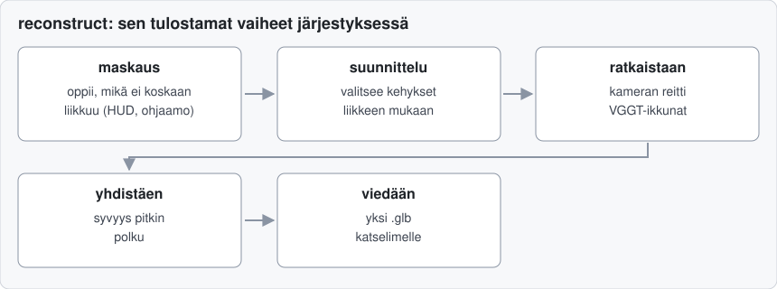

# Rekonstruointi offline-tilassa {#offline-reconstruction}

```bash
python -m heat3d_capture reconstruct lap.mp4 -o lap.glb [--solve-budget 260] [--fuse-interval 0.4]
```

Koodi: [`scan/offline.py`](https://github.com/Holdi601/3DHeat-GameCapture/blob/main/heat3d_capture/scan/offline.py),
[`pose/feedforward.py`](https://github.com/Holdi601/3DHeat-GameCapture/blob/main/heat3d_capture/pose/feedforward.py),
[`pose/vggt_model.py`](https://github.com/Holdi601/3DHeat-GameCapture/blob/main/heat3d_capture/pose/vggt_model.py),
[`pose/feedforward_source.py`](https://github.com/Holdi601/3DHeat-GameCapture/blob/main/heat3d_capture/pose/feedforward_source.py),
[`pose/solveprep.py`](https://github.com/Holdi601/3DHeat-GameCapture/blob/main/heat3d_capture/pose/solveprep.py).
Valinnat: [Komentoviite](commands.md#reconstruct).

## Miksi toinen polku {#why-a-second-path}

Inkrementaalinen seuranta on elävä ja halpa, ja se toimii siellä, missä on rakennetta, johon
tarttua: sisätila, katu, kartta, jossa on suojaa. **Kilparata on sen pahin tapaus**: tie on sileä
nauha, jossa on vähän tekstuuria, horisontti tuskin liikkuu, ja kun muutama asento ajautuu, mikään
myöhempi ei vedä niitä takaisin. Kierros tulee ulos käyränä, joka vaeltaa sen sijaan että sulkeutuisi.

Offline-polku antaa **kuvaikkunat** mallille, joka ennustaa kaikki niiden kamerat yhdessä, joten
jokainen kuva rajoittaa jokaista muuta suoraan eikä ketjun kautta. Se tarvitsee koko tallenteen
ennen vastausta, joten se ei ole elävä, ja se on hidas: minuutteja ikkunaa kohden pöytäkoneen
GPU:lla. Kaikki asentojen jälkeen - yhdistäminen, kattavuus, väri, vienti - on sama koodi kuin elävässä
skannauksessa: ratkaistu rata annetaan rekonstruoijalle asennon lähteenä, juuri sinne, missä Forzan
telemetria menee.

## Vaatimukset {#requirements}

- **PyTorch**, joka sopii GPU:hun (projekti ei lukitse sitä; asenna se ennen `requirements.txt`-tiedostoa,
  katso [Suoritusympäristö](runtime.md)).
- **`vggt`** - VGGT-mallin koodi (`from vggt.models.vggt import VGGT`), Metan GitHub-repositoriosta; sitä
  ei ole paketti-indeksissä.
- **`transformers`**, koska offline-polku ajaa syvyyden PyTorch-`DepthEstimator`in kautta (Depth Anything
  V2 Small), ei ONNX-tiedoston kautta.
- Käytännössä CUDA-GPU; molemmat mallit putoavat CPU:lle, mikä ei ole käytännöllistä.

Mikään näistä ei ole `requirements.txt`-tiedostossa, koska skanneri ei tarvitse niitä. Ne ovat
tiedostossa **`requirements-offline.txt`**, VGGT:n omilla riippuvuuksilla (`einops`, `safetensors`,
`huggingface_hub`, `Pillow`):

```bash
.venv\Scripts\python -m pip install -r requirements-offline.txt
.venv\Scripts\python -m pip install --no-deps "vggt @ git+https://github.com/facebookresearch/vggt.git"
```

VGGT asennetaan `--no-deps`-valinnalla, koska sen paketti-metatiedot lukitsevat `numpy<2`:n, ja pip
kunnioittaisi sitä alentamalla scipyn tarvitsemaa numpyä. `reconstruct` tarkistaa kaikki nämä heti
lisenssirivin tulostuksen jälkeen (`OFFLINE`-lista tiedostossa
[`runtime/preflight.py`](https://github.com/Holdi601/3DHeat-GameCapture/blob/main/heat3d_capture/runtime/preflight.py)),
listaa puuttuvat koon kanssa ja asentaa vain kyllä-vastauksella - VGGT `--no-deps`-valinnalla, kuten
yllä. Kieltäytyminen tai terminaalin puuttuminen, josta kysyä, lopettaa koodilla 1.

## Malli ja sen lisenssi {#the-model-and-its-licence}

**VGGT**, `facebook/VGGT-1B`: **CC-BY-NC-4.0, vain ei-kaupalliseen käyttöön, ja sen kanssa tehty
rekonstruointi perii saman.** Komento tulostaa tämän ennen kuin se alkaa (`describe_licence`).
Erikseen lisensoitu `facebook/VGGT-1B-Commercial` on olemassa, mutta se on portitettu repositorio, jonka
Meta myöntää tilikohtaisesti, joten sitä ei voi tehdä oletukseksi. `--model vggt-1b-commercial` ratkaisee
sen kanssa (ja tulostaa sen lisenssirivin); ilman myönnettyä pääsyä lataus epäonnistuu. VGGT:n *koodi* on
Metan oman "VGGT License" -lisenssin alla, tutkimusmateriaalisopimus, jossa on käyttöpolitiikka (luettu
paketin tiedostosta `LICENSE.txt`). Katso [Mallit ja lisenssit](models-and-licences.md).

## Ajo, vaihe vaiheelta {#the-run-stage-by-stage}

Vaiheiden nimet ovat ne, jotka komento tulostaa.



### maskaus {#masking}

`FlowMask` opitaan **4 ajosta, joissa on 90 peräkkäistä kuvaa**, keskitettyinä kohtiin 1/8, 3/8, 5/8 ja
7/8 videosta, 960 x 540 harmaana (katso [FlowMask](reconstruction-capture.md#flowmask-what-never-travels)).
Sen huomautus tulostetaan ja säilytetään yhteenvedossa. Alle 90 kuvan video ei saa maskia.

#### Kameran maski opitaan, sitä ei sovelleta {#the-camera-mask-is-learned-not-applied}

Maskia **ei** sovelleta ratkaisijalle annettuihin kehyksiin. Ohjaamon peittäminen näytti oikealta
piirteiden tilastoista (suurin osa havaituista kulmista istuu kameraan kiinnitetyillä pikseleillä) - mutta
se on väite piirteiden ilmaisimesta, ja ratkaisija on koulutettu verkko. Mitattuna sen mukaan, kuinka
paljon palautettu polku kääntyy peräkkäisten askelten välillä (auto kääntyy muutaman asteen; satunnaiskävely
yhdeksänkymmentä), raa'at kuvat antoivat pienimmän käännöksen, kontrastia nostetut kuvat hieman enemmän,
maskatut kuvat selvästi enemmän ja molemmat yhdessä eniten. Ratkaisija saa siis raakoja kuvia. Maskia
käytetään yhä kehysvälin suunnitteluun alla, ja inkrementaalinen seuranta käyttää sitä elävässä skannauksessa.
(`solveprep.enhance`, joka maskaa ja nostaa paikallista kontrastia CLAHE:lla, on olemassa, mutta tätä
komentoa ei käytä.)

### suunnittelu: kehykset välein liikkeen mukaan {#planning-frames-spaced-by-motion}

`plan_by_motion` valitsee ratkaisijan kehykset sen mukaan, **kuinka paljon kuva liikkui**, ei kellon mukaan:
kiinteä väli antaa hitaille osuuksille kehyksiä, joita ne eivät tarvitse, ja nälkiyttää nopeita, joissa
peräkkäiset kehykset eivät enää mene riittävästi päällekkäin liittyäkseen toisiinsa.

- Tavoitesiirtymä: **5 % 960 pikselin leveydestä** (48 px) mediaani-ORB-piirteiden siirtymä peräkkäisten
  valittujen kehysten välillä, mitattuna 960 x 540 harmaista kuvista CLAHE-kontrastilla, piirteet vain maskilla.
- Alkaa 0,3 s välistä; jokaisen askeleen jälkeen seuraava väli on
  `väli x (0,5 + 0,5 x tavoite / mitattu)`, rajattuna välille **0,15-2,0 s**, joten yksi kohinainen mittaus
  ei heitä suunnitelmaa.
- Kun mikään ei täsmännyt, väli pienenee 0,6-kertaiseksi (liian kaukana toisistaan on virhe, jota vältetään).
- Pysähtyy videon loppuun tai `--solve-budget`-kehysmäärään (oletus 260).

Alle 4 suunniteltu kehys on virhe.

### ratkaisu: ikkunat ja ompelu {#solving-windows-and-stitching}

Suunnitellut kehykset dekoodataan 960 px leveinä ja ratkaistaan **päällekkäisissä 16 kehyksen ikkunoissa,
joista 6 on yhteisiä seuraavan kanssa** (`plan_windows`; viimeinen ikkuna vedetään takaisin päättymään
viimeiseen kehykseen, joten videon lopulla on yhtä monta naapuria kuin keskellä). Yli **400** kehystä
yhdessä ajossa hylätään.

Jokainen ikkuna: kehykset skaalataan niin, että pitkä sivu on **518** ja molemmat sivut ovat **14**:n
monikertoja (kuvasuhde säilytetään - puristaminen vääristäisi näkökenttää), skaalataan välille 0..1 ja
ajetaan VGGT:n läpi bfloat16-autocastilla (float16 loppuu eksponentista kaukaisissa maailmakoordinaateissa).
Kameran ulkoiset parametrit muunnetaan maailmasta-kameraan-kiertoihin ja kameran keskipisteisiin. Pistekarttoja
ei säilytetä oletuksena.

Jokainen ikkuna palautuu **omaan mielivaltaiseen kehykseensä ja omaan mielivaltaiseen mittakaavaansa**, joten
ikkunat **ommellaan** ensimmäisen ikkunan kehykseen yhdenmuotoisuusmuunnoksella (kierto, siirto, yksi
mittakaava), joka sovitetaan niihin kameroihin, joita ne jakavat jo sijoitettujen kanssa:

- **Kierto kameroiden suunnista**, ei niiden sijainneista: jaetut kamerat istuvat polun varrella ja ovat
  lähes suoralla kollineaarisia, mikä jättää pelkästään sijaintiin perustuvan sovituksen sokeaksi kierrolle -
  jokainen ikkuna kaartuisi ja lopputulos tulisi suoraksi. Kierto on keskiarvo `target_R x source_R^T`
  projisoituna takaisin todelliseksi kierroksi (heijastussuojalla).
- **Mittakaava ja siirto sijainneista**, lähteen kierretyn suunnan mukaan.
- Vaaditaan vähintään **4** jaettua kameraa; vähemmän on virhe.
- Päällekkäisyys on kolmannes ikkunasta, jotta mittakaava on hyvin määritelty; mittakaavavirhe, joka kertyy
  ikkunasta toiseen, on se, mikä saa kierroksen kierteeksi.

Jokaiselle saumalle kirjataan jaettujen kameroiden pahin erimielisyys sovituksen jälkeen, mitattuna
keskimääräisen kameravälin yksikköinä (`seam_error`).

### yhdistäminen {#fusing}

Kehykset joka `--fuse-interval`-sekunnilla (oletus 0,4) dekoodataan 960 px leveinä, saavat syvyyden
Depth Anything V2 Smallilta (PyTorch) ja yhdistetään asentoon, joka **interpoloidaan** ratkaistusta
radasta niiden aikaleimalla (lineaarinen sijainti, pallomainen kierto; `FeedForwardPoses`). Kehykset ratkaistun
aikavälin ulkopuolella ohitetaan eikä niitä ekstrapoloida. Kamera käyttää **65 asteen** vaakasuuntaista
näkökenttää. Syötteen asennoilla on luottamus 0,85 yhdistämisessä ja kattavuudessa.

### vienti {#exporting}

Verkko kirjoitetaan kuten elävässä skannauksessa ([.glb-tuloste](glb-output.md)), nimettynä videon mukaan.

## Yhteenveto {#the-summary}

```text
140 cameras solved over 182s
closure error 3.1% of path length
worst seam 0.42 frame spacings
<mask note>
wrote lap.glb
```

| Rivi | Merkitys |
|---|---|
| closure error | etäisyys ensimmäisestä kamerasta viimeiseen jaettuna polun pituudella. Yhdelle kierrokselle rehellinen mitta ajautumalle. Yli 10 %: "The lap does not close ... Treat the shape as unreliable." |
| worst seam | suurin ompeleen erimielisyys. Yli 1,0: "Windows disagreed by up to N frame spacings at a seam, so part of the path is stitched on weak evidence." |
| no file | "Fusion produced no surface, so nothing was written." Poistumiskoodi on silloin 1. |

## Mittakaava {#scale}

Ommeltu polku on ensimmäisen ikkunan mielivaltaisissa yksiköissä. Syvyys ankkuroidaan kolmiomittaamalla
interpoloitujen asentojen välillä (kuten telemetrialle), joten geometria on yhdenmukainen polun kanssa -
mutta **tulos ei ole metreissä**, ellei polku ole. Tämä komento ei korjaa globaalia mittakaavaa; maakalibrointia
ei sovelleta, kun asennot tulevat asennon lähteestä.

## Tämän polun tila {#state-of-this-path}

Kun kehykset ovat kiinteällä välillä, ikkunat ratkeavat yhtenäiseksi poluksi osalla kierrosta ja
sotkuksi toisilla; viat ovat tiukoissa mutkissa, joissa näkymä kääntyy rajusti kehysten välillä, ja
näiden mutkien tiheämpi näytteistys korjaa ne. Yhtään kuvatilastoa (kirkkaus, yksityiskohta, piirteiden
määrä, sisäpistesuhde, siirtymä) ei ole pystytty ennustamaan etukäteen, mitkä osuudet epäonnistuvat. Siksi
väliä ei voi suunnitella täysin kuvista etukäteen: se täytyy valita ratkaisemalla, mittaamalla tulos ja
ratkaisemalla uudelleen tiheämmin siellä, missä polku ei ole sellainen, jonka auto olisi voinut ajaa.
Liikepohjainen suunnittelu on rakennettu; **adaptiivinen uudelleenratkaisu ei ole**.
