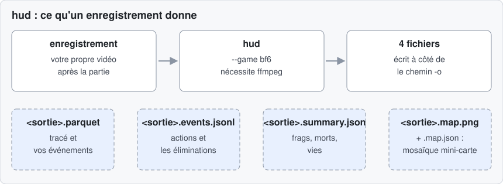

# Lire le HUD depuis un enregistrement {#reading-the-hud-from-a-recording}

`hud` lit le HUD à l'écran d'un jeu dans l'**enregistrement propre** du joueur, après la partie : les **propres**
actions du joueur, d'après la fenêtre de points que le jeu affiche sous le réticule (frags, assistances, réanimations,
ravitaillements, captures...), ses morts, d'après les écrans de chute et de déploiement, sa **propre** piste, d'après la
mini-carte, et le fil des éliminations à côté, sous forme d'événements datés. Le tout est écrit comme une table 3DHeat,
avec la mosaïque de la mini-carte comme image de carte à placer dessous.

En bref : il regarde votre vidéo de partie et note vos frags, vos morts et les endroits où vous avez marché.

```bash
.venv\Scripts\python -m heat3d_capture hud "<recording>.mp4" --game bf6 --player <name> -o out/match
```

Battlefield 6 est le premier profil de jeu.



## Ce qu'il touche et ce qu'il ne touche pas {#what-it-does-and-does-not-touch}

- Il lit un **fichier vidéo** : un clip ShadowPlay / Instant Replay, un enregistrement OBS, tout ce que ffmpeg
  décode. Il ne touche jamais au jeu, à sa mémoire, à ses fichiers ni à son réseau, et il s'exécute après la fin de la
  partie. Voir [Les règles](rules.md).
- Il ne dérive que la **propre position du joueur**, d'après la mini-carte du joueur. Les marqueurs des autres joueurs
  sur la mini-carte sont masqués et jamais lus. Le fil des éliminations est conservé en entier, mais seulement tel qu'il
  s'affiche à l'écran (qui, qui, avec quoi, quand) ; aucune position n'est rattachée à quiconque d'autre que le joueur.
- L'OCR tourne en local (RapidOCR avec les modèles PaddleOCR via ONNX Runtime). Aucune image ni aucun recadrage ne
  quitte la machine.
- Un enregistrement montre les noms des autres joueurs, et la mosaïque est une image du niveau. Les sorties sont pour
  l'usage propre du joueur ; gardez-les en local.

## Prérequis {#requirements}

- **ffmpeg et ffprobe** dans le `PATH`. Une carte NVIDIA est utilisée pour le décodage quand elle est présente
  (`-hwaccel cuda`) ; sinon le processeur décode, plusieurs fois plus lentement.
- Les paquets de `requirements.txt`, et l'OCR sans ses propres dépendances (il demande le `onnxruntime` pour processeur,
  qui entre en conflit avec celui de DirectML utilisé par le projet) :

```bash
.venv\Scripts\python -m pip install -r requirements.txt
.venv\Scripts\python -m pip install --no-deps rapidocr_onnxruntime==1.2.3
```

`rapidocr_onnxruntime` est le lecteur de texte (OCR) qui lit les noms et les mots à l'écran. `--no-deps` l'empêche de
remplacer le `onnxruntime` DirectML du projet.

Pour installer ffmpeg sous Windows : `winget install Gyan.FFmpeg`, puis ouvrez un nouveau terminal et vérifiez avec
`ffmpeg -version`. Vous ne connaissez pas la ligne de commande ? Lisez [Avant de commencer](before-you-start.md).

- Un enregistrement en **16:9**, quelle que soit la résolution (1080p, 1440p, 4K). Les autres formats sont refusés, car
  les boîtes du profil tomberaient sur les mauvaises parties de l'écran.
- La **disposition par défaut** du HUD du jeu. Un élément du HUD déplacé ou mis à l'échelle est lu au mauvais endroit.

## Options {#options}

| Option | Défaut | Signification |
|---|---|---|
| `video` | | L'enregistrement. |
| `-o`, `--out` | le nom de la vidéo, dans le dossier courant | Chemin de sortie **sans** extension ; les fichiers sont `<out>.parquet`, `.events.jsonl`, `.summary.json`, `.map.png`, `.map.json`. |
| `--game` | `bf6` | Le HUD de quel jeu lire. `bf6` (Battlefield 6) est pour l'instant le seul profil. |
| `--player` | aucun | Le nom du joueur tel que le fil des éliminations l'affiche. Comparé sans exigence stricte (l'OCR confond `l`/`I`/`1`, `O`/`0`, `rn`/`m`). Sans lui, le nom est deviné (voir plus bas). |
| `--fps` | 5 | Échantillons de mini-carte par seconde. Le fil des éliminations est échantillonné à la moitié de ce débit, la fenêtre de points et les écrans de mort aussi à la moitié (un quart quand aucune fenêtre n'est affichée), la boussole toutes les 3 s, la liste de l'escouade toutes les 15 s. |
| `--start` | 0 | Secondes dans la vidéo où commencer. |
| `--seconds` | tout | Quelle durée de la vidéo lire. |
| `--metres-per-pixel` | aucun | L'échelle de la mini-carte, si elle est connue : mètres par pixel de mini-carte au zoom habituel (la mini-carte fait 296 pixels de large sur un écran 1080p). Sans elle, les positions sont exprimées en ces pixels ; voir [Unités](#north-and-units). |
| `--cpu` | désactivé | Décoder sur le processeur même quand une carte NVIDIA est présente. |

La progression s'affiche toutes les cinq secondes ; à la fin, le joueur, les frags, les morts, les vies et les fichiers
écrits.

## Sorties {#outputs}

### `<out>.parquet` - la piste et les événements du joueur {#parquet---the-players-track-and-events}

Une ligne par échantillon où le joueur était en jeu et où la mini-carte pouvait être située, plus une par événement qui le
concerne. Le pied de page porte les instructions de lecture du visualiseur (clé `heat3d`, `kind: heat3d-hud`), pour que le
visualiseur associe chaque colonne sans rien demander.

| Colonne | Signification |
|---|---|
| `time` | Secondes depuis le début de la vidéo. |
| `event` | `position` ; `start` (la vidéo a commencé en pleine vie), `spawn` (de retour en jeu après une mort ou un long trou), `death`, `downed` et `revived` (d'après les écrans de mort, ci-dessous), `end` (une vie s'est terminée sans indication de cause) ; les actions propres du joueur d'après la fenêtre de points (`kill`, `assist`, `reviving`, `resupply`, `capture`... - le [tableau des événements](#event-table)) ; et les lignes du fil qui concernent le joueur, sous `kill_feed`, `death_feed`, `teamkill_feed`, `suicide_feed`, `squadwipe_feed`. |
| `source` | D'où vient l'événement de la ligne : `points` (la fenêtre), `screen` (les écrans de chute et de déploiement), `feed` (le fil des éliminations) ; vide sur les lignes de position. |
| `text` | Sur les lignes `points` : l'étiquette telle qu'imprimée (`KILL`, `SQUAD DAMAGE ASSIST`...), ou le titre (`DOUBLE KILL`, le nom d'un ruban), ou pour une étiquette inconnue ce qui a été lu. |
| `points` | Sur les lignes `points` : de combien le total de la fenêtre a augmenté à ce moment. Quand plusieurs actions arrivent dans le même échantillon (un frag et le véhicule où il se trouvait), c'est leur somme, indiquée sur chacune, et `shared` dit combien en partagent. Vide quand le total n'a pas été lu deux fois de part et d'autre du moment. |
| `subject`, `subject_side` | Sur les lignes `points` : le nom affiché avec l'action - la victime d'un frag, le coéquipier réanimé ou ravitaillé - et sa couleur (`enemy`, `friendly`, `squad`). |
| `confirmed` | `feed` quand le fil des éliminations avait une ligne pour le même frag ou la même mort (à 3 s près, même victime). |
| `x`, `y`, `z` | Position sur la mosaïque : `x` vers l'est, `y` vers le nord, `z` 0 (le pied de page indique que `z` est vers le haut). Le nord est le vrai nord lorsque la boussole l'a permis (voir `north_up` dans le résumé). |
| `player` | Toujours `me`. Seules les lignes du joueur ont des positions. |
| `team` | `own`. |
| `session` | `<nom de la vidéo>#NN`, une par vie. Les tracés de carte de lignes ne traversent jamais une session. |
| `heading` | Degrés dans le sens horaire depuis le nord (depuis le haut de la mosaïque quand le nord est inconnu) : la direction de la vue. |
| `dir_x`, `dir_y`, `dir_z` | La même chose sous forme de vecteur de direction, pour la direction de regard du visualiseur. |
| `zoom` | De combien la mini-carte était dézoomée par rapport à son zoom habituel (au-dessus de 1 en véhicule). |
| `killer`, `victim`, `weapon`, `headshot`, `marker` | Sur les lignes de frag et de mort qui ont une ligne de fil : la ligne du fil (ci-dessous). Un frag de fenêtre sans ligne de fil a le nom de la fenêtre comme `victim` ; un frag de fenêtre affiché en HEADSHOT a `headshot` à vrai. |

Chaque ligne d'événement prend la position du joueur à l'heure de l'événement (pour une mort ou une chute, la dernière
position avant celle-ci ; pour une réanimation, la première après). Les lignes s'adaptent directement à la
[carte de lignes](https://holdi601.github.io/3DHeat/line-heat.html) du visualiseur : sa suggestion choisit `event`, commence
à `start`, `spawn` et `revived`, termine à `death`, `downed` et `end`, et les lignes `position` suivent le tracé. Les autres
événements sont nommés de façon que la suggestion n'en prenne aucun pour un début ou une fin : donner une réanimation est
`reviving` (et non `revive`), tenir un point `defense`, un coéquipier qui apparaît sur le joueur `teammate_arrived`, les
lignes du fil `kill_feed` et ainsi de suite ; `kill` n'est pas une fin.

Un enregistrement avec deux manches sur deux cartes donne deux mosaïques qui ne peuvent pas être mises en relation. La plus
grande est `<out>.parquet` ; chaque autre ayant au moins 30 s de piste est écrite à côté sous `<out>.map2.parquet`,
`<out>.map2.map.png`, et ainsi de suite.

### `<out>.events.jsonl` - les événements du joueur et le fil des éliminations {#eventsjsonl---the-players-events-and-the-kill-feed}

Un objet JSON par ligne, dans l'ordre du temps, chacun avec un `source` :

- `points` : un par action du joueur : `time`, `event`, `text`, `points`, `shared`, `subject`, `subject_side` (comme dans le
  tableau), `popup` (de quelle fenêtre elle vient, numérotée tout au long de l'exécution), `seen` (combien de lectures l'ont
  montrée), `confirmed`, et `x`, `y` où se trouvait le joueur.
- `screen` : un par chute et par réanimation : `event` (`death`, `downed` ou `revived`), `time` (quand le joueur est tombé ;
  pour `revived`, quand les écrans ont disparu), `until` (la dernière apparition des écrans), `screens` (`down` et/ou `card`),
  `outcome` (`death`, `revived` ou `unknown` quand l'enregistrement finit avant), `killer` (d'après la ligne du fil, quand il y
  en a une), `x`, `y`.
- `feed` : chaque ligne qu'a affichée le fil, celles de tout le monde :

| Champ | Signification |
|---|---|
| `time`, `last` | Premier et dernier échantillon où la ligne a été lue (secondes depuis le début de la vidéo). `time` est le moment où le frag est apparu, à un échantillon de fil près (0,4 s au débit par défaut). |
| `kind` | Du point de vue du joueur : `kill`, `death`, `teamkill`, `suicide`, `squadwipe` ; pour les lignes des autres joueurs `kill`, `squadwipe`, ou `death` pour une ligne sans tueur. |
| `killer`, `victim` | Les noms, tels que la lecture la plus fréquente sur tous les échantillons qui montrent la ligne (une lecture plus longue l'emporte quand la lecture courante en est le début : un nom en partie caché). `killer` est vide pour une ligne qui ne montrait qu'une icône et une victime - une mort due au monde, ou une ligne dont le tueur avait déjà disparu. |
| `killer_side`, `victim_side` | D'après la couleur du nom : `friendly` (l'équipe du joueur, bleue), `enemy` (orange), `squad` (le vert pâle que le jeu utilise pour le joueur et son escouade), `neutral` (aucune de celles-ci). |
| `weapon` | La classe de l'icône d'arme dans cette exécution : `icon01`, `icon02`... Les lignes dont les icônes se ressemblent partagent une classe. Les icônes ne sont pas nommées ; il n'existe aucune liste à partir de laquelle les nommer. |
| `marker` | La petite icône entre l'arme et la victime : `skull`, `arrow`, `chevrons`, `crosses` ou vide. |
| `headshot` | `marker == "skull"` - une hypothèse, voir [Limites](#limits). |
| `seen` | Nombre d'échantillons du fil qui ont montré la ligne. |
| `me` | `killer`, `victim` ou null. |
| `matched` | Pour les lignes du joueur : si une action de la fenêtre ou un écran de mort a été trouvé pour elle. |
| `x`, `y` (, `map`) | Pour les lignes du joueur : où il se trouvait. |

### `<out>.summary.json` {#summaryjson}

Le joueur (et comment il a été trouvé), d'où viennent les événements du joueur (`own_events_from` : la fenêtre et les écrans,
ou le seul fil des éliminations quand ni l'un ni l'autre n'ont pu être lus), les frags, les morts, le K/D, les tirs à la tête,
les assistances, les réanimations données (`revives`) et reçues (`revived`), les chutes, les captures, les neutralisations, les
ravitaillements, les soins, les réparations, les véhicules détruits, le score (somme des totaux des fenêtres), chaque type
d'action avec son nombre (`actions`), le nombre de fenêtres, les morts vues seulement par le fil, le propre décompte de frags et
de morts du fil et combien de ses frags correspondent à un frag de fenêtre, les tués par coéquipiers, les suicides, les escouades
anéanties, les vies, les secondes en jeu, la distance parcourue (dans les unités du tableau), les lignes du fil, pour chaque carte
si elle est orientée au nord et combien de lectures de boussole concordent, les décomptes de la piste (échantillons, en jeu,
placés, non placés, îlots), les hypothèses faites et la durée.

### `<out>.map.png` et `<out>.map.json` - la carte sous la piste {#mappng-and-mapjson---the-map-under-the-track}

La mosaïque de toutes les mini-cartes de l'exécution, moyennée, les superpositions retirées, tournée et mise à l'échelle
exactement comme le tableau. Le fichier JSON annexe contient les deux ancres que demande le placement **Image de carte** du
visualiseur ([Images de carte](https://holdi601.github.io/3DHeat/map-images.html) dans la documentation du visualiseur) :
chargez le PNG avec **Image de carte...**, gardez **Inverser nord/sud** activé, et saisissez l'ancre 1 et l'ancre 2 (`px`, `py`,
`worldX`, `worldZ`) à partir de l'annexe. L'image se place alors exactement sous la piste.

Seules les parties du niveau que montrait la mini-carte du joueur figurent sur l'image.

## Méthode {#method}

### Décodage {#decoding}

ffmpeg décode sur la carte graphique, descend au débit d'échantillonnage pendant que les images sont encore sur la carte,
découpe les régions du profil (mini-carte, fil des éliminations, deux bandes de boussole, liste de l'escouade, fenêtre de points,
mots de l'écran de chute, coin en bas à droite), redimensionne chacune à une taille fixe et les empile en une petite image par
échantillon. Seule cette image traverse le tube vers Python. Décoder chaque image du flux H.264 constitue le minimum du temps
d'exécution.

Deux threads de travail prennent les échantillons : l'un recale les mini-cartes (OpenCV), l'autre lit le texte (ONNX Runtime).

### En jeu ou non {#in-play-or-not}

Le carré d'indication de la touche de la mini-carte (le carré clair avec la touche de la carte dedans, en bas à gauche de la
mini-carte) est dessiné chaque fois que la mini-carte l'est, et pas sur les écrans de mort, de caméra de mort, de déploiement,
de menu ou de tableau des scores. Sa présence - un carré clair et sans couleur, avec une lettre sombre en son milieu, nettement
plus clair que ce qui l'entoure - cherchée sur quelques pixels autour de sa place, est le test de jeu. Un échantillon isolé qui
contredit ses deux voisins est ignoré.

Un trou dans le jeu est une mort ou un changement de manche (la tranche suivante commence par `spawn`) lorsqu'il dure au moins
6 s, ou qu'une mort (venant des écrans, ou d'une ligne du fil qui nomme le joueur comme victime) est survenue moins de 40 s avant
lui ; un trou plus court sans mort (la grande carte ouverte) prolonge la vie. La mini-carte reste affichée pendant que le joueur
est à terre, donc un joueur à terre est en jeu.

### La piste {#the-track}

La mini-carte tourne avec la vue et garde le joueur à un point fixe (mesuré : le milieu, 49,7 % vers le bas). Pour chaque
échantillon :

1. **Masquer** ce qui n'est pas le niveau : pixels fortement colorés ou presque blancs (marqueurs d'objectifs, icônes d'escouade
   et de véhicule, signaux, limite de la zone de jeu, lignes de route, texte), le vert-jaune pâle du cône de vue, un disque autour
   du marqueur du joueur, la pointe du cône au-dessus, le carré d'indication de touche, et un mince liseré.
2. **Caractéristiques** : points-clés SIFT sur la mini-carte en gris, égalisée en contraste, à l'intérieur du masque.
3. **Recaler sur la mosaïque**, et non sur l'échantillon précédent : les points-clés sont appariés aux caractéristiques déjà
   stockées, en coordonnées de mosaïque, près de l'endroit où le joueur se trouvait ; une similitude (rotation, zoom, décalage)
   est ajustée par RANSAC. Un ajustement exige assez de points cohérents, un zoom à un tiers près du dernier et un décalage
   inférieur au tiers de la mini-carte par échantillon ; un ajustement cherché n'importe où sur la mosaïque (après une mort)
   exige le double de points cohérents.
4. **Faire croître la mosaïque** : les caractéristiques que la mosaïque n'a pas encore sont ajoutées (au plus toutes les quelques
   dixièmes de seconde de déplacement), et la mini-carte masquée est moyennée dans l'image.
5. Le point du joueur, porté par l'ajustement, est sa **position** ; le haut de la mini-carte, porté de la même façon, est son
   **cap** sur la mosaïque.

Ensuite, un point qui saute de plus de 10 pixels loin des deux échantillons avant et des deux après (qui concordent entre eux) est
retiré : une mini-carte correspond parfois à un mauvais zoom pendant un seul échantillon. Le résumé les compte (`dropped_as_jumps`).

Le recalage sur la mosaïque empêche les erreurs de s'accumuler : revenir à un endroit retrouve les caractéristiques stockées la
première fois. Une apparition dans un endroit encore inconnu démarre un **îlot** séparé ; tout dixième échantillon placé est essayé
contre les autres îlots, et la première bonne correspondance les réunit (le plus petit se fond dans le plus grand, avec sa piste).
Les îlots jamais réunis (une autre carte, ou un sol jamais partagé) sont écrits à part, comme ci-dessus.

### Nord et unités {#north-and-units}

La bande de boussole est lue toutes les 3 s : ses étiquettes sont trouvées par leur encre (claire, sans couleur, regroupée à travers
de petits écarts, graduations écartées), chacune est lue séparément, et deux étiquettes ou plus fixent à la fois l'échelle de la bande
et le relèvement sous le repère central - une seule étiquette ne fixe rien. Chaque lecture de boussole est appariée au cap de mosaïque
du même échantillon ; la médiane circulaire des écarts, sur les lectures à moins de 10 degrés d'elle, est la rotation qui met le nord de
la mosaïque en haut. Elle est appliquée quand au moins trois lectures et la moitié de toutes concordent.

<a id="units"></a>L'échelle au sol de la mini-carte n'est imprimée nulle part à l'écran, donc les positions sont en **pixels de
mini-carte au zoom habituel** : le zoom médian de l'exécution est ramené à une unité de tableau par pixel d'une mini-carte de 296 pixels
(sa taille sur un écran 1080p). Le dézoom en véhicule est retiré par le recalage, donc une unité est la même à pied et en véhicule.
`--metres-per-pixel` multiplie le tout en mètres quand l'échelle est connue (à partir d'une distance connue sur la carte, mesurée une fois).

### Le fil des éliminations {#the-kill-feed}

Le fil est lu à 2,5 échantillons par seconde, mais seulement quand ses pixels colorés ont sensiblement changé ou qu'il s'est écoulé 2 s.
Les lignes de texte sont trouvées par le détecteur de l'OCR ; une ligne dont l'image correspond à une ligne lue à l'échantillon précédent
(les lignes défilent, elle a pu bouger) reprend ce texte au lieu d'être relue. Les lignes trop petites pour un nom, ou avec une barre
oblique (un compteur d'images par seconde dans ce coin), sont écartées.

Les lignes sont groupées en rangées selon leur hauteur ; dans une rangée, le nom le plus à gauche est le tueur et le plus à droite la
victime. Les morceaux voisins de même couleur se rejoignent (un nom avec un espace). Une ligne unique qui traverse l'icône d'un nom à
l'autre est coupée à son écart le plus large quand les moitiés diffèrent de couleur, et chaque moitié est relue. Un seul nom dans la
colonne des victimes avec une icône juste à sa gauche est une ligne sans tueur. Deux morceaux d'une même couleur sans icône entre eux
forment un seul nom dont le tueur a disparu, pas un frag.

**Les camps** viennent de la couleur. Les noms sont dessinés avec une certaine transparence, donc le test porte sur la distance du texte
à son propre fond : le signe de rouge moins bleu dans cette différence est orange (ennemi) ou bleu (ami) sur n'importe quel fond ; ni l'un
ni l'autre, avec le vert au-dessus des deux autres, est la couleur d'escouade.

**Icônes** : entre les noms, les pixels de la couleur du tueur dessinent la silhouette de l'arme ; une petite icône séparée juste avant la
victime est le marqueur, nommé d'après sa forme (une tache avec des trous pour les yeux est un crâne ; un petit triangle une flèche ;
plusieurs morceaux des croix).

**Événements** : une ligne relue avec les deux noms identiques (similarité 0,7 après correction des confusions usuelles de l'OCR, dont une
à 0,8 ; une lecture coupée court correspond au début du nom complet) est le même événement, tant que l'événement a été relu il y a moins de
5 s et qu'il a moins de 14 s - aucune ligne ne reste affichée plus longtemps, donc la même paire plus tard est un nouveau frag. Une ligne sans
tueur ne se fait correspondre que sur la victime. L'heure d'un événement est sa première apparition ; ses noms, camps et marqueur sont la
majorité des apparitions ; les lignes lues une seule fois sont écartées.

**Le joueur** : `--player`, sinon la ligne la plus claire (en surbrillance) de la liste d'escouade, quand il y a au moins trois lectures et
que 60 % d'entre elles concordent, sinon le nom que le fil a le plus souvent dessiné dans la couleur d'escouade. Sinon, le résumé dit que le
joueur est inconnu, et aucune ligne du fil ne lui est attribuée. (La fenêtre et les écrans de mort sont ceux du joueur quel que soit son nom ;
ils n'ont pas besoin de nom.)

### La fenêtre de points {#the-points-popup}

Tout ce que le joueur marque, Battlefield 6 le montre dans une seule fenêtre juste à gauche et sous le réticule - au même endroit à pied, en
véhicule et à travers une visée :

```
            [ RIBBON ] (icon)          a title, now and then: a ribbon or a multi-kill
      (icon)(icon)(icon)  300          one icon per action; the popup's running total
                Some_Name              who it was about, for a moment: orange an enemy, blue a teammate
    [ KILL x2 ] [ VEHICLE DESTROYED ]  one boxed tag per kind of action, with a count
```

La fenêtre grandit tant que le joueur continue de marquer : un nouveau frag transforme `KILL` en `KILL x2`, ajoute une icône et augmente
le total ; un nouveau type d'action ajoute une étiquette. La rangée d'étiquettes montre les dernières sortes (une plus ancienne glisse dehors,
et se remet à compter quand elle revient). Environ trois secondes après la dernière action, la fenêtre se replie en une seule ligne
(`[KILL x2] 300`) puis disparaît. Le texte est gris clair, les étiquettes dans de fins cadres, le total en gros chiffres à partir de x 760 sur
un écran de 1920x1080, les étiquettes alignées à droite sur x 750.

Elle est lue 2,5 fois par seconde : le détecteur de l'OCR trouve les lignes de texte, seules les lignes d'une des rangées de la fenêtre sont
lues (les propres étiquettes du viseur de char dans la même zone ne le sont pas), et une ligne dont l'image correspond à une ligne lue à
l'échantillon précédent reprend ce texte. Une ligne qui déborde d'une icône, d'un nom ou d'une étiquette repliée dans le total (`Name10`,
`REVIVE185`) est coupée là où commence le total (x 755) et les deux moitiés sont relues. Quand aucune fenêtre n'est affichée, un échantillon
sur deux est retenu sans être lu ; quand le suivant montre une fenêtre, celui qui a été retenu est lu d'abord, de sorte que le début d'une
fenêtre est retrouvé à l'échantillon près.

**Les étiquettes** sont mises en correspondance avec le [tableau des événements](#event-table) après correction des erreurs habituelles du
lecteur (Q lu comme O, un chiffre entre des lettres, I pour L, une lettre perdue au bord) : une lecture est une étiquette quand elle ressemble
à au moins 80 % à une étiquette (85 % pour les étiquettes de cinq lettres ou moins) et qu'elle est nettement plus proche de celle-ci que de
toute autre. Les étiquettes que le lecteur a collées ensemble (`CAPTUREDORDERCOMPLETED`) sont séparées en retirant au début les étiquettes
connues. Un compte s'écrit `x2`, `X3`, un signe isolé et un chiffre, ou un chiffre juste après l'étiquette. Une ligne gris clair, en
majuscules, dans la rangée d'étiquettes qui ne correspond à rien est conservée comme une action `points` avec son texte ; une ligne qui est un
morceau d'une étiquette connue dans la même fenêtre (`DESTROYED` à côté de `VEHICLE DESTROYED`) ne l'est pas. Les titres au-dessus du total
(cadres clairs, texte sombre) sont des `multi_kills` (`DOUBLE KILL` ...) ou des `ribbon`. Le nom est la ligne colorée entre le total et les
étiquettes ; son camp vient de sa couleur, comme pour le fil.

**Fenêtres et actions** : des lectures séparées de moins de 0,9 s sans rien entre elles forment une seule fenêtre. Une fenêtre qui semble finir
et revient avant de pouvoir s'être repliée (dans les 3,2 s après sa dernière croissance), avec chaque étiquette à son compte ou plus et un total
non inférieur, est la même fenêtre perdue un instant (flou, fond clair) - rien n'y est compté deux fois. Dans une fenêtre, le compte final d'une
étiquette est le compte le plus haut lu au moins deux fois ; sa k-ième action est datée à la première lecture montrant un compte de k ou plus.
Un compte lu dans un seul échantillon n'est pas une action - sauf un frag que le fil des éliminations confirme (une ligne du joueur dans les 3 s
que nul autre frag n'a prise) : l'étiquette courte KILL est celle que le lecteur ne lit le plus souvent qu'une fois. Un titre ne compte qu'une fois
par fenêtre, lorsqu'il est lu deux fois. `points` est la hausse du total entre l'échantillon avant l'action et celui d'après - en ne comptant que les
totaux lus deux fois de suite.

Une ligne inconnue ne compte comme étiquette que sur la rangée des étiquettes connues de la même lecture (ou, sans étiquette connue, quand il n'y
a pas non plus de nom), de sorte qu'un nom dessiné dans une couleur que le test de camp ne sait pas lire n'est pas pris pour une étiquette.

### Morts et réanimations {#deaths-and-revives}

Quand le joueur tombe, le jeu l'indique sous le centre de l'écran (MAN DOWN, REQUEST REVIVE, SKIP (HOLD), NEARBY MEDICS ; une fois la
réanimation demandée, REVIVE REQUESTED, CANCEL REQUEST), et une carte en bas à droite nomme celui qui l'a fait, avec DAMAGE LOG ou PLAYER CARD
dessous et une ligne « YOU n - n FOE » au-dessus. Tué d'un coup (un tir à la tête fatal), seule la carte apparaît. Ensuite, soit un coéquipier
réanime le joueur - les écrans disparaissent et la partie continue - soit le joueur se vide de son sang ou abandonne, et l'écran de déploiement
suit, avec DEPLOY en bas à droite.

Ces mots sont lus en même temps que la fenêtre, dans la même passe de l'OCR (la fenêtre, la bande de l'écran de chute et le coin en bas à droite
empilés en une seule image) : 2,5 fois par seconde pendant qu'une fenêtre est affichée, 1,25 fois sinon. Le coin n'est inclus que lorsque le joueur
est hors jeu ou a été vu à terre dans les 3 dernières secondes ; en jeu, il ne contient que le nombre de munitions. Des observations à moins de 4 s
d'intervalle forment un seul épisode (deux observations au moins). Un épisode est une **mort** quand l'écran de déploiement apparaît dans les 12 s
qui suivent sa fin, ou quand le joueur est hors jeu 3 s après lui et y reste au moins 6 s ; c'est une **réanimation** (`downed`, puis `revived`)
quand le joueur est toujours en jeu 3 s après la disparition des écrans ; `unknown` (écrit `downed` seul) quand l'enregistrement finit avant.
L'heure de la mort est celle où le joueur est tombé : la ligne du fil qui le nomme comme victime, quand il y en a une dans les 3 s qui précèdent
l'épisode, sinon la première observation de l'épisode moins la moitié de l'intervalle de lecture. Les positions après une mort sont retirées du
tracé jusqu'à l'écran de déploiement.

Une mort du fil qu'aucun épisode n'explique (les écrans ont été manqués) reste une `death`, avec `source` `feed`, et est jugée comme précédemment :
si le joueur reste en jeu plus de 40 s après elle, il a été réanimé.

### Tableau des événements {#event-table}

Ce que devient chaque étiquette, chaque titre et chaque écran. Plusieurs étiquettes peuvent former un seul événement ; `text` garde laquelle.

| Événement | D'après | Signification |
|---|---|---|
| `kill` | KILL ; HEADSHOT | Le joueur a tué quelqu'un (le nom est la victime). Un frag à la tête affiche HEADSHOT à la place de KILL : `text` indique lequel, et `headshot` vaut vrai. |
| `assist` | ASSIST, KILL ASSIST, DAMAGE ASSIST, SQUAD DAMAGE ASSIST | Dégâts infligés à quelqu'un qu'un coéquipier a tué. |
| `kill_assist` | ASSIST COUNTS AS KILL | Une assistance que le jeu compte comme un frag. |
| `suppression`, `suppression_assist` | ENEMY SUPPRESSION ; SUPPRESSION ASSIST | Tir de suppression sur un ennemi ; sur un ennemi qu'un coéquipier a ensuite tué. |
| `smoke_assist` | SMOKE ASSIST, SQUAD SMOKE ASSIST | Fumée qui a couvert un coéquipier. |
| `spot`, `spot_assist` | SPOT, SPOTTED, ENEMY DESIGNATION ; SPOT ASSIST, SPOT BONUS | Repérer un ennemi ; un frag sur un ennemi que le joueur avait repéré. |
| `driver_assist` | DRIVER ASSIST | Un frag par le tireur du véhicule du joueur. |
| `reviving`, `reviving_bonus` | REVIVE, SQUAD REVIVE ; CONCEALED REVIVE | Le joueur a réanimé un coéquipier ; le bonus pour l'avoir fait à couvert. |
| `heal` | HEAL, SQUAD HEAL | Le joueur a soigné un coéquipier. |
| `resupply` | SUPPLY, RESUPPLY, SQUAD SUPPLY | Un coéquipier a pris des munitions au joueur. |
| `repair` | REPAIR, VEHICLE REPAIR, SQUAD REPAIR | Le joueur a réparé un véhicule. |
| `capturing`, `capture` | CAPTURING, RECAPTURING ; CAPTURED, OBJECTIVE CAPTURED | Une tranche de capture ; l'objectif pris. |
| `neutralizing`, `neutralize` | NEUTRALIZING ; NEUTRALIZED, OBJECTIVE NEUTRALIZED | La même chose pour ramener un objectif ennemi à l'état neutre. |
| `defense` | DEFENDING, OBJECTIVE DEFENDED | Tenir un objectif. |
| `offensive`, `defensive` | OFFENSIVE ; DEFENSIVE | Le bonus pour une action proche d'un objectif attaqué ; défendu. |
| `order` | ORDER COMPLETED | Un ordre d'escouade exécuté. |
| `vehicle_damage`, `vehicle_disabled`, `vehicle_destroyed`, `vehicle_destroyed_assist` | VEHICLE DAMAGE ; VEHICLE DISABLED ; VEHICLE DESTROYED ; VEHICLE DESTROYED SUPPORT | Dégâts à un véhicule ennemi, jusqu'à sa destruction, ou y avoir contribué. |
| `equipment_destroyed` | EQUIPMENT DESTROYED | Un gadget ennemi détruit. |
| `forced_bail` | FORCED BAIL | Un ennemi forcé de sortir de son véhicule. |
| `squad_wipe` | SQUAD WIPE | Le dernier membre d'une escouade ennemie tué. |
| `savior`, `avenger` | SAVIOR ; AVENGER | Un frag sur un ennemi qui blessait un coéquipier ; qui venait de tuer un des siens. |
| `teammate_arrived` | SPAWNED ON, SPAWN ASSIST, VEHICLE SPAWN, SQUAD VEHICLE SPAWN | Un coéquipier est apparu sur le joueur ou dans son véhicule. |
| `transport` | TEAM TRANSPORT | Transporter des coéquipiers dans un véhicule. |
| `fortify` | DEFENSE DEPLOYED | Une défense que le joueur a construite. |
| `points` | tout le reste dans la rangée d'étiquettes | Une action que le tableau ne connaît pas : `text` est ce qui a été lu. |
| `multi_kills` | DOUBLE KILL, TRIPLE KILL, QUAD KILL, MULTI KILL (titre) | Des frags en succession rapide. |
| `ribbon` | tout autre titre | Un ruban, d'après son nom (BALLISTIC, TANK BUSTER, ENGINEER EXPERT, SPEARHEAD...). |
| `downed` | écran de chute, puis le jeu | Le joueur est tombé et a été réanimé. |
| `revived` | la disparition des écrans, le jeu reprend | Le joueur a été réanimé par un coéquipier. |
| `death` | écran de chute ou de carte, puis déploiement ou hors jeu | Le joueur est mort. |

Les textes du tableau ont été vus dans les enregistrements d'essai, sauf ceux-ci, qui sont les noms habituels de la série de jeux et
figurent dans le tableau pour être nommés plutôt que gardés comme `points` : HEADSHOT KILL, ASSIST, KILL ASSIST, ASSIST COUNTS AS KILL,
SPOT, SPOTTED, SPOT ASSIST, SPOT BONUS, SQUAD REVIVE, HEAL, SQUAD HEAL, RESUPPLY, SQUAD SUPPLY, REPAIR, VEHICLE REPAIR, SQUAD REPAIR,
VEHICLE DISABLED, SQUAD WIPE, AVENGER, les formes OBJECTIVE ..., et les titres TRIPLE KILL, QUADRUPLE KILL et MULTI KILL. Le jeu dans une
autre langue affiche d'autres mots : ses étiquettes sortent comme `points` avec ce qui a été lu - sans être confondues avec une action
connue - avec leurs totaux et leurs noms ; et comme les écrans de mort sont reconnus à leurs mots anglais, les morts viennent alors du seul
fil des éliminations, sous forme de lignes `death` avec `source` `feed`.

## Ce qui est vérifié {#what-is-verified}

Vérifié à l'œil sur des enregistrements d'essai (ceux du joueur, qui ne font pas partie du dépôt), en dessinant des échantillons au hasard et
en comparant chacun aux images qui l'entourent :

- **Les événements propres du joueur.** Chaque action de fenêtre échantillonnée était une vraie action de ce type, trouvée à une lecture
  (0,4 s) près de son heure ; la plupart des valeurs et des noms étaient justes (les noms dans certaines écritures, comme le cyrillique, peuvent
  sortir déformés). Chaque écran de mort échantillonné a été trouvé.
- **Fil des éliminations.** La grande majorité des lignes du fil ont été trouvées avec les deux noms justes ; de petites erreurs de l'OCR (un I
  majuscule lu comme un l minuscule) sont admises. Les noms écrits avec des glyphes que le jeu lui-même affiche en carrés peuvent être manqués.
  Les camps (couleurs) sont faux pour quelques pour cent des noms.
- **En jeu.** Le test du carré d'indication de touche a concordé avec l'image à chaque instant échantillonné.
- **Piste.** Il n'existe pas de vérité terrain sur l'endroit où était le joueur, donc la piste est contrôlée sur l'enregistrement lui-même : deux
  mini-cartes sont recalées **directement l'une sur l'autre**, et ce décalage est comparé au décalage entre les deux positions du tableau. L'écart
  médian est d'environ 1 à 3 pixels de mini-carte (moins de 1 % de la largeur de la mini-carte), davantage sur une mini-carte encombrée et dézoomée.
  Les lectures de boussole concordent avec la mosaïque à 10 degrés près presque toujours.
- **Durée d'exécution.** Le décodage à environ 5 fois le temps réel en constitue la plus grande part, sur une carte graphique de bureau ; la lecture
  de la fenêtre de points ajoute environ un cinquième à la moitié.

Observé à l'œil : chaque mosaïque a des routes et des bâtiments continus à travers les vies qui l'ont construite, et les trajets de vies différentes le
long d'une même route se superposent. Un tronçon où le zoom de la mini-carte change peut sortir trop long - voir [Limites](#limits).

Les tests (`tests/test_hud_*.py`) dessinent tout ce qu'ils lisent : un niveau inventé de routes, de bâtiments et de courbes de niveau, des mini-cartes
de promenades dans ce niveau avec les superpositions qu'une vraie possède, des bandes de boussole, des lignes de fil des éliminations avec des noms
inventés. Ils vérifient qu'une boucle est suivie à deux pixels près et se referme, qu'un joueur immobile reste en place pendant que la vue tourne, que
les changements de zoom sont suivis, qu'une apparition ailleurs est rattachée quand les chemins se rejoignent, que la rotation vers le nord et
l'inversion de y placent la piste là où elle est réellement allée, que les ancres de l'image de carte l'alignent sous la piste, et l'analyse, les camps,
les marqueurs et la suppression des doublons du fil. Pour les événements propres du joueur, ils dessinent des fenêtres de points avec des noms et des
étiquettes inventés et vérifient le tableau des étiquettes et sa tolérance aux erreurs du lecteur, les étiquettes collées ensemble, les lignes de la
fenêtre, le total coupé d'un nom, le comptage pendant que la fenêtre grandit, la poursuite après un moment non lu, une étiquette qui glisse dehors puis
revient, ou la fin de la fenêtre ; qu'un compte lu une seule fois est gardé à part ; les morts, les réanimations et les issues d'après les mots des écrans ;
et, sur un match inventé, que les actions, les morts et les réanimations tombent dans le tableau à l'endroit où se trouvait le joueur, que les lignes du fil à
côté d'elles portent leurs propres noms, et que le tracé se termine à la mort et non à la réanimation.

## Limites {#limits}

- **Les unités sont des pixels de mini-carte**, et non des mètres, sauf si `--metres-per-pixel` est donné. Rien à l'écran du jeu n'indique l'échelle au sol
  de la mini-carte.
- **Seul ce que la mini-carte a montré est cartographié.** La mosaïque couvre le sol à moins d'une demi-mini-carte de l'endroit où le joueur est allé ; deux
  mosaïques qui n'ont jamais partagé de sol (deux manches sur deux cartes, ou deux vies dans des coins très éloignés d'une grande carte) restent des fichiers
  séparés aux coordonnées sans rapport.
- **La piste est celle de la mini-carte, à 5 échantillons par seconde**, sans aucun lissage. Une mini-carte très dézoomée (un hélicoptère, dans les
  enregistrements d'essai, l'a dézoomée à 2,3 fois) montre moins de détails par pixel, et hors de la zone de jeu elle n'en montre presque aucun, donc le
  recalage y est plus grossier. Les avions, et le joueur comme passager, n'étaient pas dans les enregistrements d'essai.
- **Les erreurs de recalage sont locales et ne s'accumulent pas**, mais une mosaïque construite en explorant du nouveau terrain peut porter une petite
  courbure, corrigée seulement quand le terrain est revu. Quand le zoom de la mini-carte change en continu (un véhicule qui accélère), le zoom ajusté peut
  dériver, et un tronçon de ce genre a été vu avec une distance environ deux fois supérieure à la vraie. Une mosaïque construite à partir d'une mini-carte
  d'infanterie encombrée et dézoomée est la moins précise (erreurs de 3 pixels en général, jusqu'à 18).
- **Pas d'optimisation de graphe de poses.** Une boucle se referme en appariant des caractéristiques mémorisées, et non en répartissant la correction sur
  toute la boucle.
- **Les classes d'armes ne fonctionnent pas encore.** La silhouette de l'icône est prise sur une icône translucide sur un fond mouvant, et elle varie trop
  d'un échantillon à l'autre : les enregistrements d'essai ont produit 220 à 340 classes pour 550 à 670 lignes, alors qu'un match compte quelques dizaines
  d'armes. Traitez `weapon` comme expérimental. De toute façon, les classes sont propres à chaque exécution, et ne sont pas des noms.
- **La signification des marqueurs n'est pas entièrement connue.** La flèche (`▸`) est dessinée avant le nom du joueur lui-même, dans les lignes qui le
  concernent ; ce n'est pas un type de frag. Le crâne est pris pour un tir à la tête ; c'est une hypothèse, et non ce que dit le jeu. `chevrons` et `crosses`
  (escouades anéanties) sont rapportés tels que vus.
- **Les noms dans des écritures autres que latines** (le cyrillique, par exemple) sortent sous forme de lettres latines ressemblantes : le lecteur reconnaît le
  latin et le chinois. Un même joueur est lu de la même façon à chaque fois, donc les lignes se rattachent quand même, mais le texte n'est pas son nom.
- **Les incrustations dans le coin du fil des éliminations** (un compteur d'images par seconde) peuvent masquer la fin de la victime de la rangée du haut. Le
  texte du compteur est reconnu et écarté, et un nom coupé court est rattaché à ses lectures complètes, mais un nom qui n'a jamais été vu que coupé reste coupé.
- **Une mort que ni les écrans ni le fil n'ont montrée** termine tout de même le tracé, en `end`, quand le joueur quitte le jeu pendant 6 s ou plus.
- **Les réanimations reçues** viennent des écrans de chute. Pour une mort du fil que les écrans ont manquée, elles sont seulement déduites (en jeu plus de 40 s
  après elle), et une réanimation rapide n'en est alors pas distinguée.
- **Les actions de la fenêtre sont datées d'après une lecture** : à 0,4 s près de l'apparition de l'étiquette ; une étiquette qui s'anime à l'arrivée peut être
  lue un échantillon trop tard ou trop tôt.
- **Les noms sur les lignes de la fenêtre** sont lus comme ceux du fil : les écritures autres que latines sortent déformées, et, de temps en temps, l'étiquette du
  nom d'un coéquipier flottant dans le monde près de la fenêtre est lue comme le nom de l'action. Les actions sans nom (une tranche de capture, un ordre) n'en
  portent aucun.
- **`points`** manque quand le total n'a pas été lu deux fois de part et d'autre d'une action, et il est partagé entre les actions survenues dans le même
  échantillon. Le `score` du résumé additionne les totaux finaux des fenêtres, donc une fenêtre dont le total n'a jamais été lu deux fois n'y figure pas.
- **La rangée d'étiquettes est une fenêtre** : avec quatre sortes ou plus dans une même fenêtre, l'étiquette la plus ancienne glisse vers la gauche, hors de la
  zone lue. Elle a été comptée pendant qu'elle était visible ; un compte qu'elle gagne alors qu'elle est à moitié hors écran peut être manqué.
- **Une fenêtre perdue plus longtemps qu'elle ne pouvait durer** (plus d'environ 4 s d'échantillons illisibles alors qu'elle grandissait) est prise pour deux, et
  une étiquette dont le compte est supérieur à un est alors comptée à nouveau. Non vu dans les contrôles ci-dessous.
- **Autres langues de l'interface** : les étiquettes sortent comme `points` avec leur texte, et les morts viennent du seul fil (les écrans de mort sont reconnus à
  leurs mots anglais).
- **Événements sur un îlot court** : une vie dont le tracé était trop court pour être écrit comme une carte (moins de 30 s) garde ses événements dans
  `.events.jsonl`, sans `x`, `y`, et dans aucun tableau.
- **La disposition du HUD est celle par défaut de BF6 en 16:9.** Une échelle de HUD modifiée, une palette pour daltoniens ou une taille de mini-carte différente
  demanderaient un profil à part.
