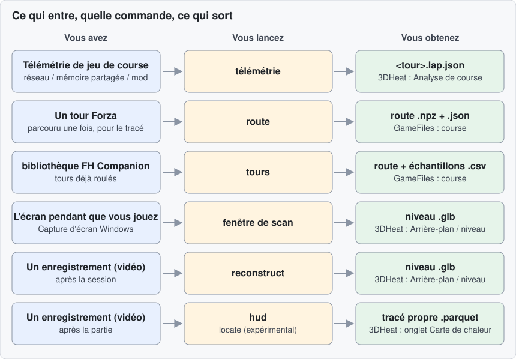

# 3DHeat GameCapture {#dheat-gamecapture}

**Qu'est-ce que c'est ?** Un outil qui consigne ce qu'un jeu de course lui dit de votre conduite, un fichier
par tour. Il peut aussi reconstruire un modèle 3D approximatif d'un niveau à partir d'une vidéo de vous en train de jouer.

**À quoi ça sert ?** À voir vos tours dans la [visionneuse 3DHeat](https://holdi601.github.io/3DHeat/) :
où vous avez freiné, où vous étiez lent, en quoi deux tours diffèrent. Et à avoir le niveau sous votre
carte de chaleur quand personne n'en possède de modèle 3D.

**Exemple :** activez le Data Out de Forza, lancez une commande, roulez deux tours. Deux fichiers de tour
apparaissent dans `laps\`. Déposez-les dans l'onglet Analyse de course de la visionneuse.


Vous débutez avec la ligne de commande ? Lisez d'abord [Avant de commencer](before-you-start.md).

## Les trois tâches {#the-three-jobs}

1. **Télémétrie de tour.** Il enregistre chaque canal qu'un jeu de course publie - le Data Out de Forza, la
   mémoire partagée des jeux Assetto Corsa, les flux réseau des jeux de rallye, un mod BeamNG, un
   plugin Trackmania - et écrit un fichier `heat3d-lap` par tour ou par étape, pour l'onglet Analyse de course de la
   visionneuse. iRacing n'a pas besoin d'enregistreur : la visionneuse lit ses propres fichiers `.ibt`.
2. **Des niveaux à partir du jeu.** Il transforme ce que l'écran a montré pendant que vous marchiez ou
   rouliez dans un niveau en un modèle 3D `.glb`, que la visionneuse place sous la carte de chaleur.
3. **Votre propre match, après coup.** `hud` lit le HUD de votre propre enregistrement - vos actions, vos morts,
   la trace de la minicarte et le journal des éliminations. `locate` (expérimental : il place encore peu d'images
   réelles) trouve où chaque image a été prise, sur le modèle 3D d'un niveau.

Les trois suivent une même règle : **rien n'est injecté dans un jeu et rien n'est accroché**. Les images viennent de
l'API publique de capture d'écran, la télémétrie d'interfaces que les jeux publient pour cela. Voir
[Les règles](rules.md).



Le code est en Python (paquet `heat3d_capture`), sous licence MIT. Les modèles de profondeur et de pose qu'il peut
exécuter ont leurs propres licences - voir [Modèles et licences](models-and-licences.md).

## Démarrage rapide {#quick-start}

### Enregistrer des tours {#record-laps}

Il vous faut Python 3.10 ou plus récent ([Avant de commencer](before-you-start.md)). Dans PowerShell :

```powershell
git clone https://github.com/Holdi601/3DHeat-GameCapture
cd 3DHeat-GameCapture
python -m venv .venv
.venv\Scripts\python -m pip install -r requirements.txt

# Forza : Réglages -> HUD et jeu -> Data Out = ON, IP 127.0.0.1, port 5300
.venv\Scripts\python -m heat3d_capture telemetry -o laps
```

**Vous devez voir** `listening on port 5300. Laps go to laps. Ctrl+C to stop.`, puis une ligne par tour à mesure que
vous franchissez la ligne d'arrivée, comme sur l'image ci-dessus. Appuyez sur Ctrl+C pour arrêter. Déposez les fichiers de
`laps\` dans l'onglet Analyse de course de la visionneuse. Chaque autre jeu ne demande qu'une option `--game` :

```powershell
.venv\Scripts\python -m heat3d_capture telemetry --game acc -o laps
.venv\Scripts\python -m heat3d_capture telemetry --game dirtrally2 -o laps
```

Voir [Enregistreurs de télémétrie](telemetry.md) pour chaque jeu et chaque option.

### Scanner un niveau {#scan-a-level}

Double-cliquez sur **`scan.bat`** dans le dossier de l'outil. Il trouve Python (et propose de l'installer
avec winget s'il n'y en a pas), crée un `.venv` privé, et ouvre la fenêtre de scan. La fenêtre indique ce qui
manque, à quoi sert chaque paquet et la taille du téléchargement, et n'installe rien sans un oui. Voir
[Exécution et dépendances](runtime.md) et [La fenêtre de scan](reconstruction-scan-ui.md).

À la main : `.venv\Scripts\python -m heat3d_capture.ui`.

Pour reconstruire un enregistrement hors ligne, avec la trajectoire de la caméra résolue d'un seul coup (nécessite PyTorch, le
paquet `vggt` et une carte graphique - voir [Reconstruction hors ligne](reconstruction-offline.md)) :

```powershell
.venv\Scripts\python -m heat3d_capture reconstruct lap.mp4 -o lap.glb
```

## Plan de la documentation {#map-of-the-documentation}

| Page | Ce qu'elle couvre |
|---|---|
| [Avant de commencer](before-you-start.md) | Python, un terminal, la première commande, erreurs courantes |
| [Les règles](rules.md) | Aucune injection, seulement les interfaces publiées, et ce que cela coûte |
| [Enregistreurs de télémétrie](telemetry.md) | La commande `telemetry` et un aperçu de chaque jeu |
| [Forza](telemetry-forza.md) | Data Out, détection de la disposition, le relais FH Companion et son `.tele.gz` |
| [Jeux Assetto Corsa](telemetry-assetto-corsa.md) | AC, ACC, AC EVO, AC Rally depuis la mémoire partagée |
| [Jeux de rallye](telemetry-rally.md) | EA SPORTS WRC, DiRT Rally 2.0 / 1 / DiRT 4, Richard Burns Rally |
| [BeamNG.drive](telemetry-beamng.md) | Le mod du protocole `heat3d` |
| [Trackmania](telemetry-trackmania.md) | Le plugin Openplanet `Heat3dRecorder` |
| [iRacing](telemetry-iracing.md) | Lecture des fichiers `.ibt` dans la visionneuse |
| [Découpage en tours et en étapes](lap-splitting.md) | `LapSplitter`, `CounterSplitter`, `LineSplitter`, `StageSplitter` |
| [Glissement, dérive et canaux dérivés](slip-and-drift.md) | Comment le glissement est mis à l'échelle, et ce que la visionneuse dérive |
| [Le fichier heat3d-lap](lap-format.md) | Le format du fichier de tour, les canaux, les unités, `meta` |
| [Jeux](games.md) | Par jeu : comment enregistrer, ce qui est envoyé, quels circuits peuvent être exportés |
| [Commandes](commands.md) | `route`, `telemetry`, `laps`, `reconstruct`, `hud`, `locate`, pas à pas |
| [Référence des commandes](../cli-reference.md) | chaque option, générée depuis `--help` |
| [Lire le HUD d'un enregistrement](hud-video.md) | `hud` : actions propres, morts, trace de la minicarte et journal des éliminations d'un enregistrement |
| [Localiser des images dans un niveau](locate.md) | `locate` : où chaque image a été prise, par rapport à la géométrie du niveau |
| [Reconstruction de niveau](reconstruction.md) | Le pipeline, des images jusqu'à un `.glb` |
| [La fenêtre de scan](reconstruction-scan-ui.md) | Chaque commande, raccourci et élément affiché |
| [Capture, masques et qualité des images](reconstruction-capture.md) | Windows Graphics Capture, images clés, masques du HUD, conseils de qualité |
| [Profondeur](reconstruction-depth.md) | Depth Anything V2, ONNX Runtime, construction du modèle |
| [Pose de la caméra et échelle](reconstruction-pose.md) | Odométrie, relocalisation, poses de télémétrie, échelle du sol, ajustement de faisceau |
| [Fusion, couverture et couleur](reconstruction-fusion-and-texture.md) | Le volume d'occupation, la grille de couverture, les points faibles, couleur par sommet |
| [La sortie .glb](glb-output.md) | Le fichier que charge la visionneuse |
| [Reconstruction hors ligne](reconstruction-offline.md) | `reconstruct`, fenêtres VGGT et raccordement |
| [Modèles et licences](models-and-licences.md) | Tailles de Depth Anything V2, VGGT, les paquets |
| [Exécution et dépendances](runtime.md) | Vérification préalable, moteurs de calcul, niveaux de performance |
| [Limites et vérifications](limits.md) | Ce qui n'est pas fait, et ce qui n'a pas été vérifié |
| [Mises à jour](updates.md) | La vérification des versions et `python -m heat3d_update` |
| [Développement](development.md) | Tests, l'environnement virtuel, organisation du dépôt |
| [Maintenir ces documents](maintaining.md) | La liste de contrôle des versions pour le code et la documentation |

## Partie de 3DHeat {#part-of-3dheat}

Les fichiers écrits ici sont chargés par la **visionneuse 3DHeat** -
[source](https://github.com/Holdi601/3DHeat), [documentation](https://holdi601.github.io/3DHeat/).
Les fichiers de tour vont dans son onglet Analyse de course, les niveaux `.glb` dans son panneau Arrière-plan / niveau, les tables de `hud` et de `locate`
dans son onglet Carte de chaleur ; la façon dont la visionneuse lit les tables et les fichiers de match est décrite dans
[Un fichier par match (.3dheat)](https://holdi601.github.io/3DHeat/container.html) et
[Charger des données](https://holdi601.github.io/3DHeat/getting-data-in.html).

| Outil | Ce qu'il fait | Documentation |
|---|---|---|
| [Visionneuse 3DHeat](https://github.com/Holdi601/3DHeat) | affiche les cartes de chaleur, les courses et les matchs en 3D, dans le navigateur | [documentation](https://holdi601.github.io/3DHeat/) |
| [GameFiles](https://github.com/Holdi601/3DHeat-GameFiles) | circuits et niveaux tirés des fichiers livrés par les jeux, en modèles 3D | [documentation](https://holdi601.github.io/3DHeat-GameFiles/) |
| [GameCapture](https://github.com/Holdi601/3DHeat-GameCapture) | télémétrie de tour des jeux de course ; niveaux reconstruits à partir de vidéos de jeu | [documentation](https://holdi601.github.io/3DHeat-GameCapture/) |
| [Unreal Exporter](https://github.com/Holdi601/3DHeat-UnrealExporter) | un plugin de l'éditeur Unreal qui exporte un niveau en modèle 3D | [documentation](https://holdi601.github.io/3DHeat-UnrealExporter/) |
| [CS2](https://github.com/Holdi601/3DHeat-CS2) | démos de Counter-Strike 2 en fichiers de match ; cartes en modèles 3D | [documentation](https://holdi601.github.io/3DHeat-CS2/) |
| [Watcher](https://github.com/Holdi601/3DHeat-Watcher) | enregistre votre jeu en arrière-plan à partir de ce que publient les jeux | [documentation](https://holdi601.github.io/3DHeat-Watcher/) |
| [Ext-WarThunder](https://github.com/Holdi601/3DHeat-Ext-WarThunder) | replays de War Thunder en fichiers de match | [documentation](https://holdi601.github.io/3DHeat-Ext-WarThunder/) |
| [Ext-WoT](https://github.com/Holdi601/3DHeat-Ext-WoT) | replays de World of Tanks en fichiers de match | [documentation](https://holdi601.github.io/3DHeat-Ext-WoT/) |
| [Ext-WoWs](https://github.com/Holdi601/3DHeat-Ext-WoWs) | replays de World of Warships en fichiers de match | [documentation](https://holdi601.github.io/3DHeat-Ext-WoWs/) |
| [Ext-Squad](https://github.com/Holdi601/3DHeat-Ext-Squad) | démos de serveurs Squad en fichiers de match | [documentation](https://holdi601.github.io/3DHeat-Ext-Squad/) |
| [Ext-DCS](https://github.com/Holdi601/3DHeat-Ext-DCS) | cartes de DCS World en modèles 3D | [documentation](https://holdi601.github.io/3DHeat-Ext-DCS/) |
| [Ext-IL2](https://github.com/Holdi601/3DHeat-Ext-IL2) | cartes d'IL-2 Sturmovik en modèles 3D | [documentation](https://holdi601.github.io/3DHeat-Ext-IL2/) |

Un développeur qui a le projet du jeu ouvert doit utiliser l'exporteur Unreal, qui lit la géométrie réelle
et donne un résultat exact. Quand les archives d'un jeu peuvent être lues, GameFiles extrait le circuit exact.
La reconstruction à partir du jeu sert au cas où seul l'écran est disponible.
