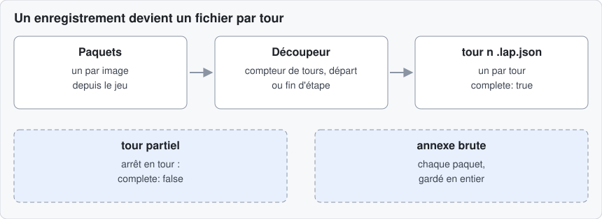

# Comment les tours et les étapes sont découpés {#how-laps-and-stages-are-split}

Un enregistreur voit un flux continu d'échantillons. Pour en faire des tours, on utilise l'un de quatre
découpeurs, choisi selon ce que le jeu dit des tours. Tous suivent la même idée : utiliser le compteur
du jeu lorsqu'il en existe un, et sinon retrouver le tour à partir des positions ; ne jamais écrire un
fragment trop court pour être comparé.

| Découpeur | Code | Utilisé par |
|---|---|---|
| `LapSplitter` | [`fulllap.py`](https://github.com/Holdi601/3DHeat-GameCapture/blob/main/heat3d_capture/telemetry/fulllap.py) | Forza |
| `CounterSplitter` | [`kunos.py`](https://github.com/Holdi601/3DHeat-GameCapture/blob/main/heat3d_capture/telemetry/kunos.py) | Assetto Corsa, ACC |
| `LineSplitter` | [`kunos.py`](https://github.com/Holdi601/3DHeat-GameCapture/blob/main/heat3d_capture/telemetry/kunos.py) | AC EVO, AC Rally, BeamNG |
| `StageSplitter` | [`rally.py`](https://github.com/Holdi601/3DHeat-GameCapture/blob/main/heat3d_capture/telemetry/rally.py) | EA SPORTS WRC, DiRT Rally 2.0, DiRT Rally, DiRT 4, Richard Burns Rally |

Trackmania découpe ses courses dans son plugin ([Trackmania](telemetry-trackmania.md)), et les fichiers
iRacing sont découpés par le visualiseur sur le compteur de tours du simulateur ([iRacing](telemetry-iracing.md)).

Lors d'un **Ctrl+C**, chaque enregistreur appelle `flush()` de son découpeur, de sorte qu'un tour ou une
étape ouvert est écrit s'il respecte les mêmes minimums que ci-dessous.

## LapSplitter (Forza) {#lapsplitter-forza}

Paramètres : `minimum_metres = 400`, `gap_seconds = 2.0`.

Pour chaque paquet décodé :

1. Si le `timestampMs` du jeu a sauté de plus de 2 secondes vers l'avant depuis le dernier paquet, ou
   a reculé, le tour ouvert est d'abord écrit.
2. Si `isRaceOn` vaut 0 (le jeu n'est pas en course), le tour ouvert est écrit et le paquet est
   ignoré.
3. Si aucun tour n'est ouvert, on en ouvre un avec le `lapNumber` du paquet.
4. Si `lapNumber` diffère de celui du tour ouvert, le tour ouvert est **fermé comme complet** ; son
   `seconds` est le `lastLap` du jeu lorsqu'il est positif. Un tour fermé ainsi est écrit quelle que soit
   sa longueur. Un nouveau tour s'ouvre.
5. Le paquet est ajouté.

L'enregistreur écrit aussi le tour ouvert lorsqu'aucun paquet n'est arrivé depuis 2 secondes de temps
réel (le jeu est en pause, ou fermé en pleine course).

**L'écriture** ne conserve le tour ouvert que s'il compte au moins 2 échantillons et au moins 400 m de
`distanceTravelled` ; il est écrit comme incomplet (une `run`). Une course point à point ne compte jamais
un second tour, elle se termine donc toujours ainsi.

## CounterSplitter (AC, ACC) {#countersplitter-ac-acc}

Paramètre : `minimum_metres = 300`. Reçoit pour chaque échantillon le `completedLaps` de la page graphique
et le temps du dernier tour.

- Le premier échantillon ouvre un tour numéroté avec le `completedLaps` en cours.
- Lorsque `completedLaps` change, le tour ouvert se ferme. Il est **complet**, avec
  `seconds = temps du dernier tour en ms / 1000` (s'il est positif), seulement si le compteur a augmenté
  exactement de 1 - un retour à 0 (redémarrage de la session) ou une hausse de plusieurs unités le ferme
  comme incomplet.
- Un tour fermé n'est écrit que s'il a des échantillons et au moins 300 m de trajet parcouru.
- L'écriture conserve le tour ouvert s'il compte plus d'un échantillon et au moins 300 m.

## LineSplitter (AC EVO, AC Rally, BeamNG) {#linesplitter-ac-evo-ac-rally-beamng}

Paramètres : `radius = 15 m`, `minimum_metres = 300`, `stop_seconds = 8`.

Ces jeux n'ont soit pas de compteur de tours sur une page que l'enregistreur lit, soit conduisent des
étapes. **La ligne est là où l'enregistrement a commencé** :

1. La position horizontale (`x`, `z`) du premier échantillon devient la ligne.
2. Une fois que la voiture a parcouru plus de 5 m, la direction de la ligne vers la voiture devient la
   direction du tour.
3. **S'arrêter** termine une course : lorsque `speed` reste sous 1 m/s pendant 8 secondes, le tour ouvert
   est écrit (c'est ainsi qu'une étape de rallye se termine : la voiture s'arrête à l'arrivée).
4. **Franchir la ligne** : après plus de 300 m parcourus, les échantillons situés à moins de 15 m de la
   ligne sont recueillis. Lorsque la voiture quitte à nouveau ce rayon, l'échantillon recueilli le plus
   proche est le franchissement. Si la voiture allait dans le même sens que la direction du tour à cet
   endroit (produit scalaire du cap local avec la direction positif), le tour se ferme sur cet
   échantillon ; sinon le passage est ignoré (la voiture a franchi le départ dans l'autre sens).
5. Le `seconds` d'un tour fermé est le temps entre son premier échantillon et le franchissement. Il est
   **complet seulement si son premier échantillon était plus rapide que 5 m/s** : un tour qui part de
   l'arrêt est un départ, pas un tour à comparer. Le premier tour d'un enregistrement commencé sur la
   grille est donc toujours incomplet ; un enregistrement commencé en tour lancé donne un premier tour
   complet au franchissement suivant.
6. Le tour suivant commence à l'échantillon de franchissement (il appartient aux deux tours).

Les tours de moins de 300 m sont écartés. L'écriture (un arrêt, ou Ctrl+C) conserve le tour ouvert s'il
compte au moins 2 échantillons et 300 m, comme incomplet. BeamNG écrit de la même façon lorsque le
véhicule est réinitialisé (son horloge recule), avant de démarrer un nouveau découpeur, de sorte que la
course effectuée avant la réinitialisation est conservée.

Les distances sont horizontales (`x`, `z`) pour le compteur de trajet et le test de la ligne, et en 3D
complète pour le test de longueur de 300 m.

## StageSplitter (jeux de rallye) {#stagesplitter-rally-games}

Paramètre : `minimum_metres = 300`. Reçoit pour chaque échantillon l'horloge d'étape du jeu, si le jeu
indique que la voiture a terminé, et éventuellement le temps du jeu pour cette étape.

1. Si l'horloge vaut 0 ou moins, ou a reculé de plus de 0,5 s, l'étape ouverte est **abandonnée** : elle
   est conservée comme étape partielle si elle n'est pas complète, compte plus de 10 échantillons et au
   moins 300 m. Une horloge à 0 ou moins écarte aussi l'échantillon (la voiture est au départ).
2. Si aucune étape n'est ouverte, une nouvelle s'ouvre (numérotée 1, 2, ... pour l'enregistrement).
3. Une fois une étape complète, les échantillons suivants sont ignorés jusqu'à ce que l'horloge recule.
4. Chaque échantillon est stocké avec `time` égal à l'horloge d'étape.
5. Lorsque le jeu indique l'arrivée, l'étape est complète ; son `seconds` est le temps du jeu lorsqu'il
   est donné et positif, sinon l'horloge. Elle est écrite si elle couvre au moins 300 m.

Ce que signifie « arrivée » selon le jeu :

| Jeu | Arrivée lorsque |
|---|---|
| EA SPORTS WRC | longueur d'étape > 0 et distance d'étape >= longueur - 0,5 m |
| Jeux DiRT | le nombre de tours effectués dépasse le nombre de départ de l'étape, ou (événement à un seul tour) la distance du tour >= 99,9 % de la longueur du circuit |
| Richard Burns Rally | horloge de course > 0 et distance jusqu'à l'arrivée <= 0 |

Pour RBR, l'axe vertical et la vitesse sont fixés au moment où une étape est écrite (voir
[Jeux de rallye](telemetry-rally.md#richard-burns-rally-rsf--ngp)).

## Temps et distance dans le fichier de tour {#time-and-distance-in-the-lap-file}

Pour tous les enregistreurs sauf Forza, `time` est recalé pour que le premier échantillon du tour vaille
0, et `distance` est la distance 3D cumulée entre positions consécutives. Forza utilise le propre
chronomètre et le compteur de distance du jeu, recalés de la même façon.
