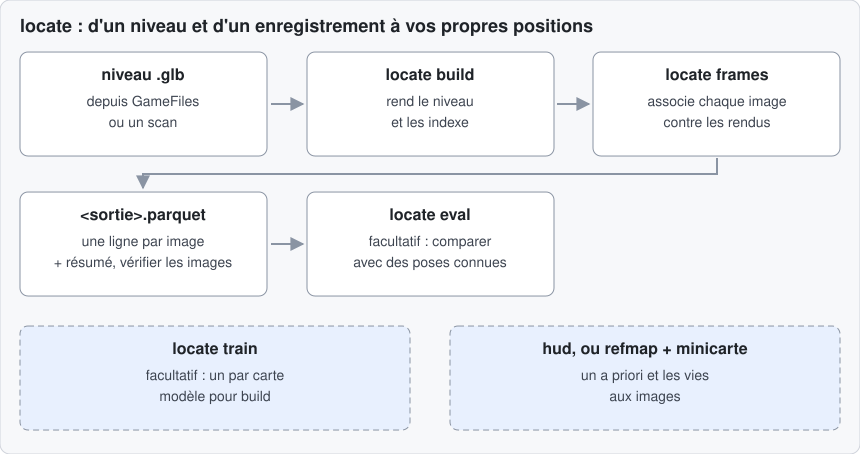

# Localiser les images dans un niveau

`locate` détermine où a été prise chaque image d'un enregistrement de jeu - la position 3D de la caméra et sa direction de
regard - en comparant l'image aux rendus de la géométrie propre au niveau. C'est fait pour les jeux qui ne gardent aucune trace
de l'endroit où était le joueur : ni démo, ni fichier de replay, ni télémétrie. Battlefield 6 est le premier.

> **Expérimental.** Sur de vrais enregistrements, il ne place pour l'instant qu'une faible part des images ; voir
> [Images réelles : expérimental](#real-frames-experimental).

```bash
# Once per level: render it from every place a player can stand, and index the renders.
.venv\Scripts\python -m heat3d_capture locate build level.glb -o level.db

# Per recording: where was each frame taken?
.venv\Scripts\python -m heat3d_capture locate frames "<recording>.mp4" --db level.db -o out/match
```

La position vient **de l'image**, par rapport à l'ensemble du niveau, sans aucun a priori. La piste de mini-carte de
[le lecteur de HUD](hud-video.md) ne sert que de solution de secours pour les images que l'image seule ne peut pas placer,
et chaque ligne indique laquelle des deux sources l'a fournie.




## Ce qu'il touche et ce qu'il ne touche pas

- Il lit l'**enregistrement propre** du joueur et un fichier de niveau que le joueur a exporté depuis sa **propre copie** du
  jeu. Il ne touche jamais au jeu, à sa mémoire, à ses fichiers pendant son exécution, ni à son réseau, et il s'exécute après la
  partie. Voir [Les règles](rules.md).
- Il ne place **que la caméra propre du joueur** : l'image est la vue propre du joueur.
- Le niveau, la base de données qui en est tirée et tout ce qui est rendu à partir de lui appartiennent à l'éditeur du jeu.
  Gardez-les en local.

## Prérequis

- Ce que liste `requirements.txt`, PyTorch (depuis pytorch.org, pour le GPU), et `requirements-locate.txt` :

```bash
.venv\Scripts\python -m pip install -r requirements-locate.txt
```

- Un GPU avec OpenGL 3.3 (4.3 est plus rapide) pour les rendus, et de préférence CUDA pour les modèles. Sur un CPU cela
  fonctionne, mais lentement.
- Les modèles sont téléchargés à la première utilisation (environ 450 Mo) : DINOv2 depuis Hugging Face, ALIKED et LightGlue
  via kornia. Tous sont sous licences autorisant l'usage commercial ; voir [Licences](#licences).
- Le **niveau** au format `.glb` (ou `.gltf`) dans le repère du visualiseur, Y vers le haut, **avec ses textures de couleur de
  base**, tel que les exportateurs 3DHeat l'écrivent (pièces `ground:` / `structure:` ; les noms des pièces ne sont pas
  nécessaires). Une unité vaut un mètre, sauf si le `extras.unit_metres` de premier niveau du fichier indique autre chose. Un
  scan GameCapture (`reconstruct`, la fenêtre de scan) est écrit en **centimètres** et porte `extras.unit_metres: 0.01`, donc il
  est lu à sa vraie taille. Un niveau sans textures fonctionne beaucoup moins bien ; voir [Limites](#limits).

## Commandes

### `locate build <level> -o <db>`

Rend le niveau depuis chaque endroit où un joueur pourrait se tenir, et garde pour chaque rendu sa pose et un descripteur
global.

| Option | Défaut | Signification |
|---|---|---|
| `level` | | Le `.glb` / `.gltf` du niveau. |
| `-o`, `--out` | | Le dossier de la base de données à écrire. |
| `--game` | `bf6` | Le profil de jeu : hauteurs des yeux, champ de vision, boîtes du HUD, vitesse (ci-dessous). `generic` pour toute vue à la première personne. |
| `--eye` | celui du profil | Hauteurs des yeux au-dessus du sol en mètres, debout d'abord. Une vue de base de données par hauteur. |
| `--fov` / `--vfov` | celui du profil | Le champ de vision horizontal de l'enregistrement, ou le vertical (le curseur de Battlefield) pour un enregistrement en 16:9. |
| `--spacing` | 2,5 | Mètres entre les endroits où les vues sont prises. |
| `--yaw-step` | 30 | Degrés entre les directions des vues. |
| `--pitch` | 0 | Inclinaisons à rendre, en degrés vers le haut. |
| `--positions` | aucun | Un tableau (Parquet ou CSV avec `x`, `y`, `z` au niveau des pieds, dans le repère du niveau) où prendre les endroits au lieu de chaque sol : la sortie d'une exécution précédente, par exemple. |
| `--shadows` | désactivé | Projeter les ombres du soleil dans les rendus (le soleil propre au niveau quand son fichier le nomme dans `extras.sun`). |
| `--untextured` | désactivé | Ne rendre que la forme et la lumière. |
| `--box X0 Z0 X1 Z1` | le fichier entier | Seulement les endroits à l'intérieur de cette boîte (unités du niveau) : la zone de jeu. |
| `--places` | `auto` | D'où sont prises les vues : `nav` - joueurs à hauteur des yeux sur le maillage de navigation du niveau (pièces `nav:` : exactement là où le jeu laisse marcher), caméras de véhicule à leur hauteur au-dessus des pièces `ground:` (terrain et routes) à moins de 50 m ; `ground` - les deux au-dessus de `ground:` ; `floors` - au-dessus de chaque face orientée vers le haut (toits et caisses compris) ; `auto` - `nav` quand le niveau a un maillage de navigation, sinon `floors`. |
| `--head` | aucun | Une tête propre à la carte, issue de `locate train`, pour les descripteurs. |

Écrit `<db>/db.json` (ce à partir de quoi et avec quoi elle a été construite) et `<db>/views.npz` (poses, descripteurs).

### `locate frames <recording> --db <db>`

| Option | Défaut | Signification |
|---|---|---|
| `source` | | Une vidéo, une image, ou un dossier d'images (prises dans l'ordre des noms, espacées de `--fps`). |
| `--db` | | La base de données écrite par `build`. Son fichier de niveau doit toujours être à son emplacement (ou `--level`). |
| `-o`, `--out` | `<source>.locate` | Chemin de sortie sans extension. |
| `--fps` | 2 | Images localisées par seconde de vidéo. |
| `--start`, `--seconds` | tout | La partie de la vidéo à lire. |
| `--width` | 1280 | La largeur à laquelle les images sont comparées. |
| `--shortlist` | 8 | Vues de la base de données essayées par image près d'un a priori ou d'une position fixée. |
| `--search-shortlist` | 16 | Sans a priori : vues de la base de données essayées par image ([cherchées ensemble](#with-no-prior-frames-searched-together)). |
| `--no-search` | désactivé | Sans a priori : chercher chaque image seule et croire sa position sans ses voisines. |
| `--accept-depth` | 0 (désactivé) | Sans a priori : ne croire une position que si la distance lointaine de ses correspondances est ce nombre de fois leur distance proche. |
| `--accept-support` | 2 | Sans a priori : voisines en accord le long de la vie qu'il faut à une position pour être crue. |
| `--checkpoint` | aucun | Garder ici l'état de l'exécution et reprendre à partir de lui s'il existe. |
| `--stop-file`, `--stop-process` | aucun | S'arrêter tout seul, état sauvegardé, avec le code de sortie 75, quand ce fichier existe ou qu'un processus dont le nom commence par ceci tourne (vérifié avant chaque image ; peut être répété), pour qu'une longue exécution libère la machine pour un jeu. La même commande reprend ensuite. |
| `--normalise` | aucun | Normalisation légère avant la comparaison : `clahe`, `gray`. |
| `--minimap` | aucun | La table de la commande `hud` : la **solution de secours** pour les images que l'image seule ne peut pas placer. |
| `--prior-radius` | aucun | **Accélération facultative**, désactivée par défaut : ne chercher que les vues de la base de données à ce nombre de mètres de la position de la mini-carte (nécessite `--minimap`). |
| `--minimap-anchor` | aucun | Un fichier JSON qui relie la mini-carte au niveau ([la mini-carte comme a priori de recherche](#the-minimap-as-a-search-prior)) : la mini-carte réduit la recherche dès la première image ; les positions ainsi trouvées sont `visual+minimap-prior`. |
| `--no-level-search` | désactivé | Avec un a priori : quand rien de proche ne correspond, ne pas chercher aussi dans tout le niveau (plus rapide). |
| `--lives` | la table de `--minimap` | La table de la commande `hud` dont les morts, déploiements et réanimations indiquent quand le joueur était en jeu : les positions ne sautent qu'à travers une mort ([les vies depuis la vidéo](#lives-from-the-footage)). |
| `--no-sequence` | désactivé | Décider chaque image seule, et non le long de l'exécution (ci-dessous). |
| `--fit-fov` | désactivé | Après l'exécution, ajuster le champ de vision sur les positions les plus sûres, par vue, et l'indiquer. |
| `--check-every` | 0 | Aussi toutes les N images, placées ou non, une image dans `<out>.check`. |
| `--no-checks` | désactivé | Ne pas écrire les images de contrôle des positions visuelles (ci-dessous). |
| `--no-zoomed` | désactivé | Ne pas résoudre les vues zoomées à partir des positions de leurs voisines (ci-dessous). |
| `--no-grow` | désactivé | Ne pas chercher à nouveau, près de chaque position, les images autour qui n'en ont toujours pas. |
| `--game`, `--eye`, `--fov`, `--vfov`, `--mask`, `--no-hud-mask`, `--max-speed` | ceux du profil | Comme ci-dessus ; `--mask x,y,w,h` ajoute une zone d'écran (sur un écran 1920x1080) qui ne fait pas partie du niveau. |
| `--vehicle-vfov` | celui du profil | Le champ de vision vertical des caméras de véhicule (le curseur de véhicule de Battlefield). |
| `--settings` | le fichier de réglages le plus récent | `bf6` : le fichier de réglages du jeu d'où sont lus les champs de vision (en lecture seule) quand aucun `--fov`/`--vfov` n'est donné ; par défaut le `PROFSAVE*_profile` le plus récent sous `Documents/Battlefield 6/settings`. Il contient les réglages tels qu'ils sont maintenant, qui peuvent ne pas être ceux d'un enregistrement plus ancien. |

### `locate refmap <level> <deploy screen> -o <refmap>`

Place la carte du jeu elle-même sur le niveau : la référence à laquelle la mini-carte est lue
([la mini-carte, lue sur le niveau](#the-minimap-read-against-the-level)). `<deploy screen>` est une image de l'écran de
déploiement montrant toute la carte, ou un enregistrement avec `--at <seconds>` à un tel moment ; le cadre de carte du profil
est découpé dedans (`--whole-picture` garde tout). Écrit `<refmap>.png` (la carte rééchantillonnée dans le repère propre du
niveau, `--mpp` mètres par pixel, 0,5 par défaut), `<refmap>.valid.png` (là où c'est la carte, et non un marqueur ou une étiquette)
et `<refmap>.json` (le repère et l'étalonnage, avec l'écart des tuiles de la carte par rapport à lui). `--topdown <prefix>` garde le
niveau rendu d'en haut pour la prochaine exécution (`--topdown-mpp`, 0,656 m par défaut ; `--box` limite).

### `locate minimap <recording> --refmap <refmap> -o <table>.parquet`

Lit la mini-carte de l'enregistrement par rapport à la carte de référence, image par image (`--fps`, 2 par défaut) : position,
cap et zoom de chaque mini-carte qui correspond, dans le repère du niveau, écrits comme une table de mini-carte avec une ancre à
côté (`<table>.anchor.json`) que `locate frames` prend avec `--minimap <table>.parquet --minimap-anchor <table>.anchor.json`. Avec
la table de la commande `hud` (`--hud`), ses vies sont reprises ; avec une ancre pour cette table aussi (`--hud-anchor`), la
première recherche se fait autour de l'endroit où elle place le joueur, et là où aucune mini-carte ne correspond, la piste propre
au HUD comble le vide, déplacée sur les positions de la carte de référence les plus proches (`--hud-fill`, en secondes, 120 par
défaut ; 0 le désactive). La source de la table, `source`, indique laquelle (`refmap`, `hud`).

### `locate eval <out>.parquet --truth <poses>`

Compare un résultat à des poses de caméra connues : une table de `time`, `x`, `y`, `z` (l'œil), `yaw`, `pitch` dans le repère du
niveau. `--offset` est le décalage d'horloge (temps de la vérité = temps de la vidéo + décalage) ; sans lui, le décalage est
cherché. `--unit-metres` convertit les erreurs en mètres.

## Profils de jeu

| | `bf6` | `generic` |
|---|---|---|
| Hauteurs des yeux | 1,6 m debout, 1,05 m accroupi (pas encore mesuré dans le jeu) | 1,65, 1,1 m |
| Champ de vision | 55 degrés verticaux, environ 86 horizontaux en 16:9 : **donner celui du joueur** avec `--vfov` | 90 horizontaux |
| HUD masqué | mini-carte et liste d'escouade, fil des éliminations, boussole, munitions, arme du joueur, fenêtres, réticule | le réticule |
| Le plus rapide à pied | 8 m/s | 8 m/s |
| Vues distinguées | à pied, en véhicule, zoomé (ci-dessous) | chaque image à pied |
| Caméras de véhicule | le curseur de véhicule (depuis le fichier de réglages), le véhicule masqué, la caméra jusqu'à 8 m au-dessus du sol, 30 m/s | - |

Le champ de vision compte plus que tout : une image résolue avec le mauvais champ de vision l'est avec la mauvaise distance
focale, et sa position glisse le long de la vue.

## Sorties

### `<out>.parquet`

Une ligne par image localisée, dans le **repère du niveau** (Y vers le haut, les unités du niveau), avec les instructions de
lecture du visualiseur dans le pied de page (`kind: heat3d-locate`). Le pied de page nomme chaque colonne qui n'a pas de rôle
propre comme une colonne supplémentaire, pour que le visualiseur les garde toutes (sa fiche d'inspection les affiche).

| Colonne | Signification |
|---|---|
| `time` | Secondes depuis le début de la vidéo. |
| `event` | `start` sur la première ligne d'une vie, `position` sur les autres. |
| `x`, `y`, `z` | L'œil, lissé à l'intérieur de la vie. Vide là où aucune des deux sources n'a placé l'image. |
| `yaw`, `pitch` | Degrés : lacet autour de l'axe vertical (0 le long de +X, croissant vers -Z, ce qui est le lacet propre au jeu dans le repère du visualiseur), tangage vers le haut à partir de l'horizontale. `pitch` est vide sur les lignes de mini-carte. |
| `dir_x`, `dir_y`, `dir_z` | Le vecteur de direction de la vue. |
| `player`, `team`, `session` | `me`, `own`, et `<video>#NN`, une par vie. |
| `life` | La vie dans laquelle les images montrent la trame (d'après les morts du HUD ; 1 = la première). Vide quand hors jeu (mort, à terre, en déploiement) ou quand les vies n'ont pas été lues. `session` est la vie de la piste, qui peut aussi se couper à un saut. |
| `source` | `visual` (d'après l'image), `visual+minimap-prior` (d'après l'image, la recherche réduite à l'a priori de la mini-carte), `minimap` (la solution de secours), `minimap+nav-floor` (à l'intérieur : la mini-carte et le sol du maillage de navigation) ou `none`. |
| `view` | `foot`, `vehicle`, `zoomed` ou `screen` (ci-dessous). |
| `cam_x`, `cam_y`, `cam_z` | La caméra qui a vu l'image. À pied et à travers une visée, c'est l'œil, et `x`, `y`, `z` sont identiques ; dans la vue à la troisième personne d'un véhicule, `x`, `y`, `z` sont le véhicule (le modèle de décalage ci-dessous) et la caméra se tient derrière et au-dessus de lui. |
| `hfov`, `zoom` | Le champ de vision horizontal avec lequel l'image a été résolue, et pour une vue zoomée son zoom par rapport à la vue normale. |
| `confidence` | 0..1 : à quel point faire confiance à la ligne (ci-dessous). |
| `uncertainty` | L'erreur typique de la ligne, en unités du niveau : pour une position visuelle, d'après ses points d'accord et ses voisines ; pour une ligne de mini-carte, d'après l'ajustement (ci-dessous). |
| `inliers`, `rmse` | Les points d'accord PnP de la résolution visuelle et son erreur de reprojection (pixels à la largeur de travail). |
| `x_raw` ... `pitch_raw` | La résolution visuelle avant lissage (aussi pour les valeurs aberrantes écartées par le vote). |
| `kept` | La position visuelle a survécu au vote des valeurs aberrantes. |
| `note` | Pourquoi une image n'a pas été placée, ou a été écartée par le vote. |

### `<out>.summary.json`

Images, positions visuelles, valeurs aberrantes, vies, lignes par source, l'ajustement de la mini-carte (paires, points
d'accord, résidu), temps par image.

## Méthode

### La base de données

Les endroits sont des points posés sur chaque triangle orienté vers le haut du niveau, répartis uniformément (un par `--spacing`
sur une grille 3D, de sorte que chaque étage d'un bâtiment en reçoit). Chacun est contrôlé depuis son œil avec six petits rendus de
profondeur : une caméra à l'intérieur de la géométrie ne voit surtout que des faces arrière, un vide sous un toit a quelque chose de
solide au-dessus de l'œil ; les deux sont écartés. Depuis chaque endroit, le niveau est rendu à chaque hauteur d'œil, à chaque
`--yaw-step` et à chaque `--pitch`, et chaque rendu est décrit par **DINOv2** (ses jetons de patch mis en commun par moyenne
généralisée, joints au jeton de classe).

Les caractéristiques locales et les points 3D auxquels une image est finalement résolue **ne sont pas stockés** : ils sont refaits
au besoin en rendant les quelques vues retenues par la recherche, ce qui prend des millisecondes. Une base de données ne pèse ainsi que
quelques centaines de mégaoctets plutôt que des dizaines de gigaoctets, et c'est ce qui permet l'affinage ci-dessous. Le prix : `frames`
a besoin du fichier de niveau et d'un GPU, pas seulement de la base de données.

### Une image

1. **Masquer** ce qui n'est pas le niveau : les boîtes du HUD du profil et le réticule, plus tout `--mask`.
2. **Recherche** sur **tout le niveau** : le descripteur global de l'image contre chaque vue de la base de données ; les quelques dizaines
   les plus semblables, éclaircies pour qu'elles couvrent des endroits et des directions différents, forment la liste courte.
3. **Appariement** : chaque vue de la liste courte est rendue de nouveau à la taille et au champ de vision de l'image, avec sa profondeur.
   Les points-clés ALIKED de l'image et du rendu sont appariés avec LightGlue. Un pixel du rendu apparié, plus sa profondeur, est un point
   3D du niveau ; chaque appariement est donc une correspondance 2D-3D ; les points-clés sur un bord de profondeur (dont la profondeur peut
   appartenir à ce qui se trouve derrière eux) sont écartés.
4. **Pose** : PnP avec RANSAC (SQPnP), puis un affinage robuste qui garde la caméra à l'horizontale - une vue à la première personne ne roule
   pas - et minimise l'erreur de reprojection des points d'accord.
5. **Est-ce possible ?** Une pose doit être à la hauteur des yeux d'un joueur au-dessus d'un sol et hors de la géométrie (un rendu de profondeur
   tout droit vers le bas). Une texture sosie ailleurs - un sol carrelé apparié à un mur du même matériau - peut donner des centaines de points
   d'accord à une pose qu'aucun joueur ne pourrait occuper ; celles-ci sont mises de côté, quel que soit leur nombre de points.
6. **Rendre et comparer** : le niveau est rendu à la pose résolue et apparié de nouveau, ce qui remplace une vue de la base de données située à
   quelques mètres et à quelques dizaines de degrés par une vue qui coïncide presque avec l'image. Répété tant qu'il gagne des points d'accord
   (au plus deux fois).
7. **Choix** : les trois endroits les plus forts (à plus d'environ 3 m les uns des autres) sont chacun affinés avant qu'on en choisisse un. Un
   sosie peut mener avant l'affinage ; le bon endroit gagne bien davantage à l'affinage.
8. **Verdict** : `confidence` combine le nombre de points d'accord, le meilleur autre endroit (`runner_up`) et l'erreur de reprojection. Une
   position est `ok` avec au moins 25 points d'accord, aucun autre endroit à plus de 80 % de ses points, et une confiance d'au moins 0,85 - le
   seuil que les mesures ci-dessous placent à 97,5-99 % de bonnes réponses.

### Les vues

Une image n'est pas toujours les yeux du joueur. Le détecteur du profil lit de quelle vue il s'agit d'après le HUD, et l'image est résolue en
conséquence :

- **À pied** : le champ de vision de l'infanterie et les hauteurs d'yeux.
- **Véhicule** (Battlefield 6 : les touches du schéma de siège, `C CAMERA` et `E EXIT`, en bas au centre) : le champ de vision du véhicule, le
  véhicule lui-même masqué (le milieu bas de l'écran dans sa vue à la troisième personne), et une caméra autorisée jusqu'à 8 m au-dessus du sol.
  La position est celle de la caméra.
- **Écran** (bords sombres autour d'un milieu sombre : la carte de déploiement, un menu, le tableau des scores) : pas une vue du niveau ; ignoré.
- **Zoomé** (une visée, un viseur de mitrailleur, la vue à la première personne d'un véhicule : un bord de l'écran noir, les deux sombres, autour
  d'une image claire) : pas cherché sur le niveau - la mince tranche d'un niveau vue par une visée ne ressemble à aucune vue large de la base -
  mais résolu après l'exécution à partir de la position la plus proche dans les 6 s, ci-dessous. Désactivé avec `--no-zoomed`.

### Les vues zoomées

Une vue étroite fixe mal la position : un pas en arrière avec un peu plus de zoom ressemble presque à la même chose. Une image zoomée part donc de
l'endroit où sa voisine place la visée - à pied, l'œil de cette position, en véhicule 2,5 m au-dessus du sol sous le milieu du véhicule (la visée
d'une tourelle) - et de la distance qu'elle a pu parcourir depuis : 2 m, plus 4 m par seconde à pied ou 8 en véhicule, au plus 12 m (`reach`).

1. **Direction et zoom, la position maintenue.** Pour chaque zoom de 1, 1,2 (la vue propre d'un véhicule, plus étroite qu'à pied), 1,5, 2, 3, 4, 6 et 8,
   le niveau est rendu depuis la visée dans des directions à moins de 30 degrés de celle de la voisine (et, à partir de 3x, quelques inclinaisons). Les
   points-clés de l'image appariés à un rendu, avec les points du niveau sous eux, sont des rayons depuis la visée ; une rotation est ajustée sur eux
   deux à deux (RANSAC) pour des distances focales de 0,75 à 1,3 fois celle de ce zoom, un point s'accordant dans un angle qui tient compte du fait que la
   visée peut être décalée de `reach` à cette distance. Le zoom, la direction et la distance focale que le plus de points partagent l'emportent.
2. **Stabilisé.** Ces points ajustent alors ensemble la position, la direction et la distance focale, par leur erreur de reprojection, la position étant
   retenue à la visée par un coût de deux pixels par `reach` de déplacement ; rendu encore une fois à la réponse, puis ajusté de nouveau. Les points
   d'accord et l'erreur sont comptés en pixels, et la position est `ok` selon la même confiance que toute autre.

Le zoom écrit (`zoom`) se rapporte au champ de vision de l'exécution à pied ; `hfov` est celui qui a été résolu. En véhicule, la position écrite est celle du
véhicule, 2,5 m sous la visée, comme pour sa vue à la troisième personne.

### Véhicules : la caméra et le véhicule

Dans la vue à la troisième personne d'un véhicule, la pose résolue est celle de la caméra-poursuite, qui se tient derrière et au-dessus du véhicule et pivote
autour de lui quand le joueur regarde autour. La position écrite (`x`, `y`, `z`) est celle du véhicule - le sol sous son milieu : la caméra plus le
`vehicle_offset` du profil, donc tant de mètres devant, le long de la direction horizontale de la caméra, et tant de mètres plus bas. La caméra reste dans
`cam_x`, `cam_y`, `cam_z`. La conversion est faite avant la séquence et la piste, de sorte qu'une caméra qui pivote autour d'un véhicule à l'arrêt n'est pas
prise pour un mouvement. Le pied de page de la table porte le décalage utilisé et indique s'il a été mesuré (`vehicleOffset`). À pied et à travers une visée, il
n'y a aucun décalage.

Comment le décalage de Battlefield 6 a été mesuré : sur des positions justes d'images réelles à la troisième personne d'un char, le milieu du char a été repéré
à l'œil sur l'image, et le niveau rendu à la position donne le sol à ce pixel. Le profil prend la médiane : environ 10 m devant la caméra et 4 m en dessous. Le
repérage est précis à un mètre près environ, et il ne vaut que pour un type de véhicule : une voiture ou un hélicoptère ne suit pas sa caméra de la même façon.

### Sans a priori : images cherchées ensemble {#with-no-prior-frames-searched-together}

Le descripteur global d'une image sur un niveau entier est un signal faible, et les points d'accord d'une seule image ne distinguent pas un bon endroit d'un
sosie. Sans a priori, les images d'un enregistrement sont donc d'abord décrites et cherchées ensemble (`search.py`), et une position n'est crue qu'avec les images
qui l'entourent :

- **Liste courte.** Les similarités de chaque vue sont mesurées par rapport à sa propre moyenne et à son écart sur l'enregistrement, pour qu'une vue qui ressemble à
  toutes les images cesse de gagner partout. Chaque image attribue un score aux cellules d'une grille de 24 m d'après le rang de sa meilleure vue ; le meilleur chemin à
  travers les cellules le long de chaque vie, dans ce que le joueur peut couvrir entre deux images, donne une croyance par cellule, et la meilleure vue de chaque cellule,
  la plus crue en premier, forme une seule liste. La recherche simple est l'autre, et les deux sont prises à tour de rôle : mesurer les vues par rapport à l'enregistrement
  pénalise un endroit que le joueur quitte à peine, et c'est là que la recherche simple réussit bien.
- **Croire.** Un candidat ne compte que si ses points d'accord couvrent au moins 12 % d'une grille de 8 x 8 sur l'image : un sosie est un objet répété, une pile de
  conteneurs, avec des centaines de points d'accord sur quelques cellules de l'image. Une position est crue quand elle se trouve sur le meilleur chemin à travers les
  candidats qui comptent (ci-dessous) avec au moins deux voisines dans les 6 s qui s'accordent avec elle. Une image hors jeu n'est pas du tout cherchée.
- **Croître.** Seul ce qui est cru sert à croître, et une position qui croît doit couvrir l'image de la même façon.

### Le long de l'exécution

Chaque image garde chaque pose physiquement possible qu'elle a trouvée, une par endroit (`candidates`), et non seulement la plus forte. L'exécution choisit ensuite une
pose par image - ou aucune - de sorte que les poses choisies forment un chemin qu'un joueur aurait pu parcourir à pied ou en véhicule, et que le plus grand nombre de
points d'accord se trouvent sur ce chemin : un modèle de Markov caché, décodé d'un seul coup (Viterbi). Un sosie qui gagne une image seul perd face à l'endroit que ses
voisines confirment ; un candidat faible que le chemin traverse, avec au moins deux voisines qui s'accordent, devient une position (`note` : `chosen along the sequence`) ; une
position confiante que toutes ses voisines contredisent cesse d'en être une. Une voisine ne compte comme concordante que dans les 6 s : au-delà, la distance qu'un joueur - et
plus encore un véhicule - aurait pu parcourir est si grande que l'accord ne dit rien. Désactivé avec `--no-sequence`.

### Temps des images

Le `time` d'une ligne est l'horodatage propre de l'image dans l'enregistrement, et non son nombre au débit nominal. Les enregistrements dérivent de leur débit nominal (de
quelques dixièmes de seconde à l'intérieur d'un clip, sur ceux qui ont été mesurés), et tout ce qui relit une image par son temps - les images de contrôle, l'affinage des
vues zoomées, `locate train --real`, la mini-carte de la commande `hud` - se déplace par horodatage. Compter les images placerait l'image de contrôle jusqu'à cette distance
de celle localisée.

### Le champ de vision, à partir des images

`--fit-fov` garde les positions les plus sûres d'une exécution (par vue) et affine la pose et la distance focale de chacune ensemble sur ses points d'accord ; la médiane sur
elles est le champ de vision avec lequel l'enregistrement a été fait, indiqué dans le résumé (`hfov_fitted`) pour le `--fov` de la prochaine exécution. Les points proches et
lointains ne bougent pas de la même façon sous un changement de distance focale que sous un changement de position, et c'est ce qui le fixe ; il faut des positions qui ont de la
profondeur, et non un mur plat.

### Un modèle propre à la carte

`locate train` entraîne une petite tête par-dessus DINOv2 pour un niveau, sur des rendus de celui-ci, pour que le descripteur global trouve les bonnes vues d'images réelles
plutôt que celles des seuls rendus :

- **Tête** : chaque jeton de patch passe par une projection à deux couches, mis en commun par moyenne généralisée sur les patchs qui montrent le niveau, joint au jeton de
  classe projeté. DINOv2 reste figé. Tout est écrit ici (MIT).
- **Paires** : un endroit sur le sol praticable et une direction, rendus deux fois depuis des poses séparées de un à deux mètres et d'une douzaine de degrés, à des champs de
  vision séparés de jusqu'à 10 degrés, sous un éclairage différent (soleil, ombres, ambiance), chacun passé par un rendu proche du jeu : étalonnage des couleurs, brume selon la
  profondeur, bloom, vignettage, fumée, personnes sur le chemin, le véhicule du joueur dans les vues de véhicule, flou de mouvement, bruit, JPEG (`augment.py`). Masqué comme une
  image. Les endroits à quelques mètres les uns des autres face au même sens ne sont pas comptés comme négatifs.
- **Images réelles** : des images dont la pose a été trouvée par le pipeline lui-même (pseudo-étiquettes : positions choisies le long d'une séquence) peuvent entrer comme paires -
  l'image et un rendu à sa pose - dans un second tour.
- **Perte** : contrastive (InfoNCE) sur le lot.

`locate build --head <head.pt>` construit la base de données avec elle ; `frames` s'en sert ensuite pour les images.

| Option de `locate train` | Défaut | Signification |
|---|---|---|
| `-o`, `--out` | obligatoire | Le fichier de tête à écrire (`.pt`). |
| `--steps` | 600 | Pas d'entraînement. |
| `--real TABLE VIDEO` | aucun | Une table de `locate frames` et son enregistrement : ses positions sûres entrent comme paires réelles. Répétable. |
| `--real-confidence` | 0.85 | La confiance qu'une position doit avoir pour entrer comme paire réelle. |
| `--spacing`, `--box`, `--places`, et les options du profil | comme `build` | Où sont les endroits d'entraînement, et le profil du jeu. |

### Contrôle à l'œil

Chaque position visuelle reçoit une image dans `<out>.check` - `<time>s_<view>_visual.jpg` : l'image, et à côté le niveau rendu à la caméra de la position
avec les bords de l'image dessinés par-dessus le rendu. Quand ils s'alignent, la position est juste. Écrit après que la séquence et la piste ont tranché, de sorte que
les images sont exactement les lignes que la table appelle visuelles. Désactivé avec `--no-checks`.

### La mini-carte, lue sur le niveau {#the-minimap-read-against-the-level}

Une mini-carte assemblée en une mosaïque (celle de la commande `hud`) n'est pas plane : son échelle dérive avec le zoom auquel chaque mini-carte a été recalée, un endroit vu
deux fois peut être dessiné deux fois, et la mosaïque de chaque clip lui est propre. Une similitude ajustée sur quelques positions tient alors près d'elles et est à des dizaines
de mètres d'elles ailleurs. Donc la mini-carte est placée par le niveau lui-même, en deux étapes, et rien n'est assemblé :

- **La carte de référence** (`locate refmap`). L'écran de déploiement dessine la carte entière orientée au nord, à plat, à une seule échelle. Le niveau rendu depuis le
  dessus montre les mêmes choses dressées depuis le sol (chars, bâtiments, murs) : sur le niveau, leur hauteur au-dessus du sol dans un rayon de 15 m ; sur la carte, ce qui est
  dessiné plus clair que le sol qui l'entoure. La carte est posée sur le niveau par corrélation croisée normalisée des deux, sur l'échelle et une petite rotation, affinée en
  comparant ses tuiles une à une, et enfin par toute la carte à la fois autour de cette réponse (quelques dizaines de tuiles laissent l'échelle lâche d'un pour cent, des mètres
  aux extrémités de la carte). Le résultat est une seule similitude, du pixel de carte au niveau.
- **La mini-carte, image par image** (`locate minimap`). Chaque mini-carte échantillonnée - le recadrage du lecteur de HUD et son masque de superposition - est appariée (SIFT)
  à la carte de référence près de l'endroit où le joueur se trouvait en dernier, ou n'importe où quand rien n'est connu, et une similitude (rotation, zoom, décalage) est ajustée.
  Le point du joueur porté par elle est la position, le haut de la mini-carte (le cône de vue) le cap, et son échelle le zoom - mesuré, non supposé.
- **Quand elle ne correspond pas.** L'écran de déploiement ne dessine rien en dehors de la zone de jeu ; une mini-carte qui montre surtout ce qui se trouve hors de cette zone -
  un joueur au bord de la carte - n'a rien à quoi se rattacher. Là, la piste propre au HUD fait office de remplaçant, décalée du décalage que mesurent les positions de la carte de
  référence les plus proches (`--hud-fill`) ; elle vaut autant que la mosaïque près de ces positions.

Sur le niveau d'essai, la mini-carte lue ainsi était à quelques mètres (médiane) des positions visuelles sûres, aussi bonne en dehors de la zone où la carte de référence a été ajustée
qu'à l'intérieur.

### La mini-carte comme a priori de recherche {#the-minimap-as-a-search-prior}

La piste de mini-carte de la commande `hud` dit, pour la plupart des images de jeu, à peu près où se trouve le joueur et dans quelle direction il regarde - dans ses propres unités
(pixels de mini-carte, nord en haut). Reliée une fois au niveau, elle réduit la recherche à une petite partie de celui-ci ; la pose elle-même vient toujours de l'image, selon les mêmes règles.

- **L'ancre** (`--minimap-anchor <anchor.json>`) : une similitude par carte, de la mini-carte au niveau - échelle, rotation (avec le miroir entre les pixels orientés au nord et les
  axes du niveau), décalage - ajustée sur les positions visuelles sûres (confiance 0,7 et plus) de plusieurs clips. La mini-carte de chaque clip est une mosaïque que le lecteur de HUD
  a assemblée seule, donc chacune se trouve ailleurs dans les unités de mini-carte ; deux mosaïques d'une même carte ne diffèrent que par un décalage, trouvé en appariant des points-clés
  entre elles (le décalage que la plupart des appariements partagent), et chaque mosaïque est reliée à une même référence à travers toutes les paires qui concordent bien. Le fichier d'ancre
  porte la similitude de la carte, le décalage du clip (`clip_shift`), et l'erreur que l'ancre a montrée contre les positions des clips laissés hors de son ajustement (`median`, `p90`, en mètres).
- **Où et dans quelle direction.** Le cap de la mini-carte est le lacet de la caméra : sur les clips mesurés, il concordait avec le lacet résolu à 2-5 degrés près. Donc une image est d'abord comparée
  à des rendus faits là où la mini-carte place la caméra - à pied un œil au-dessus du sol à cet endroit, en véhicule la caméra-poursuite derrière et au-dessus (le décalage du véhicule) - regardant
  dans la direction du cap : le point et 4 m de chaque côté, à deux inclinaisons (`seeds`). Ce n'est que lorsqu'aucun de ceux-là ne donne une position que les vues propres à la base de
  données, dans le disque, sont essayées (30 m plus l'erreur au 90e centile de l'ancre).
- **Corrigé pendant la marche.** Chaque position sûre près de l'a priori indique de combien l'ancre est décalée à cet endroit ; la médiane de celles qui sont à moins de 2 minutes corrige
  l'a priori, et leur dispersion (au moins 5 m) remplace l'erreur de l'ancre dans le rayon du disque - jusqu'à 10 m : des positions qui divergent davantage disent que la mini-carte est
  fausse à cet endroit, et non que n'importe quoi à 50 m fera l'affaire. Sans position dans les 2 minutes, l'a priori n'est pas corrigé du tout (l'erreur ailleurs dans le clip ne dit rien
  d'ici).
- **Ancres avec une grille.** Une ancre peut aussi porter `grid` : les x et z du niveau sur une grille régulière des unités de mini-carte du clip, lus par interpolation bilinéaire ; à
  l'intérieur, la grille place le point, à l'extérieur, la similitude. L'ancre d'une table de `locate minimap` est l'identité (sa table est déjà dans le repère du niveau).
- **Ajustements faibles.** Avec un a priori, un ajustement faible (25 points d'accord ou plus, mais pas assez confiant seul) qui se trouve dans le disque est conservé - avec sa confiance
  plus basse - pour que la séquence et la piste en jugent, et non rejeté : la fumée, les gravats et les murs détruits laissent moins de points d'accord aux images réelles.
- **Sources.** `visual` - l'image l'a placé, sans a priori ; `visual+minimap-prior` - l'image l'a placé, la recherche réduite à l'a priori ; `minimap` - l'image ne l'a pas fait, la
  mini-carte fait office de remplaçant ; `minimap+nav-floor` - à l'intérieur, ci-dessous.
- **À l'intérieur**, la mini-carte mène. Une image que l'image n'a pas placée, à pied, là où un œil à la position de la mini-carte voit le niveau de près de tous les côtés (distance
  médiane de moins de 8 m dans quatre directions) et aucun ciel, est à l'intérieur : elle reçoit le x et le z de la mini-carte et la hauteur du sol du maillage de navigation à cet endroit - de
  plusieurs étages, celui le plus proche de la dernière position - avec `source = minimap+nav-floor`, pour qu'il soit clair que l'image ne l'a pas fixée.

### Les vies depuis la vidéo {#lives-from-the-footage}

Une position ne peut sauter qu'à l'endroit où le joueur est mort. Les vies ne sont pas devinées à partir des positions - une seule position fausse en ouvrirait une nouvelle - mais lues
dans la vidéo : la table du lecteur de HUD enregistre les morts que montrent les écrans de chute et de déploiement (`death`), les chutes qu'un coéquipier a relevées (`downed`, `revived`),
les déploiements (`spawn`) et l'endroit où le jeu a commencé et s'est arrêté (`start`, `end`) ; `lives.py` les transforme en vies. Une mort ferme une vie, la première image de jeu après
l'écran de déploiement en ouvre une nouvelle ; une réanimation ne la coupe pas (le joueur est là où il est tombé), et les images à terre ne sont pas placées ; un tronçon de menus ou de
chargement de plus de 10 s la coupe aussi. Les images hors jeu (mort, en déploiement, à terre) ne sont jamais placées.

À l'intérieur d'une vie, la continuité est une règle stricte : chaque pas vaut au plus la vitesse multipliée par le temps écoulé, plus 1,5 m. La vitesse est celle de l'image : à pied,
celle du profil ; en véhicule, la vitesse que l'affichage du véhicule indiquait dans les 3 s (un tiers en plus, et 2 m/s, pour une accélération) ou, là où il n'en affiche aucune, la limite de sa
classe. Dans l'exécution (Viterbi), un pas à travers une mort est libre à toute distance, chaque autre pas est borné ; une image qui exigerait un saut est laissée de côté - le côté le plus faible
d'une contradiction perd (moins de points d'accord, moins de soutien) - et la vie n'est jamais coupée à cet endroit. Quand le côté laissé de côté est lui-même fort (confiance 0,9 et plus, deux
positions ou plus qui s'accordent entre elles), l'exécution ne devine pas : les deux côtés sont gardés et marqués `jump without detected death` (une mort manquée, ou une vraie téléportation), et
listés dans le résumé. La solution de secours par la mini-carte suit les mêmes vies.

Battlefield 6 : la vue à la première personne des chars affiche la vitesse (`<n> KPH`, à droite de la visée ; lue avec l'OCR du lecteur de HUD) ; la vue à la troisième personne ne l'affiche pas. Les
lectures sur les clips d'essai étaient lentes, donc les véhicules terrestres sont autorisés à 15 m/s là où rien n'est lu. Les bateaux, hélicoptères et avions ont des limites généreuses (20, 90 et 280 m/s)
qui ne sont pas mesurées : aucun clip ne montre l'un d'eux conduit ou piloté, et le classifieur de vue ne distingue pas l'air du sol - un tronçon plus rapide qu'un véhicule terrestre apparaît comme un saut,
signalé et non approuvé.

### Destruction

Les fichiers de niveau sont le niveau intact ; dans un match, les murs, maisons et rochers sont détruits par les tirs, les gravats et la fumée traînent, et la situation empire à mesure que le match avance.

- **Le recalage fait confiance au niveau statique.** Une pièce que l'export marque comme destructible (son nom commence par `destructible:`, ou `extras.destructible` sur son nœud, son maillage ou sa primitive)
  est dessinée dans le masque `destructible` du rendu. Les correspondances dont le point du niveau se trouve dessus sont écartées quand 40 correspondances ou plus sur des pièces statiques restent -
  le terrain, les routes, les grandes structures portent la résolution.
- **L'entraînement voit la destruction.** Les rendus d'entraînement (`locate train`) remplacent des patchs des pièces destructibles par du bruit de la couleur des gravats, et ajoutent de la poussière
  basse au-dessus du sol, par-dessus la fumée et le reste de l'aspect du jeu (`augment.py`), pour que le modèle propre à la carte apprenne à ne pas s'appuyer sur elles.
- **La géométrie manquante n'est pas un mauvais endroit** : avec un a priori, les ajustements faibles dans son disque sont gardés (ci-dessus).

Tant que les exports ne portent pas les marques, rien n'est marqué destructible, et ces mécanismes ne font rien.

### La piste

- **Valeurs aberrantes** : une position est comparée aux positions des 3 s qui la précèdent et, séparément, aux 3 s qui la suivent ; cohérent signifie non plus éloigné que ce que le profil
  permet à la vitesse, plus 1,5 m. Une position qui contredit la plupart de ses voisines des **deux** côtés est écartée par le vote (gardée dans les colonnes `_raw`, `kept` faux). Exiger les deux côtés
  garde la première position après une réapparition.
- **Vies** : avec les vies de la vidéo (ci-dessus), la piste suit celles-ci, et à l'intérieur d'une vie elle abandonne le côté le plus faible d'un pas qui brise la vitesse. Sans elles, elle casse là où deux
  positions gardées consécutives sont plus éloignées que la vitesse ne le permet, là où il y a un trou de plus de 8 s, et là où la table de mini-carte commence une nouvelle vie.
- **Lissage** : à l'intérieur d'une vie, chaque position est fusionnée avec une droite passant par les positions qui l'entourent (un ajustement linéaire local pondéré, sigma 0,5 s), chacune étant pondérée par son incertitude : une position forte - bonne au centimètre - reste à sa place, une faible est tirée vers ses voisines fortes. Une droite plutôt qu'une moyenne, parce qu'une moyenne ramène un joueur qui court en arrière : la moyenne a été essayée d'abord et a transformé une piste de 3 mm en une piste de 0,3 m à 2 images par seconde. Les angles de vue ne sont pas lissés ; un virage de la vue est réel, et rapide.

### La solution de secours par la mini-carte

La table de mini-carte est dans le repère de sa propre mosaïque (pixels, x vers l'est, y vers le nord). Elle est reliée au niveau par une seule similitude - rotation, échelle, décalage, et un miroir si cela s'ajuste mieux - ajustée de façon robuste sur les images où les deux ont une position. Là où l'image n'a rien donné, ou où sa position a été écartée par le vote, la position de la mini-carte fait office de remplaçant avec `source = minimap`, une confiance d'au plus 0,5 et une incertitude égale au double du résidu de l'ajustement plus 1,5 m. La mini-carte n'a pas de hauteur : elle est reprise de la position visuelle la plus proche. Une exécution à la seule mini-carte (sans position visuelle) ne peut pas être reliée au niveau et ne place rien.

`--prior-radius` utilise le même ajustement dans l'autre sens : une fois que huit positions visuelles ont relié la mini-carte au niveau, la recherche ne regarde que les vues de la base de données dans ce rayon autour de la position de la mini-carte, et retombe sur tout le niveau quand cela ne trouve rien. C'est plus rapide ; c'est aussi exact seulement dans la mesure où la mini-carte l'est, ce qui explique qu'il soit désactivé par défaut.

## Précision {#accuracy}

Mesurée sur un **banc** où la vérité est exacte : un niveau de test exporté avec ses textures, et des images rendues depuis des poses de caméra connues *pour ressembler à un jeu, et non à la base de données* - le soleil et les ombres propres au niveau, un contraste plus dur, un étalonnage des couleurs aléatoire, vignettage et bloom, des formes à la taille d'un joueur et de la fumée sur le chemin, le HUD dessiné dans les boîtes masquées, flou, bruit et JPEG. Chaque image est localisée contre **le niveau entier, sans a priori**. Juste signifie à 1 m et 5 degrés près. Rien du banc (niveaux, rendus) ne fait partie de ce dépôt.

| Images sans a priori | Résultat |
|---|---|
| placées juste | environ 4 sur 5 |
| des positions `ok` (confiance 0,85 et plus), justes | environ 97-99 % |
| erreur des positions justes | du millimètre au centimètre ; quelques centièmes de degré |
| temps par image | environ 1 s sur un GPU de bureau |

La confiance est une mesure utilisable de la fiabilité : presque toute position de 0,9 et plus était juste, alors que les positions en dessous de 0,85 étaient souvent fausses - d'où le seuil de 0,85 pour `ok`. Là où ça échoue : aucune vue correspondante n'est trouvée, trop peu d'appariements (un mur à un pas, surtout du ciel, surtout un obstacle), ou deux endroits se ressemblent.

**Une piste.** Un chemin de caméra d'essai rendu comme ci-dessus dans une vidéo de 30 fps, avec une table de mini-carte faite à partir du même chemin (dans son propre repère tourné, mis à l'échelle et miroité, avec du bruit), passé par `locate frames` à 2 images par seconde et noté avec `locate eval`, qui devait aussi trouver le décalage d'horloge : chaque image en jeu a été placée, presque toutes à partir de l'image ; le décalage d'horloge a été trouvé à quelques centièmes de seconde près ; les lignes de l'image étaient à quelques centimètres près, les lignes de mini-carte à environ un mètre près.

**Ce qui fait une différence :**

- **Les textures** sont ce sur quoi repose l'appariement. Sans elles, seule une petite part des images est placée ; un sol réduit à une seule couleur unie coûte environ un tiers des positions sûres.
- **Le bon champ de vision.** Décalé de 3 degrés, l'erreur des positions justes passe du millimètre à des dizaines de centimètres, et la plupart des positions ne sont plus `ok`. Donner le vrai champ de vision.
- **Les ombres** dans les rendus de la base (`--shadows`) : un petit gain.
- **Une liste courte plus longue** : un petit gain, plusieurs fois plus lent. Une plus courte : moins de positions, mais une plus grande précision.
- La normalisation de la lumière (CLAHE) n'a donné aucun gain et n'est pas le défaut.

Les endroits sosies sont la principale source d'erreurs sûres : une pose exactement à un module de bâtiment de distance, le long d'un mur de modules répétés, résolue de la même façon sur plusieurs images d'un joueur immobile. Affiner les trois endroits les plus forts avant de choisir, et écarter les poses impossibles, en a supprimé l'essentiel.

### Images réelles : expérimental {#real-frames-experimental}

Sur de vrais enregistrements, `locate` **ne fonctionne pas encore bien**: il ne place à partir de l'image qu'une faible part des images, surtout des images de véhicule (la caméra à la troisième personne voit plus du niveau depuis le haut), et presque aucune image à pied (le joueur regarde les murs et le sol de près). Ce qui a été appris sur les enregistrements d'essai :

- **Trouver la bonne vue est ce qui échoue.** La lumière du jeu, ses effets et ses textures d'export grossières éloignent une image réelle des rendus plus que ne le faisait l'imitation du banc, de sorte que la bonne vue se classe près de la liste courte, mais en dehors.
- **Un modèle propre à la carte aide** (`locate train`) : il classe la bonne vue beaucoup plus haut, et les images réelles ajoutées comme paires d'entraînement aident davantage sur les images qui les entourent.
- **Les images proches les unes des autres s'entraident** : à 2 images par seconde, un tronçon en véhicule avait environ un tiers de ses images placées ; à une image toutes les 5 s, presque aucune.
- **Les images réelles montrent 2 à 3 pixels d'erreur de reprojection** contre 1 sur les rendus ; le profil prend 3 comme normal (`pixel_noise`).
- **Le champ de vision** ajusté sur les images (`--fit-fov`) peut différer des réglages enregistrés : le réglage a pu changer depuis l'enregistrement.
- **Les positions faibles rendues `ok` seulement par des voisines lointaines** étaient les mauvaises ; les voisines ne comptent désormais que dans les 6 s, et chaque position de confiance 0,7 et plus était juste.
- **Le fichier de niveau compte** : le sol sans textures et le feuillage dessiné en cartes noires nuisent. Le rendu respecte les découpes (`alphaMode: MASK`) : un texel en dessous du `alphaCutoff` du matériau (0,5 quand il n'est pas donné) est écarté, de sorte que l'arrière-plan transparaît (`render.py`).

Ce qu'il faut ensuite : beaucoup plus de pseudo-étiquettes réelles, tirées de nombreux clips, pour entraîner et étalonner la confiance (`locate train --real <table> <video>`), des niveaux avec un sol texturé, et une façon de traiter les vues zoomées.

### Rendus contre images {#renders-against-frames}

Les rendus dont est faite la base de données ne sont pas les images du jeu. Sur le banc, l'écart a été imité (lumière, ombres, étalonnage, joueurs, fumée, HUD) et coûte environ 10 points de positions justes (91 % contre 80-89 %) ; les positions justes restent au millimètre. Ce qui a aidé : le soleil et les ombres propres à la carte dans les rendus comparés (faible), une liste courte plus longue (faible, lent). Ce qui n'a pas aidé : la normalisation de la lumière CLAHE.

Ce que le banc ne peut pas imiter est le reste d'une image réelle : la lumière cuite et réfléchie, l'occlusion ambiante, le brouillard, les particules, le feuillage qui bouge, les effets de post-traitement du jeu. Pour le mesurer, enregistrez la lecture de quelque chose dont les poses de caméra sont exactes - une démo ou un replay du jeu - et comparez avec `locate eval` ; il trouve lui-même le décalage d'horloge entre l'enregistrement et les poses, ou le prend avec `--offset`.

## Limites {#limits}

- **Les images réelles sont à peine placées pour l'instant.** Avec DINOv2 seul, presque aucune image réelle n'est placée sans a priori ; avec un modèle propre à la carte, quelques pour cent le sont, justes à l'examen (voir [Images réelles : expérimental](#real-frames-experimental)). Chaque chiffre de précision ci-dessus porte sur des rendus du niveau, faits pour ressembler au jeu (son soleil, ses ombres, son étalonnage, son bloom, son bruit, ses joueurs, son HUD), comparés à des rendus du même niveau. Une image réelle diffère de façons qu'un rendu ne peut pas imiter : lumière cuite et réfléchie, occlusion ambiante, brouillard, particules, décalcomanies qui changent, feuillage animé. Ce que cela coûte reste la question ouverte ; voir [Rendus contre images](#renders-against-frames) pour la façon de le mesurer.
- **Le niveau doit être celui qui a été joué**, dans la même version, avec ses textures, sol compris : voir [Ce que doit contenir le fichier de niveau](#accuracy).
- **Les endroits sosies.** Les niveaux réutilisent bâtiments, accessoires et matériaux carrelés. Deux endroits qui se ressemblent donnent deux bonnes résolutions ; la seconde est signalée (`runner_up`), la position n'est pas `ok`, et la piste ou la mini-carte doivent trancher. Une position juste mais marquée ambiguë est perdue, pas fausse.
- **Les images avec peu de niveau dedans** : un mur à un pas, le ciel, une grenade fumigène, l'entourage noir d'une visée, un écran de mort ou de menu. Elles ne donnent aucune position, et il est dit qu'elles n'en donnent aucune.
- **Le zoom.** Viser avec les visées et les lunettes réduit le champ de vision. Les images zoomées ne sont résolues qu'à partir d'une position voisine (ci-dessus) ; un long tronçon à travers une lunette sans position autour n'est pas résolu.
- **Véhicules et caméras à la troisième personne.** La caméra n'est alors ni à hauteur d'yeux ni là où se trouve le véhicule ; le décalage entre les deux (ci-dessus) a été mesuré pour un type de véhicule, un char de combat principal. Les autres véhicules suivent leur caméra autrement, et leurs positions sont décalées de la différence - quelques mètres. Le véhicule lui-même est masqué (`vehicle_hud` du profil).
- **Ce que le niveau ne contient pas** : la destruction, les véhicules, les joueurs, les portes qui ont bougé. Masqué quand c'est le HUD ; sinon RANSAC doit voir au-delà.
- **Vitesse.** Une image coûte environ 0,5 à 1,5 s sur un GPU de bureau (davantage quand d'autres travaux le partagent) : les rendus d'une liste courte, l'appariement, et le rendu-et-comparaison. Deux images par seconde d'un match de 20 minutes font 2 400 images, soit 20 minutes à une heure. La base de données n'est construite qu'une fois par niveau : environ 20 à 30 minutes pour un niveau de la taille d'une carte de tir compétitive à 2,5 m d'espacement ; une zone de jeu de la taille de Battlefield a besoin de `--box` et d'un espacement plus grand, ou de plusieurs boîtes.
- **Grands niveaux.** Un fichier de niveau peut contenir des kilomètres de décor : `--box` limite les endroits à la zone de jeu. Les ombres (`--shadows`) sont projetées à partir d'une seule carte d'ombres sur tout le fichier, qui devient grossière sur les très grands.

## Licences {#licences}

| Composant | Licence |
|---|---|
| Poids DINOv2 ViT-B/14 (`facebook/dinov2-base`) | Apache-2.0 |
| ALIKED (`aliked-n16`) | BSD-3-Clause |
| LightGlue, variante ALIKED | Apache-2.0 |
| kornia, kornia-rs | Apache-2.0 |
| moderngl, glcontext | MIT |
| transformers, huggingface_hub, safetensors | Apache-2.0 |

Tous autorisent l'usage commercial. Deux alternatives courantes ont été écartées, car leurs conditions passeraient à chaque résultat : les poids de SuperPoint (non commerciaux) et le code de régression de coordonnées de scène sous des licences non commerciales. Voir [Modèles et licences](models-and-licences.md).

## Utilisation sur Battlefield 6

Ce qu'il faut, dans l'ordre :

1. **Le niveau, texturé**, depuis la copie installée du joueur, sous forme de `.glb` en mètres, Y vers le haut, dans le repère que les tables du lecteur de HUD et du visualiseur utilisent. `extras.unit_metres` (1 pour les mètres ; un scan GameCapture écrit 0,01, car il est en centimètres) et, si connu, `extras.sun` (la direction vers le soleil) dans les `extras` de premier niveau du fichier. Un niveau sans textures se charge et se rend, mais voir [Limites](#limits).
2. **La zone de jeu** sous forme de boîte (`--box X0 Z0 X1 Z1`, en mètres) : les fichiers de niveau de Battlefield portent le décor sur des kilomètres autour, et une base de données de tout cela ne contient surtout que des vues que personne ne voit.
3. **Le champ de vision du joueur** : le curseur de Battlefield est vertical ; donnez-le avec `--vfov` (les 55 degrés du profil sont une valeur provisoire). Enregistrements en 16:9.
4. **Les hauteurs d'yeux** (`--eye`, debout puis accroupi) - les 1,6 et 1,05 m du profil ne sont pas mesurés. Mesurez-les sur la première bonne exécution : `y` des positions d'un joueur immobile sur un sol plat, moins la hauteur du sol à cet endroit.
5. **Les boîtes du HUD** ont été vérifiées sur des enregistrements 4K avec la disposition par défaut (mini-carte, liste d'escouade, fil des éliminations, boussole et boussole de visée, barre de score et drapeaux d'objectif, chat, munitions, invites, arme). Un HUD déplacé ou mis à l'échelle demande `--mask`.
6. Construire, puis localiser avec la table du lecteur de HUD comme solution de secours, et regarder un échantillon des positions :

```bash
.venv\Scripts\python -m heat3d_capture locate build level.glb -o level.db --game bf6 --box X0 Z0 X1 Z1 --shadows
.venv\Scripts\python -m heat3d_capture hud "<recording>.mp4" --game bf6 -o out/match
.venv\Scripts\python -m heat3d_capture locate frames "<recording>.mp4" --db level.db --game bf6 --vfov <yours> --minimap out/match.parquet -o out/match.locate --check-every 20
```

Chaque position visuelle reçoit une image de contrôle (`<out>.check` ; `--check-every 20` ajoute chaque 20e image, placée ou non) : l'image à côté du niveau rendu à sa position, avec les bords de l'image dessinés par-dessus le rendu. Quand ils s'alignent, la position est juste. Il n'existe pas de vérité à comparer dans Battlefield, donc cette image, la part des images placées à partir de l'image (`summary.json`), et la concordance entre l'ajustement de la mini-carte et les positions visuelles (son `residual`) sont les contrôles.
