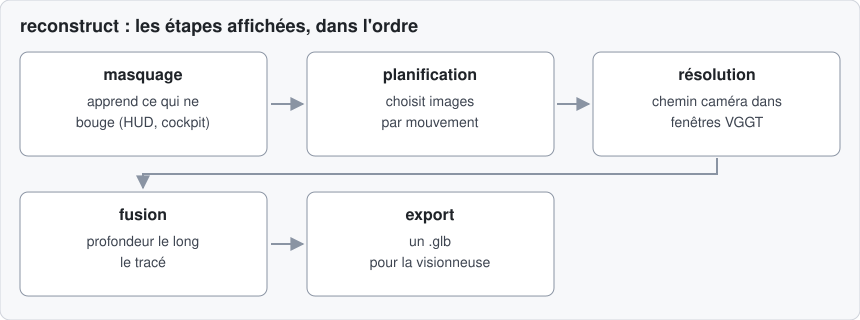

# Reconstruction hors ligne {#offline-reconstruction}

```bash
python -m heat3d_capture reconstruct lap.mp4 -o lap.glb [--solve-budget 260] [--fuse-interval 0.4]
```

Code : [`scan/offline.py`](https://github.com/Holdi601/3DHeat-GameCapture/blob/main/heat3d_capture/scan/offline.py),
[`pose/feedforward.py`](https://github.com/Holdi601/3DHeat-GameCapture/blob/main/heat3d_capture/pose/feedforward.py),
[`pose/vggt_model.py`](https://github.com/Holdi601/3DHeat-GameCapture/blob/main/heat3d_capture/pose/vggt_model.py),
[`pose/feedforward_source.py`](https://github.com/Holdi601/3DHeat-GameCapture/blob/main/heat3d_capture/pose/feedforward_source.py),
[`pose/solveprep.py`](https://github.com/Holdi601/3DHeat-GameCapture/blob/main/heat3d_capture/pose/solveprep.py).
Options : [Référence des commandes](commands.md#reconstruct).

## Pourquoi une seconde voie {#why-a-second-path}

Le suivi incrémental est en direct et peu coûteux, et il fonctionne là où il y a de la structure à quoi
s'accrocher : un intérieur, une rue, une carte avec des abris. Un **circuit est son pire cas** : la route est
un ruban lisse peu texturé, l'horizon bouge à peine, et une fois que quelques poses ont dérivé, rien de plus
tard ne les ramène. Un tour sort sous forme de courbe qui s'égare au lieu de se refermer.

La voie hors ligne remet des **fenêtres d'images** à un modèle qui prédit toutes leurs caméras ensemble, de sorte
que chaque image contraint directement chaque autre, au lieu de passer par une chaîne. Elle a besoin de
l'enregistrement complet avant de répondre, elle n'est donc pas en direct, et elle est lente : quelques minutes
par fenêtre sur un GPU de bureau. Tout ce qui vient après les poses - fusion, couverture, couleur, export - est
le même code que pour le scan en direct : la trajectoire résolue est remise au reconstructeur comme une source de
poses, exactement à l'endroit où arrive la télémétrie de Forza.

## Prérequis {#requirements}

- **PyTorch** adapté à votre GPU (non épinglé par ce projet ; à installer avant `requirements.txt`, voir [Exécution](runtime.md)).
- **`vggt`** - le code du modèle VGGT (`from vggt.models.vggt import VGGT`), depuis le dépôt GitHub de Meta ; il
  n'est pas sur l'index des paquets.
- **`transformers`**, car la voie hors ligne fait passer la profondeur par le `DepthEstimator` PyTorch (Depth Anything
  V2 Small), et non par le fichier ONNX.
- Un GPU CUDA en pratique ; les deux modèles retombent sur le CPU, ce qui n'est pas réaliste.

Aucun de ces paquets n'est dans `requirements.txt`, car le scanner n'en a pas besoin. Ils sont dans
**`requirements-offline.txt`**, avec les dépendances propres de VGGT (`einops`, `safetensors`, `huggingface_hub`,
`Pillow`) :

```bash
.venv\Scripts\python -m pip install -r requirements-offline.txt
.venv\Scripts\python -m pip install --no-deps "vggt @ git+https://github.com/facebookresearch/vggt.git"
```

VGGT s'installe avec `--no-deps` parce que ses métadonnées de paquet épinglent `numpy<2`, que pip respecterait en
rétrogradant le numpy dont scipy a besoin ici. `reconstruct` vérifie tous ces éléments juste après avoir affiché la
ligne de licence (la liste `OFFLINE` de [`runtime/preflight.py`](https://github.com/Holdi601/3DHeat-GameCapture/blob/main/heat3d_capture/runtime/preflight.py)),
indique ce qui manque avec les tailles, et n'installe qu'après un oui - VGGT avec `--no-deps`, comme ci-dessus.
Refuser, ou ne pas avoir de terminal pour répondre, quitte avec le code 1.

## Le modèle et sa licence {#the-model-and-its-licence}

**VGGT**, `facebook/VGGT-1B` : **CC-BY-NC-4.0, non commercial uniquement, et une reconstruction faite avec lui en hérite.**
La commande l'affiche avant de démarrer (`describe_licence`). Un `facebook/VGGT-1B-Commercial` sous licence distincte
existe, mais c'est un dépôt à accès restreint, accordé compte par compte par Meta : il ne peut donc pas être le choix par défaut.
`--model vggt-1b-commercial` résout avec lui (et affiche sa ligne de licence à la place) ; sans accès accordé, le
téléchargement échoue. Le *code* `vggt` est soumis à la « VGGT License » de Meta elle-même, un accord sur les
matériaux de recherche avec une politique d'usage acceptable (lue dans le `LICENSE.txt` du paquet). Voir
[Modèles et licences](models-and-licences.md).

## La marche, étape par étape {#the-run-stage-by-stage}

Les noms d'étapes sont ceux qu'affiche la commande.



### masking (masquage) {#masking}

Un `FlowMask` est appris à partir de **4 séquences de 90 images consécutives**, centrées à 1/8, 3/8, 5/8 et 7/8 de
la vidéo, en 960 x 540 en gris (voir [FlowMask](reconstruction-capture.md#flowmask-what-never-travels)). Sa note est
affichée et conservée dans le résumé. Une vidéo de moins de 90 images n'a pas de masque.

#### Le masque de caméra est appris, pas appliqué {#the-camera-mask-is-learned-not-applied}

Le masque n'est **pas** appliqué aux images données au solveur. Masquer le cockpit semblait juste d'après les
statistiques de points (la plupart des coins détectés se trouvent sur des pixels attachés à la caméra) - mais c'est
une affirmation sur un détecteur de points, et le solveur est un réseau entraîné. Mesuré par l'angle que fait la
trajectoire retrouvée entre deux pas consécutifs (une voiture tourne de quelques degrés ; une marche aléatoire de
quatre-vingt-dix degrés), les images brutes donnent le plus petit virage, les images à contraste relevé un peu plus, les
images masquées nettement plus, et les deux ensemble le plus. Le solveur reçoit donc les images brutes. Le masque sert
encore à planifier l'espacement des images ci-dessous, et le suivi incrémental l'utilise dans le scan en direct.
(`solveprep.enhance`, qui masque et relève le contraste local avec CLAHE, existe mais n'est pas utilisé par cette
commande.)

### planning : des images espacées par le mouvement {#planning-frames-spaced-by-motion}

`plan_by_motion` choisit les images du solveur selon **le déplacement de l'image**, et non selon l'horloge : un
intervalle fixe donne aux sections lentes des images dont elles n'ont pas besoin et prive les rapides, là où les
images consécutives ne se chevauchent plus assez pour être mises en relation.

- Déplacement visé : **5 % d'une largeur de 960 pixels** (48 px), déplacement médian des points ORB entre images
  choisies consécutives, mesuré sur des images 960 x 540 en gris avec contraste CLAHE, points seulement sur le masque.
- On commence avec un écart de 0,3 s ; après chaque étape, l'écart suivant devient
  `écart x (0,5 + 0,5 x visé / mesuré)`, borné à **0,15-2,0 s**, pour qu'une mesure bruitée ne fasse pas osciller le plan.
- Lorsque rien ne correspond, l'écart est réduit à 0,6 de sa valeur (être trop espacé est l'échec à éviter).
- S'arrête à la fin de la vidéo ou à `--solve-budget` images (par défaut 260).

Moins de 4 images planifiées est une erreur.

### solving (résolution) : fenêtres et raccordement {#solving-windows-and-stitching}

Les images planifiées sont décodées à 960 px de large et résolues dans des **fenêtres qui se chevauchent, de 16
images, 6 partagées** avec la suivante (`plan_windows` ; la dernière fenêtre est ramenée pour finir sur la dernière
image, de sorte que la fin d'une capture a autant de voisines que le milieu). Plus de **400** images dans une seule
passe sont refusées.

Chaque fenêtre : images redimensionnées pour que le grand côté fasse **518** et que les deux côtés soient des
multiples de **14** (rapport d'aspect conservé - l'écraser fausserait le champ de vision), ramenées entre 0 et 1,
passées dans VGGT sous autocast bfloat16 (le float16 manque d'exposant pour les coordonnées monde lointaines). Les
extrinsèques de caméra sont convertis en rotations monde-depuis-caméra et en centres de caméra. Les cartes de points
ne sont pas conservées par défaut.

Chaque fenêtre revient dans **son propre repère arbitraire et sa propre échelle arbitraire**, donc les fenêtres sont
**raccordées** dans le repère de la première par une transformation de similitude (rotation, translation, une
échelle) ajustée sur les caméras qu'elles partagent avec ce qui est déjà placé :

- **Rotation à partir des orientations des caméras**, et non de leurs positions : les caméras partagées sont
  alignées le long du trajet et presque colinéaires sur une ligne droite, ce qui laisse un ajustement sur les seules
  positions incapable de voir la rotation - chaque fenêtre se courbe et le résultat raccordé sort droit. La rotation
  est la moyenne de `target_R x source_R^T` reprojetée sur une vraie rotation (avec une garde contre les réflexions).
- **Échelle et décalage à partir des positions**, le long de la source tournée.
- Il faut au moins **4** caméras partagées ; moins est une erreur.
- Le chevauchement fait un tiers de la fenêtre pour que l'échelle soit bien déterminée ; l'erreur d'échelle qui
  s'accumule fenêtre après fenêtre est ce qui fait spiraler un tour.

Pour chaque couture, le pire désaccord des caméras partagées après l'ajustement est enregistré, en unités de
l'écart moyen entre elles (`seam_error`).

### fusing (fusion) {#fusing}

Les images toutes les `--fuse-interval` secondes (par défaut 0,4) sont décodées à 960 px de large, reçoivent une
profondeur de Depth Anything V2 Small (PyTorch), et sont fusionnées avec une pose **interpolée** depuis la trajectoire
résolue à leur horodatage (position linéaire, rotation sphérique ; `FeedForwardPoses`). Les images hors de la
plage de temps résolue sont ignorées plutôt qu'extrapolées. La caméra utilise un champ de vision horizontal de
**65 degrés**. Les poses issues du modèle en une seule passe ont une confiance de 0,85 dans la fusion et la couverture.

### exporting (export) {#exporting}

Le maillage est écrit comme pour un scan en direct ([La sortie .glb](glb-output.md)), nommé d'après la vidéo.

## Le résumé {#the-summary}

```text
140 cameras solved over 182s
closure error 3.1% of path length
worst seam 0.42 frame spacings
<mask note>
wrote lap.glb
```

| Ligne | Signification |
|---|---|
| closure error (erreur de fermeture) | distance entre la première et la dernière caméra, divisée par la longueur du trajet. Pour un tour unique, la mesure honnête de la dérive. Au-delà de 10 % : « The lap does not close ... Treat the shape as unreliable. » |
| worst seam (pire couture) | le plus grand désaccord de raccord. Au-delà de 1,0 : « Windows disagreed by up to N frame spacings at a seam, so part of the path is stitched on weak evidence. » |
| no file (pas de fichier) | « Fusion produced no surface, so nothing was written. » Le code de sortie vaut alors 1. |

## Échelle {#scale}

La trajectoire raccordée est dans les unités arbitraires de la première fenêtre. La profondeur est ancrée par
triangulation entre les poses interpolées (comme pour la télémétrie), donc la géométrie est cohérente avec la
trajectoire - mais **le résultat n'est pas en mètres** à moins que la trajectoire le soit. Rien dans cette commande
ne fixe l'échelle globale ; l'étalonnage au sol n'est pas appliqué lorsque les poses viennent d'une source de poses.

## État de cette voie {#state-of-this-path}

Avec des images à intervalle fixe, les fenêtres se résolvent en une trajectoire cohérente sur certains tronçons d'un
tour, et en un gribouillis sur d'autres ; les échecs se trouvent dans les virages serrés, où la vue pivote fortement
d'une image à l'autre, et échantillonner ces virages plus densément les rétablit. Aucune statistique d'image testée
(luminosité, détail, nombre de points, taux d'inliers, déplacement) n'a permis de prédire à l'avance quels tronçons
échoueraient. L'espacement ne peut donc pas être entièrement planifié à partir des images : il faut le choisir en
résolvant, en mesurant le résultat, puis en résolvant de nouveau plus densément là où la trajectoire n'est pas une
trajectoire qu'une voiture aurait pu suivre. La planification par le mouvement est construite ; **la nouvelle
résolution adaptative ne l'est pas**.
