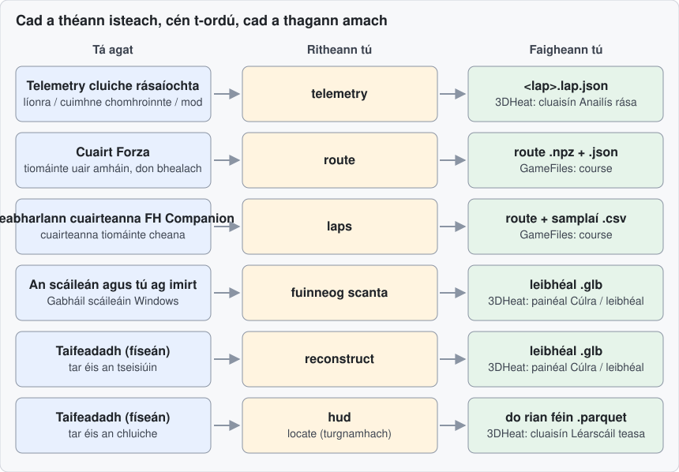

# 3DHeat GameCapture {#dheat-gamecapture}

**Cad é?** Uirlis a scríobhann síos an méid a insíonn cluiche rásaíochta di faoi do thiomáint, comhad amháin
in aghaidh na cuarta. Is féidir léi samhail 3D gharbh de leibhéal a atógáil ó fhíseán díot ag imirt freisin.

**Cén fáth a n-úsáidfinn é?** Chun do chuairteanna a fheiceáil san [amharcán 3DHeat](https://holdi601.github.io/3DHeat/):
an áit ar bhrúigh tú na coscáin, an áit a raibh tú mall, conas a dhéanann dhá chuairt difriúil. Agus chun an leibhéal a bheith faoi
do léarscáil teasa nuair nach bhfuil samhail 3D de ag aon duine.

**Sampla:** cas air Data Out Forza, rith ordú amháin, tiomáin dhá chuairt. Feictear dhá chomhad chuarta i
`laps\`. Scaoil iad ar chluaisín Anailís rása an amharcáin.


An bhfuil tú nua leis an líne ordaithe? Léigh [Sula dtosaíonn tú](before-you-start.md) ar dtús.

## Na trí jab {#the-three-jobs}

1. **Telemetry cuarta.** Taifeadann sé gach cainéal a fhoilsíonn cluiche rásaíochta - Data Out Forza,
   cuimhne chomhroinnte na gcluichí Assetto Corsa, bianna líonra na gcluichí rally, mod BeamNG, breiseán
   Trackmania - agus scríobhann sé comhad `heat3d-lap` amháin in aghaidh na cuarta nó na céime, do chluaisín Anailís
   rása an amharcáin. Ní theastaíonn taifeadán ó iRacing: léann an t-amharcán a chomhaid `.ibt` féin.
2. **Leibhéil ó ghameplay.** Casann sé an méid a thaispeáin an scáileán agus tú ag siúl nó ag tiomáint trí
   leibhéal ina shamhail 3D `.glb`, a leagann an t-amharcán faoin léarscáil teasa.
3. **Do chluiche féin, ina dhiaidh.** Léann `hud` HUD do thaifeadta féin - do ghníomhartha, básanna,
   rian mionléarscáile agus fotha maruithe. Oibríonn `locate` (turgnamhach: ní chuireann sé ach cúpla fráma fíor go dtí seo)
   amach cá raibh gach fráma tógtha, ar shamhail 3D leibhéil.

Leanann an trí cheann riail amháin: **ní instealltar aon rud isteach i gcluiche agus ní bheirtear greim ar aon rud (hook)**. Tagann frámaí
ón API poiblí gabhála scáileáin, telemetry ó chomhéadain a fhoilsíonn na cluichí chuige sin. Féach
[Na rialacha](../rules.md).



Is Python é an cód (pacáiste `heat3d_capture`), ceadúnaithe MIT. Tá ceadúnais dá gcuid féin ag na samhlacha doimhneachta agus
pose is féidir leis a rith - féach [Samhlacha agus ceadúnais](../models-and-licences.md).

## Tús tapa {#quick-start}

### Taifead cuairteanna {#record-laps}

Teastaíonn Python 3.10 nó níos nuaí uait ([Sula dtosaíonn tú](before-you-start.md)). I PowerShell:

```powershell
git clone https://github.com/Holdi601/3DHeat-GameCapture
cd 3DHeat-GameCapture
python -m venv .venv
.venv\Scripts\python -m pip install -r requirements.txt

# Forza: Settings -> HUD and Gameplay -> Data Out = ON, IP 127.0.0.1, port 5300
.venv\Scripts\python -m heat3d_capture telemetry -o laps
```

**Ba chóir duit** `listening on port 5300. Laps go to laps. Ctrl+C to stop.` a fheiceáil, ansin líne in aghaidh na cuarta de réir mar a thrasnaíonn tú an líne, mar atá
sa phictiúr thuas. Brúigh Ctrl+C chun stopadh. Scaoil na comhaid ó `laps\` ar chluaisín Anailís rása an amharcáin.
Tá gach cluiche eile `--game` amháin ar shiúl:

```powershell
.venv\Scripts\python -m heat3d_capture telemetry --game acc -o laps
.venv\Scripts\python -m heat3d_capture telemetry --game dirtrally2 -o laps
```

Féach [Taifeadáin telemetry](../telemetry.md) do gach cluiche agus rogha.

### Scan leibhéal {#scan-a-level}

Cliceáil faoi dhó ar **`scan.bat`** i bhfillteán na huirlise. Aimsíonn sé Python (agus tairgeann sé é a shuiteáil le
winget mura bhfuil aon cheann ann), déanann sé `.venv` príobháideach, agus osclaíonn sé fuinneog an scanta. Insíonn an fhuinneog
cad atá ar iarraidh, cad chuige a bhfuil gach pacáiste agus cé chomh mór is atá an íoslódáil, agus ní shuiteálann sé tada
gan "tá". Féach [Am rite agus spleáchais](../runtime.md) agus
[Fuinneog an scanta](../reconstruction-scan-ui.md).

De láimh: `.venv\Scripts\python -m heat3d_capture.ui`.

Chun taifeadadh a atógáil as líne, agus an cosán ceamara réitithe in aon turas (teastaíonn PyTorch, an
pacáiste `vggt` agus GPU - féach [Atógáil as líne](../reconstruction-offline.md)):

```powershell
.venv\Scripts\python -m heat3d_capture reconstruct lap.mp4 -o lap.glb
```

## Léarscáil na ndoiciméad {#map-of-the-documentation}

| Leathanach | Cad a chlúdaíonn sé |
|---|---|
| [Sula dtosaíonn tú](before-you-start.md) | Python, teirminéal, an chéad ordú, earráidí coitianta |
| [Na rialacha](../rules.md) | Gan instealladh, comhéadain fhoilsithe amháin, agus cad a chosnaíonn sin |
| [Taifeadáin telemetry](../telemetry.md) | An t-ordú `telemetry` agus forbhreathnú ar gach cluiche |
| [Forza](../telemetry-forza.md) | Data Out, brath leagan amach, an gaireas FH Companion agus a `.tele.gz` |
| [Cluichí Assetto Corsa](../telemetry-assetto-corsa.md) | AC, ACC, AC EVO, AC Rally ó chuimhne chomhroinnte |
| [Cluichí rally](../telemetry-rally.md) | EA SPORTS WRC, DiRT Rally 2.0 / 1 / DiRT 4, Richard Burns Rally |
| [BeamNG.drive](../telemetry-beamng.md) | An mod prótacail `heat3d` |
| [Trackmania](../telemetry-trackmania.md) | An breiseán Openplanet `Heat3dRecorder` |
| [iRacing](../telemetry-iracing.md) | Comhaid `.ibt` a léamh san amharcán |
| [Roinnt cuarta agus céime](../lap-splitting.md) | `LapSplitter`, `CounterSplitter`, `LineSplitter`, `StageSplitter` |
| [Sleamhnú, drif agus cainéil díorthaithe](../slip-and-drift.md) | Conas a scálaítear sleamhnú, agus cad a dhíorthaíonn an t-amharcán |
| [An comhad heat3d-lap](../lap-format.md) | Formáid an chomhaid chuarta, cainéil, aonaid, `meta` |
| [Cluichí](../games.md) | In aghaidh an chluiche: conas taifeadadh, cad a sheoltar, cé na cúrsaí is féidir a onnmhairiú |
| [Orduithe](../commands.md) | `route`, `telemetry`, `laps`, `reconstruct`, `hud`, `locate`, céim ar chéim |
| [Tagairt orduithe](../cli-reference.md) | gach rogha, ginte ó `--help` |
| [An HUD a léamh ó thaifeadadh](../hud-video.md) | `hud`: do ghníomhartha féin, básanna, rian mionléarscáile agus fotha maruithe ó thaifeadadh |
| [Frámaí a aimsiú i leibhéal](../locate.md) | `locate`: cá raibh gach fráma tógtha, i gcoinne gheoiméadracht an leibhéil |
| [Atógáil leibhéil](../reconstruction.md) | An phíblíne ó fhrámaí go `.glb` |
| [Fuinneog an scanta](../reconstruction-scan-ui.md) | Gach rialú, eochair aicearra agus gné forleagain |
| [Gabháil, maisc agus cáilíocht frámaí](../reconstruction-capture.md) | Windows Graphics Capture, príomhfhrámaí, maisc HUD, comhairle cháilíochta |
| [Doimhneacht](../reconstruction-depth.md) | Depth Anything V2, ONNX Runtime, an tsamhail a thógáil |
| [Pose ceamara agus scála](../reconstruction-pose.md) | Odaiméadracht, athlonnú, poses telemetry, scála talún, coigeartú burla |
| [Comhleá, clúdach agus dath](../reconstruction-fusion-and-texture.md) | An toirt áitithe, an greille clúdaigh, láithreacha laga, dath rinn |
| [An t-aschur .glb](../glb-output.md) | An comhad a lódálann an t-amharcán |
| [Atógáil as líne](../reconstruction-offline.md) | `reconstruct`, fuinneoga VGGT agus greamú |
| [Samhlacha agus ceadúnais](../models-and-licences.md) | Méideanna Depth Anything V2, VGGT, na pacáistí |
| [Am rite agus spleáchais](../runtime.md) | Réamhsheiceáil, cúlchláir, leibhéil feidhmíochta |
| [Teorainneacha agus fíorú](../limits.md) | Cad nach ndearnadh, agus cad nach seiceáladh |
| [Nuashonruithe](../updates.md) | An seic eisiúna agus `python -m heat3d_update` |
| [Forbairt](../development.md) | Tástálacha, an timpeallacht fhíorúil, leagan amach an stóir |
| [Na doiciméid seo a chothabháil](../maintaining.md) | Seicliosta eisiúna don chód agus don doiciméadúchán |

## Cuid de 3DHeat {#part-of-3dheat}

Lódálann **an t-amharcán 3DHeat** na comhaid a scríobhann sé seo -
[foinse](https://github.com/Holdi601/3DHeat), [doiciméadúchán](https://holdi601.github.io/3DHeat/).
Téann comhaid chuarta chuig a chluaisín Anailís rása, leibhéil `.glb` chuig a phainéal Cúlra / leibhéal, na táblaí `hud` agus `locate` chuig
a chluaisín Léarscáil teasa; tá conas a léann an t-amharcán táblaí agus comhaid chluiche i
[Comhad amháin in aghaidh an chluiche (.3dheat)](https://holdi601.github.io/3DHeat/container.html) agus
[Sonraí a thabhairt isteach](https://holdi601.github.io/3DHeat/getting-data-in.html).

| Uirlis | Cad a dhéanann sí | Doiciméid |
|---|---|---|
| [Amharcán 3DHeat](https://github.com/Holdi601/3DHeat) | taispeánann sé léarscáileanna teasa, rásaí agus cluichí i 3D, sa bhrabhsálaí | [docs](https://holdi601.github.io/3DHeat/) |
| [GameFiles](https://github.com/Holdi601/3DHeat-GameFiles) | cúrsaí agus leibhéil as na comhaid a sheolann cluichí, mar shamhlacha 3D | [docs](https://holdi601.github.io/3DHeat-GameFiles/) |
| [GameCapture](https://github.com/Holdi601/3DHeat-GameCapture) | telemetry cuarta ó chluichí rásaíochta; leibhéil atógtha ó fhíseán cluiche | [docs](https://holdi601.github.io/3DHeat-GameCapture/) |
| [Unreal Exporter](https://github.com/Holdi601/3DHeat-UnrealExporter) | breiseán d'Unreal Editor a onnmhairíonn leibhéal mar shamhail 3D | [docs](https://holdi601.github.io/3DHeat-UnrealExporter/) |
| [CS2](https://github.com/Holdi601/3DHeat-CS2) | demos Counter-Strike 2 ina gcomhaid chluiche; léarscáileanna ina samhlacha 3D | [docs](https://holdi601.github.io/3DHeat-CS2/) |
| [Watcher](https://github.com/Holdi601/3DHeat-Watcher) | taifeadann sé d'imirt sa chúlra ón méid a fhoilsíonn cluichí | [docs](https://holdi601.github.io/3DHeat-Watcher/) |
| [Ext-WarThunder](https://github.com/Holdi601/3DHeat-Ext-WarThunder) | athsheinmeanna War Thunder ina gcomhaid chluiche | [docs](https://holdi601.github.io/3DHeat-Ext-WarThunder/) |
| [Ext-WoT](https://github.com/Holdi601/3DHeat-Ext-WoT) | athsheinmeanna World of Tanks ina gcomhaid chluiche | [docs](https://holdi601.github.io/3DHeat-Ext-WoT/) |
| [Ext-WoWs](https://github.com/Holdi601/3DHeat-Ext-WoWs) | athsheinmeanna World of Warships ina gcomhaid chluiche | [docs](https://holdi601.github.io/3DHeat-Ext-WoWs/) |
| [Ext-Squad](https://github.com/Holdi601/3DHeat-Ext-Squad) | demos freastalaí Squad ina gcomhaid chluiche | [docs](https://holdi601.github.io/3DHeat-Ext-Squad/) |
| [Ext-DCS](https://github.com/Holdi601/3DHeat-Ext-DCS) | léarscáileanna DCS World ina samhlacha 3D | [docs](https://holdi601.github.io/3DHeat-Ext-DCS/) |
| [Ext-IL2](https://github.com/Holdi601/3DHeat-Ext-IL2) | léarscáileanna IL-2 Sturmovik ina samhlacha 3D | [docs](https://holdi601.github.io/3DHeat-Ext-IL2/) |

Ba chóir d'fhorbróir a bhfuil tionscadal an chluiche oscailte aige an t-onnmhaireoir Unreal a úsáid, a léann an fhíor-
gheoiméadracht agus atá cruinn. Nuair is féidir cartlanna an chluiche féin a léamh, bainfidh GameFiles an cúrsa cruinn amach.
Is don chás nach bhfuil ar fáil ach an scáileán an atógáil ó ghameplay.
